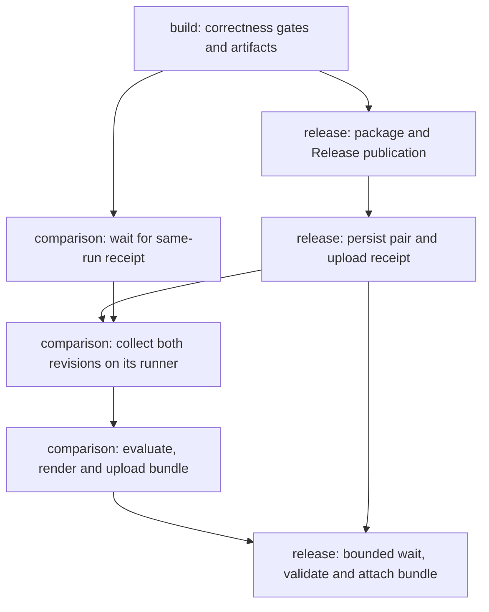

# Specification: Release baseline comparison

## 1. Business Goal

<!-- last written by: spec-author, 2026-10-13 -->

Published benchmark files do not tell the maintainer whether a release became materially more expensive than its predecessor. This Feature gives every release an automatic comparison report with identifiable evidence and explicit review flags, so performance regressions receive attention without making a measurement a build or publication gate.

## 2. User Needs

<!-- last written by: spec-author, 2026-11-01 (round 1 of item 0214's review, decision 0005 addendum) -->

| #   | Persona            | Need                                                                    | Pain Point Today                                 |
| --- | ------------------ | ----------------------------------------------------------------------- | ------------------------------------------------ |
| 1   | Release maintainer | See changes in time and managed allocation against the previous release | Separate run artifacts require manual comparison |
| 2   | Reviewer           | Know which measured changes deserve investigation and why               | No automatic review signal exists                |
| 3   | Future maintainer  | Recover the release pair, policy and raw evidence behind a finding      | Transient build artifacts can expire             |

### Assumptions

| ID  | Assumption                                                                                                                                                                                                                                                                                                                                                                                                                                                                                             |
| --- | ------------------------------------------------------------------------------------------------------------------------------------------------------------------------------------------------------------------------------------------------------------------------------------------------------------------------------------------------------------------------------------------------------------------------------------------------------------------------------------------------------ |
| A-1 | `0109-F1` B-010 supplies machine-readable BenchmarkDotNet results; this Feature evaluates them and does not replace the benchmark harness.                                                                                                                                                                                                                                                                                                                                                             |
| A-2 | `0055-F6` supplies the successful publication event and release identity; this Feature owns the performance report added to that release run.                                                                                                                                                                                                                                                                                                                                                          |
| A-3 | Measurement coverage is the release comparison inventory of available engine-stage, whole-check and tool-startup workloads, retaining each input size as a separate case; this Feature does not wait for every measuring Feature to be implemented.                                                                                                                                                                                                                                                    |
| A-4 | A complete comparison assumes the self-hosted pool that runs `build`, `release` and the comparison job (C-12) runs two or more jobs at once; with one runner the rendezvous cannot complete and every release ends `Incomplete`, advisory and never a failed build: at the comparison job's bounded receipt wait when that job takes the runner first, the release job then reporting that result at once, or at the release job's bounded result wait when it takes the runner first (decision 0005). |
| A-5 | One release run at a time: the owner never starts two releases at once and assumes no isolation between the pool's runners on one host, accepting the same-host exposure within one release run (decision 0005 addendum); if two releases run at once, a revision measured for one can share a host and an operating-system account with the other's `release` job while that job holds its write token, and nothing in the workflow prevents it.                                                      |
| A-6 | A rerun of all jobs passes `0055-F6`'s publication steps when the tag's Release is already published at that run's commit with both packages attached (`0055-F6` § 7, item 0214 amendment); without it no remedy B-018 reports after publication is actionable, because the comparison steps follow those steps.                                                                                                                                                                                       |

### Measurement equivalence

Measurement conditions comprise operating system, runtime version, architecture, toolchain, garbage-collection mode, benchmark job and timing confidence level. Workload identity covers the fixture definition and measured operation, independently of its display name. A changed product implementation is the object of comparison, not a workload change. Unknown workload or configuration equivalence is not comparable. Metric validity is checked first: absent or invalid timing uncertainty, including an unknown confidence level, receives `Insufficient evidence` rather than an equivalence judgment. Compatible time or byte scales are normalised; incompatible dimensions or observer boundaries cannot be paired.

### Comparison policy

Decision 0002 records the owner's 2026-10-13 answers. Eligible releases are successfully published stable releases and prereleases; drafts and bare tags are excluded. The baseline is the most recent eligible publication before the current release's first publication, and that pair stays fixed on reruns. Equal publication timestamps are ordered by immutable release identifier, with the larger identifier later in the sequence.

A timing flag requires a mean increase strictly greater than 10% and a current confidence interval whose lower bound is strictly greater than the previous interval's upper bound, using the same confidence level. Overlapping or touching intervals do not flag. An allocation flag requires an increase strictly greater than 10% in managed bytes per operation. Increases exactly at 10% do not flag. These are review screens, not claims of statistical significance or build thresholds.

Percentage change is `100 × (current − previous) / previous` for a positive previous value, computed without display rounding. With zero allocation in both releases, the allocation is unchanged and its percentage is undefined. A zero-to-positive allocation has no defined percentage and receives `Insufficient evidence`, making the overall comparison incomplete unless another metric already requests review. A non-positive timing baseline is invalid evidence. A known review flag takes precedence over coverage gaps in the comparison judgment. If a later reporting stage fails, available run-summary output retains any already-computed flags alongside the incomplete reporting state; it does not invent a successful attachment or a regression-free result.

## 3. Acceptance Criteria

<!-- last written by: spec-author, 2026-11-01 (OQ-3 and the comparison runner, item 0214) -->

| ID    | Claim                                                                                                                                                                                                                             | Source                                              | Status  |
| ----- | --------------------------------------------------------------------------------------------------------------------------------------------------------------------------------------------------------------------------------- | --------------------------------------------------- | ------- |
| B-001 | Given a successfully published stable release or prerelease, this Feature automatically starts its baseline comparison in the release run.                                                                                        | owner, 2026-10-13; OQ-2                             | Active  |
| B-002 | Given earlier releases, this Feature selects the immediately preceding published stable release or prerelease by publication order, fixing that predecessor for reruns and excluding drafts and unpublished tags.                 | owner, 2026-10-13; OQ-2                             | Active  |
| B-003 | Given no earlier eligible release, this Feature publishes a report marked `No baseline` without a regression judgment.                                                                                                            | B-002 boundary                                      | Active  |
| B-004 | Given a selected release pair, this Feature collects both revisions' measurements in the same comparison session on the same runner.                                                                                              | owner-approved direction, 2026-10-13; decision 0001 | Active  |
| B-005 | Given matching workload identities, inputs, measurement boundaries and measurement conditions, this Feature pairs the results as comparable.                                                                                      | decision 0001                                       | Amended |
| B-006 | Given otherwise valid evidence with a mismatch or unknown equivalence in a comparison condition of B-005, this Feature marks the pair `Not comparable` with the reason instead of judging it.                                     | B-005 boundary                                      | Amended |
| B-007 | Given a workload found only in the current measurement inventory, this Feature reports it as `Added` without a regression judgment.                                                                                               | comparison coverage boundary                        | Active  |
| B-008 | Given a workload found only in the previous measurement inventory, this Feature reports it as `Removed` without a regression judgment.                                                                                            | comparison coverage boundary                        | Active  |
| B-009 | Given comparable metric values with a positive previous value, this Feature normalises compatible units and reports both values, their shared unit, absolute change and percentage change.                                        | owner, 2026-10-13                                   | Amended |
| B-010 | Given a zero previous allocation, this Feature reports its percentage as `Not defined`, judging zero-to-zero as unchanged and zero-to-positive as `Insufficient evidence`.                                                        | arithmetic boundary                                 | Active  |
| B-011 | Given comparable timings whose mean rises strictly more than 10% and whose current confidence interval lies strictly above the previous interval, this Feature flags the timing `Review required` with its reason.                | owner, 2026-10-13; OQ-1                             | Active  |
| B-012 | Given comparable managed allocation rising strictly more than 10% above a positive previous allocation, this Feature flags the allocation `Review required` with its reason.                                                      | owner, 2026-10-13; OQ-1                             | Active  |
| B-013 | Given invalid timing values or absent or invalid timing uncertainty, this Feature marks the timing judgment `Insufficient evidence`.                                                                                              | evidence boundary                                   | Amended |
| B-014 | Given any result flagged `Review required`, this Feature identifies it in the release run summary with a link to the report.                                                                                                      | owner, 2026-10-13                                   | Active  |
| B-015 | Given a completed comparison, this Feature publishes human-readable and machine-readable reports with the same findings.                                                                                                          | owner, 2026-10-13; `0109-F1` B-009, B-010           | Active  |
| B-016 | Given a published report, this Feature identifies the release tags and commits, environments, workload cases, comparison policy and raw measurement evidence behind its findings.                                                 | reproducibility boundary                            | Active  |
| B-017 | Given passing correctness gates and a published release, this Feature leaves the build successful when it flags a regression.                                                                                                     | owner, 2026-10-13; `0109-F1` C-1                    | Active  |
| B-018 | Given a collection, parsing, evaluation, rendering or attachment failure after publication, this Feature exposes an `Incomplete` advisory outcome with an actionable reason in the release run summary without failing the build. | advisory reporting boundary; decision 0001          | Amended |
| B-019 | Given at least one flagged metric, this Feature gives the report an overall judgment of `Review required`, retaining any coverage gaps.                                                                                           | owner, 2026-10-13                                   | Active  |
| B-020 | Given no flagged metric but an empty inventory or a required metric missing, not comparable or lacking sufficient evidence, this Feature gives the report an overall judgment of `Incomplete`.                                    | incomplete evidence boundary                        | Active  |
| B-021 | Given at least one required workload case, valid comparable results for every required metric and no flag, this Feature gives the report an overall judgment of `No regression flagged`.                                          | complete evidence boundary                          | Active  |
| B-022 | Given a published comparison, this Feature keeps its reports and referenced raw evidence with the release independently of transient workflow artifact retention.                                                                 | reproducibility boundary; decision 0001             | Active  |
| B-023 | Given a pull request, main push or release dry run that publishes no release, this Feature starts no automatic release comparison.                                                                                                | `0109-F1` OQ-2; `0055-F6` B-008                     | Active  |
| B-024 | Given the selected immediate predecessor cannot be resolved or measured, this Feature reports `Incomplete` with the reason rather than substituting an older release.                                                             | B-002 boundary                                      | Active  |
| B-025 | Given a measured revision whose benchmarks declare their workload identity, this Feature derives that revision's identity mappings from those declarations.                                                                       | owner, 2026-11-01; OQ-3; decision 0005              | Active  |

## 4. Constraints

<!-- last written by: spec-author, 2026-11-01 (round 1 of item 0214's review, decision 0005 addendum) -->

| ID   | Constraint                                                                                                                                                                                                                                        | Rules Out                                                                                                                                                                                        |
| ---- | ------------------------------------------------------------------------------------------------------------------------------------------------------------------------------------------------------------------------------------------------- | ------------------------------------------------------------------------------------------------------------------------------------------------------------------------------------------------ |
| C-1  | A performance measurement or review flag never changes the correctness verdict, prevents publication, or rolls back a release.                                                                                                                    | Timing or allocation gates; treating an advisory flag as a failed check.                                                                                                                         |
| C-2  | Comparisons use the exact published product revisions and the same measurement conditions; historical shared-runner timings alone cannot establish a regression.                                                                                  | Comparing unrelated runs or treating an unchanged benchmark name as proof of an unchanged workload.                                                                                              |
| C-3  | BenchmarkDotNet's out-of-process Release measurements supply timing and managed allocation; fixture construction and composition keep the boundaries of the measuring Features.                                                                   | Debug or in-process findings, stopwatch substitutes, changed workloads hidden in a release delta.                                                                                                |
| C-4  | Each workload and parameter combination is judged independently, with no average hiding a flagged result.                                                                                                                                         | Combining small and large trees or trading a timing regression against an allocation improvement.                                                                                                |
| C-5  | An unknown, duplicated, failed, missing, non-finite, negative, added, removed or incompatible required metric is visible and cannot count as evidence of no regression.                                                                           | Empty reports presented as clean; dropping unmatched cases from the summary.                                                                                                                     |
| C-6  | A report distinguishes mean time, managed bytes per operation and any tool-process peak-memory observation, with explicit units and observer boundaries.                                                                                          | Presenting benchmark-harness allocation as child-tool memory; treating missing child-process memory as zero.                                                                                     |
| C-7  | The comparison inventory is the union of workloads and parameter cases available for the two releases; time and managed allocation are required for each case where the measuring contract supplies them.                                         | A hand-picked subset that omits regressions or silently discards added and removed cases.                                                                                                        |
| C-8  | All local outputs stay under the comparison's temporary workspace, `.artifacts/benchmarks/` or, for the comparator's own published build, `.artifacts/comparator/`, and every reported path is repository-relative.                               | Consumer-tree writes, global tool installs, a comparator built or unpacked anywhere else, comparison evidence under `.artifacts/comparator/`, and absolute paths in reports or fixtures.         |
| C-9  | Performance reporting is advisory even when a comparison-owned stage fails; existing benchmark targets retain their broken-benchmark failure semantics outside this release reporting boundary.                                                   | Weakening `0109-F1` B-012 or reporting a failed measurement as a successful comparison.                                                                                                          |
| C-10 | Measurement execution grants no publishing credentials; report publication follows `0055-F6` C-5 and C-7 in its existing release job.                                                                                                             | Running either measured revision with package-write or contents-write credentials; a third job with contents-write permissions.                                                                  |
| C-11 | A report bundle whose JSON entries hold a string value containing an absolute path, as decision 0004 defines it, is rejected when built and when validated; only a raw export value that is wholly a rooted path is instead removed and recorded. | Rewriting an embedded path such as `Root=/home/runner/…`, `file:///…` or `C:\…` to let a bundle pass; rejecting units, ratios, relative paths or resolving locators that merely contain a slash. |
| C-12 | The comparison job runs on the self-hosted pool that runs the `build` and `release` jobs (decision 0005; `0055-F2` decision 0005).                                                                                                                | A GitHub-hosted runner for collection; a runner chosen per release or per revision; a further runner provider in the release run.                                                                |

## 5. Out of Scope

<!-- last written by: spec-author, 2026-11-01 (OQ-3 and the comparison runner, item 0214) -->

| #   | Item                                                                                                           | Exclusion Reason                                                                                                        |
| --- | -------------------------------------------------------------------------------------------------------------- | ----------------------------------------------------------------------------------------------------------------------- |
| 1   | Failing a build or blocking publication on performance                                                         | Owner, 2026-10-13; C-1.                                                                                                 |
| 2   | Benchmarks on every pull request, branch push or release dry run                                               | This Feature compares published releases; `0109-F1` keeps its main-only automatic measurement policy.                   |
| 3   | Choosing when to release, publishing the package, or rewriting release versions                                | `0055-F5` and `0055-F6` own versioning and publication.                                                                 |
| 4   | Implementing missing stage or startup benchmarks                                                               | `0109-F2` to `0109-F4` own the measurements; unavailable evidence remains visible.                                      |
| 5   | Profiling, attribution to individual commits, or automatic optimisation                                        | Review flags prompt investigation, not a remedy.                                                                        |
| 6   | A new public `specht` command, manifest option, schema version or rule id                                      | This is repository release tooling, not consumer checker behaviour.                                                     |
| 7   | Email, chat messages, automatic issues or automatic reviewer assignment                                        | The review signal lives in the release run summary and report; local work items remain the delivery tracker.            |
| 8   | Predicting performance from a single size, extrapolating to unseen sizes, or claiming statistical significance | Findings cover the measured cases and the agreed screening policy only.                                                 |
| 9   | Review thresholds for tool-process peak memory                                                                 | Report that observation when available; this Feature's initial review policy covers timing and managed allocation only. |
| 10  | Hand-written identity mappings, a registry of them, or a mapping carried from one revision to another          | Owner, 2026-11-01; decision 0005; B-025. A revision without declarations is reported `Incomplete`.                      |
| 11  | Adding workload identity declarations to releases already published                                            | C-2 measures the exact published revisions; a comparison with such a release stays `Incomplete` (decision 0005).        |

## 6. Concern Separation

<!-- last written by: implementer, 2026-11-01 (release reporting round 1 findings, item 0214) -->

| #   | Concern                                                                           | Classification |
| --- | --------------------------------------------------------------------------------- | -------------- |
| 1   | Eligible publication order and a predecessor fixed for retries                    | Business       |
| 2   | Workload equivalence, coverage and strict advisory review screens                 | Business       |
| 3   | Exact product revisions measured together without publishing authority            | Both           |
| 4   | Export decoding, dimensional units and observer boundaries                        | Both           |
| 5   | Reproducible reports and durable release evidence                                 | Both           |
| 6   | Pure comparison functions separated from disk, process and provider I/O           | Technical      |
| 7   | A bounded same-run handoff after publication without a job dependency cycle       | Technical      |
| 8   | Advisory failure handling that preserves earlier correctness/publication verdicts | Both           |
| 9   | Workload identity each revision declares, read without executing it               | Both           |
| 10  | A rerun reaching the comparison past a Release already published at its commit    | Both           |

## 7. Technical Design

<!-- last written by: implementer, 2026-11-01 (rounds 1 and 2 of item 0214's review: adopts the spec-author's host sentence citing A-5 and the decision 0005 addendum; names the four steps that carry the release token), 2026-11-01 (the merge of `main`'s item 0327, `0055-F6` decision 0007: the `release` job's id-token write, the trusted-publishing push key and the OIDC request credential under A-5) -->

The selection, persistence, wire-value, evidence-pairing, evaluation, paired-collection, rendering, bundle-publication, declared-identity, reporting-outcome and release-workflow boundaries below are implemented.
[ADR-0001](adr/0001-read-only-collection-with-a-release-job-rendezvous.md)
records the architecture and rejected alternatives. The declarations linked below are authoritative for the delivered contracts.

### Composition and existing reuse

The non-packable [comparison assembly](../comparison.csproj), namespace `Specht.Comparison`, joins `specht.slnx` without referencing the benchmark assembly or product host. It is an executable: [`Program`](../Program.cs) is an internal repository-tooling entry point the release workflow runs as `request`, `attach` or `compare` with a repository-relative directory, and every one of them exits 0. `System.Text.Json`, `HttpClient`,
`TimeProvider` and the existing `System.IO.Abstractions` substitution provide its
boundaries. It adds no public `specht` command or consumer configuration.

`Program` composes concrete readers, selection, evaluation, rendering and
collection. Pure functions receive immutable values. Provider access, filesystem
access and child processes are asynchronous and cancellable; `HttpMessageHandler`,
`IFileSystem` and a process delegate supply the existing test seams. No interface
is introduced for an in-memory calculation. The publisher consumes data files,
never executes a downloaded report, and validates the bundle before uploading.

Reuse `.performance/benchmarks/BenchmarkConfiguration.cs` and the measuring
Features' native harness at each revision: Release, out-of-process BenchmarkDotNet,
`MemoryDiagnoser`, full JSON and GitHub Markdown. The collector builds and runs
each revision's own `.performance/benchmarks/benchmarks.csproj` directly and
replicates the `Benchmark` target's selection (`--list flat`, names starting
`Specht.Benchmarks.`) and conditional packing (`src/tool/tool.csproj` only when a
`Specht.Benchmarks.Startup.` case is selected). It does not call the target: the
target's `Restore` dependency restores local tools, which needs the package-source
credential C-10 keeps away from a measured revision. The target and its
broken-benchmark failure semantics are unchanged (C-9).
`ColdStartSession` already installs packed tools locally and keeps fixture setup
outside measurement; its allocation is the harness process's, not the child
product's. Its current inherited process environment needs the collection
boundary's sanitisation. Do not transplant a current harness into an older product
or add missing stage/startup benchmarks under this Feature.

Workflow composition stays in `.build/SpechtBuild.Release.cs`'s existing
`ReleaseMiddleware`; its `configuration.Jobs`, per-job `Permissions`, explicit
step insertion and `ContinueOnError` are the extension points. The gates and
package artifact retain `0055-F6`'s existing order and authority. The comparator
executable and dependencies are a separate artifact built from the gated current
commit; the release job can use that coordinator without checking out or executing
either measured revision. No publishing operation becomes a NUKE target; the
comparator's build is the `PublishComparator` target, a `dotnet publish` of the
comparison project for `net10.0` into `.artifacts/comparator`, which `Release`
depends on. The comparator steps run that output directly with `dotnet`, not
through `./build.cmd`: the entry script restores local tools from the
authenticated package source, a credential the comparison job never holds (C-10).

### Value contracts

| Value                                                            | Required content and invariant                                                                                                                                                                                      |
| ---------------------------------------------------------------- | ------------------------------------------------------------------------------------------------------------------------------------------------------------------------------------------------------------------- |
| [`ReleaseRecord`](../Model/ReleaseRecord.cs)                     | Repository and immutable release id, tag, first observed publication timestamp, draft/prerelease flags, peeled commit or explicit resolution failure; catalog completeness is explicit.                             |
| [`ReleasePair`](../Model/ReleasePair.cs) version 1               | Current record, selected predecessor record or explicit no-baseline, selection policy version, catalog snapshot digest and selecting run identity; immutable after persistence.                                     |
| [`SessionManifest`](../Model/SessionManifest.cs) version 1       | Pair digest, comparator commit/version, run id and attempt, session id, runner identity, per-side product commit, harness/export versions, invocation, environment and expected case inventory.                     |
| [`WorkloadCase`](../Model/WorkloadCase.cs)                       | Stable operation and fixture contract ids/revisions, typed canonical parameter map, measurement boundary and metric requirements. Display name and BenchmarkDotNet job display id are labels only.                  |
| [`Observation`](../Model/Observation.cs)                         | Side and case key, metric kind/dimension, observer process, raw value/unit, uncertainty level/bounds for timing, conditions, source file and record locator, or a typed unavailable/invalid reason.                 |
| [`ComparisonDocument`](../Model/ComparisonDocument.cs) version 1 | Pair/session identity, full policy, ordered union of cases, per-metric values/deltas/status/reason, overall judgment, coverage gaps and evidence manifest. The evidence manifest joins it with the bundle (`0213`). |
| [`ReportingOutcome`](../Model/ReportingOutcome.cs)               | Stage, completed/incomplete reporting state, known comparison judgment/flags if computed, actionable reason and confirmed publication references only. A stage failure never invents a judgment or a link.          |
| [`EvidenceManifest`](../Model/EvidenceManifest.cs) version 1     | Bundle-relative files with media type, SHA-256, length, role, side and case/source linkage; paths cannot escape the bundle.                                                                                         |

Wire JSON uses explicit format versions, invariant numeric values and sorted case,
parameter and file order. Unsupported versions yield unavailable evidence, never a
best-effort clean result. Failure text is sanitised; absent values are null with
reasons, never zero. Session/environment facts are evidence, not a wall-clock
field that changes deterministic evaluation of the same supplied inputs.

### Selection and persistence

The provider reader follows every release-catalog page before selection. A failed
page is an incomplete catalog, not evidence that no predecessor exists. Select
published non-drafts, including prereleases, by `(publishedAt, immutableReleaseId)`;
choose the immediately preceding eligible record in that order, never semantic
version or tag creation order. The current first-publication ordering key is
captured once. Resolve annotated tags to exact commits; preserve an unresolved
selected predecessor's identity with its failure. Do not choose the next usable
older release. Concurrent equal timestamps use the agreed immutable-id tie-breaker.

After successful package and Release publication, the existing release job creates
`comparison-pair-v1.json` as a durable asset on the current Release, before issuing
a collection receipt. The value includes the selection snapshot and resolved
commits. Creation is insert-only: an existing asset is read and validated, never
clobbered. On a concurrent creation conflict, read the winning value and use it;
an invalid or unreadable existing asset is `Incomplete`. Reruns, including a new
workflow run for the same Release, load this value instead of selecting again.
An explicit null predecessor is durable too. If saving the pair fails, collection
does not start. No result claims a fixed pair that was only stored transiently.

The pair is established before the first collection attempt; a failure before its
creation has made no selection durable. The selection predicate still uses the
current Release's original publication key when retrying that stage. Release
creation/push recovery is owned by `0055-F6`; its release job carries the
comparison steps after publication, so a rerun reaches them only past both
publication steps. "Push release packages" skips a package version already
pushed. "Create GitHub Release" keeps a Release that is published, not a draft,
under this tag, whose tag resolves to this run's commit and which carries both
package files; any other state, no Release included, runs `gh release create` as
before, so a failed first publication still fails the job and a failed package
publication is never bypassed.

### Implemented selection and evidence boundaries

[`ReleaseSelection`](../Selection/ReleaseSelection.cs) consumes a complete catalog and the current first-publication record. [`ReleaseCatalogReader`](../Selection/ReleaseCatalogReader.cs) reads all provider pages and peels annotated tags; a failed page leaves an incomplete catalog, and an unresolved tag retains its release identity. [`ReleasePairStore`](../Selection/ReleasePairStore.cs) uses a completed temporary file and an insert-only move for local persistence. [`ReleasePairAssetStore`](../Selection/ReleasePairAssetStore.cs) reads or inserts the durable release asset, reloads a concurrent winner and verifies a successful upload. Its `HttpClient` and authority are supplied by the caller; nothing invokes it automatically or creates credentials.

[`ComparisonJson`](../Model/ComparisonJson.cs) owns version-1 pair/session encoding, canonical object-key order, digests, duplicate-property rejection and read validation. [`WorkloadIdentity`](../Evidence/WorkloadIdentity.cs) keys operations with typed canonical parameters. [`BenchmarkEvidenceReader`](../Evidence/BenchmarkEvidenceReader.cs) decodes the pinned native full JSON against caller-supplied audited mappings, preserving source locators and per-metric invalidity. [`CasePairing`](../Evidence/CasePairing.cs) retains the union, expected missing results and duplicate metric locators. Matching observed and expected keys retain the union of required metrics; contradictory operation, fixture or boundary contracts remain not comparable. Unidentified records cannot establish Added/Removed coverage, including when labels change. Saved pairs reject an equal current/predecessor immutable release id regardless of timestamp. Common parameter keys pair independently. A one-sided parameter case is Added or Removed; when both sides instead have unmatched input keys for the same operation, those cases remain not comparable with an input-parameter reason. [`MetricUnits`](../Evidence/MetricUnits.cs) recognises dimensional scales and is the one unit table; evaluation scales with it.

The supported producer is BenchmarkDotNet 0.15.8. Its [pinned exporter](https://github.com/dotnet/BenchmarkDotNet/blob/v0.15.8/src/BenchmarkDotNet/Exporters/Json/JsonExporterBase.cs) supplies nanosecond statistics and bytes per operation. The cached pinned assembly's serializer was probed with invented statistics: its legacy confidence enum encodes `L999` as numeric `Level: 12`; the importer uses the version-bound enum mapping rather than treating that number as a percentage. Unsupported producers, ambiguous JSON and missing full-export metadata remain unavailable. Raw exports are caller-owned inputs; retention sanitisation and bundle construction are under [Implemented rendering and publication](#implemented-rendering-and-publication). No benchmark was run for this probe.

### Implemented evaluation

[`ComparisonEvaluation`](../Evaluation/ComparisonEvaluation.cs) is a pure function from the session and `CasePairing`'s cases to a [`ComparisonDocument`](../Model/ComparisonDocument.cs), keeping pairing's case order and evidence. It does not re-derive validity: a metric pair that pairing judged insufficient or not comparable keeps that judgment and its reason. A comparable pair is scaled through `MetricUnits.Scale` to ns or B per operation, timing intervals with their mean, and its absolute and percentage changes are computed on unrounded `decimal` values. A `decimal` overflow in scaling or arithmetic is invalid evidence, `Insufficient evidence` with a reason, never an exception. The [`ComparisonPolicy`](../Model/ComparisonPolicy.cs) applied is version 1, decision 0002's strict 10% screens, recorded in the document. Each [`MetricComparison`](../Model/MetricComparison.cs) carries a [`MetricJudgment`](../Model/MetricJudgment.cs); a flag's reason states the screen it met, and the numbers stay in the value fields, rounded only when rendered. Tool peak memory is `Informational` whatever its evidence, never flagged and never a gap (§ 5 item 9, C-6). Each [`CaseComparison`](../Model/CaseComparison.cs) keeps pairing's status and reason. A [`CoverageGap`](../Model/CoverageGap.cs) is recorded per case with no time or managed-allocation row, whatever its status, carrying pairing's reason, else the case evidence's failure, else evaluation's own reason for Added, Removed or a case with nothing to judge; and per insufficient or not comparable time or managed allocation. A case whose only non-comparable metric is tool peak memory adds no gap. The [`ComparisonJudgment`](../Model/ComparisonJudgment.cs) reduction is any flag, then an empty case list or any gap, then no regression flagged. No predecessor is `ComparisonEvaluation.NoBaseline`: the session, policy version 1, no cases, no gaps and the judgment `No baseline` (B-003), never a regression verdict.

### Implemented rendering and publication

[`ComparisonReport`](../Reporting/ComparisonReport.cs) projects one `ComparisonDocument` into `report.json` and `report.md` and recomputes no judgment, delta, gap or reason. `report.json` is the canonical `ComparisonJson` encoding of `{ formatVersion: 1, pair, comparison }`; `comparison` is the document with each observation's `sourceFile` rewritten from its workspace path to its bundle path `raw/<side>/<file name>`, otherwise unchanged and in its own order. `report.md` gives, in the document's order, the overall judgment, both releases and the pair digest, the session, each side's conditions, harness, exporter and invocation, the policy screens, cases, workloads, metrics, coverage gaps and every observation's bundle path and locator, in the wording of § 3 (`Review required`, `Not defined`). Numbers are rounded for display only: half away from zero to at most two decimal places, trailing zeros dropped, invariant culture; a positive change carries `+`, a percentage `%`, and a null number reads `Not defined`. Table cells escape backslash, pipe and backtick with a backslash and `<`/`>` as entities, and turn control characters into spaces, so display text cannot break a table or inject HTML.

[`ReportBundler`](../Reporting/ReportBundler.cs) writes `<workspace>/comparison-<releaseId>-<runId>-<attempt>.zip` from caller-supplied repository-relative [`RawExport`](../Model/RawExport.cs)s. It checks closure before writing: a valid pair whose digest is the session's; every observation citing a supplied export of its own side; each export a repository-relative `-report-full.json`, with no symbolic link or reparse point at it or at any directory between it and the repository root, without duplicate properties whose producer version `BenchmarkEvidenceReader.IsSupportedProducer` accepts, the one definition the reader also uses; no two exports sharing a bundle path, compared case-insensitively. An export no observation cites is retained with empty cases. A failure throws `InvalidDataException` with a path-free message and writes nothing. A string value that is a rooted path (`/`, `~`, `\` or a drive letter) becomes `[path removed]` and every other token keeps its raw text; such a file records `absolute-paths-removed`, any other keeps its original bytes with `none`, and `SourceSha256` is always the original's digest. The [`EvidenceManifest`](../Model/EvidenceManifest.cs) lists every other entry as an [`EvidenceFile`](../Model/EvidenceFile.cs) in ordinal path order, and `ComparisonJson.ReadManifest` owns its version-1 wire checks; identity mappings are ordered by full name, then product commit. The archive is deterministic: ordinal entry order, a fixed 2000-01-01 entry time, regular-file attributes, no directory entries. `Create` validates its own archive before writing, so a generated entry holding a rooted value - a session invocation, a workload parameter or boundary, a case or gap reason, a mapping source - is rejected, never rewritten, and nothing is written. The archive is written to a temporary file and moved without overwrite, so an existing bundle raises `IOException` and stays intact. `Validate` rejects unsafe, symbolic-link or duplicated entries, names that differ only by case included; an entry outside the manifest; a missing or altered listed file; an unsupported manifest version; a session whose pair digest is not `pair.json`'s; a report whose `pair` is not `pair.json`, whose `comparison.session` is not `session.json` in canonical form, or whose evidence references are not the bundle's raw exports; and any JSON entry, a raw export marked `none` included, holding a rooted string value or one that embeds an absolute path. The whole-value predicate is the one path removal uses. The embedded predicate is C-11's, as [decision 0004](decisions/0004-reject-an-absolute-path-embedded-in-any-bundle-value.md) defines it: at the start of a string value, or after whitespace or one of `=` `,` `;` `:` `(` `)` `[` `]` `"` `'`, a `/`-delimited segment closed by a second `/`, `~/` or `~\`, an ASCII drive letter with `:\` or `:/`, `\\`, or `file:` in any ASCII case followed by `/`. Property names are not examined, and an embedded path is never rewritten: it rejects the bundle, in `Create` before anything is written, and in `Validate`, including one left in a raw export after whole-value removal. A report observation's `locator` is exempt from both predicates only when it is a JSON pointer of at least two reference tokens whose parent pointer, every token but the last after `~1` and `~0` unescaping, resolves inside the raw export the observation's `sourceFile` cites, as the reader's `/Benchmarks/<index>/Statistics` and `/Memory` do. An array token is a decimal index without a leading zero inside the array. A locator that does not resolve, or an observation with a locator and no listed raw export, is rejected; every `locator` property anywhere in `report.json` is held to that, not only those under `comparison`. `report.md` must be exactly `ComparisonReport.Markdown` of the report's `pair` and `comparison`, so it holds nothing those values' absolute-path checks did not pass (C-8, C-11). Entry order is not required.

[`ReportBundleAssetStore`](../Reporting/ReportBundleAssetStore.cs) publishes through the caller's `HttpClient` and authority. Before any request it validates the bundle and requires the asset name its `pair.json` release and `session.json` run and attempt give. It reads every asset page: an existing asset of that name is downloaded and confirmed only when its digest matches, and is never replaced or deleted. Otherwise it uploads once as `application/zip`, treats a conflict like the pair asset does, re-lists for exactly one `uploaded` asset, downloads it and checks its digest and validity. Only then does it return a [`PublishedBundle`](../Model/PublishedBundle.cs); a transport, parse or verification failure is `InvalidDataException`, never a reported success.

### Acyclic execution and credential boundary

The generated release workflow has `build`, `release` and `comparison` jobs.
Both latter jobs need only `build`; neither needs the other's completion. Both
retain the tag-push predicate, excluding workflow dispatch. `comparison` has only
contents-read and actions-read; packages and all write scopes are absent. `release`
keeps the sole write grants, contents-write and, since `0055-F6` item 0327,
id-token-write in place of package-write, and gains actions-read solely for
the same-run return artifact. No new secret, dispatch credential or write job is
introduced. Ordinary PR/main workflows stay outside this path.

The temporal chain is publication → saved pair → receipt → collection → bundle →
attachment. There is no completion edge back to publication. The release job
uploads `comparison-request-<runId>-<attempt>` after saving the pair, then waits
for `comparison-result-<runId>-<attempt>`. The comparison job polls the same run's
artifact list for that exact receipt, validates repository, run, attempt, current
commit and pair digest, then starts work. The receipt proves successful publication
in this run; observing a tag or an old Release alone cannot trigger measurement.
The release job similarly accepts only the result for that receipt, never an old
attempt. A rerun of only failed jobs cannot consume an old receipt/result: missing
participants produce `Incomplete`; rerunning all jobs resumes with the saved pair.

Artifact upload must finish before its reader proceeds, but job completion is not
required. This relies on the immediate availability of immutable v4 artifacts,
[documented by upload-artifact](https://raw.githubusercontent.com/actions/upload-artifact/v4/README.md),
and the [run-artifact read API](https://docs.github.com/en/rest/actions/artifacts).
Do not use `needs.release.outputs` as an early signal. Insertion of a read-only
third job uses the existing generator; it does not use its built-in publisher or
a second workflow. The disposable probe and its observed limits are recorded in
the ADR; generated declarations are evidence about generation, not a live run.

The comparison runner owns both sequential revision checkouts/builds and benchmark
process trees for one session. Use separate workspace/cache/output folders under
`.artifacts/benchmarks/comparison/<sessionId>/` or its temporary workspace. Checkout
credentials are not persisted. No publisher artifact, publishing token or mutable
publisher workspace is shared with it. Child environments are built from an
allowlist of SDK/runtime and session paths; omit GitHub tokens, Actions runtime
credentials, user tool manifests and credential-bearing NuGet configuration.
Restore dependencies before measurement with read-only access where needed.
Record the OS, runtime, architecture, SDK toolchain and job each side's exports
declare; a historical SDK mismatch is visible rather than fixed by silently
retargeting. The garbage-collection condition is what the job declares, or
`Job default` when it declares nothing: the export does not record the GC mode
the process actually ran with, so two default jobs on runners with different
default GC settings are not told apart.

The receipt wait is bounded to 30 minutes; paired preparation/collection to 60
minutes total, with each revision capped at 25 minutes and failures leaving time
to render. The release-side result wait is bounded to 100 minutes from receipt,
including runner queue delay. Use injected `TimeProvider`, cancellable waits and
process-tree termination. Normal deadlines are handled in code before the platform's job safety
timeout; they do not depend on an unprobed generator timeout property. A queued, failed or cancelled collector causes a
bounded incomplete outcome, never indefinite waiting.

Every comparison-owned step after successful publication, including receipt save,
transport, rendering and attachment, has advisory failure handling. The comparison
job's setup/upload steps also continue on error and a final summary runs on failure.
Earlier gates and publication retain their failure semantics. Pre-write an
`Incomplete: comparison pending` summary before waits; replace it on completion.
On graceful cancellation kill both process trees and retain available evidence.
An explicit user cancellation or platform hard kill can prevent any final step;
it leaves the workflow cancelled, the published release intact and the prewritten
summary/pair as available evidence, never a fabricated success. No design can turn
a platform cancellation into a successful run. Recovery is a rerun with the saved
pair, not a retry loop that changes the baseline.

### Implemented collection

[`CollectionPlan`](../Collection/CollectionPlan.cs)`.For` returns no plan when the pair has no predecessor, when either side lacks a resolved 40- or 64-hex commit, when the comparator commit is not 40 or 64 hex, or when the session id is not one path segment of `[A-Za-z0-9._-]` (or is `.` or `..`). The unresolved pair outcomes are the no-baseline and unresolved-revision paths of [Implemented release reporting](#implemented-release-reporting). Its `PairDigest` is `ComparisonJson.Digest` of the saved pair. The plan carries no identity mappings: each side's come from that revision's own declarations ([Implemented workload identity declarations](#implemented-workload-identity-declarations)).

[`PairedCollector`](../Collection/PairedCollector.cs) collects the previous revision, then the current, never overlapping, under `.artifacts/benchmarks/comparison/<sessionId>/<side>/`:

| Folder    | Holds                                                                                                  | After the side |
| --------- | ------------------------------------------------------------------------------------------------------ | -------------- |
| `source`  | a shared no-checkout clone, detached at the pinned commit and verified with `git rev-parse HEAD`       | removed        |
| `home`    | the child's `HOME`, `USERPROFILE` and `DOTNET_CLI_HOME`                                                | removed        |
| `temp`    | the child's `TMPDIR`, `TMP` and `TEMP`                                                                 | removed        |
| `results` | the harness's `--artifacts ../results`; full-JSON exports land in `results/results/*-report-full.json` | kept           |

The session's `nuget` package cache and `session-manifest.json`, written with `ComparisonJson.Write`, sit beside the two sides. The manifest is written only when absent, with create-new semantics, so an earlier attempt's manifest is never overwritten, even by a concurrent run; the result is still returned. A session id names one attempt: when a side's folder already exists, that side is unavailable ("Revision workspace already exists."), no process runs for it and nothing in it is deleted. A revision without its own harness is unavailable; no harness is copied from another revision. The build and pack steps pass `--disable-build-servers`, so no build server outlives its revision.

[`RevisionEvidence`](../Collection/RevisionEvidence.cs) holds the pure derivations the collector uses: the selection (`--list flat` lines starting `Specht.Benchmarks.`, in listing order), whether the tool must be packed (a selected `Specht.Benchmarks.Startup.` name), the expected inventory, the export reading ([`ExportReading`](../Model/ExportReading.cs)) and the child environment.

Every step is a [`ProcessRequest`](../Model/ProcessRequest.cs) to the injected process delegate, answered by a [`ProcessOutcome`](../Model/ProcessOutcome.cs). Arguments and working directories are repository-relative. [`ProcessRunner`](../Collection/ProcessRunner.cs) is the real child process: it resolves the working directory against the repository root, clears the inherited environment and sets the request's, and captures standard output lines. On cancellation it kills the entire process tree, waits at most 30 seconds, timed by its injected `TimeProvider`, for the exit and the end of output, since an orphan outside the tree can hold the output open, and then rethrows the cancellation. The child environment copies only `PATH`, `DOTNET_ROOT*`, `LANG`, `LC_ALL`, `SystemRoot`, `windir`, `ComSpec` and `PATHEXT` from the parent, then sets the workspace folders above, `NUGET_PACKAGES`, `DOTNET_CLI_TELEMETRY_OPTOUT` and `DOTNET_NOLOGO`. Workspace values are absolute in the environment only and are never recorded. Tokens, Actions runtime variables and package-source credentials never reach a child.

Collection supports Linux and macOS runners. On Windows, NuGet reads the user configuration under `%APPDATA%`, which a redirected `HOME` and `USERPROFILE` do not isolate, so a credential-bearing user configuration could reach a measured revision; Windows is unsupported for collection.

Deadlines are timers from the injected `TimeProvider`, linked with the caller's token: 60 minutes for the pair and 25 for each revision; no clock is read after a step. Expiry or cancellation cancels the in-flight process and the side issues no further invocation; a side that would start after the pair budget is spent or after cancellation issues none. The reason prefers caller cancellation, then the pair bound, then the revision bound. Any other exception on a side makes that side unavailable ("Revision collection failed unexpectedly."), without the exception's text. Cleanup of `source`, `home` and `temp` ignores a folder it cannot remove, so a cleanup failure never replaces or throws over the side's result. The current side still runs, the manifest is written and a result is returned, never thrown.

A collected [`RevisionCollection`](../Model/RevisionCollection.cs) records:

- `HarnessVersion` `native-v1`: the revision's own harness run with this command line. A changed command line is a new label.
- `ExporterVersion` from `HostEnvironmentInfo` `BenchmarkDotNetVersion`, and the six measurement conditions from each benchmark record of the side's exports:
  - operating system, runtime, architecture and toolchain from `HostEnvironmentInfo` `OsVersion`, `RuntimeVersion`, `Architecture` and `DotNetCliVersion`;
  - job: the benchmark's `DisplayInfo` after its first `: `, without a trailing ` [parameters]` block, such as `ShortRun(Toolchain=.NET 10.0, IterationCount=3, LaunchCount=1, WarmupCount=3)`;
  - garbage collection: the characteristics that job declares among `Server`, `Concurrent`, `Force`, `HeapCount`, `CpuGroups`, `AllowVeryLargeObjects`, `RetainVm`, `HeapAffinitizeMask` and `NoAffinitize`, joined with `, ` in displayed order, or `Job default` when it declares none.

  Every benchmark of every export of the side must agree on the exporter version and all six conditions, or the side is unavailable with disagreeing exports. An export without benchmarks, without any one of the five host values, or with a benchmark whose `DisplayInfo` has no job segment is malformed; a missing operating system, runtime or architecture is treated the same way as a missing toolchain, so no condition is ever recorded as unknown on a collected side.

- `Invocation`: the application arguments after `--`, the same on both sides.
- `Mappings`: the side's declared identity mappings, and `InventoryReason`: "Revision benchmarks declare no workload identity." when there are none, "Revision benchmarks do not declare one workload identity for every selected benchmark." when they do not cover the selection, otherwise null. A collected side with a reason has an unknown inventory.
- The expected inventory. `--list flat` names methods, while exports name parameterised cases, so a mapping belongs to a selected name when its `FullName` equals the name or starts with the name followed by `(`. A mapping counts only when `BenchmarkEvidenceReader` would also accept it: this side's commit, a repository-relative source file and a 64-hex source digest. The inventory is known when every selected name has at least one such mapping and all their workload identities are distinct; its cases are then ordered by workload key. Otherwise it is unknown and no cases are expected.

An unavailable side keeps its pinned commit and invocation, records `unavailable` as harness and exporter version so `ComparisonJson.ReadSession` still accepts the manifest, all-null conditions, an unknown empty inventory and no result files. Its reason is fixed text, never process output: the contract reasons for a mismatched checkout, a missing harness, an empty selection, an existing workspace, an unexpected failure and the bounds; `<step> failed with exit code <n>.` for the clone, checkout, identity check, build, listing, pack and run steps; and fixed reasons for no export ("Benchmark run produced no full JSON export."), a malformed export ("Benchmark export is malformed or names no exporter version.") and disagreeing exports ("Benchmark exports disagree on their measurement conditions."). Session manifest version 1 has no reason field, so the reason lives in `RevisionCollection` and reaches the run summary through the reporting outcome; the manifest format is unchanged. A failed or unavailable previous side never stops the current side or substitutes another commit.

### Implemented workload identity declarations

A benchmark method declares its workload with [`WorkloadIdentityAttribute`](../../benchmarks/WorkloadIdentityAttribute.cs): operation id and revision, fixture id and revision, measurement boundary, and the declaring file, which the compiler supplies through `[CallerFilePath]`. Nothing reads it at run time and it changes nothing a benchmark measures (C-3). [`DeclaredIdentity`](../Collection/DeclaredIdentity.cs) reads it from the side's built `specht.benchmarks.dll` metadata with `System.Reflection.Metadata`; the measured assembly is never loaded or executed in the comparator's process. Each declared method gives one [`IdentityMapping`](../Model/IdentityMapping.cs) per `[Params]` combination:

- `FullName` is `<namespace>.<type>.<method>`, followed for a parameterised class by `(<Name>: <value>, ...)` in member declaration order, fields before properties. That is BenchmarkDotNet 0.15.8's full name, confirmed with an in-process dry run of `BindingLookupBenchmarks` (`ResolveBindings(Records: 1, Bindings: 40)`); no measurement was taken.
- Parameters are typed `number`; only integral `[Params]` values are read. A method with `[Arguments]` or `[ArgumentsSource]`, a class with `[ParamsSource]`, `[ParamsAllValues]` or a non-integral `[Params]`, a nested or generic class, or an attribute without six non-empty strings declares nothing.
- Every declared case requires time and managed allocation; tool peak memory stays informational (C-6).
- `ProductCommit` is the side's pinned commit. `SourceFile` is the compiled path made relative to that side's `source` checkout, with `\` read as `/`, and must satisfy `EvidencePaths.IsRelative`; `SourceDigest` is the SHA-256 of that file's bytes at the checkout. A path outside the checkout or an unreadable file drops the declaration, so it can only leave the inventory unknown, never put an absolute path in output (C-8, C-11).

The measured build runs in the child environment, which does not carry `GITHUB_ACTIONS`, so `Directory.Build.props` does not set `ContinuousIntegrationBuild` and no deterministic `/_/` source path map applies: the compiler records the checkout's physical path, and the collector passes the same checkout root it built in. No `PathMap` is added: it would erase the prefix relativisation needs. If deterministic paths ever reached a measured build, no declaration would relativise and every comparison would be `Incomplete` with the undeclared reason, visible rather than silently mapped.

A revision whose benchmarks declare nothing has no mappings and an unknown inventory, and its comparison is `Incomplete` with that reason; nothing is borrowed from another revision and no hand-written mapping exists (decision 0005, B-025). Every release published before this attribute therefore compares `Incomplete` as a predecessor. The operation id is unique within the harness because a workload key is the operation id with its parameters. Revisions start at `1`: an operation revision rises when what the method measures changes, a fixture revision when its input changes. The current declarations:

| Benchmark method                                     | Operation                    | Fixture                        | Boundary       |
| ---------------------------------------------------- | ---------------------------- | ------------------------------ | -------------- |
| `Check.CheckBenchmarks.Check`                        | `check`                      | `generated-specification-tree` | `in-process`   |
| `Analysis.BindingLookupBenchmarks.ResolveBindings`   | `resolve-bindings`           | `synthetic-binding-catalog`    | `in-process`   |
| `Analysis.InputReconstructionBenchmarks.Reconstruct` | `reconstruct-analysis-input` | `synthetic-analysis-inputs`    | `in-process`   |
| `Startup.ColdStartBenchmarks.EmptyTool`              | `start-empty-tool`           | `empty-tool-package`           | `tool-process` |
| `Startup.ColdStartBenchmarks.Help`                   | `start-help`                 | `installed-tool`               | `tool-process` |
| `Startup.ColdStartBenchmarks.Check`                  | `start-check`                | `one-specification-tree`       | `tool-process` |

`in-process` is a method BenchmarkDotNet measures inside the harness process; `tool-process` starts an installed tool, whose allocation is the harness's (§ 7, Composition and existing reuse).

### Implemented release reporting

The generated [release workflow](../../../.github/workflows/release.yml) comes from `ReleaseMiddleware` in [`SpechtBuild.Release.cs`](../../../.build/SpechtBuild.Release.cs):

| Job          | Needs   | Grants                                    | Runner                        | Comparison steps, each `continue-on-error: true`                                                                                                                                                                                                                                                                                  |
| ------------ | ------- | ----------------------------------------- | ----------------------------- | --------------------------------------------------------------------------------------------------------------------------------------------------------------------------------------------------------------------------------------------------------------------------------------------------------------------------------- |
| `build`      | -       | workflow default: contents, packages read | `[self-hosted, macOS, ARM64]` | `PublishComparator` after `Build`, then upload `comparator` (`.artifacts/comparator`, one day), apart from `nupkg`; the final `Release` step skips `PublishComparator`.                                                                                                                                                           |
| `release`    | `build` | actions read, contents and id-token write | `[self-hosted, macOS, ARM64]` | Checkout (`fetch-depth: 0`, `clean`, `persist-credentials: false`); after "Log in to NuGet", "Push release packages" and "Create GitHub Release": download the comparator, `request`, upload `comparison-request-${{ github.run_id }}-${{ github.run_attempt }}`, `attach`, and a fallback summary when `attach` did not succeed. |
| `comparison` | `build` | actions read, contents read               | `[self-hosted, macOS, ARM64]` | Checkout (`fetch-depth: 0`, `clean`, `persist-credentials: false`), the SDKs, download the comparator, `compare`, upload `comparison-result-${{ github.run_id }}-${{ github.run_attempt }}`, and an `always()` fallback summary when `compare` did not succeed.                                                                   |

Both later jobs carry the tag-push predicate. The publication steps keep no `if` and no `continue-on-error`, so a failed publication still fails the job and stops it before any comparison step; a comparison step can never fail the run (C-1, B-017). There is no third write job, no new secret and no `needs.release.outputs`. The fallback summary is the one comparison step that does not run the comparator, so a comparator that could not be downloaded or started still leaves `Incomplete` in the summary.

C-10 holds structurally. The comparison job's token is its own `github.token`, granted contents and actions read; the job's definition contains no `secrets.` reference. Its checkout persists no credential, so neither the checkout nor the `--shared` revision clones hold a token. The token is in the `compare` step's environment only, and every measured process gets `RevisionEvidence.ChildEnvironment`'s allowlist, which omits it. The release job's write token stays in the release job; no artifact carries a token. The comparator is the build job's output from the tagged commit; neither later job builds it.

The release job's checkout persists no credential either, so during `attach`'s wait of up to 100 minutes no write token lies in its workspace or its git configuration. The workflow token is set in the environment of three steps only: "Create GitHub Release", as `GH_TOKEN`, and the two advisory comparison steps, "Request the release comparison" (`request`) and "Attach the comparison report" (`attach`), as `GITHUB_TOKEN`. Since `0055-F6` item 0327, "Push release packages" carries no workflow token: its `NUGET_API_KEY` is a short-lived nuget.org key that the "Log in to NuGet" step before it mints from the job's OIDC token through NuGet Trusted Publishing (`0055-F6` § 7, "Item 0327 amendment"). A step split cannot narrow either credential. Actions issues one `GITHUB_TOKEN` per job, `attach`'s artifact wait needs that token's actions read, and the runner process holds the token for the whole job whichever steps name it. With `id-token: write`, the runner sets the OIDC request credential, `ACTIONS_ID_TOKEN_REQUEST_URL` and `ACTIONS_ID_TOKEN_REQUEST_TOKEN`, in the environment of every step of the job, not only the login step: the advisory comparison steps and `attach`'s wait of up to 100 minutes included. A separate job for the wait would be either a third job with contents write, which C-10 rules out, or one without the grant `attach` needs to publish. Nothing in the workflow keeps either credential from a measured revision of the comparison job on the same host: under a shared operating-system account, a measured process can read the release job's step environment during the wait, and that environment now holds the means to request an OIDC token and exchange it for a nuget.org push key, not only the workflow token. The owner accepts that exposure for the workflow token and relies on one release run at a time, not on isolation between the pool's runners (A-5, decision 0005 addendum). The OIDC request credential is the same A-5 exposure applied to the `id-token: write` grant item 0327 added; neither A-5 nor the addendum names that grant.

[`ReleaseTrigger`](../Workflow/ReleaseTrigger.cs) admits only a `push` of a `refs/tags/v…` ref; every other event, including workflow dispatch, makes each command a no-op with no summary (B-023): `RequestAsync`, `AttachAsync` and `ComparisonRun.RunAsync` return no outcome, so `AdvisoryStep` writes nothing. [`RunContext`](../Model/RunContext.cs) reads event, ref, repository, run id, attempt and commit from the Actions environment.

[`ReleaseReporting`](../Workflow/ReleaseReporting.cs)`.RequestAsync` reads the catalog, requires the release of this tag to be at this run's commit, gets or creates the durable pair asset, then writes `pair.json` and a [`ComparisonReceipt`](../Model/ComparisonReceipt.cs) (`receipt.json`: format version 1, repository, run id, attempt, commit, release id and pair digest), each create-new. A failure before the pair is saved is `PairPersistence`; nothing is uploaded and the comparison job's receipt wait ends `Incomplete`.

[`ComparisonRun`](../Workflow/ComparisonRun.cs) waits up to 30 minutes for this run and attempt's request, validates it with `ReleaseTrigger.Validate` against this run, attempt and commit and the pair's digest, and then:

- No predecessor: no process runs. The session's previous side has the commit of forty zeros, `unavailable` harness and exporter, no invocation, null conditions and an unknown empty inventory; the current side has this commit and otherwise the same. `ComparisonEvaluation.NoBaseline` gives the document and the bundle has no raw exports or mappings (B-003). `session.json` and `report.json` keep the forty zeros `ComparisonJson.ReadSession` requires; `report.md` shows `None` as the previous product commit when the pair has no predecessor.
- An unresolved predecessor is `Collection` incomplete through `ReportingOutcome.UnresolvedPredecessor`, naming the tag and its failure and saying that the saved pair fixes this predecessor for every rerun, so a rerun reports the same; no older release is substituted (B-024).
- Otherwise it collects with session id `<runId>-<attempt>`, comparator commit this run's commit, comparator version the assembly's informational version, runner identity `RUNNER_NAME`, filter `*` and job `short`. The short job is chosen to keep the full selection within the 25-minute revision bound, a judgement from the default job's iteration counts, not a measurement. An unavailable side is `Collection` incomplete with each side's reason. Each export is read again from the workspace without per-file expected cases, so `CasePairing` alone adds the missing ones.
- `Parsing` has two causes. An export the collector read that can no longer be read (an `IOException` or `UnauthorizedAccessException`) is `Parsing` incomplete with no detail. An export collection accepted but `BenchmarkEvidenceReader` rejects is `Parsing` incomplete naming each such side and the reader's fixed diagnostic, such as `Current revision: Exporter version or Release/debugger evidence is unsupported.` Collection checks only the host conditions and the job, so a non-Release configuration, an attached debugger, a producer other than 0.15.8, a record without `FullName` or `Measurements`, or a duplicate property reaches the reader. No bundle is rendered.
- Otherwise pairing, evaluation and a completed outcome whose reason is each side's inventory reason, then the bundle. Evaluation has no failure stage in the run: what `CasePairing.Pair` and `ComparisonEvaluation.Evaluate` receive is already valid, because every workload key was computed by the reader or by `RevisionEvidence.Inventory` under their own `InvalidDataException` handling, a comparable metric has exactly one valid observation per side in a recognised unit, and arithmetic overflow is `Insufficient evidence` inside evaluation. Invalid evidence is a judgment, never an exception, so `ComparisonRun` catches nothing there and returns no `Failed(Evaluation)` of its own. `ReportingStage.Evaluation` names a completed outcome's stage, and an unexpected exception thrown while evaluation is the stage in progress is summarised as `Failed(Evaluation)` by `AdvisoryStep`.

It writes `outcome.json` and the bundle into the result directory. `AttachAsync` re-validates the request, waits up to 100 minutes for the result, rejects an outcome that already claims a report, and returns an incomplete one as delivered. A completed one must have the bundle `comparison-<releaseId>-<runId>-<attempt>.zip` that `ReportBundler.Validate` accepts, whose `pair.json` is the saved pair, whose session is this run and attempt, and whose `report.json` comparison gives, through `ReportingOutcome.Completed`, the outcome's judgment and the outcome's flags in order; otherwise it is `ResultTransport`. The outcome summarised is that one, derived from the validated `report.json` with the delivered inventory reason, so no flag reaches the summary that the bundle does not carry. `ReportBundleAssetStore` then publishes it, and only its confirmed result becomes the outcome's [`ReportReference`](../Model/ReportReference.cs); a failure keeps the judgment and flags with `Attachment` incomplete.

[`RunArtifacts`](../Workflow/RunArtifacts.cs) lists the run's artifacts by exact name across every page, polling every 30 seconds, within the bound from the injected `TimeProvider`. Exactly one unexpired match is accepted and more than one is a transport failure. Every entry is checked as relative, a regular file and unique ignoring case before any is written, each create-new under `.artifacts/benchmarks/comparison/<runId>-<attempt>/request` or `/result`. A transient failure of a listing or download - no response, a request timeout, HTTP 429 or a 5xx - is retried at the next poll within the same bound; any other HTTP failure, an unsafe archive or a second match ends the wait as a transport failure.

`ReleaseReporting` and `ComparisonRun` take that action as an optional last constructor argument and call it on entering each stage; `Program` passes the one `AdvisoryStep` gives it. The stages entered, in order, with `Program`'s starting stage first:

| Command   | Starting stage    | Stages entered                                                                                                                                                                                                       |
| --------- | ----------------- | -------------------------------------------------------------------------------------------------------------------------------------------------------------------------------------------------------------------- |
| `request` | `PairPersistence` | `PairPersistence` (catalog read and pair asset), then `Receipt` (writing `pair.json` and `receipt.json`)                                                                                                             |
| `attach`  | `Receipt`         | `Receipt` (reading and validating the request), `ResultWait`, `ResultTransport` (reading and checking the result), `Attachment` (publishing the bundle)                                                              |
| `compare` | `ReceiptWait`     | `ReceiptWait`, `Receipt` (reading and validating the request), then `Collection`, `Parsing`, `Evaluation`, or `Evaluation` alone without a predecessor; `Rendering`, then `ResultTransport` (writing `outcome.json`) |

Marking only names the stage of an unexpected exception; every explicit `Failed` above keeps its own stage. Cancellation is handled as before: a caller cancellation that escapes a step is an exception like any other and is summarised at the stage in progress.

A [`ReportingOutcome`](../Model/ReportingOutcome.cs) names its [`ReportingStage`](../Model/ReportingStage.cs) and [`ReportingState`](../Model/ReportingState.cs). Each stage has one fixed cause and a remedy that a rerun can honour, because a rerun reaches the comparison steps past a Release already published at its commit: "Re-run all jobs to retry." for `PairPersistence`; "Re-run all jobs to retry; a pair already saved on the release is reused." for `Receipt` and `ReceiptWait`, where the comparison job cannot tell whether `request` saved the pair; "Re-run all jobs to retry with the saved pair." for every later stage. An unresolved predecessor offers no retry, since the saved pair fixes it. Detail text is sanitised: control characters become spaces and a rooted or embedded path token becomes `[path removed]`; `ComparisonJson.ReadOutcome` rejects an outcome that still holds one. A completed outcome carries every `Review required` metric as a [`ReviewFlag`](../Model/ReviewFlag.cs) in case and metric order.

[`AdvisoryStep`](../Workflow/AdvisoryStep.cs) runs each command: it writes `Incomplete: comparison pending` to the step summary first, hands the step an `Action<ReportingStage>` that records the stage it enters, maps any unexpected exception, `OutOfMemoryException` aside, to `Failed(<last stage entered>, null)`, else to the command's starting stage, replaces the summary with [`RunSummary`](../Workflow/RunSummary.cs)'s rendering, and exits 0. The summary gives the incomplete reason, the overall judgment when known, a completed outcome's inventory reason, the confirmed report link `https://github.com/<repository>/releases/download/<tag>/<bundle>` only after attachment, and the flagged cases with their reasons (B-014, B-018). Outside Actions it writes `.artifacts/benchmarks/summary.md`.

With one free runner in the pool, OQ-4's default holds. If the comparison job takes it first, it waits its 30 minutes, uploads a `ReceiptWait` outcome and ends; publication then runs up to that much later, never prevented, and the release job's attach finds that result and reports it. If the release job takes it first, its attach ends `ResultWait` after 100 minutes and the later comparison result is not attached. Both are `Incomplete` and advisory (A-4, C-1).

### Evidence reading, identity and evaluation

Discover the union of expected native harness cases on both revisions, including
failed cases. Missing historical harness/export/identity metadata is an explicit
gap. The importer supports explicitly recognised BenchmarkDotNet full-JSON shapes
and a session sidecar; unknown shapes cannot be treated as empty valid inventories.
A supported exporter adapter must declare the value/unit fields and how it decodes
confidence levels. BenchmarkDotNet's [JSON sample](https://benchmarkdotnet.org/articles/samples/IntroExportJson.html)
serialises an enum-like confidence `Level`; never read it as a percentage or use
standard deviation as a confidence interval. Support is bound to the producer
version and tested with invented payloads of that shape; no current default is
silently assigned to historical uncertainty. An audited mapping can establish a
historical workload contract from its source revision, fixture definition and
measured operation; matching names alone cannot.
Store that mapping and its source digest with the evidence. Unavailable discovery
is distinct from a known empty inventory and cannot imply `Added` or `Removed`.

Case pairing uses operation identity plus canonical parameters; differing fixture
contract, input, boundary or conditions produces `Not comparable`. A known
one-sided case is `Added`/`Removed`; each size stays separate. Every case carries
the required metrics its measuring contract supplies. Mean time and managed bytes
per operation are separate; child peak memory is informational with its own
observer, never substituted for managed allocation. Harness allocation remains
labelled as harness allocation for startup cases.

Validation order is decode and duplicate detection → per-metric validity →
equivalence → unit conversion → arithmetic → review screen → overall reduction.
Two records for the same side/case/metric are invalid duplicate evidence, not
last-write-wins or an average; keep both locators. Other valid metrics may still
flag. Non-finite, negative or missing values cannot prove a clean result. Timing
means must be positive, intervals finite and ordered around the mean, and the
confidence level known and valid. Absent/invalid uncertainty is `Insufficient
evidence`; differing valid confidence levels are `Not comparable`.

Normalise recognised ns/µs/us/ms/s scales to ns per operation and B/KB/MB or
B/KiB/MiB to bytes per operation with explicit decimal/binary factors. Unknown
units or incompatible dimensions/observers are `Not comparable`; conversion
failure or overflow is invalid evidence. Never infer a scale from display width.
Calculate on unrounded values and round only rendered numbers. Apply decision
0002's strict thresholds and zero-allocation policy per metric, then reduce:
any flag → `Review required`; otherwise any required gap or empty union →
`Incomplete`; otherwise → `No regression flagged`. No predecessor → `No baseline`
with no regression judgment. Reporting failure is tracked separately so an
already-computed review flag survives an incomplete attachment.

### Rendering and durable publication

Render Markdown and JSON from one immutable `ComparisonDocument`. A bundle
contains `report.md`, `report.json`, `pair.json`, `session.json`,
`evidence-manifest.json`, raw exporter documents and supported identity mappings.
Preserve raw numerical evidence; sanitise only path-bearing metadata at ingestion,
recording that transformation, and reject a value that only embeds an absolute
path ([decision 0004](decisions/0004-reject-an-absolute-path-embedded-in-any-bundle-value.md)). Reject unknown payloads that cannot be safely
retained; do not attach arbitrary logs, generated projects or absolute paths.
Keep original local exports in the workspace only. Every referenced evidence file
must exist with its recorded digest; reject rooted paths, traversal and symlinks.

Use one self-contained ZIP per attempt, named
`comparison-<releaseId>-<runId>-<attempt>.zip`, with bundle-relative links valid
after extraction. The pair asset remains separate for rerun recovery. The
release job validates the returned bundle and attaches it through the existing
workflow token. Verify the uploaded asset before linking it as retained evidence;
failed or partial uploads are `Incomplete`. Insert-only attempt names prevent
reruns from making earlier report references stale. The summary lists flagged
cases/reasons and the confirmed Release asset link; before successful attachment
it states the incomplete reporting stage and retains known flags without a
successful report link. Expiring workflow artifacts removes transport only;
reports and their entire evidence closure remain in the Release bundle.

## 8. Testing Strategy

<!-- last written by: test-writer, 2026-11-01 (review round 2 test citations and the download retry proof, item 0214) -->

Selection, evidence pairing, paired collection, evaluation and reporting are tested with synthetic catalogs, invented exporter JSON, generated fixtures, real temporary pair files and report bundles, and fake HTTP release storage. Every claim row in § 9 names its executable proofs, which pass: all twenty-five are `Covered`. No test runs a benchmark or asserts elapsed
time, allocation, a real release, a credential or a live provider response.

[`comparison.tests`](../../../test/comparison.tests/comparison.tests.csproj) references the comparator, joins `specht.slnx`, declares `IsTestProject`, and uses the existing xUnit v3, AwesomeAssertions, AutoFixtures and tier guard conventions. In-memory tests have
exactly one Unit trait, filesystem/process tests exactly one Integration trait.
Both NUKE filtered tiers must discover tests in the new project; do not add an
empty project before its first tests. [`acceptance.csproj`](../../../test/acceptance/acceptance.csproj) now has the project reference and literal `ReqnrollFeatureFile` link; [`ComparisonSteps`](../../../test/acceptance/Comparison/ComparisonSteps.cs) exercises the real selector, saved-pair store, importer, pairing, evaluation, report renderers, bundler and release-asset store over invented inputs; the reporting scenarios publish to a fake release store, delete the local workspace and verify the retrieved bundle. Every scenario of the Feature binds and passes; none is pending. Verify discovery increases; an unlinked `.feature` proves nothing executable.

| Claim | Mechanism and unit proof                                                                                                                                                                                                                                                                                                                                                                                                                                                                                                                                                                          | Synthetic acceptance/integration proof                                                                                                                                                                                                                                                                                                                                                                                                                                                                                                                                                                                                                                                |
| ----- | ------------------------------------------------------------------------------------------------------------------------------------------------------------------------------------------------------------------------------------------------------------------------------------------------------------------------------------------------------------------------------------------------------------------------------------------------------------------------------------------------------------------------------------------------------------------------------------------------- | ------------------------------------------------------------------------------------------------------------------------------------------------------------------------------------------------------------------------------------------------------------------------------------------------------------------------------------------------------------------------------------------------------------------------------------------------------------------------------------------------------------------------------------------------------------------------------------------------------------------------------------------------------------------------------------- |
| B-001 | `ReleaseTrigger.IsReleasePublication` over `RunContext.From` the Actions variables, and `ReleaseTrigger.Validate` binding a `ComparisonReceipt` to this repository, run, attempt, commit, release and pair digest; `ReleaseTriggerUnitTests`.                                                                                                                                                                                                                                                                                                                                                     | `ReleaseReportingIntegrationTests` saves the pair and writes the receipt; `ComparisonRunIntegrationTests` collects both pinned commits from a matching receipt and none from a mismatched or missing one; `RunArtifactsIntegrationTests` takes only this attempt's artifact and, after a listing or a download that fails transiently once, takes it at the next poll within the bound; `ComparisonSteps`.                                                                                                                                                                                                                                                                            |
| B-002 | `ReleaseSelection` orders complete catalogs, filters drafts, includes prereleases, breaks ties and honours saved pairs.                                                                                                                                                                                                                                                                                                                                                                                                                                                                           | Multi-page invented catalog, equal timestamps, changed later catalog and disk reload retain the same predecessor.                                                                                                                                                                                                                                                                                                                                                                                                                                                                                                                                                                     |
| B-003 | `ComparisonJudgment.NoBaseline` through `ReportingOutcome.Completed`, `ComparisonReport` and `RunSummary.Markdown`; `ComparisonReportUnitTests`, `ReportingOutcomeUnitTests` and `RunSummaryUnitTests`, each `ComparisonWithoutABaseline_*`.                                                                                                                                                                                                                                                                                                                                                      | `ComparisonRunIntegrationTests.PairWithoutAPredecessor_*`: both report forms marked `No baseline`, no benchmark started; `ComparisonSteps`.                                                                                                                                                                                                                                                                                                                                                                                                                                                                                                                                           |
| B-004 | `CollectionPlan.For` and `RevisionEvidence`; `CollectionPlanUnitTests`, `RevisionEvidenceUnitTests`.                                                                                                                                                                                                                                                                                                                                                                                                                                                                                              | `PairedCollectorIntegrationTests`, `ProcessRunnerIntegrationTests` and `ComparisonSteps`.                                                                                                                                                                                                                                                                                                                                                                                                                                                                                                                                                                                             |
| B-005 | `CasePairing` matches stable operation/fixture contracts, parameters, observers and conditions.                                                                                                                                                                                                                                                                                                                                                                                                                                                                                                   | Independently invented full-JSON exports and sidecars yield the expected paired rows.                                                                                                                                                                                                                                                                                                                                                                                                                                                                                                                                                                                                 |
| B-006 | Valid evidence with unknown/different identity or conditions yields reasons, never comparison.                                                                                                                                                                                                                                                                                                                                                                                                                                                                                                    | Scenario outline varies each equivalence field, including valid unequal confidence levels and unsupported historical formats.                                                                                                                                                                                                                                                                                                                                                                                                                                                                                                                                                         |
| B-007 | Known current-only case is Added and contributes a required coverage gap.                                                                                                                                                                                                                                                                                                                                                                                                                                                                                                                         | Invented asymmetric inventory retains the current-only case without a delta judgment.                                                                                                                                                                                                                                                                                                                                                                                                                                                                                                                                                                                                 |
| B-008 | Known predecessor-only case is Removed and contributes a required coverage gap.                                                                                                                                                                                                                                                                                                                                                                                                                                                                                                                   | Invented asymmetric inventory retains the predecessor-only case without a delta judgment.                                                                                                                                                                                                                                                                                                                                                                                                                                                                                                                                                                                             |
| B-014 | `ReportingOutcome.Completed` lists every flag and `Attached` references only a confirmed bundle; `RunSummary.Markdown` lists the flags, links only a confirmed asset and escapes display text; `ReportingOutcomeUnitTests`, `RunSummaryUnitTests`. `ReleaseReporting.AttachAsync` takes the summary's flags from `ReportingOutcome.Completed` over the bundle's validated `report.json` and rejects a returned outcome whose judgment or flags differ; that comparison is private to `ReleaseReporting`, so the integration tier pins it.                                                         | `ReleaseReportingIntegrationTests.ConfirmedResultForThisAttempt_*` publishes the bundle and references it; `ReleaseReportingIntegrationTests.ResultWhoseOutcomeFlagsDisagreeWithItsReport_*` is incomplete at `ResultTransport` without publishing; `ComparisonSteps` summarises a published bundle.                                                                                                                                                                                                                                                                                                                                                                                  |
| B-017 | `AdvisoryStep.RunAsync` exits 0 whatever the step returns or throws; `AdvisoryStepUnitTests.FlaggedRegression_*`.                                                                                                                                                                                                                                                                                                                                                                                                                                                                                 | `ComparisonSteps`. Generation evidence: `ReleaseComparisonWorkflowIntegrationTests` keeps publication failing and every advisory step after it.                                                                                                                                                                                                                                                                                                                                                                                                                                                                                                                                       |
| B-018 | `ReportingOutcome.Failed` and `Fail` per `ReportingStage`, each with its own reason ending with the remedy that stage allows, which A-6 makes true, kept flags, no verdict and no echoed rooted path; `RunArtifacts` ends a wait at its bound when the listing keeps failing transiently and at once when it is refused; `AdvisoryStep` writes the pending summary, then, on an unexpected failure, the incomplete one for the last stage the step entered, else its starting stage, without the failure text; `ReportingOutcomeUnitTests`, `AdvisoryStepUnitTests`, `RunSummaryUnitTests`.       | `ReleaseReportingIntegrationTests` (pair persistence, the stages a request and an attachment enter, attachment, 100-minute result wait, foreign bundle), `ComparisonRunIntegrationTests` (receipt, 30-minute receipt wait, harness, an export the reader rejects on either or both sides, an export unreadable after collection, rendering, the stages each path enters) and `RunArtifactsIntegrationTests` (the bound, a listing failing transiently until it, a refused listing) on a fake clock; `ComparisonSteps`. A-6 evidence, owned by `0055-F6`: `CodeAnalysisReleaseIntegrationTests` keeps a Release published at this commit with both packages and creates one otherwise. |
| B-023 | `ReleaseTrigger.IsReleasePublication` rejects a pull request, a main push, a dispatch and a non-`v` tag, and `ReleaseReporting.AttachAsync` returns no outcome when it does; `ReleaseTriggerUnitTests.RunThatPublishesNoRelease_*`.                                                                                                                                                                                                                                                                                                                                                               | `ComparisonRunIntegrationTests.RunThatPublishesNoRelease_*` sends no request and starts no process; `ReleaseReportingIntegrationTests.RunThatPublishesNoRelease_WhenAttaching_*` returns no outcome and sends no request; `ComparisonSteps`. Generation evidence: the comparison job's tag-push condition.                                                                                                                                                                                                                                                                                                                                                                            |
| B-024 | The saved pair is reused and `ComparisonRun` reads the pair from the request, never the catalog. An unresolved predecessor ends at `ReportingOutcome.UnresolvedPredecessor`: `Collection` incomplete with no verdict, flags or report, naming the predecessor's tag and resolution failure, and saying a rerun reports the same instead of offering a retry; `ReportingOutcomeUnitTests.PredecessorThatCannotBeResolved_*`. A predecessor that cannot be measured ends at `ReportingOutcome.Failed` at `Collection`, which keeps each side's reason; `ReportingOutcomeUnitTests.FailureDetail_*`. | `ReleaseReportingIntegrationTests.SavedPairWithAnUnresolvedPredecessor_*`; `ComparisonRunIntegrationTests.UnresolvedPredecessor_*` and `PredecessorWithoutAHarness_*`; `PairedCollectorIntegrationTests` failure rows; `ComparisonSteps`.                                                                                                                                                                                                                                                                                                                                                                                                                                             |
| B-025 | `DeclaredIdentity.Read` maps each declared benchmark name, parameter values expanded, to its workload with the revision's commit, repository-relative file and SHA-256, and skips a declaration whose file is not that checkout's; `DeclaredIdentityUnitTests`.                                                                                                                                                                                                                                                                                                                                   | `PairedCollectorIntegrationTests` reads each revision's own built assembly only; `ComparisonRunIntegrationTests.PreviousReleaseDeclaringNoWorkloadIdentity_*`; `ComparisonSteps` compiles synthetic declarations.                                                                                                                                                                                                                                                                                                                                                                                                                                                                     |

**Release reporting proof** (item `0214`). Every claim above names its unit test; none is excused as workflow-only. The implementation kept the readings these tests took:

- An unavailable side is `Failed(Collection)` with each side's reason; `ComparisonRunIntegrationTests.PredecessorWithoutAHarness_*` pins it.
- Parsing fails inside the real run in two ways, each pinned in `ComparisonRunIntegrationTests`. `ExportTheReaderRejects_*` gives one side's, the other side's and both sides' exports a `DEBUG` configuration, which collection accepts and `BenchmarkEvidenceReader` rejects: the outcome is `Parsing` incomplete, naming each side and the reader's diagnostic, previous before current, with no judgment, flags, report or bundle, and `outcome.json` is written. `ExportUnreadableAfterCollection_*` deletes the previous side's exports while the current side runs: `Parsing` incomplete with no detail and no bundle.
- Evaluation has no failure branch in the run (§ 7). The mechanism that keeps it from throwing is pinned at the unit tier: `ComparisonEvaluationUnitTests.InvalidTimingEvidence_*` includes a value that overflows the nanosecond scale and gets `Insufficient evidence`, and the invalid, duplicated, missing and not-comparable rows become judgments and gaps, never exceptions. An unexpected exception is summarised at the stage in progress, through three pinned links: `ComparisonRunIntegrationTests.ReceiptOfThisRunsPublication_WhenComparing_ShouldEnterEachStageInOrder` shows the run enters `Evaluation` after `Parsing` and before `Rendering`; `AdvisoryStepUnitTests.StageEnteredBeforeAFailure_*` and `SeveralStagesEntered_*` show a failure is summarised at the last stage entered with no exception text; `StepThatFails_*` shows the starting stage when none was entered. The `@B-018` examples mark their stage from `Program`'s real starting stage, `ReceiptWait` for collection, parsing, evaluation and rendering and `Receipt` for attachment, and throw. No test induces a real evaluation exception, because the design leaves none to induce, and `Program`'s composition, which passes the action and the starting stage, is not under test; the § 7 table is its record.
- `RunArtifacts` polls every 30 seconds; the tests assert the bound and that an artifact uploaded before it is found, not the interval. A listing that fails once with a 503, a 429 or a reset connection, and a download that fails once with a 503, are each retried at the next poll within the bound: `ListingThatFailsTransientlyOnce_*` and `DownloadThatFailsTransientlyOnce_*` fault the handler once and advance the fake clock one poll. The second fails if the download leaves the retry, since its 503 would then end the wait.
- `.gitignore` ignores every `Release/` folder, so the tests and the production code both sit under `Workflow/`.
- The Check, Startup and Analysis benchmarks carry `WorkloadIdentity` declarations; the benchmark project has no tests, and `DeclaredIdentityUnitTests` and `PairedCollectorIntegrationTests` pin the reading over synthetic compiled declarations.

`ReleaseComparisonWorkflowIntegrationTests`, in `test/build.tests`, reads the generated `release.yml`: needs, tag-push condition, grants, the self-hosted pool, checkout, advisory steps, the always-run summary step and the comparator artifact. It is generation evidence, not comparator coverage, and no test runs the workflow.

The unit tier pins every listed decision; none is excused as workflow-only or benchmark-only logic. Integration tests exercise disk persistence, safe extraction,
process invocation and failure cleanup with invented files/process stubs. Provider
tests use a fake `HttpMessageHandler`, follow pagination and inspect requests for
insert-only pair/asset semantics and wrong-run rejection. Retry tests fail unless
pair persistence survives catalog changes and transport expiry.
`ComparisonRunIntegrationTests` holds collection until this attempt's receipt
arrives and `ReleaseReportingIntegrationTests` holds attachment until this
attempt's bundle arrives, each over fake artifact listings on a fake clock; no
test models a completed release job as the collection trigger.

The workflow is regenerated through NUKE from `SpechtBuild.Release`, and
`ReleaseComparisonWorkflowIntegrationTests` in `test/build.tests`, which the
solution lists, inspects the generated declarations: the comparator published by
the build job, the `needs: build` edges, the tag-push condition, the only write
grant in `release`, the actions-read grants, publication before the advisory
steps, `continue-on-error` and the `always()` summary step. This is generation
evidence, not execution or comparator unit coverage. Existing `0055-F6`
decisions on its own by-record claims remain unchanged. The comparator commands
are fixed workflow steps run with `dotnet`; no build argument construction was
introduced, so none needs a unit test.

No benchmark or published performance finding is required for a design-only
change. Platform hard kill cannot guarantee final output; test graceful
cancellation and bounded missing-peer outcomes, and record that live platform
limitation honestly.

**Manual paired collection** (2026-10-31, local, no credential). A throwaway console under the gitignored `.artifacts/0212/driver` ran `PairedCollector` with the real `ProcessRunner`, `FileSystem` and `TimeProvider.System` on one machine (Apple M1 Max, macOS 26.4 Arm64, .NET 10.0.12 runtime, SDK `11.0.100-rc.2.26504.105`). It paired v0.2.35 (`0a05091cb3673de80e90c68b3ec0f79f218bc1bc`) with v0.3.1 (`c158473509037ea7877f94c97693e9e5d2a1ae75`) under filter `*InputReconstructionBenchmarks*` and job `Short`, with no identity mappings, so both inventories were unknown by design. Both sides were collected in turn in one session. Each recorded the same six conditions - toolchain `11.0.100-rc.2.26504.105`, garbage collection `Job default`, job `ShortRun(Toolchain=.NET 10.0, IterationCount=3, LaunchCount=1, WarmupCount=3)` beside operating system, runtime and architecture - and exporter `0.15.8`. `ComparisonJson.ReadSession` accepted the written `session-manifest.json`, which held no absolute path; neither did the full JSON or GitHub Markdown exports. Only `results/` remained per side; `source/`, `home/` and `temp/` were removed, while the shared `nuget/` package folder stays under the session workspace. BenchmarkDotNet's per-run `.log` holds machine paths; retaining or sanitising it is the evidence bundle's concern (B-016, B-022), not collection's. The first run recorded no toolchain or job, which would have made every real pair not comparable; the six-condition rule and its tests followed from it. The run proves no timing or review policy, no credential isolation by timing and nothing about a CI runner, and it packed nothing because no Startup case was selected; packing rests on the integration tests.

### Paired collection proof

B-004's mechanism is `CollectionPlan.For`, the pure derivations in `RevisionEvidence`, the `PairedCollector` sequence and the `ProcessRunner` boundary.

`CollectionPlanUnitTests` pins both resolved 40- or 64-hex commits, the null plan without a predecessor or a resolved commit, the null plan for a session id that is not one `[A-Za-z0-9._-]` segment (or is `.` or `..`) or a comparator commit that is not 40- or 64-hex, and the repository-relative workspace.

`RevisionEvidenceUnitTests` pins each pure derivation with literal values:

- `Select` keeps the `Specht.Benchmarks.` lines of a `--list flat` listing in listing order.
- `NeedsTool` is true only for a `Specht.Benchmarks.Startup.` name.
- `Inventory` matches the unparameterised listed names to parameterised mapping names: equal, or the name followed by `(`. It is known only when every selected name has a reader-acceptable mapping for the commit (relative source file, 64-hex digest) and the workload keys are distinct; the cases are ordered by key, and a name with several parameter cases expects all of them.
- `Read` derives the exporter and the six conditions, with the garbage collection a job declares or `Job default`. It names a malformed export (not JSON, not an object, no exporter version, no `DotNetCliVersion`, no job segment) and exports that disagree on runtime, architecture, toolchain or job.
- `ChildEnvironment` keeps the allowlist, sets the session home, temp and package keys, and drops every credential variable.

`PairedCollectorIntegrationTests` runs the collector end to end over an owned temporary root, with a scripted process delegate, invented exports and a fake clock. It pins:

- the exact previous-then-current invocations without overlap, build and pack with `--disable-build-servers`;
- one session manifest and its written copy, read back by `ComparisonJson.ReadSession` with an unavailable side;
- the six conditions reaching each side, and one disagreement and one malformed export making a side unavailable;
- repository-relative paths only, Startup-only packing and the workspace environment;
- the known inventory over parameterised mapping names;
- unavailable sides with contract or sanitised reasons while the other side is still collected;
- an unexpected delegate exception recorded as `Revision collection failed unexpectedly.`;
- a cleanup failure that leaves the collected results in place;
- a pre-existing side workspace refused without a process call, and an earlier attempt's `session-manifest.json` left byte-for-byte unchanged while the result is still returned;
- source and cache removal with results kept, the 25- and 60-minute bounds, and caller cancellation.

`ProcessRunnerIntegrationTests` starts `sh`, never git, the SDK or a benchmark, and skips on Windows. It pins:

- that the child sees only the requested environment, not a variable set in the test process;
- the working directory resolved against the runner's root, with stdout lines and the exit code returned;
- cancellation killing the child and the child it started, then rethrowing;
- a wait after the kill, bounded at 30 seconds of the injected `TimeProvider`, when an orphan outside the tree holds stdout.

`ComparisonSteps` drives the tagged scenario through the same collector.

Testability, reported to `implementer`:

- The build, run and pack argument lists and the job-dependent invocation are fixed literals inside `PairedCollector`, not derivations; the integration tier pins them exactly through the recorded requests.
- The cleanup-failure proof relies on a Unix file mode and skips on Windows.
- The 30-second kill bound is pinned by advancing a fake clock once the runner creates its timer, and an attribute timeout guards it.

### Independent review regression proof

`IndependentReviewUnitTests` pins declared metric requirements across same-key records, conflicts between observed records, expected/observed operation/fixture/boundary reconciliation, unmapped renamed records and saved self-pair rejection. `InvalidSavedPairIntegrationTests` proves that both existing pair stores reject a corrupt self-pair without reselection or replacement; the asset seam sends only reads. The tagged regression scenarios run through `ComparisonSteps`. Independent review exposed these gaps in the initial implementation even though its original tests passed; the regression tests and scenarios failed before the fixes.

### Delivered mechanism proof

| Claim | Mechanism                                                                                                                                                                                                                                                                                                                                                                                                                                                                                                                                                                                                                                                                                                                                                           | Unit and boundary proof                                                                                                                                                                                                                                                                                                                                                                                                                                                                                                                                                                                                                                                                                                                                                                                                                                                                                                                                                                                                                                                                                                                                                                                                                                                                                                                                                                                                                                                                                                                                                                                                                                                                             |
| ----- | ------------------------------------------------------------------------------------------------------------------------------------------------------------------------------------------------------------------------------------------------------------------------------------------------------------------------------------------------------------------------------------------------------------------------------------------------------------------------------------------------------------------------------------------------------------------------------------------------------------------------------------------------------------------------------------------------------------------------------------------------------------------- | --------------------------------------------------------------------------------------------------------------------------------------------------------------------------------------------------------------------------------------------------------------------------------------------------------------------------------------------------------------------------------------------------------------------------------------------------------------------------------------------------------------------------------------------------------------------------------------------------------------------------------------------------------------------------------------------------------------------------------------------------------------------------------------------------------------------------------------------------------------------------------------------------------------------------------------------------------------------------------------------------------------------------------------------------------------------------------------------------------------------------------------------------------------------------------------------------------------------------------------------------------------------------------------------------------------------------------------------------------------------------------------------------------------------------------------------------------------------------------------------------------------------------------------------------------------------------------------------------------------------------------------------------------------------------------------------------- |
| B-002 | Complete-catalog publication ordering, tag resolution and insert-only pair persistence                                                                                                                                                                                                                                                                                                                                                                                                                                                                                                                                                                                                                                                                              | `ReleaseSelectionUnitTests` pins eligibility, tie ordering, missing commits, incomplete catalogs and canonical snapshots; `ReleaseCatalogReaderIntegrationTests` pins pagination and annotated-tag peeling; `ReleasePairStoreIntegrationTests` and `ReleasePairAssetStoreIntegrationTests` pin reruns, concurrent winners and invalid saved evidence. `ComparisonSteps` executes the tagged selection and rerun scenarios.                                                                                                                                                                                                                                                                                                                                                                                                                                                                                                                                                                                                                                                                                                                                                                                                                                                                                                                                                                                                                                                                                                                                                                                                                                                                          |
| B-005 | Audited identity mapping, typed parameter keys, metric requirements and independent metric pairing                                                                                                                                                                                                                                                                                                                                                                                                                                                                                                                                                                                                                                                                  | `BenchmarkEvidenceReaderUnitTests`, `EvidenceContractsUnitTests` and `CasePairingUnitTests.MatchingCases_WhenPairing_ShouldKeepSeparateSizesAndBothMetrics`; the matching scenario invokes the importer and pairing together.                                                                                                                                                                                                                                                                                                                                                                                                                                                                                                                                                                                                                                                                                                                                                                                                                                                                                                                                                                                                                                                                                                                                                                                                                                                                                                                                                                                                                                                                       |
| B-006 | Validity before equivalence, condition/observer/fixture checks and unknown identities                                                                                                                                                                                                                                                                                                                                                                                                                                                                                                                                                                                                                                                                               | `CasePairingUnitTests.ChangedOrUnknownEquivalence_WhenPairing_ShouldNameTheCondition`, its invalid-timing ordering proof and `EvidenceBoundariesUnitTests`; the condition outline and unknown-identity scenario run through `ComparisonSteps`.                                                                                                                                                                                                                                                                                                                                                                                                                                                                                                                                                                                                                                                                                                                                                                                                                                                                                                                                                                                                                                                                                                                                                                                                                                                                                                                                                                                                                                                      |
| B-007 | Known current-only inventory retained as Added                                                                                                                                                                                                                                                                                                                                                                                                                                                                                                                                                                                                                                                                                                                      | `CasePairingUnitTests.KnownOneSidedWorkload_WhenPairing_ShouldRetainItWithoutJudgment` and `EvidenceBoundariesUnitTests.OneParameterCaseAddedOrRemoved_WhenPairing_ShouldKeepItsOneSidedStatus`; the tagged Added scenarios run in `ComparisonSteps`.                                                                                                                                                                                                                                                                                                                                                                                                                                                                                                                                                                                                                                                                                                                                                                                                                                                                                                                                                                                                                                                                                                                                                                                                                                                                                                                                                                                                                                               |
| B-008 | Known predecessor-only inventory retained as Removed                                                                                                                                                                                                                                                                                                                                                                                                                                                                                                                                                                                                                                                                                                                | The other rows of those theories and the tagged Removed scenarios in `ComparisonSteps`.                                                                                                                                                                                                                                                                                                                                                                                                                                                                                                                                                                                                                                                                                                                                                                                                                                                                                                                                                                                                                                                                                                                                                                                                                                                                                                                                                                                                                                                                                                                                                                                                             |
| B-009 | `ComparisonEvaluation` normalises both sides through `MetricUnits.Scale` to ns or B, scales timing intervals with their mean, and computes absolute and percentage change on unrounded values                                                                                                                                                                                                                                                                                                                                                                                                                                                                                                                                                                       | `ComparisonEvaluationUnitTests.CompatibleTimeScales_WhenEvaluating_ShouldShareNanosecondsWithIntervalsScaledWithTheMean`, `ComparisonEvaluationUnitTests.CompatibleByteScales_WhenEvaluating_ShouldShareBytesWithZeroChange` (decimal and binary byte scales) and `ComparisonEvaluationUnitTests.ComparableValues_WhenEvaluating_ShouldReportUnroundedAbsoluteAndPercentChange`; both tagged scenarios run the importer, pairing and evaluation through `ComparisonSteps`.                                                                                                                                                                                                                                                                                                                                                                                                                                                                                                                                                                                                                                                                                                                                                                                                                                                                                                                                                                                                                                                                                                                                                                                                                          |
| B-010 | The zero-previous allocation branch: zero to zero is unchanged, zero to positive is insufficient evidence, and neither defines a percentage                                                                                                                                                                                                                                                                                                                                                                                                                                                                                                                                                                                                                         | `ComparisonEvaluationUnitTests.ZeroPreviousAllocation_WhenEvaluating_ShouldLeaveThePercentageNotDefined`, whose rows also pin the overall judgment; both tagged scenarios run in `ComparisonSteps`.                                                                                                                                                                                                                                                                                                                                                                                                                                                                                                                                                                                                                                                                                                                                                                                                                                                                                                                                                                                                                                                                                                                                                                                                                                                                                                                                                                                                                                                                                                 |
| B-011 | The timing screen: a percentage strictly above 10 and a current lower bound strictly above the previous upper bound, on normalised intervals                                                                                                                                                                                                                                                                                                                                                                                                                                                                                                                                                                                                                        | `ComparisonEvaluationUnitTests.TimingRisingMoreThanTenPercentWithSeparatedIntervals_WhenEvaluating_ShouldRequireReviewWithReason` (112 ms, and a raw 10.0001% that displays as 10%) and `ComparisonEvaluationUnitTests.TimingWithoutStrictIncreaseOrSeparatedIntervals_WhenEvaluating_ShouldNotFlag` (exactly 10%, just below, overlapping, touching, decrease), `ComparisonEvaluationUnitTests.TimingInDifferentScales_WhenEvaluating_ShouldScreenTheNormalisedIntervals` (previous and current in different scales, where only the normalised intervals decide) and `ComparisonEvaluationUnitTests.FlaggedMetric_WhenEvaluating_ShouldNotEmbedTheUnroundedPercentageInItsReason` (the reason is rendered text, so it carries no unrounded percentage); the outline examples run in `ComparisonSteps`.                                                                                                                                                                                                                                                                                                                                                                                                                                                                                                                                                                                                                                                                                                                                                                                                                                                                                             |
| B-012 | The allocation screen: a percentage strictly above 10 over a positive previous allocation, judged apart from timing                                                                                                                                                                                                                                                                                                                                                                                                                                                                                                                                                                                                                                                 | `ComparisonEvaluationUnitTests.AllocationRisingMoreThanTenPercent_WhenEvaluating_ShouldRequireReviewWithReason`, `ComparisonEvaluationUnitTests.AllocationNotRisingMoreThanTenPercent_WhenEvaluating_ShouldNotFlag`, `ComparisonEvaluationUnitTests.AllocationRiseWithTimingImprovement_WhenEvaluating_ShouldFlagTheAllocationIndependently` and the allocation row of `ComparisonEvaluationUnitTests.FlaggedMetric_WhenEvaluating_ShouldNotEmbedTheUnroundedPercentageInItsReason`; the outline examples run in `ComparisonSteps`.                                                                                                                                                                                                                                                                                                                                                                                                                                                                                                                                                                                                                                                                                                                                                                                                                                                                                                                                                                                                                                                                                                                                                                 |
| B-013 | Pairing's per-metric validity carried into `Insufficient evidence` with its reason, and a conversion overflow treated as invalid evidence                                                                                                                                                                                                                                                                                                                                                                                                                                                                                                                                                                                                                           | `ComparisonEvaluationUnitTests.InvalidTimingEvidence_WhenEvaluating_ShouldBeInsufficientWhileTheAllocationStillFlags` (zero previous mean, negative mean, interval not around the mean, unknown confidence level, overflow) and `CasePairingUnitTests.InvalidTimingWithDifferentConditions_WhenPairing_ShouldValidateBeforeEquivalenceAndKeepAllocation`; the scenario and outline run in `ComparisonSteps`, the non-finite and absent-uncertainty examples through `BenchmarkEvidenceReader`.                                                                                                                                                                                                                                                                                                                                                                                                                                                                                                                                                                                                                                                                                                                                                                                                                                                                                                                                                                                                                                                                                                                                                                                                      |
| B-015 | `ComparisonReport` projects one document into `report.json` and `report.md` in the document's order without recomputing a judgment, delta, gap or reason; Markdown cells escape backslash, pipe, backtick, `<` and `>` and turn control characters into spaces                                                                                                                                                                                                                                                                                                                                                                                                                                                                                                      | `ComparisonReportUnitTests.CompletedComparison_WhenRendered_ShouldGiveBothFormsTheSameOrderedFindings`, `ComparisonReportUnitTests.UndefinedPercentage_WhenRenderedAsMarkdown_ShouldReadNotDefined` and `ComparisonReportUnitTests.HostileDisplayText_WhenRenderedAsMarkdown_ShouldNotBreakTheTableOrInjectHtml` (pipe, line break, backtick, script and markup rows); the tagged scenario reads both forms out of a published bundle in `ComparisonSteps`.                                                                                                                                                                                                                                                                                                                                                                                                                                                                                                                                                                                                                                                                                                                                                                                                                                                                                                                                                                                                                                                                                                                                                                                                                                         |
| B-016 | `ComparisonReport` records the pair, session, conditions, policy, workloads and every observation's bundle path and locator; `ReportBundler` checks closure before writing (the session's pair digest, own-side citations, repository-relative non-link supported exports, one bundle path per export ignoring case), requires every locator to resolve in the raw export its observation cites, removes a raw export value that is wholly a rooted path and rejects one in a generated entry, rejects any JSON value with an embedded absolute path (C-11, decision 0004), writes a deterministic archive without overwrite, and `Validate` rejects any entry, mode, digest, rooted or embedded path, unresolved locator, session or pair that is not the bundle's | `ComparisonReportUnitTests.CompletedComparison_WhenRendered_ShouldIdentifyThePairSessionPolicyWorkloadsAndRawEvidence`; `ReportBundlerUnitTests.IntactBundle_WhenValidated_ShouldReturnItsManifest`, `ReportBundlerUnitTests.BrokenBundle_WhenValidated_ShouldRejectIt` (fifty-three defects, among them a symbolic-link mode on a listed entry, case-only duplicate names, rooted values in every JSON entry, each embedded-path form of decision 0004 in a session invocation, workload parameter, reason and raw export, unresolved or single-token locators, a locator without a source file and a report session or pair that differs from the bundle's), `ReportBundlerUnitTests.RootedGeneratedValue_WhenBundling_ShouldRejectItAndWriteNoArchive` (invocation, parameter, boundary, case reason, gap reason, mapping source), `ReportBundlerUnitTests.EmbeddedAbsolutePath_WhenBundling_ShouldRejectItAndWriteNoArchive` (seven embedded forms in four placements), `ReportBundlerUnitTests.RecordedValueWithSlashes_WhenBundledAndValidated_ShouldKeepItUnchanged` (six kept values in five placements) and `ReportBundlerUnitTests.UnresolvedLocator_WhenBundling_ShouldRejectItAndWriteNoArchive`; `ReportBundlerIntegrationTests` over a temporary directory for retained digests and linkage, byte-identical archives, `IOException` on an existing archive, rooted-path removal, the four-part producer version, unsupported exports and broken closure (unsupplied, escaping, another pair, the other side's export, a shared or case-only bundle path, a symbolic-link export or parent directory); the tagged scenarios in `ComparisonSteps`, including the three C-11 boundaries. |
| B-019 | The overall reduction gives any `Review required` metric precedence over coverage gaps and keeps every gap                                                                                                                                                                                                                                                                                                                                                                                                                                                                                                                                                                                                                                                          | `ComparisonEvaluationUnitTests.FlagWithCoverageGaps_WhenEvaluating_ShouldRequireReviewAndRetainEveryGap`, with the overall assertions of the invalid-timing and simultaneous-improvement tests; the tagged scenario runs in `ComparisonSteps`.                                                                                                                                                                                                                                                                                                                                                                                                                                                                                                                                                                                                                                                                                                                                                                                                                                                                                                                                                                                                                                                                                                                                                                                                                                                                                                                                                                                                                                                      |
| B-020 | Without a flag, an empty case list, a case-level gap (one per case with no time or managed-allocation row, Added and Removed included) or a required metric gap reduces to `Incomplete`                                                                                                                                                                                                                                                                                                                                                                                                                                                                                                                                                                             | `ComparisonEvaluationUnitTests.EmptyInventory_WhenEvaluating_ShouldBeIncomplete`, `ComparisonEvaluationUnitTests.OneSidedCase_WhenEvaluating_ShouldReportACaseGapWithoutAJudgment`, `ComparisonEvaluationUnitTests.NotComparableCase_WhenEvaluating_ShouldReportEachRequiredMetricAsAGapWithItsReason`, `ComparisonEvaluationUnitTests.RequiredTimingMissingOrDuplicated_WhenEvaluating_ShouldKeepThePairingReasonAsAGap`, `ComparisonEvaluationUnitTests.NoMetricCaseWithAPairingReason_WhenEvaluating_ShouldCarryThatReasonAsACaseGap` (unavailable inventory, unknown one-sided identity) and `ComparisonEvaluationUnitTests.CaseWithoutATimeOrAllocationRow_WhenEvaluating_ShouldReportACaseGapAndBeIncomplete` (an expected case with no required metrics missing from both exports, a not comparable peak-memory-only case); the three tagged scenarios run in `ComparisonSteps`.                                                                                                                                                                                                                                                                                                                                                                                                                                                                                                                                                                                                                                                                                                                                                                                                             |
| B-021 | A nonempty case list with every required metric comparable and unflagged reduces to `No regression flagged`; tool peak memory is informational and never a gap of its own, but it does not stand in for a missing time or managed-allocation row                                                                                                                                                                                                                                                                                                                                                                                                                                                                                                                    | `ComparisonEvaluationUnitTests.CompleteUnflaggedComparison_WhenEvaluating_ShouldReportNoRegressionFlagged`, `ComparisonEvaluationUnitTests.ToolPeakMemory_WhenEvaluating_ShouldStayInformationalWithoutAFlagOrGap` and `ComparisonEvaluationUnitTests.CaseWithoutATimeOrAllocationRow_WhenEvaluating_ShouldReportACaseGapAndBeIncomplete`, which keeps a case with no time or allocation row from a clean result; the tagged scenario runs in `ComparisonSteps`.                                                                                                                                                                                                                                                                                                                                                                                                                                                                                                                                                                                                                                                                                                                                                                                                                                                                                                                                                                                                                                                                                                                                                                                                                                    |
| B-022 | `ReportBundleAssetStore` validates the bundle and the release, run and attempt in its asset name before any request, reads every asset page, uploads once as `application/zip`, treats a conflict as a possible concurrent insert, re-lists for exactly one `uploaded` asset, downloads it and verifies its digest and validity, and never replaces an asset                                                                                                                                                                                                                                                                                                                                                                                                        | `ReportBundleAssetStoreIntegrationTests` over the fake `ReleaseAssetStorage` handler: no request for an invalid bundle, a paged insert then re-list and download, an identical asset confirmed and a different one rejected, a 409 or 422 upload followed by an identical (confirmed) or different (rejected) asset, a duplicate or incomplete listing rejected, four unconfirmed uploads and six mismatched names; the tagged scenario in `ComparisonSteps` deletes the local zip and workspace, retrieves the asset and verifies every manifest digest and report evidence reference.                                                                                                                                                                                                                                                                                                                                                                                                                                                                                                                                                                                                                                                                                                                                                                                                                                                                                                                                                                                                                                                                                                             |

The fixtures are independently invented, never captured exports. `ExportData` carries the pinned producer's wire shape. Contract tests distinguish decimal/binary units and typed parameter identity; `ComparisonEvaluationUnitTests` pins the conversion and delta arithmetic. A non-finite mean has no `decimal` representation, so the unit tier cannot hand one to evaluation; the reader turns it into invalid evidence, which the B-013 outline proves end to end. Tool peak memory has no reader yet, so its informational row is proven with generated observations only. Timing uncertainty may cross zero as long as the mean is positive and finite bounds contain it. No test starts a benchmark, uses a live release, credential or network, or asserts elapsed time or measured allocation. The provider adapters run against `HttpMessageHandler`; persistence tests use owned temporary directories. All test classes carry their one tier trait, and the new project discovers the shared governance test. The full-build result is recorded in the delivery report rather than duplicated here.

## 9. Traceability Matrix

<!-- last written by: test-writer, 2026-11-01 (review round 2 test citations and the download retry proof, item 0214) -->

| Claim ID | Scenario | Test                                                                                                                                                                                                                                                                                                                                                                                                                                                                                                                                                                                                                                                                                                                                                                                                                                                                                                                                                                                                                                                                                                                                                                                                                                                                                                                                                                                                                                                                                                                                                                                                                                                                                                                                                                                                                                                                                                                                                                                                                                                                                                                                                                                                                                                                                                                                                                                                                                                                                                                                                                                                                                                                                                                                                                                                                                                                                                                                                                                                                                                                                                                                                                                                                                                                                                                                                                                                                                                                                                                                                                                                                                                                                                                                                                                                                                                                                                                                                                                                                                                                                                                                                                                                                                                                                                                       | Status  |
| -------- | -------- | -------------------------------------------------------------------------------------------------------------------------------------------------------------------------------------------------------------------------------------------------------------------------------------------------------------------------------------------------------------------------------------------------------------------------------------------------------------------------------------------------------------------------------------------------------------------------------------------------------------------------------------------------------------------------------------------------------------------------------------------------------------------------------------------------------------------------------------------------------------------------------------------------------------------------------------------------------------------------------------------------------------------------------------------------------------------------------------------------------------------------------------------------------------------------------------------------------------------------------------------------------------------------------------------------------------------------------------------------------------------------------------------------------------------------------------------------------------------------------------------------------------------------------------------------------------------------------------------------------------------------------------------------------------------------------------------------------------------------------------------------------------------------------------------------------------------------------------------------------------------------------------------------------------------------------------------------------------------------------------------------------------------------------------------------------------------------------------------------------------------------------------------------------------------------------------------------------------------------------------------------------------------------------------------------------------------------------------------------------------------------------------------------------------------------------------------------------------------------------------------------------------------------------------------------------------------------------------------------------------------------------------------------------------------------------------------------------------------------------------------------------------------------------------------------------------------------------------------------------------------------------------------------------------------------------------------------------------------------------------------------------------------------------------------------------------------------------------------------------------------------------------------------------------------------------------------------------------------------------------------------------------------------------------------------------------------------------------------------------------------------------------------------------------------------------------------------------------------------------------------------------------------------------------------------------------------------------------------------------------------------------------------------------------------------------------------------------------------------------------------------------------------------------------------------------------------------------------------------------------------------------------------------------------------------------------------------------------------------------------------------------------------------------------------------------------------------------------------------------------------------------------------------------------------------------------------------------------------------------------------------------------------------------------------------------------------------- | ------- |
| B-001    | `@B-001` | `ComparisonSteps`; `ReleaseTriggerUnitTests.TagPush_WhenTriggerChecked_ShouldStartTheComparison`; `ReleaseTriggerUnitTests.ActionsEnvironment_WhenRead_ShouldGiveTheRunContext`; `ReleaseTriggerUnitTests.ActionsEnvironmentMissingAValue_WhenRead_ShouldGiveNoRunContext`; `ReleaseTriggerUnitTests.ReceiptOfThisRunsPublication_WhenValidated_ShouldBeAccepted`; `ReleaseTriggerUnitTests.ReceiptThatDoesNotMatchThisRun_WhenValidated_ShouldBeRejectedWithAReason`; `ReleaseReportingIntegrationTests.PublishedRelease_WhenRequestingItsComparison_ShouldSaveThePairAndWriteAReceiptForThisAttempt`; `ComparisonRunIntegrationTests.ReceiptOfThisRunsPublication_WhenComparing_ShouldCollectBothPinnedRevisionsAndShareTheResult`; `ComparisonRunIntegrationTests.ReceiptThatDoesNotMatchThisRun_WhenComparing_ShouldStartNoCollection`; `RunArtifactsIntegrationTests.ExactArtifactOnALaterPage_WhenWaiting_ShouldDownloadAndUnpackOnlyIt`; `RunArtifactsIntegrationTests.ArtifactUploadedWhileWaiting_WhenPolled_ShouldBeDownloadedBeforeTheBound`; `RunArtifactsIntegrationTests.ArtifactWithAnEntryOutsideItsDirectory_WhenUnpacking_ShouldBeRejectedWithoutWritingIt`; `RunArtifactsIntegrationTests.ListingThatFailsTransientlyOnce_WhenTheNextPollSucceeds_ShouldDownloadTheArtifact`; `RunArtifactsIntegrationTests.DownloadThatFailsTransientlyOnce_WhenTheNextPollSucceeds_ShouldUnpackTheArtifact`; generation evidence `ReleaseComparisonWorkflowIntegrationTests.BuildJob_WhenGenerated_ShouldPublishTheComparatorApartFromThePackageForBothLaterJobs`                                                                                                                                                                                                                                                                                                                                                                                                                                                                                                                                                                                                                                                                                                                                                                                                                                                                                                                                                                                                                                                                                                                                                                                                                                                                                                                                                                                                                                                                                                                                                                                                                                                                                                                                                                                                                                                                                                                                                                                                                                                                                                                                                                                                                                                                                                                                                                                                                                                                                                                                                                                                                                                                                                                                                     | Covered |
| B-002    | `@B-002` | `ComparisonSteps`; `ReleaseSelectionUnitTests`; `ReleaseCatalogReaderIntegrationTests`; `ReleasePairStoreIntegrationTests`; `ReleasePairAssetStoreIntegrationTests` ; `IndependentReviewUnitTests`; `InvalidSavedPairIntegrationTests`                                                                                                                                                                                                                                                                                                                                                                                                                                                                                                                                                                                                                                                                                                                                                                                                                                                                                                                                                                                                                                                                                                                                                                                                                                                                                                                                                                                                                                                                                                                                                                                                                                                                                                                                                                                                                                                                                                                                                                                                                                                                                                                                                                                                                                                                                                                                                                                                                                                                                                                                                                                                                                                                                                                                                                                                                                                                                                                                                                                                                                                                                                                                                                                                                                                                                                                                                                                                                                                                                                                                                                                                                                                                                                                                                                                                                                                                                                                                                                                                                                                                                     | Covered |
| B-003    | `@B-003` | `ComparisonSteps`; `ComparisonReportUnitTests.ComparisonWithoutABaseline_WhenRendered_ShouldMarkBothFormsNoBaselineWithoutARegressionJudgment`; `ReportingOutcomeUnitTests.ComparisonWithoutABaseline_WhenCompleted_ShouldCarryNoFlagAndNoRegressionJudgment`; `RunSummaryUnitTests.ComparisonWithoutABaseline_WhenSummarised_ShouldReadNoBaselineWithoutARegressionJudgment`; `ComparisonRunIntegrationTests.PairWithoutAPredecessor_WhenComparing_ShouldShareANoBaselineReportWithoutCollecting`                                                                                                                                                                                                                                                                                                                                                                                                                                                                                                                                                                                                                                                                                                                                                                                                                                                                                                                                                                                                                                                                                                                                                                                                                                                                                                                                                                                                                                                                                                                                                                                                                                                                                                                                                                                                                                                                                                                                                                                                                                                                                                                                                                                                                                                                                                                                                                                                                                                                                                                                                                                                                                                                                                                                                                                                                                                                                                                                                                                                                                                                                                                                                                                                                                                                                                                                                                                                                                                                                                                                                                                                                                                                                                                                                                                                                         | Covered |
| B-004    | `@B-004` | `ComparisonSteps`; `CollectionPlanUnitTests`; `RevisionEvidenceUnitTests`; `PairedCollectorIntegrationTests`; `ProcessRunnerIntegrationTests`                                                                                                                                                                                                                                                                                                                                                                                                                                                                                                                                                                                                                                                                                                                                                                                                                                                                                                                                                                                                                                                                                                                                                                                                                                                                                                                                                                                                                                                                                                                                                                                                                                                                                                                                                                                                                                                                                                                                                                                                                                                                                                                                                                                                                                                                                                                                                                                                                                                                                                                                                                                                                                                                                                                                                                                                                                                                                                                                                                                                                                                                                                                                                                                                                                                                                                                                                                                                                                                                                                                                                                                                                                                                                                                                                                                                                                                                                                                                                                                                                                                                                                                                                                              | Covered |
| B-005    | `@B-005` | `ComparisonSteps`; `CasePairingUnitTests.MatchingCases_WhenPairing_ShouldKeepSeparateSizesAndBothMetrics`; `BenchmarkEvidenceReaderUnitTests`; `EvidenceContractsUnitTests` ; `IndependentReviewUnitTests`                                                                                                                                                                                                                                                                                                                                                                                                                                                                                                                                                                                                                                                                                                                                                                                                                                                                                                                                                                                                                                                                                                                                                                                                                                                                                                                                                                                                                                                                                                                                                                                                                                                                                                                                                                                                                                                                                                                                                                                                                                                                                                                                                                                                                                                                                                                                                                                                                                                                                                                                                                                                                                                                                                                                                                                                                                                                                                                                                                                                                                                                                                                                                                                                                                                                                                                                                                                                                                                                                                                                                                                                                                                                                                                                                                                                                                                                                                                                                                                                                                                                                                                 | Covered |
| B-006    | `@B-006` | `ComparisonSteps`; `CasePairingUnitTests.ChangedOrUnknownEquivalence_WhenPairing_ShouldNameTheCondition`; `EvidenceBoundariesUnitTests` ; `IndependentReviewUnitTests`                                                                                                                                                                                                                                                                                                                                                                                                                                                                                                                                                                                                                                                                                                                                                                                                                                                                                                                                                                                                                                                                                                                                                                                                                                                                                                                                                                                                                                                                                                                                                                                                                                                                                                                                                                                                                                                                                                                                                                                                                                                                                                                                                                                                                                                                                                                                                                                                                                                                                                                                                                                                                                                                                                                                                                                                                                                                                                                                                                                                                                                                                                                                                                                                                                                                                                                                                                                                                                                                                                                                                                                                                                                                                                                                                                                                                                                                                                                                                                                                                                                                                                                                                     | Covered |
| B-007    | `@B-007` | `ComparisonSteps`; `CasePairingUnitTests.KnownOneSidedWorkload_WhenPairing_ShouldRetainItWithoutJudgment` ; `EvidenceBoundariesUnitTests.OneParameterCaseAddedOrRemoved_WhenPairing_ShouldKeepItsOneSidedStatus`                                                                                                                                                                                                                                                                                                                                                                                                                                                                                                                                                                                                                                                                                                                                                                                                                                                                                                                                                                                                                                                                                                                                                                                                                                                                                                                                                                                                                                                                                                                                                                                                                                                                                                                                                                                                                                                                                                                                                                                                                                                                                                                                                                                                                                                                                                                                                                                                                                                                                                                                                                                                                                                                                                                                                                                                                                                                                                                                                                                                                                                                                                                                                                                                                                                                                                                                                                                                                                                                                                                                                                                                                                                                                                                                                                                                                                                                                                                                                                                                                                                                                                           | Covered |
| B-008    | `@B-008` | `ComparisonSteps`; `CasePairingUnitTests.KnownOneSidedWorkload_WhenPairing_ShouldRetainItWithoutJudgment` ; `EvidenceBoundariesUnitTests.OneParameterCaseAddedOrRemoved_WhenPairing_ShouldKeepItsOneSidedStatus`                                                                                                                                                                                                                                                                                                                                                                                                                                                                                                                                                                                                                                                                                                                                                                                                                                                                                                                                                                                                                                                                                                                                                                                                                                                                                                                                                                                                                                                                                                                                                                                                                                                                                                                                                                                                                                                                                                                                                                                                                                                                                                                                                                                                                                                                                                                                                                                                                                                                                                                                                                                                                                                                                                                                                                                                                                                                                                                                                                                                                                                                                                                                                                                                                                                                                                                                                                                                                                                                                                                                                                                                                                                                                                                                                                                                                                                                                                                                                                                                                                                                                                           | Covered |
| B-009    | `@B-009` | `ComparisonSteps`; `ComparisonEvaluationUnitTests.CompatibleTimeScales_WhenEvaluating_ShouldShareNanosecondsWithIntervalsScaledWithTheMean`; `ComparisonEvaluationUnitTests.CompatibleByteScales_WhenEvaluating_ShouldShareBytesWithZeroChange`; `ComparisonEvaluationUnitTests.ComparableValues_WhenEvaluating_ShouldReportUnroundedAbsoluteAndPercentChange`                                                                                                                                                                                                                                                                                                                                                                                                                                                                                                                                                                                                                                                                                                                                                                                                                                                                                                                                                                                                                                                                                                                                                                                                                                                                                                                                                                                                                                                                                                                                                                                                                                                                                                                                                                                                                                                                                                                                                                                                                                                                                                                                                                                                                                                                                                                                                                                                                                                                                                                                                                                                                                                                                                                                                                                                                                                                                                                                                                                                                                                                                                                                                                                                                                                                                                                                                                                                                                                                                                                                                                                                                                                                                                                                                                                                                                                                                                                                                             | Covered |
| B-010    | `@B-010` | `ComparisonSteps`; `ComparisonEvaluationUnitTests.ZeroPreviousAllocation_WhenEvaluating_ShouldLeaveThePercentageNotDefined`                                                                                                                                                                                                                                                                                                                                                                                                                                                                                                                                                                                                                                                                                                                                                                                                                                                                                                                                                                                                                                                                                                                                                                                                                                                                                                                                                                                                                                                                                                                                                                                                                                                                                                                                                                                                                                                                                                                                                                                                                                                                                                                                                                                                                                                                                                                                                                                                                                                                                                                                                                                                                                                                                                                                                                                                                                                                                                                                                                                                                                                                                                                                                                                                                                                                                                                                                                                                                                                                                                                                                                                                                                                                                                                                                                                                                                                                                                                                                                                                                                                                                                                                                                                                | Covered |
| B-011    | `@B-011` | `ComparisonSteps`; `ComparisonEvaluationUnitTests.TimingRisingMoreThanTenPercentWithSeparatedIntervals_WhenEvaluating_ShouldRequireReviewWithReason`; `ComparisonEvaluationUnitTests.TimingWithoutStrictIncreaseOrSeparatedIntervals_WhenEvaluating_ShouldNotFlag`; `ComparisonEvaluationUnitTests.TimingInDifferentScales_WhenEvaluating_ShouldScreenTheNormalisedIntervals`; `ComparisonEvaluationUnitTests.FlaggedMetric_WhenEvaluating_ShouldNotEmbedTheUnroundedPercentageInItsReason`                                                                                                                                                                                                                                                                                                                                                                                                                                                                                                                                                                                                                                                                                                                                                                                                                                                                                                                                                                                                                                                                                                                                                                                                                                                                                                                                                                                                                                                                                                                                                                                                                                                                                                                                                                                                                                                                                                                                                                                                                                                                                                                                                                                                                                                                                                                                                                                                                                                                                                                                                                                                                                                                                                                                                                                                                                                                                                                                                                                                                                                                                                                                                                                                                                                                                                                                                                                                                                                                                                                                                                                                                                                                                                                                                                                                                                | Covered |
| B-012    | `@B-012` | `ComparisonSteps`; `ComparisonEvaluationUnitTests.AllocationRisingMoreThanTenPercent_WhenEvaluating_ShouldRequireReviewWithReason`; `ComparisonEvaluationUnitTests.AllocationNotRisingMoreThanTenPercent_WhenEvaluating_ShouldNotFlag`; `ComparisonEvaluationUnitTests.AllocationRiseWithTimingImprovement_WhenEvaluating_ShouldFlagTheAllocationIndependently`; `ComparisonEvaluationUnitTests.FlaggedMetric_WhenEvaluating_ShouldNotEmbedTheUnroundedPercentageInItsReason`                                                                                                                                                                                                                                                                                                                                                                                                                                                                                                                                                                                                                                                                                                                                                                                                                                                                                                                                                                                                                                                                                                                                                                                                                                                                                                                                                                                                                                                                                                                                                                                                                                                                                                                                                                                                                                                                                                                                                                                                                                                                                                                                                                                                                                                                                                                                                                                                                                                                                                                                                                                                                                                                                                                                                                                                                                                                                                                                                                                                                                                                                                                                                                                                                                                                                                                                                                                                                                                                                                                                                                                                                                                                                                                                                                                                                                              | Covered |
| B-013    | `@B-013` | `ComparisonSteps`; `ComparisonEvaluationUnitTests.InvalidTimingEvidence_WhenEvaluating_ShouldBeInsufficientWhileTheAllocationStillFlags`; `CasePairingUnitTests.InvalidTimingWithDifferentConditions_WhenPairing_ShouldValidateBeforeEquivalenceAndKeepAllocation`                                                                                                                                                                                                                                                                                                                                                                                                                                                                                                                                                                                                                                                                                                                                                                                                                                                                                                                                                                                                                                                                                                                                                                                                                                                                                                                                                                                                                                                                                                                                                                                                                                                                                                                                                                                                                                                                                                                                                                                                                                                                                                                                                                                                                                                                                                                                                                                                                                                                                                                                                                                                                                                                                                                                                                                                                                                                                                                                                                                                                                                                                                                                                                                                                                                                                                                                                                                                                                                                                                                                                                                                                                                                                                                                                                                                                                                                                                                                                                                                                                                         | Covered |
| B-014    | `@B-014` | `ComparisonSteps`; `ReportingOutcomeUnitTests.FlaggedRegression_WhenCompleted_ShouldBeACompletedRunListingEveryFlag`; `ReportingOutcomeUnitTests.ConfirmedPublication_WhenAttached_ShouldReferenceTheRetainedReport`; `RunSummaryUnitTests.FlaggedOutcomeWithAConfirmedReport_WhenSummarised_ShouldListEveryFlagAndLinkTheRetainedAsset`; `RunSummaryUnitTests.FlaggedOutcomeWithoutAConfirmedReport_WhenSummarised_ShouldKeepTheFlagsAndPresentNoLink`; `RunSummaryUnitTests.HostileDisplayText_WhenSummarised_ShouldBeEscapedAsReportTableCellsAre`; `ReleaseReportingIntegrationTests.ConfirmedResultForThisAttempt_WhenAttaching_ShouldPublishTheBundleAndReferenceIt`; `ReleaseReportingIntegrationTests.ResultWhoseOutcomeFlagsDisagreeWithItsReport_WhenAttaching_ShouldBeIncompleteWithoutPublishing`                                                                                                                                                                                                                                                                                                                                                                                                                                                                                                                                                                                                                                                                                                                                                                                                                                                                                                                                                                                                                                                                                                                                                                                                                                                                                                                                                                                                                                                                                                                                                                                                                                                                                                                                                                                                                                                                                                                                                                                                                                                                                                                                                                                                                                                                                                                                                                                                                                                                                                                                                                                                                                                                                                                                                                                                                                                                                                                                                                                                                                                                                                                                                                                                                                                                                                                                                                                                                                                                                                              | Covered |
| B-015    | `@B-015` | `ComparisonSteps`; `ComparisonReportUnitTests.CompletedComparison_WhenRendered_ShouldGiveBothFormsTheSameOrderedFindings`; `ComparisonReportUnitTests.UndefinedPercentage_WhenRenderedAsMarkdown_ShouldReadNotDefined`; `ComparisonReportUnitTests.HostileDisplayText_WhenRenderedAsMarkdown_ShouldNotBreakTheTableOrInjectHtml`                                                                                                                                                                                                                                                                                                                                                                                                                                                                                                                                                                                                                                                                                                                                                                                                                                                                                                                                                                                                                                                                                                                                                                                                                                                                                                                                                                                                                                                                                                                                                                                                                                                                                                                                                                                                                                                                                                                                                                                                                                                                                                                                                                                                                                                                                                                                                                                                                                                                                                                                                                                                                                                                                                                                                                                                                                                                                                                                                                                                                                                                                                                                                                                                                                                                                                                                                                                                                                                                                                                                                                                                                                                                                                                                                                                                                                                                                                                                                                                           | Covered |
| B-016    | `@B-016` | `ComparisonSteps` (C-11 boundaries included); `ComparisonReportUnitTests.CompletedComparison_WhenRendered_ShouldIdentifyThePairSessionPolicyWorkloadsAndRawEvidence`; `ReportBundlerUnitTests.IntactBundle_WhenValidated_ShouldReturnItsManifest`; `ReportBundlerUnitTests.BrokenBundle_WhenValidated_ShouldRejectIt`; `ReportBundlerUnitTests.RootedGeneratedValue_WhenBundling_ShouldRejectItAndWriteNoArchive`; `ReportBundlerUnitTests.EmbeddedAbsolutePath_WhenBundling_ShouldRejectItAndWriteNoArchive`; `ReportBundlerUnitTests.RecordedValueWithSlashes_WhenBundledAndValidated_ShouldKeepItUnchanged`; `ReportBundlerUnitTests.UnresolvedLocator_WhenBundling_ShouldRejectItAndWriteNoArchive`; `ReportBundlerIntegrationTests.SuppliedEvidence_WhenBundled_ShouldRetainEveryEntryWithItsDigestAndLinkage`; `ReportBundlerIntegrationTests.SameInputs_WhenBundledTwice_ShouldWriteByteIdenticalArchivesOfRegularFiles`; `ReportBundlerIntegrationTests.ExistingArchive_WhenBundling_ShouldNotOverwriteIt`; `ReportBundlerIntegrationTests.PathBearingMetadata_WhenBundled_ShouldRemoveRootedPathsAndKeepRawNumbers`; `ReportBundlerIntegrationTests.FourPartProducerVersion_WhenBundled_ShouldRetainTheExportUnchanged`; `ReportBundlerIntegrationTests.UnsupportedExport_WhenBundling_ShouldRejectItAndWriteNoArchive`; `ReportBundlerIntegrationTests.BrokenEvidenceClosure_WhenBundling_ShouldRejectItAndWriteNoArchive`                                                                                                                                                                                                                                                                                                                                                                                                                                                                                                                                                                                                                                                                                                                                                                                                                                                                                                                                                                                                                                                                                                                                                                                                                                                                                                                                                                                                                                                                                                                                                                                                                                                                                                                                                                                                                                                                                                                                                                                                                                                                                                                                                                                                                                                                                                                                                                                                                                                                                                                                                                                                                                                                                                                                                                                                                                                                                       | Covered |
| B-017    | `@B-017` | `ComparisonSteps`; `AdvisoryStepUnitTests.FlaggedRegression_WhenTheStepCompletes_ShouldExitZeroWithItsSummary`; generation evidence `ReleaseComparisonWorkflowIntegrationTests.ReleaseJob_WhenGenerated_ShouldKeepPublicationFailingAndRunTheComparisonStepsAfterItAsAdvisory`, `ReleaseComparisonWorkflowIntegrationTests.ComparisonJob_WhenGenerated_ShouldContinueOnErrorAtEveryStepAndAlwaysSummarise`, `ReleaseComparisonWorkflowIntegrationTests.ReleaseWorkflow_WhenGenerated_ShouldNotSignalTheComparisonThroughReleaseJobOutputs`                                                                                                                                                                                                                                                                                                                                                                                                                                                                                                                                                                                                                                                                                                                                                                                                                                                                                                                                                                                                                                                                                                                                                                                                                                                                                                                                                                                                                                                                                                                                                                                                                                                                                                                                                                                                                                                                                                                                                                                                                                                                                                                                                                                                                                                                                                                                                                                                                                                                                                                                                                                                                                                                                                                                                                                                                                                                                                                                                                                                                                                                                                                                                                                                                                                                                                                                                                                                                                                                                                                                                                                                                                                                                                                                                                                 | Covered |
| B-018    | `@B-018` | `ComparisonSteps`; `ReportingOutcomeUnitTests.ComparisonOwnedStages_WhenListed_ShouldCoverEveryStepAfterPublication`; `ReportingOutcomeUnitTests.FailedStage_WhenMapped_ShouldBeIncompleteWithAnActionableReasonAndNoVerdict`; `ReportingOutcomeUnitTests.EveryFailedStage_WhenMapped_ShouldNameItsOwnReason`; `ReportingOutcomeUnitTests.FailedStage_WhenMapped_ShouldEndWithTheRemedyThatStageAllows`; `ReportingOutcomeUnitTests.FailureDetailWithARootedPath_WhenMapped_ShouldNotEchoThePath`; `ReportingOutcomeUnitTests.KnownFlags_WhenALaterStageFails_ShouldSurviveBesideTheIncompleteStateWithoutAReport`; `AdvisoryStepUnitTests.StepThatFails_WhenRun_ShouldExitZeroWithAnIncompleteSummaryForItsStage`; `AdvisoryStepUnitTests.StageEnteredBeforeAFailure_WhenRun_ShouldSummariseThatStageWithoutTheFailureText`; `AdvisoryStepUnitTests.SeveralStagesEntered_WhenTheStepFails_ShouldSummariseTheLastOne`; `AdvisoryStepUnitTests.StepStillWaiting_WhenItsSummaryIsRead_ShouldShowThePendingSummaryUntilTheOutcomeReplacesIt`; `RunSummaryUnitTests.FailedStage_WhenSummarised_ShouldStateIncompleteWithItsReasonAndNoVerdict`; `RunSummaryUnitTests.ComparisonNotYetReported_WhenSummarisedBeforeWaiting_ShouldReadIncompleteComparisonPending`; `ReleaseReportingIntegrationTests.PublishedRelease_WhenRequestingItsComparison_ShouldEnterPairPersistenceThenTheReceipt`; `ReleaseReportingIntegrationTests.ConfirmedResultForThisAttempt_WhenAttaching_ShouldEnterEachStageInOrder`; `ReleaseReportingIntegrationTests.PairThatCannotBeSaved_WhenRequesting_ShouldBeIncompleteWithoutAReceipt`; `ReleaseReportingIntegrationTests.ResultThatCannotBeAttached_WhenAttaching_ShouldKeepItsFlagsBesideTheIncompleteStateWithoutAReport`; `ReleaseReportingIntegrationTests.NoResultForThisAttempt_WhenTheHundredMinuteWaitPasses_ShouldBeIncompleteWithoutPublishing`; `ReleaseReportingIntegrationTests.ResultCarryingAnotherRequestsBundle_WhenAttaching_ShouldBeIncompleteWithoutPublishing`; `ComparisonRunIntegrationTests.NoReceiptForThisAttempt_WhenTheThirtyMinuteWaitPasses_ShouldBeIncompleteWithoutCollecting`; `ComparisonRunIntegrationTests.PredecessorWithoutAHarness_WhenComparing_ShouldBeIncompleteWithoutCheckingOutAnotherRevision`; `ComparisonRunIntegrationTests.ReceiptOfThisRunsPublication_WhenComparing_ShouldEnterEachStageInOrder`; `ComparisonRunIntegrationTests.PairWithoutAPredecessor_WhenComparing_ShouldEnterNoCollectionOrParsingStage`; `ComparisonRunIntegrationTests.NoReceiptForThisAttempt_WhenTheWaitPasses_ShouldEnterOnlyTheReceiptWaitAndTheResultTransport`; `ComparisonRunIntegrationTests.ExportTheReaderRejects_WhenComparing_ShouldBeIncompleteAtParsingNamingEachRejectedSideWithoutABundle`; `ComparisonRunIntegrationTests.ExportUnreadableAfterCollection_WhenComparing_ShouldBeIncompleteAtParsingWithoutABundle`; `ComparisonEvaluationUnitTests.InvalidTimingEvidence_WhenEvaluating_ShouldBeInsufficientWhileTheAllocationStillFlags`; `ComparisonRunIntegrationTests.ExistingBundleForThisAttempt_WhenRendering_ShouldBeIncompleteAtRenderingAndLeaveItIntact`; `RunArtifactsIntegrationTests.OnlyAnotherAttemptsOrAnExpiredArtifact_WhenTheBoundPasses_ShouldStopWaitingWithoutDownloading`; `RunArtifactsIntegrationTests.ListingThatKeepsFailingTransiently_WhenTheBoundPasses_ShouldStopWaitingWithoutDownloading`; `RunArtifactsIntegrationTests.ListingThatIsRefused_WhenWaiting_ShouldFailWithoutWaitingForTheBound`; A-6 evidence, owned by `0055-F6`, `CodeAnalysisReleaseIntegrationTests.CreateGitHubRelease_WhenTheReleaseIsAlreadyPublishedAtThisCommitWithBothPackages_ShouldKeepItAndSucceed`, `CodeAnalysisReleaseIntegrationTests.CreateGitHubRelease_WhenNoReleaseIsPublishedAtThisCommitWithBothPackages_ShouldCreateIt`; generation evidence `ReleaseComparisonWorkflowIntegrationTests.ComparisonJob_WhenGenerated_ShouldRunOnTheSelfHostedPool`, `ReleaseComparisonWorkflowIntegrationTests.ComparisonJob_WhenGenerated_ShouldBeGrantedOnlyContentsReadAndActionsRead`, `ReleaseComparisonWorkflowIntegrationTests.ComparisonJob_WhenGenerated_ShouldCheckOutTheFullHistoryWithoutPersistedCredentials`, `ReleaseComparisonWorkflowIntegrationTests.ReleaseJob_WhenGenerated_ShouldKeepTheOnlyWriteGrantAndGainActionsRead` | Covered |
| B-019    | `@B-019` | `ComparisonSteps`; `ComparisonEvaluationUnitTests.FlagWithCoverageGaps_WhenEvaluating_ShouldRequireReviewAndRetainEveryGap`; `ComparisonEvaluationUnitTests.InvalidTimingEvidence_WhenEvaluating_ShouldBeInsufficientWhileTheAllocationStillFlags`                                                                                                                                                                                                                                                                                                                                                                                                                                                                                                                                                                                                                                                                                                                                                                                                                                                                                                                                                                                                                                                                                                                                                                                                                                                                                                                                                                                                                                                                                                                                                                                                                                                                                                                                                                                                                                                                                                                                                                                                                                                                                                                                                                                                                                                                                                                                                                                                                                                                                                                                                                                                                                                                                                                                                                                                                                                                                                                                                                                                                                                                                                                                                                                                                                                                                                                                                                                                                                                                                                                                                                                                                                                                                                                                                                                                                                                                                                                                                                                                                                                                         | Covered |
| B-020    | `@B-020` | `ComparisonSteps`; `ComparisonEvaluationUnitTests.EmptyInventory_WhenEvaluating_ShouldBeIncomplete`; `ComparisonEvaluationUnitTests.OneSidedCase_WhenEvaluating_ShouldReportACaseGapWithoutAJudgment`; `ComparisonEvaluationUnitTests.NotComparableCase_WhenEvaluating_ShouldReportEachRequiredMetricAsAGapWithItsReason`; `ComparisonEvaluationUnitTests.RequiredTimingMissingOrDuplicated_WhenEvaluating_ShouldKeepThePairingReasonAsAGap`; `ComparisonEvaluationUnitTests.NoMetricCaseWithAPairingReason_WhenEvaluating_ShouldCarryThatReasonAsACaseGap`; `ComparisonEvaluationUnitTests.CaseWithoutATimeOrAllocationRow_WhenEvaluating_ShouldReportACaseGapAndBeIncomplete`                                                                                                                                                                                                                                                                                                                                                                                                                                                                                                                                                                                                                                                                                                                                                                                                                                                                                                                                                                                                                                                                                                                                                                                                                                                                                                                                                                                                                                                                                                                                                                                                                                                                                                                                                                                                                                                                                                                                                                                                                                                                                                                                                                                                                                                                                                                                                                                                                                                                                                                                                                                                                                                                                                                                                                                                                                                                                                                                                                                                                                                                                                                                                                                                                                                                                                                                                                                                                                                                                                                                                                                                                                            | Covered |
| B-021    | `@B-021` | `ComparisonSteps`; `ComparisonEvaluationUnitTests.CompleteUnflaggedComparison_WhenEvaluating_ShouldReportNoRegressionFlagged`; `ComparisonEvaluationUnitTests.ToolPeakMemory_WhenEvaluating_ShouldStayInformationalWithoutAFlagOrGap`; `ComparisonEvaluationUnitTests.CaseWithoutATimeOrAllocationRow_WhenEvaluating_ShouldReportACaseGapAndBeIncomplete`                                                                                                                                                                                                                                                                                                                                                                                                                                                                                                                                                                                                                                                                                                                                                                                                                                                                                                                                                                                                                                                                                                                                                                                                                                                                                                                                                                                                                                                                                                                                                                                                                                                                                                                                                                                                                                                                                                                                                                                                                                                                                                                                                                                                                                                                                                                                                                                                                                                                                                                                                                                                                                                                                                                                                                                                                                                                                                                                                                                                                                                                                                                                                                                                                                                                                                                                                                                                                                                                                                                                                                                                                                                                                                                                                                                                                                                                                                                                                                  | Covered |
| B-022    | `@B-022` | `ComparisonSteps`; `ReportBundleAssetStoreIntegrationTests.InvalidBundle_WhenPublishing_ShouldSendNoRequest`; `ReportBundleAssetStoreIntegrationTests.NewBundle_WhenPublishing_ShouldInsertThenVerifyTheRetainedAsset`; `ReportBundleAssetStoreIntegrationTests.IdenticalRetainedAsset_WhenPublishing_ShouldConfirmItWithoutUploading`; `ReportBundleAssetStoreIntegrationTests.DifferentRetainedAsset_WhenPublishing_ShouldRejectWithoutClobberingIt`; `ReportBundleAssetStoreIntegrationTests.ConflictingUploadOfThisBundle_WhenPublishing_ShouldConfirmTheRetainedAsset`; `ReportBundleAssetStoreIntegrationTests.ConflictingUploadOfAnotherBundle_WhenPublishing_ShouldRejectWithoutClobberingIt`; `ReportBundleAssetStoreIntegrationTests.UnusableRetainedListing_WhenPublishing_ShouldRejectWithoutUploading`; `ReportBundleAssetStoreIntegrationTests.UnconfirmedUpload_WhenPublishing_ShouldNotClaimSuccess`; `ReportBundleAssetStoreIntegrationTests.MismatchedAssetName_WhenPublishing_ShouldRejectWithoutUploading`                                                                                                                                                                                                                                                                                                                                                                                                                                                                                                                                                                                                                                                                                                                                                                                                                                                                                                                                                                                                                                                                                                                                                                                                                                                                                                                                                                                                                                                                                                                                                                                                                                                                                                                                                                                                                                                                                                                                                                                                                                                                                                                                                                                                                                                                                                                                                                                                                                                                                                                                                                                                                                                                                                                                                                                                                                                                                                                                                                                                                                                                                                                                                                                                                                                                                             | Covered |
| B-023    | `@B-023` | `ComparisonSteps`; `ReleaseTriggerUnitTests.RunThatPublishesNoRelease_WhenTriggerChecked_ShouldNotStartTheComparison`; `ComparisonRunIntegrationTests.RunThatPublishesNoRelease_WhenComparing_ShouldStartNothing`; `ReleaseReportingIntegrationTests.RunThatPublishesNoRelease_WhenAttaching_ShouldDoNothingAndLeaveNoSummary`; generation evidence `ReleaseComparisonWorkflowIntegrationTests.ComparisonJob_WhenGenerated_ShouldNeedOnlyBuildAndRunOnlyForATagPush`                                                                                                                                                                                                                                                                                                                                                                                                                                                                                                                                                                                                                                                                                                                                                                                                                                                                                                                                                                                                                                                                                                                                                                                                                                                                                                                                                                                                                                                                                                                                                                                                                                                                                                                                                                                                                                                                                                                                                                                                                                                                                                                                                                                                                                                                                                                                                                                                                                                                                                                                                                                                                                                                                                                                                                                                                                                                                                                                                                                                                                                                                                                                                                                                                                                                                                                                                                                                                                                                                                                                                                                                                                                                                                                                                                                                                                                       | Covered |
| B-024    | `@B-024` | `ComparisonSteps`; `ReportingOutcomeUnitTests.PredecessorThatCannotBeResolved_WhenMapped_ShouldSayARerunReportsTheSameRatherThanOfferARetry`; `ReportingOutcomeUnitTests.FailureDetail_WhenMapped_ShouldBeKeptInTheReason`; `ReleaseReportingIntegrationTests.SavedPairWithAnUnresolvedPredecessor_WhenRequestingAgain_ShouldReuseItThoughTheCatalogNowResolves`; `ComparisonRunIntegrationTests.UnresolvedPredecessor_WhenComparing_ShouldBeIncompleteWithTheResolutionFailureWithoutCollectingOrSelectingAgain`; `ComparisonRunIntegrationTests.PredecessorWithoutAHarness_WhenComparing_ShouldBeIncompleteWithoutCheckingOutAnotherRevision`                                                                                                                                                                                                                                                                                                                                                                                                                                                                                                                                                                                                                                                                                                                                                                                                                                                                                                                                                                                                                                                                                                                                                                                                                                                                                                                                                                                                                                                                                                                                                                                                                                                                                                                                                                                                                                                                                                                                                                                                                                                                                                                                                                                                                                                                                                                                                                                                                                                                                                                                                                                                                                                                                                                                                                                                                                                                                                                                                                                                                                                                                                                                                                                                                                                                                                                                                                                                                                                                                                                                                                                                                                                                            | Covered |
| B-025    | `@B-025` | `ComparisonSteps`; `DeclaredIdentityUnitTests.DeclaredBenchmarks_WhenRead_ShouldMapEachDeclaredNameToItsWorkloadAtThatRevisionWithItsFileAndDigest`; `DeclaredIdentityUnitTests.BenchmarksDeclaringNoWorkloadIdentity_WhenRead_ShouldGiveNoMappings`; `DeclaredIdentityUnitTests.DeclarationWhoseFileIsNotThatRevisions_WhenRead_ShouldNotBeMapped`; `DeclaredIdentityUnitTests.DeclarationTheReaderCannotRead_WhenRead_ShouldMapNothingFromIt`; `DeclaredIdentityUnitTests.SeveralParameters_WhenRead_ShouldNameEachCombinationFieldsBeforePropertiesAsBenchmarkDotNetExportsIt`; `PairedCollectorIntegrationTests.ParameterisedIdentityMappings_WhenCollecting_ShouldKnowARevisionsInventoryOnlyWhenEachSelectedNameHasAMapping`; `PairedCollectorIntegrationTests.RevisionsDeclaringTheirWorkloads_WhenCollecting_ShouldTakeEachRevisionsMappingsFromItsOwnDeclarations`; `PairedCollectorIntegrationTests.PreviousRevisionDeclaringNoWorkloadIdentity_WhenCollecting_ShouldLeaveItsInventoryUnknownWithoutTheCurrentRevisionsIdentities`; `PairedCollectorIntegrationTests.WorkloadIdentitiesWrittenOutsideTheRevision_WhenCollecting_ShouldNotBeUsed`; `ComparisonRunIntegrationTests.PreviousReleaseDeclaringNoWorkloadIdentity_WhenComparing_ShouldBeIncompleteWithThatReason`                                                                                                                                                                                                                                                                                                                                                                                                                                                                                                                                                                                                                                                                                                                                                                                                                                                                                                                                                                                                                                                                                                                                                                                                                                                                                                                                                                                                                                                                                                                                                                                                                                                                                                                                                                                                                                                                                                                                                                                                                                                                                                                                                                                                                                                                                                                                                                                                                                                                                                                                                                                                                                                                                                                                                                                                                                                                                                                                                                                                                                      | Covered |

## 10. Lessons / Spec Deltas

<!-- last written by: spec-author, 2026-11-01 (round 1 of item 0214's review, decision 0005 addendum) -->

- 2026-10-13, owner requested the deferred comparison capability from `0109-F1` OQ-4: compare every release with its predecessor, automate the report and flag meaningful regressions without failing the build. This Feature takes `0109-F5`; the epic and harness scope now link to it. No implementation was included in that definition.

- 2026-10-13, review rework: B-005, B-006, B-009, B-013 and B-018 now make equivalence, unit conversion, invalid timing evidence and failures beyond benchmark collection explicit. C-5 covers duplicate evidence. Decision 0003 records these refinements; the owner's numeric thresholds and inclusion of prereleases are unchanged.

- 2026-10-14: B-002 gains an explicit unreadable-catalog boundary scenario. B-007 and B-008 gain input-size boundary scenarios so an added or removed parameter case remains visible beside common cases; differing inputs without a common case continue to follow B-006. Claims and scope are unchanged.

- 2026-10-14: independent review adds B-002 self-pair rejection, B-005 declared-metric preservation and B-006 expected-contract/unknown-identity boundary scenarios. [Lesson 0001](lessons/0001-expected-contracts-and-identity-remain-evidence.md) records the symptom, root cause and regression proof. No claim or scope is added.

- 2026-11-01, owner widened the absolute-path check (item `0213`): an absolute path embedded in a longer string value of a report bundle's JSON entries rejects the bundle when built and when validated, never rewritten. C-11 and [decision 0004](decisions/0004-reject-an-absolute-path-embedded-in-any-bundle-value.md) define the rule; whole-value removal from raw exports is unchanged. B-016 gains boundary scenarios; no claim is added.

- 2026-11-01, the owner answered two questions for item `0214`; [decision 0005](decisions/0005-revision-declared-identity-and-the-self-hosted-pool.md) records both. OQ-3 is resolved: identity mappings come from the workload identity each measured revision's own benchmarks declare, stated by B-025 with boundary scenarios for a revision without declarations. The comparison job runs on the self-hosted pool of `build` and `release`: C-12 holds it there, A-4 records the concurrency it needs, and B-018 gains a boundary scenario for a comparison no runner collects in time. OQ-4 records the single-runner ordering. § 5 rows 10 and 11 exclude hand-written or borrowed mappings and declarations added to published releases. `0109-F1` § 5 row 2 cites the decision; no measuring Feature's boundary changes (C-3).

- 2026-11-01, round 1 of item `0214`'s review. The owner answered what keeps a measured revision from the release job's write token on a shared host: not the host; two releases are never started at once. [Decision 0005](decisions/0005-revision-declared-identity-and-the-self-hosted-pool.md)'s addendum records the answer, A-5 the assumption, and § 7 cites it in place of an unproven host fact; C-10's meaning is unchanged. A-4 and OQ-4's default now say that with one runner a comparison job that takes the runner first ends at its receipt wait, and the release job reports that result at once. C-8 names `.artifacts/comparator/`: `PublishComparator` and the comparator downloads are this Feature's steps, so their folder is a local output C-8 governs, and it holds the comparator only. A-6 records that B-018's rerun remedies rest on `0055-F6` keeping a Release already published at the run's commit, a `0055-F6` § 7 design with no claim (`0055-F6` OQ-14). No claim or scenario changes.

## 11. Open Questions

<!-- last written by: spec-author, 2026-11-01 (round 1 of item 0214's review, decision 0005 addendum) -->

| ID   | Question                                                                                                                                                                                                                                                                                                                                                                                      | Blocks                                                                                                | Resolution                                                                                                                                                                                                                                                                                                                                                                                               |
| ---- | --------------------------------------------------------------------------------------------------------------------------------------------------------------------------------------------------------------------------------------------------------------------------------------------------------------------------------------------------------------------------------------------- | ----------------------------------------------------------------------------------------------------- | -------------------------------------------------------------------------------------------------------------------------------------------------------------------------------------------------------------------------------------------------------------------------------------------------------------------------------------------------------------------------------------------------------- |
| OQ-1 | What makes a regression meaningful? Proposed timing screen: mean increase strictly above 10% and non-overlapping confidence intervals; proposed allocation screen: increase strictly above 10%. Equality with the limit does not flag.                                                                                                                                                        | B-011, B-012                                                                                          | Resolved 2026-10-13 by owner: use the proposed initial 10% screens and non-overlapping timing intervals. Decision 0002 records the boundaries; zero baselines are reported without inventing a percentage.                                                                                                                                                                                               |
| OQ-2 | Which releases qualify? Proposed: published stable releases only, excluding drafts and prereleases; choose the most recently published eligible release before the current release's first publication, and preserve that pair on reruns. The first eligible release has no baseline.                                                                                                         | B-001, B-002                                                                                          | Resolved 2026-10-13 by owner: include prereleases. Published stable releases and prereleases qualify; drafts do not. Decision 0002 records selection and reruns.                                                                                                                                                                                                                                         |
| OQ-3 | Who authors the audited identity mappings - each benchmark name mapped to its workload case, contract ids and revisions, boundary and required metrics, per product commit, with source file and digest - and where do they live? Candidates: a hand-written audited file per benchmark revision in the repository, generated from benchmark attributes, or supplied by the release workflow. | B-005 to B-008, C-7: item 0214's comparison of real releases producing comparable rows; not item 0212 | Resolved 2026-11-01 by owner: generated from the workload identity the benchmarks of each measured revision declare. A revision without declarations has no mappings, an unknown inventory and an `Incomplete` comparison with that reason; no hand-written fallback, and no mapping borrowed from another revision. Decision 0005; B-025. Kept open 2026-10-31, defaulting to caller-supplied mappings. |
| OQ-4 | With one free runner in the pool (C-12, A-4), the comparison job may take it before the release job, and publication then waits for the comparison job's bounded receipt wait (§ 7) to end. Is that delay acceptable, or must the release job take a single free runner first?                                                                                                                | Item 0214's generated release workflow; B-001                                                         | Open. Default until answered: the delay is accepted; publication is delayed, never prevented (C-1), and the comparison ends `Incomplete` at its receipt wait, a result the release job then reports at once (§ 7).                                                                                                                                                                                       |

## 12. Sign-off

<!-- last written by: spec-reviewer, 2026-11-01 (release reporting round 2, item 0214) -->

| Section                    | Status | Reviewer      | Note                                                                                                                                                                                                                                                                                                                                                                                                                                                                                                                                                                                                                                                                                                                                                                                                                                                                                                                                                                                                                                                                                                                                                                                                                                                                                                                                                                                                                                                                                                                                                                                                                                                                                                                                                                                                                                                                                                                                                                                                                                                                                                                                                                                                                                                                                                                                                                                                                                                                                                                                                                                                                                                                                                                                                                                                                                                                                                                                                                                                                                                                                                                                                                             |
| -------------------------- | ------ | ------------- | -------------------------------------------------------------------------------------------------------------------------------------------------------------------------------------------------------------------------------------------------------------------------------------------------------------------------------------------------------------------------------------------------------------------------------------------------------------------------------------------------------------------------------------------------------------------------------------------------------------------------------------------------------------------------------------------------------------------------------------------------------------------------------------------------------------------------------------------------------------------------------------------------------------------------------------------------------------------------------------------------------------------------------------------------------------------------------------------------------------------------------------------------------------------------------------------------------------------------------------------------------------------------------------------------------------------------------------------------------------------------------------------------------------------------------------------------------------------------------------------------------------------------------------------------------------------------------------------------------------------------------------------------------------------------------------------------------------------------------------------------------------------------------------------------------------------------------------------------------------------------------------------------------------------------------------------------------------------------------------------------------------------------------------------------------------------------------------------------------------------------------------------------------------------------------------------------------------------------------------------------------------------------------------------------------------------------------------------------------------------------------------------------------------------------------------------------------------------------------------------------------------------------------------------------------------------------------------------------------------------------------------------------------------------------------------------------------------------------------------------------------------------------------------------------------------------------------------------------------------------------------------------------------------------------------------------------------------------------------------------------------------------------------------------------------------------------------------------------------------------------------------------------------------------------------- |
| 1-5                        | 🟢     | spec-reviewer | Independent round 2, 2026-11-01, of the agreement delta since d1c6d849 (decision 0005 addendum). The addendum records the question asked, the three host arrangements offered, the owner's answer and the exposure it accepts, with that exposure's cost stated; A-5 states the practice the owner named and that nothing in the workflow enforces it. C-10 is unchanged and still holds as written: it governs what is granted to measurement and what publishes, and neither changed; a co-located process reading the release job's step environment is the exposure A-5 accepts, not a grant. A-4 and OQ-4's default now agree with § 7 on the one-runner order, closing round 1's P3. A-6 rests B-018's rerun remedies on `0055-F6`'s § 7 amendment, which follows that Feature's open OQ-14 default (a design note, no claim). C-8 names `.artifacts/comparator/` with its reason in § 10 and rules out evidence there; nothing in the diff writes evidence there. No claim, scenario or id changes, and no new id collides with the one open pull request (#655). P3 (spec-author): the addendum calls the owner's answer verbatim (decision 0005 line 106) but writes "two" inside the quote for the owner's "teo"; keep the original word and gloss it.                                                                                                                                                                                                                                                                                                                                                                                                                                                                                                                                                                                                                                                                                                                                                                                                                                                                                                                                                                                                                                                                                                                                                                                                                                                                                                                                                                                                                                                                                                                                                                                                                                                                                                                                                                                                                                                                                                                 |
| 6-9 release reporting      | 🟢     | spec-reviewer | Independent round 2 of the 0214 working diff over d1c6d849 (full diff from 09baa8c2). All three round-1 P2 findings are resolved. (1) `release` checks out with `persist-credentials: false` (`release.yml` line 157, `SpechtBuild.Release.cs` line 234), pinned by a generation test; the one-token argument holds, since Actions issues one `GITHUB_TOKEN` per job and C-10 rules out a third job with contents write; § 7 now shows only the job-scope boundary and cites A-5 for the host, as decision 0005's addendum records. (2) `CreateGitHubRelease` keeps a Release only when `gh release view` shows this tag, not a draft, with both package file names, and the peeled tag is `GITHUB_SHA` (`SpechtBuild.Release.cs` lines 140-171); a missing Release, a failed query, malformed JSON, another commit, a draft, a missing asset or another tag runs `gh release create` as before, so a first publication's failure still fails the job (C-1, `0055-F6` B-004, B-007, C-5, C-7), and `CodeAnalysisReleaseIntegrationTests` pins each branch and a failing create. The kept files are the first run's, as the feed's skip-duplicate copy is. Each stage's remedy is true once a rerun reaches the comparison steps (A-6), and an unresolved predecessor offers no retry (B-024). (3) B-025 is Covered: each of the eleven `DeclarationTheReaderCannotRead` rows reaches one exclusion in `DeclaredIdentity.cs` and without it would emit a mapping or, for the four-argument constructor, throw; the `SeveralParameters` rows fail if properties precede fields; `PairedCollector` pins the partly-declared reason. Round 1's P3s are closed: `attach` derives the summary from the validated `report.json` and rejects disagreeing flags; the No-baseline report shows `None`; `AttachAsync` is a no-op without a release; a transient listing failure is retried within the bound; C-8 names the comparator folder. So are 0213's two: the `locator outside comparison` rows fail if `Locators` scans only `comparison`, since the path exemption is by property name, and the `report.md` rows fail without the rendering check, since nothing else reads that entry. P3 (implementer): § 7 is the implementer's, but its stamp names only the spec-author, who wrote the host sentence; adopt it and restamp. Line 431 reads "the two publication steps, `request` and `attach`" as an apposition; name all four steps. P3 (test-writer): § 8 and § 9 cite none of this round's tests: the per-stage remedy theory (B-018), `UnresolvedPredecessor` (B-024, whose § 8 row still names `Failed`), the flag-mismatch and no-release attach tests (B-014, B-023) and the transient-retry tests. No test faults the download, so moving `UnpackAsync` out of the retry (`RunArtifacts.cs` line 38) would still pass. Rerun independently: build 0 warnings; comparator 534/534 on net11.0 and on net10.0; build.tests 102 passed, 22 skipped, 0 failed on net11.0, `CodeAnalysisReleaseIntegrationTests` 12/12 with none skipped; comparison acceptance 78/78 on net11.0; `./build.sh Specht` reported only SPEC061 against round 1's row, which this row replaces. |
| 6-9                        | 🟢     | spec-reviewer | Design self-review: ADR-0001 preserves C-1 to C-10 and 0055-F6 C-7 through a read-only peer and bounded same-run receipts. § 8 maps all 24 claims to mechanisms and synthetic proof; § 9 remains Missing. Generator capability was probed locally, not on a live runner. Child scopes and prerequisites are reconciled. Full build passed; no independent sign-off or behavioural delivery is claimed.                                                                                                                                                                                                                                                                                                                                                                                                                                                                                                                                                                                                                                                                                                                                                                                                                                                                                                                                                                                                                                                                                                                                                                                                                                                                                                                                                                                                                                                                                                                                                                                                                                                                                                                                                                                                                                                                                                                                                                                                                                                                                                                                                                                                                                                                                                                                                                                                                                                                                                                                                                                                                                                                                                                                                                           |
| 6-9 selection and evidence | 🟢     | spec-reviewer | Implementation self-review: B-002 and B-005 to B-008 have discovered acceptance and mechanism proof. Versioned pair persistence is insert-only locally and on the release-asset seam; unsupported or ambiguous evidence stays visible. C-2, C-5, C-6 and C-7 are preserved. The selection/evidence library is complete; collection, evaluation, console composition and release wiring remain downstream. No independent review or live-provider execution is claimed.                                                                                                                                                                                                                                                                                                                                                                                                                                                                                                                                                                                                                                                                                                                                                                                                                                                                                                                                                                                                                                                                                                                                                                                                                                                                                                                                                                                                                                                                                                                                                                                                                                                                                                                                                                                                                                                                                                                                                                                                                                                                                                                                                                                                                                                                                                                                                                                                                                                                                                                                                                                                                                                                                                           |
| 6-9 selection and evidence | 🟢     | spec-reviewer | Independent round 3 reviewed 1b29b1f plus the working diff. All three original P2 findings and the same-key grouping proof gap are resolved. B-002 and B-005 to B-008 have acceptance and mechanism proof; C-2, C-5, C-6 and C-7 are preserved. Comparator 89/89 passed independently; comparison acceptance evidence shows 26 passed, 40 downstream pending, zero failed. The central Xml patch matches main. Final fresh restore/full build remain delivery gates; collection, evaluation, reporting and release wiring remain downstream. No live-provider or performance result is claimed.                                                                                                                                                                                                                                                                                                                                                                                                                                                                                                                                                                                                                                                                                                                                                                                                                                                                                                                                                                                                                                                                                                                                                                                                                                                                                                                                                                                                                                                                                                                                                                                                                                                                                                                                                                                                                                                                                                                                                                                                                                                                                                                                                                                                                                                                                                                                                                                                                                                                                                                                                                                  |
| 6-9 evaluation             | 🟢     | spec-reviewer | Independent round 2 of 44b839a plus the working diff (0211). Both P2 findings are resolved: a case with no time or managed-allocation row adds one case gap carrying pairing's reason or the evidence failure, and unit rows pin unavailable inventory, unknown identity, a both-sides-missing expected case and a not comparable peak-only case; the round-1 probes now give `Incomplete`. The P3 fixes hold: mixed-scale screen rows, number-free reasons, dates, 0211 closed, 0214 receives ReportingOutcome. Comparator 134/134 passed independently.                                                                                                                                                                                                                                                                                                                                                                                                                                                                                                                                                                                                                                                                                                                                                                                                                                                                                                                                                                                                                                                                                                                                                                                                                                                                                                                                                                                                                                                                                                                                                                                                                                                                                                                                                                                                                                                                                                                                                                                                                                                                                                                                                                                                                                                                                                                                                                                                                                                                                                                                                                                                                        |
| 6-9 paired collection      | 🟢     | spec-reviewer | Independent round 2 reviewed 67ea12b plus the reworked working diff. All three round-1 P2 findings are resolved: the inventory matches parameterised mapping names to listed methods and expects every case; `RevisionEvidence` unit tests pin selection, packing, inventory, export conditions and the child environment; `ProcessRunner` integration tests prove environment exactness, tree kill with rethrow and the bounded post-kill wait. P3 rework holds; Windows is recorded unsupported and OQ-3 is open without blocking 0212. Comparator 172/172 passed independently on net10.0 and net11.0; acceptance was not rerun. B-004 merits Covered: what remains integration-only is fixed argument literals. Merging main conflicts in § 7-9, § 12 and `ComparisonSteps`; no id collides.                                                                                                                                                                                                                                                                                                                                                                                                                                                                                                                                                                                                                                                                                                                                                                                                                                                                                                                                                                                                                                                                                                                                                                                                                                                                                                                                                                                                                                                                                                                                                                                                                                                                                                                                                                                                                                                                                                                                                                                                                                                                                                                                                                                                                                                                                                                                                                                 |
| 6-9 reporting              | 🟢     | spec-reviewer | Independent round 2 of a5fada61 (790a1cd3 merged with main). All four round-1 P2 findings are resolved: `Create` validates its own archive, so a rooted or embedded path in any JSON entry rejects the bundle before writing (C-8, C-11, decision 0004); the symbolic-link entry row keeps a listed, digest-correct entry, so only the mode check rejects it; integration rows link the export and its parent directory; mismatched names vary run id and attempt. Round-1 P3s hold and § 8 has Delivered rows. The merge loses no § 7-9 content, § 9 has one row per claim with 17 Covered, decision 0004 and C-11 collide with nothing on main or open #648, and `ReportFixtures` reproduces the former fixture defaults with no asserted value changed. P3 (implementer): `Validate` exempts a `locator` anywhere in `report.json` but resolves only those under `comparison`, so a root-level `locator` holding a path passes. P3 (spec-author, for 0214): `Validate` neither path-checks `report.md` nor ties it to `report.json`; when the release job validates the peer job's bundle that is its only gate. Comparator 389/389 (300 Unit, 89 Integration) passed independently on net11.0 and net10.0; acceptance was not rerun.                                                                                                                                                                                                                                                                                                                                                                                                                                                                                                                                                                                                                                                                                                                                                                                                                                                                                                                                                                                                                                                                                                                                                                                                                                                                                                                                                                                                                                                                                                                                                                                                                                                                                                                                                                                                                                                                                                                                         |

### Review history

| Section                    | Status | Reviewer      | Note                                                                                                                                                                                                                                                                                                                                                                                                                                                                                                                                                                                                                                                                                                                                                                                                                                                                                                                                                                                                                                                                                                                                                                                                                                                                                                                                                                                                                                                                                                                                                                                                                                                                                                                                                                                                                                                                                                                                                                                                                                                                                                                                                                                                                                                                                                                                                                                                                                                                                                                                                                                                                                                                                                                                                                                                                                                                                                                                                                                                                                                                                                                                                                                                                                                                                                                                                                                                                                                                                                                                                                                                                                                                                                                                                                                                                                             |
| -------------------------- | ------ | ------------- | ------------------------------------------------------------------------------------------------------------------------------------------------------------------------------------------------------------------------------------------------------------------------------------------------------------------------------------------------------------------------------------------------------------------------------------------------------------------------------------------------------------------------------------------------------------------------------------------------------------------------------------------------------------------------------------------------------------------------------------------------------------------------------------------------------------------------------------------------------------------------------------------------------------------------------------------------------------------------------------------------------------------------------------------------------------------------------------------------------------------------------------------------------------------------------------------------------------------------------------------------------------------------------------------------------------------------------------------------------------------------------------------------------------------------------------------------------------------------------------------------------------------------------------------------------------------------------------------------------------------------------------------------------------------------------------------------------------------------------------------------------------------------------------------------------------------------------------------------------------------------------------------------------------------------------------------------------------------------------------------------------------------------------------------------------------------------------------------------------------------------------------------------------------------------------------------------------------------------------------------------------------------------------------------------------------------------------------------------------------------------------------------------------------------------------------------------------------------------------------------------------------------------------------------------------------------------------------------------------------------------------------------------------------------------------------------------------------------------------------------------------------------------------------------------------------------------------------------------------------------------------------------------------------------------------------------------------------------------------------------------------------------------------------------------------------------------------------------------------------------------------------------------------------------------------------------------------------------------------------------------------------------------------------------------------------------------------------------------------------------------------------------------------------------------------------------------------------------------------------------------------------------------------------------------------------------------------------------------------------------------------------------------------------------------------------------------------------------------------------------------------------------------------------------------------------------------------------------------ |
| 6-9 release reporting      | 🔴     | spec-reviewer | Independent round 1 of d1c6d849 against 09baa8c2 (0214; 0213's own changes out of scope). Held: `comparison` needs only `build`, carries the tag-push predicate, is granted contents and actions read with no `secrets.` reference, and checks out without persisted credentials; `release` keeps the only write grants and gains actions read; the publication steps keep no `if` or `continue-on-error`, and every comparison-owned step after them, and `PublishComparator` with its upload in `build`, is advisory; no `needs.release.outputs`; skipping `PublishComparator` in the `Release` step adds no work, since its one dependency, `Build`, is also `Pack`'s. Receipt and result are bound to run, attempt, commit, release id and pair digest, the artifact names carry the attempt, the 30, 60, 25 and 100-minute bounds use the injected clock, and `attach` validates the bundle and checks its pair, session and judgment before publishing. `DeclaredIdentity` reads metadata only, relativises the `[CallerFilePath]` value before anything records it and borrows nothing across revisions; stage marking names the stage in progress without exception text; the No-baseline bundle passes `Validate`. Three P2 findings block. (1) implementer: decision 0005 says § 7 shows that no publishing credential reaches a measured revision when `release` and `comparison` share a machine of the pool, but § 7 shows only the job-scope boundary. The `release` job's checkout (`release.yml` line 152, `SpechtBuild.Release.cs` line 192) persists its contents-write and packages-write token in its workspace for the whole of `attach`'s wait of up to 100 minutes, while A-4 has measurement running beside it - the persisted checkout credential ADR-0001 rejected option 3 over - and a process under the same account can read that step's environment. Check out without persisted credentials and state in § 7 what isolates sibling runners; a host fact it rests on routes to spec-author as an assumption (C-10, `0055-F6` C-5 and C-7). (2) implementer: every outcome's remedy is to re-run all jobs (`ReportingOutcome.cs` line 47), but once the Release exists a re-run fails at Create GitHub Release (`0055-F6` § 7), the comparison steps after it never run, and § 7's requirement and the item's contract to accept an already published Release are unbuilt, so no `Incomplete` reason is actionable (B-018, B-002). (3) test-writer: no unit test pins `DeclaredIdentity`'s exclusions (a non-integral `[Params]`, `[Arguments]` or `[ArgumentsSource]`, `[ParamsSource]` or `[ParamsAllValues]`, a nested or generic class, an empty argument), the full-name order for two or more parameters (fields before properties, on which `BindingLookupBenchmarks` relies), or the partly-declared `InventoryReason`; § 9 B-025 is Partial. P3 (implementer): `attach` takes the summary's flags from `outcome.json` and checks only the judgment against `report.json` (`ReleaseReporting.cs` lines 126-127; B-014); the No-baseline report shows forty zeros as the previous product commit; `AttachAsync` returns an `Incomplete` outcome for a run that published no release where § 7 says each command is a no-op; one transient HTTP failure ends a bounded artifact wait; `.artifacts/comparator` is outside C-8's two locations. 0213's two P3s (a `locator` outside `comparison` is exempt; `report.md` is not inspected) stay open: 0214 need not close them, but `release` now validates a bundle another job built, so they close before `0208` does. Rerun independently: build 0 warnings; comparator 494/494 on net11.0 and on net10.0; build.tests 93 passed, 22 skipped, 0 failed on net11.0, `ReleaseComparisonWorkflowIntegrationTests` 9/9; comparison acceptance 78/78 on net11.0. |
| 1-5                        | 🟢     | spec-reviewer | Independent review, 2026-11-01, of the 0214 agreement delta at d1c6d849 (decision 0005). B-025 is testable and sourced to the owner's OQ-3 answer; one scenario states it and two `@boundary` scenarios cover a revision without declarations and identities written outside a release, and § 5 rows 10 and 11 say what not to build. C-12, A-4 and OQ-4 agree with decision 0005; OQ-4 is open with a stated default (publication delayed, never prevented) and does not block agreement. All 25 claims have a scenario tag and exactly one § 9 row; the `0109-F1` § 5 row 2 citation changes no claim of that Feature. P3 (spec-author): A-4 says a one-runner release ends `Incomplete` after the release-side wait, but when the comparison job takes the runner first it ends at its 30-minute receipt wait and the release job finds that result at once, as § 7 and OQ-4 state.                                                                                                                                                                                                                                                                                                                                                                                                                                                                                                                                                                                                                                                                                                                                                                                                                                                                                                                                                                                                                                                                                                                                                                                                                                                                                                                                                                                                                                                                                                                                                                                                                                                                                                                                                                                                                                                                                                                                                                                                                                                                                                                                                                                                                                                                                                                                                                                                                                                                                                                                                                                                                                                                                                                                                                                                                                                                                                                                                           |
| 6-9 selection and evidence | 🔴     | spec-reviewer | Independent review at 1b29b1f: three P2 findings block completion—expected contracts can lose required metrics or conceal fixture/boundary disagreement; unknown identities can become Added/Removed; saved pairs can name the current immutable release as predecessor. B-002 and B-005 to B-008 need fixes and regression proof. Comparator Unit 66/66 and Integration 10/10 passed; targeted acceptance rerun remained pending. Collection, evaluation, reporting and release wiring remain downstream.                                                                                                                                                                                                                                                                                                                                                                                                                                                                                                                                                                                                                                                                                                                                                                                                                                                                                                                                                                                                                                                                                                                                                                                                                                                                                                                                                                                                                                                                                                                                                                                                                                                                                                                                                                                                                                                                                                                                                                                                                                                                                                                                                                                                                                                                                                                                                                                                                                                                                                                                                                                                                                                                                                                                                                                                                                                                                                                                                                                                                                                                                                                                                                                                                                                                                                                                       |
| 6-9 selection and evidence | 🔴     | spec-reviewer | Independent round 2 reviewed 1b29b1f plus the working diff. All three original P2 findings are resolved and regression-tested. One test-writer finding remains: same-key multi-record contract conflict detection and required-metric unioning lack unit proof under B-005/B-006 and C-5/C-7. Comparator 86/86 passed independently; comparison acceptance log shows 26 passed, 40 downstream pending, zero failed. Full build completion remains pending; collection, evaluation, reporting and release wiring are downstream.                                                                                                                                                                                                                                                                                                                                                                                                                                                                                                                                                                                                                                                                                                                                                                                                                                                                                                                                                                                                                                                                                                                                                                                                                                                                                                                                                                                                                                                                                                                                                                                                                                                                                                                                                                                                                                                                                                                                                                                                                                                                                                                                                                                                                                                                                                                                                                                                                                                                                                                                                                                                                                                                                                                                                                                                                                                                                                                                                                                                                                                                                                                                                                                                                                                                                                                  |
| 6-9 evaluation             | 🔴     | spec-reviewer | Independent review of 44b839a (0211). Strict 10% screens on unrounded decimals, strictly separated normalised intervals, zero allocation, carried pairing validity, informational peak memory and review-before-gap reduction match decisions 0002 and 0003. Two P2 findings block: a case with no time or allocation row adds no gap, so a both-sides-missing expected case or a not comparable peak-only case reduces to `No regression flagged` (B-021, C-5; implementer); no evaluation test pins the no-row case gap (B-020; test-writer).                                                                                                                                                                                                                                                                                                                                                                                                                                                                                                                                                                                                                                                                                                                                                                                                                                                                                                                                                                                                                                                                                                                                                                                                                                                                                                                                                                                                                                                                                                                                                                                                                                                                                                                                                                                                                                                                                                                                                                                                                                                                                                                                                                                                                                                                                                                                                                                                                                                                                                                                                                                                                                                                                                                                                                                                                                                                                                                                                                                                                                                                                                                                                                                                                                                                                                  |
| 6-9 paired collection      | 🔴     | spec-reviewer | Independent round 1 reviewed 67ea12b plus the working diff for item 0212. Sequential sides, TimeProvider bounds, reason order, cleanup, the allowlisted environment, relative recorded paths and no commit substitution hold; comparator 129/129 passed independently. Three P2 findings block completion: the expected inventory matches mappings to unparameterised `--list flat` names while `BenchmarkEvidenceReader` accepts only parameterised export names, so no real inventory is ever known (C-5, C-7); `ProcessRunner`'s environment clearing and process-tree kill, which carry C-10 and cancellation, have no automated proof; the export-condition, job/GC, allowlist and inventory derivations have no unit proof, so § 9 B-004 reads Covered where it is Partial. A rebase onto merged #644 conflicts in § 7-9 and `ComparisonSteps`.                                                                                                                                                                                                                                                                                                                                                                                                                                                                                                                                                                                                                                                                                                                                                                                                                                                                                                                                                                                                                                                                                                                                                                                                                                                                                                                                                                                                                                                                                                                                                                                                                                                                                                                                                                                                                                                                                                                                                                                                                                                                                                                                                                                                                                                                                                                                                                                                                                                                                                                                                                                                                                                                                                                                                                                                                                                                                                                                                                                            |
| 6-9 reporting              | 🔴     | spec-reviewer | Independent review of the 0213 working diff on 378694d8. Projection without recomputation, closure before writing, deterministic insert-only archives and verify-before-success publication meet B-015, B-016 and B-022 in the tested paths; C-5, C-6 and C-10 hold. Four P2 findings block: generated entries (session invocation, workload parameters, reasons, mappings) reach `report.md`, `report.json` and `session.json` with no absolute-path check in `Create` or `Validate` (C-8; implementer); the symbolic-link entry row is rejected by the role check, not the link check; no test supplies a symbolic-link export; no mismatched-name row varies the run id or attempt (B-016, B-022; test-writer). P3: § 8 has no Delivered mechanism proof rows for the three claims. Comparator 184/184 and acceptance 53 passed, 13 pending, rerun independently on net11.0.                                                                                                                                                                                                                                                                                                                                                                                                                                                                                                                                                                                                                                                                                                                                                                                                                                                                                                                                                                                                                                                                                                                                                                                                                                                                                                                                                                                                                                                                                                                                                                                                                                                                                                                                                                                                                                                                                                                                                                                                                                                                                                                                                                                                                                                                                                                                                                                                                                                                                                                                                                                                                                                                                                                                                                                                                                                                                                                                                                  |
| 1-5                        | 🟡     | spec-reviewer | Original draft: owner answered OQ-1 and OQ-2; specification review pending.                                                                                                                                                                                                                                                                                                                                                                                                                                                                                                                                                                                                                                                                                                                                                                                                                                                                                                                                                                                                                                                                                                                                                                                                                                                                                                                                                                                                                                                                                                                                                                                                                                                                                                                                                                                                                                                                                                                                                                                                                                                                                                                                                                                                                                                                                                                                                                                                                                                                                                                                                                                                                                                                                                                                                                                                                                                                                                                                                                                                                                                                                                                                                                                                                                                                                                                                                                                                                                                                                                                                                                                                                                                                                                                                                                      |
| 1-5                        | 🔴     | spec-reviewer | Round 1: B-005/B-006 leave unknown measurement equivalence implicit; B-009/B-013 leave unit conversion and invalid timing values implicit; B-018 covers collection failures but not subsequent reporting failures. Routed to spec-author and resolved by decision 0003 in this review.                                                                                                                                                                                                                                                                                                                                                                                                                                                                                                                                                                                                                                                                                                                                                                                                                                                                                                                                                                                                                                                                                                                                                                                                                                                                                                                                                                                                                                                                                                                                                                                                                                                                                                                                                                                                                                                                                                                                                                                                                                                                                                                                                                                                                                                                                                                                                                                                                                                                                                                                                                                                                                                                                                                                                                                                                                                                                                                                                                                                                                                                                                                                                                                                                                                                                                                                                                                                                                                                                                                                                           |
| 1-5                        | 🟢     | spec-reviewer | Round 2 self-review: decision 0003 and the amended scenarios resolve the equivalence, unit/invalid-evidence and advisory-failure gaps. Owner decisions 0001-0002 stand. All 24 claims have scenario tags and one Missing traceability row each. Agreement approved for decomposition; § 6-8 remain pending, and neither implementation nor independent review is claimed.                                                                                                                                                                                                                                                                                                                                                                                                                                                                                                                                                                                                                                                                                                                                                                                                                                                                                                                                                                                                                                                                                                                                                                                                                                                                                                                                                                                                                                                                                                                                                                                                                                                                                                                                                                                                                                                                                                                                                                                                                                                                                                                                                                                                                                                                                                                                                                                                                                                                                                                                                                                                                                                                                                                                                                                                                                                                                                                                                                                                                                                                                                                                                                                                                                                                                                                                                                                                                                                                        |

## Tasks

Cut 2026-10-13 into [`../.issue/`](../.issue/): `0208` is the Feature container.

| Item | Scope                                               | Claims                                                 |
| ---- | --------------------------------------------------- | ------------------------------------------------------ |
| 0209 | Reviewed execution, evidence and testability design | No behavioural claim; establishes § 6-8                |
| 0210 | Release selection and normalised evidence           | B-002, B-005, B-006, B-007, B-008                      |
| 0211 | Regression judgments                                | B-009, B-010, B-011, B-012, B-013, B-019, B-020, B-021 |
| 0212 | Paired measurement collection                       | B-004                                                  |
| 0213 | Report forms, evidence and durable publication      | B-015, B-016, B-022                                    |
| 0214 | Release workflow and advisory outcomes              | B-001, B-003, B-014, B-017, B-018, B-023, B-024, B-025 |

Items own their dependencies and delivery state. No item is taken by this cut.

## Scoring

| Field | Value | Basis          |
| ----- | ----- | -------------- |
| value | 0     | Not yet scored |
| risk  | 0     | Not yet scored |
