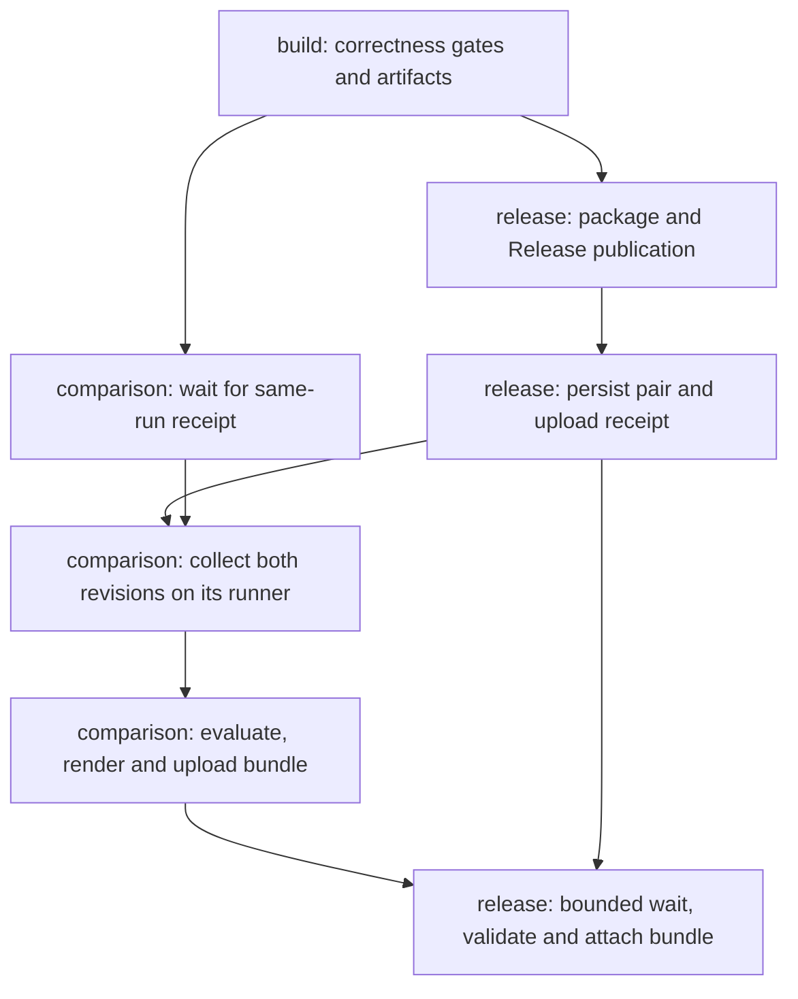

# Specification: Release baseline comparison

## 1. Business Goal

<!-- last written by: spec-author, 2026-10-13 -->

Published benchmark files do not tell the maintainer whether a release became materially more expensive than its predecessor. This Feature gives every release an automatic comparison report with identifiable evidence and explicit review flags, so performance regressions receive attention without making a measurement a build or publication gate.

## 2. User Needs

<!-- last written by: spec-author, 2026-10-13 -->

| #   | Persona            | Need                                                                    | Pain Point Today                                 |
| --- | ------------------ | ----------------------------------------------------------------------- | ------------------------------------------------ |
| 1   | Release maintainer | See changes in time and managed allocation against the previous release | Separate run artifacts require manual comparison |
| 2   | Reviewer           | Know which measured changes deserve investigation and why               | No automatic review signal exists                |
| 3   | Future maintainer  | Recover the release pair, policy and raw evidence behind a finding      | Transient build artifacts can expire             |

### Assumptions

| ID  | Assumption                                                                                                                                                                                                                                          |
| --- | --------------------------------------------------------------------------------------------------------------------------------------------------------------------------------------------------------------------------------------------------- |
| A-1 | `0109-F1` B-010 supplies machine-readable BenchmarkDotNet results; this Feature evaluates them and does not replace the benchmark harness.                                                                                                          |
| A-2 | `0055-F6` supplies the successful publication event and release identity; this Feature owns the performance report added to that release run.                                                                                                       |
| A-3 | Measurement coverage is the release comparison inventory of available engine-stage, whole-check and tool-startup workloads, retaining each input size as a separate case; this Feature does not wait for every measuring Feature to be implemented. |

### Measurement equivalence

Measurement conditions comprise operating system, runtime version, architecture, toolchain, garbage-collection mode, benchmark job and timing confidence level. Workload identity covers the fixture definition and measured operation, independently of its display name. A changed product implementation is the object of comparison, not a workload change. Unknown workload or configuration equivalence is not comparable. Metric validity is checked first: absent or invalid timing uncertainty, including an unknown confidence level, receives `Insufficient evidence` rather than an equivalence judgment. Compatible time or byte scales are normalised; incompatible dimensions or observer boundaries cannot be paired.

### Comparison policy

Decision 0002 records the owner's 2026-10-13 answers. Eligible releases are successfully published stable releases and prereleases; drafts and bare tags are excluded. The baseline is the most recent eligible publication before the current release's first publication, and that pair stays fixed on reruns. Equal publication timestamps are ordered by immutable release identifier, with the larger identifier later in the sequence.

A timing flag requires a mean increase strictly greater than 10% and a current confidence interval whose lower bound is strictly greater than the previous interval's upper bound, using the same confidence level. Overlapping or touching intervals do not flag. An allocation flag requires an increase strictly greater than 10% in managed bytes per operation. Increases exactly at 10% do not flag. These are review screens, not claims of statistical significance or build thresholds.

Percentage change is `100 × (current − previous) / previous` for a positive previous value, computed without display rounding. With zero allocation in both releases, the allocation is unchanged and its percentage is undefined. A zero-to-positive allocation has no defined percentage and receives `Insufficient evidence`, making the overall comparison incomplete unless another metric already requests review. A non-positive timing baseline is invalid evidence. A known review flag takes precedence over coverage gaps in the comparison judgment. If a later reporting stage fails, available run-summary output retains any already-computed flags alongside the incomplete reporting state; it does not invent a successful attachment or a regression-free result.

## 3. Acceptance Criteria

<!-- last written by: spec-author, 2026-10-13 -->

| ID    | Claim                                                                                                                                                                                                                             | Source                                              | Status  |
| ----- | --------------------------------------------------------------------------------------------------------------------------------------------------------------------------------------------------------------------------------- | --------------------------------------------------- | ------- |
| B-001 | Given a successfully published stable release or prerelease, this Feature automatically starts its baseline comparison in the release run.                                                                                        | owner, 2026-10-13; OQ-2                             | Active  |
| B-002 | Given earlier releases, this Feature selects the immediately preceding published stable release or prerelease by publication order, fixing that predecessor for reruns and excluding drafts and unpublished tags.                 | owner, 2026-10-13; OQ-2                             | Active  |
| B-003 | Given no earlier eligible release, this Feature publishes a report marked `No baseline` without a regression judgment.                                                                                                            | B-002 boundary                                      | Active  |
| B-004 | Given a selected release pair, this Feature collects both revisions' measurements in the same comparison session on the same runner.                                                                                              | owner-approved direction, 2026-10-13; decision 0001 | Active  |
| B-005 | Given matching workload identities, inputs, measurement boundaries and measurement conditions, this Feature pairs the results as comparable.                                                                                      | decision 0001                                       | Amended |
| B-006 | Given otherwise valid evidence with a mismatch or unknown equivalence in a comparison condition of B-005, this Feature marks the pair `Not comparable` with the reason instead of judging it.                                     | B-005 boundary                                      | Amended |
| B-007 | Given a workload found only in the current measurement inventory, this Feature reports it as `Added` without a regression judgment.                                                                                               | comparison coverage boundary                        | Active  |
| B-008 | Given a workload found only in the previous measurement inventory, this Feature reports it as `Removed` without a regression judgment.                                                                                            | comparison coverage boundary                        | Active  |
| B-009 | Given comparable metric values with a positive previous value, this Feature normalises compatible units and reports both values, their shared unit, absolute change and percentage change.                                        | owner, 2026-10-13                                   | Amended |
| B-010 | Given a zero previous allocation, this Feature reports its percentage as `Not defined`, judging zero-to-zero as unchanged and zero-to-positive as `Insufficient evidence`.                                                        | arithmetic boundary                                 | Active  |
| B-011 | Given comparable timings whose mean rises strictly more than 10% and whose current confidence interval lies strictly above the previous interval, this Feature flags the timing `Review required` with its reason.                | owner, 2026-10-13; OQ-1                             | Active  |
| B-012 | Given comparable managed allocation rising strictly more than 10% above a positive previous allocation, this Feature flags the allocation `Review required` with its reason.                                                      | owner, 2026-10-13; OQ-1                             | Active  |
| B-013 | Given invalid timing values or absent or invalid timing uncertainty, this Feature marks the timing judgment `Insufficient evidence`.                                                                                              | evidence boundary                                   | Amended |
| B-014 | Given any result flagged `Review required`, this Feature identifies it in the release run summary with a link to the report.                                                                                                      | owner, 2026-10-13                                   | Active  |
| B-015 | Given a completed comparison, this Feature publishes human-readable and machine-readable reports with the same findings.                                                                                                          | owner, 2026-10-13; `0109-F1` B-009, B-010           | Active  |
| B-016 | Given a published report, this Feature identifies the release tags and commits, environments, workload cases, comparison policy and raw measurement evidence behind its findings.                                                 | reproducibility boundary                            | Active  |
| B-017 | Given passing correctness gates and a published release, this Feature leaves the build successful when it flags a regression.                                                                                                     | owner, 2026-10-13; `0109-F1` C-1                    | Active  |
| B-018 | Given a collection, parsing, evaluation, rendering or attachment failure after publication, this Feature exposes an `Incomplete` advisory outcome with an actionable reason in the release run summary without failing the build. | advisory reporting boundary; decision 0001          | Amended |
| B-019 | Given at least one flagged metric, this Feature gives the report an overall judgment of `Review required`, retaining any coverage gaps.                                                                                           | owner, 2026-10-13                                   | Active  |
| B-020 | Given no flagged metric but an empty inventory or a required metric missing, not comparable or lacking sufficient evidence, this Feature gives the report an overall judgment of `Incomplete`.                                    | incomplete evidence boundary                        | Active  |
| B-021 | Given at least one required workload case, valid comparable results for every required metric and no flag, this Feature gives the report an overall judgment of `No regression flagged`.                                          | complete evidence boundary                          | Active  |
| B-022 | Given a published comparison, this Feature keeps its reports and referenced raw evidence with the release independently of transient workflow artifact retention.                                                                 | reproducibility boundary; decision 0001             | Active  |
| B-023 | Given a pull request, main push or release dry run that publishes no release, this Feature starts no automatic release comparison.                                                                                                | `0109-F1` OQ-2; `0055-F6` B-008                     | Active  |
| B-024 | Given the selected immediate predecessor cannot be resolved or measured, this Feature reports `Incomplete` with the reason rather than substituting an older release.                                                             | B-002 boundary                                      | Active  |

## 4. Constraints

<!-- last written by: spec-author, 2026-10-13 -->

| ID   | Constraint                                                                                                                                                                                                | Rules Out                                                                                                                       |
| ---- | --------------------------------------------------------------------------------------------------------------------------------------------------------------------------------------------------------- | ------------------------------------------------------------------------------------------------------------------------------- |
| C-1  | A performance measurement or review flag never changes the correctness verdict, prevents publication, or rolls back a release.                                                                            | Timing or allocation gates; treating an advisory flag as a failed check.                                                        |
| C-2  | Comparisons use the exact published product revisions and the same measurement conditions; historical shared-runner timings alone cannot establish a regression.                                          | Comparing unrelated runs or treating an unchanged benchmark name as proof of an unchanged workload.                             |
| C-3  | BenchmarkDotNet's out-of-process Release measurements supply timing and managed allocation; fixture construction and composition keep the boundaries of the measuring Features.                           | Debug or in-process findings, stopwatch substitutes, changed workloads hidden in a release delta.                               |
| C-4  | Each workload and parameter combination is judged independently, with no average hiding a flagged result.                                                                                                 | Combining small and large trees or trading a timing regression against an allocation improvement.                               |
| C-5  | An unknown, duplicated, failed, missing, non-finite, negative, added, removed or incompatible required metric is visible and cannot count as evidence of no regression.                                   | Empty reports presented as clean; dropping unmatched cases from the summary.                                                    |
| C-6  | A report distinguishes mean time, managed bytes per operation and any tool-process peak-memory observation, with explicit units and observer boundaries.                                                  | Presenting benchmark-harness allocation as child-tool memory; treating missing child-process memory as zero.                    |
| C-7  | The comparison inventory is the union of workloads and parameter cases available for the two releases; time and managed allocation are required for each case where the measuring contract supplies them. | A hand-picked subset that omits regressions or silently discards added and removed cases.                                       |
| C-8  | All local outputs stay under the comparison's temporary workspace or `.artifacts/benchmarks/`, and every reported path is repository-relative.                                                            | Consumer-tree writes, global tool installs and absolute paths in reports or fixtures.                                           |
| C-9  | Performance reporting is advisory even when a comparison-owned stage fails; existing benchmark targets retain their broken-benchmark failure semantics outside this release reporting boundary.           | Weakening `0109-F1` B-012 or reporting a failed measurement as a successful comparison.                                         |
| C-10 | Measurement execution grants no publishing credentials; report publication follows `0055-F6` C-5 and C-7 in its existing release job.                                                                     | Running either measured revision with package-write or contents-write credentials; a third job with contents-write permissions. |

## 5. Out of Scope

<!-- last written by: spec-author, 2026-10-13 -->

| #   | Item                                                                                                           | Exclusion Reason                                                                                                        |
| --- | -------------------------------------------------------------------------------------------------------------- | ----------------------------------------------------------------------------------------------------------------------- |
| 1   | Failing a build or blocking publication on performance                                                         | Owner, 2026-10-13; C-1.                                                                                                 |
| 2   | Benchmarks on every pull request, branch push or release dry run                                               | This Feature compares published releases; `0109-F1` keeps its main-only automatic measurement policy.                   |
| 3   | Choosing when to release, publishing the package, or rewriting release versions                                | `0055-F5` and `0055-F6` own versioning and publication.                                                                 |
| 4   | Implementing missing stage or startup benchmarks                                                               | `0109-F2` to `0109-F4` own the measurements; unavailable evidence remains visible.                                      |
| 5   | Profiling, attribution to individual commits, or automatic optimisation                                        | Review flags prompt investigation, not a remedy.                                                                        |
| 6   | A new public `specht` command, manifest option, schema version or rule id                                      | This is repository release tooling, not consumer checker behaviour.                                                     |
| 7   | Email, chat messages, automatic issues or automatic reviewer assignment                                        | The review signal lives in the release run summary and report; local work items remain the delivery tracker.            |
| 8   | Predicting performance from a single size, extrapolating to unseen sizes, or claiming statistical significance | Findings cover the measured cases and the agreed screening policy only.                                                 |
| 9   | Review thresholds for tool-process peak memory                                                                 | Report that observation when available; this Feature's initial review policy covers timing and managed allocation only. |

## 6. Concern Separation

<!-- last written by: implementer, 2026-10-14 -->

| #   | Concern                                                                           | Classification |
| --- | --------------------------------------------------------------------------------- | -------------- |
| 1   | Eligible publication order and a predecessor fixed for retries                    | Business       |
| 2   | Workload equivalence, coverage and strict advisory review screens                 | Business       |
| 3   | Exact product revisions measured together without publishing authority            | Both           |
| 4   | Export decoding, dimensional units and observer boundaries                        | Both           |
| 5   | Reproducible reports and durable release evidence                                 | Both           |
| 6   | Pure comparison functions separated from disk, process and provider I/O           | Technical      |
| 7   | A bounded same-run handoff after publication without a job dependency cycle       | Technical      |
| 8   | Advisory failure handling that preserves earlier correctness/publication verdicts | Both           |

## 7. Technical Design

<!-- last written by: implementer, 2026-10-14 -->

The selection, persistence, wire-value and evidence-pairing boundaries below are implemented. The remaining collection, evaluation, rendering and workflow sections are the agreed implementation contract.
[ADR-0001](adr/0001-read-only-collection-with-a-release-job-rendezvous.md)
records the architecture and rejected alternatives. The declarations linked below are authoritative for the delivered contracts; downstream orchestration remains pending.

### Composition and existing reuse

The non-packable [comparison assembly](../comparison.csproj), namespace `Specht.Comparison`, joins `specht.slnx` without referencing the benchmark assembly or product host. It currently exposes the selection and evidence APIs as a library; its internal repository-tooling console entry point lands with orchestration. No empty executable is introduced. `System.Text.Json`, `HttpClient`,
`TimeProvider` and the existing `System.IO.Abstractions` substitution provide its
boundaries. It adds no public `specht` command or consumer configuration.

`Program` composes concrete readers, selection, evaluation, rendering and
collection. Pure functions receive immutable values. Provider access, filesystem
access and child processes are asynchronous and cancellable; `HttpMessageHandler`,
`IFileSystem` and a process delegate supply the existing test seams. No interface
is introduced for an in-memory calculation. The publisher consumes data files,
never executes a downloaded report, and validates the bundle before uploading.

Reuse `.performance/benchmarks/BenchmarkConfiguration.cs` and the measuring
Features' native harness at each revision: Release, out-of-process BenchmarkDotNet,
`MemoryDiagnoser`, full JSON and GitHub Markdown. Reuse the `Benchmark` target's
selection and conditional packing, without changing its failure semantics.
`ColdStartSession` already installs packed tools locally and keeps fixture setup
outside measurement; its allocation is the harness process's, not the child
product's. Its current inherited process environment needs the collection
boundary's sanitisation. Do not transplant a current harness into an older product
or add missing stage/startup benchmarks under this Feature.

Workflow composition stays in `.build/SpechtBuild.Release.cs`'s existing
`ReleaseMiddleware`; its `configuration.Jobs`, per-job `Permissions`, explicit
step insertion and `ContinueOnError` are the extension points. The gates and
package artifact retain `0055-F6`'s existing order and authority. The comparator
executable and dependencies are a separate artifact built from the gated current
commit; the release job can use that coordinator without checking out or executing
either measured revision. No publishing operation becomes a NUKE target.

### Value contracts

| Value                                                      | Required content and invariant                                                                                                                                                                      |
| ---------------------------------------------------------- | --------------------------------------------------------------------------------------------------------------------------------------------------------------------------------------------------- |
| [`ReleaseRecord`](../Model/ReleaseRecord.cs)               | Repository and immutable release id, tag, first observed publication timestamp, draft/prerelease flags, peeled commit or explicit resolution failure; catalog completeness is explicit.             |
| [`ReleasePair`](../Model/ReleasePair.cs) version 1         | Current record, selected predecessor record or explicit no-baseline, selection policy version, catalog snapshot digest and selecting run identity; immutable after persistence.                     |
| [`SessionManifest`](../Model/SessionManifest.cs) version 1 | Pair digest, comparator commit/version, run id and attempt, session id, runner identity, per-side product commit, harness/export versions, invocation, environment and expected case inventory.     |
| [`WorkloadCase`](../Model/WorkloadCase.cs)                 | Stable operation and fixture contract ids/revisions, typed canonical parameter map, measurement boundary and metric requirements. Display name and BenchmarkDotNet job display id are labels only.  |
| [`Observation`](../Model/Observation.cs)                   | Side and case key, metric kind/dimension, observer process, raw value/unit, uncertainty level/bounds for timing, conditions, source file and record locator, or a typed unavailable/invalid reason. |
| `ComparisonDocument` version 1                             | Pair/session identity, full policy, ordered union of cases, per-metric values/deltas/status/reason, overall judgment, coverage gaps and evidence manifest.                                          |
| `ReportingOutcome`                                         | Stage, completed/incomplete reporting state, known comparison judgment/flags if computed, actionable reason and confirmed publication references only.                                              |
| `EvidenceManifest` version 1                               | Bundle-relative files with media type, SHA-256, length, role, side and case/source linkage; paths cannot escape the bundle.                                                                         |

Wire JSON uses explicit format versions, invariant numeric values and sorted case,
parameter and file order. Unsupported versions yield unavailable evidence, never a
best-effort clean result. Failure text is sanitised; absent values are null with
reasons, never zero. Session/environment facts are evidence, not a wall-clock
field that changes deterministic evaluation of the same supplied inputs.

### Selection and persistence

The provider reader follows every release-catalog page before selection. A failed
page is an incomplete catalog, not evidence that no predecessor exists. Select
published non-drafts, including prereleases, by `(publishedAt, immutableReleaseId)`;
choose the immediately preceding eligible record in that order, never semantic
version or tag creation order. The current first-publication ordering key is
captured once. Resolve annotated tags to exact commits; preserve an unresolved
selected predecessor's identity with its failure. Do not choose the next usable
older release. Concurrent equal timestamps use the agreed immutable-id tie-breaker.

After successful package and Release publication, the existing release job creates
`comparison-pair-v1.json` as a durable asset on the current Release, before issuing
a collection receipt. The value includes the selection snapshot and resolved
commits. Creation is insert-only: an existing asset is read and validated, never
clobbered. On a concurrent creation conflict, read the winning value and use it;
an invalid or unreadable existing asset is `Incomplete`. Reruns, including a new
workflow run for the same Release, load this value instead of selecting again.
An explicit null predecessor is durable too. If saving the pair fails, collection
does not start. No result claims a fixed pair that was only stored transiently.

The pair is established before the first collection attempt; a failure before its
creation has made no selection durable. The selection predicate still uses the
current Release's original publication key when retrying that stage. Release
creation/push recovery is owned by `0055-F6`; comparison wiring must accept an
already successfully published current Release without requiring its creation to
succeed a second time, and must not bypass a failed package publication.

### Implemented selection and evidence boundaries

[`ReleaseSelection`](../Selection/ReleaseSelection.cs) consumes a complete catalog and the current first-publication record. [`ReleaseCatalogReader`](../Selection/ReleaseCatalogReader.cs) reads all provider pages and peels annotated tags; a failed page leaves an incomplete catalog, and an unresolved tag retains its release identity. [`ReleasePairStore`](../Selection/ReleasePairStore.cs) uses a completed temporary file and an insert-only move for local persistence. [`ReleasePairAssetStore`](../Selection/ReleasePairAssetStore.cs) reads or inserts the durable release asset, reloads a concurrent winner and verifies a successful upload. Its `HttpClient` and authority are supplied by the caller; nothing invokes it automatically or creates credentials.

[`ComparisonJson`](../Model/ComparisonJson.cs) owns version-1 pair/session encoding, canonical object-key order, digests, duplicate-property rejection and read validation. [`WorkloadIdentity`](../Evidence/WorkloadIdentity.cs) keys operations with typed canonical parameters. [`BenchmarkEvidenceReader`](../Evidence/BenchmarkEvidenceReader.cs) decodes the pinned native full JSON against caller-supplied audited mappings, preserving source locators and per-metric invalidity. [`CasePairing`](../Evidence/CasePairing.cs) retains the union, expected missing results and duplicate metric locators. Common parameter keys pair independently. A one-sided parameter case is Added or Removed; when both sides instead have unmatched input keys for the same operation, those cases remain not comparable with an input-parameter reason. [`MetricUnits`](../Evidence/MetricUnits.cs) recognises dimensional scales; delta arithmetic and review screens remain downstream.

The supported producer is BenchmarkDotNet 0.15.8. Its [pinned exporter](https://github.com/dotnet/BenchmarkDotNet/blob/v0.15.8/src/BenchmarkDotNet/Exporters/Json/JsonExporterBase.cs) supplies nanosecond statistics and bytes per operation. The cached pinned assembly's serializer was probed with invented statistics: its legacy confidence enum encodes `L999` as numeric `Level: 12`; the importer uses the version-bound enum mapping rather than treating that number as a percentage. Unsupported producers, ambiguous JSON and missing full-export metadata remain unavailable. Raw exports are caller-owned inputs; retention sanitisation and report-bundle construction remain downstream. No benchmark was run for this probe.

### Acyclic execution and credential boundary

The generated release workflow will have `build`, `release` and `comparison` jobs.
Both latter jobs need only `build`; neither needs the other's completion. Both
retain the tag-push predicate, excluding workflow dispatch. `comparison` has only
contents-read and actions-read; packages and all write scopes are absent. `release`
keeps the sole package-write/contents-write grant and gains actions-read solely for
the same-run return artifact. No new secret, dispatch credential or write job is
introduced. Ordinary PR/main workflows stay outside this path.

The temporal chain is publication → saved pair → receipt → collection → bundle →
attachment. There is no completion edge back to publication. The release job
uploads `comparison-request-<runId>-<attempt>` after saving the pair, then waits
for `comparison-result-<runId>-<attempt>`. The comparison job polls the same run's
artifact list for that exact receipt, validates repository, run, attempt, current
commit and pair digest, then starts work. The receipt proves successful publication
in this run; observing a tag or an old Release alone cannot trigger measurement.
The release job similarly accepts only the result for that receipt, never an old
attempt. A rerun of only failed jobs cannot consume an old receipt/result: missing
participants produce `Incomplete`; rerunning all jobs resumes with the saved pair.

Artifact upload must finish before its reader proceeds, but job completion is not
required. This relies on the immediate availability of immutable v4 artifacts,
[documented by upload-artifact](https://raw.githubusercontent.com/actions/upload-artifact/v4/README.md),
and the [run-artifact read API](https://docs.github.com/en/rest/actions/artifacts).
Do not use `needs.release.outputs` as an early signal. Insertion of a read-only
third job uses the existing generator; it does not use its built-in publisher or
a second workflow. The disposable probe and its observed limits are recorded in
the ADR; generated declarations are evidence about generation, not a live run.

The comparison runner owns both sequential revision checkouts/builds and benchmark
process trees for one session. Use separate workspace/cache/output folders under
`.artifacts/benchmarks/comparison/<sessionId>/` or its temporary workspace. Checkout
credentials are not persisted. No publisher artifact, publishing token or mutable
publisher workspace is shared with it. Child environments are built from an
allowlist of SDK/runtime and session paths; omit GitHub tokens, Actions runtime
credentials, user tool manifests and credential-bearing NuGet configuration.
Restore dependencies before measurement with read-only access where needed.
Record actual SDK/runtime/OS/architecture/toolchain/GC/job settings on both sides;
a historical SDK mismatch is visible rather than fixed by silently retargeting.

The receipt wait is bounded to 30 minutes; paired preparation/collection to 60
minutes total, with each revision capped at 25 minutes and failures leaving time
to render. The release-side result wait is bounded to 100 minutes from receipt,
including runner queue delay. Use injected `TimeProvider`, cancellable waits and
process-tree termination. Normal deadlines are handled in code before the platform's job safety
timeout; they do not depend on an unprobed generator timeout property. A queued, failed or cancelled collector causes a
bounded incomplete outcome, never indefinite waiting.

Every comparison-owned step after successful publication, including receipt save,
transport, rendering and attachment, has advisory failure handling. The comparison
job's setup/upload steps also continue on error and a final summary runs on failure.
Earlier gates and publication retain their failure semantics. Pre-write an
`Incomplete: comparison pending` summary before waits; replace it on completion.
On graceful cancellation kill both process trees and retain available evidence.
An explicit user cancellation or platform hard kill can prevent any final step;
it leaves the workflow cancelled, the published release intact and the prewritten
summary/pair as available evidence, never a fabricated success. No design can turn
a platform cancellation into a successful run. Recovery is a rerun with the saved
pair, not a retry loop that changes the baseline.

### Evidence reading, identity and evaluation

Discover the union of expected native harness cases on both revisions, including
failed cases. Missing historical harness/export/identity metadata is an explicit
gap. The importer supports explicitly recognised BenchmarkDotNet full-JSON shapes
and a session sidecar; unknown shapes cannot be treated as empty valid inventories.
A supported exporter adapter must declare the value/unit fields and how it decodes
confidence levels. BenchmarkDotNet's [JSON sample](https://benchmarkdotnet.org/articles/samples/IntroExportJson.html)
serialises an enum-like confidence `Level`; never read it as a percentage or use
standard deviation as a confidence interval. Support is bound to the producer
version and tested with invented payloads of that shape; no current default is
silently assigned to historical uncertainty. An audited mapping can establish a
historical workload contract from its source revision, fixture definition and
measured operation; matching names alone cannot.
Store that mapping and its source digest with the evidence. Unavailable discovery
is distinct from a known empty inventory and cannot imply `Added` or `Removed`.

Case pairing uses operation identity plus canonical parameters; differing fixture
contract, input, boundary or conditions produces `Not comparable`. A known
one-sided case is `Added`/`Removed`; each size stays separate. Every case carries
the required metrics its measuring contract supplies. Mean time and managed bytes
per operation are separate; child peak memory is informational with its own
observer, never substituted for managed allocation. Harness allocation remains
labelled as harness allocation for startup cases.

Validation order is decode and duplicate detection → per-metric validity →
equivalence → unit conversion → arithmetic → review screen → overall reduction.
Two records for the same side/case/metric are invalid duplicate evidence, not
last-write-wins or an average; keep both locators. Other valid metrics may still
flag. Non-finite, negative or missing values cannot prove a clean result. Timing
means must be positive, intervals finite and ordered around the mean, and the
confidence level known and valid. Absent/invalid uncertainty is `Insufficient
evidence`; differing valid confidence levels are `Not comparable`.

Normalise recognised ns/µs/us/ms/s scales to ns per operation and B/KB/MB or
B/KiB/MiB to bytes per operation with explicit decimal/binary factors. Unknown
units or incompatible dimensions/observers are `Not comparable`; conversion
failure or overflow is invalid evidence. Never infer a scale from display width.
Calculate on unrounded values and round only rendered numbers. Apply decision
0002's strict thresholds and zero-allocation policy per metric, then reduce:
any flag → `Review required`; otherwise any required gap or empty union →
`Incomplete`; otherwise → `No regression flagged`. No predecessor → `No baseline`
with no regression judgment. Reporting failure is tracked separately so an
already-computed review flag survives an incomplete attachment.

### Rendering and durable publication

Render Markdown and JSON from one immutable `ComparisonDocument`. A bundle
contains `report.md`, `report.json`, `pair.json`, `session.json`,
`evidence-manifest.json`, raw exporter documents and supported identity mappings.
Preserve raw numerical evidence; sanitise only path-bearing metadata at ingestion,
recording that transformation. Reject unknown payloads that cannot be safely
retained; do not attach arbitrary logs, generated projects or absolute paths.
Keep original local exports in the workspace only. Every referenced evidence file
must exist with its recorded digest; reject rooted paths, traversal and symlinks.

Use one self-contained ZIP per attempt, named
`comparison-<releaseId>-<runId>-<attempt>.zip`, with bundle-relative links valid
after extraction. The pair asset remains separate for rerun recovery. The
release job validates the returned bundle and attaches it through the existing
workflow token. Verify the uploaded asset before linking it as retained evidence;
failed or partial uploads are `Incomplete`. Insert-only attempt names prevent
reruns from making earlier report references stale. The summary lists flagged
cases/reasons and the confirmed Release asset link; before successful attachment
it states the incomplete reporting stage and retains known flags without a
successful report link. Expiring workflow artifacts removes transport only;
reports and their entire evidence closure remain in the Release bundle.

## 8. Testing Strategy

<!-- last written by: test-writer, 2026-10-14 -->

Selection and evidence pairing are tested with synthetic catalogs, invented exporter JSON, generated fixtures, real temporary pair files and a fake HTTP handler. The five delivered claim rows in § 9 name their executable proofs. The remaining plan below describes downstream mechanisms; their rows stay `Missing`. No test runs a benchmark or asserts elapsed
time, allocation, a real release, a credential or a live provider response.

[`comparison.tests`](../../../test/comparison.tests/comparison.tests.csproj) references the comparator, joins `specht.slnx`, declares `IsTestProject`, and uses the existing xUnit v3, AwesomeAssertions, AutoFixtures and tier guard conventions. In-memory tests have
exactly one Unit trait, filesystem/process tests exactly one Integration trait.
Both NUKE filtered tiers must discover tests in the new project; do not add an
empty project before its first tests. [`acceptance.csproj`](../../../test/acceptance/acceptance.csproj) now has the project reference and literal `ReqnrollFeatureFile` link; [`ComparisonSteps`](../../../test/acceptance/Comparison/ComparisonSteps.cs) exercises the real selector, saved-pair store, importer and pairing over invented inputs. The unimplemented scenarios remain pending under the existing runner policy. Verify discovery increases; an unlinked `.feature` proves nothing executable.

| Claim | Mechanism and planned unit proof                                                                                             | Synthetic acceptance/integration proof                                                                                                              |
| ----- | ---------------------------------------------------------------------------------------------------------------------------- | --------------------------------------------------------------------------------------------------------------------------------------------------- |
| B-001 | Publication-receipt eligibility rejects anything short of both successful publications.                                      | `ComparisonSteps` supplies a successful receipt and observes collection; scripted transport verifies run/attempt binding.                           |
| B-002 | `ReleaseSelection` orders complete catalogs, filters drafts, includes prereleases, breaks ties and honours saved pairs.      | Multi-page invented catalog, equal timestamps, changed later catalog and disk reload retain the same predecessor.                                   |
| B-003 | No-predecessor result has no regression judgment.                                                                            | First-release receipt yields both report forms marked `No baseline`, without starting a benchmark.                                                  |
| B-004 | `CollectionPlan` pins both commits, one session/runner and separate sequential invocations.                                  | Fake process delegate records two revision arguments and conditions; temporary workspace proves isolation and cleanup.                              |
| B-005 | `CasePairing` matches stable operation/fixture contracts, parameters, observers and conditions.                              | Independently invented full-JSON exports and sidecars yield the expected paired rows.                                                               |
| B-006 | Valid evidence with unknown/different identity or conditions yields reasons, never comparison.                               | Scenario outline varies each equivalence field, including valid unequal confidence levels and unsupported historical formats.                       |
| B-007 | Known current-only case is Added and contributes a required coverage gap.                                                    | Invented asymmetric inventory retains the current-only case without a delta judgment.                                                               |
| B-008 | Known predecessor-only case is Removed and contributes a required coverage gap.                                              | Invented asymmetric inventory retains the predecessor-only case without a delta judgment.                                                           |
| B-009 | `UnitConversion` and unrounded delta arithmetic respect decimal/binary scales and dimensions.                                | Equivalent ns/µs and byte scales produce matching reports; incompatible dimensions remain visible.                                                  |
| B-010 | Zero-allocation policy distinguishes zero/zero and zero/positive without dividing by zero.                                   | Both scenario examples retain null percentage with `Not defined` and the appropriate metric/overall judgment.                                       |
| B-011 | Timing screen requires strictly more than 10% and strictly separated intervals.                                              | Boundary tables cover just below/equal/above 10%, touching/overlapping intervals and a displayed rounded 10% whose raw value exceeds it.            |
| B-012 | Allocation screen uses strict unrounded increase over positive baseline.                                                     | Just below/equal/above limits and simultaneous timing improvement prove independent allocation flags.                                               |
| B-013 | Timing validity precedes equivalence; absent/invalid confidence, non-finite values and malformed intervals are insufficient. | Synthetic malformed payloads preserve reasons and independent valid metric flags; duplicates preserve both source locators.                         |
| B-014 | Summary projection includes every known flag and only confirmed report links.                                                | Fake publisher success/failure retains flags, links only a verified asset and escapes hostile display text.                                         |
| B-015 | Both renderers project the same document without recalculating verdicts.                                                     | Parse JSON and inspect Markdown for the same ordered cases, reasons, units, gaps and judgments.                                                     |
| B-016 | Evidence closure binds release/commit, environment, policy, case and source digests.                                         | Round-trip temporary bundle; mutation or deletion of a referenced file is rejected before publication.                                              |
| B-017 | Advisory outcome mapping cannot change prior passed correctness/publication gates to failure.                                | Fake stages returning a regression leave the orchestration successful; a pre-existing gate failure stays failed.                                    |
| B-018 | Stage outcome mapping, deadlines and cancellation preserve incomplete reasons and known flags.                               | Inject collection, parse, evaluation, rendering, receipt, upload and attachment failures; fake clock advances deadlines without sleeps.             |
| B-019 | Overall reduction gives any flag precedence over gaps.                                                                       | A flagged metric plus missing/Added/Removed/duplicate evidence keeps review and every gap.                                                          |
| B-020 | Overall reduction rejects empty inventories or any required missing/incompatible/insufficient metric absent a flag.          | Invented empty, failed discovery and partial inventories cannot produce a clean report.                                                             |
| B-021 | Overall reduction requires a nonempty union and complete comparable required metrics for no flag.                            | A complete invented pair produces `No regression flagged` in both forms.                                                                            |
| B-022 | Publication adapter validates closure and inserts a durable self-contained release asset.                                    | Fake HTTP handler models release storage independently of transport; delete the temporary run artifact, retrieve and verify every bundle reference. |
| B-023 | Receipt trigger predicate rejects PR, main push and dispatch/dry-run contexts.                                               | Scenario examples observe zero collector invocations; generated workflow is inspected separately for the event predicate.                           |
| B-024 | Selection/collection failures keep the immediate predecessor; unavailable never selects again.                               | Unresolvable commit, missing harness and process failure retain the same pair and actionable incomplete reason.                                     |

The unit tier pins all listed decisions; none is excused as workflow-only or
benchmark-only logic. Integration tests exercise disk persistence, safe extraction,
process invocation and failure cleanup with invented files/process stubs. Provider
tests use a fake `HttpMessageHandler`, follow pagination and inspect requests for
insert-only pair/asset semantics and wrong-run rejection. Retry tests fail unless
pair persistence survives catalog changes and transport expiry. Independently test
receipt-before-collection and bundle-before-attachment with controlled events;
do not model a completed release job as the collection trigger.

Workflow declaration verification belongs to the integration delivery: regenerate
through NUKE, inspect build-before-publication, explicit step ordering, two
`needs: build` edges, the only write grant in `release`, actions-read grants,
advisory step outcomes and bounded waits. This is generation evidence, not
execution or comparator unit coverage. Existing `0055-F6` decisions on its own
by-record claims remain unchanged. Comparison build argument construction, if
introduced, needs unit tests in `test/build.tests` and solution registration;
that project exists on disk but is not currently listed in the solution.

A manual paired collection later demonstrates the native measurement boundaries,
actual environment capture and path sanitisation on one runner; it does not prove
a review policy or credential isolation by timing. No benchmark or published
performance finding is required for a design-only change. Platform hard kill
cannot guarantee final output; test graceful cancellation and bounded missing-peer
outcomes, and record that live platform limitation honestly.

### Delivered mechanism proof

| Claim | Mechanism                                                                                          | Unit and boundary proof                                                                                                                                                                                                                                                                                                                                                                                                    |
| ----- | -------------------------------------------------------------------------------------------------- | -------------------------------------------------------------------------------------------------------------------------------------------------------------------------------------------------------------------------------------------------------------------------------------------------------------------------------------------------------------------------------------------------------------------------- |
| B-002 | Complete-catalog publication ordering, tag resolution and insert-only pair persistence             | `ReleaseSelectionUnitTests` pins eligibility, tie ordering, missing commits, incomplete catalogs and canonical snapshots; `ReleaseCatalogReaderIntegrationTests` pins pagination and annotated-tag peeling; `ReleasePairStoreIntegrationTests` and `ReleasePairAssetStoreIntegrationTests` pin reruns, concurrent winners and invalid saved evidence. `ComparisonSteps` executes the tagged selection and rerun scenarios. |
| B-005 | Audited identity mapping, typed parameter keys, metric requirements and independent metric pairing | `BenchmarkEvidenceReaderUnitTests`, `EvidenceContractsUnitTests` and `CasePairingUnitTests.MatchingCases_WhenPairing_ShouldKeepSeparateSizesAndBothMetrics`; the matching scenario invokes the importer and pairing together.                                                                                                                                                                                              |
| B-006 | Validity before equivalence, condition/observer/fixture checks and unknown identities              | `CasePairingUnitTests.ChangedOrUnknownEquivalence_WhenPairing_ShouldNameTheCondition`, its invalid-timing ordering proof and `EvidenceBoundariesUnitTests`; the condition outline and unknown-identity scenario run through `ComparisonSteps`.                                                                                                                                                                             |
| B-007 | Known current-only inventory retained as Added                                                     | `CasePairingUnitTests.KnownOneSidedWorkload_WhenPairing_ShouldRetainItWithoutJudgment` and `EvidenceBoundariesUnitTests.OneParameterCaseAddedOrRemoved_WhenPairing_ShouldKeepItsOneSidedStatus`; the tagged Added scenarios run in `ComparisonSteps`.                                                                                                                                                                      |
| B-008 | Known predecessor-only inventory retained as Removed                                               | The other rows of those theories and the tagged Removed scenarios in `ComparisonSteps`.                                                                                                                                                                                                                                                                                                                                    |

The fixtures are independently invented, never captured exports. `ExportData` carries the pinned producer's wire shape. Contract tests distinguish decimal/binary units and typed parameter identity; actual conversion/delta arithmetic remains the evaluation slice. Timing uncertainty may cross zero as long as the mean is positive and finite bounds contain it. No test starts a benchmark, uses a live release, credential or network, or asserts elapsed time or measured allocation. The provider adapters run against `HttpMessageHandler`; persistence tests use owned temporary directories. All test classes carry their one tier trait, and the new project discovers the shared governance test. The full-build result is recorded in the delivery report rather than duplicated here.

## 9. Traceability Matrix

<!-- last written by: test-writer, 2026-10-14 (selection and evidence proof) -->

| Claim ID | Scenario | Test                                                                                                                                                                                                             | Status  |
| -------- | -------- | ---------------------------------------------------------------------------------------------------------------------------------------------------------------------------------------------------------------- | ------- |
| B-001    | `@B-001` | Missing                                                                                                                                                                                                          | Missing |
| B-002    | `@B-002` | `ComparisonSteps`; `ReleaseSelectionUnitTests`; `ReleaseCatalogReaderIntegrationTests`; `ReleasePairStoreIntegrationTests`; `ReleasePairAssetStoreIntegrationTests`                                              | Covered |
| B-003    | `@B-003` | Missing                                                                                                                                                                                                          | Missing |
| B-004    | `@B-004` | Missing                                                                                                                                                                                                          | Missing |
| B-005    | `@B-005` | `ComparisonSteps`; `CasePairingUnitTests.MatchingCases_WhenPairing_ShouldKeepSeparateSizesAndBothMetrics`; `BenchmarkEvidenceReaderUnitTests`; `EvidenceContractsUnitTests`                                      | Covered |
| B-006    | `@B-006` | `ComparisonSteps`; `CasePairingUnitTests.ChangedOrUnknownEquivalence_WhenPairing_ShouldNameTheCondition`; `EvidenceBoundariesUnitTests`                                                                          | Covered |
| B-007    | `@B-007` | `ComparisonSteps`; `CasePairingUnitTests.KnownOneSidedWorkload_WhenPairing_ShouldRetainItWithoutJudgment` ; `EvidenceBoundariesUnitTests.OneParameterCaseAddedOrRemoved_WhenPairing_ShouldKeepItsOneSidedStatus` | Covered |
| B-008    | `@B-008` | `ComparisonSteps`; `CasePairingUnitTests.KnownOneSidedWorkload_WhenPairing_ShouldRetainItWithoutJudgment` ; `EvidenceBoundariesUnitTests.OneParameterCaseAddedOrRemoved_WhenPairing_ShouldKeepItsOneSidedStatus` | Covered |
| B-009    | `@B-009` | Missing                                                                                                                                                                                                          | Missing |
| B-010    | `@B-010` | Missing                                                                                                                                                                                                          | Missing |
| B-011    | `@B-011` | Missing                                                                                                                                                                                                          | Missing |
| B-012    | `@B-012` | Missing                                                                                                                                                                                                          | Missing |
| B-013    | `@B-013` | Missing                                                                                                                                                                                                          | Missing |
| B-014    | `@B-014` | Missing                                                                                                                                                                                                          | Missing |
| B-015    | `@B-015` | Missing                                                                                                                                                                                                          | Missing |
| B-016    | `@B-016` | Missing                                                                                                                                                                                                          | Missing |
| B-017    | `@B-017` | Missing                                                                                                                                                                                                          | Missing |
| B-018    | `@B-018` | Missing                                                                                                                                                                                                          | Missing |
| B-019    | `@B-019` | Missing                                                                                                                                                                                                          | Missing |
| B-020    | `@B-020` | Missing                                                                                                                                                                                                          | Missing |
| B-021    | `@B-021` | Missing                                                                                                                                                                                                          | Missing |
| B-022    | `@B-022` | Missing                                                                                                                                                                                                          | Missing |
| B-023    | `@B-023` | Missing                                                                                                                                                                                                          | Missing |
| B-024    | `@B-024` | Missing                                                                                                                                                                                                          | Missing |

## 10. Lessons / Spec Deltas

<!-- last written by: spec-author, 2026-10-13 -->

- 2026-10-13, owner requested the deferred comparison capability from `0109-F1` OQ-4: compare every release with its predecessor, automate the report and flag meaningful regressions without failing the build. This Feature takes `0109-F5`; the epic and harness scope now link to it. No implementation was included in that definition.

- 2026-10-13, review rework: B-005, B-006, B-009, B-013 and B-018 now make equivalence, unit conversion, invalid timing evidence and failures beyond benchmark collection explicit. C-5 covers duplicate evidence. Decision 0003 records these refinements; the owner's numeric thresholds and inclusion of prereleases are unchanged.

- 2026-10-14: B-002 gains an explicit unreadable-catalog boundary scenario. B-007 and B-008 gain input-size boundary scenarios so an added or removed parameter case remains visible beside common cases; differing inputs without a common case continue to follow B-006. Claims and scope are unchanged.

## 11. Open Questions

<!-- last written by: spec-author, 2026-10-13 -->

| ID   | Question                                                                                                                                                                                                                                                                              | Blocks       | Resolution                                                                                                                                                                                                 |
| ---- | ------------------------------------------------------------------------------------------------------------------------------------------------------------------------------------------------------------------------------------------------------------------------------------- | ------------ | ---------------------------------------------------------------------------------------------------------------------------------------------------------------------------------------------------------- |
| OQ-1 | What makes a regression meaningful? Proposed timing screen: mean increase strictly above 10% and non-overlapping confidence intervals; proposed allocation screen: increase strictly above 10%. Equality with the limit does not flag.                                                | B-011, B-012 | Resolved 2026-10-13 by owner: use the proposed initial 10% screens and non-overlapping timing intervals. Decision 0002 records the boundaries; zero baselines are reported without inventing a percentage. |
| OQ-2 | Which releases qualify? Proposed: published stable releases only, excluding drafts and prereleases; choose the most recently published eligible release before the current release's first publication, and preserve that pair on reruns. The first eligible release has no baseline. | B-001, B-002 | Resolved 2026-10-13 by owner: include prereleases. Published stable releases and prereleases qualify; drafts do not. Decision 0002 records selection and reruns.                                           |

## 12. Sign-off

<!-- last written by: spec-reviewer, 2026-10-13 -->

| Section                    | Status | Reviewer      | Note                                                                                                                                                                                                                                                                                                                                                                                                                                                                   |
| -------------------------- | ------ | ------------- | ---------------------------------------------------------------------------------------------------------------------------------------------------------------------------------------------------------------------------------------------------------------------------------------------------------------------------------------------------------------------------------------------------------------------------------------------------------------------- |
| 1-5                        | 🟢     | spec-reviewer | Round 2 self-review: decision 0003 and the amended scenarios resolve the equivalence, unit/invalid-evidence and advisory-failure gaps. Owner decisions 0001-0002 stand. All 24 claims have scenario tags and one Missing traceability row each. Agreement approved for decomposition; § 6-8 remain pending, and neither implementation nor independent review is claimed.                                                                                              |
| 6-9                        | 🟢     | spec-reviewer | Design self-review: ADR-0001 preserves C-1 to C-10 and 0055-F6 C-7 through a read-only peer and bounded same-run receipts. § 8 maps all 24 claims to mechanisms and synthetic proof; § 9 remains Missing. Generator capability was probed locally, not on a live runner. Child scopes and prerequisites are reconciled. Full build passed; no independent sign-off or behavioural delivery is claimed.                                                                 |
| 6-9 selection and evidence | 🟢     | spec-reviewer | Implementation self-review: B-002 and B-005 to B-008 have discovered acceptance and mechanism proof. Versioned pair persistence is insert-only locally and on the release-asset seam; unsupported or ambiguous evidence stays visible. C-2, C-5, C-6 and C-7 are preserved. The selection/evidence library is complete; collection, evaluation, console composition and release wiring remain downstream. No independent review or live-provider execution is claimed. |

### Review history

| Section | Status | Reviewer      | Note                                                                                                                                                                                                                                                                                   |
| ------- | ------ | ------------- | -------------------------------------------------------------------------------------------------------------------------------------------------------------------------------------------------------------------------------------------------------------------------------------- |
| 1-5     | 🟡     | spec-reviewer | Original draft: owner answered OQ-1 and OQ-2; specification review pending.                                                                                                                                                                                                            |
| 1-5     | 🔴     | spec-reviewer | Round 1: B-005/B-006 leave unknown measurement equivalence implicit; B-009/B-013 leave unit conversion and invalid timing values implicit; B-018 covers collection failures but not subsequent reporting failures. Routed to spec-author and resolved by decision 0003 in this review. |

## Tasks

Cut 2026-10-13 into [`../.issue/`](../.issue/): `0208` is the Feature container.

| Item | Scope                                               | Claims                                                 |
| ---- | --------------------------------------------------- | ------------------------------------------------------ |
| 0209 | Reviewed execution, evidence and testability design | No behavioural claim; establishes § 6-8                |
| 0210 | Release selection and normalised evidence           | B-002, B-005, B-006, B-007, B-008                      |
| 0211 | Regression judgments                                | B-009, B-010, B-011, B-012, B-013, B-019, B-020, B-021 |
| 0212 | Paired measurement collection                       | B-004                                                  |
| 0213 | Report forms, evidence and durable publication      | B-015, B-016, B-022                                    |
| 0214 | Release workflow and advisory outcomes              | B-001, B-003, B-014, B-017, B-018, B-023, B-024        |

Items own their dependencies and delivery state. No item is taken by this cut.

## Scoring

| Field | Value | Basis          |
| ----- | ----- | -------------- |
| value | 0     | Not yet scored |
| risk  | 0     | Not yet scored |
