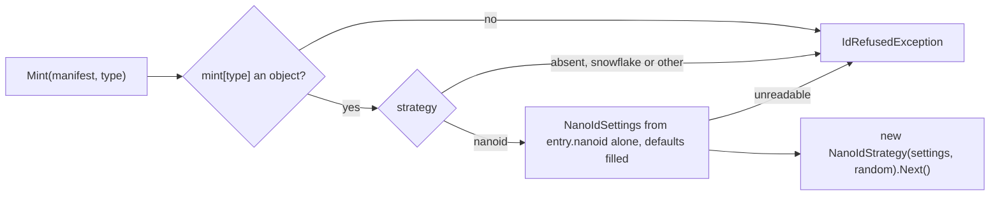

# Specification: Id generation

## 1. Business Goal

<!-- last written by: spec-author, 2026-11-06 -->

An author on a branch takes the next free number from their own copy of the tree, and a branch cut from the same `main` takes the same one; git reports nothing, and lesson 0005 records decisions, claims, constraints, questions and work items claimed two and three times and one duplicate item id reaching `main`. This Feature removes that failure state for every record type a consumer opts in: the pinned `specht` mints a new id that no other branch, worktree or agent can take, and prints it, while every type the consumer does not opt in keeps its own numbering untouched.

## 2. User Needs

<!-- last written by: spec-author, 2026-11-07 (A-1 to A-4 amended; A-6 and A-7 added) -->

| #   | Persona                                                   | Need                                                                     | Pain Point Today                                                                    |
| --- | --------------------------------------------------------- | ------------------------------------------------------------------------ | ----------------------------------------------------------------------------------- |
| 1   | An author on a branch cut in parallel with others         | A new id for a record that no other branch can also take                 | Takes the next number by hand, collides, and renumbers before merging (lesson 0005) |
| 2   | An agent session in one of several worktrees on a machine | An id from the pinned tool rather than one read off its copy of the tree | Reads the highest id on its branch and takes the next, as every other session does  |
| 3   | A consumer with numbering of its own                      | Every type it does not opt in left exactly as it is                      | N/A (a contract this Feature must not break)                                        |
| 4   | `0132-F4`, reading through MCP                            | A command whose standard output is the minted id                         | N/A (internal dependency; no command mints an id)                                   |

### Assumptions

| ID  | Assumption                                                                                                                                                                                                     |
| --- | -------------------------------------------------------------------------------------------------------------------------------------------------------------------------------------------------------------- |
| A-1 | "The id settings" in these claims are the manifest's top-level `mint` key (C-12), "a type" is one of the names C-13 lists, and "a strategy's settings" are that strategy's own sub-object in the type's entry. |
| A-2 | "A request to mint an id" is `specht mint <type> [--feature <dir>] [--root <dir>]`, one id per request (OQ-8, ADR-0033).                                                                                       |
| A-3 | Item `0256` is done: its ADR-0033 is accepted (2026-11-07) and answers OQ-1 to OQ-10 and OQ-12; its trial branch is evidence only, and no claim waits on it.                                                   |
| A-4 | "The tree holds an id of the type" (B-010) means where B-038 to B-042 say the collision guard looks for that type.                                                                                             |
| A-5 | A "candidate" is the id a type's strategy produces with its formatting applied, before the collision guard and validation accept it.                                                                           |
| A-6 | In a scenario, a manifest that opts a type in also declares in `identifiers` a grammar that admits the type's minted ids, unless the scenario says it declares none.                                           |
| A-7 | In these claims, a request for a `decision`, `claim`, `constraint`, `openQuestion` or `scenario` id names its Feature with `--feature`; a request that does not is OQ-15's, and no claim states it.            |

## 3. Acceptance Criteria

<!-- last written by: spec-author, 2026-11-07 (B-016 to B-045 added; Source cells of settled questions cite ADR-0033) -->

| ID    | Claim                                                                                                                                                                                                                                         | Source                                                                         | Status |
| ----- | --------------------------------------------------------------------------------------------------------------------------------------------------------------------------------------------------------------------------------------------- | ------------------------------------------------------------------------------ | ------ |
| B-001 | Given a request to mint an id of a type the manifest does not opt in, this Feature writes nothing on standard output.                                                                                                                         | the owner, 2026-11-06 (item `0256`); decision 0001; C-2                        | Active |
| B-002 | Given a request to mint an id of a type the manifest does not opt in, this Feature exits `2`, `3` or `4`.                                                                                                                                     | decision 0001; C-10; OQ-11                                                     | Active |
| B-003 | Given a request to mint an id of a type the manifest opts in, this Feature writes exactly one line on standard output, holding the minted id and nothing else.                                                                                | the owner's selection, 2026-11-06 (item `0256`); decision 0001; C-1            | Active |
| B-004 | Given a request that prints a minted id, this Feature exits `0`.                                                                                                                                                                              | AGENTS.md § CLI; C-10                                                          | Active |
| B-005 | Given a type opted in to Nano ID with a size, this Feature mints an id whose part after the type's prefix is exactly that many characters long.                                                                                               | the owner, 2026-11-06 (item `0256`); OQ-3; ADR-0033                            | Active |
| B-006 | Given a type opted in to Nano ID with an alphabet, this Feature mints an id in which every character after the type's prefix is in that alphabet.                                                                                             | the owner, 2026-11-06 (item `0256`); OQ-3; ADR-0033                            | Active |
| B-007 | Given a type opted in to Snowflake with an epoch, this Feature mints an id that, decoded under the type's encoding and field widths, holds the milliseconds from that epoch to the time it was minted.                                        | the owner, 2026-10-23 and 2026-11-06 (item `0256`); OQ-1, OQ-2, OQ-4; ADR-0033 | Active |
| B-008 | Given two types opted in with different strategy settings, this Feature mints each type's id with that type's own settings.                                                                                                                   | the owner, 2026-11-06 (item `0256`); C-3                                       | Active |
| B-009 | Given a type whose formatting names a prefix, this Feature mints an id that starts with that prefix.                                                                                                                                          | the owner's selection, 2026-11-06 (item `0256`); OQ-4; ADR-0033                | Active |
| B-010 | Given a tree that already holds, as an id of the type, the first candidate the type's strategy produces, this Feature prints an id the tree does not hold.                                                                                    | the owner's selection, 2026-11-06 (item `0256`); A-4; OQ-9; ADR-0033           | Active |
| B-011 | Given a candidate that the manifest's `identifiers` grammar for its type does not match, this Feature writes nothing on standard output.                                                                                                      | the owner's selection, 2026-11-06 (item `0256`); C-4; OQ-10; ADR-0033          | Active |
| B-012 | Given a candidate that the manifest's `identifiers` grammar for its type does not match, this Feature exits `2`, `3` or `4`.                                                                                                                  | C-10; OQ-11                                                                    | Active |
| B-013 | Given any request to mint an id, this Feature creates, modifies and deletes no file under the root or elsewhere.                                                                                                                              | the owner, 2026-11-06 (decision 0001); C-1; C-11                               | Active |
| B-014 | Given a valid manifest that opts types in, this Feature leaves the check reporting the violations the same tree gets with the id settings removed.                                                                                            | the owner, 2026-11-06 (item `0256`); C-6; C-8                                  | Active |
| B-015 | Given a manifest whose id settings its pinned schema version does not accept, this Feature exits `3` on a request to mint an id.                                                                                                              | AGENTS.md § CLI; `0001-F5` B-012; C-6; OQ-7; ADR-0033                          | Active |
| B-016 | Given a request with `--feature` to mint an `adr` or `lesson` id, this Feature writes nothing on standard output.                                                                                                                             | ADR-0033 § "The Feature to specify next"; OQ-8                                 | Active |
| B-017 | Given a request to mint an id that writes nothing on standard output, this Feature exits `2`, `3` or `4`.                                                                                                                                     | C-10; OQ-11; decision 0003                                                     | Active |
| B-018 | Given a request to mint an `epic`, `feature` or `task` id, this Feature writes nothing on standard output.                                                                                                                                    | decision 0003; C-13                                                            | Active |
| B-019 | Given a type opted in to Nano ID that names no alphabet, this Feature mints an id in which every character after the type's prefix is one of `0123456789abcdefghjkmnpqrstvwxyz`.                                                              | ADR-0033 (OQ-3)                                                                | Active |
| B-020 | Given an `adr` or `lesson` type opted in to Nano ID that names no size, this Feature mints an id whose part after the type's prefix is 8 characters long.                                                                                     | ADR-0033 (OQ-3)                                                                | Active |
| B-021 | Given a `decision`, `claim`, `constraint`, `openQuestion` or `scenario` type opted in to Nano ID that names no size, this Feature mints an id whose part after the type's prefix is 6 characters long.                                        | ADR-0033 (OQ-3)                                                                | Active |
| B-022 | Given a type opted in to Snowflake that names no epoch, this Feature mints an id that, decoded, holds the milliseconds from 2026-01-01 at midnight, universal time, to the time it was minted.                                                | ADR-0033 § "The Feature to specify next", finding 3                            | Active |
| B-023 | Given a type opted in to Snowflake that names no field widths, this Feature mints an id whose lowest 12 bits are its sequence, the 5 above them its worker and the 5 above those its datacenter.                                              | ADR-0033 § "The Feature to specify next"                                       | Active |
| B-024 | Given a type opted in to Snowflake that names no datacenter, this Feature mints an id whose datacenter field holds a value drawn at random for that request.                                                                                  | ADR-0033 (OQ-1); C-16                                                          | Active |
| B-025 | Given a type opted in to Snowflake that names no worker, this Feature mints an id whose worker field holds a value drawn at random for that request.                                                                                          | ADR-0033 (OQ-1); C-16                                                          | Active |
| B-026 | Given a type opted in to Snowflake that names no sequence start, this Feature mints an id whose sequence field holds a value drawn at random for that request.                                                                                | ADR-0033 (OQ-1)                                                                | Active |
| B-027 | Given a type opted in to Snowflake with a datacenter number, this Feature mints an id whose datacenter field holds that number.                                                                                                               | ADR-0033 (OQ-1); C-16                                                          | Active |
| B-028 | Given a type opted in to Snowflake with a worker number, this Feature mints an id whose worker field holds that number.                                                                                                                       | ADR-0033 (OQ-1); C-16                                                          | Active |
| B-029 | Given a Snowflake type whose first candidate the tree holds, and a clock that reads earlier at the next draw than at the first, this Feature writes nothing on standard output.                                                               | ADR-0033 (OQ-2)                                                                | Active |
| B-030 | Given a type opted in to Snowflake with the encoding `base32`, this Feature mints an id whose part after the type's prefix is the Snowflake number written in base32 over `0123456789abcdefghjkmnpqrstvwxyz`.                                 | ADR-0033 (OQ-4); C-15                                                          | Active |
| B-031 | Given a type opted in to Snowflake with the encoding `base32`, this Feature mints an id whose part after the type's prefix is 13 characters long.                                                                                             | ADR-0033 (OQ-4), finding 3                                                     | Active |
| B-032 | Given a type opted in to Snowflake with the encoding `none`, this Feature mints an id whose part after the type's prefix is the Snowflake number in decimal digits.                                                                           | ADR-0033 (OQ-4); C-15                                                          | Active |
| B-033 | Given a type opted in to Nano ID with the encoding `base32`, this Feature writes nothing on standard output.                                                                                                                                  | ADR-0033 (OQ-4), finding 3; C-15                                               | Active |
| B-034 | Given a tree that holds, as an id of the type, the first candidate in another letter case, this Feature prints an id the tree does not hold in any letter case.                                                                               | ADR-0033 (OQ-9)                                                                | Active |
| B-035 | Given a type that names no number of attempts and a tree that holds each of the first seven candidates, this Feature prints the eighth candidate.                                                                                             | ADR-0033 (OQ-9)                                                                | Active |
| B-036 | Given a type that names no number of attempts and a tree that holds each of the first eight candidates, this Feature writes nothing on standard output.                                                                                       | ADR-0033 (OQ-9)                                                                | Active |
| B-037 | Given a type that names a number of attempts and a tree that holds each of that many first candidates, this Feature writes nothing on standard output.                                                                                        | ADR-0033 (OQ-9), § "The Feature to specify next"                               | Active |
| B-038 | Given a file in any `adr/` folder of the tree whose name is the first `adr` candidate followed by `-`, this Feature prints an `adr` id that no file name in an `adr/` folder starts with.                                                     | ADR-0033 (OQ-9), § "The Feature to specify next"                               | Active |
| B-039 | Given a file in any `lessons/` folder of the tree whose name is the first `lesson` candidate followed by `-`, this Feature prints a `lesson` id that no file name in a `lessons/` folder starts with.                                         | ADR-0033 (OQ-9), § "The Feature to specify next"                               | Active |
| B-040 | Given a file in the `.spec/decisions/` folder of the Feature `--feature` names whose name is the first `decision` candidate followed by `-`, this Feature prints a `decision` id that no file name in that folder starts with.                | ADR-0033 (OQ-9), § "The Feature to specify next"                               | Active |
| B-041 | Given the first `claim`, `constraint` or `openQuestion` candidate in the first column of a table row in the `.spec/README.md` of the Feature `--feature` names, this Feature prints an id of that type that no first column there holds.      | ADR-0033 (OQ-9), § "The Feature to specify next"                               | Active |
| B-042 | Given a scenario in a `.feature` file of the Feature `--feature` names that carries a tag of `@` followed by the first `scenario` candidate, this Feature prints a `scenario` id that no scenario of that Feature carries after `@` in a tag. | ADR-0033 (OQ-5, OQ-9); C-18                                                    | Active |
| B-043 | Given a manifest that opts in a type for which `identifiers` holds no grammar, this Feature exits `3` on a request to mint an id.                                                                                                             | ADR-0033 (OQ-10); C-14                                                         | Active |
| B-044 | Given a manifest pinned to schema `0.3.1` whose only difference from a valid manifest is a `mint` key in C-12's shape, the check does not exit `3`.                                                                                           | ADR-0033 (OQ-7); decision 0003; C-12, C-17                                     | Active |
| B-045 | Given a manifest pinned to schema `0.3.1` whose only difference from a valid manifest is an `adr`, `lesson`, `decision` or `scenario` grammar in `identifiers`, the check does not exit `3`.                                                  | ADR-0033 (OQ-10); decision 0003; C-14, C-17                                    | Active |

## 4. Constraints

<!-- last written by: spec-author, 2026-11-07 (C-12 to C-18 added) -->

| ID   | Constraint                                                                                                                                                                                                                                                                                                                                                | Rules Out                                                                                                                                                                                         |
| ---- | --------------------------------------------------------------------------------------------------------------------------------------------------------------------------------------------------------------------------------------------------------------------------------------------------------------------------------------------------------- | ------------------------------------------------------------------------------------------------------------------------------------------------------------------------------------------------- |
| C-1  | Print only: a request writes the minted id on standard output and nothing anywhere else (the owner, 2026-11-06; decision 0001).                                                                                                                                                                                                                           | Writing the id into a document, a file name or `.issue/.sequence`; any state file, a Snowflake last-time or sequence file included; a new entry in the write invariant of AGENTS.md § Invariants. |
| C-2  | Opt in means opt in: a type is minted for only when the manifest names it with a strategy (the owner, 2026-11-06; item `0256`).                                                                                                                                                                                                                           | A default strategy for a type the manifest does not name; a sequence default; a fallback to the sequence when a type is absent or its strategy cannot mint.                                       |
| C-3  | Two built-in strategies, Nano ID and Snowflake, and each reads only its own settings (the owner, 2026-11-06; item `0256`).                                                                                                                                                                                                                                | A consumer-supplied strategy (§ 5 row 1); a sequence strategy; one strategy reading another's settings; a third strategy without a specification delta.                                           |
| C-4  | Formatting, the collision guard and validation are the decorators around a strategy, and validation reads a type's grammar only from the manifest's `identifiers` (the owner's selection, 2026-11-06).                                                                                                                                                    | A second grammar for a type held in the id settings or in code; a decorator that rewrites or renumbers an id already in the tree.                                                                 |
| C-5  | The id settings are one top-level manifest key, which the checker owns ([ADR-0023](../../../../.spec/adr/0023-codeanalysis-is-the-only-csharp-specific-manifest-section.md)).                                                                                                                                                                             | Settings under `codeAnalysis`; a configuration file beside the manifest; settings spread over several top-level keys.                                                                             |
| C-6  | The key is an opt-in addition and enters a schema patch (`0001-F7` C-11 and decision 0022).                                                                                                                                                                                                                                                               | A `0.minor` step for it; a required key; a rule id or a verdict reached by a tree whose manifest does not set it.                                                                                 |
| C-7  | Minting is offline and needs no coordinator (AGENTS.md § Invariants; [ADR-0028](../../../../.spec/adr/0028-files-stay-the-reading-path-and-online-allocation-waits.md)).                                                                                                                                                                                  | A network call; a lock, allocation or reservation service; a call to GitHub; epic `0324`'s allocation authority.                                                                                  |
| C-8  | The check never mints, and stays deterministic (AGENTS.md § Invariants).                                                                                                                                                                                                                                                                                  | The check calling a strategy or a decorator; a verdict that depends on the clock or on a random source.                                                                                           |
| C-9  | The strategies and decorators live in the engine; the command and the MCP tool hold none ([ADR-0031](../../../../.spec/adr/0031-the-mcp-is-its-own-program-that-runs-the-repositorys-pinned-specht.md); `0132-F3`).                                                                                                                                       | A strategy or decorator in the command's folder or in `src/mcp`; the MCP minting in its own process.                                                                                              |
| C-10 | A request that prints no id exits with a failure code the check already gives, `2`, `3` or `4` (AGENTS.md § CLI).                                                                                                                                                                                                                                         | Exit `0` or `1` with nothing printed, which `0132-F4` B-020 reads as a tool no longer restored; a new exit code.                                                                                  |
| C-11 | An id already in the tree is never renumbered or rewritten (AGENTS.md § Stable IDs).                                                                                                                                                                                                                                                                      | `init`, `upgrade` or `format` rewriting ids under a strategy; a migration of existing sequence ids to minted ones.                                                                                |
| C-12 | The id settings are the top-level key `mint`, an object keyed by type, each entry holding `strategy` (`nanoid` or `snowflake`), that strategy's sub-object (`nanoid`: `alphabet`, `size`; `snowflake`: `epoch`, `datacenterBits`, `workerBits`, `sequenceBits`, `datacenter`, `worker`, `sequenceStart`), `prefix`, `encoding` and `attempts` (ADR-0033). | Another key name; a list of types in place of an object keyed by type; a strategy's setting beside `strategy` or in the other strategy's sub-object.                                              |
| C-13 | The first slice opts in seven types, `adr`, `lesson`, `decision`, `claim`, `constraint`, `openQuestion` and `scenario` (decision 0003).                                                                                                                                                                                                                   | Minting an `epic`, `feature` or `task` id; a change to an id pattern in any frontmatter schema; a change to `ItemSequenceRule`'s task-id literal for minted ids.                                  |
| C-14 | No shipped default grammar in `identifiers` changes, the `adr`, `lesson`, `decision` and `scenario` grammars ship with no default, and a consumer that opts a type in widens its own grammar (ADR-0033).                                                                                                                                                  | A widened shipped `claim`, `constraint` or `openQuestion` grammar; a shipped default grammar for the four new keys; the tool widening a consumer's grammar.                                       |
| C-15 | Formatting offers two encodings, `none` and `base32`, and `base32`, lower-case over `0123456789abcdefghjkmnpqrstvwxyz`, is for Snowflake only (ADR-0033).                                                                                                                                                                                                 | A truncated or shortened Snowflake; a mixed-case or url-safe alphabet as a default; a third encoding without a specification delta.                                                               |
| C-16 | A Snowflake datacenter and worker are each a number the type names or a value drawn at random for the request (ADR-0033).                                                                                                                                                                                                                                 | Assigning either from the machine name, the branch, the author or the worktree path; the fixed zero fields as a default.                                                                          |
| C-17 | The `mint` key and the four optional `identifiers` keys enter schema `0.3.1`, amended in place before any package carries it (decision 0003; `0001-F7` C-17, decision 0022).                                                                                                                                                                              | Schema `0.3.2` for them; either in `0.3.0` or a lower version; amending `0.3.1` after a package carries it.                                                                                       |
| C-18 | A scenario id is the Gherkin tag `@S-<id>` on the scenario, numbered per Feature (ADR-0033).                                                                                                                                                                                                                                                              | A scenario id in a title, a step or a comment; a repository-wide scenario number; epic `0324`'s scenario key minted here, which is the Feature key plus this id.                                  |

## 5. Out of Scope

<!-- last written by: spec-author, 2026-11-07 (rows 5 and 8 amended; rows 10 to 13 added) -->

| #   | Item                                                                                                                | Exclusion Reason                                                                     |
| --- | ------------------------------------------------------------------------------------------------------------------- | ------------------------------------------------------------------------------------ |
| 1   | A consumer-supplied, pluggable strategy                                                                             | Kept open as a future option (the owner, 2026-11-06; item `0256`); C-3.              |
| 2   | A sequence strategy, a sequence default or a fallback to the sequence                                               | This replaces the sequence (the owner, 2026-11-06; item `0256`); C-2.                |
| 3   | Writing a minted id into a document, a file name or a counter                                                       | Print only (the owner, 2026-11-06; decision 0001); C-1.                              |
| 4   | Renumbering or rewriting an id already in the tree, under any strategy                                              | AGENTS.md § Stable IDs; C-11.                                                        |
| 5   | The MCP tool that mints an id                                                                                       | `0132-F4` B-023; ADR-0033 names it `mint`, with arguments `type` and `feature`; C-9. |
| 6   | A check that fails on an id claimed twice across `main` and open pull requests, or any rule over minted ids         | Item `0128`; B-014.                                                                  |
| 7   | Allocation from a shared sequence, online or across machines                                                        | Epic `0324`; ADR-0028; C-7.                                                          |
| 8   | Moving this repository's own records - the queue script, `.issue/.sequence`, ADR and lesson numbers - to minted ids | A follow-up item ADR-0033 names (its decision 8 and § Consequences).                 |
| 9   | A key a record keeps for its whole lifecycle in a database                                                          | Epic `0324` § "Service mode".                                                        |
| 10  | Minting `epic`, `feature` and `task` ids, and widening the frontmatter schemas' id patterns they need               | A later slice (decision 0003); C-13.                                                 |
| 11  | Assigning a Snowflake datacenter or worker from the machine, the branch, the author or the worktree path            | Measured to collide and not offered (ADR-0033 finding 2); C-16.                      |
| 12  | A state file that detects a clock moved back between two requests                                                   | C-1; ADR-0033 finding 2.                                                             |
| 13  | Provisional ids renumbered on merge                                                                                 | Rejected (ADR-0033 option (d)); C-11.                                                |

## 6. Concern Separation

<!-- last written by: implementer, 2026-11-07 (item `0413`: the `mint` key under `0.3.1`); implementer, 2026-11-08 (item `0414`: the minting pipeline and Nano ID) -->

Item `0413` builds the first three rows and item `0414` the next seven; every later item extends the table.

| Concern                                                                                                         | Classification | Where                                                                                                                                                                             |
| --------------------------------------------------------------------------------------------------------------- | -------------- | --------------------------------------------------------------------------------------------------------------------------------------------------------------------------------- |
| A manifest pinned to `0.3.1` or later may carry the top-level key `mint` (B-044; C-5, C-12, C-17)               | Business       | `SpechtManifestParser.Parse`, its unknown-key gate admitting `mint` when the pin is shipped and at least `MintVersion`                                                            |
| The check reads nothing from `mint`, so its verdicts are the ones the tree gets without it (B-014; C-6, C-8)    | Business       | `SpechtStructure` has no member for the key; no rule, loader or runner sees it                                                                                                    |
| A grammar for `adr`, `lesson`, `decision` or `scenario` in `identifiers`, with no shipped default (B-045; C-14) | Business       | `SpechtManifestParser.Filled` lays declared members over the pin's defaults and `GrammarFaults` compiles each; `src/tool/manifest/v0.3.1/manifest.json` declares none of the four |
| Each type is minted from its own `mint` entry, through the strategy that entry names (B-008; C-3, C-12)         | Business       | `IdMinter.Mint` selects `mint[type]` and builds the strategy from that entry alone, per request                                                                                   |
| A Nano ID holds the configured number of characters, each from the configured alphabet (B-005, B-006)           | Business       | `NanoIdStrategy.Next`                                                                                                                                                             |
| Nano ID reads only its own `nanoid` sub-object (C-3)                                                            | Business       | `IdMinter.NanoId` is handed `entry["nanoid"]` and nothing else of the entry                                                                                                       |
| An absent alphabet is lower-case base32 (B-019); an absent `adr` or `lesson` size is 8 (B-020)                  | Business       | `IdMinter.NanoId` fills the alphabet with `NanoIdSettings.Base32` and the size from `IdMinter.DefaultSize`                                                                        |
| A request the minter cannot answer gives no id and a reason with no absolute path in it                         | Technical      | `IdRefusedException`, thrown by `IdMinter.Mint`; what the command does with it is item `0415`'s (B-001, B-002)                                                                    |
| A draw is uniform, needs no network and keeps no state between requests (C-1, C-7)                              | Technical      | `CryptographicRandomSource` over `RandomNumberGenerator.GetInt32`, behind `IRandomSource`, which a test replaces                                                                  |
| The strategy lives in the engine, and no command or `src/mcp` holds one (C-9)                                   | Technical      | `src/specht/IdGeneration/`; `AddSpechtEngine` registers `IRandomSource` (kept when registered earlier) and `IdMinter`                                                             |

## 7. Technical Design

<!-- last written by: implementer, 2026-11-07 (item `0413`: the `mint` key under `0.3.1`; ADR-0033's shipped-manifest consequence reconciled, review round 1); implementer, 2026-11-08 (item `0414`: the minting pipeline and Nano ID) -->

### The key at this step: acceptance, no model

`0413` adds one version gate to `SpechtManifestParser` (`src/specht/Manifest/SpechtManifestParser.cs`), the pattern `pinPolicy`, `keys` and `forms` already follow: `MintVersion` is `0.3.1`, and `Parse` admits `mint` only when the pin is at least that and shipped. Below it the key stays unknown and the manifest is rejected, as before. The parser builds nothing from the key, and `SpechtStructure` gains no member, so nothing the check is handed can read it (C-8). The effective document that `specht manifest` prints starts from a copy of the manifest as written, so it shows `mint` as declared. The shipped `0.3.1` default manifest gets no `mint` entry, so `upgrade`, which adds only keys the pinned default defines (`ManifestKeyEditor`), never writes one (C-6).

B-045 needed no change. `identifiers` is filled name by name from whatever the manifest declares, and no list of permitted member names exists under any pin. So a grammar for one of the four types is accepted at `0.3.1` and, as a fact of the code, at every lower pin too; no claim states that a lower pin refuses one.

No shipped file under `src/tool/` changed, so `0.3.1`'s version lock is unchanged and no relock was needed. The lock covers the schema, manifest, template and rule-page trees, not the engine's key gate.

Rejected:

- **A parsed `mint` model on `SpechtStructure` now.** No claim at this step reads the settings, and a member on the structure every rule is handed is a way for the check to read them. The reader is built with its first caller, the minting pipeline (item `0414`).
- **Checking C-12's shape in the parser now**, for example the `strategy` value or the members of a sub-object. No cited claim says a malformed entry is refused, and refusal on a mint request is a later item's claim (B-015, B-043).
- **`mint` in `KnownKeys`.** That list holds the keys every pin accepts, so `0.3.0` and lower would accept `mint`, against C-17 and B-015.
- **A JSON Schema for the manifest that describes `mint`.** No JSON Schema describes the manifest. It is configuration, and the parser is where its keys are checked.
- **A default `mint` entry, or a default grammar for the four new `identifiers` keys, in the shipped `0.3.1` manifest.** [ADR-0033](../../../../.spec/adr/0033-hand-cited-ids-are-minted-by-nano-id-and-snowflake-takes-random-fields.md) § Consequences lists "the shipped manifests" as carrying "the optional `mint` key and the four optional `identifiers` keys". The delivered shape departs from that reading, because "optional" keeps them out of the shipped defaults. C-14 rules out a shipped grammar for the four keys. A `mint` default would make the key no longer opt-in (C-6), and `upgrade` would add it to every consumer's manifest. `pinPolicy` set the precedent: schema `0.3.0` defines it in the engine's gate, and no shipped default manifest gains it ([`0001-F7` decision 0021](../../../tool/.spec/decisions/0021-pinpolicy-enters-schema-0-3-0-and-upgrade-names-the-version-in-use.md)). So the version defines the keys, and the shipped files stay as they were.

### The minting pipeline and Nano ID (item `0414`)

Seven types under `src/specht/IdGeneration/`, namespace `Specht.IdGeneration`, each in its own file:

| Type                        | File                                                              | What it is                                                                                            |
| --------------------------- | ----------------------------------------------------------------- | ----------------------------------------------------------------------------------------------------- |
| `IIdStrategy`               | [`IIdStrategy.cs`](../IIdStrategy.cs)                             | The Strategy, `string Next()`. A later decorator implements it and wraps another `IIdStrategy` (C-4). |
| `NanoIdStrategy`            | [`NanoIdStrategy.cs`](../NanoIdStrategy.cs)                       | `Size` characters, each `Alphabet[random.Next(Alphabet.Length)]` (B-005, B-006).                      |
| `NanoIdSettings`            | [`NanoIdSettings.cs`](../NanoIdSettings.cs)                       | The record of `Alphabet` and `Size`, and the constant `Base32` (B-019).                               |
| `IRandomSource`             | [`IRandomSource.cs`](../IRandomSource.cs)                         | `int Next(int maxExclusive)`, uniform in `[0, maxExclusive)`.                                         |
| `CryptographicRandomSource` | [`CryptographicRandomSource.cs`](../CryptographicRandomSource.cs) | `RandomNumberGenerator.GetInt32`, offline and stateless (C-7).                                        |
| `IdMinter`                  | [`IdMinter.cs`](../IdMinter.cs)                                   | An instance over an `IRandomSource`; `Mint(JsonObject manifest, string type)` returns one id.         |
| `IdRefusedException`        | [`IdRefusedException.cs`](../IdRefusedException.cs)               | The refusal. Its message names the type and the key path, never a file path.                          |

`Mint` builds the strategy on every call from that type's entry, so two types never share settings (B-008) and nothing survives between requests (C-1). The Nano ID settings come from `entry["nanoid"]` only, so a `snowflake` sub-object beside it is never read (C-3). An absent `nanoid` sub-object names no alphabet and no size, so both defaults apply. An absent `alphabet` is `NanoIdSettings.Base32` (B-019). An absent `size` is 8 for `adr` and `lesson`, from `DefaultSize` (B-020). Any other type with no size is refused until item `0418` adds B-021's 6.

The minter refuses only what it cannot draw from. That is a type `mint` does not name, a `strategy` that is absent or not built (`snowflake` until item `0419`), a `nanoid` member that is not an object, an `alphabet` that is not a non-empty string, and a `size` that is not a positive integer. No claim this item cites states a refusal. The command maps a refusal to its output and exit code (item `0415`; B-001, B-002, B-015, B-043; C-10).

The minter takes the manifest as a `JsonObject` and holds no file system and no root. It cannot write (C-1) and has no path to put in a message. Reading the manifest from the tree is the caller's job, item `0415`. No decorator exists at this step, so the strategy is the whole pipeline and the id is the part after the type's prefix. Items `0416`, `0417` and `0420` wrap it in `Mint`.

`AddSpechtEngine` ([`SpechtEngineServiceCollectionExtensions.cs`](../../Composition/SpechtEngineServiceCollectionExtensions.cs)) registers `CryptographicRandomSource` as `IRandomSource` with `TryAddSingleton`, as it does `IFileSystem`, so a source registered earlier is kept. It registers `IdMinter` as a singleton. Neither has a caller yet; the command is item `0415`. Reuse: `IdMinter` pattern-matches `JsonNode` members where they stand, as `EffectiveManifestReader` does with `rules`. No engine type parses the `mint` key, and none should (C-8).

Rejected:

- **A decorator interface or base class now**, an `IIdDecorator` beside `IIdStrategy`. No decorator exists at this step. Each one, from item `0416`, is an `IIdStrategy` that wraps an `IIdStrategy`, and the strategy's own interface already gives that shape.
- **A parsed `mint` model on `SpechtStructure` or in `SpechtManifestParser`.** The check must not read the key (B-014, C-8; item `0413`'s § 7). The minter is its only reader, and it reads the type's JSON entry where it stands.
- **A static `IdMinter`**, as the trial at commit `cf626a3a` built it, with the clock, the random source and the held-ids lookup passed on every call. State lives in objects. The random source is a constructor dependency the engine's composition supplies and a test replaces.
- **Reading the manifest file in the minter**, from an `IFileSystem` and a root. That gives the minter a way to reach the tree and a path to leak. Loading the manifest is the command's job, through the engine's manifest store.
- **Validating the settings in `NanoIdSettings`**, as the trial's `Validate` did: 2 to 256 distinct characters, and the `UrlSafe` and `Bits` members. No cited claim states them. Checking the minted id against the type's grammar is item `0420`'s decorator (C-4).
- **A seeded random source in the engine**, the trial's `SeededRandomSource`. Only its simulation used one. A test supplies its own fixed source.
- **A default-size table or options object keyed by type.** Two types share one value. B-021's six-character default enters with item `0418`, the third case.

## 8. Testing Strategy

<!-- last written by: test-writer, 2026-11-07 (B-014, B-044 and B-045; item 0413; B-044's lower bound, review round 1); test-writer, 2026-11-08 (B-005, B-006, B-008, B-019 and B-020; item 0414) -->

B-005, B-006, B-008, B-014, B-019, B-020, B-044 and B-045 are tested; every other claim waits on the item that builds it.

The acceptance scenarios run the built tool as a process over a synthetic root that `SpechtTree` writes, holding this repository's default manifest, and read an invalid manifest as exit `3` (`IdGenerationSteps`). "A tree whose check reports a violation" is the baseline tree under the manifest's own pin, and "the id settings removed" is the same manifest without `mint` (A-1). The unit tests run `SpechtManifestParser` in memory over a manifest the test writes; the integration test runs `SpechtRunner` over the baseline tree on disk, pinned to `0.3.1`. Their rows come from `MintedTypes`, one per C-13 type, each with a C-12 entry that alternates the two strategies so that every member of both sub-objects appears, and a grammar admitting the ids the entry mints (A-6); and from `NewTypeGrammars`, one per member C-14 adds. C-12 states no value format: an epoch written `2026-01-01` and a datacenter and worker written as numbers are ADR-0033's words, not a claim.

Item `0414`'s unit tests run `NanoIdStrategy` and `IdMinter` in memory, with no file system and no network (C-1, C-7), over a manifest the test writes as a `JsonObject`, the document `SpechtManifestDocument.Document` carries. The draws come from `FixedRandomSource`, internal to `test/tests/IdGeneration/`: it answers with the draws it is given, in order and then again from the first, records the bound of every request, and refuses a draw that is not below its bound, so no test passes on a draw a uniform source cannot make. No prefix decorator exists at this step (`0417`), so the whole minted id is the part after the type's prefix. Each manifest declares an `identifiers` grammar that admits the id it mints (A-6), so the arrangement stays valid when validation (`0420`) reads it.

The scenarios of B-005, B-006, B-008, B-019 and B-020 are not bound. Each says an ADR or lesson number "is requested", which is a request to the command item `0415` builds, and the acceptance tier runs the built tool as a process (`IdGenerationSteps`); binding them now would mean a command this item does not build. Their steps are written with the command, and until then each row is `Partial`: the mechanism is pinned and the scenario is not.

| Claim | Mechanism                                                                                                                                                                                                                                       | Unit test, or why it has none                                                                                                                                                                                                                                                                                                                                                                                                                                  |
| ----- | ----------------------------------------------------------------------------------------------------------------------------------------------------------------------------------------------------------------------------------------------- | -------------------------------------------------------------------------------------------------------------------------------------------------------------------------------------------------------------------------------------------------------------------------------------------------------------------------------------------------------------------------------------------------------------------------------------------------------------- |
| B-005 | `NanoIdStrategy.Next`, which draws one character for each unit of `NanoIdSettings.Size`, and `IdMinter.Mint`, which reads `size` from the requested type's own `nanoid` sub-object                                                              | `NanoIdStrategyUnitTests.ANanoIdWithAConfiguredSize_WhenDrawn_ShouldBeThatManyCharactersLong` over `NanoIdSizes` (1, 6, 8, 10 and 21) pins the draw count; that the size is the one the type's entry names, `IdMinterUnitTests.TwoTypesOptedInWithDifferentNanoIdSettings_WhenEachIsMinted_ShouldMintEachWithItsOwnSizeAndAlphabet`                                                                                                                            |
| B-006 | `NanoIdStrategy.Next`, which takes each character as the alphabet's character at a draw below the alphabet's length, and `IdMinter.Mint`, which reads `alphabet` from the type's own `nanoid` sub-object                                        | `NanoIdStrategyUnitTests.ANanoIdWithAConfiguredAlphabet_WhenDrawn_ShouldTakeEachCharacterFromThatAlphabetAtItsDraw`: draws 2, 0, 1 and 1 over `abc` give `cabb`, and every draw is bounded by the alphabet's length, so a uniform source cannot reach a character outside it; that the alphabet is the one the type's entry names, the B-008 test                                                                                                              |
| B-008 | `IdMinter.Mint`, which selects `mint[type]` and builds the strategy from that entry alone, on every request; beneath it C-3: Nano ID reads only the entry's `nanoid` sub-object                                                                 | `IdMinterUnitTests.TwoTypesOptedInWithDifferentNanoIdSettings_WhenEachIsMinted_ShouldMintEachWithItsOwnSizeAndAlphabet`: `adr` with `ab` and 2 and `lesson` with `wxyz` and 5 in one manifest, over a draw of 1, mint `bb` and `xxxxx`. C-3's half, `IdMinterUnitTests.ANanoIdEntryThatAlsoHoldsTheSnowflakeSubObject_WhenMinted_ShouldReadOnlyItsOwnNanoIdSettings`: a `snowflake` sub-object with C-12's members beside the `nanoid` one leaves the id `bab` |
| B-014 | The unknown-key gate in `SpechtManifestParser.Parse` (`KnownKeys` and the version gates beside it) admitting `mint`, and nothing the rules read derived from the key (C-8): `SpechtStructure`, which every rule is handed, has no member for it | `SpechtManifestParserMintUnitTests.AZeroThreeOneManifestOptingATypeIn_WhenParsed_ShouldNotBeRejected` pins the gate. That the rules read nothing from the key is not a decision a unit test can hold without asserting a structure's shape; the report is where it is seen, and `SpechtRunnerMintIntegrationTests` compares it                                                                                                                                 |
| B-019 | `IdMinter.Mint`, which fills an absent `alphabet` with `NanoIdSettings.Base32`                                                                                                                                                                  | `IdMinterUnitTests.ATypeOptedInToNanoIdNamingNoAlphabet_WhenMinted_ShouldDrawFromLowerCaseBase32`: size 32 and draws 0 to 31 give the literal `0123456789abcdefghjkmnpqrstvwxyz`, so the set and its order are pinned, not through the constant                                                                                                                                                                                                                |
| B-020 | `IdMinter.Mint`, which fills an absent `size` with 8 for `adr` and `lesson`                                                                                                                                                                     | `IdMinterUnitTests.ARepositoryWideTypeOptedInToNanoIdNamingNoSize_WhenMinted_ShouldBeEightCharactersLong` over `RepositoryWideTypes`, the `adr` and `lesson` rows                                                                                                                                                                                                                                                                                              |
| B-044 | The same gate under a pin of `0.3.1`, for an entry of each C-13 type in C-12's shape, and its lower bound: below `0.3.1` the key stays unknown (C-17; item `0413`, "0.1.0 to 0.3.0 unchanged")                                                  | `SpechtManifestParserMintUnitTests.AZeroThreeOneManifestOptingATypeIn_WhenParsed_ShouldNotBeRejected` over `MintedTypes`, seven rows; the lower bound by `SpechtManifestParserMintUnitTests.APinBelowZeroThreeOneSettingMint_WhenParsed_ShouldRejectTheKeyAsOneTheEngineDoesNotKnow` over `PinsBeforeMint`, `0.1.0`, `0.2.0`, `0.2.1` and `0.3.0`                                                                                                              |
| B-045 | `Filled(manifest, defaults, "identifiers", document)`, which lays declared `identifiers` members over the pin's defaults, and `GrammarFaults`, which compiles each one                                                                          | `SpechtManifestParserMintUnitTests.AZeroThreeOneManifestDeclaringAGrammarForANewType_WhenParsed_ShouldCarryThatGrammar` over `NewTypeGrammars`; C-14's half, that `0.3.1` ships the `0.3.0` grammars and none for the four, `SpechtManifestParserMintUnitTests.TheZeroThreeOneDefaults_WhenParsed_ShouldHoldTheZeroThreeZeroGrammarsAndNoneForTheFourNewTypes`                                                                                                 |

Red before the key is built: B-044's theory and scenario, and B-014's integration test and scenario, each on `.specht/manifest.json: the engine does not know the key 'mint'.` Green before any production change: B-045's theory and scenario, and the C-14 test. The gate's lower bound has its own theory, green before and after the gate and red with `MintVersion` set to `0.1.0`: each shipped pin below `0.3.1` that sets `mint` is rejected as naming a key the engine does not know, so `0.1.0` to `0.3.0` stay unchanged (C-17; `0001-F7` C-1). `SpechtManifestParser` holds no list of the member names `identifiers` may carry, under any pin, so a grammar for `adr`, `lesson`, `decision` or `scenario` is accepted today. For `spec-author`: C-17 rules the four members out of `0.3.0` and lower, and no claim states that such a pin refuses one; B-015 states it for the id settings alone, which A-1 reads as `mint`. No test asserts it until a claim does.

Red before the pipeline is built (item `0414`): the test project does not compile, because `Specht.IdGeneration` does not exist (CS0234, and CS0246 for `IRandomSource`). Against the agreed surface returning an empty id, each of the eleven cases fails on its own assertion, a length or an expected id, and none on a missing fixture. What the design leaves to other tiers or claims, for `implementer`: C-1 and C-7 are a fact of `IdMinter` taking only an `IRandomSource`, no file system and no client, which no unit test holds without asserting the type's shape; writing nothing is seen at the command (B-013). `IdRefusedException` has no test, because no claim this item cites states a refusal (B-015, B-017 and B-043 are later items'). That `IdMinter` is registered by `AddSpechtEngine` (C-9) is not a claim's behaviour and has no test here; the command's tests resolve it (`0415`). For `spec-author`: the C-3 test arranges an entry holding a `snowflake` sub-object beside its `nanoid` one. C-12 names one sub-object per entry and does not say a second one is refused; if a later claim refuses it, that test changes with the claim.

## 9. Traceability Matrix

<!-- last written by: spec-author, 2026-11-07 (rows B-016 to B-045 added, Missing until bound); test-writer, 2026-11-07 (B-014, B-044 and B-045 bound; item 0413; B-044's lower bound, review round 1); test-writer, 2026-11-08 (B-005, B-006, B-008, B-019 and B-020 unit tests; item 0414) -->

| Claim ID | Scenario                                                          | Test                                                                                                                                                                                                                                                                                      | Status  |
| -------- | ----------------------------------------------------------------- | ----------------------------------------------------------------------------------------------------------------------------------------------------------------------------------------------------------------------------------------------------------------------------------------- | ------- |
| B-001    | A type not opted in gets no id                                    | Missing                                                                                                                                                                                                                                                                                   | Missing |
| B-002    | A type not opted in is refused                                    | Missing                                                                                                                                                                                                                                                                                   | Missing |
| B-003    | A minted id is the whole output                                   | Missing                                                                                                                                                                                                                                                                                   | Missing |
| B-004    | A printed id ends in success                                      | Missing                                                                                                                                                                                                                                                                                   | Missing |
| B-005    | A Nano ID has the configured size                                 | `NanoIdStrategyUnitTests.ANanoIdWithAConfiguredSize_WhenDrawn_ShouldBeThatManyCharactersLong`; `IdMinterUnitTests.TwoTypesOptedInWithDifferentNanoIdSettings_WhenEachIsMinted_ShouldMintEachWithItsOwnSizeAndAlphabet`; scenario not bound until item 0415                                | Partial |
| B-006    | A Nano ID draws only from the configured alphabet                 | `NanoIdStrategyUnitTests.ANanoIdWithAConfiguredAlphabet_WhenDrawn_ShouldTakeEachCharacterFromThatAlphabetAtItsDraw`; `IdMinterUnitTests.TwoTypesOptedInWithDifferentNanoIdSettings_WhenEachIsMinted_ShouldMintEachWithItsOwnSizeAndAlphabet`; scenario not bound until item 0415          | Partial |
| B-007    | A Snowflake id carries the time since its epoch                   | Missing                                                                                                                                                                                                                                                                                   | Missing |
| B-008    | Each type follows its own settings                                | `IdMinterUnitTests.TwoTypesOptedInWithDifferentNanoIdSettings_WhenEachIsMinted_ShouldMintEachWithItsOwnSizeAndAlphabet`; `IdMinterUnitTests.ANanoIdEntryThatAlsoHoldsTheSnowflakeSubObject_WhenMinted_ShouldReadOnlyItsOwnNanoIdSettings`; scenario not bound until item 0415             | Partial |
| B-009    | A minted id starts with its type's prefix                         | Missing                                                                                                                                                                                                                                                                                   | Missing |
| B-010    | An id the tree already holds is never handed out                  | Missing                                                                                                                                                                                                                                                                                   | Missing |
| B-011    | An id its type's grammar rejects is not printed                   | Missing                                                                                                                                                                                                                                                                                   | Missing |
| B-012    | An id its type's grammar rejects is refused                       | Missing                                                                                                                                                                                                                                                                                   | Missing |
| B-013    | A request writes nothing                                          | Missing                                                                                                                                                                                                                                                                                   | Missing |
| B-014    | Opting types in changes no verdict                                | `IdGenerationSteps` (@B-014); `SpechtRunnerMintIntegrationTests.TheBaselineTreeWithAManifestOptingTypesIn_WhenChecked_ShouldGiveTheReportItGetsWithTheMintKeyRemoved`; `SpechtManifestParserMintUnitTests.AZeroThreeOneManifestOptingATypeIn_WhenParsed_ShouldNotBeRejected`              | Covered |
| B-015    | Id settings the pinned version rejects are invalid                | Missing                                                                                                                                                                                                                                                                                   | Missing |
| B-016    | A repository-wide type is refused a Feature                       | Missing                                                                                                                                                                                                                                                                                   | Missing |
| B-017    | A request that prints no id ends in failure                       | Missing                                                                                                                                                                                                                                                                                   | Missing |
| B-018    | Epic, Feature and task ids are not minted                         | Missing                                                                                                                                                                                                                                                                                   | Missing |
| B-019    | A Nano ID with no alphabet draws from lower-case base32           | `IdMinterUnitTests.ATypeOptedInToNanoIdNamingNoAlphabet_WhenMinted_ShouldDrawFromLowerCaseBase32`; scenario not bound until item 0415                                                                                                                                                     | Partial |
| B-020    | A repository-wide Nano ID with no size is 8 characters            | `IdMinterUnitTests.ARepositoryWideTypeOptedInToNanoIdNamingNoSize_WhenMinted_ShouldBeEightCharactersLong`; scenario not bound until item 0415                                                                                                                                             | Partial |
| B-021    | A per-Feature Nano ID with no size is 6 characters                | Missing                                                                                                                                                                                                                                                                                   | Missing |
| B-022    | A Snowflake id with no epoch counts from 2026                     | Missing                                                                                                                                                                                                                                                                                   | Missing |
| B-023    | A Snowflake id with no widths has the default layout              | Missing                                                                                                                                                                                                                                                                                   | Missing |
| B-024    | A Snowflake datacenter left unnamed is random                     | Missing                                                                                                                                                                                                                                                                                   | Missing |
| B-025    | A Snowflake worker left unnamed is random                         | Missing                                                                                                                                                                                                                                                                                   | Missing |
| B-026    | A Snowflake sequence start left unnamed is random                 | Missing                                                                                                                                                                                                                                                                                   | Missing |
| B-027    | A named Snowflake datacenter is the one minted                    | Missing                                                                                                                                                                                                                                                                                   | Missing |
| B-028    | A named Snowflake worker is the one minted                        | Missing                                                                                                                                                                                                                                                                                   | Missing |
| B-029    | A clock moving back during a request mints nothing                | Missing                                                                                                                                                                                                                                                                                   | Missing |
| B-030    | A base32 Snowflake id is the number in base32                     | Missing                                                                                                                                                                                                                                                                                   | Missing |
| B-031    | A base32 Snowflake id is 13 characters                            | Missing                                                                                                                                                                                                                                                                                   | Missing |
| B-032    | An unencoded Snowflake id is decimal                              | Missing                                                                                                                                                                                                                                                                                   | Missing |
| B-033    | A Nano ID is not encoded in base32                                | Missing                                                                                                                                                                                                                                                                                   | Missing |
| B-034    | An id held in another letter case is never handed out             | Missing                                                                                                                                                                                                                                                                                   | Missing |
| B-035    | The guard tries eight candidates by default                       | Missing                                                                                                                                                                                                                                                                                   | Missing |
| B-036    | Eight held candidates refuse the request by default               | Missing                                                                                                                                                                                                                                                                                   | Missing |
| B-037    | A type's own number of attempts bounds the guard                  | Missing                                                                                                                                                                                                                                                                                   | Missing |
| B-038    | An ADR number is checked against every ADR folder                 | Missing                                                                                                                                                                                                                                                                                   | Missing |
| B-039    | A lesson number is checked against every lessons folder           | Missing                                                                                                                                                                                                                                                                                   | Missing |
| B-040    | A decision number is checked against the Feature's decisions      | Missing                                                                                                                                                                                                                                                                                   | Missing |
| B-041    | A claim, constraint or question id is checked against its Feature | Missing                                                                                                                                                                                                                                                                                   | Missing |
| B-042    | A scenario id is checked against the Feature's scenario tags      | Missing                                                                                                                                                                                                                                                                                   | Missing |
| B-043    | A type opted in with no grammar is an invalid manifest            | Missing                                                                                                                                                                                                                                                                                   | Missing |
| B-044    | Schema 0.3.1 accepts the id settings                              | `IdGenerationSteps` (@B-044); `SpechtManifestParserMintUnitTests.AZeroThreeOneManifestOptingATypeIn_WhenParsed_ShouldNotBeRejected`; `SpechtManifestParserMintUnitTests.APinBelowZeroThreeOneSettingMint_WhenParsed_ShouldRejectTheKeyAsOneTheEngineDoesNotKnow`                          | Covered |
| B-045    | Schema 0.3.1 accepts the four new grammars                        | `IdGenerationSteps` (@B-045); `SpechtManifestParserMintUnitTests.AZeroThreeOneManifestDeclaringAGrammarForANewType_WhenParsed_ShouldCarryThatGrammar`; `SpechtManifestParserMintUnitTests.TheZeroThreeOneDefaults_WhenParsed_ShouldHoldTheZeroThreeZeroGrammarsAndNoneForTheFourNewTypes` | Covered |

## 10. Lessons / Spec Deltas

<!-- last written by: spec-author, 2026-11-07 (OQ-18 raised, item 0413; OQ-18 reworded, item 0413 review round 1) -->

2026-11-07: the owner accepted ADR-0033 by selecting "Accept as proposed", and selected the options decision 0003 records for ADR-0033's decisions 4 and 5 and for OQ-11.

- Resolved in place: OQ-1 to OQ-10 and OQ-12, each from ADR-0033, OQ-6 and OQ-7 also from decision 0003. OQ-11 stays open on its default (decision 0003).
- Added: B-016 to B-045; C-12 to C-18; § 5 rows 10 to 13; OQ-13 to OQ-17, raised by spec-author for what ADR-0033 leaves unstated; § 9 rows B-016 to B-045, `Missing` until bound.
- Amended: A-1 to A-4 name the settled key, types and command, and A-3 records the spike done; A-6 added, how a scenario reads a type opted in, since B-043 makes a type with no grammar an invalid manifest; the Source cells of B-005 to B-007, B-009 to B-011 and B-015 add ADR-0033, and no claim's wording changes; § 5 row 5 names the tool and its arguments, and row 8 cites ADR-0033's follow-up.
- The `@B-010` scenario asks for the claim id for a Feature, the form B-041 states.
- `spec_status` moves from `draft` to `in-review`, and `status` from `blocked` to `ready`, the spike it waited on being done.

2026-11-07, agreement review round 1 (§ 12), spec-author's answers:

- Finding 1: the scenarios of B-001 to B-006, B-008, B-011 to B-013 and B-015, B-017's first and third Examples rows and B-019's ask for an ADR number, a repository-wide type, in place of a claim id with no Feature; no claim's wording changes. A-7 added: a per-Feature request in these claims names its Feature, and OQ-15's Blocks says no claim reaches it.
- Finding 2: OQ-16's Blocks names B-010, B-016, B-017 and B-021, whose scenarios name a Feature; B-019's no longer does.
- Finding 3: B-018's scenario opts in the type it asks for. Whether such a `mint` entry is an invalid manifest is not settled by C-13 or decision 0003; it is raised as OQ-17, and B-018's wording holds under both readings.
- Finding 4: OQ-14's Blocks names C-18.
- Finding 5: OQ-13 proceeds on `none` for Nano ID, and the formatting item waits on it for Snowflake; OQ-14 proceeds on ADR-0033's in-tree prefixes; neither default carries a claim.

2026-11-07, agreement review round 2 (§ 12), spec-author's answer: OQ-15's Blocks cell names B-018, whose scenarios ask for an `epic`, `feature` or `task` id without `--feature`; none is a type of the first slice (C-13), and OQ-17 governs them.

2026-11-07, item `0413`: OQ-18 raised by spec-author. As delivered, `identifiers` holds no list of permitted member names under any pin, so a pin below `0.3.1` accepts the four grammars C-17 rules out of it; no claim states otherwise, and none is added.

2026-11-07, item `0413` review round 1 (§ 12), spec-author's answer: OQ-18 records `0001-F7` C-1, which rules out refusing the four members under the published `0.1.0` to `0.3.0`, and now leaves open C-17's Rules Out cell for them, not whether to refuse them; no claim is added.

## 11. Open Questions

<!-- last written by: spec-author, 2026-11-07 (OQ-1 to OQ-10 and OQ-12 resolved; OQ-11 kept open; OQ-13 to OQ-17 raised, review round 1 findings; OQ-15 Blocks names B-018, review round 2; OQ-18 raised, item 0413; OQ-18 reworded, item 0413 review round 1) -->

| ID    | Question                                                                                                                                                                                                                                             | Blocks                                                                                                                                                                                                                                                                                                            | Resolution                                                                                                                                                                                                                                                                                                                                                                                                                                                                                                                                                                                                                                                                                                                                                                                                                                            |
| ----- | ---------------------------------------------------------------------------------------------------------------------------------------------------------------------------------------------------------------------------------------------------- | ----------------------------------------------------------------------------------------------------------------------------------------------------------------------------------------------------------------------------------------------------------------------------------------------------------------- | ----------------------------------------------------------------------------------------------------------------------------------------------------------------------------------------------------------------------------------------------------------------------------------------------------------------------------------------------------------------------------------------------------------------------------------------------------------------------------------------------------------------------------------------------------------------------------------------------------------------------------------------------------------------------------------------------------------------------------------------------------------------------------------------------------------------------------------------------------- |
| OQ-1  | How is a Snowflake datacenter and worker id assigned with no coordinator, across clones, worktrees and agents on one machine, and what collides when two of them share one?                                                                          | B-007; a claim on worker ids                                                                                                                                                                                                                                                                                      | Resolved 2026-11-07: a datacenter and a worker are each a number the type names or a value drawn at random per request, `random` by default; machine, branch, author and path assignment are not offered (B-024, B-025, B-027, B-028; C-16; § 5 row 11). ADR-0033. Was: Open. Item `0256` answers it (question 1, criterion 2). No claim states how a worker id is assigned until then.                                                                                                                                                                                                                                                                                                                                                                                                                                                               |
| OQ-2  | What does Snowflake do when the clock reads earlier than an id it minted before - within a run, and across runs, given that C-1 keeps no state between them?                                                                                         | B-007                                                                                                                                                                                                                                                                                                             | Resolved 2026-11-07: within a request the strategy refuses a clock read earlier than its last draw (B-029); across requests nothing detects it, a duplicate needs the same random fields in a re-entered millisecond, the guard catches one already in the tree, and no state file is kept (C-1; § 5 row 12). ADR-0033. Was: Open. Item `0256` answers it (question 1, criterion 2).                                                                                                                                                                                                                                                                                                                                                                                                                                                                  |
| OQ-3  | What are Nano ID's default alphabet and size, or must a type name both, and what is the collision probability at that size against the expected id volume?                                                                                           | B-005, B-006                                                                                                                                                                                                                                                                                                      | Resolved 2026-11-07: where a type names none, the alphabet is `0123456789abcdefghjkmnpqrstvwxyz` and the size 8 for `adr` and `lesson` and 6 for the per-Feature types (B-019 to B-021); a type may name either (B-005, B-006). ADR-0033. Was: Open. Item `0256` answers it (its Nano ID criterion, with the arithmetic). B-005 and B-006 hold for the settings a type names.                                                                                                                                                                                                                                                                                                                                                                                                                                                                         |
| OQ-4  | Which encodings does formatting offer - decimal, base32 or another - and does a shorter one keep the collision property where ids are cited by hand, in file names, branch names and commit subjects?                                                | B-007, B-009                                                                                                                                                                                                                                                                                                      | Resolved 2026-11-07: two encodings, `none` and `base32`, `base32` for Snowflake only; base32 is lossless and keeps the collision property, and a truncated Snowflake does not (B-030 to B-033; C-15). The encoding of a type that names none is OQ-13. ADR-0033. Was: Open. Item `0256` answers it (question 2, criterion 3).                                                                                                                                                                                                                                                                                                                                                                                                                                                                                                                         |
| OQ-5  | What is a scenario id: where is it written, where does the collision guard look for one, and how does it relate to epic `0324`'s scenario key?                                                                                                       | B-010, for scenarios                                                                                                                                                                                                                                                                                              | Resolved 2026-11-07: a scenario id is the Gherkin tag `@S-<id>` on the scenario, numbered per Feature; the guard reads those tags in the Feature's `.feature` files; epic `0324`'s scenario key is the Feature key plus this id (B-042; C-18). ADR-0033. Was: Open. Item `0256` answers it (its design, opt-in per id type; epic `0324` § "Service mode").                                                                                                                                                                                                                                                                                                                                                                                                                                                                                            |
| OQ-6  | Which id types can be opted in, and what is each one's name in the key? Is a work item one, when the check reads only a consumer's task files?                                                                                                       | B-001 to B-015                                                                                                                                                                                                                                                                                                    | Resolved 2026-11-07: a type's name is its `identifiers` name - `epic`, `feature`, `task`, `claim`, `constraint`, `openQuestion` - or `adr`, `lesson`, `decision` and `scenario`; a work item is `task`, a consumer's task files, and this repository's `.issue/` items are not; the first slice opts in only `adr`, `lesson`, `decision`, `claim`, `constraint`, `openQuestion` and `scenario` (C-13; B-018). ADR-0033; decision 0003. Was: Open. Item `0256` answers it (question 6). Proceeds on item `0256`'s list: items and epics, Features, ADRs, lessons, claims, constraints, open questions, decisions and scenarios.                                                                                                                                                                                                                        |
| OQ-7  | What are the key's name and shape, and which patch carries it: `0.3.1` while it is open beside `0001-F16`'s item `0388`, or the next patch?                                                                                                          | B-014, B-015; C-5, C-6                                                                                                                                                                                                                                                                                            | Resolved 2026-11-07: the top-level key `mint`, an object keyed by type, in the shape C-12 states, entering schema `0.3.1` amended before any package carries it (C-17; B-044). ADR-0033; decision 0003. Was: Open. Item `0256` answers it (its ADR names the manifest key and the schema version it needs).                                                                                                                                                                                                                                                                                                                                                                                                                                                                                                                                           |
| OQ-8  | What is the command's name, which arguments does it take, and does one request mint one id or several?                                                                                                                                               | B-003                                                                                                                                                                                                                                                                                                             | Resolved 2026-11-07: `specht mint <type> [--feature <dir>] [--root <dir>]`, one id per request; `--feature` names the Feature for a per-Feature type and is refused for the others (A-2; B-016); `0132-F4` names the tool `mint`, with arguments `type` and `feature`. A per-Feature type without `--feature` is OQ-15, and what `--feature` takes OQ-16. ADR-0033. Was: Open. Item `0256` answers it (its ADR names the command and MCP tool shape). Proceeds on the working name `specht mint <type> [--root <dir>]`, one id per request; `0132-F4` C-7 names the MCP tool from it.                                                                                                                                                                                                                                                                 |
| OQ-9  | Where does the collision guard look for each type's existing ids, how many candidates does it try, and what does a request do when every one is held?                                                                                                | B-010                                                                                                                                                                                                                                                                                                             | Resolved 2026-11-07: per type where B-038 to B-042 say, in any letter case (B-034), 8 candidates unless the type names its number of attempts (B-035 to B-037); a request whose every attempt is held writes no id (B-036) and exits as OQ-11 settles (B-017). ADR-0033. Was: Open. Item `0256` answers it (criterion 1 runs the guard per id type).                                                                                                                                                                                                                                                                                                                                                                                                                                                                                                  |
| OQ-10 | What does validation check for a type the manifest's `identifiers` holds no grammar for - ADRs, lessons, decisions, scenarios - and must a type opted in have a grammar that admits its ids, since the shipped claim grammar rejects a Snowflake id? | B-011, B-012                                                                                                                                                                                                                                                                                                      | Resolved 2026-11-07: a type opted in needs a grammar in `identifiers`; `adr`, `lesson`, `decision` and `scenario` enter with no shipped default; opting a type in without one is an invalid manifest, exit `3` (B-043, B-045; C-14); the grammar must admit minted ids, and a candidate it rejects is not printed (B-011). ADR-0033; decision 0003. Was: Open. Item `0256` answers it (question 4).                                                                                                                                                                                                                                                                                                                                                                                                                                                   |
| OQ-11 | Which of `2`, `3` and `4` does each refusal exit with - a type not opted in, a candidate its grammar rejects, a guard that finds no free id - and what does each write on standard error?                                                            | B-002, B-012, B-017                                                                                                                                                                                                                                                                                               | Open. Asked 2026-11-07: the owner selected "Keep open on default" (decision 0003). Proceeds on C-10: one of `2`, `3` and `4`, with the reason on standard error and no absolute path. Was: Open. Owner not asked.                                                                                                                                                                                                                                                                                                                                                                                                                                                                                                                                                                                                                                     |
| OQ-12 | Does any shipped default grammar in `identifiers` change, or does a consumer that opts a type in widen its own?                                                                                                                                      | B-011                                                                                                                                                                                                                                                                                                             | Resolved 2026-11-07: no shipped default grammar changes; a consumer that opts a type in widens its own (C-14). ADR-0033. Was: Open. Item `0256` answers it (question 4). Proceeds on no shipped grammar changing.                                                                                                                                                                                                                                                                                                                                                                                                                                                                                                                                                                                                                                     |
| OQ-13 | Which encoding does a type that names none get: `none` for both strategies, or `base32` for Snowflake?                                                                                                                                               | B-030 to B-032, for an unset encoding                                                                                                                                                                                                                                                                             | Open. Raised 2026-11-07 by spec-author: ADR-0033 recommends `base32` for Snowflake and names no default. Proceeds on `none` for a Nano ID type, the only encoding C-15 leaves it (ADR-0033 finding 3), with no claim. For a Snowflake type ADR-0033 states no basis, so the item that builds formatting waits on this question for an unset Snowflake encoding.                                                                                                                                                                                                                                                                                                                                                                                                                                                                                       |
| OQ-14 | Does a type that names no prefix mint an id with none, or with the in-tree prefix ADR-0033's table gives the type (`B-`, `C-`, `OQ-`, `S-`, and none for the file-named types)?                                                                      | B-009, B-041, B-042, for an unset prefix; C-18                                                                                                                                                                                                                                                                    | Open. Raised 2026-11-07 by spec-author: ADR-0033 gives each type's in-tree prefix and states no default. Proceeds on that table's prefix, with no claim: none for `adr`, `lesson` and `decision`, `B-` for `claim`, `C-` for `constraint`, `OQ-` for `openQuestion` and `S-` for `scenario` (ADR-0033 § "The Feature to specify next", finding 3).                                                                                                                                                                                                                                                                                                                                                                                                                                                                                                    |
| OQ-15 | What does a request for a `decision`, `claim`, `constraint`, `openQuestion` or `scenario` id do without `--feature`: refuse it, or take the Feature from somewhere else?                                                                             | A-7: a claim for a per-Feature request without `--feature`. No claim of B-001 to B-045 reaches it: each scenario that asks for a per-Feature id names its Feature, B-018's ask for an `epic`, `feature` or `task` id, none a type of the first slice (C-13; OQ-17), and the rest ask for an `adr` or `lesson` id. | Open. Raised 2026-11-07 by spec-author: ADR-0033 says `--feature` names the Feature for those types and states nothing for a request without it.                                                                                                                                                                                                                                                                                                                                                                                                                                                                                                                                                                                                                                                                                                      |
| OQ-16 | What does `--feature <dir>` take - the folder that holds a Feature's `.spec/`, relative to the root, or also a legacy `epics/<epic>/<feature>/` folder - and what does a request do when the folder holds no Feature?                                | B-010, B-016, B-017, B-021, B-040 to B-042                                                                                                                                                                                                                                                                        | Open. Raised 2026-11-07 by spec-author: ADR-0033 names the guard's places in the co-located layout only.                                                                                                                                                                                                                                                                                                                                                                                                                                                                                                                                                                                                                                                                                                                                              |
| OQ-17 | Is a `mint` entry naming `epic`, `feature` or `task` an invalid manifest under the pinned schema, exiting `3` (B-015), or a request refused?                                                                                                         | B-018                                                                                                                                                                                                                                                                                                             | Open. Raised 2026-11-07 by spec-author: C-13 and decision 0003 leave the three types for a later slice and say neither. B-018 holds under both.                                                                                                                                                                                                                                                                                                                                                                                                                                                                                                                                                                                                                                                                                                       |
| OQ-18 | What does C-17's Rules Out cell say of the `adr`, `lesson`, `decision` and `scenario` members of `identifiers` "in `0.3.0` or a lower version", when the code on `main` accepts them at every pin and refusing them there is ruled out?              | C-17's Rules Out cell, for the four members. Not item `0413`: B-045 holds. No claim.                                                                                                                                                                                                                              | Open. Raised 2026-11-07 by spec-author: as delivered (item `0413`), `identifiers` holds no list of permitted member names under any pin, so a manifest declaring one of the four is accepted at `0.3.0` and lower (§ 7, § 8); B-015 states refusal for the id settings alone, which A-1 reads as `mint`. `0.1.0` to `0.3.0` are published (`0001-F7` § 6), so refusing the four there would fail a tree those versions accept, a change in place `0001-F7` C-1 rules out. The owner has not ruled. Proceeds, on spec-author's default and not the owner's, with the four members accepted at every pin as the code does, C-17 unchanged, and no claim or test, until the owner rules. Was, until item `0413` review round 1: must a pin below `0.3.1` refuse the four members, exiting `3`, and under which claim and item; it omitted `0001-F7` C-1. |

## 12. Sign-off

<!-- last written by: spec-reviewer, 2026-11-07 (round 1); spec-reviewer, 2026-11-07 (round 2); spec-reviewer, 2026-11-07 (item `0413`, rounds 1 and 2); spec-reviewer, 2026-11-08 (item `0414`) -->

| Section            | Status | Reviewer      | Note                                                                                                                                                                                                                                                                                                                                                                                                                                                                                                                                                                                                                                                                                                                                                                                                                                                                                                                                                                                                                                                                                                                                                                                                                                                                                                                                                                                                                                                                                                                                                                                                                                                                                                                                                                                                                                                                                                                                                                                                                                                                                                                                                                                                                                                                                                                                                                                                                                                                                                                                                                                                                                                                                                                                                                                                                                                                                                                                                                                                                                                                                                                                                                                                                                                                                                                                                                                                                                                                                                                                                                                                                                                                                                                      |
| ------------------ | ------ | ------------- | ------------------------------------------------------------------------------------------------------------------------------------------------------------------------------------------------------------------------------------------------------------------------------------------------------------------------------------------------------------------------------------------------------------------------------------------------------------------------------------------------------------------------------------------------------------------------------------------------------------------------------------------------------------------------------------------------------------------------------------------------------------------------------------------------------------------------------------------------------------------------------------------------------------------------------------------------------------------------------------------------------------------------------------------------------------------------------------------------------------------------------------------------------------------------------------------------------------------------------------------------------------------------------------------------------------------------------------------------------------------------------------------------------------------------------------------------------------------------------------------------------------------------------------------------------------------------------------------------------------------------------------------------------------------------------------------------------------------------------------------------------------------------------------------------------------------------------------------------------------------------------------------------------------------------------------------------------------------------------------------------------------------------------------------------------------------------------------------------------------------------------------------------------------------------------------------------------------------------------------------------------------------------------------------------------------------------------------------------------------------------------------------------------------------------------------------------------------------------------------------------------------------------------------------------------------------------------------------------------------------------------------------------------------------------------------------------------------------------------------------------------------------------------------------------------------------------------------------------------------------------------------------------------------------------------------------------------------------------------------------------------------------------------------------------------------------------------------------------------------------------------------------------------------------------------------------------------------------------------------------------------------------------------------------------------------------------------------------------------------------------------------------------------------------------------------------------------------------------------------------------------------------------------------------------------------------------------------------------------------------------------------------------------------------------------------------------------------------------- |
| 1-5                | 🟡     | spec-reviewer | Agreement review pending                                                                                                                                                                                                                                                                                                                                                                                                                                                                                                                                                                                                                                                                                                                                                                                                                                                                                                                                                                                                                                                                                                                                                                                                                                                                                                                                                                                                                                                                                                                                                                                                                                                                                                                                                                                                                                                                                                                                                                                                                                                                                                                                                                                                                                                                                                                                                                                                                                                                                                                                                                                                                                                                                                                                                                                                                                                                                                                                                                                                                                                                                                                                                                                                                                                                                                                                                                                                                                                                                                                                                                                                                                                                                                  |
| 1-5                | 🔴     | spec-reviewer | Round 1 (2026-11-07) - blocked, reviewing `origin/main` (`e009b184`)...`5e637643`; the 🟡 row above stays until a round clears this one. Holds: B-001 to B-015 keep their wording, only their Source cells gain ADR-0033; C-1 to C-11 are unchanged; B-016 to B-045, C-12 to C-18 and OQ-13 to OQ-16 are new ids, none on `main` and no open pull request; each new claim and constraint stays within ADR-0033 and decision 0003 (B-022's universal-time epoch agrees with ADR-0033 finding 3's arithmetic); OQ-1 to OQ-10 and OQ-12 are resolved in place with what they replaced, OQ-11 stays open on its default, none deleted; every C-12 to C-18 has a Rules Out cell and § 5 rows 10 to 13 match ADR-0033 options (b-h) and (d), finding 2 and decision 0003; attribution matches the owner's four selections and nothing more; § 9 has one row per claim (45) and every `@B-` tag resolves; `depends_on` F5 and F7 and `blocks` `0132/F4` are symmetric; `0001-F7` decision 0022's unsigned delta does not block, since C-6 and C-17 rest on the owner's verbatim ruling and on `0001-F7` C-17, which 0022 does not touch. `./build.sh Specht`: 57 Features, 0 errors, 0 warnings. Blocking, `spec-author`: (1) the scenarios of B-001 to B-006, B-008, B-011 to B-013 and B-015, and B-017's first and third Examples rows, request a per-Feature claim id without a Feature, the case OQ-15 leaves open; under a refusal B-003 to B-006 and B-008 fail, and B-001, B-002, B-011 to B-013, B-015 and B-017's third row pass for the wrong reason. Ask for those ids for a Feature, as the B-010 amendment does, or use a repository-wide type, and name every claim it still reaches in OQ-15's Blocks cell. Non-blocking, `spec-author`: (2) OQ-16's Blocks cell omits B-010, B-016, B-019 and B-021, whose scenarios also name a Feature; (3) B-018's scenario opts in only claim ids, so it cannot fail apart from B-001; give it a manifest whose id settings name the type, and say whether that manifest is invalid (B-015); (4) C-18 fixes a scenario id as `@S-<id>` while OQ-14 leaves an unset prefix open; add C-18 to OQ-14's Blocks; (5) OQ-13 and OQ-14 name no default to proceed on, so the item that builds formatting waits on them or ships an unset path no claim states; say which at the cut. Non-blocking, `spec-reviewer`: (6) `0001-F7` § 12 owes a round on decision 0022 (C-11, B-066, B-154, OQ-74); if it moves C-11's opt-in definition, re-read C-6, C-17, B-044 and B-045, the four `identifiers` members being optional members of a key `0.3.0` defines.                                                                                                                                                                                                                                                                                                                                                                                                                                                                                                                                                                                                                                                                                                                                                                                                                                                                                                                                                                                                                                                                                                                        |
| 1-5                | 🟢     | spec-reviewer | Round 2 (2026-11-07) - approved, reviewing `5e637643`...`393be96b`; clears the 🟡 and round-1 🔴 rows above. Round-1 findings: (1) closed: the scenarios of B-001 to B-006, B-008, B-011 to B-013, B-015, B-017's three rows and B-019 now ask for an ADR number, and every request for a `decision`, `claim`, `constraint`, `openQuestion` or `scenario` id in the `.feature` file names its Feature (B-010, B-021, B-040 to B-042); B-011 and B-012 keep their failure through an ADR grammar of four digits, which no Snowflake candidate matches; A-7 scopes the claims to a per-Feature request that names its Feature, and OQ-15 records that no claim reaches the other case. (2) closed: OQ-16 blocks B-010, B-016, B-017 and B-021. (3) closed: B-018 opts in the type it asks for, so it can fail apart from B-001; OQ-17 records whether that entry is an invalid manifest, and either answer writes nothing. (4) closed: OQ-14 blocks C-18. (5) closed: OQ-13 proceeds on `none` for Nano ID, the only encoding C-15 and B-033 leave it, and the formatting item waits on it for Snowflake; OQ-14 proceeds on ADR-0033's in-tree prefixes; both are recorded defaults, not claims. (6) stays with `0001-F7` § 12 and does not block. No claim, constraint, § 5 row or § 9 row changed; OQ-11 is unchanged from `5e637643`; A-7 and OQ-17 are new ids; decision 0003 is untouched, and every new text is spec-author's or ADR-0033's, so attribution stays the owner's four selections. `./build.sh Specht`: 57 Features, 0 errors, 0 warnings. Non-blocking, `spec-author`: OQ-15's Blocks cell says the scenarios not naming a Feature ask for an `adr` or `lesson` id, but B-018's ask for epic, Feature and task ids; say so. `spec_status` stays `in-review`: §§ 6-8 are pending and § 9 is `Missing` throughout.                                                                                                                                                                                                                                                                                                                                                                                                                                                                                                                                                                                                                                                                                                                                                                                                                                                                                                                                                                                                                                                                                                                                                                                                                                                                                                                                                                                                                                                                                                                                                                                                                                                                                                                                                                                                                                                                                         |
| 6-11 (item `0413`) | 🔴     | spec-reviewer | Item `0413` (2026-11-07) - blocked, reviewing `origin/main` (`c67ef3e9`)...`04c09ee8`; narrow tests run in review: `SpechtManifestParserMintUnitTests` and `SpechtRunnerMintIntegrationTests` 13 passed, `IdGenerationFeature` 6 passed and 57 skipped as unbound, and the built checker on this tree 57 Features, 0 errors, 0 warnings. Holds: B-044 is the one version gate `mint` needs, `MintVersion` `0.3.1` beside the `pinPolicy` and `keys` gates, admitting the key only at a shipped pin of `0.3.1` or later; B-014 holds by construction, `SpechtStructure` gaining no member, and the integration test compares the whole report document with and without the key over a tree with violations (C-6, C-8); B-045 needed no change and its tests pass before and after, as § 8 says; C-14's half is pinned by the defaults test; no file under `src/tool/` or `docs/rules/` changes, so the `0.3.1` lock entry stands and the item's reworded criterion is true; the key is top-level and checker-owned (C-5; ADR-0023); § 9 has one row each for B-014, B-044 and B-045, each naming a scenario and a unit test; OQ-18 is a new id, raised by spec-author, and says the owner has not ruled; every commit body opens with `Delivers 0413` and cites the claims; no absolute path, vendor name, inline code comment beyond the Given, When and Then markers, package version in a project file, or test class without exactly one `Tier` trait. Blocking, `test-writer`: (1) no test holds the gate's lower bound, a manifest pinned to `0.3.0` or lower that sets `mint` still rejected, so `MintVersion` at `0.1.0`, or the comparison removed, leaves every test green; that bound is the item's criterion "0.1.0 to 0.3.0 unchanged" and C-17's Rules Out, and every earlier gate has its test (`SpechtManifestParser.PinPolicy.Unit.Tests.cs`, `SpechtManifestParser.KeysAndForms.Unit.Tests.cs`); add the rows and name them in § 8. Non-blocking, `spec-author`: (2) OQ-18 omits `0001-F7` C-1: `0.1.0` to `0.3.0` are published, so refusing the four grammars there fails a tree those versions accept, a change in place C-1 rules out; record it, and say that what stays open is C-17's Rules Out cell, which the code on `main` already contradicts for the four members, not a refusal. Non-blocking, `implementer`: (3) § 7 does not reconcile ADR-0033's Consequences line that the shipped manifests carry the optional `mint` key and the four `identifiers` keys; the reading taken is sound, C-14 ruling out a default for the four and C-6, with the `pinPolicy` precedent of `0001-F7` decision 0021, keeping an opt-in key out of the default so `upgrade` never writes it, but cite the line in the rejected default bullet. Delivery: (4) the item is `in-progress` with `closed: null`; it moves to `done` with the date before the pull request opens. `spec_status` stays `in-review`.                                                                                                                                                                                                                                                                                                                                                                                                                                                                                                                                                                                                                                                                                                                                                                                             |
| 6-11 (item `0413`) | 🟢     | spec-reviewer | Item `0413` round 2 (2026-11-07) - approved, reviewing `90773dd8`...`bbc6792c` by reading, the build and tests not run in review while the full build ran in this worktree; clears the item's round-1 🔴 row above. Round-1 findings: (1) closed: `SpechtManifestParserMintUnitTests.APinBelowZeroThreeOneSettingMint_WhenParsed_ShouldRejectTheKeyAsOneTheEngineDoesNotKnow` over `PinsBeforeMint` (`0.1.0`, `0.2.0`, `0.2.1`, `0.3.0`) expects `SpechtManifestException` naming `mint` as unknown, so `MintVersion` lowered to `0.1.0` or the comparison removed fails all four rows; it holds the item's criterion "0.1.0 to 0.3.0 unchanged" and C-17, and § 8 and B-044's § 9 row name it. (2) closed: OQ-18 records `0001-F7` C-1 against refusing the four members under the published `0.1.0` to `0.3.0`, now leaves open C-17's Rules Out cell rather than a refusal, keeps its earlier wording under "Was", and stays spec-author's default with the owner not having ruled; § 10 records the answer. (3) closed: § 7's rejected-default bullet quotes ADR-0033 § Consequences on the shipped manifests and reconciles it through C-14, C-6 and the `pinPolicy` precedent, which `0001-F7` decision 0021 states as the call. (4) closed: the item is `done`, `closed: "2026-11-07"`. No claim, constraint, § 5 row, scenario or production line changed in the round; the four commits each open with `Delivers 0413`; the new theory class has its one `Tier` trait through its test class and adds no absolute path or vendor name. `spec_status` stays `in-review`: § 9 is `Missing` for every claim but B-014, B-044 and B-045.                                                                                                                                                                                                                                                                                                                                                                                                                                                                                                                                                                                                                                                                                                                                                                                                                                                                                                                                                                                                                                                                                                                                                                                                                                                                                                                                                                                                                                                                                                                                                                                                                                                                                                                                                                                                                                                                                                                                                                                                                                                                             |
| 6-11 (item `0414`) | 🟢     | spec-reviewer | Item `0414` (2026-11-08) - approved, reviewing `origin/main` (`395d2739`)...`1ead2cc8`; narrow tests run in review: `Specht.Tests.IdGeneration` 11 passed on `net11.0` and on `net10.0`, the unit tier 2052 passed on `net11.0`, `./build.sh Format` succeeded, and the built checker on this tree 57 Features, 0 errors, 0 warnings. Holds: B-005 and B-006 are `NanoIdStrategy.Next`, one draw per character of `Size`, each bounded by the alphabet's length, and the strategy tests fail on a wrong count, a wrong index or a wrong bound; B-008's test fails if either type takes the other's settings; B-019's test pins the literal alphabet and its order, not the constant; B-020's theory fails if `adr` or `lesson` loses its 8; `IdMinter` takes the manifest as a `JsonObject` and only an `IRandomSource`, so it holds no file system, root or client (C-1, C-7); `NanoId` is handed `entry["nanoid"]` alone (C-3, C-12); `IIdStrategy` is ADR-0033's `string Next()` Strategy that C-4's decorators wrap, the owner's design (decision 0001), so its one implementation is agreed, not speculative; `IRandomSource` is the injected random source ADR-0033 names, cryptographic in production; nothing under `src/tool/` or `src/mcp/` changes (C-9); no Snowflake, prefix, encoding, guard, validation, command or B-021 behaviour enters (items `0415` to `0420`); the new statics are private helpers of an instance class and a constant; each of the two test classes has one `Tier` trait; every commit body opens with `Delivers 0414` and cites the claims; no absolute path, vendor name, co-author trailer, inline code comment beyond the Given, When and Then markers, or package version in a project file. The test commit's `--no-verify` is the red: Format cannot load a project that does not compile, and Format and the self-check pass at `1ead2cc8`. § 9's five rows are `Partial`, which does not block the item. Non-blocking, `test-writer`: (1) an entry with no `nanoid` sub-object, `{ "strategy": "nanoid" }`, takes both defaults in `IdMinter.NanoId` (§ 7), but every B-019 and B-020 test writes the sub-object, so a minter that refused the absent sub-object stays green; add a row, or say in § 8 which item pins it. (2) the C-3 test's `snowflake` sub-object holds no member named `alphabet` or `size`, so it fails only on a minter that refuses the sibling, which no claim states; § 8 calls it C-3's half, while C-3 is held by construction (§ 6); say what it pins. (3) `TryAddSingleton` keeping an `IRandomSource` registered earlier, and `IdMinter`'s registration, have no test; § 8 defers the registration to item `0415`'s command tests, and the kept source belongs there too. Non-blocking, `spec-author`: (4) the five `Partial` rows wait on scenario steps that need the command, but item `0415`'s criteria name only its own claims, so no item moves B-005, B-006, B-008, B-019 and B-020 to `Covered`; add the binding to `0415`'s acceptance criteria. Non-blocking, `implementer`: (5) the refusals of a strategy that is absent or not built, a `nanoid` that is not an object, an alphabet that is not a non-empty string and a size that is not a positive integer are behaviour no claim this item cites states, as § 7 says; they are the least that avoids an index or allocation fault, and the item that cites B-001, B-002, B-015 or B-043 pins the one it maps. Delivery: (6) the item is `in-progress` with `closed: null`; it moves to `done` with the date before the pull request opens. `spec_status` stays `in-review`: § 9 is `Missing` for every claim but B-005, B-006, B-008, B-014, B-019, B-020, B-044 and B-045. |

## Tasks

<!-- last written by: spec-author, 2026-11-07 (items 0412 to 0421 cut) -->

Cut 2026-11-07 into [`../.issue/`](../.issue/), after the agreement review approved § 1-5 (§ 12, round 2): `0412` (the Feature), with:

- `0413`, the `mint` key and the four `identifiers` grammars under `0.3.1` (B-014, B-044, B-045).
- `0414`, the engine's minting pipeline and Nano ID (B-005, B-006, B-008, B-019, B-020).
- `0415`, the `specht mint` command (B-001 to B-004, B-015, B-016, B-043).
- `0416`, the collision guard for `adr` and `lesson` ids (B-017, B-034 to B-039).
- `0417`, the prefix and the Nano ID encoding (B-009, B-033).
- `0418`, the per-Feature types (B-010, B-021, B-040 to B-042). It is blocked on OQ-15 and OQ-16.
- `0419`, Snowflake, its fields and its encodings (B-007, B-013, B-022 to B-032). It is blocked on OQ-13, for a Snowflake type that names no encoding.
- `0420`, validation against a type's grammar (B-011, B-012), after `0419`.
- `0421`, no `epic`, `feature` or `task` id (B-018). It is blocked on OQ-17.

Every item waits, through `0413`, on `0388` (`0001-F7`), which cuts schema `0.3.1`. The items that refuse a request proceed on OQ-11's default, and `0417` and `0418` on OQ-14's.

## Scoring

| Field | Value | Basis                       |
| ----- | ----- | --------------------------- |
| value | 0     | Not scored before agreement |
| risk  | 0     | Not scored before agreement |
