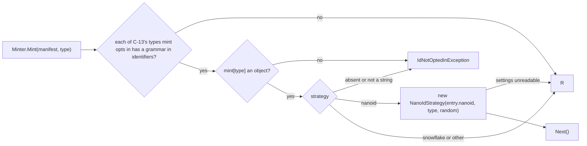
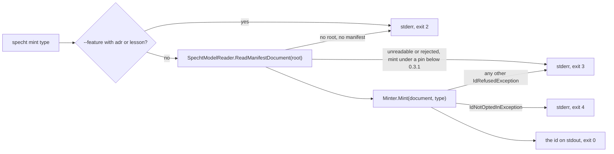

# Specification: Id generation

## 1. Business Goal

<!-- last written by: spec-author, 2026-11-06 -->

An author on a branch takes the next free number from their own copy of the tree, and a branch cut from the same `main` takes the same one; git reports nothing, and lesson 0005 records decisions, claims, constraints, questions and work items claimed two and three times and one duplicate item id reaching `main`. This Feature removes that failure state for every record type a consumer opts in: the pinned `specht` mints a new id that no other branch, worktree or agent can take, and prints it, while every type the consumer does not opt in keeps its own numbering untouched.

## 2. User Needs

<!-- last written by: spec-author, 2026-11-07 (A-1 to A-4 amended; A-6 and A-7 added); spec-author, 2026-11-08 (A-8 added, item 0422 review) -->

| #   | Persona                                                   | Need                                                                     | Pain Point Today                                                                    |
| --- | --------------------------------------------------------- | ------------------------------------------------------------------------ | ----------------------------------------------------------------------------------- |
| 1   | An author on a branch cut in parallel with others         | A new id for a record that no other branch can also take                 | Takes the next number by hand, collides, and renumbers before merging (lesson 0005) |
| 2   | An agent session in one of several worktrees on a machine | An id from the pinned tool rather than one read off its copy of the tree | Reads the highest id on its branch and takes the next, as every other session does  |
| 3   | A consumer with numbering of its own                      | Every type it does not opt in left exactly as it is                      | N/A (a contract this Feature must not break)                                        |
| 4   | `0132-F4`, reading through MCP                            | A command whose standard output is the minted id                         | N/A (internal dependency; no command mints an id)                                   |

### Assumptions

| ID  | Assumption                                                                                                                                                                                                     |
| --- | -------------------------------------------------------------------------------------------------------------------------------------------------------------------------------------------------------------- |
| A-1 | "The id settings" in these claims are the manifest's top-level `mint` key (C-12), "a type" is one of the names C-13 lists, and "a strategy's settings" are that strategy's own sub-object in the type's entry. |
| A-2 | "A request to mint an id" is `specht mint <type> [--feature <dir>] [--root <dir>]`, one id per request (OQ-8, ADR-0033).                                                                                       |
| A-3 | Item `0256` is done: its ADR-0033 is accepted (2026-11-07) and answers OQ-1 to OQ-10 and OQ-12; its trial branch is evidence only, and no claim waits on it.                                                   |
| A-4 | "The tree holds an id of the type" (B-010) means where B-038 to B-042 say the collision guard looks for that type.                                                                                             |
| A-5 | A "candidate" is the id a type's strategy produces with its formatting applied, before the collision guard and validation accept it.                                                                           |
| A-6 | In a scenario, a manifest that opts a type in also declares in `identifiers` a grammar that admits the type's minted ids, unless the scenario says it declares none.                                           |
| A-7 | In these claims, a request for a `decision`, `claim`, `constraint`, `openQuestion` or `scenario` id names its Feature with `--feature`; a request that does not is OQ-15's, and no claim states it.            |
| A-8 | In a scenario run through the command, "no id is minted" is observed as nothing written on standard output, as B-001 observes it, and the request then ends as B-017 states.                                   |

## 3. Acceptance Criteria

<!-- last written by: spec-author, 2026-11-07 (B-016 to B-045 added; Source cells of settled questions cite ADR-0033); spec-author, 2026-11-08 (B-046 to B-051 added, item 0422); spec-author, 2026-11-08 (B-046 withdrawn, item 0422 review); spec-author, 2026-11-09 (B-043's Source cites A-1, item 0415 review); spec-author, 2026-11-09 (B-002 narrowed to exit `4`, OQ-11 answered in part, item 0415); spec-author, 2026-11-09 (B-002 reaches an entry naming no strategy, OQ-11's second answer, item 0415) -->

| ID    | Claim                                                                                                                                                                                                                                         | Source                                                                                                                                                                                                 | Status    |
| ----- | --------------------------------------------------------------------------------------------------------------------------------------------------------------------------------------------------------------------------------------------- | ------------------------------------------------------------------------------------------------------------------------------------------------------------------------------------------------------ | --------- |
| B-001 | Given a request to mint an id of a type the manifest does not opt in, this Feature writes nothing on standard output.                                                                                                                         | the owner, 2026-11-06 (item `0256`); decision 0001; C-2                                                                                                                                                | Active    |
| B-002 | Given a request to mint an id of a type the manifest does not opt in, or whose entry in the manifest's id settings names no strategy, this Feature exits `4`.                                                                                 | the owner's selections, 2026-11-09 (item `0415`); decision 0001; C-2; C-10; OQ-11                                                                                                                      | Active    |
| B-003 | Given a request to mint an id of a type the manifest opts in, this Feature writes exactly one line on standard output, holding the minted id and nothing else.                                                                                | the owner's selection, 2026-11-06 (item `0256`); decision 0001; C-1                                                                                                                                    | Active    |
| B-004 | Given a request that prints a minted id, this Feature exits `0`.                                                                                                                                                                              | AGENTS.md § CLI; C-10                                                                                                                                                                                  | Active    |
| B-005 | Given a type opted in to Nano ID with a size, this Feature mints an id whose part after the type's prefix is exactly that many characters long.                                                                                               | the owner, 2026-11-06 (item `0256`); OQ-3; ADR-0033                                                                                                                                                    | Active    |
| B-006 | Given a type opted in to Nano ID with an alphabet, this Feature mints an id in which every character after the type's prefix is in that alphabet.                                                                                             | the owner, 2026-11-06 (item `0256`); OQ-3; ADR-0033                                                                                                                                                    | Active    |
| B-007 | Given a type opted in to Snowflake with an epoch, this Feature mints an id that, decoded under the type's encoding and field widths, holds the milliseconds from that epoch to the time it was minted.                                        | the owner, 2026-10-23 and 2026-11-06 (item `0256`); OQ-1, OQ-2, OQ-4; ADR-0033                                                                                                                         | Active    |
| B-008 | Given two types opted in with different strategy settings, this Feature mints each type's id with that type's own settings.                                                                                                                   | the owner, 2026-11-06 (item `0256`); C-3                                                                                                                                                               | Active    |
| B-009 | Given a type whose formatting names a prefix, this Feature mints an id that starts with that prefix.                                                                                                                                          | the owner's selection, 2026-11-06 (item `0256`); OQ-4; ADR-0033                                                                                                                                        | Active    |
| B-010 | Given a tree that already holds, as an id of the type, the first candidate the type's strategy produces, this Feature prints an id the tree does not hold.                                                                                    | the owner's selection, 2026-11-06 (item `0256`); A-4; OQ-9; ADR-0033                                                                                                                                   | Active    |
| B-011 | Given a candidate that the manifest's `identifiers` grammar for its type does not match, this Feature writes nothing on standard output.                                                                                                      | the owner's selection, 2026-11-06 (item `0256`); C-4; OQ-10; ADR-0033                                                                                                                                  | Active    |
| B-012 | Given a candidate that the manifest's `identifiers` grammar for its type does not match, this Feature exits `2`, `3` or `4`.                                                                                                                  | C-10; OQ-11                                                                                                                                                                                            | Active    |
| B-013 | Given any request to mint an id, this Feature creates, modifies and deletes no file under the root or elsewhere.                                                                                                                              | the owner, 2026-11-06 (decision 0001); C-1; C-11                                                                                                                                                       | Active    |
| B-014 | Given a valid manifest that opts types in, this Feature leaves the check reporting the violations the same tree gets with the id settings removed.                                                                                            | the owner, 2026-11-06 (item `0256`); C-6; C-8                                                                                                                                                          | Active    |
| B-015 | Given a manifest whose id settings its pinned schema version does not accept, this Feature exits `3` on a request to mint an id.                                                                                                              | AGENTS.md § CLI; `0001-F5` B-012; C-6; OQ-7; ADR-0033                                                                                                                                                  | Active    |
| B-016 | Given a request with `--feature` to mint an `adr` or `lesson` id, this Feature writes nothing on standard output.                                                                                                                             | ADR-0033 § "The Feature to specify next"; OQ-8                                                                                                                                                         | Active    |
| B-017 | Given a request to mint an id that writes nothing on standard output, this Feature exits `2`, `3` or `4`.                                                                                                                                     | C-10; OQ-11; decision 0003                                                                                                                                                                             | Active    |
| B-018 | Given a request to mint an `epic`, `feature` or `task` id, this Feature writes nothing on standard output.                                                                                                                                    | decision 0003; C-13                                                                                                                                                                                    | Active    |
| B-019 | Given a type opted in to Nano ID that names no alphabet, this Feature mints an id in which every character after the type's prefix is one of `0123456789abcdefghjkmnpqrstvwxyz`.                                                              | ADR-0033 (OQ-3)                                                                                                                                                                                        | Active    |
| B-020 | Given an `adr` or `lesson` type opted in to Nano ID that names no size, this Feature mints an id whose part after the type's prefix is 8 characters long.                                                                                     | ADR-0033 (OQ-3)                                                                                                                                                                                        | Active    |
| B-021 | Given a `decision`, `claim`, `constraint`, `openQuestion` or `scenario` type opted in to Nano ID that names no size, this Feature mints an id whose part after the type's prefix is 6 characters long.                                        | ADR-0033 (OQ-3)                                                                                                                                                                                        | Active    |
| B-022 | Given a type opted in to Snowflake that names no epoch, this Feature mints an id that, decoded, holds the milliseconds from 2026-01-01 at midnight, universal time, to the time it was minted.                                                | ADR-0033 § "The Feature to specify next", finding 3                                                                                                                                                    | Active    |
| B-023 | Given a type opted in to Snowflake that names no field widths, this Feature mints an id whose lowest 12 bits are its sequence, the 5 above them its worker and the 5 above those its datacenter.                                              | ADR-0033 § "The Feature to specify next"                                                                                                                                                               | Active    |
| B-024 | Given a type opted in to Snowflake that names no datacenter, this Feature mints an id whose datacenter field holds a value drawn at random for that request.                                                                                  | ADR-0033 (OQ-1); C-16                                                                                                                                                                                  | Active    |
| B-025 | Given a type opted in to Snowflake that names no worker, this Feature mints an id whose worker field holds a value drawn at random for that request.                                                                                          | ADR-0033 (OQ-1); C-16                                                                                                                                                                                  | Active    |
| B-026 | Given a type opted in to Snowflake that names no sequence start, this Feature mints an id whose sequence field holds a value drawn at random for that request.                                                                                | ADR-0033 (OQ-1)                                                                                                                                                                                        | Active    |
| B-027 | Given a type opted in to Snowflake with a datacenter number, this Feature mints an id whose datacenter field holds that number.                                                                                                               | ADR-0033 (OQ-1); C-16                                                                                                                                                                                  | Active    |
| B-028 | Given a type opted in to Snowflake with a worker number, this Feature mints an id whose worker field holds that number.                                                                                                                       | ADR-0033 (OQ-1); C-16                                                                                                                                                                                  | Active    |
| B-029 | Given a Snowflake type whose first candidate the tree holds, and a clock that reads earlier at the next draw than at the first, this Feature writes nothing on standard output.                                                               | ADR-0033 (OQ-2)                                                                                                                                                                                        | Active    |
| B-030 | Given a type opted in to Snowflake with the encoding `base32`, this Feature mints an id whose part after the type's prefix is the Snowflake number written in base32 over `0123456789abcdefghjkmnpqrstvwxyz`.                                 | ADR-0033 (OQ-4); C-15                                                                                                                                                                                  | Active    |
| B-031 | Given a type opted in to Snowflake with the encoding `base32`, this Feature mints an id whose part after the type's prefix is 13 characters long.                                                                                             | ADR-0033 (OQ-4), finding 3                                                                                                                                                                             | Active    |
| B-032 | Given a type opted in to Snowflake with the encoding `none`, this Feature mints an id whose part after the type's prefix is the Snowflake number in decimal digits.                                                                           | ADR-0033 (OQ-4); C-15                                                                                                                                                                                  | Active    |
| B-033 | Given a type opted in to Nano ID with the encoding `base32`, this Feature writes nothing on standard output.                                                                                                                                  | ADR-0033 (OQ-4), finding 3; C-15                                                                                                                                                                       | Active    |
| B-034 | Given a tree that holds, as an id of the type, the first candidate in another letter case, this Feature prints an id the tree does not hold in any letter case.                                                                               | ADR-0033 (OQ-9)                                                                                                                                                                                        | Active    |
| B-035 | Given a type that names no number of attempts and a tree that holds each of the first seven candidates, this Feature prints the eighth candidate.                                                                                             | ADR-0033 (OQ-9)                                                                                                                                                                                        | Active    |
| B-036 | Given a type that names no number of attempts and a tree that holds each of the first eight candidates, this Feature writes nothing on standard output.                                                                                       | ADR-0033 (OQ-9)                                                                                                                                                                                        | Active    |
| B-037 | Given a type that names a number of attempts and a tree that holds each of that many first candidates, this Feature writes nothing on standard output.                                                                                        | ADR-0033 (OQ-9), § "The Feature to specify next"                                                                                                                                                       | Active    |
| B-038 | Given a file in any `adr/` folder of the tree whose name is the first `adr` candidate followed by `-`, this Feature prints an `adr` id that no file name in an `adr/` folder starts with.                                                     | ADR-0033 (OQ-9), § "The Feature to specify next"                                                                                                                                                       | Active    |
| B-039 | Given a file in any `lessons/` folder of the tree whose name is the first `lesson` candidate followed by `-`, this Feature prints a `lesson` id that no file name in a `lessons/` folder starts with.                                         | ADR-0033 (OQ-9), § "The Feature to specify next"                                                                                                                                                       | Active    |
| B-040 | Given a file in the `.spec/decisions/` folder of the Feature `--feature` names whose name is the first `decision` candidate followed by `-`, this Feature prints a `decision` id that no file name in that folder starts with.                | ADR-0033 (OQ-9), § "The Feature to specify next"                                                                                                                                                       | Active    |
| B-041 | Given the first `claim`, `constraint` or `openQuestion` candidate in the first column of a table row in the `.spec/README.md` of the Feature `--feature` names, this Feature prints an id of that type that no first column there holds.      | ADR-0033 (OQ-9), § "The Feature to specify next"                                                                                                                                                       | Active    |
| B-042 | Given a scenario in a `.feature` file of the Feature `--feature` names that carries a tag of `@` followed by the first `scenario` candidate, this Feature prints a `scenario` id that no scenario of that Feature carries after `@` in a tag. | ADR-0033 (OQ-5, OQ-9); C-18                                                                                                                                                                            | Active    |
| B-043 | Given a manifest that opts in a type for which `identifiers` holds no grammar, this Feature exits `3` on a request to mint an id.                                                                                                             | ADR-0033 (OQ-10); A-1; C-14                                                                                                                                                                            | Active    |
| B-044 | Given a manifest pinned to schema `0.3.1` whose only difference from a valid manifest is a `mint` key in C-12's shape, the check does not exit `3`.                                                                                           | ADR-0033 (OQ-7); decision 0003; C-12, C-17                                                                                                                                                             | Active    |
| B-045 | Given a manifest pinned to schema `0.3.1` whose only difference from a valid manifest is an `adr`, `lesson`, `decision` or `scenario` grammar in `identifiers`, the check does not exit `3`.                                                  | ADR-0033 (OQ-10); decision 0003; C-14, C-17                                                                                                                                                            | Active    |
| B-046 | Given a request to mint an id of a type the manifest does not opt in, this Feature mints no id.                                                                                                                                               | Withdrawn 2026-11-08 by spec-author, on item `0422`'s review: B-001 states the same refusal and its scenario observes the same thing (§ 10). Was: the owner's selection, 2026-11-08 (item `0422`); C-2 | Withdrawn |
| B-047 | Given a type whose entry in the manifest's id settings names no strategy, this Feature mints no id of that type.                                                                                                                              | the owner's selection, 2026-11-08 (item `0422`); C-2, C-12                                                                                                                                             | Active    |
| B-048 | Given a type whose entry in the manifest's id settings names a strategy other than `nanoid` or `snowflake`, this Feature mints no id of that type.                                                                                            | the owner's selection, 2026-11-08 (item `0422`); C-3, C-12                                                                                                                                             | Active    |
| B-049 | Given a type opted in to Nano ID whose Nano ID settings are not an object, this Feature mints no id of that type.                                                                                                                             | the owner's selection, 2026-11-08 (item `0422`); C-12                                                                                                                                                  | Active    |
| B-050 | Given a type opted in to Nano ID whose alphabet is empty or is not a string, this Feature mints no id of that type.                                                                                                                           | the owner's selection, 2026-11-08 (item `0422`); C-12                                                                                                                                                  | Active    |
| B-051 | Given a type opted in to Nano ID whose size is not a positive whole number, this Feature mints no id of that type.                                                                                                                            | the owner's selection, 2026-11-08 (item `0422`); C-12                                                                                                                                                  | Active    |

## 4. Constraints

<!-- last written by: spec-author, 2026-11-07 (C-12 to C-18 added) -->

| ID   | Constraint                                                                                                                                                                                                                                                                                                                                                | Rules Out                                                                                                                                                                                         |
| ---- | --------------------------------------------------------------------------------------------------------------------------------------------------------------------------------------------------------------------------------------------------------------------------------------------------------------------------------------------------------- | ------------------------------------------------------------------------------------------------------------------------------------------------------------------------------------------------- |
| C-1  | Print only: a request writes the minted id on standard output and nothing anywhere else (the owner, 2026-11-06; decision 0001).                                                                                                                                                                                                                           | Writing the id into a document, a file name or `.issue/.sequence`; any state file, a Snowflake last-time or sequence file included; a new entry in the write invariant of AGENTS.md § Invariants. |
| C-2  | Opt in means opt in: a type is minted for only when the manifest names it with a strategy (the owner, 2026-11-06; item `0256`).                                                                                                                                                                                                                           | A default strategy for a type the manifest does not name; a sequence default; a fallback to the sequence when a type is absent or its strategy cannot mint.                                       |
| C-3  | Two built-in strategies, Nano ID and Snowflake, and each reads only its own settings (the owner, 2026-11-06; item `0256`).                                                                                                                                                                                                                                | A consumer-supplied strategy (§ 5 row 1); a sequence strategy; one strategy reading another's settings; a third strategy without a specification delta.                                           |
| C-4  | Formatting, the collision guard and validation are the decorators around a strategy, and validation reads a type's grammar only from the manifest's `identifiers` (the owner's selection, 2026-11-06).                                                                                                                                                    | A second grammar for a type held in the id settings or in code; a decorator that rewrites or renumbers an id already in the tree.                                                                 |
| C-5  | The id settings are one top-level manifest key, which the checker owns ([ADR-0023](../../../../.spec/adr/0023-codeanalysis-is-the-only-csharp-specific-manifest-section.md)).                                                                                                                                                                             | Settings under `codeAnalysis`; a configuration file beside the manifest; settings spread over several top-level keys.                                                                             |
| C-6  | The key is an opt-in addition and enters a schema patch (`0001-F7` C-11 and decision 0022).                                                                                                                                                                                                                                                               | A `0.minor` step for it; a required key; a rule id or a verdict reached by a tree whose manifest does not set it.                                                                                 |
| C-7  | Minting is offline and needs no coordinator (AGENTS.md § Invariants; [ADR-0028](../../../../.spec/adr/0028-files-stay-the-reading-path-and-online-allocation-waits.md)).                                                                                                                                                                                  | A network call; a lock, allocation or reservation service; a call to GitHub; epic `0324`'s allocation authority.                                                                                  |
| C-8  | The check never mints, and stays deterministic (AGENTS.md § Invariants).                                                                                                                                                                                                                                                                                  | The check calling a strategy or a decorator; a verdict that depends on the clock or on a random source.                                                                                           |
| C-9  | The strategies and decorators live in the engine; the command and the MCP tool hold none ([ADR-0031](../../../../.spec/adr/0031-the-mcp-is-its-own-program-that-runs-the-repositorys-pinned-specht.md); `0132-F3`).                                                                                                                                       | A strategy or decorator in the command's folder or in `src/mcp`; the MCP minting in its own process.                                                                                              |
| C-10 | A request that prints no id exits with a failure code the check already gives, `2`, `3` or `4` (AGENTS.md § CLI).                                                                                                                                                                                                                                         | Exit `0` or `1` with nothing printed, which `0132-F4` B-020 reads as a tool no longer restored; a new exit code.                                                                                  |
| C-11 | An id already in the tree is never renumbered or rewritten (AGENTS.md § Stable IDs).                                                                                                                                                                                                                                                                      | `init`, `upgrade` or `format` rewriting ids under a strategy; a migration of existing sequence ids to minted ones.                                                                                |
| C-12 | The id settings are the top-level key `mint`, an object keyed by type, each entry holding `strategy` (`nanoid` or `snowflake`), that strategy's sub-object (`nanoid`: `alphabet`, `size`; `snowflake`: `epoch`, `datacenterBits`, `workerBits`, `sequenceBits`, `datacenter`, `worker`, `sequenceStart`), `prefix`, `encoding` and `attempts` (ADR-0033). | Another key name; a list of types in place of an object keyed by type; a strategy's setting beside `strategy` or in the other strategy's sub-object.                                              |
| C-13 | The first slice opts in seven types, `adr`, `lesson`, `decision`, `claim`, `constraint`, `openQuestion` and `scenario` (decision 0003).                                                                                                                                                                                                                   | Minting an `epic`, `feature` or `task` id; a change to an id pattern in any frontmatter schema; a change to `ItemSequenceRule`'s task-id literal for minted ids.                                  |
| C-14 | No shipped default grammar in `identifiers` changes, the `adr`, `lesson`, `decision` and `scenario` grammars ship with no default, and a consumer that opts a type in widens its own grammar (ADR-0033).                                                                                                                                                  | A widened shipped `claim`, `constraint` or `openQuestion` grammar; a shipped default grammar for the four new keys; the tool widening a consumer's grammar.                                       |
| C-15 | Formatting offers two encodings, `none` and `base32`, and `base32`, lower-case over `0123456789abcdefghjkmnpqrstvwxyz`, is for Snowflake only (ADR-0033).                                                                                                                                                                                                 | A truncated or shortened Snowflake; a mixed-case or url-safe alphabet as a default; a third encoding without a specification delta.                                                               |
| C-16 | A Snowflake datacenter and worker are each a number the type names or a value drawn at random for the request (ADR-0033).                                                                                                                                                                                                                                 | Assigning either from the machine name, the branch, the author or the worktree path; the fixed zero fields as a default.                                                                          |
| C-17 | The `mint` key and the four optional `identifiers` keys enter schema `0.3.1`, amended in place before any package carries it (decision 0003; `0001-F7` C-17, decision 0022).                                                                                                                                                                              | Schema `0.3.2` for them; either in `0.3.0` or a lower version; amending `0.3.1` after a package carries it.                                                                                       |
| C-18 | A scenario id is the Gherkin tag `@S-<id>` on the scenario, numbered per Feature (ADR-0033).                                                                                                                                                                                                                                                              | A scenario id in a title, a step or a comment; a repository-wide scenario number; epic `0324`'s scenario key minted here, which is the Feature key plus this id.                                  |

## 5. Out of Scope

<!-- last written by: spec-author, 2026-11-07 (rows 5 and 8 amended; rows 10 to 13 added); spec-author, 2026-11-08 (rows 14 and 15 added, item 0422); spec-author, 2026-11-08 (row 14 cites B-047 to B-051, item 0422 review) -->

| #   | Item                                                                                                                   | Exclusion Reason                                                                                                                                                |
| --- | ---------------------------------------------------------------------------------------------------------------------- | --------------------------------------------------------------------------------------------------------------------------------------------------------------- |
| 1   | A consumer-supplied, pluggable strategy                                                                                | Kept open as a future option (the owner, 2026-11-06; item `0256`); C-3.                                                                                         |
| 2   | A sequence strategy, a sequence default or a fallback to the sequence                                                  | This replaces the sequence (the owner, 2026-11-06; item `0256`); C-2.                                                                                           |
| 3   | Writing a minted id into a document, a file name or a counter                                                          | Print only (the owner, 2026-11-06; decision 0001); C-1.                                                                                                         |
| 4   | Renumbering or rewriting an id already in the tree, under any strategy                                                 | AGENTS.md § Stable IDs; C-11.                                                                                                                                   |
| 5   | The MCP tool that mints an id                                                                                          | `0132-F4` B-023; ADR-0033 names it `mint`, with arguments `type` and `feature`; C-9.                                                                            |
| 6   | A check that fails on an id claimed twice across `main` and open pull requests, or any rule over minted ids            | Item `0128`; B-014.                                                                                                                                             |
| 7   | Allocation from a shared sequence, online or across machines                                                           | Epic `0324`; ADR-0028; C-7.                                                                                                                                     |
| 8   | Moving this repository's own records - the queue script, `.issue/.sequence`, ADR and lesson numbers - to minted ids    | A follow-up item ADR-0033 names (its decision 8 and § Consequences).                                                                                            |
| 9   | A key a record keeps for its whole lifecycle in a database                                                             | Epic `0324` § "Service mode".                                                                                                                                   |
| 10  | Minting `epic`, `feature` and `task` ids, and widening the frontmatter schemas' id patterns they need                  | A later slice (decision 0003); C-13.                                                                                                                            |
| 11  | Assigning a Snowflake datacenter or worker from the machine, the branch, the author or the worktree path               | Measured to collide and not offered (ADR-0033 finding 2); C-16.                                                                                                 |
| 12  | A state file that detects a clock moved back between two requests                                                      | C-1; ADR-0033 finding 2.                                                                                                                                        |
| 13  | Provisional ids renumbered on merge                                                                                    | Rejected (ADR-0033 option (d)); C-11.                                                                                                                           |
| 14  | What a request B-047 to B-051 mint no id for writes, and how it exits                                                  | The command's claims: B-001, B-002, B-015, B-017 and B-043 (items `0415`, `0416`); OQ-11.                                                                       |
| 15  | A claim that no id is minted for a type that names no Nano ID size and has no default, or for the strategy `snowflake` | Built only while items `0418` and `0419` are open: B-021 gives every per-Feature type a default size, and B-007 and B-022 to B-032 make `snowflake` a strategy. |

## 6. Concern Separation

<!-- last written by: implementer, 2026-11-07 (item `0413`: the `mint` key under `0.3.1`); implementer, 2026-11-08 (item `0414`: the minting pipeline and Nano ID); implementer, 2026-11-08 (item `0414`, review round 3: `Specht.Identifiers`, `Minter`, `RandomSource`, the settings read by `NanoIdStrategy`); implementer, 2026-11-08 (item `0422`: the refusal row is Both, B-046 to B-051); implementer, 2026-11-08 (item `0422` review: B-046 withdrawn, the row cites B-001 and B-047 to B-051, and the command's claims as § 5 row 14 does); implementer, 2026-11-09 (item `0415`: the `mint` command, B-043's grammar check); implementer, 2026-11-09 (item `0415`, round 2: B-002 exits `4`; B-043 over C-13's types); implementer, 2026-11-09 (item `0415`, round 3: an entry naming no strategy exits `4`; B-043 over the C-13 types `mint` opts in) -->

Item `0413` builds the first three rows, item `0414` the next seven and item `0415` the last six; every later item extends the table.

| Concern                                                                                                                                                                    | Classification | Where                                                                                                                                                                                                                                                                                                                         |
| -------------------------------------------------------------------------------------------------------------------------------------------------------------------------- | -------------- | ----------------------------------------------------------------------------------------------------------------------------------------------------------------------------------------------------------------------------------------------------------------------------------------------------------------------------- |
| A manifest pinned to `0.3.1` or later may carry the top-level key `mint` (B-044; C-5, C-12, C-17)                                                                          | Business       | `SpechtManifestParser.Parse`, its unknown-key gate admitting `mint` when the pin is shipped and at least `MintVersion`                                                                                                                                                                                                        |
| The check reads nothing from `mint`, so its verdicts are the ones the tree gets without it (B-014; C-6, C-8)                                                               | Business       | `SpechtStructure` has no member for the key; no rule, loader or runner sees it                                                                                                                                                                                                                                                |
| A grammar for `adr`, `lesson`, `decision` or `scenario` in `identifiers`, with no shipped default (B-045; C-14)                                                            | Business       | `SpechtManifestParser.Filled` lays declared members over the pin's defaults and `GrammarFaults` compiles each; `src/tool/manifest/v0.3.1/manifest.json` declares none of the four                                                                                                                                             |
| Each type is minted from its own `mint` entry, through the strategy that entry names (B-008; C-3, C-12)                                                                    | Business       | `Minter.Mint` selects `mint[type]` and builds the strategy that entry's `strategy` names, per request                                                                                                                                                                                                                         |
| A Nano ID holds the configured number of characters, each from the configured alphabet (B-005, B-006)                                                                      | Business       | `NanoIdStrategy.Next`                                                                                                                                                                                                                                                                                                         |
| Nano ID reads only its own `nanoid` sub-object (C-3)                                                                                                                       | Business       | `Minter.Mint` hands the `NanoIdStrategy` constructor `entry["nanoid"]` and the type, and nothing else of the entry                                                                                                                                                                                                            |
| An absent alphabet is lower-case base32 (B-019); an absent `adr` or `lesson` size is 8 (B-020)                                                                             | Business       | The `NanoIdStrategy` constructor fills the alphabet with `NanoIdStrategy.Base32` and the size from `NanoIdStrategy.DefaultSize`                                                                                                                                                                                               |
| A request the minter refuses gives no id (B-001, B-043, B-047 to B-051), and a reason with no absolute path in it                                                          | Both           | `IdRefusedException`, thrown by `Minter.Mint` and the `NanoIdStrategy` constructor, and its subtype `IdNotOptedInException` for a type `mint` does not name or whose entry names no strategy; what the command does with it is the command's claims' (§ 5 row 14; B-001, B-002, B-015, B-017, B-043; items `0415` and `0416`) |
| A draw is uniform, needs no network and keeps no state between requests (C-1, C-7)                                                                                         | Technical      | `RandomSource` over `RandomNumberGenerator.GetInt32`, behind `IRandomSource`, which a test replaces                                                                                                                                                                                                                           |
| The strategy lives in the engine, and no command or `src/mcp` holds one (C-9)                                                                                              | Technical      | `src/specht/Identifiers/`; `AddSpechtEngine` registers `IRandomSource` (kept when registered earlier) and `Minter`                                                                                                                                                                                                            |
| A request for an opted-in type writes one line, the id alone, and exits `0` (B-003, B-004; C-1)                                                                            | Business       | `MintCommand.ExecuteAsync` writes `Minter.Mint`'s return through the console's output writer and nothing else; it opens no file for writing                                                                                                                                                                                   |
| A request that prints no id writes nothing on standard output, its reason on standard error with no absolute path, and exits `2`, `3` or `4` (B-001, B-002, B-017; C-10)   | Both           | `MintCommand`'s catch clauses and `Fail`: `IdNotOptedInException` is `4` (B-002, the owner's selections on OQ-11), and the rest of the mapping is § 7's design choice under OQ-11's default                                                                                                                                   |
| `--feature` is refused for `adr` and `lesson`, whatever folder it names (B-016)                                                                                            | Business       | `MintCommand.ExecuteAsync`, from the arguments alone, before any file is read                                                                                                                                                                                                                                                 |
| Id settings the pin does not accept refuse a request with exit `3` (B-015; C-17)                                                                                           | Business       | `SpechtModelReader.ReadManifestDocument` through `SpechtManifestParser`'s `mint` key gate (item `0413`), the read the check shares                                                                                                                                                                                            |
| Every one of C-13's types `mint` opts in has a grammar in `identifiers`, or no request gets an id (B-043; A-1; C-4, C-13, C-14), and the check never reads it (B-014; C-8) | Business       | `Minter.Mint`, over its `Types` list, before it reads the requested entry; the parser and every rule are unchanged                                                                                                                                                                                                            |
| The command parses, calls the engine, prints and folds a refusal into an exit code, and holds no strategy or decorator (C-9)                                               | Technical      | `src/tool/Features/Mint/`: `MintCommand` and `MintRegistration`; `Program.cs` calls `AddMint`                                                                                                                                                                                                                                 |

## 7. Technical Design

<!-- last written by: implementer, 2026-11-07 (item `0413`: the `mint` key under `0.3.1`; ADR-0033's shipped-manifest consequence reconciled, review round 1); implementer, 2026-11-08 (item `0414`: the minting pipeline and Nano ID); implementer, 2026-11-08 (item `0414`, review round 3: `Specht.Identifiers`, `Minter`, `RandomSource`, the settings read by `NanoIdStrategy`); implementer, 2026-11-08 (item `0422`: the refusals traced to B-046 to B-051); implementer, 2026-11-08 (item `0422` review: B-046 withdrawn, its refusal traced to B-001); implementer, 2026-11-09 (item `0415`: the `mint` command; B-043 in `Minter.Mint`); implementer, 2026-11-09 (item `0415`, round 2: `IdNotOptedInException` and exit `4` for B-002, the owner's selection on OQ-11; B-043 narrowed to C-13's types); implementer, 2026-11-09 (item `0415`, round 3: B-047's entry is `IdNotOptedInException` and exits `4`, the owner's selection; B-043 counts a member that names a strategy) -->

### The key at this step: acceptance, no model

`0413` adds one version gate to `SpechtManifestParser` (`src/specht/Manifest/SpechtManifestParser.cs`), the pattern `pinPolicy`, `keys` and `forms` already follow: `MintVersion` is `0.3.1`, and `Parse` admits `mint` only when the pin is at least that and shipped. Below it the key stays unknown and the manifest is rejected, as before. The parser builds nothing from the key, and `SpechtStructure` gains no member, so nothing the check is handed can read it (C-8). The effective document that `specht manifest` prints starts from a copy of the manifest as written, so it shows `mint` as declared. The shipped `0.3.1` default manifest gets no `mint` entry, so `upgrade`, which adds only keys the pinned default defines (`ManifestKeyEditor`), never writes one (C-6).

B-045 needed no change. `identifiers` is filled name by name from whatever the manifest declares, and no list of permitted member names exists under any pin. So a grammar for one of the four types is accepted at `0.3.1` and, as a fact of the code, at every lower pin too; no claim states that a lower pin refuses one.

No shipped file under `src/tool/` changed, so `0.3.1`'s version lock is unchanged and no relock was needed. The lock covers the schema, manifest, template and rule-page trees, not the engine's key gate.

Rejected:

- **A parsed `mint` model on `SpechtStructure` now.** No claim at this step reads the settings, and a member on the structure every rule is handed is a way for the check to read them. The reader is built with its first caller, the minting pipeline (item `0414`).
- **Checking C-12's shape in the parser now**, for example the `strategy` value or the members of a sub-object. No cited claim says a malformed entry is refused, and refusal on a mint request is a later item's claim (B-015, B-043).
- **`mint` in `KnownKeys`.** That list holds the keys every pin accepts, so `0.3.0` and lower would accept `mint`, against C-17 and B-015.
- **A JSON Schema for the manifest that describes `mint`.** No JSON Schema describes the manifest. It is configuration, and the parser is where its keys are checked.
- **A default `mint` entry, or a default grammar for the four new `identifiers` keys, in the shipped `0.3.1` manifest.** [ADR-0033](../../../../.spec/adr/0033-hand-cited-ids-are-minted-by-nano-id-and-snowflake-takes-random-fields.md) § Consequences lists "the shipped manifests" as carrying "the optional `mint` key and the four optional `identifiers` keys". The delivered shape departs from that reading, because "optional" keeps them out of the shipped defaults. C-14 rules out a shipped grammar for the four keys. A `mint` default would make the key no longer opt-in (C-6), and `upgrade` would add it to every consumer's manifest. `pinPolicy` set the precedent: schema `0.3.0` defines it in the engine's gate, and no shipped default manifest gains it ([`0001-F7` decision 0021](../../../tool/.spec/decisions/0021-pinpolicy-enters-schema-0-3-0-and-upgrade-names-the-version-in-use.md)). So the version defines the keys, and the shipped files stay as they were.

### The minting pipeline and Nano ID (item `0414`)

Six types under `src/specht/Identifiers/`, namespace `Specht.Identifiers`, each in its own file:

| Type                 | File                                                | What it is                                                                                                                                                                                                            |
| -------------------- | --------------------------------------------------- | --------------------------------------------------------------------------------------------------------------------------------------------------------------------------------------------------------------------- |
| `IIdStrategy`        | [`IIdStrategy.cs`](../IIdStrategy.cs)               | The Strategy, `string Next()`. A later decorator implements it and wraps another `IIdStrategy` (C-4).                                                                                                                 |
| `NanoIdStrategy`     | [`NanoIdStrategy.cs`](../NanoIdStrategy.cs)         | Built from a type's `nanoid` sub-object and the type; `Next` draws `size` characters, each `alphabet[random.Next(alphabet.Length)]` (B-005, B-006). Holds the constant `Base32` (B-019) and the default size (B-020). |
| `IRandomSource`      | [`IRandomSource.cs`](../IRandomSource.cs)           | `int Next(int maxExclusive)`, uniform in `[0, maxExclusive)`.                                                                                                                                                         |
| `RandomSource`       | [`RandomSource.cs`](../RandomSource.cs)             | `RandomNumberGenerator.GetInt32`, offline and stateless (C-7).                                                                                                                                                        |
| `Minter`             | [`Minter.cs`](../Minter.cs)                         | An instance over an `IRandomSource`; `Mint(JsonObject manifest, string type)` returns one id.                                                                                                                         |
| `IdRefusedException` | [`IdRefusedException.cs`](../IdRefusedException.cs) | The refusal. Its message names the type and the key path, never a file path.                                                                                                                                          |

`Mint` builds the strategy on every call from that type's entry, so two types never share settings (B-008) and nothing survives between requests (C-1). The minter knows a strategy's name and nothing of its settings: it hands `NanoIdStrategy` `entry["nanoid"]` and the type, so a `snowflake` sub-object beside it is never read (C-3). The strategy's constructor reads that sub-object alone. An absent sub-object names no alphabet and no size, so both defaults apply. An absent `alphabet` is `NanoIdStrategy.Base32` (B-019). An absent `size` is 8 for `adr` and `lesson`, from `DefaultSize` (B-020). Any other type with no size is refused until item `0418` adds B-021's 6.

Refusals fall where the knowledge sits. The minter refuses a type `mint` does not name and a `strategy` that is absent, not a string, or not built (`snowflake` until item `0419`); the first two cases are `IdNotOptedInException` (item `0415`, B-002). The `NanoIdStrategy` constructor refuses a `nanoid` member that is not an object, an `alphabet` that is not a non-empty string, a `size` that is not a positive integer, and an absent size for a type with no default. B-001 and B-047 to B-051 state all but two of them, and item `0422` changed no code to meet them: `Minter.Mint` carries B-001 (a type not opted in, so no id reaches the command to print), B-047 (no strategy named) and B-048 (a strategy other than `nanoid` or `snowflake`), and the `NanoIdStrategy` constructor carries B-049 (settings not an object), B-050 (an alphabet that is empty or not a string) and B-051 (a size that is not a positive whole number). Two refusals stay unclaimed while items `0418` and `0419` are open, an absent size for a type with no default and `snowflake` (§ 5 row 15). Each claimed refusal is an `IdRefusedException`, B-001's and B-047's its subtype `IdNotOptedInException`; the output and exit code a refused request gets stay with the command's claims (§ 5 row 14; items `0415` and `0416`; B-001, B-002, B-015, B-017, B-043; C-10).

The minter takes the manifest as a `JsonObject` and holds no file system and no root. It cannot write (C-1) and has no path to put in a message. Reading the manifest from the tree is the caller's job, item `0415`. No decorator exists at this step, so the strategy is the whole pipeline and the id is the part after the type's prefix. Items `0416`, `0417` and `0420` wrap it in `Mint`.

`AddSpechtEngine` ([`SpechtEngineServiceCollectionExtensions.cs`](../../Composition/SpechtEngineServiceCollectionExtensions.cs)) registers `RandomSource` as `IRandomSource` with `TryAddSingleton`, as it does `IFileSystem`, so a source registered earlier is kept. It registers `Minter` as a singleton. `MintCommand` is the caller (item `0415`). Reuse: `Minter` and `NanoIdStrategy` pattern-match `JsonNode` members where they stand, as `EffectiveManifestReader` does with `rules`. No engine type parses the `mint` key, and none should (C-8).

Both read a string member, `strategy` and `alphabet`, with a `JsonValue` pattern and `TryGetValue<string>`, and share no helper. The two differ: a non-string `strategy` is "names no strategy", while a non-string or empty `alphabet` is its own refusal. A shared helper would make the strategy depend on the minter, or add a type for one expression. A third reader is where the shape is settled (`coding-conventions` § Design). Inside `Minter` the strategy read is one private method, `StrategyOf`, since item `0415` gave it a second caller: B-043's check reads each C-13 member's strategy, and the requested entry's read is the first.

Review round 3 ([review 5819141960](https://github.com/RLittlesII/specht/pull/789#pullrequestreview-5819141960)):

- **The folder and namespace** are `src/specht/Identifiers/` and `Specht.Identifiers`, from `IdGeneration` ([decision 0004](decisions/0004-id-generation-lives-at-src-specht-identifiers.md)).
- **`IdMinter` is `Minter`.** The namespace already says what it mints.
- **`CryptographicRandomSource` is `RandomSource`.** The type does no cryptography of its own; it calls `RandomNumberGenerator.GetInt32`, and its summary names that call and claims nothing more.
- **Nano ID's settings moved into `NanoIdStrategy`.** The minter read the alphabet, the size and their defaults into a `NanoIdSettings` record and handed it over, so it knew one strategy's keys. Now the strategy reads its own sub-object, and `NanoIdSettings` is deleted.

Rejected:

- **A decorator interface or base class now**, an `IIdDecorator` beside `IIdStrategy`. No decorator exists at this step. Each one, from item `0416`, is an `IIdStrategy` that wraps an `IIdStrategy`, and the strategy's own interface already gives that shape.
- **A parsed `mint` model on `SpechtStructure` or in `SpechtManifestParser`.** The check must not read the key (B-014, C-8; item `0413`'s § 7). The minter is its only reader, and it reads the type's JSON entry where it stands.
- **A settings record beside the strategy**, the `NanoIdSettings` built before round 3. Its producer and its consumer are now both the strategy's constructor, so it would be a type with no second caller.
- **A static minter**, as the trial at commit `cf626a3a` built it, with the clock, the random source and the held-ids lookup passed on every call. State lives in objects. The random source is a constructor dependency the engine's composition supplies and a test replaces.
- **Reading the manifest file in the minter**, from an `IFileSystem` and a root. That gives the minter a way to reach the tree and a path to leak. Loading the manifest is the command's job, through the engine's manifest store.
- **Validating the settings beyond what a draw needs**, as the trial's `Validate` did: 2 to 256 distinct characters, and the `UrlSafe` and `Bits` members. No cited claim states them. Checking the minted id against the type's grammar is item `0420`'s decorator (C-4).
- **A seeded random source in the engine**, the trial's `SeededRandomSource`. Only its simulation used one. A test supplies its own fixed source.
- **A default-size table or options object keyed by type.** Two types share one value. B-021's six-character default enters with item `0418`, the third case.

### The `mint` command (item `0415`)

Two files under `src/tool/Features/Mint/`, namespace `Specht.Tool.Features.Mint` (decision 0002): [`MintCommand.cs`](../../../tool/Features/Mint/MintCommand.cs), the command with its nested `Settings` (`<type>`, `--feature <DIR>`, `--root <DIR>`, A-2), and [`MintRegistration.cs`](../../../tool/Features/Mint/MintRegistration.cs), whose `AddMint` adds it as `mint`. `Program.cs` calls `AddMint` after `AddManifest`. The engine gains one type for it, [`IdNotOptedInException`](../IdNotOptedInException.cs), an `IdRefusedException` that `Minter.Mint` throws for a type `mint` does not name, or whose entry names no strategy; `IdRefusedException` is no longer sealed so that it can be its base.

The command reads the manifest through `SpechtModelReader.ReadManifestDocument`, the read `specht manifest` already makes (reuse). It gives the missing-root, missing-manifest and rejected-manifest failures every command gives, and the parser's `mint` key gate (item `0413`), so B-015 needed no new code. It reads no frontmatter schema and no specification. It hands the minter the effective document, not the file's text. That document's `identifiers` has the pin's default grammars laid under the declared ones, so `claim`, `constraint` and `openQuestion` have a grammar by default, and `adr`, `lesson`, `decision` and `scenario` have one only when declared (C-14). The id goes out through `IAnsiConsole.Profile.Out.Writer`, as `ManifestCommand` prints. A refusal goes to an injectable `TextWriter` that defaults to standard error, as `RuleSetCommand` does. Each refusal message names a type, a key or the manifest's relative path, never the root (C-10; AGENTS.md § Invariants).

Every refusal is decided inside `ExecuteAsync`, not in `Settings.Validate`. Spectre writes a validation failure to standard output and exits with its own code. That breaks B-001, B-016 and B-017 and C-10.

**Exit codes.** B-002's `4` comes from the owner's selections, which answer OQ-11 for B-002 only: a type not opted in, and an entry naming no strategy (B-047; § 10). The rest of the mapping is a design choice under OQ-11's recorded default, which stays open for B-012 and B-017: C-10 allows `2`, `3` or `4`, and the command picks among them.

| Request                                                                                                                                    | Exit | Source of the refusal                                            |
| ------------------------------------------------------------------------------------------------------------------------------------------ | ---- | ---------------------------------------------------------------- |
| `--feature` with `adr` or `lesson` (B-016)                                                                                                 | `2`  | `MintCommand`, from the arguments                                |
| A root that is not a directory, or no manifest                                                                                             | `2`  | `SpechtRootNotFoundException`, `SpechtManifestNotFoundException` |
| A manifest that is unreadable or rejected, `mint` under a pin below `0.3.1` included (B-015)                                               | `3`  | `SpechtManifestUnreadableException`, `SpechtManifestException`   |
| A type not opted in, or whose entry names no strategy (B-001, B-002, B-047)                                                                | `4`  | `IdNotOptedInException`                                          |
| One of C-13's types `mint` opts in with no grammar (B-043); a strategy not built, or Nano ID settings it cannot draw from (B-048 to B-051) | `3`  | Any other `IdRefusedException`                                   |

- **A type not opted in is `4`**, as something named on the command line that is not found (B-002, the owner's selection), and so is an entry naming no strategy, which C-2 says is not an opt-in (B-002, B-047, the owner's selection). The minter tells it apart by type, `IdNotOptedInException`, so the command still reads nothing of `mint`. Its catch clause comes before the general one.
- **Every other minter refusal is `3`.** Each is the manifest's id settings giving no id for an opted-in type, which is a manifest the engine rejects for that request. B-015 and B-043 fix `3` for two of them. B-048 to B-051 are entries that name a strategy and give no id, so they stay `3` under OQ-11's default.
- **`--feature` with `adr` or `lesson` is `2`.** The arguments alone decide it, before any file is read. Exit `2` already covers refused usage: the frontmatter command's usage line, and a pin with no version and no terminal.
- `docs/cli.md` and `docs/exit-codes.md` state this mapping, and `ExitCodes`' summaries name it. If the rest of OQ-11's answer splits these codes, the change lands in `MintCommand`'s catch clauses, plus an engine refusal type when the split falls inside `IdRefusedException`.

**B-043 sits in `Minter.Mint`.** It is the first step, before the requested entry is read. It checks each of C-13's seven types, `adr`, `lesson`, `decision`, `claim`, `constraint`, `openQuestion` and `scenario`, that `mint` opts in against `identifiers`. A member opts its type in when its value is an object whose `strategy` is a string, the read `StrategyOf` makes. The list is `Minter`'s private `Types`. A-1 reads B-043's "a type" as one of C-13's names (§ 10, item `0415` review). B-043 states the exit for a request for any id of such a manifest, so the check is not limited to the requested type. A C-13 member that names no strategy, or whose value is not an object, opts nothing in, so the check skips it (B-002, B-047). A request for that type exits `4`. For a member whose value is not an object that is the not-opted-in path, which OQ-11 leaves open; nothing is built for it beyond that path.

A `mint` member that names none of C-13's types is outside the check, so a request for an opted-in type beside it mints its id (B-003). Nothing is built for a request that names such a member: it takes the path any other entry takes. Whether such a member is id settings the pin does not accept, and what a request naming it does, is OQ-19.

**`--feature` is checked against the type alone.** The folder it names is not read, resolved or validated, so B-016 holds under every answer to OQ-16. For any other type, `--feature` is accepted and not read, and the request mints as it would without it. Item `0418`'s guard is the first reader of the folder. A per-Feature type with no size is still refused by `NanoIdStrategy` (§ 5 row 15). Nothing decides a per-Feature type without `--feature` (OQ-15; item `0418`). The repository-wide pair `adr`, `lesson` is a literal in the command. It is a different fact from `NanoIdStrategy.DefaultSize`, the size default, and it moves into the engine when item `0418`'s guard becomes its second reader.

The CLI shape stays `--feature <dir>`. `0132-F4` B-023 relays the pinned `specht mint`, and whether its `feature` argument maps to `--feature` is that Feature's OQ-9, which this item does not answer.

Rejected:

- **B-043 in `SpechtManifestParser`.** That is the check's path. A grammar-less `mint` entry would then turn a check into exit `3`, against B-014, B-044 and C-8, which say the check's verdicts do not depend on `mint`.
- **B-043, or any reading of `mint` or `identifiers`, in the command.** C-9 keeps the command thin, and the manifest's id settings are the engine's to read.
- **A separate minting-manifest validator type.** It would have one caller, `Minter.Mint`, and the check is one loop.
- **The B-043 check over every member of `mint`**, as round 1 built it. It refused a request for an opted-in type because of a member that names no type, which B-043 does not state (A-1; OQ-19).
- **The B-043 check over every C-13 member `mint` names, whatever its value**, as round 2 built it. It refused a request for an opted-in type because of a member naming no strategy, which opts nothing in (B-002, B-047).
- **The command reading `mint` to tell a type not opted in apart**, in place of `IdNotOptedInException`. C-9 keeps the command thin, and the minter already knows the case.
- **`IdNotOptedInException` as a sibling of `IdRefusedException`.** As a subtype it keeps every existing catch of `IdRefusedException` meaning "no id", and the engine's tests of B-001 still hold.
- **`--feature` refused in `Settings.Validate`.** Spectre's output and exit code break B-016 and C-10.

## 8. Testing Strategy

<!-- last written by: test-writer, 2026-11-07 (B-014, B-044 and B-045; item 0413; B-044's lower bound, review round 1); test-writer, 2026-11-08 (B-005, B-006, B-008, B-019 and B-020; item 0414); test-writer, 2026-11-08 (review round 1: the absent sub-object, C-3's outside settings, the kept random source; item 0414); test-writer, 2026-11-08 (review round 3: `Specht.Identifiers`, `Minter`, the settings read by `NanoIdStrategy`, the standing notes on the current names; item 0414); test-writer, 2026-11-08 (B-046 to B-051 and the random source's range; item 0422); test-writer, 2026-11-08 (review: B-046's test traced to B-001, the case count, B-006 alone for the random source; item 0422); test-writer, 2026-11-09 (B-001 to B-004, B-015, B-016 and B-043 through the command; the scenarios of B-005, B-006, B-008, B-019, B-020 and B-047 to B-051 and two rows of B-017's bound; item 0415); test-writer, 2026-11-09 (B-043 at `Minter`, the command's fold; item 0415 green); test-writer, 2026-11-09 (B-043's reach limited to C-13's types; a `mint` member naming no type; item 0415 review round 1); test-writer, 2026-11-09 (B-002 exits `4`, the owner's selection on OQ-11; item 0415); test-writer, 2026-11-09 (item 0415 round 2 green: B-002, B-003 and B-043); test-writer, 2026-11-09 (B-002 row names the no-strategy fold row; item 0415 review round 2); test-writer, 2026-11-09 (an entry naming no strategy exits `4`, B-002 and B-047; a C-13 member naming no strategy is outside B-043's check; item 0415); test-writer, 2026-11-09 (item 0415 round 3 green: B-002, B-003, B-043 and B-047) -->

B-001 to B-006, B-008, B-014 to B-016, B-019, B-020, B-043 to B-045 and B-047 to B-051 are tested at both tiers, and B-017's not-opted-in and for-a-Feature rows through the command; every other claim waits on the item that builds it.

The acceptance scenarios run the built tool as a process over a synthetic root that `SpechtTree` writes, holding this repository's default manifest, and read an invalid manifest as exit `3` (`IdGenerationSteps`). "A tree whose check reports a violation" is the baseline tree under the manifest's own pin, and "the id settings removed" is the same manifest without `mint` (A-1). The unit tests run `SpechtManifestParser` in memory over a manifest the test writes; the integration test runs `SpechtRunner` over the baseline tree on disk, pinned to `0.3.1`. Their rows come from `MintedTypes`, one per C-13 type, each with a C-12 entry that alternates the two strategies so that every member of both sub-objects appears, and a grammar admitting the ids the entry mints (A-6); and from `NewTypeGrammars`, one per member C-14 adds. C-12 states no value format: an epoch written `2026-01-01` and a datacenter and worker written as numbers are ADR-0033's words, not a claim.

Item `0414`'s unit tests run `NanoIdStrategy` and `Minter` in memory, with no file system and no network (C-1, C-7), over a manifest the test writes as a `JsonObject`, the document `SpechtManifestDocument.Document` carries. The draws come from `FixedRandomSource`, internal to `test/tests/Identifiers/`: it answers with the draws it is given, in order and then again from the first, records the bound of every request, and refuses a draw that is not below its bound, so no test passes on a draw a uniform source cannot make. No prefix decorator exists at this step (`0417`), so the whole minted id is the part after the type's prefix. Each manifest declares an `identifiers` grammar that admits the id it mints (A-6), so the arrangement stays valid when validation (`0420`) reads it.

The scenarios of B-005, B-006, B-008, B-019 and B-020 were not bound by item `0414`: each says an ADR or lesson number "is requested", a request to the command item `0415` builds. Item `0415` binds them, as it binds those of B-047 to B-051 (item `0422`); see its paragraph below.

| Claim | Mechanism                                                                                                                                                                                                                                                                                                                                                                                                                                                                                                        | Unit test, or why it has none                                                                                                                                                                                                                                                                                                                                                                                                                                                                                                                                                                                                                                                                                                                                                                                                                                                                                                                                                                                                                                                                                                                                                                                                                                                                                                                                                                                                                                                                                                                                                                                                                                                                                                                                |
| ----- | ---------------------------------------------------------------------------------------------------------------------------------------------------------------------------------------------------------------------------------------------------------------------------------------------------------------------------------------------------------------------------------------------------------------------------------------------------------------------------------------------------------------- | ------------------------------------------------------------------------------------------------------------------------------------------------------------------------------------------------------------------------------------------------------------------------------------------------------------------------------------------------------------------------------------------------------------------------------------------------------------------------------------------------------------------------------------------------------------------------------------------------------------------------------------------------------------------------------------------------------------------------------------------------------------------------------------------------------------------------------------------------------------------------------------------------------------------------------------------------------------------------------------------------------------------------------------------------------------------------------------------------------------------------------------------------------------------------------------------------------------------------------------------------------------------------------------------------------------------------------------------------------------------------------------------------------------------------------------------------------------------------------------------------------------------------------------------------------------------------------------------------------------------------------------------------------------------------------------------------------------------------------------------------------------ |
| B-001 | `Minter.Mint`, which refuses a manifest with no `mint` object, or a `mint` object with no entry object for the requested type, before any strategy is built, so no id reaches the command to print; and `MintCommand.ExecuteAsync`'s fold of that refusal, which writes nothing on standard output                                                                                                                                                                                                               | `MinterUnitTests.ATypeTheManifestDoesNotOptIn_WhenMinted_ShouldBeRefusedWithNoIdDrawn` over `TypesNotOptedIn`, B-001's two Examples rows: no `mint` key, and `mint` opting only `lesson` in to Nano ID. Each throws `IdRefusedException` and draws nothing from the `FixedRandomSource`, so a minter that fell back to a default strategy and returned an id fails it. The command's fold: `MintCommandUnitTests.ARequest_WhenExecuted_ShouldFoldTheEngineAnswerIntoItsOutputAndExitCode` over `MintRequestFolds`, the not-opted-in row: nothing on standard output. Through the process, `MintCommandIntegrationTests.ATypeTheManifestDoesNotOptIn_WhenRequested_ShouldWriteNothingOnStandardOutput` over `TypesNotOptedInRequests`, the same two rows                                                                                                                                                                                                                                                                                                                                                                                                                                                                                                                                                                                                                                                                                                                                                                                                                                                                                                                                                                                                      |
| B-002 | `Minter.Mint`'s refusal of a type not opted in (B-001's row) and of an entry naming no strategy (B-047's row) as `IdNotOptedInException`, a kind of `IdRefusedException` its other refusals are not, and `MintCommand.ExecuteAsync`'s fold of it into exit `4`, `ExitCodes.NotFound` (the owner's selections on OQ-11, B-002 and B-047)                                                                                                                                                                          | The refusal's kind: `MinterUnitTests.ATypeTheManifestDoesNotOptIn_WhenMinted_ShouldBeRefusedAsNotOptedIn` over `TypesNotOptedIn`, `MinterUnitTests.AnEntryNamingNoStrategy_WhenMinted_ShouldBeRefusedWithNoIdDrawn` over `EntriesNamingNoStrategy`, and the B-043 theory, whose refusal is not an `IdNotOptedInException`. `IdNotOptedInException` subclasses `IdRefusedException` in `Specht.Identifiers`, so every existing catch holds. The command's fold: `MintCommandUnitTests.ARequest_WhenExecuted_ShouldFoldTheEngineAnswerIntoItsOutputAndExitCode` over `MintRequestFolds`, the not-opted-in and no-strategy rows: exit `4`. Through the process, `MintCommandIntegrationTests.ATypeTheManifestDoesNotOptIn_WhenRequested_ShouldExitAsForSomethingNamedOnTheCommandLineThatIsNotFound` over `TypesNotOptedInRequests` and `EntriesNamingNoStrategyRequests`, no `strategy` and `7` in its place: exit `4`. The not-opted-in rows were red against `61e59bcd` on exit `3`, and the `Minter` test did not compile before the type existed (CS0246, in that file alone); they pass with item `0415`'s round 2. The no-strategy rows, the `Minter` test's two, the fold's, the integration test's two and the scenario's two, were red against `ef2e43d6`, where the minter threw a plain `IdRefusedException` and the command exited `3` on `'mint.adr' names no strategy.`; they pass with item `0415`'s round 3 (`fa8b861e`). B-048 to B-051's refusals keep exit `3`, asserted only against the set `2`, `3` and `4` by their scenarios (A-8; OQ-11 open for them). No test arranges a C-13 member whose value is not an object (OQ-11)                                                                                                           |
| B-003 | `MintCommand.ExecuteAsync`'s write of the id `Minter.Mint` returns as one line through `IAnsiConsole.Profile.Out.Writer`, with nothing else written there                                                                                                                                                                                                                                                                                                                                                        | The command's fold: `MintCommandUnitTests.ARequest_WhenExecuted_ShouldFoldTheEngineAnswerIntoItsOutputAndExitCode` over `MintRequestFolds`, the `adr` and `lesson` rows: standard output is `zzz` and at most one line ending, and nothing on the error writer. Through the process, `MintCommandIntegrationTests.AnOptedInType_WhenRequested_ShouldWriteOneLineHoldingOnlyTheMintedId` over `OptedInRepositoryWideTypes`, `adr` and `lesson`: a Nano ID entry over the one-character alphabet `z` and a size of 3 can mint only `zzz`, so standard output must be `zzz` and at most one line ending, with no random source replaced                                                                                                                                                                                                                                                                                                                                                                                                                                                                                                                                                                                                                                                                                                                                                                                                                                                                                                                                                                                                                                                                                                                         |
| B-004 | `MintCommand.ExecuteAsync`'s return of `ExitCodes.Success` once it has printed an id                                                                                                                                                                                                                                                                                                                                                                                                                             | The command's fold: `MintCommandUnitTests.ARequest_WhenExecuted_ShouldFoldTheEngineAnswerIntoItsOutputAndExitCode` over `MintRequestFolds`, the same rows: exit `0`. Through the process, `MintCommandIntegrationTests.AnOptedInType_WhenItsIdIsPrinted_ShouldExitZero` over `OptedInRepositoryWideTypes`, the same arrangement as B-003's, asserting that `zzz` was printed and the exit is `0`                                                                                                                                                                                                                                                                                                                                                                                                                                                                                                                                                                                                                                                                                                                                                                                                                                                                                                                                                                                                                                                                                                                                                                                                                                                                                                                                                             |
| B-005 | `NanoIdStrategy`, whose constructor reads `size` from the `nanoid` sub-object it is handed and whose `Next` draws that many characters, and `Minter.Mint`, which hands it the requested type's own `nanoid` sub-object                                                                                                                                                                                                                                                                                           | `NanoIdStrategyUnitTests.ANanoIdWithAConfiguredSize_WhenDrawn_ShouldBeThatManyCharactersLong` over `NanoIdSizes` (1, 6, 8, 10 and 21) pins the draw count; that the size is the one the type's entry names, `MinterUnitTests.TwoTypesOptedInWithDifferentNanoIdSettings_WhenEachIsMinted_ShouldMintEachWithItsOwnSizeAndAlphabet`                                                                                                                                                                                                                                                                                                                                                                                                                                                                                                                                                                                                                                                                                                                                                                                                                                                                                                                                                                                                                                                                                                                                                                                                                                                                                                                                                                                                                            |
| B-006 | `NanoIdStrategy.Next`, which takes each character as the alphabet's character at a draw below the alphabet's length, the alphabet its constructor read from the `nanoid` sub-object, and `Minter.Mint`, which hands it the type's own sub-object                                                                                                                                                                                                                                                                 | `NanoIdStrategyUnitTests.ANanoIdWithAConfiguredAlphabet_WhenDrawn_ShouldTakeEachCharacterFromThatAlphabetAtItsDraw`: draws 2, 0, 1 and 1 over `abc` give `cabb`, and every draw is bounded by the alphabet's length, so a uniform source cannot reach a character outside it; that the alphabet is the one the type's entry names, the B-008 test; that the real source's draw is below its bound, `RandomSourceUnitTests.ABound_WhenDrawnBelowRepeatedly_ShouldOnlyGiveWholeNumbersFromZeroToBelowTheBound` over `RandomSourceBounds` (1, 2 and 32), 256 draws each, asserting the range and not the spread                                                                                                                                                                                                                                                                                                                                                                                                                                                                                                                                                                                                                                                                                                                                                                                                                                                                                                                                                                                                                                                                                                                                                 |
| B-008 | `Minter.Mint`, which selects `mint[type]` and builds the strategy from that entry alone, on every request; beneath it C-3: the minter hands `NanoIdStrategy` the entry's `nanoid` sub-object, absent or not, and nothing else of the entry                                                                                                                                                                                                                                                                       | `MinterUnitTests.TwoTypesOptedInWithDifferentNanoIdSettings_WhenEachIsMinted_ShouldMintEachWithItsOwnSizeAndAlphabet`: `adr` with `ab` and 2 and `lesson` with `wxyz` and 5 in one manifest, over a draw of 1, mint `bb` and `xxxxx`. C-3's half, `MinterUnitTests.ANanoIdEntryWithAlphabetsAndSizesOutsideItsNanoIdSubObject_WhenMinted_ShouldReadOnlyTheNanoIdSubObject` over `NanoIdSubObjects`: the entry itself names `wxyz` and 5 and its `snowflake` sub-object `pq` and 7, and over draws of 1 and 0 a `nanoid` sub-object naming `ab` and 3 mints `bab`, one naming only `ab` mints `babababa` (`adr`'s default size), one naming only 3 mints `101` (base32), and no `nanoid` sub-object mints `10101010` (both defaults). Reading either outside value, in place of a member the sub-object names or as a fallback for one it leaves out, changes the id, and so does refusing an absent sub-object or handing the strategy a type other than the one requested. It does not pin that an entry with such outside members is refused: C-12 excludes them from the shape, and no claim refuses such an entry                                                                                                                                                                                                                                                                                                                                                                                                                                                                                                                                                                                                                                        |
| B-014 | The unknown-key gate in `SpechtManifestParser.Parse` (`KnownKeys` and the version gates beside it) admitting `mint`, and nothing the rules read derived from the key (C-8): `SpechtStructure`, which every rule is handed, has no member for it                                                                                                                                                                                                                                                                  | `SpechtManifestParserMintUnitTests.AZeroThreeOneManifestOptingATypeIn_WhenParsed_ShouldNotBeRejected` pins the gate. That the rules read nothing from the key is not a decision a unit test can hold without asserting a structure's shape; the report is where it is seen, and `SpechtRunnerMintIntegrationTests` compares it                                                                                                                                                                                                                                                                                                                                                                                                                                                                                                                                                                                                                                                                                                                                                                                                                                                                                                                                                                                                                                                                                                                                                                                                                                                                                                                                                                                                                               |
| B-015 | The gate in `SpechtManifestParser.Parse` that admits `mint` only from `MintVersion`, `0.3.1` (item `0413`), and `MintCommand.ExecuteAsync`'s fold of the `SpechtManifestException` it raises into exit `3`                                                                                                                                                                                                                                                                                                       | The gate: `SpechtManifestParserMintUnitTests.APinBelowZeroThreeOneSettingMint_WhenParsed_ShouldRejectTheKeyAsOneTheEngineDoesNotKnow` over `PinsBeforeMint`. The command's fold: `MintCommandUnitTests.ARequest_WhenExecuted_ShouldFoldTheEngineAnswerIntoItsOutputAndExitCode` over `MintRequestFolds`, the `0.3.0` row: exit `3`, beside the unreadable-manifest row. Through the process, `MintCommandIntegrationTests.IdSettingsUnderAPinBeforeZeroThreeOne_WhenRequested_ShouldExitAsAnInvalidManifest` over `PinsBeforeMint`, `0.1.0` to `0.3.0`, each first checked with the same manifest less `mint` to exit other than `3`, so only the settings make it invalid                                                                                                                                                                                                                                                                                                                                                                                                                                                                                                                                                                                                                                                                                                                                                                                                                                                                                                                                                                                                                                                                                   |
| B-016 | `MintCommand.ExecuteAsync`'s first step: `--feature` with `adr` or `lesson` returns exit `2` before any file is read, whatever folder it names, with nothing on standard output (§ 7)                                                                                                                                                                                                                                                                                                                            | `MintCommandUnitTests.ARequest_WhenExecuted_ShouldFoldTheEngineAnswerIntoItsOutputAndExitCode` over `MintRequestFolds`, the `adr` row naming `features/one` and the `lesson` row naming `absent`, the arguments alone deciding: nothing on standard output and exit `2`, the table's. Through the process, `MintCommandIntegrationTests.ARepositoryWideTypeRequestedForAFeature_WhenRequested_ShouldWriteNothingOnStandardOutput` over `FoldersNamedForRepositoryWideTypes`: each type opted in to Nano ID with a grammar, and `--feature` naming a co-located Feature's folder, a folder above it with no `.spec/`, and a folder that does not exist, so it holds under every answer to OQ-16                                                                                                                                                                                                                                                                                                                                                                                                                                                                                                                                                                                                                                                                                                                                                                                                                                                                                                                                                                                                                                                               |
| B-017 | The command's fold of any request that prints no id into an exit of `2`, `3` or `4`; item `0416`'s claim, whose third row is the guard's exhaustion                                                                                                                                                                                                                                                                                                                                                              | No test of this item's: the scenario's not-opted-in and for-a-Feature rows are bound (item `0415`), the first held at the integration tier by B-002's test; the guard's row and any unit test are item `0416`'s                                                                                                                                                                                                                                                                                                                                                                                                                                                                                                                                                                                                                                                                                                                                                                                                                                                                                                                                                                                                                                                                                                                                                                                                                                                                                                                                                                                                                                                                                                                                              |
| B-019 | The `NanoIdStrategy` constructor, which fills an absent `alphabet`, or an absent `nanoid` sub-object, with `NanoIdStrategy.Base32`                                                                                                                                                                                                                                                                                                                                                                               | `NanoIdStrategyUnitTests.ANanoIdNamingNoAlphabet_WhenDrawn_ShouldDrawFromLowerCaseBase32`: size 32 and draws 0 to 31 give the literal `0123456789abcdefghjkmnpqrstvwxyz`, so the set and its order are pinned, not through the constant; no sub-object takes both defaults, `NanoIdStrategyUnitTests.ARepositoryWideTypeWithNoNanoIdSubObject_WhenDrawn_ShouldDrawEightCharactersFromLowerCaseBase32` over `RepositoryWideTypes`: draws 24 to 31 give `rstvwxyz`; that the minter hands an absent sub-object and an absent alphabet through, the `{ "size": 3 }` and absent rows of C-3's theory, beside an entry and a `snowflake` sub-object that name other alphabets                                                                                                                                                                                                                                                                                                                                                                                                                                                                                                                                                                                                                                                                                                                                                                                                                                                                                                                                                                                                                                                                                     |
| B-020 | The `NanoIdStrategy` constructor, which fills an absent `size`, or an absent `nanoid` sub-object, with 8 for `adr` and `lesson`, from the type it is handed                                                                                                                                                                                                                                                                                                                                                      | `NanoIdStrategyUnitTests.ARepositoryWideTypesNanoIdNamingNoSize_WhenDrawn_ShouldBeEightCharactersLong` over `RepositoryWideTypes`, the `adr` and `lesson` rows; with no `nanoid` sub-object at all, `NanoIdStrategyUnitTests.ARepositoryWideTypeWithNoNanoIdSubObject_WhenDrawn_ShouldDrawEightCharactersFromLowerCaseBase32`; that the minter hands the strategy the requested type, the `{ "alphabet": "ab" }` and absent rows of C-3's theory, beside an entry and a `snowflake` sub-object that name other sizes                                                                                                                                                                                                                                                                                                                                                                                                                                                                                                                                                                                                                                                                                                                                                                                                                                                                                                                                                                                                                                                                                                                                                                                                                                         |
| B-043 | `Minter.Mint`'s first step: every member of `mint` that names one of C-13's types and opts it in, its entry naming a strategy (B-002),, `adr`, `lesson`, `decision`, `claim`, `constraint`, `openQuestion` and `scenario`, must have a grammar in the effective `identifiers`, checked before the requested entry, refused as `IdRefusedException`; a member naming none of them is outside the check (§ 10, 2026-11-09; OQ-19 open); and `MintCommand.ExecuteAsync`'s fold of it into exit `3` (§ 7; C-4, C-14) | The check: `MinterUnitTests.AManifestOptingInATypeWithNoGrammar_WhenAnyTypeIsMinted_ShouldBeRefusedWithNoIdDrawn` over `ManifestsOptingInATypeWithNoGrammar`, the integration test's rows, each refused with nothing drawn, the third a `lesson` request with its own grammar beside an `adr` entry with none. The check's reach: `MinterUnitTests.AMintMemberOptingNoTypeInWithNoGrammar_WhenAnOptedInTypeIsMinted_ShouldMintItsId` over `MintMembersOptingNoTypeIn`, `adr` opted in with a grammar beside a member with none that opts no C-13 type in, `foo`, which names no type, or a `lesson` entry naming no strategy, minting `zzz`; the `lesson` row and the fold's matching row were red against `ef2e43d6` on `'mint.lesson' opts 'lesson' in, and 'identifiers' holds no grammar for it.`, the check reaching a member that names no strategy, and pass with round 3; the `foo` row was red against `c6e74070`, where the minter refused on `'mint.foo' opts 'foo' in, and 'identifiers' holds no grammar for it.`, and green once the check covers only C-13's types. The fold: `MintCommandUnitTests.ARequest_WhenExecuted_ShouldFoldTheEngineAnswerIntoItsOutputAndExitCode` over `MintRequestFolds`, the no-grammar row: exit `3`; and the `foo` row: `zzz` and exit `0`, red against `c6e74070` on exit `3` and green since. No test requests `foo` itself (OQ-19). Through the process, `MintCommandIntegrationTests.AManifestOptingInATypeWithNoGrammar_WhenRequested_ShouldExitAsAnInvalidManifest` over `ManifestsOptingInATypeWithNoGrammar`: `adr` and `lesson` each requested with no grammar, and `lesson`, with a grammar, requested beside an `adr` entry with none, since the claim states the exit for a request to mint any id |
| B-044 | The same gate under a pin of `0.3.1`, for an entry of each C-13 type in C-12's shape, and its lower bound: below `0.3.1` the key stays unknown (C-17; item `0413`, "0.1.0 to 0.3.0 unchanged")                                                                                                                                                                                                                                                                                                                   | `SpechtManifestParserMintUnitTests.AZeroThreeOneManifestOptingATypeIn_WhenParsed_ShouldNotBeRejected` over `MintedTypes`, seven rows; the lower bound by `SpechtManifestParserMintUnitTests.APinBelowZeroThreeOneSettingMint_WhenParsed_ShouldRejectTheKeyAsOneTheEngineDoesNotKnow` over `PinsBeforeMint`, `0.1.0`, `0.2.0`, `0.2.1` and `0.3.0`                                                                                                                                                                                                                                                                                                                                                                                                                                                                                                                                                                                                                                                                                                                                                                                                                                                                                                                                                                                                                                                                                                                                                                                                                                                                                                                                                                                                            |
| B-045 | `Filled(manifest, defaults, "identifiers", document)`, which lays declared `identifiers` members over the pin's defaults, and `GrammarFaults`, which compiles each one                                                                                                                                                                                                                                                                                                                                           | `SpechtManifestParserMintUnitTests.AZeroThreeOneManifestDeclaringAGrammarForANewType_WhenParsed_ShouldCarryThatGrammar` over `NewTypeGrammars`; C-14's half, that `0.3.1` ships the `0.3.0` grammars and none for the four, `SpechtManifestParserMintUnitTests.TheZeroThreeOneDefaults_WhenParsed_ShouldHoldTheZeroThreeZeroGrammarsAndNoneForTheFourNewTypes`                                                                                                                                                                                                                                                                                                                                                                                                                                                                                                                                                                                                                                                                                                                                                                                                                                                                                                                                                                                                                                                                                                                                                                                                                                                                                                                                                                                               |
| B-047 | `Minter.Mint`, which reads `strategy` as a string, and as no name when it is absent or not a string, and refuses no name as `IdNotOptedInException` (B-002)                                                                                                                                                                                                                                                                                                                                                      | `MinterUnitTests.AnEntryNamingNoStrategy_WhenMinted_ShouldBeRefusedWithNoIdDrawn` over `EntriesNamingNoStrategy`: no `strategy`, and `7` in its place, each beside a `nanoid` sub-object an id could be drawn from, so a default of `nanoid` would mint one; each refused as `IdNotOptedInException` with nothing drawn. The exit is B-002's (its row)                                                                                                                                                                                                                                                                                                                                                                                                                                                                                                                                                                                                                                                                                                                                                                                                                                                                                                                                                                                                                                                                                                                                                                                                                                                                                                                                                                                                       |
| B-048 | `Minter.Mint`'s strategy switch, whose last arm refuses every string but `nanoid`                                                                                                                                                                                                                                                                                                                                                                                                                                | `MinterUnitTests.AnEntryNamingAStrategyOtherThanNanoIdOrSnowflake_WhenMinted_ShouldBeRefusedWithNoIdDrawn` over `UnknownStrategies`, `sequence` and `uuid`, each beside a `nanoid` sub-object. `snowflake` is not a row: § 5 row 15 leaves its refusal unclaimed while item `0419` is open                                                                                                                                                                                                                                                                                                                                                                                                                                                                                                                                                                                                                                                                                                                                                                                                                                                                                                                                                                                                                                                                                                                                                                                                                                                                                                                                                                                                                                                                   |
| B-049 | The `NanoIdStrategy` constructor's first check, which refuses a `nanoid` member that is present and not a `JsonObject`                                                                                                                                                                                                                                                                                                                                                                                           | `NanoIdStrategyUnitTests.NanoIdSettingsThatAreNotAnObject_WhenDrawn_ShouldBeRefusedWithNoIdDrawn` over `NanoIdSettingsNotObjects`: `8`, `["ab", 2]` and `"ab"`, each for `adr`, whose default size would let an id be drawn if the member were read as absent. Each test builds the strategy and draws, and asserts the refusal and that nothing was drawn; that the minter hands the strategy this member, C-3's theory                                                                                                                                                                                                                                                                                                                                                                                                                                                                                                                                                                                                                                                                                                                                                                                                                                                                                                                                                                                                                                                                                                                                                                                                                                                                                                                                     |
| B-050 | The `NanoIdStrategy` constructor's `alphabet` switch, which keeps a non-empty string and refuses any other value present                                                                                                                                                                                                                                                                                                                                                                                         | `NanoIdStrategyUnitTests.ANanoIdAlphabetThatIsEmptyOrNotAString_WhenDrawn_ShouldBeRefusedWithNoIdDrawn` over `AlphabetsNotNonEmptyText`, `""` and `5`, beside a size of 4                                                                                                                                                                                                                                                                                                                                                                                                                                                                                                                                                                                                                                                                                                                                                                                                                                                                                                                                                                                                                                                                                                                                                                                                                                                                                                                                                                                                                                                                                                                                                                                    |
| B-051 | The `NanoIdStrategy` constructor's `size` switch, which keeps a value read as an `int` above zero and refuses any other value present                                                                                                                                                                                                                                                                                                                                                                            | `NanoIdStrategyUnitTests.ANanoIdSizeThatIsNotAPositiveWholeNumber_WhenDrawn_ShouldBeRefusedWithNoIdDrawn` over `SizesNotPositiveWholeNumbers`, `0`, `-3`, `2.5` and `"8"` as text, beside the alphabet `ab`                                                                                                                                                                                                                                                                                                                                                                                                                                                                                                                                                                                                                                                                                                                                                                                                                                                                                                                                                                                                                                                                                                                                                                                                                                                                                                                                                                                                                                                                                                                                                  |

Red before the key is built: B-044's theory and scenario, and B-014's integration test and scenario, each on `.specht/manifest.json: the engine does not know the key 'mint'.` Green before any production change: B-045's theory and scenario, and the C-14 test. The gate's lower bound has its own theory, green before and after the gate and red with `MintVersion` set to `0.1.0`: each shipped pin below `0.3.1` that sets `mint` is rejected as naming a key the engine does not know, so `0.1.0` to `0.3.0` stay unchanged (C-17; `0001-F7` C-1). `SpechtManifestParser` holds no list of the member names `identifiers` may carry, under any pin, so a grammar for `adr`, `lesson`, `decision` or `scenario` is accepted today. For `spec-author`: C-17 rules the four members out of `0.3.0` and lower, and no claim states that such a pin refuses one; B-015 states it for the id settings alone, which A-1 reads as `mint`. No test asserts it until a claim does.

Red before the pipeline is built (item `0414`): the test project does not compile, because `Specht.IdGeneration` does not exist (CS0234, and CS0246 for `IRandomSource`). Against the agreed surface returning an empty id, each of the eleven cases fails on its own assertion, a length or an expected id, and none on a missing fixture.

What the design leaves to other tiers or claims, for `implementer`: C-1 and C-7 are a fact of `Minter` taking only an `IRandomSource`, no file system and no client, which no unit test holds without asserting the type's shape; writing nothing is seen at the command (B-013). `IdRefusedException` is the refusal the engine tests of B-001 and B-047 to B-051 assert where the engine mints no id (item `0422`); what a refused request writes and how it exits is the command's (§ 5 row 14; B-001, B-002, B-015, B-017 and B-043; items `0415` and `0416`). No test reads the refusal's message: § 7 says it names the type and the key, and no claim states it. That `Minter` is registered by `AddSpechtEngine` (C-9), and that a random source registered before `AddSpechtEngine` is the one kept, since it registers `RandomSource` with `TryAddSingleton`, are not a claim's behaviour and have no unit test. `MintCommandUnitTests` (item `0415`) builds `Minter` directly; only the process runs, `MintCommandIntegrationTests` and `IdGenerationSteps`, reach the registration, by resolving the command, and no test registers a random source of its own, so the kept one is untested. For `spec-author`: the C-3 theory arranges an entry holding a `snowflake` sub-object beside its `nanoid` one, and `alphabet` and `size` members on the entry itself and in that `snowflake` sub-object. C-12 excludes a strategy's setting beside `strategy` or in the other strategy's sub-object, and no claim says such an entry is refused; if a later claim refuses it, the theory changes with the claim.

Review round 1 (item `0414`): fifteen cases, green against `1ead2cc8`. Each new case was checked to fail by a temporary local edit of `IdMinter`, reverted: refusing an absent `nanoid` sub-object fails both rows of the absent-sub-object theory; reading the `snowflake` sub-object, or the entry itself, in place of `nanoid` fails all three rows of C-3's theory, and B-008's and B-019's tests besides.

Review round 3 (item `0414`): the tests move to `test/tests/Identifiers/`, namespace `Specht.Tests.Identifiers`, and `IdMinterUnitTests` becomes `MinterUnitTests` in `Minter.Unit.Tests.cs`. The settings are read by the `NanoIdStrategy` constructor from the `nanoid` sub-object and the type, so the absent-alphabet, absent-size and absent-sub-object tests now build `NanoIdStrategy` directly and sit in `NanoIdStrategyUnitTests`; `MinterUnitTests` keeps B-008's test and C-3's theory, which gains a row with no `nanoid` sub-object, so the minter's hand-off of an absent sub-object is still pinned there. No refusal test moves or is added: none existed, and no claim this item cites states one. Sixteen cases. Red until the implementer's commit: the test project does not compile, because `Specht.Identifiers` does not exist (CS0234 in `FixedRandomSource.cs`, `Minter.Unit.Tests.cs` and `NanoIdStrategy.Unit.Tests.cs`, and CS0246 for `IRandomSource`). Against a temporary local stub of the agreed surface, removed before the commit, the sixteen are green under `Tier=Unit`; returning an empty id fails all sixteen on their own assertions; and in the minter, refusing an absent sub-object or falling back to the entry's own members fails the absent row of C-3's theory, and handing the strategy another type fails its absent and alphabet-only rows; in the strategy, refusing an absent sub-object fails the absent-sub-object theory and C-3's absent row, and a default size of 6 for every type fails the absent-size and absent-sub-object theories and C-3's alphabet-only and absent rows.

Item `0422`: fifteen refusal cases and the random source's three, over code item `0414` built, so all eighteen were green on their first run, against the code at `7bbf1329`. Each was checked to fail by a temporary edit of the production code, reverted before the commit. In `Minter`: opting an absent type in to `nanoid` fails both rows of the not-opted-in theory, written for B-046 and traced to B-001 once B-046 was withdrawn in review (§ 10); building `nanoid` for an entry naming no strategy fails both rows of B-047's; building it for any other name fails both rows of B-048's. In `NanoIdStrategy`: reading a `nanoid` member that is not an object as absent fails all three rows of B-049's; `Base32` for a refused alphabet fails both rows of B-050's; a size of 8 for a refused size fails all four rows of B-051's; each with no exception thrown. Dropping the non-empty check fails B-050's empty row on the draw `FixedRandomSource` refuses below a bound of 0, and admitting a size of 0 fails B-051's `0` row. `RandomSource` drawing below the bound plus one fails all three rows of its theory. B-001's scenario and those of B-047 to B-051 are not bound, for the reason B-005's are not: each requests an ADR number, a request to the command item `0415` builds, where A-8 says what "no id is minted" observes; so each row is `Partial`. Not tested: a JSON `null` for `nanoid`, `alphabet` or `size`, which reads as absent and takes the default (§ 10), and the two refusals § 5 row 15 leaves unclaimed, an unset size for a type with no default and `snowflake`; no claim states either.

Item `0415`: the command's tests run the built tool as a process (`AcceptanceTool.Launch`) over a synthetic root that `SpechtTree` writes, `specht mint <type> [--feature <dir>] --root .`, with each integration test writing its manifest whole. None names a settings type, a constructor or a seam `implementer` has not chosen. An opted-in type draws from the one-character alphabet `z`, so the id is known before the request and no random source is replaced. No test depends on a file being written (C-1; B-013 is item `0419`'s). A refusal is asserted against the set `2`, `3` and `4` where the claim names the set (B-017 for A-8's "no ADR number is minted" in B-047 to B-051's scenarios), against `4` for a type not opted in (B-002, the owner's selection on OQ-11, 2026-11-09), and against `3` where it names the invalid manifest (B-015, B-043); OQ-11 stays open for every other refusal. `MintCommandIntegrationTests.ARefusedRequestUnderAnAbsoluteRoot_WhenRequested_ShouldNameNoAbsolutePath` over `RefusedRequests` holds AGENTS.md § Invariants for one request of each refusal under an absolute `--root`; it names no claim and has no § 9 row.

The scenarios bound: B-001 to B-006, B-008, B-015, B-016, B-019, B-020, B-043, B-047 to B-051, and B-017's not-opted-in and for-a-Feature rows. B-017's for-a-Feature row opts ADR numbers in, so the refusal it ends is `--feature`'s and not the first row's again. The steps write only `adr` and `lesson` entries, and only in the words those scenarios use, so every scenario of items `0416` to `0421` keeps a step no binding matches and stays pending: Snowflake, a prefix, an encoding, a number of attempts, an id the tree holds, a per-Feature type, B-018's types and B-017's guard row. The part of an id after its prefix is the line less the entry's `prefix`; `adr` and `lesson` have none under every answer to OQ-14.

Red, on `net11.0` against `e68e652a`, where the host has no `mint` command: 21 of the 25 integration cases fail and 30 of the `IdGenerationFeature`'s 76 cases fail, with 40 pending and the 6 of B-014, B-044 and B-045 passing. Each fails on its own assertion: standard output holding Spectre's `Unknown command 'mint'`, which it writes there, or exit `255`; none on a compile error or a missing step. B-015's integration control and the scenario's guard, the same manifest less `mint` under the older pin exiting other than `3`, pass, so B-015 is red for the request alone. The four absolute-root cases pass before the command exists, because Spectre wraps its echo of the arguments at the console width and the root is never printed whole; they hold the invariant once the command answers.

Green, against `4abf58ab` and these tests: 73 of the `Specht.Tests.Mint` and `Specht.Tests.Identifiers` cases on `net10.0` and `net11.0`, and `IdGenerationFeature`'s 36 bound cases, with the 40 of items `0416` to `0421` still pending. The fold's theory, `MintCommandUnitTests`, builds `MintCommand` from `EngineServices.Reader` over a `MockFileSystem`, a `Minter` over `FixedRandomSource`, a `TestConsole` and an injected error writer, as `RuleSetCommandUnitTests` does, and runs one row per source in § 7's exit-code table: a minted id for each repository-wide type, `--feature` with each, a missing root, a missing manifest, an unreadable manifest, `mint` under `0.3.0`, a type not opted in, a type with no grammar and an entry naming no strategy. Each refusal row asserts nothing on standard output and a reason that starts `specht: ` and names no absolute path. It pins § 7's codes, which are `implementer`'s choice under OQ-11's default; an answer to OQ-11 that splits them changes these rows and no claim's test. Checked by a temporary edit, reverted before the hand-off: removing `Minter.Mint`'s grammar check fails all three rows of the B-043 `Minter` theory and the fold's no-grammar row; writing to standard output before the `--feature` refusal fails both `--feature` rows. B-001 to B-006, B-008, B-015, B-016, B-019, B-020, B-043 and B-047 to B-051 are `Covered`. B-017 stays `Partial`: its third row, the guard's exhaustion, is item `0416`'s. Review round 1 adds a `Minter` test and a fold row for a `mint` member naming none of C-13's types (§ 10, 2026-11-09), and B-002's exit `4` adds the not-opted-in `Minter` test and moves the fold row and the integration test to `4`; each was red against `c6e74070` or `61e59bcd` for its own reason. Green with item `0415`'s round 2: 77 of the `Specht.Tests.Mint` and `Specht.Tests.Identifiers` cases on `net10.0` and `net11.0`, and `IdGenerationFeature`'s 36 bound cases with 40 pending. The owner's selection of exit `4` for an entry naming no strategy (B-002, B-047) adds the no-strategy rows of B-002's tests and scenario and moves B-047's `Minter` test to `IdNotOptedInException`, and a `lesson` entry naming no strategy joins the B-043 reach theory and the fold; each was red against `ef2e43d6` (B-002 and B-047 rows of § 8). Green with item `0415`'s round 3 (`fa8b861e`): 81 of the `Specht.Tests.Mint` and `Specht.Tests.Identifiers` cases on `net10.0` and `net11.0`, and `IdGenerationFeature`'s 38 bound cases with 40 pending. B-002, B-003, B-043 and B-047 are `Covered`.

## 9. Traceability Matrix

<!-- last written by: spec-author, 2026-11-07 (rows B-016 to B-045 added, Missing until bound); test-writer, 2026-11-07 (B-014, B-044 and B-045 bound; item 0413; B-044's lower bound, review round 1); test-writer, 2026-11-08 (B-005, B-006, B-008, B-019 and B-020 unit tests; item 0414); test-writer, 2026-11-08 (review round 1: the absent sub-object, C-3's outside settings, the kept random source; item 0414); test-writer, 2026-11-08 (review round 3: `Specht.Identifiers`, `Minter`, the settings read by `NanoIdStrategy`; item 0414); spec-author, 2026-11-08 (rows B-046 to B-051 added, Missing until bound; item 0422); test-writer, 2026-11-08 (B-046 to B-051 unit tests, `Partial`; the random source's range under B-006; item 0422); spec-author, 2026-11-08 (row B-046 withdrawn, item 0422 review); test-writer, 2026-11-08 (B-046's test traced to B-001; item 0422 review); test-writer, 2026-11-09 (B-001 to B-004, B-015, B-016, B-017 and B-043 bound, and the scenarios of B-005, B-006, B-008, B-019, B-020 and B-047 to B-051; red until item 0415's command); test-writer, 2026-11-09 (B-043 at `Minter`, the command's fold; rows Covered once green; item 0415); test-writer, 2026-11-09 (a `mint` member naming no type: B-003 and B-043 Partial until the check is limited; item 0415 review round 1); test-writer, 2026-11-09 (B-002 exits `4`, Partial until built; item 0415); test-writer, 2026-11-09 (B-002, B-003 and B-043 Covered; item 0415 round 2); test-writer, 2026-11-09 (no-strategy entries exit `4`: B-002, B-003, B-043 and B-047 Partial until built; item 0415); test-writer, 2026-11-09 (B-002, B-003, B-043 and B-047 Covered; item 0415 round 3) -->

| Claim ID | Scenario                                                          | Test                                                                                                                                                                                                                                                                                                                                                                                                                                                    | Status    |
| -------- | ----------------------------------------------------------------- | ------------------------------------------------------------------------------------------------------------------------------------------------------------------------------------------------------------------------------------------------------------------------------------------------------------------------------------------------------------------------------------------------------------------------------------------------------- | --------- |
| B-001    | A type not opted in gets no id                                    | `IdGenerationSteps` (@B-001); `MintCommandIntegrationTests.ATypeTheManifestDoesNotOptIn_WhenRequested_ShouldWriteNothingOnStandardOutput`; `MinterUnitTests.ATypeTheManifestDoesNotOptIn_WhenMinted_ShouldBeRefusedWithNoIdDrawn`; `MintCommandUnitTests.ARequest_WhenExecuted_ShouldFoldTheEngineAnswerIntoItsOutputAndExitCode`                                                                                                                       | Covered   |
| B-002    | A type not opted in is refused                                    | `IdGenerationSteps` (@B-002); `MintCommandIntegrationTests.ATypeTheManifestDoesNotOptIn_WhenRequested_ShouldExitAsForSomethingNamedOnTheCommandLineThatIsNotFound`; `MinterUnitTests.ATypeTheManifestDoesNotOptIn_WhenMinted_ShouldBeRefusedAsNotOptedIn`; `MinterUnitTests.AnEntryNamingNoStrategy_WhenMinted_ShouldBeRefusedWithNoIdDrawn`; `MintCommandUnitTests.ARequest_WhenExecuted_ShouldFoldTheEngineAnswerIntoItsOutputAndExitCode`            | Covered   |
| B-003    | A minted id is the whole output                                   | `IdGenerationSteps` (@B-003); `MintCommandIntegrationTests.AnOptedInType_WhenRequested_ShouldWriteOneLineHoldingOnlyTheMintedId`; `MinterUnitTests.AMintMemberOptingNoTypeInWithNoGrammar_WhenAnOptedInTypeIsMinted_ShouldMintItsId`; `MintCommandUnitTests.ARequest_WhenExecuted_ShouldFoldTheEngineAnswerIntoItsOutputAndExitCode`                                                                                                                    | Covered   |
| B-004    | A printed id ends in success                                      | `IdGenerationSteps` (@B-004); `MintCommandIntegrationTests.AnOptedInType_WhenItsIdIsPrinted_ShouldExitZero`; `MintCommandUnitTests.ARequest_WhenExecuted_ShouldFoldTheEngineAnswerIntoItsOutputAndExitCode`                                                                                                                                                                                                                                             | Covered   |
| B-005    | A Nano ID has the configured size                                 | `NanoIdStrategyUnitTests.ANanoIdWithAConfiguredSize_WhenDrawn_ShouldBeThatManyCharactersLong`; `MinterUnitTests.TwoTypesOptedInWithDifferentNanoIdSettings_WhenEachIsMinted_ShouldMintEachWithItsOwnSizeAndAlphabet`; `IdGenerationSteps` (@B-005)                                                                                                                                                                                                      | Covered   |
| B-006    | A Nano ID draws only from the configured alphabet                 | `NanoIdStrategyUnitTests.ANanoIdWithAConfiguredAlphabet_WhenDrawn_ShouldTakeEachCharacterFromThatAlphabetAtItsDraw`; `MinterUnitTests.TwoTypesOptedInWithDifferentNanoIdSettings_WhenEachIsMinted_ShouldMintEachWithItsOwnSizeAndAlphabet`; `RandomSourceUnitTests.ABound_WhenDrawnBelowRepeatedly_ShouldOnlyGiveWholeNumbersFromZeroToBelowTheBound`; `IdGenerationSteps` (@B-006)                                                                     | Covered   |
| B-007    | A Snowflake id carries the time since its epoch                   | Missing                                                                                                                                                                                                                                                                                                                                                                                                                                                 | Missing   |
| B-008    | Each type follows its own settings                                | `MinterUnitTests.TwoTypesOptedInWithDifferentNanoIdSettings_WhenEachIsMinted_ShouldMintEachWithItsOwnSizeAndAlphabet`; `MinterUnitTests.ANanoIdEntryWithAlphabetsAndSizesOutsideItsNanoIdSubObject_WhenMinted_ShouldReadOnlyTheNanoIdSubObject`; `IdGenerationSteps` (@B-008)                                                                                                                                                                           | Covered   |
| B-009    | A minted id starts with its type's prefix                         | Missing                                                                                                                                                                                                                                                                                                                                                                                                                                                 | Missing   |
| B-010    | An id the tree already holds is never handed out                  | Missing                                                                                                                                                                                                                                                                                                                                                                                                                                                 | Missing   |
| B-011    | An id its type's grammar rejects is not printed                   | Missing                                                                                                                                                                                                                                                                                                                                                                                                                                                 | Missing   |
| B-012    | An id its type's grammar rejects is refused                       | Missing                                                                                                                                                                                                                                                                                                                                                                                                                                                 | Missing   |
| B-013    | A request writes nothing                                          | Missing                                                                                                                                                                                                                                                                                                                                                                                                                                                 | Missing   |
| B-014    | Opting types in changes no verdict                                | `IdGenerationSteps` (@B-014); `SpechtRunnerMintIntegrationTests.TheBaselineTreeWithAManifestOptingTypesIn_WhenChecked_ShouldGiveTheReportItGetsWithTheMintKeyRemoved`; `SpechtManifestParserMintUnitTests.AZeroThreeOneManifestOptingATypeIn_WhenParsed_ShouldNotBeRejected`                                                                                                                                                                            | Covered   |
| B-015    | Id settings the pinned version rejects are invalid                | `IdGenerationSteps` (@B-015); `MintCommandIntegrationTests.IdSettingsUnderAPinBeforeZeroThreeOne_WhenRequested_ShouldExitAsAnInvalidManifest`; `SpechtManifestParserMintUnitTests.APinBelowZeroThreeOneSettingMint_WhenParsed_ShouldRejectTheKeyAsOneTheEngineDoesNotKnow`; `MintCommandUnitTests.ARequest_WhenExecuted_ShouldFoldTheEngineAnswerIntoItsOutputAndExitCode`                                                                              | Covered   |
| B-016    | A repository-wide type is refused a Feature                       | `IdGenerationSteps` (@B-016); `MintCommandIntegrationTests.ARepositoryWideTypeRequestedForAFeature_WhenRequested_ShouldWriteNothingOnStandardOutput`; `MintCommandUnitTests.ARequest_WhenExecuted_ShouldFoldTheEngineAnswerIntoItsOutputAndExitCode`                                                                                                                                                                                                    | Covered   |
| B-017    | A request that prints no id ends in failure                       | `IdGenerationSteps` (@B-017), the not-opted-in and for-a-Feature rows; the guard's row and any unit test are item 0416's                                                                                                                                                                                                                                                                                                                                | Partial   |
| B-018    | Epic, Feature and task ids are not minted                         | Missing                                                                                                                                                                                                                                                                                                                                                                                                                                                 | Missing   |
| B-019    | A Nano ID with no alphabet draws from lower-case base32           | `NanoIdStrategyUnitTests.ANanoIdNamingNoAlphabet_WhenDrawn_ShouldDrawFromLowerCaseBase32`; `NanoIdStrategyUnitTests.ARepositoryWideTypeWithNoNanoIdSubObject_WhenDrawn_ShouldDrawEightCharactersFromLowerCaseBase32`; `MinterUnitTests.ANanoIdEntryWithAlphabetsAndSizesOutsideItsNanoIdSubObject_WhenMinted_ShouldReadOnlyTheNanoIdSubObject`; `IdGenerationSteps` (@B-019)                                                                            | Covered   |
| B-020    | A repository-wide Nano ID with no size is 8 characters            | `NanoIdStrategyUnitTests.ARepositoryWideTypesNanoIdNamingNoSize_WhenDrawn_ShouldBeEightCharactersLong`; `NanoIdStrategyUnitTests.ARepositoryWideTypeWithNoNanoIdSubObject_WhenDrawn_ShouldDrawEightCharactersFromLowerCaseBase32`; `MinterUnitTests.ANanoIdEntryWithAlphabetsAndSizesOutsideItsNanoIdSubObject_WhenMinted_ShouldReadOnlyTheNanoIdSubObject`; `IdGenerationSteps` (@B-020)                                                               | Covered   |
| B-021    | A per-Feature Nano ID with no size is 6 characters                | Missing                                                                                                                                                                                                                                                                                                                                                                                                                                                 | Missing   |
| B-022    | A Snowflake id with no epoch counts from 2026                     | Missing                                                                                                                                                                                                                                                                                                                                                                                                                                                 | Missing   |
| B-023    | A Snowflake id with no widths has the default layout              | Missing                                                                                                                                                                                                                                                                                                                                                                                                                                                 | Missing   |
| B-024    | A Snowflake datacenter left unnamed is random                     | Missing                                                                                                                                                                                                                                                                                                                                                                                                                                                 | Missing   |
| B-025    | A Snowflake worker left unnamed is random                         | Missing                                                                                                                                                                                                                                                                                                                                                                                                                                                 | Missing   |
| B-026    | A Snowflake sequence start left unnamed is random                 | Missing                                                                                                                                                                                                                                                                                                                                                                                                                                                 | Missing   |
| B-027    | A named Snowflake datacenter is the one minted                    | Missing                                                                                                                                                                                                                                                                                                                                                                                                                                                 | Missing   |
| B-028    | A named Snowflake worker is the one minted                        | Missing                                                                                                                                                                                                                                                                                                                                                                                                                                                 | Missing   |
| B-029    | A clock moving back during a request mints nothing                | Missing                                                                                                                                                                                                                                                                                                                                                                                                                                                 | Missing   |
| B-030    | A base32 Snowflake id is the number in base32                     | Missing                                                                                                                                                                                                                                                                                                                                                                                                                                                 | Missing   |
| B-031    | A base32 Snowflake id is 13 characters                            | Missing                                                                                                                                                                                                                                                                                                                                                                                                                                                 | Missing   |
| B-032    | An unencoded Snowflake id is decimal                              | Missing                                                                                                                                                                                                                                                                                                                                                                                                                                                 | Missing   |
| B-033    | A Nano ID is not encoded in base32                                | Missing                                                                                                                                                                                                                                                                                                                                                                                                                                                 | Missing   |
| B-034    | An id held in another letter case is never handed out             | Missing                                                                                                                                                                                                                                                                                                                                                                                                                                                 | Missing   |
| B-035    | The guard tries eight candidates by default                       | Missing                                                                                                                                                                                                                                                                                                                                                                                                                                                 | Missing   |
| B-036    | Eight held candidates refuse the request by default               | Missing                                                                                                                                                                                                                                                                                                                                                                                                                                                 | Missing   |
| B-037    | A type's own number of attempts bounds the guard                  | Missing                                                                                                                                                                                                                                                                                                                                                                                                                                                 | Missing   |
| B-038    | An ADR number is checked against every ADR folder                 | Missing                                                                                                                                                                                                                                                                                                                                                                                                                                                 | Missing   |
| B-039    | A lesson number is checked against every lessons folder           | Missing                                                                                                                                                                                                                                                                                                                                                                                                                                                 | Missing   |
| B-040    | A decision number is checked against the Feature's decisions      | Missing                                                                                                                                                                                                                                                                                                                                                                                                                                                 | Missing   |
| B-041    | A claim, constraint or question id is checked against its Feature | Missing                                                                                                                                                                                                                                                                                                                                                                                                                                                 | Missing   |
| B-042    | A scenario id is checked against the Feature's scenario tags      | Missing                                                                                                                                                                                                                                                                                                                                                                                                                                                 | Missing   |
| B-043    | A type opted in with no grammar is an invalid manifest            | `IdGenerationSteps` (@B-043); `MintCommandIntegrationTests.AManifestOptingInATypeWithNoGrammar_WhenRequested_ShouldExitAsAnInvalidManifest`; `MinterUnitTests.AManifestOptingInATypeWithNoGrammar_WhenAnyTypeIsMinted_ShouldBeRefusedWithNoIdDrawn`; `MinterUnitTests.AMintMemberOptingNoTypeInWithNoGrammar_WhenAnOptedInTypeIsMinted_ShouldMintItsId`; `MintCommandUnitTests.ARequest_WhenExecuted_ShouldFoldTheEngineAnswerIntoItsOutputAndExitCode` | Covered   |
| B-044    | Schema 0.3.1 accepts the id settings                              | `IdGenerationSteps` (@B-044); `SpechtManifestParserMintUnitTests.AZeroThreeOneManifestOptingATypeIn_WhenParsed_ShouldNotBeRejected`; `SpechtManifestParserMintUnitTests.APinBelowZeroThreeOneSettingMint_WhenParsed_ShouldRejectTheKeyAsOneTheEngineDoesNotKnow`                                                                                                                                                                                        | Covered   |
| B-045    | Schema 0.3.1 accepts the four new grammars                        | `IdGenerationSteps` (@B-045); `SpechtManifestParserMintUnitTests.AZeroThreeOneManifestDeclaringAGrammarForANewType_WhenParsed_ShouldCarryThatGrammar`; `SpechtManifestParserMintUnitTests.TheZeroThreeOneDefaults_WhenParsed_ShouldHoldTheZeroThreeZeroGrammarsAndNoneForTheFourNewTypes`                                                                                                                                                               | Covered   |
| B-046    | No id is minted for a type not opted in                           | None: withdrawn (§ 10); its `Minter` test traces to B-001                                                                                                                                                                                                                                                                                                                                                                                               | Withdrawn |
| B-047    | No id is minted for an entry that names no strategy               | `MinterUnitTests.AnEntryNamingNoStrategy_WhenMinted_ShouldBeRefusedWithNoIdDrawn`; `IdGenerationSteps` (@B-047)                                                                                                                                                                                                                                                                                                                                         | Covered   |
| B-048    | No id is minted through a strategy that does not exist            | `MinterUnitTests.AnEntryNamingAStrategyOtherThanNanoIdOrSnowflake_WhenMinted_ShouldBeRefusedWithNoIdDrawn`; `IdGenerationSteps` (@B-048)                                                                                                                                                                                                                                                                                                                | Covered   |
| B-049    | No id is minted from Nano ID settings that are not named settings | `NanoIdStrategyUnitTests.NanoIdSettingsThatAreNotAnObject_WhenDrawn_ShouldBeRefusedWithNoIdDrawn`; `IdGenerationSteps` (@B-049)                                                                                                                                                                                                                                                                                                                         | Covered   |
| B-050    | No id is minted from an alphabet that is empty or not text        | `NanoIdStrategyUnitTests.ANanoIdAlphabetThatIsEmptyOrNotAString_WhenDrawn_ShouldBeRefusedWithNoIdDrawn`; `IdGenerationSteps` (@B-050)                                                                                                                                                                                                                                                                                                                   | Covered   |
| B-051    | No id is minted for a size that is not a positive whole number    | `NanoIdStrategyUnitTests.ANanoIdSizeThatIsNotAPositiveWholeNumber_WhenDrawn_ShouldBeRefusedWithNoIdDrawn`; `IdGenerationSteps` (@B-051)                                                                                                                                                                                                                                                                                                                 | Covered   |

## 10. Lessons / Spec Deltas

<!-- last written by: spec-author, 2026-11-07 (OQ-18 raised, item 0413; OQ-18 reworded, item 0413 review round 1); spec-author, 2026-11-08 (item 0422 cut, B-046 to B-051 added; B-046 withdrawn and A-8 added, item 0422 review); spec-author, 2026-11-09 (item 0415 review, the B-043 check's reach; OQ-19 raised); spec-author, 2026-11-09 (OQ-11 answered in part for B-002, item 0415); spec-author, 2026-11-09 (item 0415 review round 2, findings 5 and 6); spec-author, 2026-11-09 (OQ-11's second answer, item 0415) -->

2026-11-07: the owner accepted ADR-0033 by selecting "Accept as proposed", and selected the options decision 0003 records for ADR-0033's decisions 4 and 5 and for OQ-11.

- Resolved in place: OQ-1 to OQ-10 and OQ-12, each from ADR-0033, OQ-6 and OQ-7 also from decision 0003. OQ-11 stays open on its default (decision 0003).
- Added: B-016 to B-045; C-12 to C-18; § 5 rows 10 to 13; OQ-13 to OQ-17, raised by spec-author for what ADR-0033 leaves unstated; § 9 rows B-016 to B-045, `Missing` until bound.
- Amended: A-1 to A-4 name the settled key, types and command, and A-3 records the spike done; A-6 added, how a scenario reads a type opted in, since B-043 makes a type with no grammar an invalid manifest; the Source cells of B-005 to B-007, B-009 to B-011 and B-015 add ADR-0033, and no claim's wording changes; § 5 row 5 names the tool and its arguments, and row 8 cites ADR-0033's follow-up.
- The `@B-010` scenario asks for the claim id for a Feature, the form B-041 states.
- `spec_status` moves from `draft` to `in-review`, and `status` from `blocked` to `ready`, the spike it waited on being done.

2026-11-07, agreement review round 1 (§ 12), spec-author's answers:

- Finding 1: the scenarios of B-001 to B-006, B-008, B-011 to B-013 and B-015, B-017's first and third Examples rows and B-019's ask for an ADR number, a repository-wide type, in place of a claim id with no Feature; no claim's wording changes. A-7 added: a per-Feature request in these claims names its Feature, and OQ-15's Blocks says no claim reaches it.
- Finding 2: OQ-16's Blocks names B-010, B-016, B-017 and B-021, whose scenarios name a Feature; B-019's no longer does.
- Finding 3: B-018's scenario opts in the type it asks for. Whether such a `mint` entry is an invalid manifest is not settled by C-13 or decision 0003; it is raised as OQ-17, and B-018's wording holds under both readings.
- Finding 4: OQ-14's Blocks names C-18.
- Finding 5: OQ-13 proceeds on `none` for Nano ID, and the formatting item waits on it for Snowflake; OQ-14 proceeds on ADR-0033's in-tree prefixes; neither default carries a claim.

2026-11-07, agreement review round 2 (§ 12), spec-author's answer: OQ-15's Blocks cell names B-018, whose scenarios ask for an `epic`, `feature` or `task` id without `--feature`; none is a type of the first slice (C-13), and OQ-17 governs them.

2026-11-07, item `0413`: OQ-18 raised by spec-author. As delivered, `identifiers` holds no list of permitted member names under any pin, so a pin below `0.3.1` accepts the four grammars C-17 rules out of it; no claim states otherwise, and none is added.

2026-11-07, item `0413` review round 1 (§ 12), spec-author's answer: OQ-18 records `0001-F7` C-1, which rules out refusing the four members under the published `0.1.0` to `0.3.0`, and now leaves open C-17's Rules Out cell for them, not whether to refuse them; no claim is added.

2026-11-08, item `0422`: asked how to handle the codecov/patch gap on PR 789, the owner selected "Add refusal claim+tests". The wording, the split into six claims and the § 5 rows are spec-author's.

- Added: B-046 to B-051, each stating that the engine mints no id for an input item `0414`'s `Minter` and `NanoIdStrategy` refuse; their scenarios; § 5 rows 14 and 15; § 9 rows B-046 to B-051, `Missing` until bound. No existing claim, constraint or scenario changes.
- B-046 and B-047 restate C-2 as behaviour: an entry naming no strategy is not an opt-in. B-046 differs from B-001 in what fails it: a Feature that mints an id and does not print it passes B-001 and fails B-046.
- Two refusals `0414` built are not claimed (§ 5 row 15): an unset size for a type with no default, which B-021 removes for every per-Feature type, and `snowflake`, which B-007 and B-022 to B-032 make a strategy. A JSON `null` for `nanoid`, `alphabet` or `size` reads as absent and takes the default, so no claim refuses it.
- For `implementer` and `test-writer`: § 7 and § 8 say no claim states a refusal; that no longer holds for B-046 to B-051.

2026-11-08, item `0422` review (§ 12), spec-author's answers:

- Finding 1: B-046 is withdrawn and its scenario removed. It had B-001's Given and B-001's two Examples rows, and its Then can be observed through the command only as nothing on standard output, which B-001 already asserts. The case it named, an id minted and not printed, is visible only inside the engine, where the `Minter` test can serve as B-001's mechanism. The id is retired, not reused, and B-047 to B-051 keep their numbers. § 5 row 14 and the Tasks line now cite B-047 to B-051.
- Finding 2: A-8 says what "no id is minted" observes through the command: nothing on standard output, as for B-001, then the ending B-017 states. Item `0415` gains a criterion that binds the scenarios of B-047 to B-051.
- Finding 3: the Tasks stamp is brought up to date.
- For `implementer` and `test-writer`: § 6, § 7 and § 8 still cite B-046, and its `Minter` test belongs in § 9's B-001 row; retrace them to B-001.

2026-11-09, item `0415` review (§ 12), spec-author's answer to the finding that the B-043 check runs over every member of `mint`, a name that is not one of C-13's types included:

- The claims as written do not reach such a member. A-1 reads B-043's "a type" as one of C-13's names. B-015 names no member set either: C-12 and ADR-0033 give `mint` as an object keyed by type, and reading that as C-13's seven would make an `epic`, `feature` or `task` entry an invalid manifest, which is OQ-17's. The built check matches neither claim: it refuses such a member without a grammar and accepts it with one, which `identifiers` admits under any name (OQ-18). So B-003 holds for an opted-in type beside it, and the check refuses requests B-043 does not.
- Added: OQ-19, raised by spec-author. Amended: B-043's Source cites A-1; no claim's wording changes. OQ-17 is untouched: the effective `identifiers` at `0.3.1` holds a grammar for `epic`, `feature` and `task`, so a check over C-13's names refuses nothing for them that the built one does not.
- For `implementer`: narrow `Minter.Mint`'s B-043 check to the members of `mint` that name C-13's types, and § 6 and § 7 with it. For `test-writer`: § 8's B-043 row reads "every member of `mint`"; an opted-in type beside a member naming no type, holding B-003, is not yet a case.

2026-11-09, item `0415`: relayed in session by the coordinating session, the owner selected option (b), "Use 4 for a type not opted in", among (a) keep `3`, (b) use `4` and (c) answer OQ-11 fully now. The owner's words were "(b) Use 4"; the options' wording is the agents', not the owner's.

- Resolved in part: OQ-11, for B-002. It stays open for B-012 and B-017, since (c) was not selected.
- Amended: B-002 exits `4`, and its Source cites the selection; its scenario's Then observes that ending. C-10, A-8 and § 5 row 14 stand: `4` is one of C-10's codes, and A-8 and row 14 read the ending through B-017, which OQ-11 still leaves at `2`, `3` or `4`. Items `0412` and `0415` carry B-002's new criterion.
- Left in OQ-11, since the selection does not say: whether an entry that names no strategy (B-047), not an opt-in under C-2 as the 2026-11-08 entry reads it, exits `4`.
- For `implementer`: a type not opted in needs a refusal `Minter.Mint` raises apart from the others, which § 7 folds into `3` together; § 6, § 7's exit-code mapping and its rejected alternative "Exit `4` for a type not opted in", and the pages that state the mapping follow. For `test-writer`: B-002's tests and the not-opted-in row of the command's fold assert `4`, and the scenario's new Then needs a binding.

2026-11-09, item `0415` review round 2 (§ 12), spec-author's answers:

- Finding 5: no claim says which side a C-13 member whose value is not an object falls on. B-002 reads it as a type not opted in, B-047 as an entry naming no strategy, and C-12, whose entries each hold `strategy`, as id settings B-015 refuses. OQ-11 now lists it as unanswered, and it proceeds on the built exit `4`, a default that is spec-author's and not the owner's. C-10 allows `4`, and B-001, B-017 and A-8 hold under it, so the code need not change while the question stays open.
- Finding 6: OQ-19 now says what a request naming a non-type member does in the interim: what § 7 records, the same as for B-018's types until item `0421`.

2026-11-09, item `0415`: relayed in session by the coordinating session, the owner answered "(i) Use exit 4" to whether an entry that names no strategy (B-047) falls under B-002. The options' wording is the coordinating session's, not the owner's; option (ii), exit `3` as built, was not selected.

- Resolved in part: OQ-11, for B-047's entry. B-012 and B-017 stay open.
- Amended: B-002 names an entry that names no strategy beside a type not opted in, and its scenario gains B-047's two Examples rows; its Source cites C-2 and both selections. B-047's wording does not change: its Then, no id minted, is observed as A-8 says, and its exit is B-002's. A-8 stands, since `4` is one of B-017's codes.
- spec-author's reading, not the owner's: under C-2 such an entry does not opt its type in, so B-043, which speaks of a manifest that opts a type in, does not reach it, and an entry naming no strategy with no grammar refuses no other request.
- A C-13 member whose value is not an object stays in OQ-11. spec-author reads it with B-047's entry, since under C-2 it names no strategy, and the selection answered B-047's entry, not this member; it proceeds on `4`.
- Still exit `3` under C-10, no selection having reached them: an entry naming a strategy that is not built (B-048), Nano ID settings B-049 to B-051 refuse, an opted-in type with no grammar (B-043), and id settings the pin does not accept (B-015).

## 11. Open Questions

<!-- last written by: spec-author, 2026-11-07 (OQ-1 to OQ-10 and OQ-12 resolved; OQ-11 kept open; OQ-13 to OQ-17 raised, review round 1 findings; OQ-15 Blocks names B-018, review round 2; OQ-18 raised, item 0413; OQ-18 reworded, item 0413 review round 1); spec-author, 2026-11-09 (OQ-19 raised, item 0415 review); spec-author, 2026-11-09 (OQ-11 answered in part for B-002, item 0415); spec-author, 2026-11-09 (OQ-11 and OQ-19 amended, item 0415 review round 2); spec-author, 2026-11-09 (OQ-11 answered in part for B-047, item 0415) -->

| ID    | Question                                                                                                                                                                                                                                             | Blocks                                                                                                                                                                                                                                                                                                            | Resolution                                                                                                                                                                                                                                                                                                                                                                                                                                                                                                                                                                                                                                                                                                                                                                                                                                                                                                                                                                                                                                                                            |
| ----- | ---------------------------------------------------------------------------------------------------------------------------------------------------------------------------------------------------------------------------------------------------- | ----------------------------------------------------------------------------------------------------------------------------------------------------------------------------------------------------------------------------------------------------------------------------------------------------------------- | ------------------------------------------------------------------------------------------------------------------------------------------------------------------------------------------------------------------------------------------------------------------------------------------------------------------------------------------------------------------------------------------------------------------------------------------------------------------------------------------------------------------------------------------------------------------------------------------------------------------------------------------------------------------------------------------------------------------------------------------------------------------------------------------------------------------------------------------------------------------------------------------------------------------------------------------------------------------------------------------------------------------------------------------------------------------------------------- |
| OQ-1  | How is a Snowflake datacenter and worker id assigned with no coordinator, across clones, worktrees and agents on one machine, and what collides when two of them share one?                                                                          | B-007; a claim on worker ids                                                                                                                                                                                                                                                                                      | Resolved 2026-11-07: a datacenter and a worker are each a number the type names or a value drawn at random per request, `random` by default; machine, branch, author and path assignment are not offered (B-024, B-025, B-027, B-028; C-16; § 5 row 11). ADR-0033. Was: Open. Item `0256` answers it (question 1, criterion 2). No claim states how a worker id is assigned until then.                                                                                                                                                                                                                                                                                                                                                                                                                                                                                                                                                                                                                                                                                               |
| OQ-2  | What does Snowflake do when the clock reads earlier than an id it minted before - within a run, and across runs, given that C-1 keeps no state between them?                                                                                         | B-007                                                                                                                                                                                                                                                                                                             | Resolved 2026-11-07: within a request the strategy refuses a clock read earlier than its last draw (B-029); across requests nothing detects it, a duplicate needs the same random fields in a re-entered millisecond, the guard catches one already in the tree, and no state file is kept (C-1; § 5 row 12). ADR-0033. Was: Open. Item `0256` answers it (question 1, criterion 2).                                                                                                                                                                                                                                                                                                                                                                                                                                                                                                                                                                                                                                                                                                  |
| OQ-3  | What are Nano ID's default alphabet and size, or must a type name both, and what is the collision probability at that size against the expected id volume?                                                                                           | B-005, B-006                                                                                                                                                                                                                                                                                                      | Resolved 2026-11-07: where a type names none, the alphabet is `0123456789abcdefghjkmnpqrstvwxyz` and the size 8 for `adr` and `lesson` and 6 for the per-Feature types (B-019 to B-021); a type may name either (B-005, B-006). ADR-0033. Was: Open. Item `0256` answers it (its Nano ID criterion, with the arithmetic). B-005 and B-006 hold for the settings a type names.                                                                                                                                                                                                                                                                                                                                                                                                                                                                                                                                                                                                                                                                                                         |
| OQ-4  | Which encodings does formatting offer - decimal, base32 or another - and does a shorter one keep the collision property where ids are cited by hand, in file names, branch names and commit subjects?                                                | B-007, B-009                                                                                                                                                                                                                                                                                                      | Resolved 2026-11-07: two encodings, `none` and `base32`, `base32` for Snowflake only; base32 is lossless and keeps the collision property, and a truncated Snowflake does not (B-030 to B-033; C-15). The encoding of a type that names none is OQ-13. ADR-0033. Was: Open. Item `0256` answers it (question 2, criterion 3).                                                                                                                                                                                                                                                                                                                                                                                                                                                                                                                                                                                                                                                                                                                                                         |
| OQ-5  | What is a scenario id: where is it written, where does the collision guard look for one, and how does it relate to epic `0324`'s scenario key?                                                                                                       | B-010, for scenarios                                                                                                                                                                                                                                                                                              | Resolved 2026-11-07: a scenario id is the Gherkin tag `@S-<id>` on the scenario, numbered per Feature; the guard reads those tags in the Feature's `.feature` files; epic `0324`'s scenario key is the Feature key plus this id (B-042; C-18). ADR-0033. Was: Open. Item `0256` answers it (its design, opt-in per id type; epic `0324` § "Service mode").                                                                                                                                                                                                                                                                                                                                                                                                                                                                                                                                                                                                                                                                                                                            |
| OQ-6  | Which id types can be opted in, and what is each one's name in the key? Is a work item one, when the check reads only a consumer's task files?                                                                                                       | B-001 to B-015                                                                                                                                                                                                                                                                                                    | Resolved 2026-11-07: a type's name is its `identifiers` name - `epic`, `feature`, `task`, `claim`, `constraint`, `openQuestion` - or `adr`, `lesson`, `decision` and `scenario`; a work item is `task`, a consumer's task files, and this repository's `.issue/` items are not; the first slice opts in only `adr`, `lesson`, `decision`, `claim`, `constraint`, `openQuestion` and `scenario` (C-13; B-018). ADR-0033; decision 0003. Was: Open. Item `0256` answers it (question 6). Proceeds on item `0256`'s list: items and epics, Features, ADRs, lessons, claims, constraints, open questions, decisions and scenarios.                                                                                                                                                                                                                                                                                                                                                                                                                                                        |
| OQ-7  | What are the key's name and shape, and which patch carries it: `0.3.1` while it is open beside `0001-F16`'s item `0388`, or the next patch?                                                                                                          | B-014, B-015; C-5, C-6                                                                                                                                                                                                                                                                                            | Resolved 2026-11-07: the top-level key `mint`, an object keyed by type, in the shape C-12 states, entering schema `0.3.1` amended before any package carries it (C-17; B-044). ADR-0033; decision 0003. Was: Open. Item `0256` answers it (its ADR names the manifest key and the schema version it needs).                                                                                                                                                                                                                                                                                                                                                                                                                                                                                                                                                                                                                                                                                                                                                                           |
| OQ-8  | What is the command's name, which arguments does it take, and does one request mint one id or several?                                                                                                                                               | B-003                                                                                                                                                                                                                                                                                                             | Resolved 2026-11-07: `specht mint <type> [--feature <dir>] [--root <dir>]`, one id per request; `--feature` names the Feature for a per-Feature type and is refused for the others (A-2; B-016); `0132-F4` names the tool `mint`, with arguments `type` and `feature`. A per-Feature type without `--feature` is OQ-15, and what `--feature` takes OQ-16. ADR-0033. Was: Open. Item `0256` answers it (its ADR names the command and MCP tool shape). Proceeds on the working name `specht mint <type> [--root <dir>]`, one id per request; `0132-F4` C-7 names the MCP tool from it.                                                                                                                                                                                                                                                                                                                                                                                                                                                                                                 |
| OQ-9  | Where does the collision guard look for each type's existing ids, how many candidates does it try, and what does a request do when every one is held?                                                                                                | B-010                                                                                                                                                                                                                                                                                                             | Resolved 2026-11-07: per type where B-038 to B-042 say, in any letter case (B-034), 8 candidates unless the type names its number of attempts (B-035 to B-037); a request whose every attempt is held writes no id (B-036) and exits as OQ-11 settles (B-017). ADR-0033. Was: Open. Item `0256` answers it (criterion 1 runs the guard per id type).                                                                                                                                                                                                                                                                                                                                                                                                                                                                                                                                                                                                                                                                                                                                  |
| OQ-10 | What does validation check for a type the manifest's `identifiers` holds no grammar for - ADRs, lessons, decisions, scenarios - and must a type opted in have a grammar that admits its ids, since the shipped claim grammar rejects a Snowflake id? | B-011, B-012                                                                                                                                                                                                                                                                                                      | Resolved 2026-11-07: a type opted in needs a grammar in `identifiers`; `adr`, `lesson`, `decision` and `scenario` enter with no shipped default; opting a type in without one is an invalid manifest, exit `3` (B-043, B-045; C-14); the grammar must admit minted ids, and a candidate it rejects is not printed (B-011). ADR-0033; decision 0003. Was: Open. Item `0256` answers it (question 4).                                                                                                                                                                                                                                                                                                                                                                                                                                                                                                                                                                                                                                                                                   |
| OQ-11 | Which of `2`, `3` and `4` does each refusal exit with - a type not opted in, a candidate its grammar rejects, a guard that finds no free id - and what does each write on standard error?                                                            | B-012, B-017. B-002 answered 2026-11-09.                                                                                                                                                                                                                                                                          | Resolved in part 2026-11-09 by the repository owner, in two selections among options agents wrote (§ 10): option (b), "Use 4 for a type not opted in", so a type not opted in exits `4` (B-002); and option (i), answered "(i) Use exit 4", so an entry that names no strategy (B-047) exits `4` as a type not opted in (B-002). Not answered: the exit of a candidate its grammar rejects (B-012) and of a request whose guard finds no free id (B-017); whether a C-13 member of `mint` whose value is not an object - `null`, a number, text - is a type not opted in (B-002) or id settings the pin does not accept (B-015); and what each refusal writes on standard error. Those proceed on C-10: one of `2`, `3` and `4`, with the reason on standard error and no absolute path. A member whose value is not an object proceeds on exit `4`, on spec-author's reading and not the owner's: under C-2 it names no strategy, as B-047's entry does. Was: Open. Asked 2026-11-07: the owner selected "Keep open on default" (decision 0003); before that, Open, owner not asked. |
| OQ-12 | Does any shipped default grammar in `identifiers` change, or does a consumer that opts a type in widen its own?                                                                                                                                      | B-011                                                                                                                                                                                                                                                                                                             | Resolved 2026-11-07: no shipped default grammar changes; a consumer that opts a type in widens its own (C-14). ADR-0033. Was: Open. Item `0256` answers it (question 4). Proceeds on no shipped grammar changing.                                                                                                                                                                                                                                                                                                                                                                                                                                                                                                                                                                                                                                                                                                                                                                                                                                                                     |
| OQ-13 | Which encoding does a type that names none get: `none` for both strategies, or `base32` for Snowflake?                                                                                                                                               | B-030 to B-032, for an unset encoding                                                                                                                                                                                                                                                                             | Open. Raised 2026-11-07 by spec-author: ADR-0033 recommends `base32` for Snowflake and names no default. Proceeds on `none` for a Nano ID type, the only encoding C-15 leaves it (ADR-0033 finding 3), with no claim. For a Snowflake type ADR-0033 states no basis, so the item that builds formatting waits on this question for an unset Snowflake encoding.                                                                                                                                                                                                                                                                                                                                                                                                                                                                                                                                                                                                                                                                                                                       |
| OQ-14 | Does a type that names no prefix mint an id with none, or with the in-tree prefix ADR-0033's table gives the type (`B-`, `C-`, `OQ-`, `S-`, and none for the file-named types)?                                                                      | B-009, B-041, B-042, for an unset prefix; C-18                                                                                                                                                                                                                                                                    | Open. Raised 2026-11-07 by spec-author: ADR-0033 gives each type's in-tree prefix and states no default. Proceeds on that table's prefix, with no claim: none for `adr`, `lesson` and `decision`, `B-` for `claim`, `C-` for `constraint`, `OQ-` for `openQuestion` and `S-` for `scenario` (ADR-0033 § "The Feature to specify next", finding 3).                                                                                                                                                                                                                                                                                                                                                                                                                                                                                                                                                                                                                                                                                                                                    |
| OQ-15 | What does a request for a `decision`, `claim`, `constraint`, `openQuestion` or `scenario` id do without `--feature`: refuse it, or take the Feature from somewhere else?                                                                             | A-7: a claim for a per-Feature request without `--feature`. No claim of B-001 to B-045 reaches it: each scenario that asks for a per-Feature id names its Feature, B-018's ask for an `epic`, `feature` or `task` id, none a type of the first slice (C-13; OQ-17), and the rest ask for an `adr` or `lesson` id. | Open. Raised 2026-11-07 by spec-author: ADR-0033 says `--feature` names the Feature for those types and states nothing for a request without it.                                                                                                                                                                                                                                                                                                                                                                                                                                                                                                                                                                                                                                                                                                                                                                                                                                                                                                                                      |
| OQ-16 | What does `--feature <dir>` take - the folder that holds a Feature's `.spec/`, relative to the root, or also a legacy `epics/<epic>/<feature>/` folder - and what does a request do when the folder holds no Feature?                                | B-010, B-016, B-017, B-021, B-040 to B-042                                                                                                                                                                                                                                                                        | Open. Raised 2026-11-07 by spec-author: ADR-0033 names the guard's places in the co-located layout only.                                                                                                                                                                                                                                                                                                                                                                                                                                                                                                                                                                                                                                                                                                                                                                                                                                                                                                                                                                              |
| OQ-17 | Is a `mint` entry naming `epic`, `feature` or `task` an invalid manifest under the pinned schema, exiting `3` (B-015), or a request refused?                                                                                                         | B-018                                                                                                                                                                                                                                                                                                             | Open. Raised 2026-11-07 by spec-author: C-13 and decision 0003 leave the three types for a later slice and say neither. B-018 holds under both.                                                                                                                                                                                                                                                                                                                                                                                                                                                                                                                                                                                                                                                                                                                                                                                                                                                                                                                                       |
| OQ-18 | What does C-17's Rules Out cell say of the `adr`, `lesson`, `decision` and `scenario` members of `identifiers` "in `0.3.0` or a lower version", when the code on `main` accepts them at every pin and refusing them there is ruled out?              | C-17's Rules Out cell, for the four members. Not item `0413`: B-045 holds. No claim.                                                                                                                                                                                                                              | Open. Raised 2026-11-07 by spec-author: as delivered (item `0413`), `identifiers` holds no list of permitted member names under any pin, so a manifest declaring one of the four is accepted at `0.3.0` and lower (§ 7, § 8); B-015 states refusal for the id settings alone, which A-1 reads as `mint`. `0.1.0` to `0.3.0` are published (`0001-F7` § 6), so refusing the four there would fail a tree those versions accept, a change in place `0001-F7` C-1 rules out. The owner has not ruled. Proceeds, on spec-author's default and not the owner's, with the four members accepted at every pin as the code does, C-17 unchanged, and no claim or test, until the owner rules. Was, until item `0413` review round 1: must a pin below `0.3.1` refuse the four members, exiting `3`, and under which claim and item; it omitted `0001-F7` C-1.                                                                                                                                                                                                                                 |
| OQ-19 | Is a `mint` member that names none of the ten types OQ-6 lists id settings the pinned schema version does not accept, so that every request exits `3` (B-015), and what does a request naming it do?                                                 | B-015, for such a member. Not item `0415`: B-003 and B-043 hold. No claim.                                                                                                                                                                                                                                        | Open. Raised 2026-11-09 by spec-author, on item `0415`'s review: C-12 and ADR-0033 key `mint` by type and name no member set a version accepts, and A-1 reads B-043's "a type" as one of C-13's names, so neither claim reaches such a member; `epic`, `feature` and `task` are OQ-17's. Proceeds, on spec-author's reading and not the owner's, on the claims as written: the member makes no request exit `3`, and a request for an opted-in type beside it prints its id (B-003). A request naming the member itself has no default and no item; in the interim it takes the path any entry takes (§ 7), so an entry naming `nanoid` with a size mints an id, as an `epic`, `feature` or `task` entry does until item `0421` builds B-018.                                                                                                                                                                                                                                                                                                                                         |

## 12. Sign-off

<!-- last written by: spec-reviewer, 2026-11-07 (round 1); spec-reviewer, 2026-11-07 (round 2); spec-reviewer, 2026-11-07 (item `0413`, rounds 1 and 2); spec-reviewer, 2026-11-08 (item `0414`, rounds 1, 2 and 3); spec-reviewer, 2026-11-08 (item `0422`); spec-reviewer, 2026-11-09 (item `0415`, rounds 1 and 2) -->

| Section            | Status | Reviewer      | Note                                                                                                                                                                                                                                                                                                                                                                                                                                                                                                                                                                                                                                                                                                                                                                                                                                                                                                                                                                                                                                                                                                                                                                                                                                                                                                                                                                                                                                                                                                                                                                                                                                                                                                                                                                                                                                                                                                                                                                                                                                                                                                                                                                                                                                                                                                                                                                                                                                                                                                                                                                                                                                                                                                                                                                                                                                                                                                                                                                                                                                                                                                                                                                                                                                                                                                                                                                                                                                                                                                                                                                                                                                                                                                                                                                                                                                                                                                                                                                                                                                                                                                                                                                                                                                                                                                                |
| ------------------ | ------ | ------------- | ------------------------------------------------------------------------------------------------------------------------------------------------------------------------------------------------------------------------------------------------------------------------------------------------------------------------------------------------------------------------------------------------------------------------------------------------------------------------------------------------------------------------------------------------------------------------------------------------------------------------------------------------------------------------------------------------------------------------------------------------------------------------------------------------------------------------------------------------------------------------------------------------------------------------------------------------------------------------------------------------------------------------------------------------------------------------------------------------------------------------------------------------------------------------------------------------------------------------------------------------------------------------------------------------------------------------------------------------------------------------------------------------------------------------------------------------------------------------------------------------------------------------------------------------------------------------------------------------------------------------------------------------------------------------------------------------------------------------------------------------------------------------------------------------------------------------------------------------------------------------------------------------------------------------------------------------------------------------------------------------------------------------------------------------------------------------------------------------------------------------------------------------------------------------------------------------------------------------------------------------------------------------------------------------------------------------------------------------------------------------------------------------------------------------------------------------------------------------------------------------------------------------------------------------------------------------------------------------------------------------------------------------------------------------------------------------------------------------------------------------------------------------------------------------------------------------------------------------------------------------------------------------------------------------------------------------------------------------------------------------------------------------------------------------------------------------------------------------------------------------------------------------------------------------------------------------------------------------------------------------------------------------------------------------------------------------------------------------------------------------------------------------------------------------------------------------------------------------------------------------------------------------------------------------------------------------------------------------------------------------------------------------------------------------------------------------------------------------------------------------------------------------------------------------------------------------------------------------------------------------------------------------------------------------------------------------------------------------------------------------------------------------------------------------------------------------------------------------------------------------------------------------------------------------------------------------------------------------------------------------------------------------------------------------------------------- |
| 1-5                | 🟡     | spec-reviewer | Agreement review pending                                                                                                                                                                                                                                                                                                                                                                                                                                                                                                                                                                                                                                                                                                                                                                                                                                                                                                                                                                                                                                                                                                                                                                                                                                                                                                                                                                                                                                                                                                                                                                                                                                                                                                                                                                                                                                                                                                                                                                                                                                                                                                                                                                                                                                                                                                                                                                                                                                                                                                                                                                                                                                                                                                                                                                                                                                                                                                                                                                                                                                                                                                                                                                                                                                                                                                                                                                                                                                                                                                                                                                                                                                                                                                                                                                                                                                                                                                                                                                                                                                                                                                                                                                                                                                                                                            |
| 1-5                | 🔴     | spec-reviewer | Round 1 (2026-11-07) - blocked, reviewing `origin/main` (`e009b184`)...`5e637643`; the 🟡 row above stays until a round clears this one. Holds: B-001 to B-015 keep their wording, only their Source cells gain ADR-0033; C-1 to C-11 are unchanged; B-016 to B-045, C-12 to C-18 and OQ-13 to OQ-16 are new ids, none on `main` and no open pull request; each new claim and constraint stays within ADR-0033 and decision 0003 (B-022's universal-time epoch agrees with ADR-0033 finding 3's arithmetic); OQ-1 to OQ-10 and OQ-12 are resolved in place with what they replaced, OQ-11 stays open on its default, none deleted; every C-12 to C-18 has a Rules Out cell and § 5 rows 10 to 13 match ADR-0033 options (b-h) and (d), finding 2 and decision 0003; attribution matches the owner's four selections and nothing more; § 9 has one row per claim (45) and every `@B-` tag resolves; `depends_on` F5 and F7 and `blocks` `0132/F4` are symmetric; `0001-F7` decision 0022's unsigned delta does not block, since C-6 and C-17 rest on the owner's verbatim ruling and on `0001-F7` C-17, which 0022 does not touch. `./build.sh Specht`: 57 Features, 0 errors, 0 warnings. Blocking, `spec-author`: (1) the scenarios of B-001 to B-006, B-008, B-011 to B-013 and B-015, and B-017's first and third Examples rows, request a per-Feature claim id without a Feature, the case OQ-15 leaves open; under a refusal B-003 to B-006 and B-008 fail, and B-001, B-002, B-011 to B-013, B-015 and B-017's third row pass for the wrong reason. Ask for those ids for a Feature, as the B-010 amendment does, or use a repository-wide type, and name every claim it still reaches in OQ-15's Blocks cell. Non-blocking, `spec-author`: (2) OQ-16's Blocks cell omits B-010, B-016, B-019 and B-021, whose scenarios also name a Feature; (3) B-018's scenario opts in only claim ids, so it cannot fail apart from B-001; give it a manifest whose id settings name the type, and say whether that manifest is invalid (B-015); (4) C-18 fixes a scenario id as `@S-<id>` while OQ-14 leaves an unset prefix open; add C-18 to OQ-14's Blocks; (5) OQ-13 and OQ-14 name no default to proceed on, so the item that builds formatting waits on them or ships an unset path no claim states; say which at the cut. Non-blocking, `spec-reviewer`: (6) `0001-F7` § 12 owes a round on decision 0022 (C-11, B-066, B-154, OQ-74); if it moves C-11's opt-in definition, re-read C-6, C-17, B-044 and B-045, the four `identifiers` members being optional members of a key `0.3.0` defines.                                                                                                                                                                                                                                                                                                                                                                                                                                                                                                                                                                                                                                                                                                                                                                                                                                                                                                                                                                                                                                                                                                                                                                                                                                                                                                                                                                                                                                                                                                                                                                                                                                                                                                                  |
| 1-5                | 🟢     | spec-reviewer | Round 2 (2026-11-07) - approved, reviewing `5e637643`...`393be96b`; clears the 🟡 and round-1 🔴 rows above. Round-1 findings: (1) closed: the scenarios of B-001 to B-006, B-008, B-011 to B-013, B-015, B-017's three rows and B-019 now ask for an ADR number, and every request for a `decision`, `claim`, `constraint`, `openQuestion` or `scenario` id in the `.feature` file names its Feature (B-010, B-021, B-040 to B-042); B-011 and B-012 keep their failure through an ADR grammar of four digits, which no Snowflake candidate matches; A-7 scopes the claims to a per-Feature request that names its Feature, and OQ-15 records that no claim reaches the other case. (2) closed: OQ-16 blocks B-010, B-016, B-017 and B-021. (3) closed: B-018 opts in the type it asks for, so it can fail apart from B-001; OQ-17 records whether that entry is an invalid manifest, and either answer writes nothing. (4) closed: OQ-14 blocks C-18. (5) closed: OQ-13 proceeds on `none` for Nano ID, the only encoding C-15 and B-033 leave it, and the formatting item waits on it for Snowflake; OQ-14 proceeds on ADR-0033's in-tree prefixes; both are recorded defaults, not claims. (6) stays with `0001-F7` § 12 and does not block. No claim, constraint, § 5 row or § 9 row changed; OQ-11 is unchanged from `5e637643`; A-7 and OQ-17 are new ids; decision 0003 is untouched, and every new text is spec-author's or ADR-0033's, so attribution stays the owner's four selections. `./build.sh Specht`: 57 Features, 0 errors, 0 warnings. Non-blocking, `spec-author`: OQ-15's Blocks cell says the scenarios not naming a Feature ask for an `adr` or `lesson` id, but B-018's ask for epic, Feature and task ids; say so. `spec_status` stays `in-review`: §§ 6-8 are pending and § 9 is `Missing` throughout.                                                                                                                                                                                                                                                                                                                                                                                                                                                                                                                                                                                                                                                                                                                                                                                                                                                                                                                                                                                                                                                                                                                                                                                                                                                                                                                                                                                                                                                                                                                                                                                                                                                                                                                                                                                                                                                                                                                                                                                                                                                                                                                                                                                                                                                                                                                                                                                                                                                                                   |
| 6-11 (item `0413`) | 🔴     | spec-reviewer | Item `0413` (2026-11-07) - blocked, reviewing `origin/main` (`c67ef3e9`)...`04c09ee8`; narrow tests run in review: `SpechtManifestParserMintUnitTests` and `SpechtRunnerMintIntegrationTests` 13 passed, `IdGenerationFeature` 6 passed and 57 skipped as unbound, and the built checker on this tree 57 Features, 0 errors, 0 warnings. Holds: B-044 is the one version gate `mint` needs, `MintVersion` `0.3.1` beside the `pinPolicy` and `keys` gates, admitting the key only at a shipped pin of `0.3.1` or later; B-014 holds by construction, `SpechtStructure` gaining no member, and the integration test compares the whole report document with and without the key over a tree with violations (C-6, C-8); B-045 needed no change and its tests pass before and after, as § 8 says; C-14's half is pinned by the defaults test; no file under `src/tool/` or `docs/rules/` changes, so the `0.3.1` lock entry stands and the item's reworded criterion is true; the key is top-level and checker-owned (C-5; ADR-0023); § 9 has one row each for B-014, B-044 and B-045, each naming a scenario and a unit test; OQ-18 is a new id, raised by spec-author, and says the owner has not ruled; every commit body opens with `Delivers 0413` and cites the claims; no absolute path, vendor name, inline code comment beyond the Given, When and Then markers, package version in a project file, or test class without exactly one `Tier` trait. Blocking, `test-writer`: (1) no test holds the gate's lower bound, a manifest pinned to `0.3.0` or lower that sets `mint` still rejected, so `MintVersion` at `0.1.0`, or the comparison removed, leaves every test green; that bound is the item's criterion "0.1.0 to 0.3.0 unchanged" and C-17's Rules Out, and every earlier gate has its test (`SpechtManifestParser.PinPolicy.Unit.Tests.cs`, `SpechtManifestParser.KeysAndForms.Unit.Tests.cs`); add the rows and name them in § 8. Non-blocking, `spec-author`: (2) OQ-18 omits `0001-F7` C-1: `0.1.0` to `0.3.0` are published, so refusing the four grammars there fails a tree those versions accept, a change in place C-1 rules out; record it, and say that what stays open is C-17's Rules Out cell, which the code on `main` already contradicts for the four members, not a refusal. Non-blocking, `implementer`: (3) § 7 does not reconcile ADR-0033's Consequences line that the shipped manifests carry the optional `mint` key and the four `identifiers` keys; the reading taken is sound, C-14 ruling out a default for the four and C-6, with the `pinPolicy` precedent of `0001-F7` decision 0021, keeping an opt-in key out of the default so `upgrade` never writes it, but cite the line in the rejected default bullet. Delivery: (4) the item is `in-progress` with `closed: null`; it moves to `done` with the date before the pull request opens. `spec_status` stays `in-review`.                                                                                                                                                                                                                                                                                                                                                                                                                                                                                                                                                                                                                                                                                                                                                                                                                                                                                                                                                                                                                                                                                                                                                                                                                                                                                                                                                                                       |
| 6-11 (item `0413`) | 🟢     | spec-reviewer | Item `0413` round 2 (2026-11-07) - approved, reviewing `90773dd8`...`bbc6792c` by reading, the build and tests not run in review while the full build ran in this worktree; clears the item's round-1 🔴 row above. Round-1 findings: (1) closed: `SpechtManifestParserMintUnitTests.APinBelowZeroThreeOneSettingMint_WhenParsed_ShouldRejectTheKeyAsOneTheEngineDoesNotKnow` over `PinsBeforeMint` (`0.1.0`, `0.2.0`, `0.2.1`, `0.3.0`) expects `SpechtManifestException` naming `mint` as unknown, so `MintVersion` lowered to `0.1.0` or the comparison removed fails all four rows; it holds the item's criterion "0.1.0 to 0.3.0 unchanged" and C-17, and § 8 and B-044's § 9 row name it. (2) closed: OQ-18 records `0001-F7` C-1 against refusing the four members under the published `0.1.0` to `0.3.0`, now leaves open C-17's Rules Out cell rather than a refusal, keeps its earlier wording under "Was", and stays spec-author's default with the owner not having ruled; § 10 records the answer. (3) closed: § 7's rejected-default bullet quotes ADR-0033 § Consequences on the shipped manifests and reconciles it through C-14, C-6 and the `pinPolicy` precedent, which `0001-F7` decision 0021 states as the call. (4) closed: the item is `done`, `closed: "2026-11-07"`. No claim, constraint, § 5 row, scenario or production line changed in the round; the four commits each open with `Delivers 0413`; the new theory class has its one `Tier` trait through its test class and adds no absolute path or vendor name. `spec_status` stays `in-review`: § 9 is `Missing` for every claim but B-014, B-044 and B-045.                                                                                                                                                                                                                                                                                                                                                                                                                                                                                                                                                                                                                                                                                                                                                                                                                                                                                                                                                                                                                                                                                                                                                                                                                                                                                                                                                                                                                                                                                                                                                                                                                                                                                                                                                                                                                                                                                                                                                                                                                                                                                                                                                                                                                                                                                                                                                                                                                                                                                                                                                                                                                                                                       |
| 6-11 (item `0414`) | 🟢     | spec-reviewer | Item `0414` (2026-11-08) - approved, reviewing `origin/main` (`395d2739`)...`1ead2cc8`; narrow tests run in review: `Specht.Tests.IdGeneration` 11 passed on `net11.0` and on `net10.0`, the unit tier 2052 passed on `net11.0`, `./build.sh Format` succeeded, and the built checker on this tree 57 Features, 0 errors, 0 warnings. Holds: B-005 and B-006 are `NanoIdStrategy.Next`, one draw per character of `Size`, each bounded by the alphabet's length, and the strategy tests fail on a wrong count, a wrong index or a wrong bound; B-008's test fails if either type takes the other's settings; B-019's test pins the literal alphabet and its order, not the constant; B-020's theory fails if `adr` or `lesson` loses its 8; `IdMinter` takes the manifest as a `JsonObject` and only an `IRandomSource`, so it holds no file system, root or client (C-1, C-7); `NanoId` is handed `entry["nanoid"]` alone (C-3, C-12); `IIdStrategy` is ADR-0033's `string Next()` Strategy that C-4's decorators wrap, the owner's design (decision 0001), so its one implementation is agreed, not speculative; `IRandomSource` is the injected random source ADR-0033 names, cryptographic in production; nothing under `src/tool/` or `src/mcp/` changes (C-9); no Snowflake, prefix, encoding, guard, validation, command or B-021 behaviour enters (items `0415` to `0420`); the new statics are private helpers of an instance class and a constant; each of the two test classes has one `Tier` trait; every commit body opens with `Delivers 0414` and cites the claims; no absolute path, vendor name, co-author trailer, inline code comment beyond the Given, When and Then markers, or package version in a project file. The test commit's `--no-verify` is the red: Format cannot load a project that does not compile, and Format and the self-check pass at `1ead2cc8`. § 9's five rows are `Partial`, which does not block the item. Non-blocking, `test-writer`: (1) an entry with no `nanoid` sub-object, `{ "strategy": "nanoid" }`, takes both defaults in `IdMinter.NanoId` (§ 7), but every B-019 and B-020 test writes the sub-object, so a minter that refused the absent sub-object stays green; add a row, or say in § 8 which item pins it. (2) the C-3 test's `snowflake` sub-object holds no member named `alphabet` or `size`, so it fails only on a minter that refuses the sibling, which no claim states; § 8 calls it C-3's half, while C-3 is held by construction (§ 6); say what it pins. (3) `TryAddSingleton` keeping an `IRandomSource` registered earlier, and `IdMinter`'s registration, have no test; § 8 defers the registration to item `0415`'s command tests, and the kept source belongs there too. Non-blocking, `spec-author`: (4) the five `Partial` rows wait on scenario steps that need the command, but item `0415`'s criteria name only its own claims, so no item moves B-005, B-006, B-008, B-019 and B-020 to `Covered`; add the binding to `0415`'s acceptance criteria. Non-blocking, `implementer`: (5) the refusals of a strategy that is absent or not built, a `nanoid` that is not an object, an alphabet that is not a non-empty string and a size that is not a positive integer are behaviour no claim this item cites states, as § 7 says; they are the least that avoids an index or allocation fault, and the item that cites B-001, B-002, B-015 or B-043 pins the one it maps. Delivery: (6) the item is `in-progress` with `closed: null`; it moves to `done` with the date before the pull request opens. `spec_status` stays `in-review`: § 9 is `Missing` for every claim but B-005, B-006, B-008, B-014, B-019, B-020, B-044 and B-045.                                                                                                                                                                                                                                                                                                                                                                                                                                                                                                                                                                                           |
| 6-11 (item `0414`) | 🟢     | spec-reviewer | Item `0414` round 2 (2026-11-08) - approved, reviewing `cf56756f`...`9ea8f29e`; narrow tests run in review: `Specht.Tests.IdGeneration` 15 passed on `net11.0` and on `net10.0`, and the built checker on this tree at `9ea8f29e` 57 Features, 0 errors, 0 warnings. Round-1 findings: (1) closed: `IdMinterUnitTests.ARepositoryWideTypeOptedInToNanoIdWithNoNanoIdSubObject_WhenMinted_ShouldDrawEightCharactersFromLowerCaseBase32` over `RepositoryWideTypes` mints `{ "strategy": "nanoid" }` and expects `rstvwxyz` from draws 24 to 31, so a minter that refuses the absent sub-object, or loses either default, fails both rows (B-019, B-020). (2) closed: C-3's theory over `NanoIdSubObjects` sets `wxyz` and 5 on the entry and `pq` and 7 in its `snowflake` sub-object, and each row's id, `bab`, `babababa` and `101`, differs from every id that reading either outside value in place of, or as a fallback for, a `nanoid` member gives; § 8 says it pins no refusal of those members, which C-12 excludes from the shape and no claim refuses. (3) closed: § 8 names the kept random source and `IdMinter`'s registration as deferred to item `0415`'s command tests, which resolve the minter through the factory. (4) closed: item `0415` gains the criterion binding the scenarios of B-005, B-006, B-008, B-019 and B-020 and moving their § 9 rows to `Covered`, with `claims:` unchanged and the reason in its decisions. (5) stays as delivered: the refusals no cited claim states are disclosed in § 7 and fall to the item that cites B-001, B-002, B-015 or B-043. No claim, constraint, § 5 row, scenario or production line changed in the round; the test commit touches § 8 and § 9 alone, the item commit item `0415` alone; both commits open with `Delivers 0414`; the new theory data adds no test class, so the `Tier` traits stand, and no absolute path or vendor name. Delivery: (6) the item is `in-progress` with `closed: null`; it moves to `done` with the date before the pull request opens. `spec_status` stays `in-review`: § 9 is `Missing` for every claim but B-005, B-006, B-008, B-014, B-019, B-020, B-044 and B-045.                                                                                                                                                                                                                                                                                                                                                                                                                                                                                                                                                                                                                                                                                                                                                                                                                                                                                                                                                                                                                                                                                                                                                                                                                                                                                                                                                                                                                                                                                                                                                                                                                                                                                                                                                                                                                                                                                                                                                                                                                                                                                                                                       |
| 6-11 (item `0414`) | 🟢     | spec-reviewer | Item `0414` round 3 (2026-11-08) - approved, reviewing `b3a259c8`...`18257cd5` against the owner's [review 5819141960](https://github.com/RLittlesII/specht/pull/789#pullrequestreview-5819141960); narrow tests run in review: `Specht.Tests.Identifiers` 16 passed on `net11.0` and on `net10.0`, and the built checker on this tree. The owner's four asks: (a) met: the engine folder is `src/specht/Identifiers/`, namespace `Specht.Identifiers`, with the specification, the items, the tests and the acceptance steps moved to match, and no live link or `spec:` field names `IdGeneration`; the mentions left are history (earlier § 8 and § 12 notes, ADR-0033's trial-branch findings, done item `0256`'s decision log) or the names decision 0004 call 4 keeps, the Feature title, `id-generation.feature` and `IdGenerationSteps`. (b) met: `CryptographicRandomSource` is `RandomSource`, and its summary names only `RandomNumberGenerator.GetInt32`. (c) met: the `NanoIdStrategy` constructor reads `alphabet` and `size` and fills `Base32` and `DefaultSize` from the sub-object and the type, `NanoIdSettings` is deleted, and `Minter.Mint` knows the strategy's name alone and hands over `entry["nanoid"]`. (d) met: `IdMinter` is `Minter`. Holds: no claim, constraint, scenario, § 5 row, id or title changes; the refusals and their messages are the set `b3a259c8` had, moved and not added, so no behaviour enters beyond the cited claims; B-005, B-006, B-008, B-019 and B-020 each keep a unit test, the 15 cases becoming 16 by C-3's new absent-sub-object row, which fails on a minter that refuses the absent sub-object, falls back to the entry's own members or hands the strategy another type; `IdRefusedException` stays disclosed as untested in § 7 and § 8, since no cited claim states a refusal; C-1 and C-7 hold, `Minter` taking a `JsonObject` and an `IRandomSource` alone; C-3 and C-12, the strategy reading only its own sub-object; C-9, nothing under `src/tool/` or `src/mcp/` changes and the composition only renames its registrations. Decision 0004 quotes the owner's one sentence verbatim and marks the placement as the recorder's reading; its reason cites AGENTS.md, not the owner. ADR-0033's edit retargets three links to the moved specification and changes no finding, decision or status, within the precedent of `25f4ee3c` (ADR-0001 prose) and `966752c1` (ADR-0018 status). Every commit body opens with `Delivers 0414`; no co-author trailer, vendor name, absolute path, inline code comment beyond the Given, When and Then markers, package version in a project file or mutable static (`DefaultSize` is a private pure helper); each of the two test classes has one `Tier` trait. `--no-verify`: `4ca4aa95` discloses it as the red, a test project that cannot compile; `13051f32` and `18257cd5` ran the hooks. Non-blocking, delivery: (1) `2b44b77e` was committed with `--no-verify` and its body does not say so; the hook could not pass while `test/acceptance/acceptance.csproj` still linked the moved `.feature`, which `4ca4aa95` retargets. Recorded here; history is not rewritten. Non-blocking, `spec-author`: (2) decision 0002's Reversal reads "by the repository owner in decision 0004" and then lists the specification and the items, which decision 0004 calls the recorder's reading of the owner's words; write "by decision 0004, on the owner's review", as `.build/Releasing` decision 0001's partial supersession names the record. `spec_status` stays `in-review`: § 9 is `Missing` for every claim but B-005, B-006, B-008, B-014, B-019, B-020, B-044 and B-045.                                                                                                                                                                                                                                                                                                                                                                                                                                                                                                                                                                                                                        |
| 1-11 (item `0422`) | 🟢     | spec-reviewer | Item `0422` (2026-11-08) - approved, reviewing `3fdefa90`...`f7d7484c`; narrow tests run in review: `Specht.Tests.Identifiers` 34 passed on `net11.0` and on `net10.0`, 16 before the item, and two refusals mutated in review and reverted, `Minter.Mint`'s last arm building `nanoid` and the size switch returning 8, failed both rows of B-048's theory and all four of B-051's. Holds: B-046 to B-051 are new ids, none on `main` (`39e0cfb3`, which gained #790 since and merges clean) or in open pull request 791; each states a refusal `Minter.Mint` or the `NanoIdStrategy` constructor already makes at `3fdefa90`, and the item changes no logic, only doc tags; B-048 excludes `snowflake` by name, so it stays true when item `0419` builds it; § 5 row 15 leaves unclaimed the interim `snowflake` refusal and the absent size with no default, each removed by a claim already agreed (B-007, B-022 to B-032; B-021); § 5 row 14 keeps the stream and exit code with the command's claims, so no claim here states either; each scenario carries its `@B-04x` and `@boundary` tags and its Examples rows match its theory's rows one for one (2, 2, 2, 3, 2, 4); each test asserts `IdRefusedException` and an empty `FixedRandomSource.Bounds`, and the B-049 to B-051 tests call `Next`, so a constructor that stopped refusing fails on the draw; § 9's six `Partial` rows are honest, the scenarios needing the command; `RandomSourceUnitTests` is a fair B-006 mechanism, the production source drawing below the alphabet's length, and fails on a source drawing below the bound plus one; § 6's row is `Both`, the template's third classification, now that claims state the refusal beside the technical no-absolute-path reason; § 7 lists the refusals as the code makes them; attribution is the owner's one selection, "Add refusal claim+tests", and § 10 and the decisions of items `0412` and `0422` say the wording, the six-way split, value 2 and risk 1 are spec-author's; item `0422` follows `.spec/templates/item.yml` (a task under `0412`, `depends_on` `0414`, which is done, no stored rank or priority), `.issue/.sequence` is `0422`, and `.issue/.goal` is untouched, `0412` being in no milestone; every commit body opens with `Delivers 0422`; no co-author trailer, vendor name, absolute path, inline code comment beyond the Given, When and Then markers, or project-file version; `RandomSourceUnitTests` has one `Tier` trait. Non-blocking, `spec-author`: (1) B-046 duplicates B-001: the same Given, the same two Examples rows, and a Then, "no ADR number is minted", that the acceptance tier, running the tool as a process, can observe only as nothing on standard output; § 10's distinction, an id minted and not printed, is visible only inside the engine, where the `Minter` test can stand as B-001's mechanism. Drop B-046 before merge, while the id is unreserved, and trace the test to B-001, or say what its bound step observes that B-001's does not. (2) § 9's six rows wait on item `0415`, but its criteria bind only the scenarios of B-005, B-006, B-008, B-019 and B-020, so no item moves B-046 to B-051 to `Covered`, the gap item `0414` round 1 finding (4) closed for those five; add them, and say what "no ADR number is minted" observes. (3) The Tasks stamp still reads 2026-11-07 beside the new `0422` line. Non-blocking, `test-writer`: (4) § 8 counts "eighteen refusal cases and the random source's three" and "all twenty-one"; the theories hold fifteen refusal rows and three bounds, eighteen in all. (5) `RandomSourceUnitTests`' summary, and the test commit, place it beneath B-006 and C-7, but it cannot fail on a network call and § 8 says C-7 is held by construction; name B-006 alone. Non-blocking, `implementer`: (6) § 6's refusal row leaves the command's handling to item `0415` (B-001, B-002), while § 5 row 14 and § 7 also name B-015, B-017, B-043 and item `0416`; align them. Delivery: (7) the item is `in-progress` with `closed: null`; it moves to `done` with the date before the pull request opens, after a rebase onto `39e0cfb3`. `spec_status` stays `in-review`: § 9 is `Missing` for every claim but B-005, B-006, B-008, B-014, B-019, B-020 and B-044 to B-051. |
| 6-11 (item `0415`) | 🟢     | spec-reviewer | Item `0415` (2026-11-09) - approved, reviewing `origin/main` (`9286fa60`)...`f01587dd`; narrow tests run in review on `net11.0`: `Specht.Tests.Mint` and `Specht.Tests.Identifiers` 73 passed, `IdGenerationFeature` 36 passed and 40 skipped as unbound, the docs Feature 6 passed and 5 skipped, and the built tool on this tree 0 errors, 0 warnings. Holds: B-003 and B-004 are `MintCommand.ExecuteAsync` writing `Minter.Mint`'s return alone through the console's output writer and returning `0`; B-001, B-002 and B-047 to B-051 are the one `IdRefusedException` fold into exit `3`, nothing on standard output and the reason on standard error; B-015 is the parser's `0.3.1` gate (item `0413`) through `ReadManifestDocument`, folded into `3`; B-016 is decided from the arguments before any file is read, exit `2`; B-043 sits in `Minter.Mint` over the effective `identifiers`, so the check's path, the parser and every rule are unchanged (B-014, C-8), the command reads neither key (C-9), and no shipped grammar changes (C-4, C-14); the command opens no file for writing (C-1) and makes no network call (C-7); every exit is `2` or `3`, within C-10, and § 7 records the mapping as a choice under OQ-11's default; § 3, § 4, § 5 and § 11 are untouched, OQ-11 stays open, and `0132-F4` OQ-9 is not answered: the shape stays `specht mint <type> [--feature <dir>] [--root <dir>]` and B-023 reads its standard output; the step bindings write only `adr` and `lesson` entries, and every scenario of items `0416` to `0421`, B-017's third row included, keeps an unbound step; § 9 holds one row per claim, the 17 moved to `Covered` each naming the unit test of its mechanism and the scenario, and B-017 stays `Partial`; `docs/cli.md` matches the help (`0002-F1`), and `docs/exit-codes.md`, `ExitCodes`, the package readme and AGENTS.md § CLI's synopsis name the command; every commit body opens with `Delivers 0415`; no absolute path in any output or fixture, no inline code comment beyond Given, When and Then, no vendor name, and both new test classes carry one `Tier` trait. Non-blocking: (1) `spec-author`: `Minter.Mint` (`src/specht/Identifiers/Minter.cs` line 33) refuses every request when any `mint` member, a name outside C-13 included, has no grammar, so a manifest opting `adr` in with a grammar beside a `foo` member with none refuses `adr`, which B-003 says prints, since A-1 makes "a type" a C-13 name; say whether B-043, or B-015 through C-12's shape, covers a member that is not a type, or the loop narrows to C-13's names. (2) `test-writer`: § 8's design note for `implementer` still defers `Minter`'s registration and the kept random source to this item's tests "which resolve the minter through the factory"; the fold's unit test builds `Minter` directly and only the process run reaches the registration, so the sentence is corrected or the deferral withdrawn, no test asked for. (3) owner: the codes stand under OQ-11's default, which allows any of `2`, `3` and `4`, so they are not a finding; that a type not opted in shares `3` with an invalid manifest, though the check and `specht manifest` accept that manifest, is OQ-11's question, open for the owner. Delivery: (4) the item is `in-progress` with `closed: null`; it moves to `done` with the date before the pull request opens. `spec_status` stays `in-review`: § 9 is `Missing` for B-007, B-009 to B-013, B-018 and B-021 to B-042.                                                                                                                                                                                                                                                                                                                                                                                                                                                                                                                                                                                                                                                                                                                                                                                           |
| 6-11 (item `0415`) | 🟢     | spec-reviewer | Item `0415` round 2 (2026-11-09) - approved, reviewing `c6e74070`...`5c5ee086` by reading, the build and tests not run in review while the full build ran in this worktree. Round-1 findings: (1) closed: `Minter.Mint` checks only C-13's seven types that `mint` names, so an opted-in `adr` beside a `foo` member with no grammar mints (B-003), pinned by `MinterUnitTests.AMintMemberNamingNoTypeWithNoGrammar_WhenAnOptedInTypeIsMinted_ShouldMintItsId` and a `MintRequestFolds` row, each red against `c6e74070` as § 8 records; B-043's Source cites A-1, § 10 records spec-author's reading, and OQ-19 is a new id, raised by spec-author, proceeding on the claims as written and not on the owner's word. (2) closed: § 8 now says `MintCommandUnitTests` builds `Minter` directly, only the process runs reach the registration, and the kept random source is untested. (3) closed by the owner: § 10 records the selection of option (b), quotes the owner's words, "(b) Use 4", and says the option wording is the agents'; B-002's Source credits "the owner's selection" and nothing more; OQ-11 is resolved in part, for B-002 only, and stays open for B-012, B-017, B-047 and what each refusal writes on standard error, with its earlier text kept under "Was". Holds: B-002 is `IdNotOptedInException`, a subtype of `IdRefusedException` raised in the engine, so the command still reads nothing of `mint` (C-9) and B-001's engine test still holds; its catch comes before the general one; an object entry naming no strategy stays `3` (B-047), and the fold row pins it; B-002's unit, fold, integration and scenario tests assert `4`; `4` keeps its one meaning, something named on the command line that is not found, and `3` a manifest whose id settings give no id; `Types` is a private `static readonly` constant, which `specht-conventions` § Coding keeps static, holding no loaded state; the `.feature` change is spec-author's commit; § 9 keeps one row per claim, B-002, B-003 and B-043 name the new tests, and B-017 stays `Partial`; every commit body opens with `Delivers 0415`. Non-blocking: (4) `implementer`: `docs/cli.md` lines 537 to 538, `docs/exit-codes.md` lines 14 and 15 and `ExitCodes` (`src/tool/ExitCodes.cs` lines 24 and 29 to 30) call an entry naming no strategy "an opted-in type" and give `4` to a type not opted in, but C-2 and § 10's 2026-11-08 entry make an entry with no strategy not an opt-in, so a reader expects `4` for B-047 and gets `3`; word the two codes as the code splits them, `4` for a type `mint` holds no entry object for and `3` for one whose entry gives no id, which leaves OQ-11's B-047 question open. (5) `spec-author`: `Minter.Mint` (`src/specht/Identifiers/Minter.cs` line 42) gives `IdNotOptedInException`, so exit `4`, to a C-13 member whose value is not an object (`null`, a number, text) when it has a grammar, while B-047 names "an entry" that names no strategy and OQ-11 leaves B-047's exit open; no test pins the case; say under OQ-11 which side such a member falls on. (6) `spec-author`: OQ-19 says a request naming a non-type member "has no default", but § 7 records that it takes any entry's path, so one with a `nanoid` strategy and a size mints an id; OQ-19's Resolution says that is the interim, as B-018's types have until item `0421`. (7) `test-writer`: § 8's B-002 row ends "B-047 to B-051's refusals keep exit `3` and are not pinned against `4`", but `MintRequestFolds`' no-strategy row asserts `3`; the sentence names that row. Delivery: (8) the item is still `in-progress` with `closed: null`; it moves to `done` with the date before the pull request opens. `spec_status` stays `in-review`.                                                                                                                                                                                                                                                                                                                                                                                                                                                                                                                                            |

## Tasks

<!-- last written by: spec-author, 2026-11-07 (items 0412 to 0421 cut); spec-author, 2026-11-08 (item 0422 cut; B-046 withdrawn, item 0422 review); spec-author, 2026-11-09 (OQ-11's answer for B-002, item 0415) -->

Cut 2026-11-07 into [`../.issue/`](../.issue/), after the agreement review approved § 1-5 (§ 12, round 2): `0412` (the Feature), with:

- `0413`, the `mint` key and the four `identifiers` grammars under `0.3.1` (B-014, B-044, B-045).
- `0414`, the engine's minting pipeline and Nano ID (B-005, B-006, B-008, B-019, B-020).
- `0415`, the `specht mint` command (B-001 to B-004, B-015, B-016, B-043).
- `0416`, the collision guard for `adr` and `lesson` ids (B-017, B-034 to B-039).
- `0417`, the prefix and the Nano ID encoding (B-009, B-033).
- `0418`, the per-Feature types (B-010, B-021, B-040 to B-042). It is blocked on OQ-15 and OQ-16.
- `0419`, Snowflake, its fields and its encodings (B-007, B-013, B-022 to B-032). It is blocked on OQ-13, for a Snowflake type that names no encoding.
- `0420`, validation against a type's grammar (B-011, B-012), after `0419`.
- `0421`, no `epic`, `feature` or `task` id (B-018). It is blocked on OQ-17.

Cut 2026-11-08: `0422`, the engine minting no id for the inputs B-047 to B-051 state, on the owner's selection recorded in § 10; B-046 was withdrawn in its review.

Every item waits, through `0413`, on `0388` (`0001-F7`), which cuts schema `0.3.1`. The items that refuse a request proceed on OQ-11's default, except `0415`'s type not opted in, which OQ-11's 2026-11-09 answer gives exit `4`, and `0417` and `0418` on OQ-14's.

## Scoring

| Field | Value | Basis                       |
| ----- | ----- | --------------------------- |
| value | 0     | Not scored before agreement |
| risk  | 0     | Not scored before agreement |
