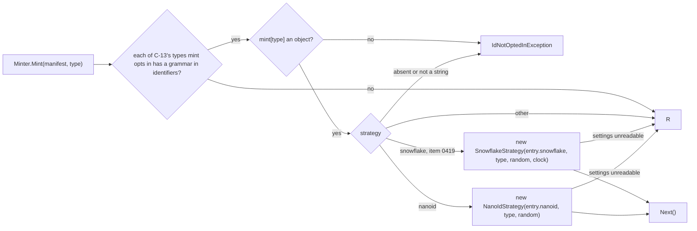
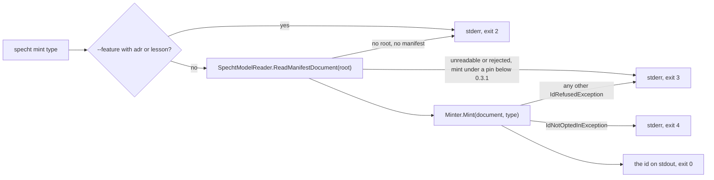
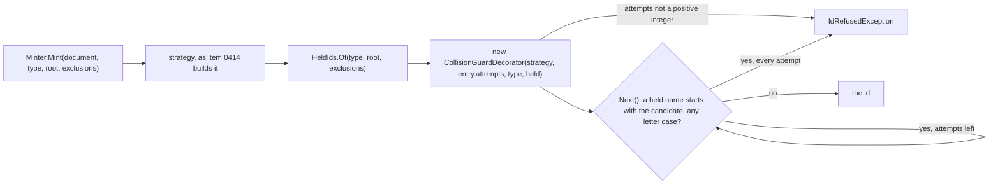
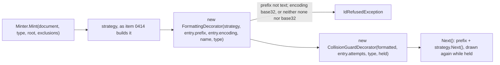
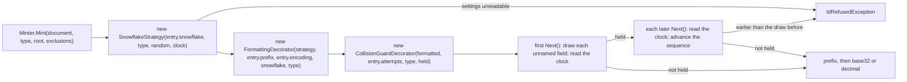
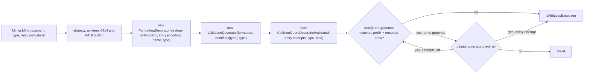
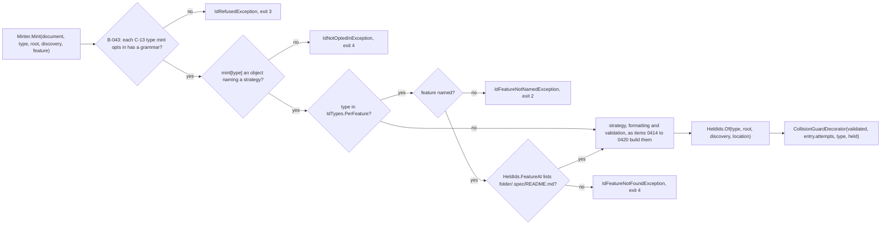
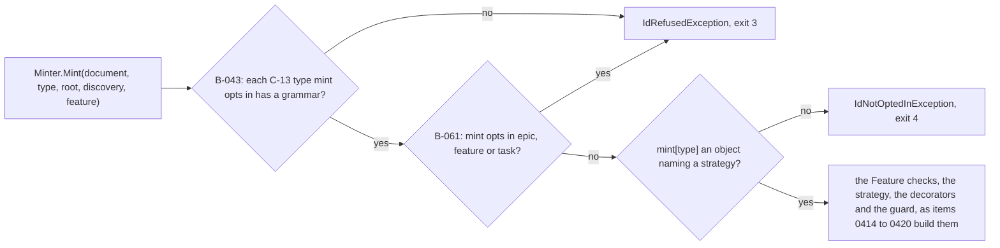
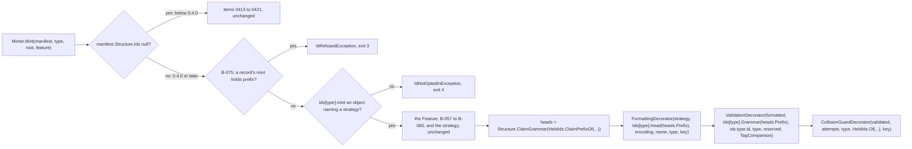
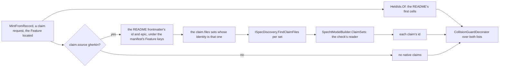

# Specification: Id generation

## 1. Business Goal

<!-- last written by: spec-author, 2026-11-06 -->

An author on a branch takes the next free number from their own copy of the tree, and a branch cut from the same `main` takes the same one; git reports nothing, and lesson 0005 records decisions, claims, constraints, questions and work items claimed two and three times and one duplicate item id reaching `main`. This Feature removes that failure state for every record type a consumer opts in: the pinned `specht` mints a new id that no other branch, worktree or agent can take, and prints it, while every type the consumer does not opt in keeps its own numbering untouched.

## 2. User Needs

<!-- last written by: spec-author, 2026-11-07 (A-1 to A-4 amended; A-6 and A-7 added); spec-author, 2026-11-08 (A-8 added, item 0422 review); spec-author, 2026-11-10 (A-7 names the folder `--feature` takes, OQ-15 and OQ-16 answered, item 0418); spec-author, 2026-11-12 (need 5 and A-9 added, A-1 and A-6 amended, one `ids` record per type, decision 0005); spec-author, 2026-11-14 (A-4 names B-078's place, OQ-21 answered, item 0440) -->

| #   | Persona                                                   | Need                                                                     | Pain Point Today                                                                                    |
| --- | --------------------------------------------------------- | ------------------------------------------------------------------------ | --------------------------------------------------------------------------------------------------- |
| 1   | An author on a branch cut in parallel with others         | A new id for a record that no other branch can also take                 | Takes the next number by hand, collides, and renumbers before merging (lesson 0005)                 |
| 2   | An agent session in one of several worktrees on a machine | An id from the pinned tool rather than one read off its copy of the tree | Reads the highest id on its branch and takes the next, as every other session does                  |
| 3   | A consumer with numbering of its own                      | Every type it does not opt in left exactly as it is                      | N/A (a contract this Feature must not break)                                                        |
| 4   | `0132-F4`, reading through MCP                            | A command whose standard output is the minted id                         | N/A (internal dependency; no command mints an id)                                                   |
| 5   | A consumer whose Features declare their own claim prefix  | Minted ids in each Feature's own form, such as `ACTIVITY-k3x9ab`         | Mint prints `B-` ids, which the check rejects in a Feature that declares a prefix (`0001-F5` B-079) |

### Assumptions

| ID  | Assumption                                                                                                                                                                                                                                                                                                                                                                                                                                                                                                                                                                                                                                                                                                 |
| --- | ---------------------------------------------------------------------------------------------------------------------------------------------------------------------------------------------------------------------------------------------------------------------------------------------------------------------------------------------------------------------------------------------------------------------------------------------------------------------------------------------------------------------------------------------------------------------------------------------------------------------------------------------------------------------------------------------------------- |
| A-1 | "The id settings" in these claims are the manifest's top-level `mint` key (C-12) under a pin below schema `0.4.0`, and from `0.4.0` the `mint` members of the `ids` records (C-21); "a type" is one of the names C-13 lists, and "a strategy's settings" are that strategy's own sub-object in the type's entry. Amended 2026-11-12 (spec-author; decision 0005): the `0.4.0` clause added.                                                                                                                                                                                                                                                                                                                |
| A-2 | "A request to mint an id" is `specht mint <type> [--feature <dir>] [--root <dir>]`, one id per request (OQ-8, ADR-0033).                                                                                                                                                                                                                                                                                                                                                                                                                                                                                                                                                                                   |
| A-3 | Item `0256` is done: its ADR-0033 is accepted (2026-11-07) and answers OQ-1 to OQ-10 and OQ-12; its trial branch is evidence only, and no claim waits on it.                                                                                                                                                                                                                                                                                                                                                                                                                                                                                                                                               |
| A-4 | "The tree holds an id of the type" (B-010) means where B-038 to B-042 and B-078 say the collision guard looks for that type. Amended 2026-11-14 (spec-author, on the owner's selection for OQ-21): B-078 added. Was: where B-038 to B-042 say.                                                                                                                                                                                                                                                                                                                                                                                                                                                             |
| A-5 | A "candidate" is the id a type's strategy produces with its formatting applied, before the collision guard and validation accept it.                                                                                                                                                                                                                                                                                                                                                                                                                                                                                                                                                                       |
| A-6 | In a scenario under a pin below schema `0.4.0`, a manifest that opts a type in also declares in `identifiers` a grammar that admits the type's minted ids, unless the scenario says it declares none. Amended 2026-11-12 (spec-author; decision 0005): scoped to a pin below `0.4.0`, whose shipped records admit the default draws (C-14).                                                                                                                                                                                                                                                                                                                                                                |
| A-7 | In these claims, a request for a `decision`, `claim`, `constraint`, `openQuestion` or `scenario` id names its Feature with `--feature`, the folder, relative to the root, that holds that Feature's `.spec/` (OQ-16), unless the claim says otherwise, as B-057 to B-060 do.                                                                                                                                                                                                                                                                                                                                                                                                                               |
| A-8 | In a scenario run through the command, "no id is minted" is observed as nothing written on standard output, as B-001 observes it, and the request then ends as B-017 states.                                                                                                                                                                                                                                                                                                                                                                                                                                                                                                                               |
| A-9 | From schema `0.4.0` a type's _record_ is its `ids` record (`0001-F5` C-14), and its _head_ for a request is `0001-F5` A-8's head for the Feature `--feature` names, or the head of the record's `plain` for an `adr` or `lesson` request; "the type's prefix" in the other claims is that head. A _form request_ is a request under such a pin whose `--feature` names a Feature that declares a claim prefix (`0001-F5` A-7), for a type whose record has a `form`. A Feature whose `claim_prefix` `0001-F5` B-078 or B-100 reports is read as declaring none, for every type, as `0001-F5` A-8 reads it. A request's _claim head_ and _scenario head_ are the heads of those two types for that request. |

## 3. Acceptance Criteria

<!-- last written by: spec-author, 2026-11-07 (B-016 to B-045 added; Source cells of settled questions cite ADR-0033); spec-author, 2026-11-08 (B-046 to B-051 added, item 0422); spec-author, 2026-11-08 (B-046 withdrawn, item 0422 review); spec-author, 2026-11-09 (B-043's Source cites A-1, item 0415 review); spec-author, 2026-11-09 (B-002 narrowed to exit `4`, OQ-11 answered in part, item 0415); spec-author, 2026-11-09 (B-002 reaches an entry naming no strategy, OQ-11's second answer, item 0415); spec-author, 2026-11-09 (B-002 scoped to a manifest B-015 and B-043 do not refuse, item 0415 review round 3); spec-author, 2026-11-10 (item 0416 review round 1: B-052, OQ-20); spec-author, 2026-11-10 (B-053 and B-054 added, item 0417's design pass); spec-author, 2026-11-10 (B-055 added on OQ-14's answer, item 0417); spec-author, 2026-11-10 (B-055 reworded, item 0417 review round 2, finding 5); spec-author, 2026-11-10 (B-056 added on OQ-13's answer, item 0419); spec-author, 2026-11-10 (B-057 to B-060 added on OQ-15's and OQ-16's answers, item 0418; B-061 and B-062 added on OQ-17's answer, item 0421); spec-author, 2026-11-12 (B-009, B-011, B-012, B-043 and B-055 scoped to a pin below `0.4.0`; B-063 to B-076 added on the owner's selections, B-064 and B-069 withdrawn before merge, decision 0005); spec-author, 2026-11-14 (B-078 to B-080 added, B-041's and B-070's Source cells cite OQ-21, on the owner's selections for OQ-19 and OQ-21; item 0440) -->

| ID    | Claim                                                                                                                                                                                                                                                                                                                                         | Source                                                                                                                                                                                                                                                                                                                            | Status    |
| ----- | --------------------------------------------------------------------------------------------------------------------------------------------------------------------------------------------------------------------------------------------------------------------------------------------------------------------------------------------- | --------------------------------------------------------------------------------------------------------------------------------------------------------------------------------------------------------------------------------------------------------------------------------------------------------------------------------- | --------- |
| B-001 | Given a request to mint an id of a type the manifest does not opt in, this Feature writes nothing on standard output.                                                                                                                                                                                                                         | the owner, 2026-11-06 (item `0256`); decision 0001; C-2                                                                                                                                                                                                                                                                           | Active    |
| B-002 | Given a manifest that B-015 and B-043 do not refuse, and a request to mint an id of a type it does not opt in, or whose entry in the manifest's id settings names no strategy, this Feature exits `4`.                                                                                                                                        | the owner's selections, 2026-11-09 (item `0415`); decision 0001; C-2; C-10; OQ-10; OQ-11                                                                                                                                                                                                                                          | Active    |
| B-003 | Given a request to mint an id of a type the manifest opts in, this Feature writes exactly one line on standard output, holding the minted id and nothing else.                                                                                                                                                                                | the owner's selection, 2026-11-06 (item `0256`); decision 0001; C-1                                                                                                                                                                                                                                                               | Active    |
| B-004 | Given a request that prints a minted id, this Feature exits `0`.                                                                                                                                                                                                                                                                              | AGENTS.md § CLI; C-10                                                                                                                                                                                                                                                                                                             | Active    |
| B-005 | Given a type opted in to Nano ID with a size, this Feature mints an id whose part after the type's prefix is exactly that many characters long.                                                                                                                                                                                               | the owner, 2026-11-06 (item `0256`); OQ-3; ADR-0033                                                                                                                                                                                                                                                                               | Active    |
| B-006 | Given a type opted in to Nano ID with an alphabet, this Feature mints an id in which every character after the type's prefix is in that alphabet.                                                                                                                                                                                             | the owner, 2026-11-06 (item `0256`); OQ-3; ADR-0033                                                                                                                                                                                                                                                                               | Active    |
| B-007 | Given a type opted in to Snowflake with an epoch, this Feature mints an id that, decoded under the type's encoding and field widths, holds the milliseconds from that epoch to the time it was minted.                                                                                                                                        | the owner, 2026-10-23 and 2026-11-06 (item `0256`); OQ-1, OQ-2, OQ-4; ADR-0033                                                                                                                                                                                                                                                    | Active    |
| B-008 | Given two types opted in with different strategy settings, this Feature mints each type's id with that type's own settings.                                                                                                                                                                                                                   | the owner, 2026-11-06 (item `0256`); C-3                                                                                                                                                                                                                                                                                          | Active    |
| B-009 | Given a manifest pinned below schema `0.4.0` and a type whose formatting names a prefix, this Feature mints an id that starts with that prefix.                                                                                                                                                                                               | the owner's selection, 2026-11-06 (item `0256`); OQ-4; ADR-0033. Amended 2026-11-12 (spec-author, on the owner's selection, 2026-11-12 ("Redesign: one record"); decision 0005): scoped to a pin below `0.4.0`, where a type has no prefix setting (C-21). Was: every manifest                                                    | Amended   |
| B-010 | Given a tree that already holds, as an id of the type, the first candidate the type's strategy produces, this Feature prints an id the tree does not hold.                                                                                                                                                                                    | the owner's selection, 2026-11-06 (item `0256`); A-4; OQ-9; ADR-0033                                                                                                                                                                                                                                                              | Active    |
| B-011 | Given a manifest pinned below schema `0.4.0` and a candidate that the manifest's `identifiers` grammar for its type does not match, this Feature writes nothing on standard output.                                                                                                                                                           | the owner's selection, 2026-11-06 (item `0256`); C-4; OQ-10; ADR-0033. Amended 2026-11-12 (spec-author; decision 0005): scoped to a pin below `0.4.0`; B-068 validates from it. Was: every manifest                                                                                                                               | Amended   |
| B-012 | Given a manifest pinned below schema `0.4.0` and a candidate that the manifest's `identifiers` grammar for its type does not match, this Feature exits `2`, `3` or `4`.                                                                                                                                                                       | C-10; OQ-11. Amended 2026-11-12 (spec-author; decision 0005): scoped to a pin below `0.4.0`, as B-011 is. Was: every manifest                                                                                                                                                                                                     | Amended   |
| B-013 | Given any request to mint an id, this Feature creates, modifies and deletes no file under the root or elsewhere.                                                                                                                                                                                                                              | the owner, 2026-11-06 (decision 0001); C-1; C-11                                                                                                                                                                                                                                                                                  | Active    |
| B-014 | Given a valid manifest that opts types in, this Feature leaves the check reporting the violations the same tree gets with the id settings removed.                                                                                                                                                                                            | the owner, 2026-11-06 (item `0256`); C-6; C-8                                                                                                                                                                                                                                                                                     | Active    |
| B-015 | Given a manifest whose id settings its pinned schema version does not accept, this Feature exits `3` on a request to mint an id.                                                                                                                                                                                                              | AGENTS.md § CLI; `0001-F5` B-012; C-6; OQ-7; ADR-0033                                                                                                                                                                                                                                                                             | Active    |
| B-016 | Given a request with `--feature` to mint an `adr` or `lesson` id, this Feature writes nothing on standard output.                                                                                                                                                                                                                             | ADR-0033 § "The Feature to specify next"; OQ-8                                                                                                                                                                                                                                                                                    | Active    |
| B-017 | Given a request to mint an id that writes nothing on standard output, this Feature exits `2`, `3` or `4`.                                                                                                                                                                                                                                     | C-10; OQ-11; decision 0003                                                                                                                                                                                                                                                                                                        | Active    |
| B-018 | Given a request to mint an `epic`, `feature` or `task` id, this Feature writes nothing on standard output.                                                                                                                                                                                                                                    | decision 0003; C-13                                                                                                                                                                                                                                                                                                               | Active    |
| B-019 | Given a type opted in to Nano ID that names no alphabet, this Feature mints an id in which every character after the type's prefix is one of `0123456789abcdefghjkmnpqrstvwxyz`.                                                                                                                                                              | ADR-0033 (OQ-3)                                                                                                                                                                                                                                                                                                                   | Active    |
| B-020 | Given an `adr` or `lesson` type opted in to Nano ID that names no size, this Feature mints an id whose part after the type's prefix is 8 characters long.                                                                                                                                                                                     | ADR-0033 (OQ-3)                                                                                                                                                                                                                                                                                                                   | Active    |
| B-021 | Given a `decision`, `claim`, `constraint`, `openQuestion` or `scenario` type opted in to Nano ID that names no size, this Feature mints an id whose part after the type's prefix is 6 characters long.                                                                                                                                        | ADR-0033 (OQ-3)                                                                                                                                                                                                                                                                                                                   | Active    |
| B-022 | Given a type opted in to Snowflake that names no epoch, this Feature mints an id that, decoded, holds the milliseconds from 2026-01-01 at midnight, universal time, to the time it was minted.                                                                                                                                                | ADR-0033 § "The Feature to specify next", finding 3                                                                                                                                                                                                                                                                               | Active    |
| B-023 | Given a type opted in to Snowflake that names no field widths, this Feature mints an id whose lowest 12 bits are its sequence, the 5 above them its worker and the 5 above those its datacenter.                                                                                                                                              | ADR-0033 § "The Feature to specify next"                                                                                                                                                                                                                                                                                          | Active    |
| B-024 | Given a type opted in to Snowflake that names no datacenter, this Feature mints an id whose datacenter field holds a value drawn at random for that request.                                                                                                                                                                                  | ADR-0033 (OQ-1); C-16                                                                                                                                                                                                                                                                                                             | Active    |
| B-025 | Given a type opted in to Snowflake that names no worker, this Feature mints an id whose worker field holds a value drawn at random for that request.                                                                                                                                                                                          | ADR-0033 (OQ-1); C-16                                                                                                                                                                                                                                                                                                             | Active    |
| B-026 | Given a type opted in to Snowflake that names no sequence start, this Feature mints an id whose sequence field holds a value drawn at random for that request.                                                                                                                                                                                | ADR-0033 (OQ-1)                                                                                                                                                                                                                                                                                                                   | Active    |
| B-027 | Given a type opted in to Snowflake with a datacenter number, this Feature mints an id whose datacenter field holds that number.                                                                                                                                                                                                               | ADR-0033 (OQ-1); C-16                                                                                                                                                                                                                                                                                                             | Active    |
| B-028 | Given a type opted in to Snowflake with a worker number, this Feature mints an id whose worker field holds that number.                                                                                                                                                                                                                       | ADR-0033 (OQ-1); C-16                                                                                                                                                                                                                                                                                                             | Active    |
| B-029 | Given a Snowflake type whose first candidate the tree holds, and a clock that reads earlier at the next draw than at the first, this Feature writes nothing on standard output.                                                                                                                                                               | ADR-0033 (OQ-2)                                                                                                                                                                                                                                                                                                                   | Active    |
| B-030 | Given a type opted in to Snowflake with the encoding `base32`, this Feature mints an id whose part after the type's prefix is the Snowflake number written in base32 over `0123456789abcdefghjkmnpqrstvwxyz`.                                                                                                                                 | ADR-0033 (OQ-4); C-15                                                                                                                                                                                                                                                                                                             | Active    |
| B-031 | Given a type opted in to Snowflake with the encoding `base32`, this Feature mints an id whose part after the type's prefix is 13 characters long.                                                                                                                                                                                             | ADR-0033 (OQ-4), finding 3                                                                                                                                                                                                                                                                                                        | Active    |
| B-032 | Given a type opted in to Snowflake with the encoding `none`, this Feature mints an id whose part after the type's prefix is the Snowflake number in decimal digits.                                                                                                                                                                           | ADR-0033 (OQ-4); C-15                                                                                                                                                                                                                                                                                                             | Active    |
| B-033 | Given a type opted in to Nano ID with the encoding `base32`, this Feature writes nothing on standard output.                                                                                                                                                                                                                                  | ADR-0033 (OQ-4), finding 3; C-15                                                                                                                                                                                                                                                                                                  | Active    |
| B-034 | Given a tree that holds, as an id of the type, the first candidate in another letter case, this Feature prints an id the tree does not hold in any letter case.                                                                                                                                                                               | ADR-0033 (OQ-9)                                                                                                                                                                                                                                                                                                                   | Active    |
| B-035 | Given a type that names no number of attempts and a tree that holds each of the first seven candidates, this Feature prints the eighth candidate.                                                                                                                                                                                             | ADR-0033 (OQ-9)                                                                                                                                                                                                                                                                                                                   | Active    |
| B-036 | Given a type that names no number of attempts and a tree that holds each of the first eight candidates, this Feature writes nothing on standard output.                                                                                                                                                                                       | ADR-0033 (OQ-9)                                                                                                                                                                                                                                                                                                                   | Active    |
| B-037 | Given a type that names a number of attempts and a tree that holds each of that many first candidates, this Feature writes nothing on standard output.                                                                                                                                                                                        | ADR-0033 (OQ-9), § "The Feature to specify next"                                                                                                                                                                                                                                                                                  | Active    |
| B-038 | Given a file in any `adr/` folder of the tree whose name is the first `adr` candidate followed by `-`, this Feature prints an `adr` id that no file name in an `adr/` folder starts with.                                                                                                                                                     | ADR-0033 (OQ-9), § "The Feature to specify next"                                                                                                                                                                                                                                                                                  | Active    |
| B-039 | Given a file in any `lessons/` folder of the tree whose name is the first `lesson` candidate followed by `-`, this Feature prints a `lesson` id that no file name in a `lessons/` folder starts with.                                                                                                                                         | ADR-0033 (OQ-9), § "The Feature to specify next"                                                                                                                                                                                                                                                                                  | Active    |
| B-040 | Given a file in the `.spec/decisions/` folder of the Feature `--feature` names whose name is the first `decision` candidate followed by `-`, this Feature prints a `decision` id that no file name in that folder starts with.                                                                                                                | ADR-0033 (OQ-9), § "The Feature to specify next"                                                                                                                                                                                                                                                                                  | Active    |
| B-041 | Given the first `claim`, `constraint` or `openQuestion` candidate in the first column of a table row in the `.spec/README.md` of the Feature `--feature` names, this Feature prints an id of that type that no first column there holds.                                                                                                      | ADR-0033 (OQ-9), § "The Feature to specify next"; OQ-21: holds under a `gherkin` claim source too, beside B-078. Source amended 2026-11-14 (spec-author, on the owner's selection for OQ-21)                                                                                                                                      | Active    |
| B-042 | Given a scenario in a `.feature` file of the Feature `--feature` names that carries a tag of `@` followed by the first `scenario` candidate, this Feature prints a `scenario` id that no scenario of that Feature carries after `@` in a tag.                                                                                                 | ADR-0033 (OQ-5, OQ-9); C-18                                                                                                                                                                                                                                                                                                       | Active    |
| B-043 | Given a manifest pinned below schema `0.4.0` that opts in a type for which `identifiers` holds no grammar, this Feature exits `3` on a request to mint an id.                                                                                                                                                                                 | ADR-0033 (OQ-10); A-1; C-14. Amended 2026-11-12 (spec-author; decision 0005): scoped to a pin below `0.4.0`, where every type has a shipped record (`0001-F5` B-097). Was: every manifest                                                                                                                                         | Amended   |
| B-044 | Given a manifest pinned to schema `0.3.1` whose only difference from a valid manifest is a `mint` key in C-12's shape, the check does not exit `3`.                                                                                                                                                                                           | ADR-0033 (OQ-7); decision 0003; C-12, C-17                                                                                                                                                                                                                                                                                        | Active    |
| B-045 | Given a manifest pinned to schema `0.3.1` whose only difference from a valid manifest is an `adr`, `lesson`, `decision` or `scenario` grammar in `identifiers`, the check does not exit `3`.                                                                                                                                                  | ADR-0033 (OQ-10); decision 0003; C-14, C-17                                                                                                                                                                                                                                                                                       | Active    |
| B-046 | Given a request to mint an id of a type the manifest does not opt in, this Feature mints no id.                                                                                                                                                                                                                                               | Withdrawn 2026-11-08 by spec-author, on item `0422`'s review: B-001 states the same refusal and its scenario observes the same thing (§ 10). Was: the owner's selection, 2026-11-08 (item `0422`); C-2                                                                                                                            | Withdrawn |
| B-047 | Given a type whose entry in the manifest's id settings names no strategy, this Feature mints no id of that type.                                                                                                                                                                                                                              | the owner's selection, 2026-11-08 (item `0422`); C-2, C-12                                                                                                                                                                                                                                                                        | Active    |
| B-048 | Given a type whose entry in the manifest's id settings names a strategy other than `nanoid` or `snowflake`, this Feature mints no id of that type.                                                                                                                                                                                            | the owner's selection, 2026-11-08 (item `0422`); C-3, C-12                                                                                                                                                                                                                                                                        | Active    |
| B-049 | Given a type opted in to Nano ID whose Nano ID settings are not an object, this Feature mints no id of that type.                                                                                                                                                                                                                             | the owner's selection, 2026-11-08 (item `0422`); C-12                                                                                                                                                                                                                                                                             | Active    |
| B-050 | Given a type opted in to Nano ID whose alphabet is empty or is not a string, this Feature mints no id of that type.                                                                                                                                                                                                                           | the owner's selection, 2026-11-08 (item `0422`); C-12                                                                                                                                                                                                                                                                             | Active    |
| B-051 | Given a type opted in to Nano ID whose size is not a positive whole number, this Feature mints no id of that type.                                                                                                                                                                                                                            | the owner's selection, 2026-11-08 (item `0422`); C-12                                                                                                                                                                                                                                                                             | Active    |
| B-052 | Given a type whose number of attempts is not a positive whole number, this Feature writes nothing on standard output.                                                                                                                                                                                                                         | spec-author, 2026-11-10, on item `0416`'s review round 1 (§ 12, finding 3); C-12                                                                                                                                                                                                                                                  | Active    |
| B-053 | Given a type whose prefix is not text, this Feature writes nothing on standard output.                                                                                                                                                                                                                                                        | spec-author, 2026-11-10, on item `0417`'s design pass; C-12                                                                                                                                                                                                                                                                       | Active    |
| B-054 | Given a type whose encoding is neither `none` nor `base32`, this Feature writes nothing on standard output.                                                                                                                                                                                                                                   | spec-author, 2026-11-10, on item `0417`'s design pass; C-12, C-15                                                                                                                                                                                                                                                                 | Active    |
| B-055 | Given a manifest pinned below schema `0.4.0` and a type whose formatting names no prefix, this Feature mints an id whose part ahead of what the type's encoding writes is that type's in-tree prefix: none for `adr`, `lesson` and `decision`, `B-` for `claim`, `C-` for `constraint`, `OQ-` for `openQuestion` and `S-` for `scenario`.     | the owner's selection, 2026-11-10 (item `0417`); OQ-14; ADR-0033. Amended 2026-11-12 (spec-author, on the owner's selection, 2026-11-12 ("Redesign: one record"); decision 0005): scoped to a pin below `0.4.0`; B-065 and B-066 hold from it, and the shipped records keep these prefixes (`0001-F5` B-089). Was: every manifest | Amended   |
| B-056 | Given a type opted in to Snowflake that names no encoding, this Feature mints an id whose part after the type's prefix is the Snowflake number written in base32 over `0123456789abcdefghjkmnpqrstvwxyz`.                                                                                                                                     | the owner's selection, 2026-11-10 (item `0419`); OQ-13; ADR-0033 (OQ-4), finding 3; C-15                                                                                                                                                                                                                                          | Active    |
| B-057 | Given a request without `--feature` to mint a `decision`, `claim`, `constraint`, `openQuestion` or `scenario` id, this Feature writes nothing on standard output.                                                                                                                                                                             | the owner's selection, 2026-11-10 (item `0418`); OQ-15; A-7                                                                                                                                                                                                                                                                       | Active    |
| B-058 | Given a manifest that B-015 and B-043 do not refuse and that opts in a `decision`, `claim`, `constraint`, `openQuestion` or `scenario` type, and a request without `--feature` to mint an id of that type, this Feature exits `2`.                                                                                                            | the owner's selection, 2026-11-10 (item `0418`); OQ-15; C-10                                                                                                                                                                                                                                                                      | Active    |
| B-059 | Given a request with `--feature` naming a folder that holds no Feature's `.spec/`, to mint a `decision`, `claim`, `constraint`, `openQuestion` or `scenario` id, this Feature writes nothing on standard output.                                                                                                                              | the owner's selections, 2026-11-10 (item `0418`); OQ-16; A-7                                                                                                                                                                                                                                                                      | Active    |
| B-060 | Given a manifest that B-015 and B-043 do not refuse, and a request with `--feature` naming a folder that holds no Feature's `.spec/`, to mint a `decision`, `claim`, `constraint`, `openQuestion` or `scenario` id, this Feature exits `4`.                                                                                                   | the owner's selections, 2026-11-10 (item `0418`); OQ-16; A-7; C-10                                                                                                                                                                                                                                                                | Active    |
| B-061 | Given a manifest that opts in an `epic`, `feature` or `task` type, this Feature exits `3` on a request to mint an id.                                                                                                                                                                                                                         | the owner's selection, 2026-11-10 (item `0421`); OQ-17; B-015; C-13                                                                                                                                                                                                                                                               | Active    |
| B-062 | Given a manifest pinned to schema `0.3.1` whose only difference from a valid manifest is a `mint` entry that opts in an `epic`, `feature` or `task` type, the check does not exit `3`.                                                                                                                                                        | the owner's selection, 2026-11-10 (item `0421`); OQ-17; C-8; C-13                                                                                                                                                                                                                                                                 | Active    |
| B-063 | Given a form request (A-9), this Feature mints an id that is the type's head followed by what the type's encoding writes.                                                                                                                                                                                                                     | The owner's selection, 2026-11-12 ("Redesign: one record"); decision 0005; `0001-F5` A-8; C-19                                                                                                                                                                                                                                    | Active    |
| B-064 | Given a Feature-form request for a type whose formatting names a prefix, this Feature mints the id B-063 states.                                                                                                                                                                                                                              | Withdrawn 2026-11-12 by spec-author, before merge, on the owner's selection "Redesign: one record": from `0.4.0` no type has a prefix setting (C-21), and below it no request is a form request. Was: the owner's selection "Feature form wins" (decision 0005)                                                                   | Withdrawn |
| B-065 | Given a manifest pinned to schema `0.4.0` or later and a request for an `adr` or `lesson` id, or one whose `--feature` names a Feature that declares no claim prefix, this Feature mints an id that is the head of the type's `plain` followed by what the type's encoding writes.                                                            | spec-author, 2026-11-12, on the owner's selection "Redesign: one record"; decision 0005; `0001-F5` A-8; C-19                                                                                                                                                                                                                      | Active    |
| B-066 | Given a manifest pinned to schema `0.4.0` or later and a request whose `--feature` names a Feature that declares a claim prefix, for a type whose record has no `form`, this Feature mints an id that is the head of the type's `plain` followed by what the type's encoding writes.                                                          | The owner's selections, 2026-11-12 ("Same opt-in rule", "Include decision"); decision 0005; `0001-F5` B-097                                                                                                                                                                                                                       | Active    |
| B-067 | Given a manifest pinned to schema `0.4.0` or later and a request for an id of any type whose `--feature` names a Feature whose `claim_prefix` `0001-F5` B-078 or B-100 reports, this Feature mints an id that is the head of the type's `plain` followed by what the type's encoding writes.                                                  | spec-author, 2026-11-12, on spec-reviewer's findings that mint and the check must agree on an invalid prefix, for every type (round 2); decision 0005; `0001-F5` A-8, B-100, OQ-31; A-9; C-4, C-19                                                                                                                                | Active    |
| B-068 | Given a manifest pinned to schema `0.4.0` or later, this Feature prints no id whose part after the type's head the type's record's `id` does not wholly match.                                                                                                                                                                                | The owner's selection, 2026-11-12 ("Redesign: one record") (mint validates the draw against `id` alone); decision 0005; `0001-F5` A-8; C-4                                                                                                                                                                                        | Active    |
| B-069 | Given a Feature-form request under a manifest whose `identifiers` grammar for the type matches no id the type's Feature grammar matches, this Feature prints an id.                                                                                                                                                                           | Withdrawn 2026-11-12 by spec-author, before merge, on the owner's selection "Rejected; upgrade migrates": from `0.4.0` `identifiers` holds no grammar for a C-13 type (`0001-F5` B-092). Was: the owner's selection "One featurePrefix key" (decision 0005)                                                                       | Withdrawn |
| B-070 | Given a form request (A-9) for a `claim`, `constraint` or `openQuestion` id whose first candidate is in the first column of a table row in that Feature's `.spec/README.md`, this Feature prints an id of that type that no first column there holds.                                                                                         | spec-author, 2026-11-12, B-041 for a form request; decision 0005; OQ-21: holds under a `gherkin` claim source too, beside B-078. Source amended 2026-11-14 (spec-author, on the owner's selection for OQ-21)                                                                                                                      | Active    |
| B-071 | Given a form request (A-9) for a `scenario` id whose first candidate a scenario of that Feature carries after `@` in a tag, this Feature prints a `scenario` id that no scenario of that Feature carries after `@` in a tag.                                                                                                                  | spec-author, 2026-11-12, B-042 for a form request; decision 0005; C-18                                                                                                                                                                                                                                                            | Active    |
| B-072 | Given a form request (A-9) for a type opted in to Nano ID, this Feature mints an id whose part after the type's head is as many characters long as the type's Nano ID size.                                                                                                                                                                   | spec-author, 2026-11-12, B-005 for a form request; decision 0005; B-020, B-021                                                                                                                                                                                                                                                    | Active    |
| B-073 | Given a form request (A-9) for a type opted in to Snowflake, this Feature mints an id whose part after the type's head, decoded under the type's encoding and field widths, holds the milliseconds from the type's epoch to the time it was minted.                                                                                           | spec-author, 2026-11-12, B-007 for a form request; decision 0005; B-022, B-056                                                                                                                                                                                                                                                    | Active    |
| B-074 | Given a manifest pinned to schema `0.4.0` whose `ids` record for a C-13 type holds only a `mint` naming Nano ID or Snowflake and no size or encoding, a request for an id of that type prints an id.                                                                                                                                          | The owner's selection, 2026-11-12 ("Widen all seven"); decision 0005; `0001-F5` B-089, B-097; C-14                                                                                                                                                                                                                                | Active    |
| B-075 | Given a manifest pinned to schema `0.4.0` or later that holds the top-level `mint` key, an `identifiers` member for a C-13 type, or a `prefix` in a record's `mint`, this Feature exits `3` on a request to mint an id.                                                                                                                       | The owner's selections, 2026-11-12 ("Redesign: one record", "Rejected; upgrade migrates"); decision 0005; `0001-F5` B-092; B-015; C-21                                                                                                                                                                                            | Active    |
| B-076 | Given a request for a `scenario` id whose claim head is longer than its scenario head and begins with it (A-9), this Feature prints no scenario id whose text after the scenario head begins with the rest of the claim head, compared as the claim tag case setting compares tags.                                                           | spec-author, 2026-11-12, on spec-reviewer's finding 1 against the `featurePrefix` draft and round-2 finding 1; decision 0005; `0001-F5` B-100, B-101; B-077; C-18                                                                                                                                                                 | Active    |
| B-077 | Given a request for a `claim` id whose scenario head is longer than its claim head and begins with it (A-9), this Feature prints no claim id whose text after the claim head begins with the rest of the scenario head, compared as the claim tag case setting compares tags.                                                                 | spec-author, 2026-11-12, on spec-reviewer's round-2 finding 1; decision 0005; `0001-F5` B-095, B-101; B-076                                                                                                                                                                                                                       | Active    |
| B-078 | Given a manifest pinned to schema `0.4.0` or later whose `claim.source` is `gherkin`, and a claim `0001-F16` B-001 builds, from a claim file set whose Feature identity is that of the Feature `--feature` names, whose id is the first `claim` candidate, this Feature prints a `claim` id that is the id of no claim built from those sets. | The owner's selection, 2026-11-14 ("(a) Adopt, item in 0.7.0"); OQ-21; `0001-F16` B-001, B-004; B-041, B-070; A-4                                                                                                                                                                                                                 | Active    |
| B-079 | Given a manifest pinned below schema `0.4.0` and a request naming a `mint` member that is none of C-13's seven types and none of `epic`, `feature` and `task`, this Feature writes nothing on standard output.                                                                                                                                | The owner's selections, 2026-11-14 ("Adopt default as answer", "(a) Exit 4, not opted in"); OQ-19; B-001; C-2, C-13                                                                                                                                                                                                               | Active    |
| B-080 | Given a manifest pinned below schema `0.4.0` that B-015 and B-043 do not refuse, and a request naming a `mint` member that is none of C-13's seven types and none of `epic`, `feature` and `task`, this Feature exits `4`.                                                                                                                    | The owner's selections, 2026-11-14 ("Adopt default as answer", "(a) Exit 4, not opted in"); OQ-19; B-002; C-10, C-13                                                                                                                                                                                                              | Active    |

## 4. Constraints

<!-- last written by: spec-author, 2026-11-07 (C-12 to C-18 added); spec-author, 2026-11-12 (C-4, C-6, C-12, C-17 and C-18 amended, C-14 reversed on the owner's selection, C-19 and C-21 added, C-20 retired before merge; decision 0005) -->

| ID   | Constraint                                                                                                                                                                                                                                                                                                                                                                                                                                                                                                                                                                                                          | Rules Out                                                                                                                                                                                                                                      |
| ---- | ------------------------------------------------------------------------------------------------------------------------------------------------------------------------------------------------------------------------------------------------------------------------------------------------------------------------------------------------------------------------------------------------------------------------------------------------------------------------------------------------------------------------------------------------------------------------------------------------------------------- | ---------------------------------------------------------------------------------------------------------------------------------------------------------------------------------------------------------------------------------------------- |
| C-1  | Print only: a request writes the minted id on standard output and nothing anywhere else (the owner, 2026-11-06; decision 0001).                                                                                                                                                                                                                                                                                                                                                                                                                                                                                     | Writing the id into a document, a file name or `.issue/.sequence`; any state file, a Snowflake last-time or sequence file included; a new entry in the write invariant of AGENTS.md § Invariants.                                              |
| C-2  | Opt in means opt in: a type is minted for only when the manifest names it with a strategy (the owner, 2026-11-06; item `0256`).                                                                                                                                                                                                                                                                                                                                                                                                                                                                                     | A default strategy for a type the manifest does not name; a sequence default; a fallback to the sequence when a type is absent or its strategy cannot mint.                                                                                    |
| C-3  | Two built-in strategies, Nano ID and Snowflake, and each reads only its own settings (the owner, 2026-11-06; item `0256`).                                                                                                                                                                                                                                                                                                                                                                                                                                                                                          | A consumer-supplied strategy (§ 5 row 1); a sequence strategy; one strategy reading another's settings; a third strategy without a specification delta.                                                                                        |
| C-4  | Formatting, the collision guard and validation are the decorators around a strategy, and validation reads a type's grammar only from the manifest: below schema `0.4.0` its `identifiers`, and from `0.4.0` the type's `ids` record, whose `id` the part after the head must wholly match (the owner's selection, 2026-11-06). Amended 2026-11-12 (spec-author, on the owner's selection "Redesign: one record"; decision 0005): the `0.4.0` clause added. Was: validation reads a type's grammar only from the manifest's `identifiers`; ruled out a second grammar for a type held in the id settings or in code. | A grammar for a type in code, under a record's `mint`, or built by mint apart from the check's; a decorator that rewrites or renumbers an id already in the tree.                                                                              |
| C-5  | The id settings are one top-level manifest key, which the checker owns ([ADR-0023](../../../../.spec/adr/0023-codeanalysis-is-the-only-csharp-specific-manifest-section.md)).                                                                                                                                                                                                                                                                                                                                                                                                                                       | Settings under `codeAnalysis`; a configuration file beside the manifest; settings spread over several top-level keys.                                                                                                                          |
| C-6  | The `mint` key is an opt-in addition and enters a schema patch (`0001-F7` C-11 and decision 0022); from schema `0.4.0` the id settings are the records' `mint` members, which that `0.minor` step brings (C-17). Amended 2026-11-12 (spec-author; decision 0005): the `0.4.0` clause added.                                                                                                                                                                                                                                                                                                                         | A `0.minor` step for the `mint` key; a required key; a rule id or a verdict reached by a tree whose manifest does not set the id settings.                                                                                                     |
| C-7  | Minting is offline and needs no coordinator (AGENTS.md § Invariants; [ADR-0028](../../../../.spec/adr/0028-files-stay-the-reading-path-and-online-allocation-waits.md)).                                                                                                                                                                                                                                                                                                                                                                                                                                            | A network call; a lock, allocation or reservation service; a call to GitHub; epic `0324`'s allocation authority.                                                                                                                               |
| C-8  | The check never mints, and stays deterministic (AGENTS.md § Invariants).                                                                                                                                                                                                                                                                                                                                                                                                                                                                                                                                            | The check calling a strategy or a decorator; a verdict that depends on the clock or on a random source.                                                                                                                                        |
| C-9  | The strategies and decorators live in the engine; the command and the MCP tool hold none ([ADR-0031](../../../../.spec/adr/0031-the-mcp-is-its-own-program-that-runs-the-repositorys-pinned-specht.md); `0132-F3`).                                                                                                                                                                                                                                                                                                                                                                                                 | A strategy or decorator in the command's folder or in `src/mcp`; the MCP minting in its own process.                                                                                                                                           |
| C-10 | A request that prints no id exits with a failure code the check already gives, `2`, `3` or `4` (AGENTS.md § CLI).                                                                                                                                                                                                                                                                                                                                                                                                                                                                                                   | Exit `0` or `1` with nothing printed, which `0132-F4` B-020 reads as a tool no longer restored; a new exit code.                                                                                                                               |
| C-11 | An id already in the tree is never renumbered or rewritten (AGENTS.md § Stable IDs).                                                                                                                                                                                                                                                                                                                                                                                                                                                                                                                                | `init`, `upgrade` or `format` rewriting ids under a strategy; a migration of existing sequence ids to minted ones.                                                                                                                             |
| C-12 | The id settings are the top-level key `mint`, an object keyed by type, each entry holding `strategy` (`nanoid` or `snowflake`), that strategy's sub-object (`nanoid`: `alphabet`, `size`; `snowflake`: `epoch`, `datacenterBits`, `workerBits`, `sequenceBits`, `datacenter`, `worker`, `sequenceStart`), `prefix`, `encoding` and `attempts` (ADR-0033). Amended 2026-11-12 (spec-author; decision 0005): below schema `0.4.0`; C-21 holds from it.                                                                                                                                                                | Another key name; a list of types in place of an object keyed by type; a strategy's setting beside `strategy` or in the other strategy's sub-object.                                                                                           |
| C-13 | The first slice opts in seven types, `adr`, `lesson`, `decision`, `claim`, `constraint`, `openQuestion` and `scenario` (decision 0003).                                                                                                                                                                                                                                                                                                                                                                                                                                                                             | Minting an `epic`, `feature` or `task` id; a change to an id pattern in any frontmatter schema; a change to `ItemSequenceRule`'s task-id literal for minted ids.                                                                               |
| C-14 | From schema `0.4.0` the shipped `ids` record for each C-13 type admits the type's in-tree prefix (B-055) followed by a default Nano ID or Snowflake draw, beside every id the `0.3.1` default for it admits (`0001-F5` B-089, B-090, B-099, C-15); `0.3.1` and every lower version keep their defaults. Reversed 2026-11-12 (the owner's selection "Widen all seven"; decision 0005; ADR-0036). Was: no shipped default grammar changes, the `adr`, `lesson`, `decision` and `scenario` grammars ship with no default, and a consumer that opts a type in widens its own grammar (ADR-0033).                        | A `0.4.0` default that rejects an id the `0.3.1` default admits; a change to a default of `0.3.1` or a lower version; the tool widening a grammar the consumer's manifest declares.                                                            |
| C-15 | Formatting offers two encodings, `none` and `base32`, and `base32`, lower-case over `0123456789abcdefghjkmnpqrstvwxyz`, is for Snowflake only (ADR-0033).                                                                                                                                                                                                                                                                                                                                                                                                                                                           | A truncated or shortened Snowflake; a mixed-case or url-safe alphabet as a default; a third encoding without a specification delta.                                                                                                            |
| C-16 | A Snowflake datacenter and worker are each a number the type names or a value drawn at random for the request (ADR-0033).                                                                                                                                                                                                                                                                                                                                                                                                                                                                                           | Assigning either from the machine name, the branch, the author or the worktree path; the fixed zero fields as a default.                                                                                                                       |
| C-17 | The `mint` key and the four optional `identifiers` keys enter schema `0.3.1`, amended in place before any package carries it (decision 0003; `0001-F7` C-17, decision 0022); the `ids` key and the C-14 records enter schema `0.4.0`, a `0.minor` step, which rejects the `mint` key and the C-13 `identifiers` members (`0001-F5` B-092), since a published package carries `0.3.1` and the wider `claim` default can fail a tree it accepts (decision 0005; `0001-F7` C-11, OQ-78). Amended 2026-11-12 (spec-author; decision 0005): the `0.4.0` clause added, on the owner's answer to `0001-F7` OQ-78.          | Schema `0.3.2` for the `mint` key or the four `identifiers` keys; any of them in `0.3.0` or a lower version; the `ids` key or the C-14 records in `0.3.1`, a lower version or a patch of `0.3.1`; amending `0.3.1` after a package carries it. |
| C-18 | A scenario id is the Gherkin tag `@` followed by the scenario's id as its Feature renders it, `S-<id>` by default, numbered per Feature (ADR-0033; `0001-F5` A-8). Amended 2026-11-12 (spec-author; decision 0005): the rendered form added. Was: the tag `@S-<id>`.                                                                                                                                                                                                                                                                                                                                                | A scenario id in a title, a step or a comment; a repository-wide scenario number; epic `0324`'s scenario key minted here, which is the Feature key plus this id.                                                                               |
| C-19 | From schema `0.4.0` a type's id shape is read from its `ids` record and the Feature's claim prefix alone, and mint renders and validates it as the check reads it (`0001-F5` A-8, C-14; the owner's selection "Redesign: one record", 2026-11-12; decision 0005).                                                                                                                                                                                                                                                                                                                                                   | A prefix under a record's `mint`; a form in a Feature's frontmatter; a form for a Feature that declares no claim prefix, or a prefix inferred from its name, path or epic; a grammar mint builds apart from the record.                        |
| C-20 | Retired 2026-11-12 by spec-author, before merge, on the owner's selection "Redesign: one record": from `0.4.0` no type has a prefix setting (C-21), so no precedence is left to state. Was: a Feature-form request mints the Feature form whatever `mint.<type>.prefix` names (the owner's selection "Feature form wins").                                                                                                                                                                                                                                                                                          | Nothing; retired.                                                                                                                                                                                                                              |
| C-21 | From schema `0.4.0` a type's id settings are the `mint` member of its `ids` record, holding `strategy`, that strategy's sub-object, `encoding` and `attempts` as C-12 shapes them, and no `prefix` (the owner's selection "Redesign: one record", 2026-11-12; decision 0005).                                                                                                                                                                                                                                                                                                                                       | A `prefix` in a record's `mint`; the top-level `mint` key; a strategy setting beside `mint` in the record.                                                                                                                                     |

## 5. Out of Scope

<!-- last written by: spec-author, 2026-11-07 (rows 5 and 8 amended; rows 10 to 13 added); spec-author, 2026-11-08 (rows 14 and 15 added, item 0422); spec-author, 2026-11-08 (row 14 cites B-047 to B-051, item 0422 review); spec-author, 2026-11-10 (row 15 brought current, `snowflake` built, item 0419); spec-author, 2026-11-11 (row 15 brought current, per-Feature default sizes built, item 0418); spec-author, 2026-11-12 (rows 16 to 23 added, one `ids` record per type, decision 0005); spec-author, 2026-11-14 (row 15 names B-079 and B-080, OQ-19 answered, item 0440) -->

| #   | Item                                                                                                                          | Exclusion Reason                                                                                                                                                                                                                          |
| --- | ----------------------------------------------------------------------------------------------------------------------------- | ----------------------------------------------------------------------------------------------------------------------------------------------------------------------------------------------------------------------------------------- |
| 1   | A consumer-supplied, pluggable strategy                                                                                       | Kept open as a future option (the owner, 2026-11-06; item `0256`); C-3.                                                                                                                                                                   |
| 2   | A sequence strategy, a sequence default or a fallback to the sequence                                                         | This replaces the sequence (the owner, 2026-11-06; item `0256`); C-2.                                                                                                                                                                     |
| 3   | Writing a minted id into a document, a file name or a counter                                                                 | Print only (the owner, 2026-11-06; decision 0001); C-1.                                                                                                                                                                                   |
| 4   | Renumbering or rewriting an id already in the tree, under any strategy                                                        | AGENTS.md § Stable IDs; C-11.                                                                                                                                                                                                             |
| 5   | The MCP tool that mints an id                                                                                                 | `0132-F4` B-023; ADR-0033 names it `mint`, with arguments `type` and `feature`; C-9.                                                                                                                                                      |
| 6   | A check that fails on an id claimed twice across `main` and open pull requests, or any rule over minted ids                   | Item `0128`; B-014.                                                                                                                                                                                                                       |
| 7   | Allocation from a shared sequence, online or across machines                                                                  | Epic `0324`; ADR-0028; C-7.                                                                                                                                                                                                               |
| 8   | Moving this repository's own records - the queue script, `.issue/.sequence`, ADR and lesson numbers - to minted ids           | A follow-up item ADR-0033 names (its decision 8 and § Consequences).                                                                                                                                                                      |
| 9   | A key a record keeps for its whole lifecycle in a database                                                                    | Epic `0324` § "Service mode".                                                                                                                                                                                                             |
| 10  | Minting `epic`, `feature` and `task` ids, and widening the frontmatter schemas' id patterns they need                         | A later slice (decision 0003); C-13.                                                                                                                                                                                                      |
| 11  | Assigning a Snowflake datacenter or worker from the machine, the branch, the author or the worktree path                      | Measured to collide and not offered (ADR-0033 finding 2); C-16.                                                                                                                                                                           |
| 12  | A state file that detects a clock moved back between two requests                                                             | C-1; ADR-0033 finding 2.                                                                                                                                                                                                                  |
| 13  | Provisional ids renumbered on merge                                                                                           | Rejected (ADR-0033 option (d)); C-11.                                                                                                                                                                                                     |
| 14  | What a request B-047 to B-051 mint no id for writes, and how it exits                                                         | The command's claims: B-001, B-002, B-015, B-017 and B-043 (items `0415`, `0416`); OQ-11.                                                                                                                                                 |
| 15  | A claim that no id is minted for a type that names no Nano ID size and has no default                                         | B-020 and B-021 give every C-13 type a default size (item `0418`); no other name is minted for: B-061 refuses `epic`, `feature` and `task` (item `0421`), and B-079 and B-080 any other `mint` member below `0.4.0` (OQ-19, item `0440`). |
| 16  | A form for `adr` or `lesson` ids                                                                                              | Repository-wide records that no `--feature` names (B-016); the owner's selection "Include decision" admits a `decision` form (decision 0005); `0001-F5` B-084.                                                                            |
| 17  | A form for `epic`, `feature` or `task` ids                                                                                    | Row 10; C-13.                                                                                                                                                                                                                             |
| 18  | A rule over scenario, constraint, open question or decision ids, or the check reading their records beyond the scenario heads | The owner's selection "Same opt-in rule" (decision 0005); `0001-F5` B-091, § 5 row 27; C-8; B-014.                                                                                                                                        |
| 19  | A consumer's own scripts that read, write or number its ids                                                                   | They are the consumer's; this Feature serves them through `specht mint` alone.                                                                                                                                                            |
| 20  | Rewriting a Feature's ids into its form once it declares a prefix or a record gains a `form`                                  | C-11; row 4.                                                                                                                                                                                                                              |
| 21  | A change to the MCP tool `mint` for the `ids` record                                                                          | `0132-F4` B-023 and B-025: the tool answers with what the pinned `specht mint` prints for its `type` and `feature`, so the form reaches it unchanged; C-9.                                                                                |
| 22  | Moving the `mint` key and the `identifiers` members into `ids` records                                                        | `0001-F7` B-155 to B-161, through `upgrade`; this Feature writes nothing (C-1).                                                                                                                                                           |
| 23  | A prefix setting from schema `0.4.0`                                                                                          | A record's `plain` and `form` give every head (C-21; `0001-F5` C-14).                                                                                                                                                                     |

## 6. Concern Separation

<!-- last written by: implementer, 2026-11-07 (item `0413`: the `mint` key under `0.3.1`); implementer, 2026-11-08 (item `0414`: the minting pipeline and Nano ID); implementer, 2026-11-08 (item `0414`, review round 3: `Specht.Identifiers`, `Minter`, `RandomSource`, the settings read by `NanoIdStrategy`); implementer, 2026-11-08 (item `0422`: the refusal row is Both, B-046 to B-051); implementer, 2026-11-08 (item `0422` review: B-046 withdrawn, the row cites B-001 and B-047 to B-051, and the command's claims as § 5 row 14 does); implementer, 2026-11-09 (item `0415`: the `mint` command, B-043's grammar check); implementer, 2026-11-09 (item `0415`, round 2: B-002 exits `4`; B-043 over C-13's types); implementer, 2026-11-09 (item `0415`, round 3: an entry naming no strategy exits `4`; B-043 over the C-13 types `mint` opts in); implementer, 2026-11-10 (item `0416`: the collision guard); implementer, 2026-11-10 (item `0417`: the formatting decorator); implementer, 2026-11-10 (item `0417`: B-055 cited, OQ-14 answered); implementer, 2026-11-10 (item `0419`'s design pass: the Snowflake strategy, the clock, both encodings; the unset-encoding row on OQ-13's answer); implementer, 2026-11-10 (item `0419` built: `random` for a field is unnamed, ADR-0033 OQ-1); implementer, 2026-11-11 (item `0420`'s design pass: the validation decorator); implementer, 2026-11-11 (item `0418`'s design pass: the per-Feature types, their places and refusals); implementer, 2026-11-11 (item `0418` built: the rows hold as designed); implementer, 2026-11-11 (item `0421`'s design pass: B-061's refusal, B-018 through B-002 and B-061, B-062 with the check unchanged; item `0420`'s no-grammar row narrowed to OQ-19); implementer, 2026-11-13 (item `0437`'s design pass: minting from the `ids` record; three earlier rows scoped below `0.4.0`); implementer, 2026-11-13 (item `0437` built: the refusals' keys under the record, two Nano ID and Snowflake rows name the key) -->

Item `0413` builds the first three rows, item `0414` the next seven, item `0415` the next six, item `0416` the next six, item `0417` the next five, the unset-encoding one amended by item `0419`, item `0419` the next eight, item `0420` the next five, item `0418` the next twelve, item `0421` the next three, narrowing item `0420`'s no-grammar row, and item `0437` the last thirteen, scoping three earlier rows below `0.4.0`; every later item extends the table.

| Concern                                                                                                                                                                                                                                                             | Classification | Where                                                                                                                                                                                                                                                                                                                         |
| ------------------------------------------------------------------------------------------------------------------------------------------------------------------------------------------------------------------------------------------------------------------- | -------------- | ----------------------------------------------------------------------------------------------------------------------------------------------------------------------------------------------------------------------------------------------------------------------------------------------------------------------------- |
| A manifest pinned to `0.3.1` or later may carry the top-level key `mint` (B-044; C-5, C-12, C-17)                                                                                                                                                                   | Business       | `SpechtManifestParser.Parse`, its unknown-key gate admitting `mint` when the pin is shipped and at least `MintVersion`                                                                                                                                                                                                        |
| The check reads nothing from `mint`, so its verdicts are the ones the tree gets without it (B-014; C-6, C-8)                                                                                                                                                        | Business       | `SpechtStructure` has no member for the key; no rule, loader or runner sees it                                                                                                                                                                                                                                                |
| A grammar for `adr`, `lesson`, `decision` or `scenario` in `identifiers`, with no shipped default (B-045; C-14)                                                                                                                                                     | Business       | `SpechtManifestParser.Filled` lays declared members over the pin's defaults and `GrammarFaults` compiles each; `src/tool/manifest/v0.3.1/manifest.json` declares none of the four                                                                                                                                             |
| Each type is minted from its own `mint` entry, through the strategy that entry names (B-008; C-3, C-12), below `0.4.0`; from it, its `ids` record's `mint` (item `0437`)                                                                                            | Business       | `Minter.Mint` selects `mint[type]` and builds the strategy that entry's `strategy` names, per request                                                                                                                                                                                                                         |
| A Nano ID holds the configured number of characters, each from the configured alphabet (B-005, B-006)                                                                                                                                                               | Business       | `NanoIdStrategy.Next`                                                                                                                                                                                                                                                                                                         |
| Nano ID reads only its own `nanoid` sub-object (C-3)                                                                                                                                                                                                                | Business       | `Minter.Mint` hands the `NanoIdStrategy` constructor `entry["nanoid"]`, the type and the key a refusal names, and nothing else of the entry                                                                                                                                                                                   |
| An absent alphabet is lower-case base32 (B-019); an absent `adr` or `lesson` size is 8 (B-020)                                                                                                                                                                      | Business       | The `NanoIdStrategy` constructor fills the alphabet with `NanoIdStrategy.Base32` and the size from `NanoIdStrategy.DefaultSize`                                                                                                                                                                                               |
| A request the minter refuses gives no id (B-001, B-043, B-047 to B-051), and a reason with no absolute path in it                                                                                                                                                   | Both           | `IdRefusedException`, thrown by `Minter.Mint` and the `NanoIdStrategy` constructor, and its subtype `IdNotOptedInException` for a type `mint` does not name or whose entry names no strategy; what the command does with it is the command's claims' (§ 5 row 14; B-001, B-002, B-015, B-017, B-043; items `0415` and `0416`) |
| A draw is uniform, needs no network and keeps no state between requests (C-1, C-7)                                                                                                                                                                                  | Technical      | `RandomSource` over `RandomNumberGenerator.GetInt32`, behind `IRandomSource`, which a test replaces                                                                                                                                                                                                                           |
| The strategy lives in the engine, and no command or `src/mcp` holds one (C-9)                                                                                                                                                                                       | Technical      | `src/specht/Identifiers/`; `AddSpechtEngine` registers `IRandomSource` (kept when registered earlier) and `Minter`                                                                                                                                                                                                            |
| A request for an opted-in type writes one line, the id alone, and exits `0` (B-003, B-004; C-1)                                                                                                                                                                     | Business       | `MintCommand.ExecuteAsync` writes `Minter.Mint`'s return through the console's output writer and nothing else; it opens no file for writing                                                                                                                                                                                   |
| A request that prints no id writes nothing on standard output, its reason on standard error with no absolute path, and exits `2`, `3` or `4` (B-001, B-002, B-017; C-10)                                                                                            | Both           | `MintCommand`'s catch clauses and `Fail`: `IdNotOptedInException` is `4` (B-002, the owner's selections on OQ-11), and the rest of the mapping is § 7's design choice under OQ-11's default                                                                                                                                   |
| `--feature` is refused for `adr` and `lesson`, whatever folder it names (B-016)                                                                                                                                                                                     | Business       | `MintCommand.ExecuteAsync`, from the arguments alone, before any file is read                                                                                                                                                                                                                                                 |
| Id settings the pin does not accept refuse a request with exit `3` (B-015; C-17)                                                                                                                                                                                    | Business       | `SpechtModelReader.ReadManifestDocument` through `SpechtManifestParser`'s `mint` key gate (item `0413`), the read the check shares                                                                                                                                                                                            |
| Every one of C-13's types `mint` opts in has a grammar in `identifiers`, or no request gets an id (B-043; A-1; C-4, C-13, C-14), and the check never reads it (B-014; C-8)                                                                                          | Business       | `Minter.Mint`, over its `Types` list, before it reads the requested entry; the parser and every rule are unchanged                                                                                                                                                                                                            |
| The command parses, calls the engine, prints and folds a refusal into an exit code, and holds no strategy or decorator (C-9)                                                                                                                                        | Technical      | `src/tool/Features/Mint/`: `MintCommand` and `MintRegistration`; `Program.cs` calls `AddMint`                                                                                                                                                                                                                                 |
| A candidate the tree holds, in any letter case, is drawn again (B-034)                                                                                                                                                                                              | Business       | `CollisionGuardDecorator.Next`: a candidate is held when a held name starts with it under `StringComparison.OrdinalIgnoreCase`                                                                                                                                                                                                |
| A type tries 8 candidates when its entry names no `attempts`, and the number it names otherwise (B-035 to B-037; C-12)                                                                                                                                              | Business       | The `CollisionGuardDecorator` constructor reads `entry["attempts"]`, an absent one `CollisionGuardDecorator.DefaultAttempts`                                                                                                                                                                                                  |
| An `adr` id is held by the file names in every `adr/` folder, a `lesson` id by those in every `lessons/` folder (B-038, B-039)                                                                                                                                      | Business       | `HeldIds.Of`, over the globs `**/adr/*` and `**/lessons/*`                                                                                                                                                                                                                                                                    |
| A guard that draws only held candidates gives no id, and the request prints nothing and exits `3` (B-017, B-036, B-037; C-10)                                                                                                                                       | Both           | `CollisionGuardDecorator.Next` throws `IdRefusedException`; `MintCommand` folds it into `3`, § 7's table under OQ-11's default                                                                                                                                                                                                |
| The guard reads the tree through the check's own listing and writes nothing (C-1, C-11)                                                                                                                                                                             | Technical      | `HeldIds` over `ISpecDiscovery.FindTestFiles` and the manifest's exclusions, less the root `.spec/` skip                                                                                                                                                                                                                      |
| The guard is a decorator in the engine around the strategy, outermost of ADR-0033's three (C-4, C-9)                                                                                                                                                                | Technical      | `Minter.Mint` wraps the strategy it builds in `CollisionGuardDecorator`; `AddSpechtEngine` registers `HeldIds`                                                                                                                                                                                                                |
| A prefix the type names starts the id, ahead of the strategy's draw (B-009; C-12)                                                                                                                                                                                   | Business       | `FormattingDecorator.Next` returns the prefix its constructor read from `entry["prefix"]` ahead of the wrapped strategy's draw                                                                                                                                                                                                |
| A type that names no prefix gets ADR-0033's in-tree prefix, none for `adr`, `lesson` and `decision` (B-055; OQ-14, answered)                                                                                                                                        | Business       | The `FormattingDecorator` constructor looks the type up in `InTreePrefixes`, the table as data, and an absent type is the empty prefix                                                                                                                                                                                        |
| A type that names no encoding takes its strategy's: `base32` for Snowflake (B-056), and `none` for Nano ID (OQ-13, answered; no claim for Nano ID)                                                                                                                  | Business       | The `FormattingDecorator` constructor reads an absent `encoding` as `base32` when the strategy name is `snowflake`, and as `none` otherwise                                                                                                                                                                                   |
| A prefix that is not text, `base32` for a Nano ID type, or an encoding neither `none` nor `base32` gives no id and draws nothing, and the request exits `3` (B-033, B-053, B-054; C-10, C-15)                                                                       | Both           | The `FormattingDecorator` constructor throws `IdRefusedException` before `Next` is called; `MintCommand` folds it into `3`, § 7's table under OQ-11's default                                                                                                                                                                 |
| Formatting is a decorator in the engine inside the guard, so the guard compares the prefixed candidate (C-4, C-9; A-5)                                                                                                                                              | Technical      | `Minter.Mint` wraps the strategy it builds in `FormattingDecorator`, and that in `CollisionGuardDecorator`                                                                                                                                                                                                                    |
| A Snowflake id holds the milliseconds from its epoch to the time it was minted, above its datacenter, worker and sequence fields (B-007)                                                                                                                            | Business       | `SnowflakeStrategy.Next`: the clock's reading less the epoch, in Unix milliseconds, shifted left by the sum of the three widths                                                                                                                                                                                               |
| A type that names no epoch counts from 2026-01-01 at midnight, universal time (B-022), and one that names no widths has 5 datacenter, 5 worker and 12 sequence bits (B-023)                                                                                         | Business       | The `SnowflakeStrategy` constructor fills an absent `epoch`, `datacenterBits`, `workerBits` and `sequenceBits` from its private defaults                                                                                                                                                                                      |
| Snowflake reads only its own `snowflake` sub-object (C-3)                                                                                                                                                                                                           | Business       | `Minter.Mint` hands the `SnowflakeStrategy` constructor `entry["snowflake"]`, the type, the random source, the clock and the key a refusal names, and nothing else of the entry                                                                                                                                               |
| A datacenter, worker or sequence start the type names is the one minted, and one it does not name, or names as `random`, is drawn at random once for the request (B-024 to B-028; C-16; `random` is ADR-0033's OQ-1 answer, with no claim)                          | Business       | `SnowflakeStrategy`'s first `Next` draws each unnamed field from `IRandomSource`, bounded by `1 << width`: the datacenter, then the worker, then the sequence start                                                                                                                                                           |
| A clock that reads earlier at a later draw of the request than at the draw before it gives no id, and the request exits `3` (B-029; C-1, C-10)                                                                                                                      | Both           | `SnowflakeStrategy.Next` throws `IdRefusedException` before it builds a number; `MintCommand` folds it into `3`, § 7's table under OQ-11's default                                                                                                                                                                            |
| `base32` writes the Snowflake number in 13 lower-case base32 characters, and `none` in decimal digits (B-030 to B-032; C-15)                                                                                                                                        | Business       | `FormattingDecorator.Next` reads the strategy's decimal draw and writes it over `NanoIdStrategy.Base32`, padded with `0` to 13 characters, or leaves it as drawn                                                                                                                                                              |
| Snowflake settings a draw cannot proceed from, and a time the time field cannot hold, give no id, and the request exits `3` (no claim; § 7)                                                                                                                         | Both           | The `SnowflakeStrategy` constructor, and its `Next` for the time, throw `IdRefusedException`; `MintCommand` folds it into `3`                                                                                                                                                                                                 |
| The engine reads the time only through an injected clock and references no clock itself, so the check cannot read one (B-013; C-1, C-8, C-9; `0001-F1` decision 0006)                                                                                               | Technical      | `IClock` in `src/specht/Identifiers/`, which `Minter` takes; `SystemClock` over `TimeProvider.System` in `src/tool/Features/Mint/`, registered by `MintRegistration.AddMint(IServiceCollection)`; the strategy keeps its last time and sequence in the instance `Minter.Mint` builds per request, and no file                 |
| Below `0.4.0`, a candidate the type's `identifiers` grammar does not match is not printed, the guard draws no other, and the request exits `3` (B-011, B-012; C-10; `3` is a design choice under OQ-11's default)                                                   | Both           | `ValidationDecorator.Next` throws `IdRefusedException`, which `CollisionGuardDecorator.Next` does not catch; `MintCommand` folds it into `3`, § 7's table                                                                                                                                                                     |
| Validation reads a type's grammar only from `identifiers` below `0.4.0`, and from its `ids` record from it (C-4; item `0437`)                                                                                                                                       | Business       | `Minter.Mint` hands the `ValidationDecorator` constructor `identifiers[type]` of the effective document, and nothing of `mint`                                                                                                                                                                                                |
| A grammar matches a candidate as the check reads an id against it: the pattern as written, not anchored again, under `RegexOptions.CultureInvariant` and in one letter case (no claim; § 7)                                                                         | Business       | The `ValidationDecorator` constructor compiles the pattern once per request, and `Next` calls `Regex.IsMatch` on each candidate                                                                                                                                                                                               |
| Validation checks A-5's candidate, prefix and encoding applied, before the guard compares it with the tree, ADR-0033's order (C-4, C-9)                                                                                                                             | Technical      | `Minter.Mint` wraps `FormattingDecorator` in `ValidationDecorator`, and that in `CollisionGuardDecorator`                                                                                                                                                                                                                     |
| A requested type `identifiers` holds no grammar for, which neither B-043 nor B-061 reaches, a `mint` member naming none of the ten types OQ-6 lists, has its candidate passed on unchecked, so the request mints as OQ-19's recorded interim says (no claim; OQ-19) | Business       | The `ValidationDecorator` constructor keeps no grammar for an absent member, and `Next` returns the wrapped strategy's candidate as drawn                                                                                                                                                                                     |
| Which types are repository-wide, `adr` and `lesson`, and which per-Feature, `decision`, `claim`, `constraint`, `openQuestion` and `scenario`, is one fact the command, the minter and Nano ID read (B-016, B-020, B-021, B-043, B-058; C-13; ADR-0033's OQ-3)       | Business       | `IdTypes.RepositoryWide` and `IdTypes.PerFeature`; `MintCommand` reads the first for B-016, and `Minter`'s `Types` is the two in that order                                                                                                                                                                                   |
| An absent `decision`, `claim`, `constraint`, `openQuestion` or `scenario` size is 6 (B-021)                                                                                                                                                                         | Business       | The `NanoIdStrategy` constructor, through `DefaultSize`: 8 for a type in `IdTypes.RepositoryWide`, 6 for one in `IdTypes.PerFeature`, none otherwise                                                                                                                                                                          |
| A per-Feature type `mint` opts in, requested without `--feature`, gives no id, and the request exits `2` (B-057, B-058; OQ-15, answered)                                                                                                                            | Both           | `Minter.Mint` throws `IdFeatureNotNamedException` after B-043's check and the opt-in check, before it builds the strategy; `MintCommand` folds it into `2`                                                                                                                                                                    |
| A per-Feature request whose `--feature` names a folder that holds no Feature's `.spec/`, a legacy `epics/<epic>/<feature>/` folder among them, gives no id, and the request exits `4` (B-059, B-060; A-7; OQ-16, answered)                                          | Both           | `Minter.Mint` throws `IdFeatureNotFoundException` at the same step when `HeldIds.FeatureAt` finds no Feature; `MintCommand` folds it into `4`                                                                                                                                                                                 |
| A folder holds a Feature when the check lists `<folder>/.spec/README.md` as a specification, the folder spelled relative to the root as the listing spells it (A-7; the comparison is a design choice, § 7)                                                         | Business       | `HeldIds.FeatureAt` over `ISpecDiscovery.FindSpecifications` with the manifest's discovery inputs as they stand; the value is compared with the listing, never opened                                                                                                                                                         |
| A `decision` id is held by the file names in the Feature's `.spec/decisions/` (B-040)                                                                                                                                                                               | Business       | `HeldIds.Of`, over the glob `<Feature>/.spec/decisions/*` and the exclusions the `adr` and `lesson` places use (OQ-20's default)                                                                                                                                                                                              |
| A `claim`, `constraint` or `openQuestion` id is held by the first cell of every row of every table in the Feature's `.spec/README.md` (B-041)                                                                                                                       | Business       | `HeldIds.Of` over `SpechtDocumentParser.FirstCells`, the check's Markdig pipeline and cell text                                                                                                                                                                                                                               |
| A `scenario` id is held by every tag in the Feature's companion `.feature` files, less its `@` (B-042; C-18)                                                                                                                                                        | Business       | `HeldIds.Of` over `ISpecDiscovery.FindCompanions` and `FeatureTagParser.TagNames`                                                                                                                                                                                                                                             |
| A per-Feature candidate is held as an `adr` one is: a held name starts with it, in any letter case (B-010, B-034)                                                                                                                                                   | Business       | `CollisionGuardDecorator.Next`, unchanged                                                                                                                                                                                                                                                                                     |
| The per-Feature places are read through the check's own listing, file store and parsers, and nothing is written (C-1, C-9, C-11)                                                                                                                                    | Technical      | `HeldIds` over `ISpecDiscovery`, `SpechtTreeStore`, `SpechtDocumentParser` and `FeatureTagParser`, each already registered by `AddSpechtEngine`                                                                                                                                                                               |
| The command hands the engine `--feature` and the manifest's discovery inputs, and reads nothing of the Feature (C-9)                                                                                                                                                | Technical      | `MintCommand.ExecuteAsync` passes `Settings.Feature` and `Structure.Discovery` to `Minter.Mint`                                                                                                                                                                                                                               |
| `--feature` for a type neither repository-wide nor per-Feature is accepted and not read (no claim; § 7)                                                                                                                                                             | Business       | `Minter.Mint` resolves the folder only for a type in `IdTypes.PerFeature`                                                                                                                                                                                                                                                     |
| A manifest whose `mint` opts in `epic`, `feature` or `task` gives no id on any request, which writes nothing on standard output and exits `3` (B-018, B-061; B-015; C-13; OQ-17, answered)                                                                          | Both           | `Minter.Mint`, over its private `NotMinted`, in its first step after B-043's loop and before the requested entry is read, throws `IdRefusedException`; `MintCommand`'s general clause folds it into `3`, unchanged                                                                                                            |
| An `epic`, `feature` or `task` member that names no strategy opts nothing in, so a request for that type writes nothing on standard output and exits `4` (B-002, B-018; C-2)                                                                                        | Business       | `Minter.Mint`'s opt-in check of the requested entry, unchanged: `IdNotOptedInException`                                                                                                                                                                                                                                       |
| The check reads no `epic`, `feature` or `task` member of `mint`, so a `0.3.1` manifest that opts one in is not an invalid manifest to it (B-062; B-014; C-8)                                                                                                        | Business       | `SpechtManifestParser`'s `mint` gate (item `0413`), unchanged; `SpechtStructure` has no member for the key                                                                                                                                                                                                                    |
| From schema `0.4.0` a type's id settings are the `mint` member of its `ids` record, and below it the type's member of the top-level `mint` (A-1; C-12, C-21)                                                                                                        | Business       | `Minter.Mint` branches on `SpechtStructure.Ids`: null reads `mint[type]`, set reads `ids[type].mint` of the effective document (item `0437`)                                                                                                                                                                                  |
| From `0.4.0` a type whose record's `mint` names no strategy, or a type with no record, gives no id and exits `4` (B-002; C-2)                                                                                                                                       | Business       | `Minter.Mint`'s opt-in check over `ids[type].mint`: `IdNotOptedInException`                                                                                                                                                                                                                                                   |
| A `prefix` in any record's `mint` refuses every request with exit `3`, as the top-level `mint` and a C-13 `identifiers` member do under `0.4.0` (B-075; C-21)                                                                                                       | Both           | `Minter.Mint`'s first step from `0.4.0`, over `IdTypes`, throws `IdRefusedException`; `SpechtManifestParser`'s `OldIdFaults` (item `0436`) raises the other two; `MintCommand` folds both into `3`                                                                                                                            |
| A Feature's claim prefix is read as the check reads it, from the frontmatter key the manifest names, and as none where `0001-F5` B-078 or B-100 reports it (B-067; A-9; C-19)                                                                                       | Business       | `HeldIds.ClaimPrefixOf` over `SpechtTreeStore` and `SpechtDocumentParser.Parse(...).Frontmatter.Text`; `SpechtStructure.ClaimGrammar`, unchanged                                                                                                                                                                              |
| From `0.4.0` the id starts with the type's head for the request: its record's `form` with the Feature's prefix, or its `plain` (B-063, B-065 to B-067; A-9; C-19)                                                                                                   | Business       | `Minter.Mint` hands `FormattingDecorator` `SpechtIdRecord.Head` of the prefix in effect, as its prefix                                                                                                                                                                                                                        |
| From `0.4.0` a candidate whose part after the head the record's `id` does not wholly match is not printed, and the request exits `3` (B-068; C-4; `3` a design choice under OQ-11's default)                                                                        | Both           | `Minter.Mint` hands `ValidationDecorator` `SpechtIdRecord.Grammar` of the prefix in effect and the key `ids.<type>.id`; `ValidationDecorator.Next` throws `IdRefusedException`                                                                                                                                                |
| No claim id begins with a longer scenario head, and no scenario id with a longer claim head, compared as the claim tag case setting compares tags; such a request exits `3` (B-076, B-077)                                                                          | Both           | `Minter`'s private `Reserved`, from `SpechtClaimGrammar`'s heads; `ValidationDecorator.Next` refuses a candidate starting with it under `SpechtStructure.TagComparison`                                                                                                                                                       |
| The guard holds a headed candidate by first cells and scenario tags as it holds a prefixed one (B-070, B-071), and the part after the head is the strategy's draw (B-072, B-073)                                                                                    | Business       | `CollisionGuardDecorator`, `HeldIds.Of`, `NanoIdStrategy` and `SnowflakeStrategy`, unchanged; formatting writes the head ahead of the draw                                                                                                                                                                                    |
| Schema `0.4.0`'s shipped records admit every type's default draws (B-074; C-14)                                                                                                                                                                                     | Business       | `src/tool/manifest/v0.4.0/manifest.json` (item `0436`); no mint code                                                                                                                                                                                                                                                          |
| Below `0.4.0` a request mints as items `0413` to `0421` built it (B-009, B-011, B-012, B-043, B-055 as amended)                                                                                                                                                     | Business       | `Minter.Mint`'s branch for a null `SpechtStructure.Ids`: the top-level `mint`, B-043's and B-061's loops, `entry["prefix"]` and `identifiers[type]`                                                                                                                                                                           |
| The check reads no record's `mint`; mint reads it from the document, never from the structure every rule is handed (B-014; `0001-F5` B-091; C-8)                                                                                                                    | Technical      | `SpechtIdRecord` holds no `mint` (item `0436`); `Minter.Mint` reads `ids[type].mint` of `SpechtManifestDocument.Document`                                                                                                                                                                                                     |
| The command hands the engine the manifest document whole and reads nothing of `ids` (C-9)                                                                                                                                                                           | Technical      | `MintCommand.ExecuteAsync` passes the `SpechtManifestDocument` `ReadManifestDocument` returns to `Minter.Mint`                                                                                                                                                                                                                |
| From `0.4.0` a refusal names the setting under the record, `ids.<type>.mint.<member>` and `ids.<type>.id`; below it `mint.<type>.<member>` and `identifiers.<type>` (no claim; § 7)                                                                                 | Technical      | `Minter` hands each decorator and strategy the key `ids.<type>.mint` or `mint.<type>`, and `ValidationDecorator` the grammar's key                                                                                                                                                                                            |

## 7. Technical Design

<!-- last written by: implementer, 2026-11-07 (item `0413`: the `mint` key under `0.3.1`; ADR-0033's shipped-manifest consequence reconciled, review round 1); implementer, 2026-11-08 (item `0414`: the minting pipeline and Nano ID); implementer, 2026-11-08 (item `0414`, review round 3: `Specht.Identifiers`, `Minter`, `RandomSource`, the settings read by `NanoIdStrategy`); implementer, 2026-11-08 (item `0422`: the refusals traced to B-046 to B-051); implementer, 2026-11-08 (item `0422` review: B-046 withdrawn, its refusal traced to B-001); implementer, 2026-11-09 (item `0415`: the `mint` command; B-043 in `Minter.Mint`); implementer, 2026-11-09 (item `0415`, round 2: `IdNotOptedInException` and exit `4` for B-002, the owner's selection on OQ-11; B-043 narrowed to C-13's types); implementer, 2026-11-09 (item `0415`, round 3: B-047's entry is `IdNotOptedInException` and exits `4`, the owner's selection; B-043 counts a member that names a strategy); implementer, 2026-11-10 (item 0416: the collision guard); implementer, 2026-11-10 (item 0416 review round 1: `ISpecDiscovery`, the git listing and OQ-20, B-052); implementer, 2026-11-10 (item `0417`: the formatting decorator, its three refusals in the exit-code table); implementer, 2026-11-10 (item `0417`: B-055 and OQ-14's answer); implementer, 2026-11-10 (item `0419`'s design pass: the Snowflake strategy, `IClock` and `SystemClock`, both encodings, its refusals in the exit-code table); implementer, 2026-11-10 (item `0419` built: the subsection points at the declarations; `random` for a field is unnamed, ADR-0033 OQ-1; items `0414` and `0417` brought current); implementer, 2026-11-11 (item `0420`'s design pass: the validation decorator, its refusal in the exit-code table, a type with no grammar passed on; item `0416`'s composition order brought current); implementer, 2026-11-11 (item `0420` built: `ValidationDecorator` and its composition in `Minter.Mint`, `docs/cli.md`'s exit-`3` cause, item `0414`'s pointer brought current); implementer, 2026-11-11 (item `0418`'s design pass: the per-Feature types, the Feature folder, the per-Feature places, B-021's size, two rows in the exit-code table); implementer, 2026-11-11 (item `0418` built: `IdTypes`, the two refusals in `Minter.Mint` and their folds in `MintCommand`, `HeldIds.FeatureAt` and the per-Feature places, `FirstCells`, `TagNames`, B-021's size, `docs/cli.md` and `docs/exit-codes.md`, item `0414`'s size pointer brought current); implementer, 2026-11-11 (item `0418`: the "Decisions" bullet cites OQ-20 as amended); implementer, 2026-11-11 (item `0421`'s design pass: B-061 in `Minter.Mint` over a private `NotMinted`, its row in the exit-code table, B-062 with no parser change, B-018 through B-002 and B-061, the earlier statements the build brings current); implementer, 2026-11-11 (item `0421` built: `NotMinted` and B-061's loop in `Minter.Mint`, the `<implements>` tags, `docs/cli.md`, `docs/exit-codes.md` and `ExitCodes.InvalidManifest`, items `0415`, `0418` and `0420` brought current); implementer, 2026-11-13 (item `0437`'s design pass: minting from the `ids` record, four rows in the exit-code table); implementer, 2026-11-13 (item `0437` built: the refusals name the setting under the record, the coordinator's option (b); validation's refusal without a redraw stated as the chosen path); implementer, 2026-11-13 (item `0437`, review round 1: a type with no effective record refused as not opted in before its `mint` is read; refusal without a redraw settled on B-012's precedent, no open point); implementer, 2026-11-14 (item `0440` built: native claims held for a `claim` request, a `mint` member naming no id type refused below `0.4.0`, earlier statements on OQ-19 and OQ-20 brought current) -->

### The key at this step: acceptance, no model

`0413` adds one version gate to `SpechtManifestParser` (`src/specht/Manifest/SpechtManifestParser.cs`), the pattern `pinPolicy`, `keys` and `forms` already follow: `MintVersion` is `0.3.1`, and `Parse` admits `mint` only when the pin is at least that and shipped. Below it the key stays unknown and the manifest is rejected, as before. The parser builds nothing from the key, and `SpechtStructure` gains no member, so nothing the check is handed can read it (C-8). The effective document that `specht manifest` prints starts from a copy of the manifest as written, so it shows `mint` as declared. The shipped `0.3.1` default manifest gets no `mint` entry, so `upgrade`, which adds only keys the pinned default defines (`ManifestKeyEditor`), never writes one (C-6).

B-045 needed no change. `identifiers` is filled name by name from whatever the manifest declares, and no list of permitted member names exists under any pin. So a grammar for one of the four types is accepted at `0.3.1` and, as a fact of the code, at every lower pin too; no claim states that a lower pin refuses one.

No shipped file under `src/tool/` changed, so `0.3.1`'s version lock is unchanged and no relock was needed. The lock covers the schema, manifest, template and rule-page trees, not the engine's key gate.

Rejected:

- **A parsed `mint` model on `SpechtStructure` now.** No claim at this step reads the settings, and a member on the structure every rule is handed is a way for the check to read them. The reader is built with its first caller, the minting pipeline (item `0414`).
- **Checking C-12's shape in the parser now**, for example the `strategy` value or the members of a sub-object. No cited claim says a malformed entry is refused, and refusal on a mint request is a later item's claim (B-015, B-043).
- **`mint` in `KnownKeys`.** That list holds the keys every pin accepts, so `0.3.0` and lower would accept `mint`, against C-17 and B-015.
- **A JSON Schema for the manifest that describes `mint`.** No JSON Schema describes the manifest. It is configuration, and the parser is where its keys are checked.
- **A default `mint` entry, or a default grammar for the four new `identifiers` keys, in the shipped `0.3.1` manifest.** [ADR-0033](../../../../.spec/adr/0033-hand-cited-ids-are-minted-by-nano-id-and-snowflake-takes-random-fields.md) § Consequences lists "the shipped manifests" as carrying "the optional `mint` key and the four optional `identifiers` keys". The delivered shape departs from that reading, because "optional" keeps them out of the shipped defaults. C-14 rules out a shipped grammar for the four keys. A `mint` default would make the key no longer opt-in (C-6), and `upgrade` would add it to every consumer's manifest. `pinPolicy` set the precedent: schema `0.3.0` defines it in the engine's gate, and no shipped default manifest gains it ([`0001-F7` decision 0021](../../../tool/.spec/decisions/0021-pinpolicy-enters-schema-0-3-0-and-upgrade-names-the-version-in-use.md)). So the version defines the keys, and the shipped files stay as they were.

### The minting pipeline and Nano ID (item `0414`)

Six types under `src/specht/Identifiers/`, namespace `Specht.Identifiers`, each in its own file:

| Type                 | File                                                | What it is                                                                                                                                                                                                            |
| -------------------- | --------------------------------------------------- | --------------------------------------------------------------------------------------------------------------------------------------------------------------------------------------------------------------------- |
| `IIdStrategy`        | [`IIdStrategy.cs`](../IIdStrategy.cs)               | The Strategy, `string Next()`. A later decorator implements it and wraps another `IIdStrategy` (C-4).                                                                                                                 |
| `NanoIdStrategy`     | [`NanoIdStrategy.cs`](../NanoIdStrategy.cs)         | Built from a type's `nanoid` sub-object and the type; `Next` draws `size` characters, each `alphabet[random.Next(alphabet.Length)]` (B-005, B-006). Holds the constant `Base32` (B-019) and the default size (B-020). |
| `IRandomSource`      | [`IRandomSource.cs`](../IRandomSource.cs)           | `int Next(int maxExclusive)`, uniform in `[0, maxExclusive)`.                                                                                                                                                         |
| `RandomSource`       | [`RandomSource.cs`](../RandomSource.cs)             | `RandomNumberGenerator.GetInt32`, offline and stateless (C-7).                                                                                                                                                        |
| `Minter`             | [`Minter.cs`](../Minter.cs)                         | An instance over an `IRandomSource`; `Mint(JsonObject manifest, string type)` returns one id.                                                                                                                         |
| `IdRefusedException` | [`IdRefusedException.cs`](../IdRefusedException.cs) | The refusal. Its message names the type and the key path, never a file path.                                                                                                                                          |



`Mint` builds the strategy on every call from that type's entry, so two types never share settings (B-008) and nothing survives between requests (C-1). The minter knows a strategy's name and nothing of its settings: it hands `NanoIdStrategy` `entry["nanoid"]` and the type, so a `snowflake` sub-object beside it is never read (C-3). The strategy's constructor reads that sub-object alone. An absent sub-object names no alphabet and no size, so both defaults apply. An absent `alphabet` is `NanoIdStrategy.Base32` (B-019). An absent `size` is 8 for a type in `IdTypes.RepositoryWide` and 6 for one in `IdTypes.PerFeature`, from `DefaultSize` (B-020, B-021; item `0418`). A type in neither scope with no size is refused.

Refusals fall where the knowledge sits. The minter refuses a type `mint` does not name and a `strategy` that is absent, not a string, or neither `nanoid` nor `snowflake` (item `0419` built `snowflake`); the first two cases are `IdNotOptedInException` (item `0415`, B-002). The `NanoIdStrategy` constructor refuses a `nanoid` member that is not an object, an `alphabet` that is not a non-empty string, a `size` that is not a positive integer, and an absent size for a type with no default. B-001 and B-047 to B-051 state all but two of them, and item `0422` changed no code to meet them: `Minter.Mint` carries B-001 (a type not opted in, so no id reaches the command to print), B-047 (no strategy named) and B-048 (a strategy other than `nanoid` or `snowflake`), and the `NanoIdStrategy` constructor carries B-049 (settings not an object), B-050 (an alphabet that is empty or not a string) and B-051 (a size that is not a positive whole number). One refusal stays unclaimed, an absent size for a type in neither scope (§ 5 row 15; item `0418` gave the per-Feature types their 6); `snowflake` was the other until item `0419` built it. Each claimed refusal is an `IdRefusedException`, B-001's and B-047's its subtype `IdNotOptedInException`; the output and exit code a refused request gets stay with the command's claims (§ 5 row 14; items `0415` and `0416`; B-001, B-002, B-015, B-017, B-043; C-10).

The minter takes the manifest as a `JsonObject` and holds no file system and no root. It cannot write (C-1) and has no path to put in a message. Reading the manifest from the tree is the caller's job, item `0415`. No decorator exists at this step, so the strategy is the whole pipeline and the id is the part after the type's prefix. Items `0416`, `0417` and `0420` wrap it in `Mint`.

`AddSpechtEngine` ([`SpechtEngineServiceCollectionExtensions.cs`](../../Composition/SpechtEngineServiceCollectionExtensions.cs)) registers `RandomSource` as `IRandomSource` with `TryAddSingleton`, as it does `IFileSystem`, so a source registered earlier is kept. It registers `Minter` as a singleton. `MintCommand` is the caller (item `0415`). Reuse: `Minter` and `NanoIdStrategy` pattern-match `JsonNode` members where they stand, as `EffectiveManifestReader` does with `rules`. No engine type parses the `mint` key, and none should (C-8).

Both read a string member, `strategy` and `alphabet`, with a `JsonValue` pattern and `TryGetValue<string>`, and share no helper. The two differ: a non-string `strategy` is "names no strategy", while a non-string or empty `alphabet` is its own refusal. A shared helper would make the strategy depend on the minter, or add a type for one expression. A third reader is where the shape is settled (`coding-conventions` § Design). Inside `Minter` the strategy read is one private method, `StrategyOf`, since item `0415` gave it a second caller: B-043's check reads each C-13 member's strategy, and the requested entry's read is the first.

Review round 3 ([review 5819141960](https://github.com/RLittlesII/specht/pull/789#pullrequestreview-5819141960)):

- **The folder and namespace** are `src/specht/Identifiers/` and `Specht.Identifiers`, from `IdGeneration` ([decision 0004](decisions/0004-id-generation-lives-at-src-specht-identifiers.md)).
- **`IdMinter` is `Minter`.** The namespace already says what it mints.
- **`CryptographicRandomSource` is `RandomSource`.** The type does no cryptography of its own; it calls `RandomNumberGenerator.GetInt32`, and its summary names that call and claims nothing more.
- **Nano ID's settings moved into `NanoIdStrategy`.** The minter read the alphabet, the size and their defaults into a `NanoIdSettings` record and handed it over, so it knew one strategy's keys. Now the strategy reads its own sub-object, and `NanoIdSettings` is deleted.

Rejected:

- **A decorator interface or base class now**, an `IIdDecorator` beside `IIdStrategy`. No decorator exists at this step. Each one, from item `0416`, is an `IIdStrategy` that wraps an `IIdStrategy`, and the strategy's own interface already gives that shape.
- **A parsed `mint` model on `SpechtStructure` or in `SpechtManifestParser`.** The check must not read the key (B-014, C-8; item `0413`'s § 7). The minter is its only reader, and it reads the type's JSON entry where it stands.
- **A settings record beside the strategy**, the `NanoIdSettings` built before round 3. Its producer and its consumer are now both the strategy's constructor, so it would be a type with no second caller.
- **A static minter**, as the trial at commit `cf626a3a` built it, with the clock, the random source and the held-ids lookup passed on every call. State lives in objects. The random source is a constructor dependency the engine's composition supplies and a test replaces.
- **Reading the manifest file in the minter**, from an `IFileSystem` and a root. That gives the minter a way to reach the tree and a path to leak. Loading the manifest is the command's job, through the engine's manifest store.
- **Validating the settings beyond what a draw needs**, as the trial's `Validate` did: 2 to 256 distinct characters, and the `UrlSafe` and `Bits` members. No cited claim states them. Checking the minted id against the type's grammar is `ValidationDecorator`'s, item `0420` (C-4).
- **A seeded random source in the engine**, the trial's `SeededRandomSource`. Only its simulation used one. A test supplies its own fixed source.
- **A default-size table or options object keyed by type.** Two types share one value. B-021's six-character default enters with item `0418`, the third case.

### The `mint` command (item `0415`)

Two files under `src/tool/Features/Mint/`, namespace `Specht.Tool.Features.Mint` (decision 0002): [`MintCommand.cs`](../../../tool/Features/Mint/MintCommand.cs), the command with its nested `Settings` (`<type>`, `--feature <DIR>`, `--root <DIR>`, A-2), and [`MintRegistration.cs`](../../../tool/Features/Mint/MintRegistration.cs), whose `AddMint` adds it as `mint`. `Program.cs` calls `AddMint` after `AddManifest`. The engine gains one type for it, [`IdNotOptedInException`](../IdNotOptedInException.cs), an `IdRefusedException` that `Minter.Mint` throws for a type `mint` does not name, or whose entry names no strategy; `IdRefusedException` is no longer sealed so that it can be its base.



The command reads the manifest through `SpechtModelReader.ReadManifestDocument`, the read `specht manifest` already makes (reuse). It gives the missing-root, missing-manifest and rejected-manifest failures every command gives, and the parser's `mint` key gate (item `0413`), so B-015 needed no new code. It reads no frontmatter schema and no specification. It hands the minter the effective document, not the file's text. That document's `identifiers` has the pin's default grammars laid under the declared ones, so `claim`, `constraint` and `openQuestion` have a grammar by default, and `adr`, `lesson`, `decision` and `scenario` have one only when declared (C-14). The id goes out through `IAnsiConsole.Profile.Out.Writer`, as `ManifestCommand` prints. A refusal goes to an injectable `TextWriter` that defaults to standard error, as `RuleSetCommand` does. Each refusal message names a type, a key or the manifest's relative path, never the root (C-10; AGENTS.md § Invariants).

Every refusal is decided inside `ExecuteAsync`, not in `Settings.Validate`. Spectre writes a validation failure to standard output and exits with its own code. That breaks B-001, B-016 and B-017 and C-10.

**Exit codes.** B-002's `4` comes from the owner's selections, which answer OQ-11 for B-002 only: a type not opted in, and an entry naming no strategy (B-047; § 10). The rest of the mapping is a design choice under OQ-11's recorded default, which stays open for B-012 and B-017: C-10 allows `2`, `3` or `4`, and the command picks among them.

| Request                                                                                                                                                              | Exit | Source of the refusal                                                    |
| -------------------------------------------------------------------------------------------------------------------------------------------------------------------- | ---- | ------------------------------------------------------------------------ |
| `--feature` with `adr` or `lesson` (B-016)                                                                                                                           | `2`  | `MintCommand`, from the arguments                                        |
| A root that is not a directory, or no manifest                                                                                                                       | `2`  | `SpechtRootNotFoundException`, `SpechtManifestNotFoundException`         |
| A manifest that is unreadable or rejected, `mint` under a pin below `0.3.1` included (B-015)                                                                         | `3`  | `SpechtManifestUnreadableException`, `SpechtManifestException`           |
| A type not opted in, or whose entry names no strategy (B-001, B-002, B-047)                                                                                          | `4`  | `IdNotOptedInException`                                                  |
| One of C-13's types `mint` opts in with no grammar (B-043); a strategy other than `nanoid` or `snowflake`, or Nano ID settings it cannot draw from (B-048 to B-051)  | `3`  | Any other `IdRefusedException`                                           |
| A prefix that is not text (B-053), `base32` for a Nano ID type (B-033), or an encoding neither `none` nor `base32` (B-054) (item `0417`)                             | `3`  | `IdRefusedException`, from the `FormattingDecorator` constructor         |
| A clock read earlier at a later draw (B-029), Snowflake settings the strategy cannot draw from, or a time its time field cannot hold (item `0419`)                   | `3`  | `IdRefusedException`, from the `SnowflakeStrategy` constructor or `Next` |
| A candidate the type's `identifiers` grammar does not match (B-011, B-012) (item `0420`)                                                                             | `3`  | `IdRefusedException`, from `ValidationDecorator.Next`                    |
| A per-Feature type `mint` opts in, requested without `--feature` (B-057, B-058) (item `0418`)                                                                        | `2`  | `IdFeatureNotNamedException`, from `Minter.Mint`                         |
| `--feature` naming a folder that holds no Feature's `.spec/`, for a per-Feature type (B-059, B-060) (item `0418`)                                                    | `4`  | `IdFeatureNotFoundException`, from `Minter.Mint`                         |
| A manifest whose `mint` opts in `epic`, `feature` or `task`, on any request (B-018, B-061) (item `0421`)                                                             | `3`  | `IdRefusedException`, from `Minter.Mint`                                 |
| The top-level `mint`, or an `identifiers` member for a C-13 type, under a pin at `0.4.0` or later (B-075) (item `0437`)                                              | `3`  | `SpechtManifestException`, from `SpechtManifestParser` (item `0436`)     |
| A `prefix` in any `ids` record's `mint`, on any request (B-075) (item `0437`)                                                                                        | `3`  | `IdRefusedException`, from `Minter.Mint`                                 |
| From `0.4.0`, a type whose `ids` record's `mint` names no strategy, or a type with no record (B-002) (item `0437`)                                                   | `4`  | `IdNotOptedInException`, from `Minter.Mint`                              |
| A candidate whose part after the head its record's `id` does not wholly match (B-068), or that begins with the other type's longer head (B-076, B-077) (item `0437`) | `3`  | `IdRefusedException`, from `ValidationDecorator.Next`                    |

- **A type not opted in is `4`**, as something named on the command line that is not found (B-002, the owner's selection), and so is an entry naming no strategy, which C-2 says is not an opt-in (B-002, B-047, the owner's selection). The minter tells it apart by type, `IdNotOptedInException`, so the command still reads nothing of `mint`. Its catch clause comes before the general one.
- **Every other minter refusal is `3`.** Each is the manifest's id settings giving no id for an opted-in type, which is a manifest the engine rejects for that request. B-015 and B-043 fix `3` for two of them. B-048 to B-051 are entries that name a strategy and give no id, so they stay `3` under OQ-11's default.
- **`--feature` with `adr` or `lesson` is `2`.** The arguments alone decide it, before any file is read. Exit `2` already covers refused usage: the frontmatter command's usage line, and a pin with no version and no terminal.
- `docs/cli.md` and `docs/exit-codes.md` state this mapping, and `ExitCodes`' summaries name it. If the rest of OQ-11's answer splits these codes, the change lands in `MintCommand`'s catch clauses, plus an engine refusal type when the split falls inside `IdRefusedException`.

**B-043 sits in `Minter.Mint`.** It is the first step, before the requested entry is read. It checks each of C-13's seven types, `adr`, `lesson`, `decision`, `claim`, `constraint`, `openQuestion` and `scenario`, that `mint` opts in against `identifiers`. A member opts its type in when its value is an object whose `strategy` is a string, the read `StrategyOf` makes. The list is `Minter`'s private `Types`. A-1 reads B-043's "a type" as one of C-13's names (§ 10, item `0415` review). B-043 states the exit for a request for any id of such a manifest, so the check is not limited to the requested type. A C-13 member that names no strategy, or whose value is not an object, opts nothing in, so the check skips it (B-002, B-047). A request for that type exits `4`. For a member whose value is not an object that is the not-opted-in path, which OQ-11 leaves open; nothing is built for it beyond that path.

A `mint` member that names none of the ten types OQ-6 lists is outside the check, so a request for an opted-in type beside it mints its id (B-003). An opted-in `epic`, `feature` or `task` member refuses every request instead (B-061, item `0421`). Nothing is built for a request that names such a member: it takes the path any other entry takes. Whether such a member is id settings the pin does not accept, and what a request naming it does, is OQ-19.

**`--feature` is checked against the type alone.** The folder it names is not read, resolved or validated, so B-016 holds under every answer to OQ-16. For any other type, `--feature` is accepted and not read, and the request mints as it would without it. Item `0418`'s guard is the first reader of the folder. A per-Feature type with no size is still refused by `NanoIdStrategy` (§ 5 row 15). Nothing decides a per-Feature type without `--feature` (OQ-15; item `0418`). The repository-wide pair `adr`, `lesson` is a literal in the command. It is a different fact from `NanoIdStrategy.DefaultSize`, the size default, and it moves into the engine when item `0418`'s guard becomes its second reader.

The CLI shape stays `--feature <dir>`. `0132-F4` B-023 relays the pinned `specht mint`, and whether its `feature` argument maps to `--feature` is that Feature's OQ-9, which this item does not answer.

Rejected:

- **B-043 in `SpechtManifestParser`.** That is the check's path. A grammar-less `mint` entry would then turn a check into exit `3`, against B-014, B-044 and C-8, which say the check's verdicts do not depend on `mint`.
- **B-043, or any reading of `mint` or `identifiers`, in the command.** C-9 keeps the command thin, and the manifest's id settings are the engine's to read.
- **A separate minting-manifest validator type.** It would have one caller, `Minter.Mint`, and the check is one loop.
- **The B-043 check over every member of `mint`**, as round 1 built it. It refused a request for an opted-in type because of a member that names no type, which B-043 does not state (A-1; OQ-19).
- **The B-043 check over every C-13 member `mint` names, whatever its value**, as round 2 built it. It refused a request for an opted-in type because of a member naming no strategy, which opts nothing in (B-002, B-047).
- **The command reading `mint` to tell a type not opted in apart**, in place of `IdNotOptedInException`. C-9 keeps the command thin, and the minter already knows the case.
- **`IdNotOptedInException` as a sibling of `IdRefusedException`.** As a subtype it keeps every existing catch of `IdRefusedException` meaning "no id", and the engine's tests of B-001 still hold.
- **`--feature` refused in `Settings.Validate`.** Spectre's output and exit code break B-016 and C-10.

### The collision guard (item `0416`)

Two types under `src/specht/Identifiers/`, namespace `Specht.Identifiers`, each in its own file:

| Type                      | File                                                          | What it is                                                                                                                                                                                                                           |
| ------------------------- | ------------------------------------------------------------- | ------------------------------------------------------------------------------------------------------------------------------------------------------------------------------------------------------------------------------------ |
| `CollisionGuardDecorator` | [`CollisionGuardDecorator.cs`](../CollisionGuardDecorator.cs) | An `IIdStrategy` wrapping an `IIdStrategy`. Built from the strategy, the entry's `attempts` member, the type and the held names. `Next` draws up to the number of attempts and returns the first candidate no held name starts with. |
| `HeldIds`                 | [`HeldIds.cs`](../HeldIds.cs)                                 | ADR-0033's `HeldIds`, over `ISpecDiscovery`. `Of(type, root, exclusions)` returns the file names the guard compares against: every `adr/` folder's for `adr`, every `lessons/` folder's for `lesson`, none for any other type yet.   |

`Minter` now takes `HeldIds` beside its `IRandomSource`, and `Mint` takes the root and the manifest's exclusions after the document and the type. Its signatures are the declarations in [`Minter.cs`](../Minter.cs). `MintCommand` passes the root it already resolved and `Structure.Discovery.Exclusions` from the manifest document it already read. It reads nothing of `mint` and lists nothing (C-9). `AddSpechtEngine` registers `HeldIds` as a singleton.



**Composition order.** ADR-0033 composes guard, then validation, then formatting, around the strategy. The guard is the outermost, so it compares the candidate in the form the tree holds it, after item `0417`'s prefix and encoding and item `0420`'s grammar check. `Minter.Mint` builds the strategy and wraps it in the guard as its last step. Item `0417` puts its decorator between the two, so the guard wraps the formatted strategy. No formatting or validation decorator existed at this step. Item `0417` builds formatting inside the guard, and item `0420` builds validation between the two, so the guard wraps the validated, formatted strategy.

**Where the held ids are read.** `HeldIds.Of` lists through `ISpecDiscovery.FindTestFiles(root, globs, exclusions)`, the check's own listing, which `SpechtDiscovery` implements. Inside a git work tree that listing is `git ls-files --cached --others --exclude-standard`, so a gitignored ADR or lesson holds no id; outside one it walks the file system (`0001-F6` B-005, B-006). The globs are `**/adr/*` for `adr` and `**/lessons/*` for `lesson` (B-038, B-039). `SpechtDiscovery.Pattern` reads `**/` as zero or more directories, so a folder at the root matches as well as a Feature's `.spec/adr/`. Any `adr/` folder matches, whether or not a `README.md` sits beside it. The method's name says test files; its behaviour is a glob listing outside the exclusions, which is what the guard needs. The exclusions are the manifest's, with one entry dropped: `/.spec`, the root `.spec/` skip of `0001-F6` decision 0003. The default manifest skips the root `.spec/` because it holds no specification. It is also where the repository-wide ADRs and lessons live (AGENTS.md), so a guard that honoured the skip would miss every repository-wide record. `HeldIds` drops that one entry and honours the rest (`.git`, `bin`, `obj`, `node_modules`, `.claude` and so on). That way a worktree's copy of the tree and the build output are never read. No claim states which folders and files the guard skips: B-038 and B-039 say "any `adr/` folder of the tree". Which exclusions apply, and whether a file git ignores holds an id, is OQ-20, which proceeds on this built behaviour as spec-author's default.

**The match rule.** A candidate is held when a held file name starts with it under `StringComparison.OrdinalIgnoreCase` (B-034, B-038, B-039). The ADR names `<id>-*.md`, and the claims say "starts with". So the comparison is a prefix of the whole name, not an id parsed out of it, and `A-held.md` holds `a`. A file whose name merely starts with the candidate, `README.md` for a one-character `r`, holds it too. At the default size of 8 that cannot happen by accident.

**Attempts.** The guard reads the entry's `attempts` member itself, as `NanoIdStrategy` reads its own sub-object (item `0414`, review round 3). An absent member is `CollisionGuardDecorator.DefaultAttempts`, 8 (B-035, B-036). Otherwise it is the number named (B-037). `attempts` is the number of draws in all, so 8 attempts with the first seven held print the eighth candidate.

**Refusals.** Both are `IdRefusedException`, and `MintCommand` folds them into `3` under § 7's table and OQ-11's default (C-10). The guard writes nothing on standard output. Its messages name the type and the key `mint.<type>.attempts`, never a path.

- An exhausted guard, every candidate held (B-017's third row, B-036, B-037). This is a design choice under OQ-11, which stays open for B-017. It is a manifest whose id settings give no free id for the request, the same reading as the other minter refusals.
- An `attempts` member that is not a positive integer: `0`, a negative number, a fraction or text (B-052), refused by the `CollisionGuardDecorator` constructor as `NanoIdStrategy` refuses a `size` that is not a positive integer (B-051). A JSON `null` is read as an absent member, so it gives the default of 8 and is not refused.

**PR #815.** That pull request (item `0008`) added `ISpecDiscovery` and registers `SpechtDiscovery` only as it, over an `IFileSystem` and an `IChildProcess`. `HeldIds` takes `ISpecDiscovery` and calls only `FindTestFiles`, an existing method, and nothing under `src/specht/Discovery/` changed. The tests build it as `new HeldIds(new SpechtDiscovery(files, new UnexpectedChildProcess()))`, as the Discovery tests do for a tree with no `.git`.

Reversed from item `0414`'s design: "the minter takes the manifest as a `JsonObject` and holds no file system and no root". The minter still holds no file system, and `HeldIds` holds the listing. It now takes a root on each call, and the guard reads under it. No message carries the root.

Rejected:

- **The listing in the command**, `HeldIds` called from `MintCommand` and its names handed to `Minter`. C-9 keeps the strategies, the decorators and what they read in the engine, and the command would have to know which types are guarded.
- **A walk of its own in `HeldIds`**, over `IFileSystem`, or a new glob-listing method on `SpechtDiscovery`. The first is a second listing of the tree, which can drift from the check's exclusions. The second edits the type PR #815 rewrote. `FindTestFiles` already lists what a glob list matches outside the exclusions.
- **The manifest's exclusions as they stand**, `/.spec` included. The guard would read no repository-wide ADR or lesson under the default manifest, and B-038's root `.spec/adr/` row fails.
- **No exclusions at all.** The guard would walk `.git`, `node_modules`, the build output and `.claude/worktrees/`, whose copies of other branches' trees would count as held.
- **An exact id match**, the name before its first `-` compared with the candidate. The claims say "starts with".
- **The `attempts` read in `Minter`** and an `int` handed to the guard. A decorator reads its own setting, as the strategy does, so the minter knows the name of a key and nothing of what it means.
- **A lazy listing inside `Next`**, with `HeldIds`, the root and the exclusions handed to the guard. The guard would then depend on the tree, not on the names it compares, and a unit test of the comparison would need a file system.
- **A guard per type, or none for types without places.** Every type is wrapped. For a type `HeldIds` reads no place for, the held list is empty, so the first candidate is printed, and its `attempts` is still checked. Item `0418` adds the per-Feature places to `HeldIds.Of`.

### The formatting decorator (item `0417`)

One type under `src/specht/Identifiers/`, namespace `Specht.Identifiers`:

| Type                  | File                                                  | What it is                                                                                                                                                                                                                                        |
| --------------------- | ----------------------------------------------------- | ------------------------------------------------------------------------------------------------------------------------------------------------------------------------------------------------------------------------------------------------- |
| `FormattingDecorator` | [`FormattingDecorator.cs`](../FormattingDecorator.cs) | An `IIdStrategy` wrapping an `IIdStrategy`. Built from the strategy, the entry's `prefix` and `encoding` members, the name of the strategy the entry names, and the type. `Next` returns the prefix and then the wrapped strategy's draw (B-009). |



**Composition.** `Minter.Mint` wraps the strategy in `FormattingDecorator`, and that in `CollisionGuardDecorator`, the one wrap item `0416` left for it. The guard draws from the formatted strategy, so it compares the candidate A-5 defines, prefix included, with the names the tree holds (B-038). The minter hands the decorator `entry["prefix"]`, `entry["encoding"]` and the strategy's name, and reads neither member itself, as it hands the guard `entry["attempts"]`.

**The two settings.** Each is read where it stands as JSON. A member that is absent, or a JSON null, which `JsonObject` gives as no node, is read as not named, as `attempts` is (item `0416`).

- `prefix`: a JSON string is the prefix. Not named, it is the type's in-tree prefix from ADR-0033's table (B-055, the owner's answer to OQ-14): `B-` for `claim`, `C-` for `constraint`, `OQ-` for `openQuestion` and `S-` for `scenario`, and the empty prefix for `adr`, `lesson`, `decision` and any other type. The table is the private dictionary `InTreePrefixes`, read with `GetValueOrDefault`, so the lookup is one expression that every request naming no prefix runs. `Minter.Mint` mints any type `mint` opts in, so the table's prefixes are output today: a `claim` entry naming `nanoid.size` and no prefix prints `B-` and its draw, and `constraint`, `openQuestion` and `scenario` print `C-`, `OQ-` and `S-` the same way. B-055's tests pin the table, one row per type.
- `encoding`: not named, it is `none`, OQ-13's recorded default for a Nano ID type, with no claim. `none` leaves the draw as it is. At this step formatting built no encoder: the only strategy `Minter` built was Nano ID, and C-15 offers `base32` to Snowflake alone. Item `0419` makes an unnamed encoding `base32` for `snowflake` (B-056, OQ-13's answer) and builds the encoder (B-030 to B-032).

**Refusals.** All three are `IdRefusedException`s thrown by the constructor, so `Next` is never called and nothing is drawn. The minter builds the decorator before the guard, so the guard's `attempts` is not read either. `MintCommand` folds each into `3`, under § 7's exit-code table and OQ-11's default (C-10). Each message names `mint.<type>.prefix` or `mint.<type>.encoding`, and the `base32` one also names the strategy; none carries a path.

- A `prefix` that is not text: a number, a list, an object or a yes-or-no value (B-053).
- The encoding `base32` (B-033). The decorator refused it whatever the strategy while Nano ID was the only one built; item `0419` accepts it for `snowflake` and refuses it for every other strategy name. The message names the strategy the entry names. Item `0419` adds Snowflake's `base32` under B-030's tests. It gives the encoding a path for that strategy, which is the first caller to read the strategy name for more than the message.
- Any other `encoding`, text or not, such as `base64`, `decimal` or `7` (B-054).

The value is compared ordinally, so `None` or `BASE32` is an encoding formatting does not offer. No claim states another letter case (§ 8).

**One reader of a string member.** The private `TextOf` reads text from both members with a `JsonValue` pattern and `TryGetValue<string>`, the read `Minter.StrategyOf` and `NanoIdStrategy`'s alphabet make. This makes three types that read a string member this way. They are not merged here, since that would edit two types no claim of this item reaches, a refactor of its own.

Rejected:

- **Refusing `base32` at draw time**, as the trial at commit `cf626a3a` did. Its decorator encoded each candidate and refused one that was not a decimal number. A Nano ID drawn from the decimal digits passed and was encoded, against B-033, and the strategy had already drawn. Refusing at construction stops the request on its settings, whatever the alphabet. The `NanoIdAlphabetsEncodedInBase32` rows pin this.
- **Reading `prefix` and `encoding` in `Minter`**, and handing the decorator a string and an enum. A decorator reads its own settings, as the strategy and the guard do (items `0414` and `0416`), so the minter knows the names of keys and nothing of what they mean.
- **The in-tree prefix as a branch per type**, a `switch` over the type names. The table is a fact of ADR-0033 that B-055 states as a mapping, and as data it reads as that mapping: one entry per prefixed type and one lookup, with the empty prefix for every other type. A `switch` spreads it across arms and adds a code path per type for the same answer.
- **An encoding enum or an encoder type now.** `none` is the identity, and `base32` has no strategy to encode while Snowflake is not built. Both enter with item `0419`, the first caller that encodes.
- **The `base32` refusal conditioned on the strategy name being `nanoid`.** While `Minter` refuses `snowflake`, the other side of that condition is reached by no request, and the claimed behaviour is the same.

### Snowflake (item `0419`)

Two types under `src/specht/Identifiers/`, namespace `Specht.Identifiers`, and one under `src/tool/Features/Mint/`, namespace `Specht.Tool.Features.Mint`, each in its own file:

| Type                | File                                                           | What it is                                                                                                                                                                                                                                                             |
| ------------------- | -------------------------------------------------------------- | ---------------------------------------------------------------------------------------------------------------------------------------------------------------------------------------------------------------------------------------------------------------------- |
| `IClock`            | [`IClock.cs`](../IClock.cs)                                    | `DateTimeOffset GetUtcNow()`, the time in universal time. The engine's one way to the time, which a test replaces.                                                                                                                                                     |
| `SnowflakeStrategy` | [`SnowflakeStrategy.cs`](../SnowflakeStrategy.cs)              | An `IIdStrategy`, `SnowflakeStrategy(JsonNode? settings, string type, IRandomSource random, IClock clock)`. Built from a type's `snowflake` sub-object and the type, as `NanoIdStrategy` is. `Next` returns the Snowflake number in decimal digits, invariant culture. |
| `SystemClock`       | [`SystemClock.cs`](../../../tool/Features/Mint/SystemClock.cs) | The tool's `IClock`: `TimeProvider.System.GetUtcNow()`.                                                                                                                                                                                                                |

Three existing types change:

- **`Minter(IRandomSource random, HeldIds held, IClock clock)`**, declared in [`Minter.cs`](../Minter.cs). The clock is the last parameter. `Mint`'s signature is unchanged. Its strategy switch gains `"snowflake" => new SnowflakeStrategy(entry["snowflake"], type, random, clock)`.
- **`FormattingDecorator`** keeps its constructor, `(IIdStrategy strategy, JsonNode? prefix, JsonNode? encoding, string strategyName, string type)`. The strategy name now decides the encoding, as item `0417` foresaw.
- **`MintRegistration`** ([`MintRegistration.cs`](../../../tool/Features/Mint/MintRegistration.cs)) gains `AddMint(this IServiceCollection services)`, which registers `SystemClock` as `IClock` with `TryAddSingleton`. `Program.cs` calls it beside `AddInit` and `AddUpgrade`.



**The clock.** `0001-F1` decision 0006 proves that the check cannot read the time: no clock member appears in `src/specht`'s metadata. `EngineAssembly.Forbidden` lists `DateTime.UtcNow`, `DateTimeOffset.UtcNow`, `TimeProvider` and `Stopwatch`, and the determinism tests fail on any of them. Snowflake needs the time (B-007), so the engine declares `IClock` and the host supplies it. `SystemClock` is the tool's, and `AddMint` registers it with `TryAddSingleton`, so a clock registered earlier is kept, as `AddSpechtEngine` keeps a random source. `AddSpechtEngine` registers no clock. An engine composed alone therefore builds `Minter` only once its host registers one. The engine's `UpstreamSchemaFetcher` waits on the tool's `HttpClient` the same way. The engine holds the interface and references no clock, so decision 0006's proof holds unchanged, and the check still never calls `Minter` (C-8). That decision's reversal clause, "when the engine first needs the time", is reached here, and the indirection it names is `IClock`. The time is a seam a test cannot cross unaided (`coding-conventions` § Design). `IClock` is the sibling of `IRandomSource`.

**Settings.** The constructor reads `settings` alone, which `Minter.Mint` hands it as `entry["snowflake"]` (C-3). A member that is absent, or a JSON null, is read as not named, as `attempts` and `prefix` are (items `0416`, `0417`). The integers are read with a `JsonValue` pattern and `TryGetValue<int>`, as Nano ID's `size` is.

| Member                                         | Not named                                                                      | Named                                                     | Refused, no claim                                                   |
| ---------------------------------------------- | ------------------------------------------------------------------------------ | --------------------------------------------------------- | ------------------------------------------------------------------- |
| the sub-object                                 | every default below                                                            | an object                                                 | anything else                                                       |
| `epoch`                                        | 2026-01-01 at midnight, universal time (B-022)                                 | text `yyyy-MM-dd`: midnight, universal time, on that date | not text, or not a date in that form                                |
| `datacenterBits`, `workerBits`, `sequenceBits` | 5, 5 and 12 (B-023)                                                            | the width                                                 | not an integer from 0 to 30; the three sum to above 62              |
| `datacenter`, `worker`                         | drawn, `random.Next(1 << width)` (B-024, B-025; C-16); so is the text `random` | the value (B-027, B-028; C-16)                            | neither `random` nor an integer from 0 to below `1 << width`        |
| `sequenceStart`                                | drawn, `random.Next(1 << sequenceBits)` (B-026); so is the text `random`       | the value                                                 | neither `random` nor an integer from 0 to below `1 << sequenceBits` |

- **The epoch's form is a design choice.** No claim states one. The scenario writes "an epoch of 2026-01-01", and B-022 names a date at midnight, universal time. The text is read with `DateTimeOffset.TryParseExact(text, "yyyy-MM-dd", CultureInfo.InvariantCulture, DateTimeStyles.AssumeUniversal, out var epoch)`. Accepting a time of day or an offset later turns a refused request into an id and changes no check verdict (C-8).
- **The width bound.** A width is at most 30, because `IRandomSource.Next` takes an `int` bound and `1 << 30` is the largest power of two below `int.MaxValue`. The three widths sum to at most 62, so the time field keeps at least one bit and the sign bit stays clear. The time field is the 63 bits less the three widths; C-12 names no time width.
- **`random` is read as not named.** ADR-0033's OQ-1 answer is "a number or `random`, default `random`", and its defaults name `random` for the three fields. So the text `random` for `datacenter`, `worker` or `sequenceStart` is drawn, as an absent member is. No claim states it; the coordinating session decided it at the build, reversing the design pass, which refused it. The comparison is ordinal, so `Random` is refused like any other text. The private `Field` reads all three members.

**`Next`.**

1. The first call draws each field the type does not name, one `IRandomSource.Next` each, in the order datacenter, worker, sequence start, each bounded by `1 << width`. A named field draws nothing. With every field unnamed and the default widths, the three draws are bounded by 32, 32 and 4096. The sequence is its start.
2. Every call reads `IClock.GetUtcNow()` once. The elapsed time is the reading's Unix milliseconds less the epoch's.
3. A later call refuses when the elapsed time is below the previous call's (B-029). Otherwise the sequence advances by one, modulo `1 << sequenceBits`. It does not reset in a new millisecond.
4. A call refuses an elapsed time below 0 or not below `1L << (63 - datacenterBits - workerBits - sequenceBits)`: an epoch later than the clock, or under the defaults a time after 2095-09-07.
5. The number is `elapsed << (datacenterBits + workerBits + sequenceBits) | datacenter << (workerBits + sequenceBits) | worker << sequenceBits | sequence`, a `long` written with `ToString(CultureInfo.InvariantCulture)`.

The first draw happens at the first `Next`, not in the constructor. `Minter` builds the formatting decorator after the strategy, so a prefix or encoding refused there leaves nothing drawn, as item `0417` states for formatting. The previous time and the sequence live in the instance `Mint` builds for the request and in no file (B-013; C-1; § 5 row 12).

**The sequence on the guard's second draw is a design choice.** No claim states it. The guard draws again only when the tree holds the candidate. Advancing by one makes the next candidate differ from the held one in the same millisecond, which B-029's request needs to reach its second reading. Under a clock that does not move, a request's candidates are its start, then start plus 1, and so on. A wrapped sequence in one millisecond gives a candidate the guard has already found held, so the guard draws again until its attempts run out. Nothing waits for the clock.

**Check value.** At 2026-11-07T12:00Z under the defaults, with every field zero, the number is `112521432268800000` and its `base32` is `033y1mp000000`, 13 characters (ADR-0033 finding 3). The value was recomputed for this layout.

**Encodings.** The `FormattingDecorator` constructor reads an absent `encoding` as `base32` when the strategy name is `snowflake` (B-056, the owner's answer to OQ-13), and as `none` otherwise. It accepts `base32` only for `snowflake` and still refuses it for any other strategy name (B-033), with the message item `0417` wrote. `Next` writes the prefix and then:

- for `none`, the draw as it is: Snowflake's decimal digits (B-032) or Nano ID's characters;
- for `base32`, the draw read with `long.Parse(draw, NumberStyles.None, CultureInfo.InvariantCulture)` and written in 13 characters, most significant first, five bits each, over `NanoIdStrategy.Base32` (B-030, B-031). High bits that are zero are written as `0`. Thirteen characters hold 65 bits, so every layout writes 13, and text order is numeric order (ADR-0033 finding 3).

The encoding is a private flag the constructor sets and `Next` reads, and the base32 writing is one private method.

**Refusals.** Each is an `IdRefusedException`, and `MintCommand` folds it into `3` under § 7's exit-code table and OQ-11's default (C-10). Each message names `mint.<type>.snowflake.<member>`, or the type for the clock and the time, and never a path.

- A clock read earlier at a later draw of the request than at the draw before it (B-029), from `Next`. Exit `3` is a design choice: OQ-11 stays open for every refusal but B-002's. B-029 states only that nothing is printed.
- The settings refused in the table, from the constructor, and a time the time field cannot hold, from `Next`. No claim states them. Each is a setting no draw can proceed from, the line item `0414` drew for Nano ID before item `0422` claimed its refusals. Claiming them is spec-author's call.

**Reversed.**

- Item `0414`: `Minter` refused `snowflake` as a strategy not built. It now builds it, and the refusal of every other name stays (B-048).
- Item `0417`: an absent encoding was `none` for every type, `base32` was refused whatever the strategy, and formatting built no encoder. `snowflake` now takes `base32` by default and may name `none`.
- Item `0417` deferred an encoding enum and an encoder type to this item. Neither is built. Two encodings are one flag and one private method, and nothing else reads them.

Rejected:

- **`TimeProvider` in the engine**, handed to `Minter` or the strategy, as the trial at commit `cf626a3a` did. `EngineAssembly.Forbidden` names `System.TimeProvider`, and the determinism tests (`0001-F1` decision 0006) fail on it.
- **A second exemption in that reference guard**, for the strategy's clock read. It weakens the proof from "the engine cannot read the time" to "one site does", and the guard and the decision are not this role's to change.
- **The time read in `MintCommand` and handed to `Mint`.** B-029 needs a second reading in the request, after the guard finds the first candidate held. One value cannot read earlier.
- **A `Func<DateTimeOffset>` in place of `IClock`.** A delegate registered in the container names nothing it stands for. The random source, the sibling seam, is an interface.
- **A system clock registered by `AddSpechtEngine`.** Its implementation would put a clock reference in the engine.
- **A clock or a random draw fixed through an option or an environment variable of the tool**, so that a launched process mints a known Snowflake. That is a configuration point no claim states. B-007, B-022 and B-024 to B-026 fix the time or the draws, and their tests compose `Minter` in process through the public constructors above.
- **A settings record beside the strategy**, the trial's `SnowflakeSettings`. Its producer and its consumer would both be the constructor, as item `0414` found for Nano ID.
- **The fields drawn in the constructor.** A prefix or encoding refused afterwards would have drawn.
- **Waiting for the next millisecond on a spent sequence**, as the trial did. Under a test clock that does not move it never returns, and the guard's attempts already bound the draws in a request.
- **A sequence reset to its start in a new millisecond.** With a random start the reset adds a branch and no protection the advance lacks.
- **The strategy writing its own `base32`.** It would read `encoding`, which is formatting's (C-4), outside its own sub-object (C-3).
- **The epoch as Unix milliseconds**, as the trial took it, **or any text `DateTimeOffset.TryParse` accepts.** The scenario writes a date. A lenient parse accepts `01/02/2026` and local offsets, forms a reader can take two ways.
- **A second copy of the base32 alphabet in formatting.** B-019 and B-030 name one alphabet, and `NanoIdStrategy.Base32` holds it. Moving the constant to a type both read would be a refactor of its own.

### Validation (item `0420`)

One type under `src/specht/Identifiers/`, namespace `Specht.Identifiers`:

| Type                  | File                                                  | What it is                                                                                                                                                                                                                                                                                                                                                                   |
| --------------------- | ----------------------------------------------------- | ---------------------------------------------------------------------------------------------------------------------------------------------------------------------------------------------------------------------------------------------------------------------------------------------------------------------------------------------------------------------------- |
| `ValidationDecorator` | [`ValidationDecorator.cs`](../ValidationDecorator.cs) | An `IIdStrategy` wrapping an `IIdStrategy`, `ValidationDecorator(IIdStrategy strategy, JsonNode? grammar, string type)`. Built from the strategy, the type's member of `identifiers` and the type. `Next` returns the wrapped strategy's candidate when the grammar matches it, and refuses it otherwise (B-011, B-012). With no grammar, it returns the candidate as drawn. |

One existing type changes. **`Minter.Mint`**, declared in [`Minter.cs`](../Minter.cs), keeps its signature and builds the decorator between formatting and the guard, from the `identifiers` object it already reads for B-043:

```csharp
var formatted = new FormattingDecorator(strategy, entry["prefix"], entry["encoding"], name, type);
var validated = new ValidationDecorator(formatted, grammars?[type], type);
return new CollisionGuardDecorator(validated, entry["attempts"], type, held.Of(type, root, exclusions)).Next();
```

`MintCommand`, `MintRegistration` and `AddSpechtEngine` do not change. The minter builds the decorator per request, as it builds the others, so nothing is registered.



**Composition.** ADR-0033 composes guard, then validation, then formatting, around the strategy, and the guard is already the outermost (item `0416`). So validation wraps formatting and checks the candidate A-5 defines, the strategy's draw with its prefix and encoding applied, which is the form a grammar such as `^B-[0-9]{3}[a-z]?$` describes. The guard wraps validation, so each candidate it draws is checked before it is compared with the tree.

**The grammar.** The minter hands the constructor `identifiers[type]` of the effective document, the member as it stands, as it hands the guard `entry["attempts"]`; it reads nothing of the grammar itself. That document has the pin's default grammars laid under the declared ones (item `0415`), so a `claim` entry with no declared grammar is checked against the shipped `^B-[0-9]{3}[a-z]?$`. Validation reads nothing of `mint` and no grammar from code (C-4). The constructor compiles a member that is present with `GetValue<string>`, once for the request, and keeps no grammar for an absent one.

What reaches it through the command is narrower than the parameter's type. `mint` enters at schema `0.3.1` (B-015, item `0413`). The parser reads each `identifiers` member with `GetValue<string>` under every pin, and from `0.3.0` compiles every effective grammar under `RegexOptions.CultureInvariant` (`0001-F5` B-014), so a member that is not text, or a grammar that does not compile, is a manifest the read refuses with exit `3` before the minter runs. Neither reaches the constructor from any caller, so it does not handle a member that is not text and does not catch the `Regex` constructor's `ArgumentException`. B-043 then refuses a manifest that opts in a C-13 type with no grammar.

**No grammar.** An absent member reaches the constructor only for a requested type outside B-043's and B-061's reach: a `mint` member naming none of the ten types OQ-6 lists (OQ-19). An opted-in `epic`, `feature` or `task` request is refused before any decorator is built, an `epic` with no declared grammar among them (B-061, item `0421`). B-011 and B-012 reach only a candidate a grammar does not match, so they presuppose a grammar, and A-1 confines B-043 to C-13's types. The decorator passes such a candidate on unchanged, so the request mints, as OQ-19's recorded interim says. Every type is still wrapped, as every type is guarded (item `0416`): the decorator reads its own setting, and the minter does not decide from it whether to wrap.

**The match.** A candidate matches when `Regex.IsMatch` finds the pattern in it: the pattern as written, not anchored again, compiled with `RegexOptions.CultureInvariant` and no other option. No claim states how a grammar is applied or in which letter case, so both are design choices, made so that an id validation admits is one the check accepts as an id of the type:

- The check reads an id against an `identifiers` grammar as written: `SpechtClaims` calls `IsMatch` with the claim grammar, and `ItemSequenceRule` compiles the task grammar under `RegexOptions.CultureInvariant`, the parser's option. The shipped grammars, and every grammar a test hands the minter, carry `^` and `$`, so they match the whole candidate.
- The match is in one letter case. The check reads no `identifiers` grammar under `RegexOptions.IgnoreCase`, so a grammar that admits `ab12` and not `AB12` makes the check refuse `AB12`. A consumer who wants either case writes `(?i)` in the pattern. The guard's comparison in any letter case (B-034) is about two names colliding on a file system, not about an id's form.

**A rejected candidate refuses the request.** `Next` throws `IdRefusedException` at the first candidate the grammar does not match, and `CollisionGuardDecorator.Next` catches nothing, so the guard draws no other candidate. B-011 states that nothing is printed. B-012 states that a request with such a candidate exits `2`, `3` or `4`, so a guard that drew again and printed a later candidate would exit `0` against it. ADR-0033's OQ-10 answer says the grammar must admit minted ids: a candidate it rejects means the type's settings and grammar disagree, which the consumer fixes in the manifest. A held candidate the grammar rejects refuses the same way, since validation sits inside the guard.

**The refusal.** One, an `IdRefusedException` from `Next` for a candidate the grammar does not match (B-011, B-012), which `MintCommand` folds into `3` under § 7's exit-code table (C-10). It writes nothing on standard output. Exit `3` is a design choice under OQ-11's recorded default, which stays open for B-012: a manifest whose grammar rejects the id its settings give is the same reading as the other minter refusals. The message names the type, the key `identifiers.<type>`, the candidate and the pattern, so the consumer sees the form the grammar must admit, and never a path; the candidate goes to standard error only. The constructor refuses nothing.

`docs/cli.md` lists a candidate its type's grammar rejects among the causes of exit `3` for `mint`. `docs/exit-codes.md` and `ExitCodes.InvalidManifest`'s summary already cover it, as an entry that names a strategy and gives no id.

**Existing tests and A-6.** Every manifest that reaches `Minter.Mint` in the unit, integration and acceptance tests declares a grammar its minted ids match, so none changes.

**A note for item `0418`.** The acceptance step `GivenAManifestThatOptsATypeInToNanoIdWithNoSize` writes the grammar `^[0-9a-z]+$` and today serves `adr` and `lesson` alone (B-020). B-021's scenario uses the same step text for the per-Feature types, whose in-tree prefixes `B-`, `C-`, `OQ-` and `S-` (B-055) that grammar rejects. When the step's reach grows to them, its grammar must admit the prefix, as A-6 reads a scenario, or validation refuses each request.

Rejected:

- **Validation outermost, around the guard.** ADR-0033's order puts the guard outside, and item `0416` built it there. With validation outside, the guard would pass over a held candidate the grammar rejects, and validation would see only the free one.
- **Validation inside formatting**, around the strategy. It would check the draw without its prefix or encoding, not A-5's candidate, and the shipped `claim`, `constraint` and `openQuestion` grammars name the prefix.
- **The guard drawing again on a rejected candidate.** A later candidate that matched would print an id and exit `0`, against B-012, and would hide a grammar that does not admit the type's ids.
- **Refusing a requested type `identifiers` holds no grammar for.** No claim states it: B-011 and B-012 presuppose a grammar, A-1 confines B-043 to C-13's types, and OQ-19's recorded interim says a request naming such a member mints. Whether it is refused is OQ-19's to decide. B-061 refuses an opted-in `epic` before any decorator is built (item `0421`).
- **Skipping the wrap in `Minter` when the type has no grammar.** The minter would decide from a setting the decorator reads, and every other decorator wraps every type.
- **The `Regex` built in `Minter`** and handed to the decorator, as the trial at commit `cf626a3a` did. A decorator reads its own setting where it stands (items `0414`, `0416`, `0417`), so the minter knows a key and nothing of what it means.
- **The whole manifest, or the whole `identifiers` object, handed to the decorator.** It would see `mint` and every other type's grammar. Handing it the type's member keeps C-4's "only from `identifiers`" visible in the call.
- **The pattern anchored again, `\A(?:…)\z`**, as `FeatureTagParser` and `PathIdentityRule` read a grammar inside a larger form. Validation reads a whole id, as `SpechtClaims` does, and anchoring would refuse ids the check accepts under a grammar written without `^` and `$`.
- **`RegexOptions.IgnoreCase`**, to match the guard. The check reads no grammar in any letter case, so validation would print ids the check then refuses.
- **A match timeout.** No claim states one, a candidate is a few dozen characters at most, and the parser and the check compile the same grammars with none.
- **An exception subtype for a rejected candidate.** The command folds every refusal but `IdNotOptedInException` into `3`, so a subtype has no reader. It enters if OQ-11's answer gives B-012 its own code (§ 7, "Exit codes").
- **Checking, at construction, that the grammar admits everything the settings can draw.** No claim states it, and a pattern is not compared with an alphabet and a size without enumerating the draws.

### Per-Feature types (item `0418`)

Three new types under `src/specht/Identifiers/`, namespace `Specht.Identifiers`, each in its own file:

| Type                         | What it is                                                                                                                                                                                                                                     |
| ---------------------------- | ---------------------------------------------------------------------------------------------------------------------------------------------------------------------------------------------------------------------------------------------- |
| `IdTypes`                    | A static class holding ADR-0033's two scopes of C-13's types as data: `RepositoryWide`, `adr` and `lesson`, and `PerFeature`, `decision`, `claim`, `constraint`, `openQuestion` and `scenario`, each an `IReadOnlyList<string>` in that order. |
| `IdFeatureNotNamedException` | A sealed `IdRefusedException`: a per-Feature type `mint` opts in, requested with no Feature (B-057, B-058).                                                                                                                                    |
| `IdFeatureNotFoundException` | A sealed `IdRefusedException`: a per-Feature request whose Feature folder holds no Feature's `.spec/` (B-059, B-060).                                                                                                                          |

Six existing types change:

- **`Minter.Mint(JsonObject manifest, string type, string root, SpechtDiscoveryInputs discovery, string? feature)`.** `discovery` replaces `exclusions`, because finding a Feature and its companions needs the manifest's layouts and companion globs as well as its exclusions. `feature` is `--feature` as given, or `null`. The private `Types` becomes `[.. IdTypes.RepositoryWide, .. IdTypes.PerFeature]`, the same seven in the same order, so B-043's first refusal is unchanged.
- **`HeldIds(ISpecDiscovery discovery, SpechtTreeStore tree, SpechtDocumentParser documents, FeatureTagParser tags)`.** It gains `SpechtLocation? FeatureAt(string root, SpechtDiscoveryInputs discovery, string folder)`, and `Of(string type, string root, SpechtDiscoveryInputs discovery, SpechtLocation? feature)` replaces `Of(type, root, exclusions)`.
- **`NanoIdStrategy`**: `DefaultSize` is 8 for a type in `IdTypes.RepositoryWide`, 6 for one in `IdTypes.PerFeature`, and none otherwise (B-020, B-021).
- **`SpechtDocumentParser`** gains `FirstCells(string text)`, over a new internal `MarkdownTextReader.FirstCells(string text, MarkdownPipeline pipeline)` that it hands its own pipeline.
- **`FeatureTagParser`** gains `TagNames(string text)`.
- **`MintCommand`**: B-016 reads `IdTypes.RepositoryWide`; it passes `settings.Feature` and `manifest.Structure.Discovery` to `Mint`; `IdFeatureNotNamedException` folds into `2`, and `IdFeatureNotFoundException` joins `IdNotOptedInException`'s clause at `4`, both ahead of the general clause.

`AddSpechtEngine` already registers `SpechtTreeStore`, `SpechtDocumentParser`, `FeatureTagParser` and `HeldIds`, so the composition does not change.



**The order of the refusals follows from the claims, not from a choice.**

- B-058 is scoped to a manifest that B-015 and B-043 do not refuse and that opts the type in, and B-002 gives `4` to a type not opted in, or whose entry names no strategy, whatever `--feature` holds. So `decision` with no `--feature` exits `4` when `mint` does not opt it in, and `3` under a manifest B-043 refuses. The arguments alone cannot decide `2`, and the command, which reads nothing of `mint` (C-9), cannot either. The check sits in `Minter.Mint` after B-043's loop and after the entry's strategy is read. The strategy switch's `null` arm therefore moves ahead of it, and the switch keeps its `nanoid`, `snowflake` and other arms.
- An entry naming a strategy other than `nanoid` or `snowflake` opts its type in, by B-043's reading (item `0415`), and B-048 states no exit. B-058's `2` therefore precedes the strategy switch, and B-048 to B-052, the formatting refusals and B-011 never pre-empt it; each of those is `3` only as a design choice under OQ-11.
- B-060 is scoped to a manifest that B-015 and B-043 do not refuse, so the folder is resolved after B-043's loop and before the strategy is built, for the same reason. Its `4` and B-002's are one code, so their mutual order changes no exit. The opt-in check comes first, so a type not opted in lists nothing.
- B-016 stays in the command, decided from the arguments before any file is read, as item `0415` built it. Only its literal moves: the command reads `IdTypes.RepositoryWide`. That placement gives `2` to an `adr` or `lesson` request with `--feature` under a manifest that B-015 or B-043 refuses, or that does not opt the type in, where B-015, B-043 and B-002 as written name `3`, `3` and `4`. It is item `0415`'s built behaviour, unchanged here, and reported to spec-author.
- Item `0421`'s B-061 sits with B-043 ahead of both, in `Minter.Mint`'s first step. Its Source cites B-015, so B-058's and B-060's scope reads it as one of B-015's refusals.

In `Minter.Mint`, after B-043's loop and the entry read:

```csharp
var name = StrategyOf(entry) ?? throw new IdNotOptedInException($"'mint.{type}' names no strategy, so '{type}' is not opted in.");
var location = !IdTypes.PerFeature.Contains(type) ? null
    : feature is null ? throw new IdFeatureNotNamedException($"A '{type}' id is minted for a Feature, and the request names none.")
    : held.FeatureAt(root, discovery, feature) ?? throw new IdFeatureNotFoundException($"The folder named for the '{type}' id holds no Feature's '.spec/'.");
```

**What "a folder that holds a Feature's `.spec/`" is.** A-7 reads `--feature` as the folder, relative to the root, that holds the Feature's `.spec/`. `HeldIds.FeatureAt` lists the specifications through `ISpecDiscovery.FindSpecifications(root, discovery)`, the check's own listing under the manifest's layouts and exclusions as they stand. It returns the location whose `RelativePath` is the folder, any trailing `/` removed, followed by `/.spec/README.md`, compared ordinally. The value is never joined to the root or opened. No claim states the comparison, so each consequence below is a design choice under A-7 and the owner's selections on OQ-16:

- A folder that does not exist, an absolute path, a path with a `..` segment, a leading `./`, a `\` separator, and `.` or the empty text for the root are not a listed path, so each names no Feature and exits `4`. Discovery drops every `..` path and lists none that is absolute.
- A `.spec/README.md` the check does not list names no Feature: one under an exclusion, the root `/.spec` and `.claude` among them, one outside every layout's glob, and, where discovery asks git (`0001-F6` B-005), one git ignores.
- A listed `.spec/README.md` whose frontmatter is not `type: feature` names a Feature. The check lists it as a specification and reports its frontmatter, and the guard reads it as the check does.
- The comparison is ordinal: `Features/One` names no Feature listed as `features/one`, even on a file system that ignores letter case.
- A legacy `epics/<epic>/<feature>/` folder holds `spec.md`, not `.spec/README.md`, so B-059's and B-060's second example names no Feature with no layout's name read. A consumer's co-located layout is whichever layout's glob lists `<folder>/.spec/README.md`.

No refusal message carries the value: an absolute one would put an absolute path on standard error (AGENTS.md § Invariants). Each names the type.

**The per-Feature places.** `HeldIds.Of` switches on the type, as item `0416` built it:

| Type                                  | Held names                                                                                 | Read through                                                                                                 |
| ------------------------------------- | ------------------------------------------------------------------------------------------ | ------------------------------------------------------------------------------------------------------------ |
| `adr`, `lesson`                       | Unchanged: the file names in every `adr/` or `lessons/` folder (B-038, B-039)              | `FindTestFiles` over `**/adr/*` or `**/lessons/*`, with `discovery.Exclusions` less `/.spec`                 |
| `decision`                            | The file names in the Feature's `.spec/decisions/` (B-040)                                 | `FindTestFiles` over `feature.Directory + "/decisions/*"`, with the same exclusions                          |
| `claim`, `constraint`, `openQuestion` | The first cell of every row of every pipe table in the Feature's `.spec/README.md` (B-041) | `SpechtTreeStore.Load` of `feature.RelativePath`, then `SpechtDocumentParser.FirstCells`                     |
| `scenario`                            | The text after `@` of every tag on a tag line of each companion (B-042; C-18)              | `FindCompanions(root, feature, discovery)`, `SpechtTreeStore.Load` of each, then `FeatureTagParser.TagNames` |
| any other type, or no Feature         | None                                                                                       | Nothing                                                                                                      |

- **Decisions.** `*` matches within one folder, so a file in a subfolder of `decisions/` holds nothing; B-040 says "in the folder". The exclusions are those of the `adr` and `lesson` places: the manifest's less `/.spec`, and where discovery asks git, a file git ignores holds no id. That is OQ-20's recorded default, which OQ-20 names for this place as well as the `adr/` and `lessons/` places. OQ-20 is open, and its default is spec-author's and not the owner's.
- **README tables.** The check reads the first table of each `##` section (`MarkdownTextReader.Read`), where §§ 3, 4 and 11 hold their ids. B-041 says "a table row", so the guard reads every table. `FirstCells` parses with the parser's own pipeline (`UsePipeTables`), takes every `Table` among the document's descendants, header row included, and flattens each row's first cell with the check's private `CellText`: visible literals and code-span content, trimmed. So `` `B-001` `` and `**B-001**` are both `B-001`. The result is a superset of the check's reading, and holding more only makes the guard draw again. The three types compare against one list, since no claim id starts with `C-` or `OQ-`.
- **Scenario tags.** The check's model cannot answer: `FeatureScenario.Tags` holds only the tags that match the claim tag form and grammar, so an `@S-` tag never appears in it. `TagNames` reads lines as `FeatureTagParser.Scan` does. A trimmed line starting with `#` is a comment, a trimmed line starting with `@` is a tag line, its tokens are split on whitespace as `Scan` splits them, and each token starting with `@` gives its text after the `@`. Every tag line counts, whether Gherkin gives its tags to the Feature, a Rule, a scenario or an Examples block. A Feature's tag, which every scenario carries, holds its id too, so the list is a superset of B-042's "carries". `Scan` is unchanged and no helper is drawn out of it.
- **Companions.** `FindCompanions` lists the files beside the Feature's README that the manifest's companion globs match, the files the check reads as that Feature's `.feature` files. It enumerates the folder through the file system, not through git or the exclusions, as the check does.
- **The match.** Unchanged from item `0416`: a candidate is held when a held name starts with it under `StringComparison.OrdinalIgnoreCase` (B-010, B-034). So a first cell `B-abc123 (withdrawn)` holds `B-abc123`, and so does `b-ABC123`.

**B-021.** ADR-0033's OQ-3 answer is "size 8 repository-wide and 6 per Feature", so the default size is keyed by scope, and `DefaultSize` reads `IdTypes`. A type in neither scope keeps no default, and the constructor still refuses its absent size for a `mint` member naming none of the ten types OQ-6 lists (OQ-19). An opted-in `epic`, `feature` or `task` is refused by B-061 before `NanoIdStrategy` is built (item `0421`).

**Where the scopes live.** `IdTypes` is in the engine, read by `MintCommand` (B-016), `Minter` (B-058, B-060 and B-043's list) and `NanoIdStrategy` (B-020, B-021). `HeldIds` does not read it: its switch names each type's place, which a scope cannot. Two lists of names are the whole fact, so it is data, as `FormattingDecorator`'s `InTreePrefixes` is.

**`--feature` for any other type.** For `epic`, `feature`, `task` and a member naming no C-13 type, `--feature` is accepted and not read. A request for a member naming none of the ten types OQ-6 lists mints as it would without it, item `0415`'s behaviour narrowed to them, and an `epic`, `feature` or `task` request is refused as it would be without it (B-002, B-061; item `0421`). No claim states otherwise. `Minter.Mint` does not refuse a Feature for `adr` or `lesson`: B-016 is the command's, and `0132-F4` OQ-9 decides how the MCP tool's `feature` reaches the command.

**Exit codes.** Two rows join item `0415`'s table. Both codes are claims, not design choices: B-058's `2` is the owner's selection on OQ-15, and B-060's `4` the owner's selection on OQ-16 (§ 11).

**Documentation the build changes.**

- `docs/cli.md` § `specht mint`: the `--feature <DIR>` row names the folder, relative to the root and spelled with `/`, that holds the Feature's `.spec/`, required for `decision`, `claim`, `constraint`, `openQuestion` and `scenario` and refused for `adr` and `lesson`. Exit `2` gains a per-Feature type requested without `--feature`, and exit `4` a `--feature` folder that holds no Feature's `.spec/`. An example, `specht mint claim --feature src/specht/Identifiers --root .`, joins `specht mint adr --root .`.
- `MintCommand.Settings.Feature`'s `[Description]` says the same, briefly. `docs/cli.md` is held to the help (`0002-F1`), so both change together.
- `docs/exit-codes.md`'s rows for `2` and `4`, and the summaries of `ExitCodes.MissingInput` and `ExitCodes.NotFound`.

**For the tests (A-6).** Item `0420`'s note stands. `GivenAManifestThatOptsATypeInToNanoIdWithNoSize` writes `AnyId`, `^[0-9a-z]+$`. When its pattern reaches the five per-Feature types for B-021's scenario, the grammar it writes must admit the type's in-tree prefix ahead of the draw, as A-6 reads a scenario: none for `decision`, and `B-`, `C-`, `OQ-` and `S-` for `claim`, `constraint`, `openQuestion` and `scenario` (B-055). For example, `^B-[0-9a-z]+$` for `claim`. Declaring no grammar is not a way out: the shipped `claim`, `constraint` and `openQuestion` grammars take digits only and reject a Nano ID draw. Every per-Feature step that opts a type in needs the same. Each per-Feature request through the command must also name a folder that holds a `.spec/README.md`, or B-060 refuses it; `Tree.WriteCoLocatedFeature` already writes `features/one`'s. The new signatures of `Minter.Mint` and `HeldIds` reach every `Mint` call and every `HeldIds` construction in the unit tests, which change with the build.

**Reversed.** The build brings these earlier statements current:

- Item `0414`: "Any other type with no size is refused until item `0418` adds B-021's 6." A per-Feature type now has 6, and the refusal stays for a type in neither scope.
- Item `0415`: "`--feature` is checked against the type alone", and "Nothing decides a per-Feature type without `--feature`". For a per-Feature type the folder is now resolved, and B-058 decides the request without one. "For any other type, `--feature` is accepted and not read" narrows to the types in neither scope.
- Item `0415`: the repository-wide pair "is a different fact from `NanoIdStrategy.DefaultSize`" and "moves into the engine when item `0418`'s guard becomes its second reader". ADR-0033's OQ-3 keys the size by the same scope, so the size default is a reader of the pair, and the guard is not.
- Item `0416`: `HeldIds.Of(type, root, exclusions)` read no place for a type other than `adr` and `lesson`, and `Minter.Mint` took the exclusions alone.

Rejected:

- **B-058 decided in the command, from the arguments.** A `decision` request with no `--feature` exits `4` when `mint` does not opt it in (B-002) and `3` under a manifest B-043 refuses, and the command reads nothing of `mint` (C-9).
- **The folder checked in the command**, before the manifest is read. B-060 is scoped to a manifest B-015 and B-043 do not refuse, so a check ahead of the read gives `4` where B-015 names `3`.
- **`IFileSystem.File.Exists` on `<root>/<folder>/.spec/README.md`.** It is a second reading of "a Feature" that drifts from the check's: an excluded or git-ignored specification would count. The value would also reach the file system, so `..` and absolute paths would need handling of their own.
- **Normalising the value**: a leading `./`, `\` as a separator, `.` for the root, case folding. No claim states any of them, and each is refused as no Feature, which a later claim can widen.
- **The Feature read through `SpechtModelReader.Read`.** It compiles the frontmatter schemas and reads every specification in the tree, and a schema failure would refuse a request with `3`, outside B-060's scope.
- **A Feature-locating type of its own beside `HeldIds`.** Its one caller would be `Minter`, and `HeldIds`, ADR-0033's place for what the guard reads, already holds the listing.
- **Only the first table of each section**, through `SpechtDocument.Sections`. B-041 says "a table row", so an id in a later table under a `###` heading would be printed while the tree holds it.
- **Only §§ 3, 4 and 11, one per type.** B-041 names no section, and section titles are manifest data.
- **Scenario tags through `FeatureFile.Scenarios`.** Its tags are claim tags only, so `@S-` tags never reach it.
- **`Scan` widened to keep every tag.** It would change the model every rule reads.
- **Only the tags Gherkin attaches to a scenario.** The superset is simpler, and holding more never breaks B-042.
- **`IdNotOptedInException` for a folder that holds no Feature.** Its summary and its meaning are a type `mint` does not opt in, and a split of OQ-11's codes would have to separate the two again.
- **One exception carrying its exit code.** The engine would know the command's codes, which the command folds a refusal into (C-9, C-10).
- **The scope sets in the command**, where item `0415` put the pair. The minter and Nano ID read them, and C-9 keeps what decides an id in the engine.
- **A default-size table keyed by type.** ADR-0033 keys the size by scope, and a seven-row table would restate `IdTypes`.
- **A scope enum and a lookup from type to scope.** Every reader asks whether a type is in a scope, and membership answers that without a second type.
- **`feature` as an optional parameter of `Mint`**, to keep the tests' calls compiling. Every caller decides whether it names a Feature, and the command always passes what it was given.

### Epic, Feature and task (item `0421`)

No new type. One existing type changes, **`Minter`**, declared in [`Minter.cs`](../Minter.cs). `Mint` keeps its signature. Its first step holds a second loop after B-043's, over the private list `NotMinted`, declared beside `Types` in the same file, which holds `epic`, `feature` and `task` in that order:

```csharp
foreach (var refused in NotMinted)
{
    if (StrategyOf(mint?[refused]) is not null)
    {
        throw new IdRefusedException($"'mint.{refused}' opts '{refused}' in, and no '{refused}' id is minted under the pinned schema version.");
    }
}
```

`MintCommand`, `MintRegistration`, `AddSpechtEngine`, `IdTypes`, `NanoIdStrategy` and `SpechtManifestParser` do not change in behaviour. `Minter.Mint` and `MintCommand.ExecuteAsync` gain `<implements>` tags for B-018 and B-061, as both already carry B-043's for the same kind of refusal and fold. `NotMinted` carries the same two tags.



**What "opts in" reads.** It is the reading B-043 already makes (item `0415`). A member opts its type in when its value is an object whose `strategy` is a string, the read `StrategyOf` makes. So an `epic`, `feature` or `task` entry is refused whatever strategy name it gives, `nanoid`, `snowflake` or any other. Its other settings do not matter, and neither does whether `identifiers` holds a grammar for the type. A member naming one of the three whose value is not an object, or whose entry names no strategy, opts nothing in (C-2). B-061 skips it, and a request for that type takes B-002's path and exits `4`.

**Every request, not only the requested type.** B-061 states the exit for "a request to mint an id". OQ-17's answer checks the entry "when an id is requested, as B-043 is", and B-043's check covers every opted-in member whatever type is requested (item `0415`). B-061's check does the same. So an `adr` request beside an opted-in `epic` exits `3`, as the B-061 scenario's ADR-number row asks.

**The order.**

- B-061 and B-043 are both `3`, so their order changes no exit, only the message. B-061 runs after B-043's loop, which keeps B-043's refusals and their tests as they are. A manifest that trips both gets B-043's message.
- Both run before the requested entry is read. B-002, B-058 and B-060 are scoped to a manifest that B-015 and B-043 do not refuse. B-061's Source cites B-015, and OQ-17's answer calls the entry "id settings the pinned schema version does not accept", which is B-015's refusal. So B-061 comes before B-002's `4`, B-058's `2` and B-060's `4`, the place item `0418`'s order kept for it.
- B-016 stays in the command and is decided from the arguments before any file is read. So `adr --feature` beside an opted-in `epic` exits `2`, where B-015, as B-061 reads it, names `3`. Item `0418` reported the same precedence for B-015 and B-043. It is unchanged here and is reported to spec-author.

**B-018.** After the build, a request for an `epic`, `feature` or `task` id writes nothing on standard output in every case:

- A manifest that opts the type in exits `3` on B-061.
- A manifest that does not opt it in, or whose entry for it names no strategy, exits `4` on B-002.
- A manifest the read or B-043 refuses exits `2` or `3` before either check runs.

`--feature` is accepted for the three and not read, as for any type in neither scope (item `0418`). It changes none of these outcomes.

**The check (B-062).** No parser change is made. `SpechtManifestParser` admits `mint` at `0.3.1` and later and reads none of its members (item `0413`). So the check accepts an `epic`, `feature` or `task` entry as it accepts any other member, and `SpechtStructure` carries nothing of it (B-014; C-8). B-062 holds through that gate as built. A test pins it, so a later change that reads `mint` on the check's path cannot move the verdict unseen. The refusal sits in `Minter.Mint` for the reason B-043's does (item `0415`, "Rejected"). The parser gets no `<implements>` tag for B-062, because no declaration is written or changed for it.

**The refusal.** A plain `IdRefusedException`, which `MintCommand`'s general clause folds into `3` (C-10). B-061 fixes the code, so its row in the exit-code table is a claim and not a design choice under OQ-11. The message names the member and the type. It names no path and does not read `schemaVersion`.

**Where the three names live.** `NotMinted` is a private `static readonly string[]` of `Minter`, beside `Types`. `Minter.Mint` is its one reader. The command reads nothing of `mint` (C-9). `NanoIdStrategy`'s `DefaultSize` already keeps no size for a type in neither scope, so it needs no list. `HeldIds` reads no place for the three. The repository-wide pair set the precedent: it was a literal in its one reader (item `0415`) and moved into `IdTypes` when a second reader arrived (item `0418`). The three are the types C-13 leaves out, not a scope ADR-0033 gives, so they are not a third `IdTypes` scope either.

**Exit codes.** One row joins item `0415`'s table: a manifest that opts in `epic`, `feature` or `task` gives `3` on any request, from `Minter.Mint`.

**Documentation the build changes.**

- `docs/cli.md` § `specht mint`: the exit-`3` causes gain a `mint` key that opts in `epic`, `feature` or `task`. The paragraph above the options table gains one sentence: `epic`, `feature` and `task` ids are not minted, and an entry that opts one in refuses every request. No help text changes.
- `docs/exit-codes.md`, the row for `3`: a `mint` entry that opts in `epic`, `feature` or `task` joins the entry that names a strategy and gives no id.
- `ExitCodes.InvalidManifest`'s summary says the same.
- `docs/configuration.md` does not change. Its statement that the check reads nothing from `mint` is B-062.

**For the tests (A-6).** A B-061 test must fail against today's code for the right reason. Today an `epic`, `feature` or `task` entry with no Nano ID size is refused by `NanoIdStrategy`, which has no default size for them, and exits `3`. A `feature` or `task` candidate is also refused by the type's shipped grammar and exits `3`. So a row that opts one of the three in with no size, or with no declared grammar its draw matches, is green before the build. Each such row should name a size and declare a grammar the draw matches. Today's code then mints and prints, and the build refuses with `3`. The ADR-number row, an `adr` request beside an opted-in `epic`, mints today. B-018's rows pass today on the same refusals, so the same settings make them fail first. B-062 is green both before and after the build, and its test pins the unchanged check.

**Reversed.** The build brings these earlier statements current:

- Item `0415`: "A `mint` member that names none of C-13's types is outside the check, so a request for an opted-in type beside it mints its id." An opted-in `epic`, `feature` or `task` member now refuses every request under B-061. The sentence still holds for a member that names none of the ten types OQ-6 lists (OQ-19).
- Item `0418`: "Item `0421`'s B-061 is not built." It is built, in the place that bullet names.
- Item `0418`, B-021: "`epic`, `feature` and `task`, which B-061 refuses once item `0421` builds it". An opted-in one is now refused before `NanoIdStrategy` is built, so only a member naming none of the ten types reaches the size refusal.
- Item `0418`, "`--feature` for any other type": "the request mints as it would without it" no longer holds for `epic`, `feature` and `task`. Such a request is refused as it would be without `--feature`.
- Item `0420`, "No grammar": no opted-in `epic`, `feature` or `task` request reaches the decorator any longer, so the only requested type with no grammar is a member naming none of the ten types (OQ-19). Its "Rejected" bullet's "and for `epic`, B-061's (item `0421`)" is decided: B-061 refuses before any decorator is built.
- § 6's row for a requested type with no grammar (item `0420`) is narrowed in this pass.

Rejected:

- **B-061 in `SpechtManifestParser`**, as a member `0.3.1` does not accept. A check of such a tree would exit `3`, against B-062, B-014 and C-8.
- **B-061 in the command.** C-9 keeps the command thin, and it reads nothing of `mint`.
- **Only the requested type checked.** B-061 and OQ-17's "as B-043 is" refuse any request. An `adr` request beside an opted-in `epic` would mint.
- **Every member naming one of the three refused, whatever its value.** A member naming no strategy opts nothing in (C-2, B-002, B-047), the reading item `0415` round 2's rejection settled for B-043. B-018 holds for such a member through `4`.
- **The three added to `Types`, so that B-043's loop refuses them.** B-043 refuses a member with no grammar. B-061 refuses one whatever `identifiers` holds. One loop would carry two conditions for two claims.
- **`IdTypes.NotMinted`, a third public list.** It would have one reader. `IdTypes` holds ADR-0033's two scopes of C-13's types, and the three C-13 leaves out are not one. The list moves when a second reader arrives, as the repository-wide pair did.
- **The three derived from `identifiers`' members or from the frontmatter schema kinds.** B-061 names three types. `identifiers` may declare a grammar for any member, and the kinds are a different fact, one schema per kind of file. A later slice that mints one of the three (§ 5 row 10) removes it from this list and from neither of those.
- **An exception subtype for the refusal.** The command folds every `IdRefusedException` except its three subtypes into `3`, and B-061's `3` is that fold, so a subtype would have no reader.
- **The check after the requested entry is read.** B-002, B-058 and B-060 are scoped to a manifest B-015 does not refuse, so a later check would give `4` or `2` where B-061 names `3`.
- **B-061 ahead of B-043's loop.** No claim orders the two, and both are `3`. After it, B-043's messages and tests stay as they are.
- **The pin's version in the message.** `Minter` would read `schemaVersion` for the text alone.

### Minting from the `ids` record (item `0437`)

Built in item `0437`.

No new type. Below schema `0.4.0` every request takes the path items `0413` to `0421` built (B-009, B-011, B-012, B-043, B-055 as amended). From `0.4.0` the settings, the head and the grammar come from the type's `ids` record, read as `0001-F5` reads it (item `0436`; A-9, C-19, C-21). The switch is [`SpechtStructure.Ids`](../../Manifest/SpechtStructure.cs): null below `0.4.0`, the seven effective records from it.

| File                                                           | Change                                                                                                                                                                                                                                                                                                                                                                                                                                                                                                                                                                                                                                                                                            |
| -------------------------------------------------------------- | ------------------------------------------------------------------------------------------------------------------------------------------------------------------------------------------------------------------------------------------------------------------------------------------------------------------------------------------------------------------------------------------------------------------------------------------------------------------------------------------------------------------------------------------------------------------------------------------------------------------------------------------------------------------------------------------------- |
| [`Minter.cs`](../Minter.cs)                                    | `Mint(SpechtManifestDocument manifest, string type, string root, string? feature)` replaces `Mint(JsonObject manifest, string type, string root, SpechtDiscoveryInputs discovery, string? feature)`. [`SpechtManifestDocument`](../../Manifest/SpechtManifestDocument.cs) is the pair `ReadManifestDocument` already returns: `Document` for the settings, `Structure` for `Discovery`, `Ids`, `FeatureKeys`, `ClaimGrammar` and `TagComparison`. It branches on `Structure.Ids` to the private `MintBelowIds`, the earlier body, or `MintFromRecord`; `FeatureOf` and `StrategyNamed` are the steps both share, `MintOf` reads a record's `mint`, and `Reserved` gives B-076's and B-077's head. |
| [`ValidationDecorator.cs`](../ValidationDecorator.cs)          | `ValidationDecorator(IIdStrategy strategy, string? grammar, string key, string type, string? reserved, StringComparison comparison)` replaces `(IIdStrategy strategy, JsonNode? grammar, string type)`. `grammar` is the pattern as text, `key` the setting a refusal names, and `reserved` the other type's longer head, or null.                                                                                                                                                                                                                                                                                                                                                                |
| [`HeldIds.cs`](../HeldIds.cs)                                  | Gains `string? ClaimPrefixOf(string root, SpechtLocation feature, string? key)`: the Feature's `.spec/README.md` through `SpechtTreeStore`, then `SpechtDocumentParser.Parse(text, path).Frontmatter.Text(key)`, the value `SpechtModelBuilder.Build` hands the check's `ClaimGrammar` (reuse). Null for a null key.                                                                                                                                                                                                                                                                                                                                                                              |
| [`MintCommand.cs`](../../../tool/Features/Mint/MintCommand.cs) | Passes the manifest document whole: `minter.Mint(manifest, settings.Type, root, settings.Feature)`. The catch clauses do not change. `Settings.Type`'s `[Description]` names the `ids` record as well as the `mint` key.                                                                                                                                                                                                                                                                                                                                                                                                                                                                          |

[`FormattingDecorator`](../FormattingDecorator.cs), [`CollisionGuardDecorator`](../CollisionGuardDecorator.cs), [`NanoIdStrategy`](../NanoIdStrategy.cs) and [`SnowflakeStrategy`](../SnowflakeStrategy.cs) each gain a last parameter, `string? key = null`, the setting a refusal names; null is `mint.<type>`, the key below `0.4.0` (see **Messages**). `IdTypes`, `SpechtIdRecord`, `SpechtStructure`, `SpechtClaimGrammar`, `SpechtManifestParser`, `MintRegistration` and `AddSpechtEngine` do not change.



**The settings (A-1, C-21).** From `0.4.0` a type's entry is `ids[type].mint` of `manifest.Document`, the effective document. The parser keeps each declared record's members as written and fills only `plain`, `form` and `id` from the shipped record (`0001-F5` B-097), and no shipped record carries a `mint`, so a type is opted in only where the consumer's record names a strategy (C-2). The entry is read as the top-level member is below `0.4.0`: `StrategyOf`, then `nanoid`, `snowflake`, `encoding` and `attempts` handed to the same constructors, the shape C-21 gives them. The `mint` member is read from the document, not from `SpechtIdRecord`: the check reads no record's `mint` (`0001-F5` B-091, § 5 row 27; C-8), and `SpechtStructure`, which every rule is handed, stays without it (item `0436`).

- A request for a type with no record, `epic`, `feature`, `task` or any other name, finds no entry and exits `4`, as a type not opted in (B-002). `Minter` looks the type up in the effective records before it reads the type's `mint`, so a `$`-led `ids` member, which the parser skips and the document keeps, has no record and is refused the same way whatever its `mint` holds (C-10). Its message names `ids.<type>.mint`.
- B-043's and B-061's loops do not run from `0.4.0`. Every C-13 type has a shipped record and so a grammar (`0001-F5` B-097). `ids` holds no record for `epic`, `feature` or `task` (`0001-F5` B-083), and the top-level `mint` that could opt one in is rejected (`0001-F5` B-092). OQ-19's member naming none of the ten types cannot be written either, so that interim does not reach `0.4.0`.
- A record's `mint` that is not an object opts nothing in, and exits `4`, as a top-level member that is not an object does below `0.4.0` (item `0415`).

**B-075.** Its first two legs, the top-level `mint` and an `identifiers` member for a C-13 type, are rejected by the read: item `0436`'s `OldIdFaults` (`0001-F5` B-092, B-093) raises a `SpechtManifestException`, which the command already folds into `3`. No mint code is needed for them. The third leg, a `prefix` in a record's `mint`, is accepted by the parser, because the check reads no record's `mint` (`0001-F5` B-091, § 5 row 27). `Minter.Mint` refuses it in its first step from `0.4.0`. It loops over `IdTypes`' seven names, and a record whose `mint` is an object holding a `prefix` member throws `IdRefusedException`. That holds whatever the prefix's value and whether or not the `mint` names a strategy. The message names `ids.<type>.mint.prefix` and says the head comes from the record's `plain` or `form`.

- B-075 states the exit for "a request to mint an id", so the loop covers every record, not only the requested type's, as B-043's and B-061's loops do (items `0415`, `0421`).
- It runs before the requested entry is read, so B-002's `4`, B-058's `2` and B-060's `4` do not pre-empt it, the order item `0421` keeps for B-061.
- B-016 stays in the command and is decided from the arguments first (items `0418`, `0421`): `adr --feature` beside such a record exits `2`.

**The head (A-9; B-063, B-065 to B-067).** For a per-Feature type, after B-060 resolves the Feature, `HeldIds.ClaimPrefixOf(root, location, Structure.FeatureKeys.ClaimPrefix)` reads the value the Feature declares. `Structure.ClaimGrammar(value)` (item `0436`) then gives the prefix in effect and the claim and scenario heads for it. The prefix is null for no value, a value that is not text, white space alone (B-078's reports), and a prefix that gives claims and scenarios one head (B-100); otherwise it is the declared text. For `adr` and `lesson` no Feature is resolved, and the minter calls `ClaimGrammar(null)`.

The type's head is `Structure.Ids[type].Head(prefix)`, `0001-F5` A-8's rendering: the `form` with the prefix where both exist, and the `plain` otherwise. One call covers four claims:

- B-063: a record with a form, in a Feature whose prefix is in effect.
- B-065: `adr`, `lesson`, and a Feature that declares no prefix.
- B-066: a record with no form, in a prefixed Feature.
- B-067: every type, in a Feature whose prefix B-078 or B-100 reports.

Mint and the check render the head with the same `ClaimGrammar` and `Head` (C-19).

The head reaches `FormattingDecorator` as its `prefix` argument, `JsonValue.Create(head)`. The decorator writes it ahead of the encoded draw as it writes `mint.<type>.prefix` below `0.4.0`. Formatting stays inside the guard, so the guard compares the headed candidate (A-5; item `0417`'s order). The decorator's absent-prefix branch, B-055's `InTreePrefixes`, is not reached from `0.4.0`: the shipped records carry those prefixes in their `plain` (`0001-F5` B-089; C-14). The plain `{id}`, as `decision`, `adr` and `lesson` ship it, gives the empty head.

**Validation (B-068; C-4).** The grammar is `Structure.Ids[type].Grammar(prefix)`: the head escaped as literal text, then a whole match of the record's `id`, case-sensitive. It is the pattern the check reads a claim id with (`0001-F5` A-8, B-086). The decorator takes the pattern as text and compiles it as it compiles an `identifiers` grammar, under `RegexOptions.CultureInvariant` alone (item `0420`). Below `0.4.0` the minter hands it `identifiers[type]` as text; the parser has already checked that member is text and compiles. The refusal names the `key` argument, `identifiers.<type>` below `0.4.0` and `ids.<type>.id` from it. A rejected candidate refuses the request with `3` and nothing is drawn again: B-068 states only that no such id is printed, and `3` is item `0420`'s design choice for B-012 under OQ-11's default. That is the path built, a role-level choice on B-012's precedent; the owner may revise it.

**The other type's head (B-076, B-077).** A private `Reserved(type, heads)` in `Minter` picks the head a candidate must not start with:

- A `claim` request whose scenario head is longer: the scenario head. The test is `SpechtClaimGrammar.LongerScenarioHead`, which the tag scan reads for `0001-F5` B-095.
- A `scenario` request whose claim head is longer than its scenario head: the claim head.
- Any other request, or either request without a longer other head: none.

`ValidationDecorator.Next` refuses a candidate that starts with the reserved head under `Structure.TagComparison`, the claim tag case setting. The candidate starts with its own head. So it starts with the longer head exactly when its text after its own head begins with the rest of the longer head, which is B-076's and B-077's wording. On the claim side this is the test `ClaimIdRule` makes for `0001-F5` B-101. A longer head that does not begin with the shorter one never matches, because the candidate cannot start with both. B-077's printed case, `ACTIVITY-` beside `ACTIVITY-SCENARIO-`, reserves `ACTIVITY-SCENARIO-`. No base32 draw after `ACTIVITY-` begins `SCENARIO-`, so the claim id is printed.

The refusal is an `IdRefusedException`, folded into `3` like B-068's. The check would read such an id as the other type's (`0001-F5` B-095, B-101), so validation does not admit it. Nothing is drawn again: the path built, chosen on B-012's and B-068's precedent (item `0420`) and not the owner's ruling, so the owner may still ask for a redraw.

**The guard (B-070, B-071) and the strategies (B-072, B-073).** No change. The guard compares the headed candidate with the first cells of the Feature's README tables and with the text after `@` of every tag in its companions (items `0416`, `0418`). So a row `ACTIVITY-k3x9ab` holds the claim `ACTIVITY-k3x9ab`, and a tag `@ACTIVITY-SCENARIO-k3x9ab` holds that scenario id. Nano ID draws its size and Snowflake its number. Formatting only writes the head ahead of the draw, so the part after the head is what B-005 and B-007 state.

**B-074.** No mint code. Item `0436`'s shipped records admit each type's in-tree head followed by 6 or 13 base32 characters, or 8 or 13 for `adr` and `lesson` (`0001-F5` B-089). A record holding only `mint` fills its `plain`, `form` and `id` from them (`0001-F5` B-097). The default sizes and Snowflake's default `base32` draw exactly those (B-020, B-021, B-056).

**Below `0.4.0` (B-009, B-011, B-012, B-043, B-055 as amended).** When `Ids` is null, `Mint` takes the existing path: `mint[type]`, B-043's and B-061's loops, `entry["prefix"]` to formatting, and `identifiers[type]` to validation with the key `identifiers.<type>`, no reserved head and `StringComparison.Ordinal`. Only the parameter shapes differ. The Feature's prefix is not read below `0.4.0`. There a prefixed Feature's claims are its prefix and three digits (`0001-F5` B-079), and no claim makes mint print that form.

**Exit codes.** Four rows join item `0415`'s table: the old settings under `0.4.0` and a prefix in a record's `mint` (`3`), a type whose record names no strategy (`4`, B-002's code), and a draw the record's `id` rejects or that begins with the other type's longer head (`3`).

**Messages.** Below `0.4.0` they do not change. From `0.4.0` every refusal names the setting where the manifest holds it: the minter's own `ids.<type>.mint`, validation's `ids.<type>.id`, and `FormattingDecorator`'s, `CollisionGuardDecorator`'s and both strategies' `ids.<type>.mint.<member>`, such as `ids.claim.mint.nanoid.size`. `Minter` hands each of the four the key as its last argument, `ids.<type>.mint` or `mint.<type>`; a construction that passes none, as the tests of the four do, names `mint.<type>`. No claim states a message; the coordinator chose this over leaving `mint.<type>.<member>` in place, and the tests under `RecordOptInsRefused` hold it.

**Documentation the build changes.**

- `docs/cli.md` § `specht mint`. From `0.4.0` a type is opted in by `ids.<type>.mint`, and its id takes the record's head: the `form` with the Feature's claim prefix, or the `plain`. "which this command does not read yet" goes, and the `identifiers` grammar sentence is scoped below `0.4.0`. Exit `3` gains the old settings under `0.4.0`, a `prefix` in a record's `mint`, a draw the record's `id` rejects, and an id beginning with the other type's longer head. Exit `4` gains a type whose record names no strategy. `Settings.Type`'s `[Description]` changes with it, since `docs/cli.md` is held to the help (`0002-F1`).
- `docs/configuration.md` § "Minted ids" and § "Id records". `specht mint` reads `ids.<type>.mint`, with an example record. The `prefix` row is scoped below `0.4.0`, and "does not read it yet" goes.
- `docs/mcp.md` § `mint`. "A type the manifest opts in" names the `ids` record from `0.4.0`. The tool does not change (§ 5 row 21).
- `docs/exit-codes.md`, rows `3` and `4`, and the summaries of `ExitCodes.InvalidManifest` and `ExitCodes.NotFound`, where they name `mint`.

**For the tests.**

- `IdGenerationSteps` pins its root to `0.3.1` and removes `ids`, and "a manifest pinned to schema {word}" only moves the pin. A root moved to `0.4.0` that keeps the top-level `mint` or an `identifiers` member for one of the seven types is rejected by `0001-F5` B-092 on every request. The `0.4.0` scenarios need a pin step that removes both, and steps that write `ids.<type>` alone: the `mint` with no `prefix`, and `plain`, `form` or `id` where the scenario names them. B-075's rows put one old setting back.
- No `identifiers` grammar is written from `0.4.0`. A-6 is scoped below it, and a record that leaves its `id` to the shipped record admits the default draws (B-074).
- "A Feature that declares the claim prefix …" writes the value under the key the manifest names, `claim_prefix` in the shipped `0.4.0` manifest, into `features/one/.spec/README.md`'s frontmatter. B-067's rows write white space alone and `S-`.
- The in-process harness (fixed draws, a fixed clock) serves B-070, B-071 and B-073 as it serves B-040 to B-042 and B-007: it runs `MintCommand`, which hides the new `Mint` signature. B-076 and B-077 can launch the built tool: an alphabet of the one letter `S` makes every draw known.
- B-067's and B-077's "the check reads it" and "accepts it": write the minted id into the Feature's claims table and check the tree for a claim. The check reads no constraint id (`0001-F5` B-091, § 5 row 27), so B-067's constraint rows have no check reading to observe; that is reported to spec-author.
- Unit tests change with the signatures: every `Minter.Mint` call takes a `SpechtManifestDocument`, most simply from `SpechtManifestParser.ParseDocument`, and every `ValidationDecorator` construction takes the pattern as text, a key, a reserved head and a comparison.

**Reversed.** The build brings these earlier statements current:

- Item `0415`: the command "hands the minter the effective document". It now hands the `SpechtManifestDocument`: the structure and the effective document.
- Item `0418`: `Minter.Mint(JsonObject manifest, string type, string root, SpechtDiscoveryInputs discovery, string? feature)`. `discovery` is now `manifest.Structure.Discovery`.
- Item `0420`: `ValidationDecorator(IIdStrategy strategy, JsonNode? grammar, string type)`, "validation reads a type's grammar only from `identifiers`", and the refusal naming `identifiers.<type>`. Each holds below `0.4.0`; from it the grammar is the record's (C-4 as amended).
- § 6's rows for the `mint` entry, the `identifiers` grammar and C-4 are scoped below `0.4.0` in this pass.

Rejected:

- **B-075's prefix in `SpechtManifestParser`.** That is the check's path, and the check reads no record's `mint` (`0001-F5` B-091, § 5 row 27; C-8).
- **`mint` parsed into `SpechtIdRecord`.** Every rule is handed the structure, so the check could read it (C-8). Item `0436` rejected it for the same reason.
- **The head rendered in mint from the document's `ids` text.** It would be a second rendering beside `SpechtIdRecord.Head`, which C-19 rules out.
- **The prefix read through `SpechtModelReader.Read`.** It compiles the frontmatter schemas and reads every specification, so a schema failure would refuse the request with `3`. Item `0418` rejected it for the Feature folder.
- **The prefix read in the command.** C-9 keeps the command thin.
- **`Minter` taking `SpechtTreeStore` and `SpechtDocumentParser`.** `HeldIds` already holds both and reads the same README for B-041.
- **Keeping `Mint`'s signature and adding a `SpechtStructure`.** Three arguments would come from one object the command already holds, and `SpechtManifestDocument` is that object.
- **B-076 and B-077 as a negative lookahead in the pattern.** Mint would build a grammar apart from the record's (C-4, C-19).
- **B-076 and B-077 as a fourth decorator.** C-4 names three, and it would have one caller.
- **B-076 and B-077 in the guard, drawing again.** The guard draws again for a name the tree holds, and this candidate is held by none. A candidate the check would read as the other type's is one validation does not admit, and validation refuses without a redraw (item `0420`). The build proceeds on B-012's precedent (item `0420`), a role-level choice the owner may revise; no open question stands on it.
- **A required `key` parameter on the four constructors.** It would change every test construction of them, the test-writer's; the optional parameter gives those `mint.<type>` unchanged.
- **A `string` head parameter on `FormattingDecorator`.** B-009's, B-033's, B-053's and B-055's handling of `entry["prefix"]` would move into `Minter` below `0.4.0`. Passing the head as a `JsonValue` keeps the constructor as it is.
- **The prefix read below `0.4.0`.** No claim makes mint print a prefixed form there, and B-009 and B-055 state the `0.3.1` behaviour.

### Native claims and a member naming no id type (item `0440`)

Built in item `0440`. No new type.

| File                                                         | Change                                                                                                                                                                                                                                                                                                              |
| ------------------------------------------------------------ | ------------------------------------------------------------------------------------------------------------------------------------------------------------------------------------------------------------------------------------------------------------------------------------------------------------------- |
| [`HeldIds.cs`](../HeldIds.cs)                                | Gains `NativeClaimsOf(string root, SpechtStructure structure, SpechtLocation feature)`: the ids of the claims the check builds from the claim file sets of the Feature's identity, none unless `claim.source` is `gherkin` (B-078).                                                                                 |
| [`Minter.cs`](../Minter.cs)                                  | `MintFromRecord` hands the guard, for a `claim` request, `HeldIds.Of` and `NativeClaimsOf` together. `MintBelowIds` refuses a type that is none of C-13's seven with `IdNotOptedInException` before it reads the member (B-079, B-080).                                                                             |
| [`SpechtModelBuilder.cs`](../../Model/SpechtModelBuilder.cs) | `ClaimSets` is `internal static` and takes the sets and each one's listed files in place of the whole `SpechtListing`, so the guard reads a subset of the sets through it. `Build` hands it every set and `listing.ClaimFiles`, so the check reads as before.                                                       |
| [`ISpecDiscovery.cs`](../../Discovery/ISpecDiscovery.cs)     | Gains `FindClaimFiles(string root, string glob, IReadOnlyList<string> exclusions)`, the `.feature` files a set's glob matches, which `SpechtModelReader.Read` listed inline. [`SpechtDiscovery`](../../Discovery/SpechtDiscovery.cs) implements it over `FindTestFiles`, and `SpechtModelReader.Read` now calls it. |

`MintCommand`, `CollisionGuardDecorator`, `IdTypes`, `SpechtClaims`, `SpechtStructure` and the parser do not change. `--feature` resolves as items `0418` and `0437` built it (B-059, B-060): OQ-22 is open, and B-078 reaches only a Feature `FeatureAt` finds.



**B-078's match (§ 10, spec-author's readings).** A set is the Feature's when its `feature` equals the `id` the Feature's `.spec/README.md` frontmatter states under `FeatureKeys.Id`, and, where the set has an `epic`, that equals the value under `FeatureKeys.Epic`. The parser gives a set an `epic` exactly when the manifest declares `identifiers.epic` (`0001-F16` B-027), so a set with none is matched by `feature` alone. Both comparisons are ordinal, as `FeatureSpec.Epic` and `FeatureSpec.Id` are read. A README with no `id` matches no set. The set's `record` takes no part, and another Feature's sets hold nothing for this one. A file two sets match is read once per matching set, as the check reads it.

**The reader is the check's (`0001-F16` B-001).** The files are listed by `FindClaimFiles` under the manifest's exclusions, as the check lists them, not with the guard's `/.spec` exception: these are the claims the check builds, and the check honours every exclusion. Their text comes through `SpechtTreeStore`, and `SpechtModelBuilder.ClaimSets` reads them with the shared `GherkinClaimTextReader` under the manifest's claim tag form, the tree's claim grammar and the lifecycle tag lists. A file whose tags cannot be read declares nothing, as in the check. Every row of each set is held: a planned, withdrawn or superseded claim is still a claim the check builds. The guard compares as it always has, a held name starting with the candidate in any letter case (item `0416`), so the claim ids sit beside the first cells in one list.

**B-041 and B-070 under `gherkin`.** No change: `HeldIds.Of` still returns the README's first cells for a `claim` request, and the native ids are added beside them. A form request (A-9) takes the same path, its head from the README's prefix as built; the check reads native tags with the tree's grammar, which is OQ-23's, open.

**B-079 and B-080.** `MintBelowIds` runs B-043's and B-061's loops first, so a manifest either refuses still exits `3` (B-080's "that B-015 and B-043 do not refuse"). Then a requested type that is not one of `IdTypes`' seven names, or whose `mint` member is not an object, is refused with the existing `IdNotOptedInException` and the existing message, `The type '<type>' is not opted in under 'mint'.` `MintCommand` already folds that into `4` with nothing on stdout (B-002). `epic`, `feature` and `task` reach this check only when not opted in, since B-061's loop refuses them otherwise, and were refused there before. `identifiers` is not read for the name (§ 10, reading 4c). From `0.4.0` nothing changes: a name with no record was already refused this way (item `0437`).

**Documentation.** `docs/cli.md` § `specht mint` and its exit `4`, `docs/exit-codes.md` row `4`, and `docs/configuration.md` § "Minted ids". No `[Description]` changes, so the help `docs/cli.md` is held to is the same.

**Reversed.** The build brings these earlier statements current:

- Item `0415`: "Nothing is built for a request that names such a member: it takes the path any other entry takes. Whether such a member is id settings the pin does not accept, and what a request naming it does, is OQ-19." OQ-19 is answered; such a request is refused with `4` (B-079, B-080). The member still makes no other request exit `3` (B-003).
- Item `0416`: "OQ-20, which proceeds on this built behaviour as spec-author's default." The built behaviour is now the owner's answer (OQ-20, resolved 2026-11-14).
- Item `0418`: the "Decisions" bullet's "OQ-20 is open, and its default is spec-author's and not the owner's", likewise; B-021's size refusal "for a `mint` member naming none of the ten types" is no longer reached, as the request is refused first; and "A request for a member naming none of the ten types OQ-6 lists mints as it would without it": it is refused.
- Item `0420`, "No grammar": no requested type now reaches the validation decorator without a grammar below `0.4.0`, since every requested type that passes is one of C-13's, whose grammar B-043 requires. The decorator's pass-through for a null grammar stays; nothing below `0.4.0` reaches it.
- Item `0421`: "The sentence still holds for a member that names none of the ten types OQ-6 lists (OQ-19)" now holds only for a request for another, opted-in type beside it.
- Item `0437`: "OQ-19's member naming none of the ten types cannot be written either, so that interim does not reach `0.4.0`." The interim is gone below `0.4.0` too.
- The guard's places (item `0416`'s mermaid, A-4): for a `claim` request under `gherkin`, the held list is the README's first cells and the native claim ids.

Rejected:

- **`SpechtModelReader.Read` for the native claims.** It reads and compiles the frontmatter schemas and every specification, so a schema failure would refuse a mint request with `3`, as item `0437` found for the claim prefix. `HeldIds` also has no reader to hand, and its construction is the test-writer's.
- **A second Gherkin tag scan in `HeldIds`**, through `FeatureTagParser` or a glob of its own. It would be a second reader of the claims the check builds, free to drift from `0001-F16` B-001's tag form, grammar and lifecycle tags.
- **The `.feature` filter repeated in `HeldIds`** over `FindTestFiles`, as item `0416` rejected a second listing. The check's listing moved to `ISpecDiscovery` instead, one place both call.
- **Matching a set by its `record`**, the README path. Spec-author's reading 4a: identity alone.
- **Native claims for `constraint` or `openQuestion`.** B-078 names `claim`; a claim file set declares claims only.
- **The scenario guard over the sets' files.** OQ-24, open; B-042 is unchanged.
- **A new exception or message for B-079's name.** B-080 states B-002's exit, and the existing refusal states the request's type and the key it was looked for under.

## 8. Testing Strategy

<!-- last written by: test-writer, 2026-11-13 (item 0167: the mint test class renamed for the check); test-writer, 2026-11-07 (B-014, B-044 and B-045; item 0413; B-044's lower bound, review round 1); test-writer, 2026-11-08 (B-005, B-006, B-008, B-019 and B-020; item 0414); test-writer, 2026-11-08 (review round 1: the absent sub-object, C-3's outside settings, the kept random source; item 0414); test-writer, 2026-11-08 (review round 3: `Specht.Identifiers`, `Minter`, the settings read by `NanoIdStrategy`, the standing notes on the current names; item 0414); test-writer, 2026-11-08 (B-046 to B-051 and the random source's range; item 0422); test-writer, 2026-11-08 (review: B-046's test traced to B-001, the case count, B-006 alone for the random source; item 0422); test-writer, 2026-11-09 (B-001 to B-004, B-015, B-016 and B-043 through the command; the scenarios of B-005, B-006, B-008, B-019, B-020 and B-047 to B-051 and two rows of B-017's bound; item 0415); test-writer, 2026-11-09 (B-043 at `Minter`, the command's fold; item 0415 green); test-writer, 2026-11-09 (B-043's reach limited to C-13's types; a `mint` member naming no type; item 0415 review round 1); test-writer, 2026-11-09 (B-002 exits `4`, the owner's selection on OQ-11; item 0415); test-writer, 2026-11-09 (item 0415 round 2 green: B-002, B-003 and B-043); test-writer, 2026-11-09 (B-002 row names the no-strategy fold row; item 0415 review round 2); test-writer, 2026-11-09 (an entry naming no strategy exits `4`, B-002 and B-047; a C-13 member naming no strategy is outside B-043's check; item 0415); test-writer, 2026-11-09 (item 0415 round 3 green: B-002, B-003, B-043 and B-047); test-writer, 2026-11-09 (B-043 checked before B-002's refusal; item 0415 review round 3); test-writer, 2026-11-10 (item 0416); test-writer, 2026-11-10 (item 0416 round 2: the guard and `HeldIds` pinned); test-writer, 2026-11-10 (B-052; item 0416 round 3); test-writer, 2026-11-10 (B-052 object and list rows, `HeldIds` with no places; item 0416 round 4); test-writer, 2026-11-10 (B-009, B-033, B-053 and B-054 bound, red until built; item 0417); test-writer, 2026-11-10 (B-009, B-033, B-053 and B-054 green; base32 refused whatever the strategy; item 0417); test-writer, 2026-11-10 (B-055 bound and green, OQ-14's stale notes replaced; item 0417); test-writer, 2026-11-10 (B-007, B-013, B-022 to B-032 and B-056 bound, red until built; B-033 and B-048 name the Snowflake arm; item 0419); test-writer, 2026-11-10 (B-007, B-013, B-022 to B-032 and B-056 green; item 0419); test-writer, 2026-11-10 (B-010 and B-035 for Snowflake, the guard's redraw; item 0419 review); test-writer, 2026-11-11 (B-011 and B-012 bound, red until built; item 0420); test-writer, 2026-11-11 (B-011 and B-012 green; item 0420); test-writer, 2026-11-11 (B-010's scenario, B-021, B-040 to B-042 and B-057 to B-060 bound, red until built; item 0418); test-writer, 2026-11-11 (B-010, B-021, B-040 to B-042 and B-057 to B-060 green; item 0418); test-writer, 2026-11-11 (B-018, B-061 and B-062 bound, B-018 and B-061 red until built; item 0421); implementer, 2026-11-11 (B-018 and B-061 green, Covered; item 0421); test-writer, 2026-11-11 (B-034, B-035, B-038 and B-039 bound in process, B-036 and B-037 rebound in process; item 0421); test-writer, 2026-11-13 (the step root pinned to `0.3.1` without `ids`, the scope of the amended B-009, B-011, B-012, B-043 and B-055; item 0436); test-writer, 2026-11-13 (B-009, B-011, B-012, B-043 and B-055 under the new signatures, B-063, B-065 to B-068 and B-070 to B-077; item 0437); test-writer, 2026-11-13 (B-063, B-065 to B-068 and B-070 to B-077 green at both tiers; B-002 from `0.4.0` at the unit tier; item 0437); test-writer, 2026-11-13 (B-002's `$x` rows red and green; item 0437, spec-reviewer round 2 finding 5); test-writer, 2026-11-14 (B-078 to B-080 bound, red; B-041 and B-070 under a `gherkin` claim source; item 0440) -->

B-001 to B-006, B-008, B-014 to B-016, B-019, B-020, B-043 to B-045 and B-047 to B-051 are tested at both tiers, and B-017's not-opted-in and for-a-Feature rows through the command. B-017's guard row, B-034 to B-039 and B-052 are tested at both tiers (item `0416`; the scenarios of B-034, B-035, B-038 and B-039 with item `0421`). B-009, B-033, B-053, B-054 and B-055 are tested at both tiers (item `0417`), and B-007, B-013, B-022 to B-032 and B-056 (item `0419`). B-011 and B-012 are tested at both tiers (item `0420`). B-021, B-040 to B-042 and B-057 to B-060 are tested at both tiers, and B-010's scenario is bound (item `0418`). B-018, B-061 and B-062 are tested at both tiers (item `0421`). B-063, B-065 to B-068 and B-070 to B-077 are tested at both tiers, and B-002 from `0.4.0` at the unit tier (item `0437`); every other claim waits on the item that builds it.

The acceptance scenarios run the built tool as a process over a synthetic root that `SpechtTree` writes, holding this repository's default manifest pinned to `0.3.1` without its `ids` key, and read an invalid manifest as exit `3` (`IdGenerationSteps`). The pin keeps the top-level `mint` key and the `identifiers` grammars the scenarios write the id settings and grammars A-1 and A-6 read below `0.4.0`, the scope the amended B-009, B-011, B-012, B-043 and B-055 state; at this repository's own `0.4.0` pin `0001-F5` B-092 rejects both (item `0436`), and item `0437` builds the `0.4.0` path. "A tree whose check reports a violation" is the baseline tree under the manifest's own pin, and "the id settings removed" is the same manifest without `mint` (A-1). The unit tests run `SpechtManifestParser` in memory over a manifest the test writes; the integration test runs `SpechtCheck` (`SpechtRunner` until item 0167) over the baseline tree on disk, pinned to `0.3.1`. Their rows come from `MintedTypes`, one per C-13 type, each with a C-12 entry that alternates the two strategies so that every member of both sub-objects appears, and a grammar admitting the ids the entry mints (A-6); and from `NewTypeGrammars`, one per member C-14 adds. C-12 states no value format: an epoch written `2026-01-01` and a datacenter and worker written as numbers are ADR-0033's words, not a claim.

Item `0414`'s unit tests run `NanoIdStrategy` and `Minter` in memory, with no file system and no network (C-1, C-7), over a manifest the test writes as a `JsonObject`, the document `SpechtManifestDocument.Document` carries. The draws come from `FixedRandomSource`, internal to `test/tests/Identifiers/`: it answers with the draws it is given, in order and then again from the first, records the bound of every request, and refuses a draw that is not below its bound, so no test passes on a draw a uniform source cannot make. No prefix decorator exists at this step (`0417`), so the whole minted id is the part after the type's prefix. Each manifest declares an `identifiers` grammar that admits the id it mints (A-6), so the arrangement stays valid when validation (`0420`) reads it.

The scenarios of B-005, B-006, B-008, B-019 and B-020 were not bound by item `0414`: each says an ADR or lesson number "is requested", a request to the command item `0415` builds. Item `0415` binds them, as it binds those of B-047 to B-051 (item `0422`); see its paragraph below.

| Claim | Mechanism                                                                                                                                                                                                                                                                                                                                                                                                                                                                                                                                                                                                    | Unit test, or why it has none                                                                                                                                                                                                                                                                                                                                                                                                                                                                                                                                                                                                                                                                                                                                                                                                                                                                                                                                                                                                                                                                                                                                                                                                                                                                                                                                                                                                                                                                                                                                                                                                                                                                                                                                                                                                                                                                                                                                                                                                                                                                                                                                                                                                                                                                                                                                                                                                                                                                                                                                                        |
| ----- | ------------------------------------------------------------------------------------------------------------------------------------------------------------------------------------------------------------------------------------------------------------------------------------------------------------------------------------------------------------------------------------------------------------------------------------------------------------------------------------------------------------------------------------------------------------------------------------------------------------ | ------------------------------------------------------------------------------------------------------------------------------------------------------------------------------------------------------------------------------------------------------------------------------------------------------------------------------------------------------------------------------------------------------------------------------------------------------------------------------------------------------------------------------------------------------------------------------------------------------------------------------------------------------------------------------------------------------------------------------------------------------------------------------------------------------------------------------------------------------------------------------------------------------------------------------------------------------------------------------------------------------------------------------------------------------------------------------------------------------------------------------------------------------------------------------------------------------------------------------------------------------------------------------------------------------------------------------------------------------------------------------------------------------------------------------------------------------------------------------------------------------------------------------------------------------------------------------------------------------------------------------------------------------------------------------------------------------------------------------------------------------------------------------------------------------------------------------------------------------------------------------------------------------------------------------------------------------------------------------------------------------------------------------------------------------------------------------------------------------------------------------------------------------------------------------------------------------------------------------------------------------------------------------------------------------------------------------------------------------------------------------------------------------------------------------------------------------------------------------------------------------------------------------------------------------------------------------------ |
| B-001 | `Minter.Mint`, which refuses a manifest with no `mint` object, or a `mint` object with no entry object for the requested type, before any strategy is built, so no id reaches the command to print; and `MintCommand.ExecuteAsync`'s fold of that refusal, which writes nothing on standard output                                                                                                                                                                                                                                                                                                           | `MinterUnitTests.ATypeTheManifestDoesNotOptIn_WhenMinted_ShouldBeRefusedWithNoIdDrawn` over `TypesNotOptedIn`, B-001's two Examples rows: no `mint` key, and `mint` opting only `lesson` in to Nano ID. Each throws `IdRefusedException` and draws nothing from the `FixedRandomSource`, so a minter that fell back to a default strategy and returned an id fails it. The command's fold: `MintCommandUnitTests.ARequest_WhenExecuted_ShouldFoldTheEngineAnswerIntoItsOutputAndExitCode` over `MintRequestFolds`, the not-opted-in row: nothing on standard output. Through the process, `MintCommandIntegrationTests.ATypeTheManifestDoesNotOptIn_WhenRequested_ShouldWriteNothingOnStandardOutput` over `TypesNotOptedInRequests`, the same two rows                                                                                                                                                                                                                                                                                                                                                                                                                                                                                                                                                                                                                                                                                                                                                                                                                                                                                                                                                                                                                                                                                                                                                                                                                                                                                                                                                                                                                                                                                                                                                                                                                                                                                                                                                                                                                              |
| B-002 | `Minter.Mint`'s refusal of a type not opted in (B-001's row) and of an entry naming no strategy (B-047's row) as `IdNotOptedInException`, a kind of `IdRefusedException` its other refusals are not, and `MintCommand.ExecuteAsync`'s fold of it into exit `4`, `ExitCodes.NotFound` (the owner's selections on OQ-11, B-002 and B-047)                                                                                                                                                                                                                                                                      | The refusal's kind: `MinterUnitTests.ATypeTheManifestDoesNotOptIn_WhenMinted_ShouldBeRefusedAsNotOptedIn` over `TypesNotOptedIn`, `MinterUnitTests.AnEntryNamingNoStrategy_WhenMinted_ShouldBeRefusedWithNoIdDrawn` over `EntriesNamingNoStrategy`, and the B-043 theory, whose refusal is not an `IdNotOptedInException`, including a `lesson` not opted in beside an `adr` entry with no grammar: B-002 holds only for a manifest B-015 and B-043 do not refuse (B-043 row). `IdNotOptedInException` subclasses `IdRefusedException` in `Specht.Identifiers`, so every existing catch holds. The command's fold: `MintCommandUnitTests.ARequest_WhenExecuted_ShouldFoldTheEngineAnswerIntoItsOutputAndExitCode` over `MintRequestFolds`, the not-opted-in and no-strategy rows: exit `4`. Through the process, `MintCommandIntegrationTests.ATypeTheManifestDoesNotOptIn_WhenRequested_ShouldExitAsForSomethingNamedOnTheCommandLineThatIsNotFound` over `TypesNotOptedInRequests` and `EntriesNamingNoStrategyRequests`, no `strategy` and `7` in its place: exit `4`. The not-opted-in rows were red against `61e59bcd` on exit `3`, and the `Minter` test did not compile before the type existed (CS0246, in that file alone); they pass with item `0415`'s round 2. The no-strategy rows, the `Minter` test's two, the fold's, the integration test's two and the scenario's two, were red against `ef2e43d6`, where the minter threw a plain `IdRefusedException` and the command exited `3` on `'mint.adr' names no strategy.`; they pass with item `0415`'s round 3 (`fa8b861e`). B-048 to B-051's refusals keep exit `3`, asserted only against the set `2`, `3` and `4` by their scenarios (A-8; OQ-11 open for them). No test arranges a C-13 member whose value is not an object (OQ-11). From `0.4.0` the refusal is `Minter.Mint`'s over `ids[type].mint`, `MintOf` or `StrategyOf` giving nothing: `MinterIdsUnitTests.ATypeNotOptedInOrWhoseRecordNamesNoStrategy_WhenMinted_ShouldBeRefusedAsNotOptedInWithNoIdDrawn` over `RecordsNotOptingTheTypeIn`, no `ids` key, a record for `lesson` alone, an `adr` record with no `mint`, an `adr` record whose `mint` has no `strategy` or `7` in its place, `epic`, a type with no record, and `$x`, a `$`-led member the parser skips, in two rows, its `mint` naming `snowflake` with a `snowflake` sub-object and `nanoid` with a `nanoid` sub-object: `IdNotOptedInException`, with no draw (item `0437`). Its fold into `4` is the command's, unchanged by the version; B-002's scenario runs below `0.4.0` only. |
| B-003 | `MintCommand.ExecuteAsync`'s write of the id `Minter.Mint` returns as one line through `IAnsiConsole.Profile.Out.Writer`, with nothing else written there                                                                                                                                                                                                                                                                                                                                                                                                                                                    | The command's fold: `MintCommandUnitTests.ARequest_WhenExecuted_ShouldFoldTheEngineAnswerIntoItsOutputAndExitCode` over `MintRequestFolds`, the `adr` and `lesson` rows: standard output is `zzz` and at most one line ending, and nothing on the error writer. Through the process, `MintCommandIntegrationTests.AnOptedInType_WhenRequested_ShouldWriteOneLineHoldingOnlyTheMintedId` over `OptedInRepositoryWideTypes`, `adr` and `lesson`: a Nano ID entry over the one-character alphabet `z` and a size of 3 can mint only `zzz`, so standard output must be `zzz` and at most one line ending, with no random source replaced                                                                                                                                                                                                                                                                                                                                                                                                                                                                                                                                                                                                                                                                                                                                                                                                                                                                                                                                                                                                                                                                                                                                                                                                                                                                                                                                                                                                                                                                                                                                                                                                                                                                                                                                                                                                                                                                                                                                                 |
| B-004 | `MintCommand.ExecuteAsync`'s return of `ExitCodes.Success` once it has printed an id                                                                                                                                                                                                                                                                                                                                                                                                                                                                                                                         | The command's fold: `MintCommandUnitTests.ARequest_WhenExecuted_ShouldFoldTheEngineAnswerIntoItsOutputAndExitCode` over `MintRequestFolds`, the same rows: exit `0`. Through the process, `MintCommandIntegrationTests.AnOptedInType_WhenItsIdIsPrinted_ShouldExitZero` over `OptedInRepositoryWideTypes`, the same arrangement as B-003's, asserting that `zzz` was printed and the exit is `0`                                                                                                                                                                                                                                                                                                                                                                                                                                                                                                                                                                                                                                                                                                                                                                                                                                                                                                                                                                                                                                                                                                                                                                                                                                                                                                                                                                                                                                                                                                                                                                                                                                                                                                                                                                                                                                                                                                                                                                                                                                                                                                                                                                                     |
| B-005 | `NanoIdStrategy`, whose constructor reads `size` from the `nanoid` sub-object it is handed and whose `Next` draws that many characters, and `Minter.Mint`, which hands it the requested type's own `nanoid` sub-object                                                                                                                                                                                                                                                                                                                                                                                       | `NanoIdStrategyUnitTests.ANanoIdWithAConfiguredSize_WhenDrawn_ShouldBeThatManyCharactersLong` over `NanoIdSizes` (1, 6, 8, 10 and 21) pins the draw count; that the size is the one the type's entry names, `MinterUnitTests.TwoTypesOptedInWithDifferentNanoIdSettings_WhenEachIsMinted_ShouldMintEachWithItsOwnSizeAndAlphabet`                                                                                                                                                                                                                                                                                                                                                                                                                                                                                                                                                                                                                                                                                                                                                                                                                                                                                                                                                                                                                                                                                                                                                                                                                                                                                                                                                                                                                                                                                                                                                                                                                                                                                                                                                                                                                                                                                                                                                                                                                                                                                                                                                                                                                                                    |
| B-006 | `NanoIdStrategy.Next`, which takes each character as the alphabet's character at a draw below the alphabet's length, the alphabet its constructor read from the `nanoid` sub-object, and `Minter.Mint`, which hands it the type's own sub-object                                                                                                                                                                                                                                                                                                                                                             | `NanoIdStrategyUnitTests.ANanoIdWithAConfiguredAlphabet_WhenDrawn_ShouldTakeEachCharacterFromThatAlphabetAtItsDraw`: draws 2, 0, 1 and 1 over `abc` give `cabb`, and every draw is bounded by the alphabet's length, so a uniform source cannot reach a character outside it; that the alphabet is the one the type's entry names, the B-008 test; that the real source's draw is below its bound, `RandomSourceUnitTests.ABound_WhenDrawnBelowRepeatedly_ShouldOnlyGiveWholeNumbersFromZeroToBelowTheBound` over `RandomSourceBounds` (1, 2 and 32), 256 draws each, asserting the range and not the spread                                                                                                                                                                                                                                                                                                                                                                                                                                                                                                                                                                                                                                                                                                                                                                                                                                                                                                                                                                                                                                                                                                                                                                                                                                                                                                                                                                                                                                                                                                                                                                                                                                                                                                                                                                                                                                                                                                                                                                         |
| B-007 | `SnowflakeStrategy`'s constructor, which reads `epoch` from the `snowflake` sub-object it is handed as text `yyyy-MM-dd`, at midnight, universal time, and `Next`, which reads `IClock.GetUtcNow` once and puts the milliseconds from that epoch above the three fields, `elapsed << (datacenterBits + workerBits + sequenceBits)`; and `Minter.Mint`, which hands it `entry["snowflake"]` and the clock it was built with (§ 7)                                                                                                                                                                             | `SnowflakeStrategyUnitTests.ASnowflakeWithAnEpoch_WhenDrawn_ShouldHoldTheMillisecondsFromThatEpochAboveItsFields` over `SnowflakeEpochs`: 2026-01-01 at noon on 2026-10-23, the scenario's 25531200000; 2024-02-29, a leap day, over the same reading, 83592000000; and 2025-07-04 under widths of 3, 4 and 6 at 12:00:00.123, 41169600123, so an epoch read at another time of day, a width ignored or the milliseconds dropped fails a row. Each shifts the number down past the widths the row names. The hand-off: `MinterUnitTests.ASnowflakeEntryNamingNoEncodingWithSettingsOutsideItsSnowflakeSubObject_WhenMinted_ShouldMintFromTheSubObjectAndTheClockInBase32`, an entry naming an `epoch` and a `datacenter` beside `strategy` and in a `nanoid` sub-object, and none in its `snowflake` one, minting ADR-0033's check value `033y1mp000000` from the clock's reading (C-3)                                                                                                                                                                                                                                                                                                                                                                                                                                                                                                                                                                                                                                                                                                                                                                                                                                                                                                                                                                                                                                                                                                                                                                                                                                                                                                                                                                                                                                                                                                                                                                                                                                                                                              |
| B-008 | `Minter.Mint`, which selects `mint[type]` and builds the strategy from that entry alone, on every request; beneath it C-3: the minter hands `NanoIdStrategy` the entry's `nanoid` sub-object, absent or not, and nothing else of the entry                                                                                                                                                                                                                                                                                                                                                                   | `MinterUnitTests.TwoTypesOptedInWithDifferentNanoIdSettings_WhenEachIsMinted_ShouldMintEachWithItsOwnSizeAndAlphabet`: `adr` with `ab` and 2 and `lesson` with `wxyz` and 5 in one manifest, over a draw of 1, mint `bb` and `xxxxx`. C-3's half, `MinterUnitTests.ANanoIdEntryWithAlphabetsAndSizesOutsideItsNanoIdSubObject_WhenMinted_ShouldReadOnlyTheNanoIdSubObject` over `NanoIdSubObjects`: the entry itself names `wxyz` and 5 and its `snowflake` sub-object `pq` and 7, and over draws of 1 and 0 a `nanoid` sub-object naming `ab` and 3 mints `bab`, one naming only `ab` mints `babababa` (`adr`'s default size), one naming only 3 mints `101` (base32), and no `nanoid` sub-object mints `10101010` (both defaults). Reading either outside value, in place of a member the sub-object names or as a fallback for one it leaves out, changes the id, and so does refusing an absent sub-object or handing the strategy a type other than the one requested. It does not pin that an entry with such outside members is refused: C-12 excludes them from the shape, and no claim refuses such an entry                                                                                                                                                                                                                                                                                                                                                                                                                                                                                                                                                                                                                                                                                                                                                                                                                                                                                                                                                                                                                                                                                                                                                                                                                                                                                                                                                                                                                                                                |
| B-009 | `FormattingDecorator.Next`, which returns the prefix its constructor read from the entry's `prefix` ahead of the candidate the wrapped strategy draws; and `Minter.Mint`, which hands it `entry["prefix"]` and builds it inside the collision guard, so the guard compares the prefixed candidate (A-5; § 7's composition order)                                                                                                                                                                                                                                                                             | `FormattingDecoratorUnitTests.ATypeWhoseFormattingNamesAPrefix_WhenDrawn_ShouldStartWithThatPrefixAheadOfTheDraw` over `NanoIdEncodingsOffered`, no encoding named and `none`: the prefix `ADR-` over a draw of 1 from `ab` at size 2 gives `ADR-bb`, so the part after it is B-005's and B-006's draw. The hand-off: `MinterUnitTests.AnEntryNamingAPrefix_WhenMinted_ShouldMintAnIdStartingWithThatPrefix`. The order: `MinterUnitTests.AnEntryNamingAPrefixAndAHeldNameStartingWithThePrefixedFirstCandidate_WhenMinted_ShouldMintTheNextCandidateWithThatPrefix`, a held `ADR-x-held.md` beside the prefix `ADR-` over `xy`, so the guard draws again and mints `ADR-y`; a guard inside the formatting compares `x`, which no held name starts with, and mints `ADR-x`. The alphabet holds no letter of the prefix, so a bare candidate cannot match it in another letter case. A type naming no prefix is B-055's row                                                                                                                                                                                                                                                                                                                                                                                                                                                                                                                                                                                                                                                                                                                                                                                                                                                                                                                                                                                                                                                                                                                                                                                                                                                                                                                                                                                                                                                                                                                                                                                                                                                           |
| B-010 | `CollisionGuardDecorator.Next`, which draws again while a held name starts with the candidate, and the strategy's next candidate: for Nano ID a new draw, and for Snowflake `SnowflakeStrategy.Next`'s later call, which advances the sequence when the clock reads no earlier than at the call before it (§ 7)                                                                                                                                                                                                                                                                                              | Nano ID: `CollisionGuardDecoratorUnitTests.AHeldNameStartingWithTheFirstCandidateInCapitalLetters_WhenDrawn_ShouldGiveACandidateNoHeldNameStartsWithInAnyLetterCase`, B-034's test, whose first candidate is held. Snowflake: `CollisionGuardDecoratorUnitTests.ASnowflakeWhoseFirstCandidateIsHeldAndAClockNotReadingEarlier_WhenDrawn_ShouldGiveACandidateTheTreeDoesNotHold` over `SnowflakeReadingsNotEarlier`, a clock reading the same millisecond and one later at the second draw, with the first candidate a second strategy built from the same settings, draws and reading produces held; each row asserts the id is not empty and that the held name does not start with it. Per-Feature: `MinterUnitTests.APerFeatureTypesFirstCandidateHeldInItsFeaturesPlace_WhenMintedForThatFeature_ShouldMintTheNextCandidate` over `PerFeatureFirstCandidatesHeld`, each type's first candidate held in its place (B-040 to B-042), so the second is minted                                                                                                                                                                                                                                                                                                                                                                                                                                                                                                                                                                                                                                                                                                                                                                                                                                                                                                                                                                                                                                                                                                                                                                                                                                                                                                                                                                                                                                                                                                                                                                                                                       |
| B-011 | `ValidationDecorator.Next`, which draws one candidate from the strategy it wraps and refuses it as `IdRefusedException` when `Regex.IsMatch` does not find the type's grammar in it, the pattern as written under `RegexOptions.CultureInvariant` and in one letter case (§ 7); `Minter.Mint`, which hands it `identifiers[type]` and builds it around `FormattingDecorator` and inside `CollisionGuardDecorator`, so it checks A-5's candidate, prefix included, and the guard, which catches nothing, draws no other; and `MintCommand.ExecuteAsync`'s fold of the refusal into nothing on standard output | `ValidationDecoratorUnitTests.ACandidateItsTypesGrammarDoesNotMatch_WhenDrawn_ShouldBeRefusedWithNoOtherCandidateDrawn` over `GrammarsRejectingTheDraw`, a letter under the scenarios' four-digit grammar and a lower-case draw under `^AA$`, each asserting the refusal and that one candidate's draws were made, so a decorator that refuses before drawing or draws again fails it; `ValidationDecoratorUnitTests.ACandidateItsTypesGrammarMatches_WhenDrawn_ShouldBeThatCandidate` over `GrammarsMatchingTheDraw`, an anchored grammar and the unanchored `a` over `aa`, so the decorator refuses only the candidates B-011 names. The composition: `MinterUnitTests.AnEntryNamingAPrefixItsGrammarDoesNotAdmit_WhenMinted_ShouldBeRefusedWithOneCandidateDrawn`, the prefix `ADR-` under `^[ab]$`, which a validation inside formatting admits; `MinterUnitTests.AHeldFirstCandidateItsGrammarRejectsAndAFreeSecondItAdmits_WhenMinted_ShouldBeRefusedWithNoSecondCandidateDrawn`, a held `a` under `^b$`, which a validation outside the guard, or a guard that draws again on a refusal, mints as `b`. Through the command: `MintCommandUnitTests.AnAdrSnowflakeEntryWhoseGrammarAdmitsOnlyFourDigitNumbers_WhenRequested_ShouldWriteNothingOnStandardOutput`, a Snowflake `adr` entry under `^[0-9]{4}$`, the scenarios' arrangement. A type with no grammar, which no claim states (§ 6; OQ-19), is `ValidationDecoratorUnitTests.ATypeWithNoGrammar_WhenDrawn_ShouldBeTheCandidateAsDrawn`                                                                                                                                                                                                                                                                                                                                                                                                                                                                                                                                                                                                                                                                                                                                                                                                                                                                                                                                                                                                                                                                                 |
| B-012 | The same refusal, and `MintCommand.ExecuteAsync`'s fold of an `IdRefusedException` that is not an `IdNotOptedInException` into `3`, § 7's choice under OQ-11's default (C-10)                                                                                                                                                                                                                                                                                                                                                                                                                                | B-011's decorator and `Minter` tests, the refusal the exit follows: `ValidationDecoratorUnitTests.ACandidateItsTypesGrammarDoesNotMatch_WhenDrawn_ShouldBeRefusedWithNoOtherCandidateDrawn` and `MinterUnitTests.AHeldFirstCandidateItsGrammarRejectsAndAFreeSecondItAdmits_WhenMinted_ShouldBeRefusedWithNoSecondCandidateDrawn`. Through the command, at the claim's `2`, `3` or `4`: `MintCommandUnitTests.AnAdrSnowflakeEntryWhoseGrammarAdmitsOnlyFourDigitNumbers_WhenRequested_ShouldExitWithACodeTheCheckGives`. § 7's `3` is the fold of a refusal that is not an `IdNotOptedInException`, which `MintCommandUnitTests.ARequest_WhenExecuted_ShouldFoldTheEngineAnswerIntoItsOutputAndExitCode`'s B-043 row already holds, so it gains no row                                                                                                                                                                                                                                                                                                                                                                                                                                                                                                                                                                                                                                                                                                                                                                                                                                                                                                                                                                                                                                                                                                                                                                                                                                                                                                                                                                                                                                                                                                                                                                                                                                                                                                                                                                                                                               |
| B-013 | `MintCommand.ExecuteAsync`, which reads the manifest through `SpechtModelReader.ReadManifestDocument` and writes only to its console and error writer, and `Minter.Mint`, whose only file access is `HeldIds.Of`, a listing through `SpechtDiscovery`; the strategies' state lives in the instance a request builds (§ 7; C-1, C-11)                                                                                                                                                                                                                                                                         | `MintCommandUnitTests.ARequestOverATreeWithNumberedAdrs_WhenExecuted_ShouldCreateModifyAndDeleteNoFile` over `RequestsOverNumberedAdrs`, a Nano ID entry, a Snowflake entry and no `mint`: the command runs over a `MockFileSystem` holding a manifest and two numbered ADRs, and every path it holds, with each file's text and last-write time, is the same after the request as before it. The mock is the whole file system the command and the minter are handed, so it is "under the root or elsewhere"                                                                                                                                                                                                                                                                                                                                                                                                                                                                                                                                                                                                                                                                                                                                                                                                                                                                                                                                                                                                                                                                                                                                                                                                                                                                                                                                                                                                                                                                                                                                                                                                                                                                                                                                                                                                                                                                                                                                                                                                                                                                        |
| B-014 | The unknown-key gate in `SpechtManifestParser.Parse` (`KnownKeys` and the version gates beside it) admitting `mint`, and nothing the rules read derived from the key (C-8): `SpechtStructure`, which every rule is handed, has no member for it                                                                                                                                                                                                                                                                                                                                                              | `SpechtManifestParserMintUnitTests.AZeroThreeOneManifestOptingATypeIn_WhenParsed_ShouldNotBeRejected` pins the gate. That the rules read nothing from the key is not a decision a unit test can hold without asserting a structure's shape; the report is where it is seen, and `SpechtCheckMintIntegrationTests` compares it                                                                                                                                                                                                                                                                                                                                                                                                                                                                                                                                                                                                                                                                                                                                                                                                                                                                                                                                                                                                                                                                                                                                                                                                                                                                                                                                                                                                                                                                                                                                                                                                                                                                                                                                                                                                                                                                                                                                                                                                                                                                                                                                                                                                                                                        |
| B-015 | The gate in `SpechtManifestParser.Parse` that admits `mint` only from `MintVersion`, `0.3.1` (item `0413`), and `MintCommand.ExecuteAsync`'s fold of the `SpechtManifestException` it raises into exit `3`                                                                                                                                                                                                                                                                                                                                                                                                   | The gate: `SpechtManifestParserMintUnitTests.APinBelowZeroThreeOneSettingMint_WhenParsed_ShouldRejectTheKeyAsOneTheEngineDoesNotKnow` over `PinsBeforeMint`. The command's fold: `MintCommandUnitTests.ARequest_WhenExecuted_ShouldFoldTheEngineAnswerIntoItsOutputAndExitCode` over `MintRequestFolds`, the `0.3.0` row: exit `3`, beside the unreadable-manifest row. Through the process, `MintCommandIntegrationTests.IdSettingsUnderAPinBeforeZeroThreeOne_WhenRequested_ShouldExitAsAnInvalidManifest` over `PinsBeforeMint`, `0.1.0` to `0.3.0`, each first checked with the same manifest less `mint` to exit other than `3`, so only the settings make it invalid                                                                                                                                                                                                                                                                                                                                                                                                                                                                                                                                                                                                                                                                                                                                                                                                                                                                                                                                                                                                                                                                                                                                                                                                                                                                                                                                                                                                                                                                                                                                                                                                                                                                                                                                                                                                                                                                                                           |
| B-016 | `MintCommand.ExecuteAsync`'s first step: `--feature` with `adr` or `lesson` returns exit `2` before any file is read, whatever folder it names, with nothing on standard output (§ 7)                                                                                                                                                                                                                                                                                                                                                                                                                        | `MintCommandUnitTests.ARequest_WhenExecuted_ShouldFoldTheEngineAnswerIntoItsOutputAndExitCode` over `MintRequestFolds`, the `adr` row naming `features/one` and the `lesson` row naming `absent`, the arguments alone deciding: nothing on standard output and exit `2`, the table's. Through the process, `MintCommandIntegrationTests.ARepositoryWideTypeRequestedForAFeature_WhenRequested_ShouldWriteNothingOnStandardOutput` over `FoldersNamedForRepositoryWideTypes`: each type opted in to Nano ID with a grammar, and `--feature` naming a co-located Feature's folder, a folder above it with no `.spec/`, and a folder that does not exist, so it holds under every answer to OQ-16                                                                                                                                                                                                                                                                                                                                                                                                                                                                                                                                                                                                                                                                                                                                                                                                                                                                                                                                                                                                                                                                                                                                                                                                                                                                                                                                                                                                                                                                                                                                                                                                                                                                                                                                                                                                                                                                                       |
| B-017 | The command's fold of any request that prints no id into an exit of `2`, `3` or `4`; its third row is `CollisionGuardDecorator.Next`'s `IdRefusedException` once every candidate it draws is held, which § 7's table folds into `3` under OQ-11's default                                                                                                                                                                                                                                                                                                                                                    | The guard's refusal: `CollisionGuardDecoratorUnitTests.EveryCandidateItsAttemptsDrawHeld_WhenDrawn_ShouldBeRefusedAfterDrawingThatManyCandidates`; its fold at the claim's `2`, `3` or `4`: `MintCommandUnitTests.AnAdrEntryWithEveryCandidateItsGuardTriesHeld_WhenRequested_ShouldPrintNothingAndExitWithACodeTheCheckGives`; § 7's code per refusal: `MintCommandUnitTests.ARequest_WhenExecuted_ShouldFoldTheEngineAnswerIntoItsOutputAndExitCode`                                                                                                                                                                                                                                                                                                                                                                                                                                                                                                                                                                                                                                                                                                                                                                                                                                                                                                                                                                                                                                                                                                                                                                                                                                                                                                                                                                                                                                                                                                                                                                                                                                                                                                                                                                                                                                                                                                                                                                                                                                                                                                                               |
| B-018 | `Minter.Mint`'s refusal of an `epic`, `feature` or `task` request in every case: B-061's when the manifest opts the type in, and B-002's `IdNotOptedInException` when it does not or its entry names no strategy, so no id reaches the command to print; and `MintCommand.ExecuteAsync`'s fold of either, which writes nothing on standard output (§ 7, item `0421`)                                                                                                                                                                                                                                         | Opted in: `MinterUnitTests.AManifestOptingInAnEpicFeatureOrTaskType_WhenAnyTypeIsMinted_ShouldBeRefusedWithNoIdDrawn` over `NotMintedTypesOptedIn`, B-061's row. Not opted in: `MinterUnitTests.AnEpicFeatureOrTaskTypeTheManifestDoesNotOptIn_WhenMinted_ShouldBeRefusedAsNotOptedInWithNoIdDrawn` over `NotMintedTypesLeftOut`: no `epic` member, a `feature` entry naming no strategy, and a `task` member that is a number, each with a grammar its draw would match. The fold: `MintCommandUnitTests.ARequest_WhenExecuted_ShouldFoldTheEngineAnswerIntoItsOutputAndExitCode` over `MintRequestFolds`, its `epic` row opted in, exit `3`, and its `task` row not opted in, exit `4`, each with nothing on standard output. Through the process, `MintCommandIntegrationTests.AnEpicFeatureOrTaskId_WhenRequested_ShouldWriteNothingOnStandardOutput` over `NotMintedTypesOptedIn` and `NotMintedTypesLeftOut`                                                                                                                                                                                                                                                                                                                                                                                                                                                                                                                                                                                                                                                                                                                                                                                                                                                                                                                                                                                                                                                                                                                                                                                                                                                                                                                                                                                                                                                                                                                                                                                                                                                                   |
| B-019 | The `NanoIdStrategy` constructor, which fills an absent `alphabet`, or an absent `nanoid` sub-object, with `NanoIdStrategy.Base32`                                                                                                                                                                                                                                                                                                                                                                                                                                                                           | `NanoIdStrategyUnitTests.ANanoIdNamingNoAlphabet_WhenDrawn_ShouldDrawFromLowerCaseBase32`: size 32 and draws 0 to 31 give the literal `0123456789abcdefghjkmnpqrstvwxyz`, so the set and its order are pinned, not through the constant; no sub-object takes both defaults, `NanoIdStrategyUnitTests.ARepositoryWideTypeWithNoNanoIdSubObject_WhenDrawn_ShouldDrawEightCharactersFromLowerCaseBase32` over `RepositoryWideTypes`: draws 24 to 31 give `rstvwxyz`; that the minter hands an absent sub-object and an absent alphabet through, the `{ "size": 3 }` and absent rows of C-3's theory, beside an entry and a `snowflake` sub-object that name other alphabets                                                                                                                                                                                                                                                                                                                                                                                                                                                                                                                                                                                                                                                                                                                                                                                                                                                                                                                                                                                                                                                                                                                                                                                                                                                                                                                                                                                                                                                                                                                                                                                                                                                                                                                                                                                                                                                                                                             |
| B-020 | The `NanoIdStrategy` constructor, which fills an absent `size`, or an absent `nanoid` sub-object, with 8 for `adr` and `lesson`, from the type it is handed                                                                                                                                                                                                                                                                                                                                                                                                                                                  | `NanoIdStrategyUnitTests.ARepositoryWideTypesNanoIdNamingNoSize_WhenDrawn_ShouldBeEightCharactersLong` over `RepositoryWideTypes`, the `adr` and `lesson` rows; with no `nanoid` sub-object at all, `NanoIdStrategyUnitTests.ARepositoryWideTypeWithNoNanoIdSubObject_WhenDrawn_ShouldDrawEightCharactersFromLowerCaseBase32`; that the minter hands the strategy the requested type, the `{ "alphabet": "ab" }` and absent rows of C-3's theory, beside an entry and a `snowflake` sub-object that name other sizes                                                                                                                                                                                                                                                                                                                                                                                                                                                                                                                                                                                                                                                                                                                                                                                                                                                                                                                                                                                                                                                                                                                                                                                                                                                                                                                                                                                                                                                                                                                                                                                                                                                                                                                                                                                                                                                                                                                                                                                                                                                                 |
| B-021 | `NanoIdStrategy.DefaultSize`, 6 for a type in `IdTypes.PerFeature`, read when the entry's `nanoid` names no `size` (§ 7)                                                                                                                                                                                                                                                                                                                                                                                                                                                                                     | `NanoIdStrategyUnitTests.APerFeatureTypesNanoIdNamingNoSize_WhenDrawn_ShouldBeSixCharactersLong` over `PerFeatureTypes`, one row for each of the five types: an entry naming an alphabet and no size draws 6 characters. The strategy alone, so nothing is ahead of the draw; the prefix is B-055's                                                                                                                                                                                                                                                                                                                                                                                                                                                                                                                                                                                                                                                                                                                                                                                                                                                                                                                                                                                                                                                                                                                                                                                                                                                                                                                                                                                                                                                                                                                                                                                                                                                                                                                                                                                                                                                                                                                                                                                                                                                                                                                                                                                                                                                                                  |
| B-022 | The `SnowflakeStrategy` constructor, which fills an absent `epoch`, or an absent `snowflake` sub-object, with 2026-01-01 at midnight, universal time (§ 7)                                                                                                                                                                                                                                                                                                                                                                                                                                                   | `SnowflakeStrategyUnitTests.ASnowflakeNamingNoEpoch_WhenDrawn_ShouldHoldTheMillisecondsFromMidnightOn20260101UniversalTime` over `SnowflakeSettingsNamingNoEpoch`: no sub-object at noon on 2026-11-07, 26827200000; an empty one a millisecond after the default epoch, 1; and one naming a datacenter and a worker, read at 06:30 at an offset of two hours behind universal time, 5128200000, so an epoch at local midnight or a reading taken without its offset fails a row                                                                                                                                                                                                                                                                                                                                                                                                                                                                                                                                                                                                                                                                                                                                                                                                                                                                                                                                                                                                                                                                                                                                                                                                                                                                                                                                                                                                                                                                                                                                                                                                                                                                                                                                                                                                                                                                                                                                                                                                                                                                                                     |
| B-023 | The `SnowflakeStrategy` constructor, which fills an absent `datacenterBits`, `workerBits` and `sequenceBits` with 5, 5 and 12, and `Next`'s layout: the sequence in the lowest `sequenceBits`, the worker in the `workerBits` above it and the datacenter in the `datacenterBits` above those (§ 7)                                                                                                                                                                                                                                                                                                          | `SnowflakeStrategyUnitTests.ASnowflakeNamingNoFieldWidths_WhenDrawn_ShouldHoldItsSequenceInTheLowest12BitsItsWorkerInThe5AboveAndItsDatacenterInThe5AboveThose`: a datacenter of 3 and a worker of 9 named and a sequence start drawn as 3001, each read back by its mask and shift, and the time above them, 26827200000                                                                                                                                                                                                                                                                                                                                                                                                                                                                                                                                                                                                                                                                                                                                                                                                                                                                                                                                                                                                                                                                                                                                                                                                                                                                                                                                                                                                                                                                                                                                                                                                                                                                                                                                                                                                                                                                                                                                                                                                                                                                                                                                                                                                                                                            |
| B-024 | `SnowflakeStrategy.Next`'s first call, which draws an absent `datacenter` as `IRandomSource.Next(1 << datacenterBits)` before the worker and the sequence start (§ 7; C-16)                                                                                                                                                                                                                                                                                                                                                                                                                                  | `SnowflakeStrategyUnitTests.ASnowflakeFieldLeftUnnamed_WhenTwoRequestsAreDrawn_ShouldHoldTheValueDrawnForEachRequest` over `SnowflakeFieldsLeftUnnamed`, its datacenter row: two strategies, one per request, share a `FixedRandomSource` answering 17 and then 4, and each number holds its own request's draw in bits 17 to 21, with both draws bounded by 32. A value drawn once and kept, or not drawn, fails the row                                                                                                                                                                                                                                                                                                                                                                                                                                                                                                                                                                                                                                                                                                                                                                                                                                                                                                                                                                                                                                                                                                                                                                                                                                                                                                                                                                                                                                                                                                                                                                                                                                                                                                                                                                                                                                                                                                                                                                                                                                                                                                                                                            |
| B-025 | `SnowflakeStrategy.Next`'s first call, which draws an absent `worker` as `IRandomSource.Next(1 << workerBits)` (§ 7; C-16)                                                                                                                                                                                                                                                                                                                                                                                                                                                                                   | `SnowflakeStrategyUnitTests.ASnowflakeFieldLeftUnnamed_WhenTwoRequestsAreDrawn_ShouldHoldTheValueDrawnForEachRequest`, its worker row: draws of 22 and then 4, in bits 12 to 16, each bounded by 32                                                                                                                                                                                                                                                                                                                                                                                                                                                                                                                                                                                                                                                                                                                                                                                                                                                                                                                                                                                                                                                                                                                                                                                                                                                                                                                                                                                                                                                                                                                                                                                                                                                                                                                                                                                                                                                                                                                                                                                                                                                                                                                                                                                                                                                                                                                                                                                  |
| B-026 | `SnowflakeStrategy.Next`'s first call, which draws an absent `sequenceStart` as `IRandomSource.Next(1 << sequenceBits)`, the sequence of the first candidate (§ 7)                                                                                                                                                                                                                                                                                                                                                                                                                                           | `SnowflakeStrategyUnitTests.ASnowflakeFieldLeftUnnamed_WhenTwoRequestsAreDrawn_ShouldHoldTheValueDrawnForEachRequest`, its sequence row: draws of 3001 and then 4, in bits 0 to 11, each bounded by 4096                                                                                                                                                                                                                                                                                                                                                                                                                                                                                                                                                                                                                                                                                                                                                                                                                                                                                                                                                                                                                                                                                                                                                                                                                                                                                                                                                                                                                                                                                                                                                                                                                                                                                                                                                                                                                                                                                                                                                                                                                                                                                                                                                                                                                                                                                                                                                                             |
| B-027 | The `SnowflakeStrategy` constructor's read of a named `datacenter`, which `Next` holds in the datacenter field and draws nothing for (§ 7; C-16)                                                                                                                                                                                                                                                                                                                                                                                                                                                             | `SnowflakeStrategyUnitTests.ASnowflakeNamingADatacenterOrAWorker_WhenDrawn_ShouldHoldThatNumberInItsField` over `SnowflakeFieldsNamed`, its datacenter rows: 3 at the default width, and 7 in a datacenter of 3 bits, read at the bits its row names                                                                                                                                                                                                                                                                                                                                                                                                                                                                                                                                                                                                                                                                                                                                                                                                                                                                                                                                                                                                                                                                                                                                                                                                                                                                                                                                                                                                                                                                                                                                                                                                                                                                                                                                                                                                                                                                                                                                                                                                                                                                                                                                                                                                                                                                                                                                 |
| B-028 | The `SnowflakeStrategy` constructor's read of a named `worker`, which `Next` holds in the worker field and draws nothing for (§ 7; C-16)                                                                                                                                                                                                                                                                                                                                                                                                                                                                     | `SnowflakeStrategyUnitTests.ASnowflakeNamingADatacenterOrAWorker_WhenDrawn_ShouldHoldThatNumberInItsField`, its worker rows: 9 at the default width, and 200 in a worker of 8 bits                                                                                                                                                                                                                                                                                                                                                                                                                                                                                                                                                                                                                                                                                                                                                                                                                                                                                                                                                                                                                                                                                                                                                                                                                                                                                                                                                                                                                                                                                                                                                                                                                                                                                                                                                                                                                                                                                                                                                                                                                                                                                                                                                                                                                                                                                                                                                                                                   |
| B-029 | `SnowflakeStrategy.Next`, which refuses as `IdRefusedException` a later call whose elapsed time is below the previous call's; `CollisionGuardDecorator.Next`, which draws the second candidate only when the tree holds the first; and `MintCommand.ExecuteAsync`'s fold of the refusal into nothing on standard output (§ 7)                                                                                                                                                                                                                                                                                | `SnowflakeStrategyUnitTests.ASecondDrawWhoseClockReadsEarlierThanAtTheFirst_WhenDrawn_ShouldBeRefused`: a clock reading a millisecond earlier at the second `Next` than at the first. The guard's composition: `MinterUnitTests.ASnowflakeEntryWhoseFirstCandidateIsHeldAndAClockReadingEarlierAtTheNextDraw_WhenMinted_ShouldBeRefused`, a tree holding `033y1mp000000-held.md`, the first candidate, so the guard draws again and the strategy refuses. The fold is B-017's row: an `IdRefusedException` that is not an `IdNotOptedInException` writes nothing on standard output                                                                                                                                                                                                                                                                                                                                                                                                                                                                                                                                                                                                                                                                                                                                                                                                                                                                                                                                                                                                                                                                                                                                                                                                                                                                                                                                                                                                                                                                                                                                                                                                                                                                                                                                                                                                                                                                                                                                                                                                  |
| B-030 | `FormattingDecorator.Next`, which for `snowflake` under `base32` writes the prefix and then the strategy's decimal number in base 32 over `NanoIdStrategy.Base32`, most significant character first (§ 7; C-15)                                                                                                                                                                                                                                                                                                                                                                                              | `FormattingDecoratorUnitTests.ASnowflakeEncodedInBase32OrNamingNoEncoding_WhenDrawn_ShouldWriteTheNumberAfterThePrefixInThirteenLowerCaseBase32Characters` over `SnowflakeNumbersInBase32`, the prefix `ADR-` ahead of each: ADR-0033's check value `033y1mp000000`, zero, 31 and 32 at the lowest characters, `000000000000z` and `0000000000010`, a number with every field set, `02z3hsj00d6mn`, and the largest a layout holds, `long.MaxValue`, `7zzzzzzzzzzzz`. Each row compares the whole id, so another alphabet, character order or prefix placement fails it                                                                                                                                                                                                                                                                                                                                                                                                                                                                                                                                                                                                                                                                                                                                                                                                                                                                                                                                                                                                                                                                                                                                                                                                                                                                                                                                                                                                                                                                                                                                                                                                                                                                                                                                                                                                                                                                                                                                                                                                              |
| B-031 | `FormattingDecorator.Next`, which pads the base32 number with `0` on the left to 13 characters, the length a 63-bit number takes (§ 7)                                                                                                                                                                                                                                                                                                                                                                                                                                                                       | `FormattingDecoratorUnitTests.ASnowflakeEncodedInBase32OrNamingNoEncoding_WhenDrawn_ShouldWriteTheNumberAfterThePrefixInThirteenLowerCaseBase32Characters`: every row is 13 characters after `ADR-`, zero as thirteen `0`s and `long.MaxValue` with none, so a number left unpadded or cut fails a row                                                                                                                                                                                                                                                                                                                                                                                                                                                                                                                                                                                                                                                                                                                                                                                                                                                                                                                                                                                                                                                                                                                                                                                                                                                                                                                                                                                                                                                                                                                                                                                                                                                                                                                                                                                                                                                                                                                                                                                                                                                                                                                                                                                                                                                                               |
| B-032 | `FormattingDecorator.Next`, which for the encoding `none` writes the prefix and then the strategy's decimal number unchanged, and `SnowflakeStrategy.Next`, which writes it with `ToString(CultureInfo.InvariantCulture)` (§ 7; C-15)                                                                                                                                                                                                                                                                                                                                                                        | `FormattingDecoratorUnitTests.ASnowflakeWithTheEncodingNone_WhenDrawn_ShouldWriteTheNumberAfterThePrefixInDecimalDigits` over `SnowflakeNumbersInDecimal`: ADR-0033's check value `112521432268800000`, `0`, the number with every field set, `107085614285232789`, and `9223372036854775807`, each after `ADR-`                                                                                                                                                                                                                                                                                                                                                                                                                                                                                                                                                                                                                                                                                                                                                                                                                                                                                                                                                                                                                                                                                                                                                                                                                                                                                                                                                                                                                                                                                                                                                                                                                                                                                                                                                                                                                                                                                                                                                                                                                                                                                                                                                                                                                                                                     |
| B-033 | The `FormattingDecorator` constructor, which refuses the encoding `base32` before any draw, as `IdRefusedException`, for every strategy name but `snowflake` (§ 7, item `0419`); `Minter.Mint`'s hand-off of `entry["encoding"]`; and `MintCommand.ExecuteAsync`'s fold of the refusal                                                                                                                                                                                                                                                                                                                       | `FormattingDecoratorUnitTests.ANanoIdWithTheEncodingBase32_WhenDrawn_ShouldBeRefusedWithNoCandidateDrawn` over `NanoIdAlphabetsEncodedInBase32`, base32 itself and the decimal digits, so a refusal that depends on the alphabet fails a row. The hand-off: `MinterUnitTests.ANanoIdEntryWithTheEncodingBase32_WhenMinted_ShouldBeRefusedWithNoIdDrawn`. The fold: `MintCommandUnitTests.ARequest_WhenExecuted_ShouldFoldTheEngineAnswerIntoItsOutputAndExitCode`, whose no-grammar row folds an `IdRefusedException` that is not an `IdNotOptedInException` into nothing on standard output                                                                                                                                                                                                                                                                                                                                                                                                                                                                                                                                                                                                                                                                                                                                                                                                                                                                                                                                                                                                                                                                                                                                                                                                                                                                                                                                                                                                                                                                                                                                                                                                                                                                                                                                                                                                                                                                                                                                                                                         |
| B-034 | `CollisionGuardDecorator.Next`, which draws again while a held name starts with the candidate under `StringComparison.OrdinalIgnoreCase`                                                                                                                                                                                                                                                                                                                                                                                                                                                                     | `CollisionGuardDecoratorUnitTests.AHeldNameStartingWithTheFirstCandidateInCapitalLetters_WhenDrawn_ShouldGiveACandidateNoHeldNameStartsWithInAnyLetterCase`; at the acceptance tier, `IdGenerationSteps` (@B-034), in process (item `0421`)                                                                                                                                                                                                                                                                                                                                                                                                                                                                                                                                                                                                                                                                                                                                                                                                                                                                                                                                                                                                                                                                                                                                                                                                                                                                                                                                                                                                                                                                                                                                                                                                                                                                                                                                                                                                                                                                                                                                                                                                                                                                                                                                                                                                                                                                                                                                          |
| B-035 | `CollisionGuardDecorator`'s constructor, which fills an absent `attempts` with `DefaultAttempts`, 8, and `Next`'s loop, which counts every draw                                                                                                                                                                                                                                                                                                                                                                                                                                                              | `CollisionGuardDecoratorUnitTests.NoAttemptsNamedAndTheFirstSevenCandidatesHeld_WhenDrawn_ShouldGiveTheEighthCandidate`. Snowflake: `CollisionGuardDecoratorUnitTests.NoAttemptsNamedAndTheFirstSevenSnowflakeCandidatesHeld_WhenDrawn_ShouldGiveTheEighthCandidate`, whose seven held names and expected id are the first eight candidates of a second strategy built from the same settings, draws and clock, so the test names the eighth candidate without stating how the sequence advances; at the acceptance tier, `IdGenerationSteps` (@B-035), in process (item `0421`)                                                                                                                                                                                                                                                                                                                                                                                                                                                                                                                                                                                                                                                                                                                                                                                                                                                                                                                                                                                                                                                                                                                                                                                                                                                                                                                                                                                                                                                                                                                                                                                                                                                                                                                                                                                                                                                                                                                                                                                                     |
| B-036 | `Next`'s bound: after `DefaultAttempts` held draws it refuses, so no id reaches the command to print                                                                                                                                                                                                                                                                                                                                                                                                                                                                                                         | `CollisionGuardDecoratorUnitTests.EveryCandidateItsAttemptsDrawHeld_WhenDrawn_ShouldBeRefusedAfterDrawingThatManyCandidates`, the row naming no attempts, which counts 8 draws; through the command, `MintCommandUnitTests.AnAdrEntryWithEveryCandidateItsGuardTriesHeld_WhenRequested_ShouldPrintNothingAndExitWithACodeTheCheckGives`                                                                                                                                                                                                                                                                                                                                                                                                                                                                                                                                                                                                                                                                                                                                                                                                                                                                                                                                                                                                                                                                                                                                                                                                                                                                                                                                                                                                                                                                                                                                                                                                                                                                                                                                                                                                                                                                                                                                                                                                                                                                                                                                                                                                                                              |
| B-037 | The constructor's read of the entry's own `attempts` (C-12), the bound `Next` refuses at                                                                                                                                                                                                                                                                                                                                                                                                                                                                                                                     | `CollisionGuardDecoratorUnitTests.EveryCandidateItsAttemptsDrawHeld_WhenDrawn_ShouldBeRefusedAfterDrawingThatManyCandidates`, the row naming 3; through the command, `MintCommandUnitTests.AnAdrEntryWithEveryCandidateItsGuardTriesHeld_WhenRequested_ShouldPrintNothingAndExitWithACodeTheCheckGives`, which `Minter` hands the entry's `attempts`                                                                                                                                                                                                                                                                                                                                                                                                                                                                                                                                                                                                                                                                                                                                                                                                                                                                                                                                                                                                                                                                                                                                                                                                                                                                                                                                                                                                                                                                                                                                                                                                                                                                                                                                                                                                                                                                                                                                                                                                                                                                                                                                                                                                                                 |
| B-038 | `HeldIds.Of` for `adr`: the name of each file `SpechtDiscovery.FindTestFiles` lists for `**/adr/*`, under the manifest's exclusions less `/.spec`                                                                                                                                                                                                                                                                                                                                                                                                                                                            | `HeldIdsUnitTests.ATreeWithFilesInTheRootsAndAFeaturesFolders_WhenATypesHeldIdsAreRead_ShouldListTheNameOfEachFileInEveryFolderOfThatType`, the `adr` row, the root's `.spec/adr/` under the default exclusions and a Feature's; at the acceptance tier, `IdGenerationSteps` (@B-038), in process (item `0421`)                                                                                                                                                                                                                                                                                                                                                                                                                                                                                                                                                                                                                                                                                                                                                                                                                                                                                                                                                                                                                                                                                                                                                                                                                                                                                                                                                                                                                                                                                                                                                                                                                                                                                                                                                                                                                                                                                                                                                                                                                                                                                                                                                                                                                                                                      |
| B-039 | `HeldIds.Of` for `lesson`: the same listing for `**/lessons/*`                                                                                                                                                                                                                                                                                                                                                                                                                                                                                                                                               | `HeldIdsUnitTests.ATreeWithFilesInTheRootsAndAFeaturesFolders_WhenATypesHeldIdsAreRead_ShouldListTheNameOfEachFileInEveryFolderOfThatType`, the `lesson` row; at the acceptance tier, `IdGenerationSteps` (@B-039), in process (item `0421`)                                                                                                                                                                                                                                                                                                                                                                                                                                                                                                                                                                                                                                                                                                                                                                                                                                                                                                                                                                                                                                                                                                                                                                                                                                                                                                                                                                                                                                                                                                                                                                                                                                                                                                                                                                                                                                                                                                                                                                                                                                                                                                                                                                                                                                                                                                                                         |
| B-040 | `HeldIds.Of`'s `decision` arm, the file names in the Feature's `.spec/decisions/`, and `CollisionGuardDecorator.Next`, which draws again while a held name starts with the candidate (B-010)                                                                                                                                                                                                                                                                                                                                                                                                                 | `HeldIdsUnitTests.AFeatureHoldingADecisionTableRowsAndAScenarioTag_WhenAPerFeatureTypesHeldIdsAreReadForIt_ShouldListTheNameHeldInThatTypesPlace` over `PerFeaturePlaces`, its `decision` row: `abc123-held.md` is listed. Through the minter, `MinterUnitTests.APerFeatureTypesFirstCandidateHeldInItsFeaturesPlace_WhenMintedForThatFeature_ShouldMintTheNextCandidate`, its `decision` row: the first candidate `x` held as `x-held.md`, so `y` is minted                                                                                                                                                                                                                                                                                                                                                                                                                                                                                                                                                                                                                                                                                                                                                                                                                                                                                                                                                                                                                                                                                                                                                                                                                                                                                                                                                                                                                                                                                                                                                                                                                                                                                                                                                                                                                                                                                                                                                                                                                                                                                                                         |
| B-041 | `HeldIds.Of`'s `claim`, `constraint` and `openQuestion` arm: `SpechtDocumentParser.FirstCells` over the Feature's `.spec/README.md`, the first cell of every table row                                                                                                                                                                                                                                                                                                                                                                                                                                       | `SpechtDocumentParserUnitTests.ASpecificationWithTablesUnderItsSectionsAndASubsection_WhenItsFirstCellsAreRead_ShouldGiveTheFirstCellOfEachTableRow`: rows under two `##` sections and a `###` subsection. `HeldIdsUnitTests.AFeatureHoldingADecisionTableRowsAndAScenarioTag_WhenAPerFeatureTypesHeldIdsAreReadForIt_ShouldListTheNameHeldInThatTypesPlace`, its `claim`, `constraint` and `openQuestion` rows. `MinterUnitTests.APerFeatureTypesFirstCandidateHeldInItsFeaturesPlace_WhenMintedForThatFeature_ShouldMintTheNextCandidate`, the same three rows: `B-x`, `C-x` and `OQ-x` held in § 3, § 4 and § 11 tables, so `B-y`, `C-y` and `OQ-y` are minted. Under a `gherkin` claim source, `MinterIdsUnitTests.AFeatureWhoseSpecificationAndClaimFilesEachHoldACandidate_WhenAClaimIdIsMintedUnderAGherkinClaimSource_ShouldMintACandidateNeitherHolds`: the README's first cell `B-aa` is held beside a claim file's `B-bb`, so `B-ab` is minted (OQ-21; item `0440`), red until B-078 is built                                                                                                                                                                                                                                                                                                                                                                                                                                                                                                                                                                                                                                                                                                                                                                                                                                                                                                                                                                                                                                                                                                                                                                                                                                                                                                                                                                                                                                                                                                                                                                             |
| B-042 | `HeldIds.Of`'s `scenario` arm: the Feature's companions through `FindCompanions`, and `FeatureTagParser.TagNames`, the text after `@` of every tag                                                                                                                                                                                                                                                                                                                                                                                                                                                           | `FeatureTagParserUnitTests.ACompanionWhoseScenariosCarryTags_WhenItsTagNamesAreRead_ShouldGiveTheTextAfterTheAtOfEachTag`: `B-001`, `S-abc123` and `boundary`. `HeldIdsUnitTests.AFeatureHoldingADecisionTableRowsAndAScenarioTag_WhenAPerFeatureTypesHeldIdsAreReadForIt_ShouldListTheNameHeldInThatTypesPlace`, its `scenario` row. `MinterUnitTests.APerFeatureTypesFirstCandidateHeldInItsFeaturesPlace_WhenMintedForThatFeature_ShouldMintTheNextCandidate`, its `scenario` row: `@S-x` held, so `S-y` is minted                                                                                                                                                                                                                                                                                                                                                                                                                                                                                                                                                                                                                                                                                                                                                                                                                                                                                                                                                                                                                                                                                                                                                                                                                                                                                                                                                                                                                                                                                                                                                                                                                                                                                                                                                                                                                                                                                                                                                                                                                                                                |
| B-043 | `Minter.Mint`'s first step: every member of `mint` that names one of C-13's types, `adr`, `lesson`, `decision`, `claim`, `constraint`, `openQuestion` and `scenario`, and opts it in, its entry naming a strategy (B-002), must have a grammar in the effective `identifiers`, checked before the requested entry and so before B-002's refusal of a type not opted in, refused as `IdRefusedException`; a member naming none of them is outside the check (§ 10, 2026-11-09; OQ-19 open); and `MintCommand.ExecuteAsync`'s fold of it into exit `3` (§ 7; C-4, C-14)                                        | The check: `MinterUnitTests.AManifestOptingInATypeWithNoGrammar_WhenAnyTypeIsMinted_ShouldBeRefusedWithNoIdDrawn` over `ManifestsOptingInATypeWithNoGrammar`, the integration test's rows, each refused with nothing drawn, the third a `lesson` request with its own grammar beside an `adr` entry with none. The check's reach: `MinterUnitTests.AMintMemberOptingNoTypeInWithNoGrammar_WhenAnOptedInTypeIsMinted_ShouldMintItsId` over `MintMembersOptingNoTypeIn`, `adr` opted in with a grammar beside a member with none that opts no C-13 type in, `foo`, which names no type, or a `lesson` entry naming no strategy, minting `zzz`; the `lesson` row and the fold's matching row were red against `ef2e43d6` on `'mint.lesson' opts 'lesson' in, and 'identifiers' holds no grammar for it.`, the check reaching a member that names no strategy, and pass with round 3; the `foo` row was red against `c6e74070`, where the minter refused on `'mint.foo' opts 'foo' in, and 'identifiers' holds no grammar for it.`, and green once the check covers only C-13's types. The fold: `MintCommandUnitTests.ARequest_WhenExecuted_ShouldFoldTheEngineAnswerIntoItsOutputAndExitCode` over `MintRequestFolds`, the no-grammar row: exit `3`; and the `foo` row: `zzz` and exit `0`, red against `c6e74070` on exit `3` and green since. No test requests `foo` itself (OQ-19). Through the process, `MintCommandIntegrationTests.AManifestOptingInATypeWithNoGrammar_WhenRequested_ShouldExitAsAnInvalidManifest` over `ManifestsOptingInATypeWithNoGrammar`: `adr` and `lesson` each requested with no grammar, `lesson`, with a grammar, requested beside an `adr` entry with none, since the claim states the exit for a request to mint any id, and `lesson` not opted in, with no entry or an entry naming no strategy, beside an `adr` entry with no grammar, exit `3` and not B-002's `4`; the `Minter` theory over the same rows asserts these two refusals are not `IdNotOptedInException`. The B-043 scenario's `a lesson number` row binds to the existing steps. All five rows and the scenario's two pass at once against `1a457535`; with the grammar check moved after the requested entry's refusals, a temporary edit reverted before the hand-off, the two `lesson`-not-opted-in rows fail at both tiers, on `IdNotOptedInException` and on exit `4`, and so does the scenario's `a lesson number` row                                                                                                                                                       |
| B-044 | The same gate under a pin of `0.3.1`, for an entry of each C-13 type in C-12's shape, and its lower bound: below `0.3.1` the key stays unknown (C-17; item `0413`, "0.1.0 to 0.3.0 unchanged")                                                                                                                                                                                                                                                                                                                                                                                                               | `SpechtManifestParserMintUnitTests.AZeroThreeOneManifestOptingATypeIn_WhenParsed_ShouldNotBeRejected` over `MintedTypes`, seven rows; the lower bound by `SpechtManifestParserMintUnitTests.APinBelowZeroThreeOneSettingMint_WhenParsed_ShouldRejectTheKeyAsOneTheEngineDoesNotKnow` over `PinsBeforeMint`, `0.1.0`, `0.2.0`, `0.2.1` and `0.3.0`                                                                                                                                                                                                                                                                                                                                                                                                                                                                                                                                                                                                                                                                                                                                                                                                                                                                                                                                                                                                                                                                                                                                                                                                                                                                                                                                                                                                                                                                                                                                                                                                                                                                                                                                                                                                                                                                                                                                                                                                                                                                                                                                                                                                                                    |
| B-045 | `Filled(manifest, defaults, "identifiers", document)`, which lays declared `identifiers` members over the pin's defaults, and `GrammarFaults`, which compiles each one                                                                                                                                                                                                                                                                                                                                                                                                                                       | `SpechtManifestParserMintUnitTests.AZeroThreeOneManifestDeclaringAGrammarForANewType_WhenParsed_ShouldCarryThatGrammar` over `NewTypeGrammars`; C-14's half, that `0.3.1` ships the `0.3.0` grammars and none for the four, `SpechtManifestParserMintUnitTests.TheZeroThreeOneDefaults_WhenParsed_ShouldHoldTheZeroThreeZeroGrammarsAndNoneForTheFourNewTypes`                                                                                                                                                                                                                                                                                                                                                                                                                                                                                                                                                                                                                                                                                                                                                                                                                                                                                                                                                                                                                                                                                                                                                                                                                                                                                                                                                                                                                                                                                                                                                                                                                                                                                                                                                                                                                                                                                                                                                                                                                                                                                                                                                                                                                       |
| B-047 | `Minter.Mint`, which reads `strategy` as a string, and as no name when it is absent or not a string, and refuses no name as `IdNotOptedInException` (B-002)                                                                                                                                                                                                                                                                                                                                                                                                                                                  | `MinterUnitTests.AnEntryNamingNoStrategy_WhenMinted_ShouldBeRefusedWithNoIdDrawn` over `EntriesNamingNoStrategy`: no `strategy`, and `7` in its place, each beside a `nanoid` sub-object an id could be drawn from, so a default of `nanoid` would mint one; each refused as `IdNotOptedInException` with nothing drawn. The exit is B-002's (its row)                                                                                                                                                                                                                                                                                                                                                                                                                                                                                                                                                                                                                                                                                                                                                                                                                                                                                                                                                                                                                                                                                                                                                                                                                                                                                                                                                                                                                                                                                                                                                                                                                                                                                                                                                                                                                                                                                                                                                                                                                                                                                                                                                                                                                               |
| B-048 | `Minter.Mint`'s strategy switch, whose last arm refuses every string but `nanoid` and `snowflake` (item `0419`)                                                                                                                                                                                                                                                                                                                                                                                                                                                                                              | `MinterUnitTests.AnEntryNamingAStrategyOtherThanNanoIdOrSnowflake_WhenMinted_ShouldBeRefusedWithNoIdDrawn` over `UnknownStrategies`, `sequence` and `uuid`, each beside a `nanoid` sub-object. `snowflake` is not a row: it is built (B-007)                                                                                                                                                                                                                                                                                                                                                                                                                                                                                                                                                                                                                                                                                                                                                                                                                                                                                                                                                                                                                                                                                                                                                                                                                                                                                                                                                                                                                                                                                                                                                                                                                                                                                                                                                                                                                                                                                                                                                                                                                                                                                                                                                                                                                                                                                                                                         |
| B-049 | The `NanoIdStrategy` constructor's first check, which refuses a `nanoid` member that is present and not a `JsonObject`                                                                                                                                                                                                                                                                                                                                                                                                                                                                                       | `NanoIdStrategyUnitTests.NanoIdSettingsThatAreNotAnObject_WhenDrawn_ShouldBeRefusedWithNoIdDrawn` over `NanoIdSettingsNotObjects`: `8`, `["ab", 2]` and `"ab"`, each for `adr`, whose default size would let an id be drawn if the member were read as absent. Each test builds the strategy and draws, and asserts the refusal and that nothing was drawn; that the minter hands the strategy this member, C-3's theory                                                                                                                                                                                                                                                                                                                                                                                                                                                                                                                                                                                                                                                                                                                                                                                                                                                                                                                                                                                                                                                                                                                                                                                                                                                                                                                                                                                                                                                                                                                                                                                                                                                                                                                                                                                                                                                                                                                                                                                                                                                                                                                                                             |
| B-050 | The `NanoIdStrategy` constructor's `alphabet` switch, which keeps a non-empty string and refuses any other value present                                                                                                                                                                                                                                                                                                                                                                                                                                                                                     | `NanoIdStrategyUnitTests.ANanoIdAlphabetThatIsEmptyOrNotAString_WhenDrawn_ShouldBeRefusedWithNoIdDrawn` over `AlphabetsNotNonEmptyText`, `""` and `5`, beside a size of 4                                                                                                                                                                                                                                                                                                                                                                                                                                                                                                                                                                                                                                                                                                                                                                                                                                                                                                                                                                                                                                                                                                                                                                                                                                                                                                                                                                                                                                                                                                                                                                                                                                                                                                                                                                                                                                                                                                                                                                                                                                                                                                                                                                                                                                                                                                                                                                                                            |
| B-051 | The `NanoIdStrategy` constructor's `size` switch, which keeps a value read as an `int` above zero and refuses any other value present                                                                                                                                                                                                                                                                                                                                                                                                                                                                        | `NanoIdStrategyUnitTests.ANanoIdSizeThatIsNotAPositiveWholeNumber_WhenDrawn_ShouldBeRefusedWithNoIdDrawn` over `SizesNotPositiveWholeNumbers`, `0`, `-3`, `2.5` and `"8"` as text, beside the alphabet `ab`                                                                                                                                                                                                                                                                                                                                                                                                                                                                                                                                                                                                                                                                                                                                                                                                                                                                                                                                                                                                                                                                                                                                                                                                                                                                                                                                                                                                                                                                                                                                                                                                                                                                                                                                                                                                                                                                                                                                                                                                                                                                                                                                                                                                                                                                                                                                                                          |
| B-052 | The `CollisionGuardDecorator` constructor's `attempts` switch, which keeps a value read as an `int` above zero, fills a JSON null or an absent member with `DefaultAttempts`, and refuses any other value as `IdRefusedException`, which § 7's table folds into `3`                                                                                                                                                                                                                                                                                                                                          | `CollisionGuardDecoratorUnitTests.AnAttemptsThatIsNotAPositiveWholeNumber_WhenDrawn_ShouldBeRefusedWithNoCandidateDrawn`, rows from `AttemptsNotPositiveWholeNumbers`, the scenario's four and an object and a list, which are not a `JsonValue`; the fold of the refusal: `MintCommandUnitTests.ARequest_WhenExecuted_ShouldFoldTheEngineAnswerIntoItsOutputAndExitCode`                                                                                                                                                                                                                                                                                                                                                                                                                                                                                                                                                                                                                                                                                                                                                                                                                                                                                                                                                                                                                                                                                                                                                                                                                                                                                                                                                                                                                                                                                                                                                                                                                                                                                                                                                                                                                                                                                                                                                                                                                                                                                                                                                                                                            |
| B-053 | The `FormattingDecorator` constructor's `prefix` switch, which keeps a JSON string and refuses any other value present as `IdRefusedException`, before any draw                                                                                                                                                                                                                                                                                                                                                                                                                                              | `FormattingDecoratorUnitTests.APrefixThatIsNotText_WhenDrawn_ShouldBeRefusedWithNoCandidateDrawn` over `PrefixesNotText`, the scenario's four: `7`, a list, an object and `true`. The hand-off is B-009's minter test; the fold is B-033's row                                                                                                                                                                                                                                                                                                                                                                                                                                                                                                                                                                                                                                                                                                                                                                                                                                                                                                                                                                                                                                                                                                                                                                                                                                                                                                                                                                                                                                                                                                                                                                                                                                                                                                                                                                                                                                                                                                                                                                                                                                                                                                                                                                                                                                                                                                                                       |
| B-054 | The `FormattingDecorator` constructor's `encoding` switch, which keeps `none`, refuses `base32` (B-033) and refuses any other value present, text or not, as `IdRefusedException`, before any draw                                                                                                                                                                                                                                                                                                                                                                                                           | `FormattingDecoratorUnitTests.AnEncodingNeitherNoneNorBase32_WhenDrawn_ShouldBeRefusedWithNoCandidateDrawn` over `EncodingsNotOffered`, the scenario's `base64` and `decimal` and the number `7`. The hand-off is B-033's minter test; the fold is B-033's row. Every row is under `nanoid`, where `base32` is refused too, so a decorator refusing all but `none` passes it, as the built one does until Snowflake exists; what `base32` gives a Snowflake type is B-030's (item `0419`)                                                                                                                                                                                                                                                                                                                                                                                                                                                                                                                                                                                                                                                                                                                                                                                                                                                                                                                                                                                                                                                                                                                                                                                                                                                                                                                                                                                                                                                                                                                                                                                                                                                                                                                                                                                                                                                                                                                                                                                                                                                                                            |
| B-055 | The `FormattingDecorator` constructor's read of an absent `prefix` as the type's entry in `InTreePrefixes`, `B-`, `C-`, `OQ-` and `S-` for `claim`, `constraint`, `openQuestion` and `scenario`, and the empty prefix by `GetValueOrDefault` for every other type, `adr`, `lesson` and `decision` among them; `Next`, which puts it ahead of the draw; and `Minter.Mint`'s hand-off of `entry["prefix"]`, nothing when the entry names none                                                                                                                                                                  | `FormattingDecoratorUnitTests.ATypeWhoseFormattingNamesNoPrefix_WhenDrawn_ShouldStartWithItsInTreePrefixAheadOfTheDraw` over `TypesNamingNoPrefix`, one row for each of C-13's seven types: a decorator handed no prefix over a draw of 1 from `ab` at size 2 mints the row's prefix ahead of `bb`, and `bb` exactly for `adr`, `lesson` and `decision`. Each row asserts the whole id, so a table entry missing, renamed or misspelt, or a default other than the empty prefix, fails its row. The hand-off, `Minter.Mint`'s `entry["prefix"]`, is B-009's minter test for a named prefix and the `@B-055` outlines through the built tool for an absent one; a minter test with no prefix would assert the decorator's table again through another arrangement                                                                                                                                                                                                                                                                                                                                                                                                                                                                                                                                                                                                                                                                                                                                                                                                                                                                                                                                                                                                                                                                                                                                                                                                                                                                                                                                                                                                                                                                                                                                                                                                                                                                                                                                                                                                                     |
| B-056 | The `FormattingDecorator` constructor, which reads an absent `encoding` as `base32` when the strategy name is `snowflake` and as `none` otherwise (§ 7; OQ-13)                                                                                                                                                                                                                                                                                                                                                                                                                                               | `FormattingDecoratorUnitTests.ASnowflakeEncodedInBase32OrNamingNoEncoding_WhenDrawn_ShouldWriteTheNumberAfterThePrefixInThirteenLowerCaseBase32Characters`, its rows with no encoding named: the check value, 32 and `long.MaxValue`. The hand-off of an absent encoding: `MinterUnitTests.ASnowflakeEntryNamingNoEncodingWithSettingsOutsideItsSnowflakeSubObject_WhenMinted_ShouldMintFromTheSubObjectAndTheClockInBase32`. A Nano ID naming no encoding stays B-009's `none` row                                                                                                                                                                                                                                                                                                                                                                                                                                                                                                                                                                                                                                                                                                                                                                                                                                                                                                                                                                                                                                                                                                                                                                                                                                                                                                                                                                                                                                                                                                                                                                                                                                                                                                                                                                                                                                                                                                                                                                                                                                                                                                  |
| B-057 | `Minter.Mint`'s `IdFeatureNotNamedException` for a per-Feature type with no `feature`, after B-043's loop and the opt-in check, and `MintCommand`'s clause, which writes nothing on standard output (§ 7)                                                                                                                                                                                                                                                                                                                                                                                                    | `MinterUnitTests.APerFeatureTypeOptedIn_WhenMintedWithoutAFeature_ShouldBeRefusedAsNamingNoFeature` over `PerFeatureTypes`. The command: `MintCommandUnitTests.ARequest_WhenExecuted_ShouldFoldTheEngineAnswerIntoItsOutputAndExitCode` over `MintRequestFolds`, the `claim` row naming no Feature, nothing on standard output. Through the process, `MintCommandIntegrationTests.APerFeatureTypeRequestedWithoutAFeature_WhenRequested_ShouldWriteNothingOnStandardOutput` over `PerFeatureTypes`                                                                                                                                                                                                                                                                                                                                                                                                                                                                                                                                                                                                                                                                                                                                                                                                                                                                                                                                                                                                                                                                                                                                                                                                                                                                                                                                                                                                                                                                                                                                                                                                                                                                                                                                                                                                                                                                                                                                                                                                                                                                                   |
| B-058 | The same refusal, folded by `MintCommand` into exit `2`, and its place after B-043 and the opt-in check, so a manifest B-043 refuses or one that does not opt the type in keeps its `3` or `4` (§ 7)                                                                                                                                                                                                                                                                                                                                                                                                         | `MinterUnitTests.APerFeatureTypeOptedIn_WhenMintedWithoutAFeature_ShouldBeRefusedAsNamingNoFeature`; `MinterUnitTests.AManifestRefusingThePerFeatureType_WhenMintedWithoutAFeatureOrForAFolderHoldingNone_ShouldBeRefusedForTheManifestAndNotTheFeature` over `ManifestsRefusedBeforeTheFeature`, its rows naming no Feature: a type not opted in, an entry naming no strategy and a type opted in with no grammar, each refused but not as naming no Feature (B-002, B-043), and, from item `0421`, `claim` opted in beside an opted-in `task` (B-061). The fold: `MintRequestFolds`'s `claim` row naming no Feature, exit `2`. Through the process, `MintCommandIntegrationTests.APerFeatureTypeRequestedWithoutAFeature_WhenRequested_ShouldExitAsAUsageFailure` over `PerFeatureTypes`                                                                                                                                                                                                                                                                                                                                                                                                                                                                                                                                                                                                                                                                                                                                                                                                                                                                                                                                                                                                                                                                                                                                                                                                                                                                                                                                                                                                                                                                                                                                                                                                                                                                                                                                                                                           |
| B-059 | `HeldIds.FeatureAt`, the listed specification whose `RelativePath` is the folder followed by `/.spec/README.md`, or none; `Minter.Mint`'s `IdFeatureNotFoundException` when it gives none; `MintCommand`'s clause, nothing on standard output (§ 7)                                                                                                                                                                                                                                                                                                                                                          | `HeldIdsUnitTests.AFolderHoldingAFeaturesSpec_WhenItsFeatureIsFound_ShouldGiveTheSpecificationTheCheckListsForThatFeature`, the second of two Features; `HeldIdsUnitTests.AFolderHoldingNoFeaturesSpec_WhenItsFeatureIsFound_ShouldGiveNoSpecification` over `FoldersHoldingNoFeature`: a folder holding Features below it, one holding a file and no `.spec/`, one that does not exist, and a legacy `epics/` Feature folder; `MinterUnitTests.APerFeatureTypeOptedIn_WhenMintedForAFolderHoldingNoFeature_ShouldBeRefusedAsFindingNoFeature` over the same rows. The command: `MintRequestFolds`'s `claim` row naming `absent`, nothing on standard output. Through the process, `MintCommandIntegrationTests.APerFeatureTypeRequestedForAFolderHoldingNoFeature_WhenRequested_ShouldWriteNothingOnStandardOutput` over `FoldersHoldingNoFeature`                                                                                                                                                                                                                                                                                                                                                                                                                                                                                                                                                                                                                                                                                                                                                                                                                                                                                                                                                                                                                                                                                                                                                                                                                                                                                                                                                                                                                                                                                                                                                                                                                                                                                                                                  |
| B-060 | The same refusal, folded by `MintCommand` into exit `4`, after B-043 and the opt-in check (§ 7)                                                                                                                                                                                                                                                                                                                                                                                                                                                                                                              | `MinterUnitTests.APerFeatureTypeOptedIn_WhenMintedForAFolderHoldingNoFeature_ShouldBeRefusedAsFindingNoFeature`; `MinterUnitTests.AManifestRefusingThePerFeatureType_WhenMintedWithoutAFeatureOrForAFolderHoldingNone_ShouldBeRefusedForTheManifestAndNotTheFeature`, its rows naming `absent`, the `task` row of item `0421` among them (B-061). The fold: `MintRequestFolds`'s `claim` row naming `absent`, exit `4`. Through the process, `MintCommandIntegrationTests.APerFeatureTypeRequestedForAFolderHoldingNoFeature_WhenRequested_ShouldExitAsForSomethingNamedOnTheCommandLineThatIsNotFound` over `FoldersHoldingNoFeature`                                                                                                                                                                                                                                                                                                                                                                                                                                                                                                                                                                                                                                                                                                                                                                                                                                                                                                                                                                                                                                                                                                                                                                                                                                                                                                                                                                                                                                                                                                                                                                                                                                                                                                                                                                                                                                                                                                                                               |
| B-061 | `Minter.Mint`'s first step: a second loop after B-043's, over `NotMinted`, `epic`, `feature` and `task`, which refuses as a plain `IdRefusedException` a manifest whose `mint` opts one of them in, its member an object whose `strategy` is a string (`StrategyOf`), whatever type is requested and before the requested entry is read, so before B-002's, B-058's and B-060's refusals; and `MintCommand.ExecuteAsync`'s fold of it into exit `3` (§ 7, item `0421`; C-10)                                                                                                                                 | `MinterUnitTests.AManifestOptingInAnEpicFeatureOrTaskType_WhenAnyTypeIsMinted_ShouldBeRefusedWithNoIdDrawn` over `NotMintedTypesOptedIn`, each of the three requested, and over `RequestsBesideANotMintedTypeOptedIn`: an `adr` request beside an opted-in `epic`, the `adr` entry minting without it, and a `lesson` request not opted in beside an opted-in `feature`; each refused exactly as `IdRefusedException`, none of its three subtypes, with nothing drawn. The order before the Feature: `MinterUnitTests.AManifestRefusingThePerFeatureType_WhenMintedWithoutAFeatureOrForAFolderHoldingNone_ShouldBeRefusedForTheManifestAndNotTheFeature` over `ManifestsRefusedBeforeTheFeature`, its rows opting `claim` in beside an opted-in `task`, without a Feature and for `absent`. The reach: `MinterUnitTests.AMintMemberOptingNoTypeInWithNoGrammar_WhenAnOptedInTypeIsMinted_ShouldMintItsId` over `MintMembersOptingNoTypeIn`, its `epic` row naming no strategy and its `task` row a number, each beside an opted-in `adr` minting `zzz` (C-2). The fold: `MintRequestFolds`'s `epic` row and its `adr` row beside an opted-in `epic`, exit `3`, and its `adr` row beside a `feature` entry naming no strategy, exit `0`. Through the process, `MintCommandIntegrationTests.AManifestOptingInAnEpicFeatureOrTaskType_WhenAnyTypeIsRequested_ShouldExitAsAnInvalidManifest` over `NotMintedTypesOptedIn` and `RequestsBesideANotMintedTypeOptedIn`                                                                                                                                                                                                                                                                                                                                                                                                                                                                                                                                                                                                                                                                                                                                                                                                                                                                                                                                                                                                                                                                                                                      |
| B-062 | The gate in `SpechtManifestParser.Parse` that admits `mint` from `MintVersion`, `0.3.1`, and reads none of its members (item `0413`), so an `epic`, `feature` or `task` entry is accepted as any other member is; no parser change is made (§ 7, item `0421`)                                                                                                                                                                                                                                                                                                                                                | `SpechtManifestParserMintUnitTests.AZeroThreeOneManifestOptingInAnEpicFeatureOrTaskType_WhenParsed_ShouldNotBeRejected` over `NotMintedTypes`, a `0.3.1` manifest whose only member beside the pin is the `mint` entry. No integration test: the check through the process is the scenario's, and one would assert it again through another arrangement                                                                                                                                                                                                                                                                                                                                                                                                                                                                                                                                                                                                                                                                                                                                                                                                                                                                                                                                                                                                                                                                                                                                                                                                                                                                                                                                                                                                                                                                                                                                                                                                                                                                                                                                                                                                                                                                                                                                                                                                                                                                                                                                                                                                                              |
| B-063 | `HeldIds.ClaimPrefixOf`, which reads the Feature's `claim_prefix`; `Structure.ClaimGrammar`, which gives the prefix in effect; `Structure.Ids[type].Head(prefix)`, the record's `form` with that prefix; and `Minter.Mint`'s hand-off of the head to `FormattingDecorator` (§ 7). Unit: `MinterIdsUnitTests.ATypesRecordAndItsFeaturesClaimPrefix_WhenTheTypeIsMinted_ShouldWriteTheRecordsHeadAheadOfTheDraw`, the form rows of `RecordHeads`; `HeldIdsUnitTests.AFeatureDeclaringAClaimPrefix_WhenItsClaimPrefixIsRead_ShouldGiveTheTextUnderTheKeyNamed`                                                  |
| B-065 | `Head(prefix)` with a null prefix, which gives the record's `plain`: an `adr` or `lesson` request reads no Feature, and a Feature with no `claim_prefix` gives none (§ 7). Unit: the plain rows of `RecordHeads`                                                                                                                                                                                                                                                                                                                                                                                             |
| B-066 | `Head(prefix)` for a record with no `form`, which gives the `plain` whatever the prefix (§ 7). Unit: the formless rows of `RecordHeads`                                                                                                                                                                                                                                                                                                                                                                                                                                                                      |
| B-067 | `Structure.ClaimGrammar`'s null prefix for white space alone (`0001-F5` B-078) and for a prefix that gives claims and scenarios one head (`0001-F5` B-100), so `Head` gives the `plain` (§ 7). Unit: the invalid-prefix rows of `RecordHeads`, claim and constraint, under both prefixes                                                                                                                                                                                                                                                                                                                     |
| B-068 | `Structure.Ids[type].Grammar(prefix)`, the head as literal text then a whole match of the record's `id`, handed to `ValidationDecorator` as text with the key `ids.<type>.id` (§ 7). Unit: `MinterIdsUnitTests.AClaimDrawItsRecordsIdRejects_WhenMinted_ShouldBeRefusedNamingTheRecordsIdWithNoOtherCandidateDrawn`                                                                                                                                                                                                                                                                                          |
| B-070 | `CollisionGuardDecorator` over `HeldIds.Of`'s first columns, comparing the headed candidate, since formatting sits inside the guard (item `0417`'s order; § 7). Unit: the claim, constraint and open question rows of `MinterIdsUnitTests.APrefixedFeatureHoldingTheFirstHeadedCandidate_WhenItsTypeIsMinted_ShouldMintTheNextCandidate`. Under a `gherkin` claim source, `MinterIdsUnitTests.AFeatureWhoseSpecificationAndClaimFilesEachHoldACandidate_WhenAClaimIdIsMintedUnderAGherkinClaimSource_ShouldMintACandidateNeitherHolds`, as for B-041 (item `0440`)                                           |
| B-071 | The same guard over `HeldIds.Of`'s scenario tags (§ 7). Unit: the scenario row of `APrefixedFeatureHoldingTheFirstHeadedCandidate_WhenItsTypeIsMinted_ShouldMintTheNextCandidate`                                                                                                                                                                                                                                                                                                                                                                                                                            |
| B-072 | `NanoIdStrategy`'s size, read from `ids[type].mint.nanoid`, with the head written ahead of the draw by `FormattingDecorator` (§ 7). Unit: the sized Nano ID rows of `RecordHeads`                                                                                                                                                                                                                                                                                                                                                                                                                            |
| B-073 | `SnowflakeStrategy`'s epoch and field widths, read from `ids[type].mint.snowflake`, encoded under the record's encoding after the head (§ 7). Unit: `MinterIdsUnitTests.AClaimRecordOptedInToSnowflakeInAPrefixedFeature_WhenMinted_ShouldHoldTheTimeSinceItsEpochAfterTheHead`                                                                                                                                                                                                                                                                                                                              |
| B-074 | No mint code: item `0436`'s shipped records fill `plain`, `form` and `id`, and the default sizes and Snowflake's default `base32` draw what they admit (§ 7). Unit: `MinterIdsUnitTests.ARecordHoldingOnlyItsOptIn_WhenItsTypeIsMinted_ShouldMintAnId`, a row per C-13 type and strategy                                                                                                                                                                                                                                                                                                                     |
| B-075 | `OldIdFaults` for the top-level `mint` and the C-13 `identifiers` members (item `0436`), and `Minter.Mint`'s first step from `0.4.0`, which refuses a `prefix` in any record's `mint` as an `IdRefusedException` before any draw (§ 7). Unit: `MinterIdsUnitTests.ARecordWhoseOptInNamesAPrefix_WhenAnyTypeIsMinted_ShouldBeRefusedNamingThatPrefixWithNoIdDrawn`; the first two legs are `0001-F5` B-092's tests                                                                                                                                                                                            |
| B-076 | `ValidationDecorator.Next`'s refusal of a candidate that starts with the reserved head, the claim head when it is longer than the scenario head and begins with it, under `Structure.TagComparison` (§ 7). Unit: `ValidationDecoratorUnitTests.ACandidateStartingWithTheReservedHead_WhenDrawn_ShouldBeRefusedWithNoOtherCandidateDrawn` and its converse; the scenario rows of `MinterIdsUnitTests.ADrawStartingWithTheOtherTypesLongerHead_WhenMinted_ShouldBeRefusedWithNoOtherCandidateDrawn`                                                                                                            |
| B-077 | The same refusal with the scenario head reserved for a claim request (§ 7). Unit: the claim rows of `ADrawStartingWithTheOtherTypesLongerHead_WhenMinted_ShouldBeRefusedWithNoOtherCandidateDrawn` and `ADrawNotStartingWithTheOtherTypesHead_WhenMinted_ShouldBeThatDrawUnderItsHead`                                                                                                                                                                                                                                                                                                                       |
| B-078 | The collision guard's held `claim` ids from `0.4.0` under a `gherkin` claim source: the ids of the claims `0001-F16` B-001 builds from the claim file sets naming the Feature `--feature` names, beside `HeldIds.Of`'s first cells (B-041, B-070). Not built: `HeldIds.Of` reads the first cells alone (§ 7)                                                                                                                                                                                                                                                                                                 | `MinterIdsUnitTests.AClaimTheFeaturesClaimFilesDeclareAsTheFirstCandidate_WhenAClaimIdIsMintedForThatFeature_ShouldMintTheNextCandidate` over `NativeClaimsHoldingTheFirstCandidate`: a scenario, a rule and the Feature each declaring `B-aa`, the first candidate, so `B-bb` is minted. `MinterIdsUnitTests.AFeatureWhoseSpecificationAndClaimFilesEachHoldACandidate_WhenAClaimIdIsMintedUnderAGherkinClaimSource_ShouldMintACandidateNeitherHolds`: `B-aa` in the README's § 3 table and `B-bb` on a scenario, so `B-ab`. The set names `features/one` by its identity, `F1`, and by its `record`, the Feature's `.spec/README.md`, and the manifest the minter is handed is also the root's `.specht/manifest.json`, so each test holds whichever the guard reads (OQ-22)                                                                                                                                                                                                                                                                                                                                                                                                                                                                                                                                                                                                                                                                                                                                                                                                                                                                                                                                                                                                                                                                                                                                                                                                                                                                                                                                                                                                                                                                                                                                                                                                                                                                                                                                                                                                       |
| B-079 | `Minter.Mint`'s refusal, below `0.4.0`, of a request naming a `mint` member that is none of the ten types, as an `IdNotOptedInException`, and `MintCommand.ExecuteAsync`'s fold of it into nothing on standard output (B-002's path). Not built: `MintBelowIds` builds the strategy the member names whatever its name (§ 7)                                                                                                                                                                                                                                                                                 | `MinterUnitTests.AMintMemberNamingNoIdType_WhenThatNameIsMinted_ShouldBeRefusedAsNotOptedIn`: `widget` under `0.3.1`, opted in to Nano ID with a size of 6 and no grammar under `identifiers`. The fold into nothing on standard output is `MintCommandUnitTests.ARequest_WhenExecuted_ShouldFoldTheEngineAnswerIntoItsOutputAndExitCode`'s not-opted-in rows, unchanged                                                                                                                                                                                                                                                                                                                                                                                                                                                                                                                                                                                                                                                                                                                                                                                                                                                                                                                                                                                                                                                                                                                                                                                                                                                                                                                                                                                                                                                                                                                                                                                                                                                                                                                                                                                                                                                                                                                                                                                                                                                                                                                                                                                                             |
| B-080 | The same refusal, folded by `MintCommand.ExecuteAsync` into exit `4`, `ExitCodes.NotFound` (B-002's row)                                                                                                                                                                                                                                                                                                                                                                                                                                                                                                     | `MinterUnitTests.AMintMemberNamingNoIdType_WhenThatNameIsMinted_ShouldBeRefusedAsNotOptedIn`, the refusal's kind. The fold into `4` is `MintCommandUnitTests.ARequest_WhenExecuted_ShouldFoldTheEngineAnswerIntoItsOutputAndExitCode`'s not-opted-in rows, which gain no `widget` row: it would assert that fold again through another arrangement                                                                                                                                                                                                                                                                                                                                                                                                                                                                                                                                                                                                                                                                                                                                                                                                                                                                                                                                                                                                                                                                                                                                                                                                                                                                                                                                                                                                                                                                                                                                                                                                                                                                                                                                                                                                                                                                                                                                                                                                                                                                                                                                                                                                                                   |

Red before the key is built: B-044's theory and scenario, and B-014's integration test and scenario, each on `.specht/manifest.json: the engine does not know the key 'mint'.` Green before any production change: B-045's theory and scenario, and the C-14 test. The gate's lower bound has its own theory, green before and after the gate and red with `MintVersion` set to `0.1.0`: each shipped pin below `0.3.1` that sets `mint` is rejected as naming a key the engine does not know, so `0.1.0` to `0.3.0` stay unchanged (C-17; `0001-F7` C-1). `SpechtManifestParser` holds no list of the member names `identifiers` may carry, under any pin, so a grammar for `adr`, `lesson`, `decision` or `scenario` is accepted today. For `spec-author`: C-17 rules the four members out of `0.3.0` and lower, and no claim states that such a pin refuses one; B-015 states it for the id settings alone, which A-1 reads as `mint`. No test asserts it until a claim does.

Red before the pipeline is built (item `0414`): the test project does not compile, because `Specht.IdGeneration` does not exist (CS0234, and CS0246 for `IRandomSource`). Against the agreed surface returning an empty id, each of the eleven cases fails on its own assertion, a length or an expected id, and none on a missing fixture.

What the design leaves to other tiers or claims, for `implementer`: C-1 and C-7 are a fact of `Minter` taking only an `IRandomSource`, no file system and no client, which no unit test holds without asserting the type's shape; writing nothing is seen at the command (B-013). `IdRefusedException` is the refusal the engine tests of B-001 and B-047 to B-051 assert where the engine mints no id (item `0422`); what a refused request writes and how it exits is the command's (§ 5 row 14; B-001, B-002, B-015, B-017 and B-043; items `0415` and `0416`). No test reads the refusal's message: § 7 says it names the type and the key, and no claim states it. That `Minter` is registered by `AddSpechtEngine` (C-9), and that a random source registered before `AddSpechtEngine` is the one kept, since it registers `RandomSource` with `TryAddSingleton`, are not a claim's behaviour and have no unit test. `MintCommandUnitTests` (item `0415`) builds `Minter` directly; only the process runs, `MintCommandIntegrationTests` and `IdGenerationSteps`, reach the registration, by resolving the command, and no test registers a random source of its own, so the kept one is untested. For `spec-author`: the C-3 theory arranges an entry holding a `snowflake` sub-object beside its `nanoid` one, and `alphabet` and `size` members on the entry itself and in that `snowflake` sub-object. C-12 excludes a strategy's setting beside `strategy` or in the other strategy's sub-object, and no claim says such an entry is refused; if a later claim refuses it, the theory changes with the claim.

Review round 1 (item `0414`): fifteen cases, green against `1ead2cc8`. Each new case was checked to fail by a temporary local edit of `IdMinter`, reverted: refusing an absent `nanoid` sub-object fails both rows of the absent-sub-object theory; reading the `snowflake` sub-object, or the entry itself, in place of `nanoid` fails all three rows of C-3's theory, and B-008's and B-019's tests besides.

Review round 3 (item `0414`): the tests move to `test/tests/Identifiers/`, namespace `Specht.Tests.Identifiers`, and `IdMinterUnitTests` becomes `MinterUnitTests` in `Minter.Unit.Tests.cs`. The settings are read by the `NanoIdStrategy` constructor from the `nanoid` sub-object and the type, so the absent-alphabet, absent-size and absent-sub-object tests now build `NanoIdStrategy` directly and sit in `NanoIdStrategyUnitTests`; `MinterUnitTests` keeps B-008's test and C-3's theory, which gains a row with no `nanoid` sub-object, so the minter's hand-off of an absent sub-object is still pinned there. No refusal test moves or is added: none existed, and no claim this item cites states one. Sixteen cases. Red until the implementer's commit: the test project does not compile, because `Specht.Identifiers` does not exist (CS0234 in `FixedRandomSource.cs`, `Minter.Unit.Tests.cs` and `NanoIdStrategy.Unit.Tests.cs`, and CS0246 for `IRandomSource`). Against a temporary local stub of the agreed surface, removed before the commit, the sixteen are green under `Tier=Unit`; returning an empty id fails all sixteen on their own assertions; and in the minter, refusing an absent sub-object or falling back to the entry's own members fails the absent row of C-3's theory, and handing the strategy another type fails its absent and alphabet-only rows; in the strategy, refusing an absent sub-object fails the absent-sub-object theory and C-3's absent row, and a default size of 6 for every type fails the absent-size and absent-sub-object theories and C-3's alphabet-only and absent rows.

Item `0422`: fifteen refusal cases and the random source's three, over code item `0414` built, so all eighteen were green on their first run, against the code at `7bbf1329`. Each was checked to fail by a temporary edit of the production code, reverted before the commit. In `Minter`: opting an absent type in to `nanoid` fails both rows of the not-opted-in theory, written for B-046 and traced to B-001 once B-046 was withdrawn in review (§ 10); building `nanoid` for an entry naming no strategy fails both rows of B-047's; building it for any other name fails both rows of B-048's. In `NanoIdStrategy`: reading a `nanoid` member that is not an object as absent fails all three rows of B-049's; `Base32` for a refused alphabet fails both rows of B-050's; a size of 8 for a refused size fails all four rows of B-051's; each with no exception thrown. Dropping the non-empty check fails B-050's empty row on the draw `FixedRandomSource` refuses below a bound of 0, and admitting a size of 0 fails B-051's `0` row. `RandomSource` drawing below the bound plus one fails all three rows of its theory. B-001's scenario and those of B-047 to B-051 are not bound, for the reason B-005's are not: each requests an ADR number, a request to the command item `0415` builds, where A-8 says what "no id is minted" observes; so each row is `Partial`. Not tested: a JSON `null` for `nanoid`, `alphabet` or `size`, which reads as absent and takes the default (§ 10), and the two refusals § 5 row 15 leaves unclaimed, an unset size for a type with no default and `snowflake`; no claim states either.

Item `0415`: the command's tests run the built tool as a process (`AcceptanceTool.Launch`) over a synthetic root that `SpechtTree` writes, `specht mint <type> [--feature <dir>] --root .`, with each integration test writing its manifest whole. None names a settings type, a constructor or a seam `implementer` has not chosen. An opted-in type draws from the one-character alphabet `z`, so the id is known before the request and no random source is replaced. No test depends on a file being written (C-1; B-013 is item `0419`'s). A refusal is asserted against the set `2`, `3` and `4` where the claim names the set (B-017 for A-8's "no ADR number is minted" in B-047 to B-051's scenarios), against `4` for a type not opted in (B-002, the owner's selection on OQ-11, 2026-11-09), and against `3` where it names the invalid manifest (B-015, B-043); OQ-11 stays open for every other refusal. `MintCommandIntegrationTests.ARefusedRequestUnderAnAbsoluteRoot_WhenRequested_ShouldNameNoAbsolutePath` over `RefusedRequests` holds AGENTS.md § Invariants for one request of each refusal under an absolute `--root`; it names no claim and has no § 9 row.

The scenarios bound: B-001 to B-006, B-008, B-015, B-016, B-019, B-020, B-043, B-047 to B-051, and B-017's not-opted-in and for-a-Feature rows. B-017's for-a-Feature row opts ADR numbers in, so the refusal it ends is `--feature`'s and not the first row's again. The steps write only `adr` and `lesson` entries, and only in the words those scenarios use, so every scenario of items `0416` to `0421` keeps a step no binding matches and stays pending: Snowflake, a prefix, an encoding, a number of attempts, an id the tree holds, a per-Feature type, B-018's types and B-017's guard row. The part of an id after its prefix is the line less the entry's `prefix`; `adr` and `lesson` have none under every answer to OQ-14.

Red, on `net11.0` against `e68e652a`, where the host has no `mint` command: 21 of the 25 integration cases fail and 30 of the `IdGenerationFeature`'s 76 cases fail, with 40 pending and the 6 of B-014, B-044 and B-045 passing. Each fails on its own assertion: standard output holding Spectre's `Unknown command 'mint'`, which it writes there, or exit `255`; none on a compile error or a missing step. B-015's integration control and the scenario's guard, the same manifest less `mint` under the older pin exiting other than `3`, pass, so B-015 is red for the request alone. The four absolute-root cases pass before the command exists, because Spectre wraps its echo of the arguments at the console width and the root is never printed whole; they hold the invariant once the command answers.

Green, against `4abf58ab` and these tests: 73 of the `Specht.Tests.Mint` and `Specht.Tests.Identifiers` cases on `net10.0` and `net11.0`, and `IdGenerationFeature`'s 36 bound cases, with the 40 of items `0416` to `0421` still pending. The fold's theory, `MintCommandUnitTests`, builds `MintCommand` from `EngineServices.Reader` over a `MockFileSystem`, a `Minter` over `FixedRandomSource`, a `TestConsole` and an injected error writer, as `RuleSetCommandUnitTests` does, and runs one row per source in § 7's exit-code table: a minted id for each repository-wide type, `--feature` with each, a missing root, a missing manifest, an unreadable manifest, `mint` under `0.3.0`, a type not opted in, a type with no grammar and an entry naming no strategy. Each refusal row asserts nothing on standard output and a reason that starts `specht: ` and names no absolute path. It pins § 7's codes, which are `implementer`'s choice under OQ-11's default; an answer to OQ-11 that splits them changes these rows and no claim's test. Checked by a temporary edit, reverted before the hand-off: removing `Minter.Mint`'s grammar check fails all three rows of the B-043 `Minter` theory and the fold's no-grammar row; writing to standard output before the `--feature` refusal fails both `--feature` rows. B-001 to B-006, B-008, B-015, B-016, B-019, B-020, B-043 and B-047 to B-051 are `Covered`. B-017 stays `Partial`: its third row, the guard's exhaustion, is item `0416`'s. Review round 1 adds a `Minter` test and a fold row for a `mint` member naming none of C-13's types (§ 10, 2026-11-09), and B-002's exit `4` adds the not-opted-in `Minter` test and moves the fold row and the integration test to `4`; each was red against `c6e74070` or `61e59bcd` for its own reason. Green with item `0415`'s round 2: 77 of the `Specht.Tests.Mint` and `Specht.Tests.Identifiers` cases on `net10.0` and `net11.0`, and `IdGenerationFeature`'s 36 bound cases with 40 pending. The owner's selection of exit `4` for an entry naming no strategy (B-002, B-047) adds the no-strategy rows of B-002's tests and scenario and moves B-047's `Minter` test to `IdNotOptedInException`, and a `lesson` entry naming no strategy joins the B-043 reach theory and the fold; each was red against `ef2e43d6` (B-002 and B-047 rows of § 8). Green with item `0415`'s round 3 (`fa8b861e`): 81 of the `Specht.Tests.Mint` and `Specht.Tests.Identifiers` cases on `net10.0` and `net11.0`, and `IdGenerationFeature`'s 38 bound cases with 40 pending. B-002, B-003, B-043 and B-047 are `Covered`.

Item `0416`: `CollisionGuardDecoratorUnitTests` wraps `NanoIdStrategy` with a size of 1 over a short alphabet, so each draw from `FixedRandomSource` is one candidate and the bounds it records count the candidates drawn. The refusal theory reads its rows from `GuardsHoldingEveryAttempt` and leaves the candidate after the held ones free, so a guard drawing once more prints it. `HeldIdsUnitTests` lists a `MockFileSystem` tree with an `adr/` and a `lessons/` folder in the root's `.spec/` and in a Feature's at `src/area/.spec/`, with no `README.md`, under the exclusions the parser gives a manifest that names none, `/.spec` among them. It asserts that the names are contained, not the whole list, since no claim says what else a type holds.

The command keeps one guard test, the refusal theory: the fold into nothing on standard output and an exit of `2`, `3` or `4` (B-017's set, not § 7's `3`; OQ-11), and `Minter`'s hand-off of the root, the exclusions and `attempts`. Round 1's command tests of B-034, B-035, B-038 and B-039 were removed, with their theory data, once the guard and `HeldIds` were pinned directly.

The scenarios bound: B-017's guard row, B-036 and B-037, and with item `0421` B-034, B-035, B-038 and B-039. The built tool draws at random and has no seam that fixes a draw, so B-017's guard row, which launches it, writes a held ADR only for an entry over the one-character alphabet `z` and size 3, whose one candidate `zzz` is every candidate it tries, as `.spec/adr/zzz-held.md`. The other six run the request in process, as items `0418` and `0419` do: `MintCommand` over the engine's own reader and a `Minter` over the root's file system, drawing from a test-owned `IRandomSource` the nine characters `a` to `j` of the entry's base32 alphabet in turn, so each of the first nine candidates of size 8 differs from the others and the first differs from itself in capital letters. No production code changed. "The ADR number that would be minted first" is the id the same request mints before the tree holds it, written as `.spec/adr/<id>-held.md`, in capital letters for B-034, and for B-038 and B-039 into the `.spec/adr/` or `.spec/lessons/` of a co-located Feature at `features/one`. "The first seven, eight or three that would be minted" are the first ids of a `NanoIdStrategy` built from the entry's own `nanoid` settings over the same draws; the entry names no prefix and no encoding, so formatting leaves each as drawn, and the step asserts that the candidate after the held ones is free, so a guard drawing once more prints it. B-036 and B-037 move from the one-character alphabet to these draws, so their scenarios pin the count the unit theory pins. The Then of B-034, B-038 and B-039 lists the file names in every `adr/` or `lessons/` folder under the root and asserts that none starts with the minted id, under `OrdinalIgnoreCase` for B-034 and `Ordinal` for the other two; B-035's asserts the eighth candidate.

Red in round 1, on `net11.0` against `4920cd27`: the command's cases failed on their own assertions, each printing the first candidate, `a`, and the three bound scenarios failed, the guard row on exit `0` and B-036 and B-037 on `zzz` on standard output. Green in round 2 against the built guard: 93 of the `Specht.Tests.Identifiers` and `Specht.Tests.Mint` cases on `net11.0` and `net10.0`. Each was checked to fail by a temporary edit, reverted: comparing under `Ordinal` fails B-034's test; a `DefaultAttempts` of 7 fails B-035's test and the no-attempts refusal row, and of 9 that row and the command's; looping one draw more fails all four refusal rows; applying `/.spec`, or returning paths in place of names, fails both `HeldIds` rows and the command's rows; the glob `**/lesson/*` fails the `lesson` row.

Red and green with item `0421`, on `net11.0` against `5d9915a3` and these steps: `IdGenerationFeature`'s 118 cases, 114 passing and 4 pending before, give 118 passing and none pending. Each new or rebound scenario was checked to fail on its own Then by a temporary edit under `src/specht/Identifiers/`, reverted before the commit: comparing under `Ordinal` in `CollisionGuardDecorator.Next` fails B-034's scenario alone, the minted `abcdefgh` starting `ABCDEFGH-held.md`; a `DefaultAttempts` of 7 fails B-035's alone, on exit `3` where an id is minted; one of 9 fails B-036's alone, printing the ninth candidate; looping one draw more fails B-036's and B-037's, printing the ninth and the fourth; the `adr` glob `.spec/adr/*` fails B-038's alone, and the `lesson` glob `**/lesson/*` B-039's alone, each printing the first candidate the Feature's folder holds. B-017's guard row stays green under each, as its one candidate is every candidate. `./build.sh` with these steps, every target succeeding: `specht.tests` gives 3114 cases, 2378 unit and 736 integration, none failing; `specht.acceptance` gives 1549 cases, 1448 passing, 101 pending and none failing, four fewer pending than before. B-034, B-035, B-038 and B-039 are `Covered`.

B-052 (round 3): the theory builds the guard over each of the scenario's four values and asserts that `Next` refuses with no candidate drawn, as B-052 states the behaviour, not which member refuses. Checked by temporary edits, reverted: reading any other value as `DefaultAttempts` fails all four unit rows and all four scenario rows; admitting numbers down to `-9` fails none, because a guard with 0 or fewer attempts draws nothing and refuses in `Next`, so B-052 still holds. The scenario writes `attempts` beside a base32 entry of size 8 and binds every row, since nothing is printed whatever the draw. Round 4 adds the rows `{}` and `[1]` to the unit theory and none to the scenario, whose Examples are `spec-author`'s; reading any other value as `DefaultAttempts` fails both. `HeldIds.Of`'s last arm, which gives a type with no places, every per-Feature type, no held names, is a mechanism no claim states and has no test; item `0418`'s B-040 to B-042 replace it. Not claimed, for `spec-author`: which folders `HeldIds` skips beyond `/.spec`, and that a JSON null `attempts` reads as absent.

Item `0417`: `FormattingDecoratorUnitTests` wraps `NanoIdStrategy` over `FixedRandomSource`, as the guard's tests do, and builds the decorator from the agreed constructor, `FormattingDecorator(strategy, prefix, encoding, strategyName, type)`, handing it the entry's members as JSON. Each refusal asserts that `Next` refuses with nothing drawn, as B-052's theory does, not which member refuses. The command's fold gains no row: the three refusals are `IdRefusedException`s that are not `IdNotOptedInException`, which the no-grammar row already folds, and a row each would assert that fold again through another arrangement. Not tested, for `spec-author`, since no claim states them: a Nano ID type naming no encoding beyond B-009's row, which proceeds on OQ-13's `none`; a JSON null `prefix` or `encoding` read as absent (§ 10, item `0417`'s design pass); an empty prefix; and an encoding in another letter case.

The scenarios bound: B-009, B-033, B-053 and B-054, each over an `adr` entry of base32 and size 8, B-009's with a grammar admitting the prefix ahead of eight base32 characters (A-6). The step that reads the part after a prefix reads `prefix` as text, and no scenario that calls it names one that is not.

Red on `net11.0` against `2126bd52` and these tests: the test project does not compile, CS0246 for `FormattingDecorator` in `FormattingDecorator.Unit.Tests.cs` alone, as item `0414`'s tests were red. Against a temporary local stub of the agreed surface that returns the strategy's draw unchanged, removed before the hand-off, 14 of the 111 `Specht.Tests.Identifiers` and `Specht.Tests.Mint` cases fail, each on its own assertion: the prefix rows on `bb` where `ADR-bb` was expected, the refusal rows on no exception thrown, and the three new `Minter` tests because `Minter.Mint` builds no decorator. Against a temporary stub of the agreed design wired as § 7 says, all 111 pass; composing the formatting outside the guard fails only the order test, on `ADR-x`, and handing the decorator no encoding fails only the minter's `base32` test. `IdGenerationFeature`: 89 cases, 46 passing, 35 pending, and the 8 bound here failing on an id written on standard output, the bare id where B-009 expects `ADR-`.

Green with item `0417`'s `FormattingDecorator` and `Minter.Mint`'s composition, uncommitted on `2126bd52`: the 111 `Specht.Tests.Identifiers` and `Specht.Tests.Mint` cases on `net11.0` and `net10.0`, and `IdGenerationFeature`'s 54 bound cases with 35 pending. The built decorator refuses `base32` whatever strategy name it is handed (§ 7), and the tests hold: each builds it with `nanoid`, and none depends on the name. It also fills an absent prefix from ADR-0033's table, which B-055 now states and its row pins. B-009, B-033, B-053 and B-054 are `Covered`.

B-055 (OQ-14's 2026-11-10 answer): the unit theory and the two scenarios were written over the built decorator, so all were green on their first run, on `net11.0` and `net10.0`: 120 `Specht.Tests.Identifiers` and `Specht.Tests.Mint` cases, the theory's seven among them, and `IdGenerationFeature`'s 96 cases, 61 passing and 35 pending, the seven `@B-055` cases bound here and no pending case newly bound. The steps write an entry for any of C-13's types where a scenario names no prefix, Nano ID over base32 at size 8 with no `prefix` and no `encoding`, and a grammar admitting the draw under any upper-case prefix and a hyphen (A-6); the request for a Feature extends to the five per-Feature types, which the command refuses `--feature` to none of. The Then step asserts the line starts with the prefix the scenario names and that the rest is exactly the entry's size of characters from its alphabet. Lower-case base32 holds none of `B`, `C`, `O`, `Q`, `S` or `-`, so a missing prefix fails the start and a prefix the scenario does not name, `adr`'s or `claim`'s alike, leaves more than eight characters or one outside the alphabet. A temporary mutation of `InTreePrefixes` was not made, since this role writes no production code; the red case is argued from the assertions: each unit row compares the whole id with `Be`, so the stub item `0417`'s red run used, which returns the draw unchanged, fails the four prefixed rows on `bb`, and a non-empty default fails the other three. B-055 is `Covered`.

Item `0419`: `SnowflakeStrategyUnitTests` builds the strategy from the agreed constructor, `SnowflakeStrategy(settings, type, random, clock)`, over `FixedRandomSource` and `FixedClock`, internal to `test/tests/Identifiers/`. `FixedClock` answers with the readings it is given, in order and then the last one again, so every time a request reads is stated and no test reads the machine's clock; `FixedClock.CheckTime` is ADR-0033's, noon on 2026-11-07, universal time. The strategy's tests decode its decimal number by mask and shift at the widths each row names, so each claim's field is asserted apart from the others. The whole number and its two encodings are pinned at `FormattingDecorator`, over `SnowflakeNumbersInBase32` and `SnowflakeNumbersInDecimal`, whose rows hold ADR-0033's check value, `112521432268800000` and `033y1mp000000`, and were computed apart from any implementation. Every `Minter` the tests build takes `new FixedClock(FixedClock.CheckTime)` as its third argument, `Minter(random, held, clock)` (§ 7). The command's fold gains no row: B-029's refusal is an `IdRefusedException` that is not an `IdNotOptedInException`, which the no-grammar row folds already.

The scenarios bound, all of them: B-007, B-013's three rows, B-022 to B-032 and B-056. The built tool reads the machine's clock and draws at random, and a launched process has no seam that fixes either. The scenarios that name a time, a draw or the candidate a request mints first, B-007, B-022, B-024, B-025, B-026 and B-029, run in process: `IdGenerationSteps` builds `MintCommand` from `EngineServices.Reader`, a `HeldIds` over the real file system and a `Minter` over its own fixed draws and clock, and runs it over the same `SpechtTree` root with the same manifest, so only the host's registration differs from a launched request. Where such a scenario names no time the clock reads noon on 2026-11-07, universal time, and where it names no draw each draw is 0. They are bound, not left pending, because each claim's value is one the scenario fixes; pending, B-007 and B-022 to B-029 would have no acceptance tier. B-029's held first candidate is the one an in-process request mints under the same clock and draws, written as `.spec/adr/<id>-held.md` before the request. The other scenarios launch the built tool, so they reach `MintRegistration.AddMint`'s clock, and each Then holds whatever the time and the draw. B-023's entry names its datacenter, worker and sequence start, 3, 9 and 2709, and no widths, so its fields decode at the default layout. B-030, B-032 and B-056 name the same three fields, and "is the Snowflake number" decodes the line under the entry's encoding, base32 where it names none, and its widths, asserts those three fields, and asserts every character is in the encoding's alphabet; the exact number at a known time is the unit tier's. B-013's Then compares every file under the root, its text and its last-write time, before and after the request; elsewhere is the unit test's, over the whole `MockFileSystem` the command is handed. No integration test is added: every launched behaviour is a scenario's, and one would assert it again through another arrangement.

Red on `net11.0` against `97eb7c8e` and these tests: neither test project compiles, CS0246 for `IClock` in `FixedClock.cs` and for `SnowflakeStrategy`, as item `0417`'s tests were red. Against a temporary local stub of the agreed surface whose `Next` returns `1`, with `Minter`'s third parameter and `AddMint`'s registration of `SystemClock`, removed before the hand-off: 28 of the 151 `Specht.Tests.Identifiers` and `Specht.Tests.Mint` cases fail, each on its own assertion: a field or a time of 0 or 1 where the row's value was expected, no exception thrown for B-029's two tests, and formatting's existing refusal of `base32` for the four base32 rows that name it or no encoding. B-013's three rows pass, since nothing writes and the claim holds before Snowflake. `IdGenerationFeature`: 97 cases, 12 failing, those of B-007, B-022 to B-028, B-030 to B-032 and B-056, each on its own assertion, 65 passing and 20 pending, with B-013's three rows passing and B-029's passing for the wrong reason, every candidate `1`, so the guard runs out of attempts. Against a temporary stub of the § 7 design, also removed: all 151 unit cases pass, and `IdGenerationFeature`'s 77 bound cases with 20 pending; with the clock's refusal removed, B-029's two unit tests fail on no exception thrown and its scenario on `033y1mnzw0001` on standard output, so B-029 is red for its own reason. B-013's snapshot was not checked by a temporary edit that writes a file, since this role writes no production code; the case is argued from the assertion: a file created or deleted changes the snapshot's paths, and one modified changes its text or its last-write time.

Green with item `0419`'s `SnowflakeStrategy`, `IClock`, `SystemClock` and `MintRegistration.AddMint`, and `Minter.Mint`'s and `FormattingDecorator`'s Snowflake arms, uncommitted on `97eb7c8e`, with no test changed: the 151 `Specht.Tests.Identifiers` and `Specht.Tests.Mint` cases on `net11.0` and `net10.0`, and `IdGenerationFeature`'s 97 cases on both, 77 passing and 20 pending, the 16 cases bound here among the passing and none of the pending. The built strategy reads the text `random` for a datacenter, worker or sequence start as unnamed and draws it; no claim states that, and no test reads it. B-007, B-013, B-022 to B-032 and B-056 are `Covered`.

B-010 and B-035 for Snowflake (item `0419`'s review): the guard's next draw when the tree holds the first candidate, which both claims state for every strategy, through `CollisionGuardDecorator` over `SnowflakeStrategy`, `FixedRandomSource` and `FixedClock`. The held names and B-035's expected id are the candidates of a second strategy built from the same settings, draws and readings, so neither test states the sequence's step. Green on their first run, over the built strategy, on `net11.0` and `net10.0`: 154 `Specht.Tests.Identifiers` and `Specht.Tests.Mint` cases. Checked by temporary edits of `SnowflakeStrategy.Next`, reverted: refusing a reading equal to the previous one fails B-010's same-millisecond row and B-035's test; not advancing the sequence fails the same two; advancing it by two fails none, as no claim states the step. B-010 stays `Partial`: its scenario asks for a claim id for a Feature, item `0418`'s. What no test reaches in `SnowflakeStrategy`, from a local Cobertura run of these unit cases and `IdGenerationFeature`: the refusals of a `snowflake` member that is not an object, an epoch not written `yyyy-MM-dd`, a width outside 0 to 30, widths summing above 62, a named field outside its bound, and a time the time field cannot hold, and the text `random` read as unnamed. No claim states any of them, so none is tested.

Not tested, for `spec-author`, since no claim states them: the sequence's advance by one and its wrap (§ 7); the settings § 7 refuses, an epoch not written `yyyy-MM-dd`, a width above 30, widths summing above 62, a named field at or above its bound, and a time the time field cannot hold; and `random` for a datacenter, worker or sequence start. `SystemClock` has no unit test: it reads the machine's time, which no test may; the launched scenarios reach it through `AddMint`, and no test registers a clock of its own, so a clock registered earlier being kept is untested, as the random source's is.

Item `0420`: `ValidationDecoratorUnitTests` wraps `NanoIdStrategy` over `FixedRandomSource`, as the guard's and formatting's tests do, and builds the decorator from the agreed constructor, `ValidationDecorator(strategy, grammar, type)`, handing it the grammar as a JSON string, or none. The rejection theory asserts that `Next` refuses and that exactly one candidate's draws were made; it does not assert the message. § 7's two match choices each have a row, since § 7 states them: the unanchored `a` over `aa` in the match theory, which a pattern anchored again refuses, and `^AA$` over `aa` in the rejection theory, which `RegexOptions.IgnoreCase` admits. `RegexOptions.CultureInvariant` has no row: without `IgnoreCase` no candidate a test can draw matches differently under another culture. The no-grammar test traces to no claim: it pins § 6's row for a type `identifiers` holds no grammar for, OQ-19's recorded interim. The composition is pinned at `Minter`, and the command's fold through `MintCommandUnitTests` at what the claims state, nothing on standard output for B-011 and an exit of `2`, `3` or `4` for B-012, as B-017's guard row is; the fold theory gains no row, as items `0417` and `0419` added none. No integration test is added: the launched request is the scenarios', and one would assert it again through another arrangement.

The scenarios bound: B-011 and B-012. Each opts `adr` in to Snowflake with the existing step and replaces its grammar with `^[0-9]{4}$` in the one new step, `GivenItsAdrGrammarAdmitsOnlyFourDigitAdrNumbers`; the request, the empty standard output and the failure code are existing bindings. No Snowflake id matches that grammar under either encoding, so the request launches the built tool whatever its clock reads and its draws are; a request runs in process only where a scenario names a time, a draw or a first candidate (item `0419`), and neither scenario does.

Red on `net11.0` against `fd983e92` and these tests: `test/tests` does not compile, CS0246 for `ValidationDecorator` in `ValidationDecorator.Unit.Tests.cs` alone, as items `0417` and `0419` were red. `test/acceptance` compiles, and `IdGenerationFeature`'s 118 cases give 77 passing, 39 pending and the two bound here failing on their own assertions: B-011's on an id, `0354sr9c8e1d4`, on standard output, and B-012's on exit `0`. Against a temporary local stub of the agreed surface that returns the wrapped candidate unchanged, with `Minter` unchanged, removed before the hand-off: 6 of the 163 `Specht.Tests.Identifiers` and `Specht.Tests.Mint` cases fail, each on its own assertion: the two rejection rows and the two `Minter` tests on no exception thrown, and the two command tests on `033y1mp000000` on standard output and on exit `0`. The three cases that state a pass-through, the two match rows and the no-grammar test, pass against that stub by construction; against a stub that refuses every candidate they fail on the `IdRefusedException` thrown, and the rejection rows on no draw made. Against a temporary stub of the § 7 design, wired into `Minter.Mint` as § 7 says and also removed: all 163 unit cases pass, and `IdGenerationFeature`'s 79 bound cases with 39 pending. Each design choice was checked by a temporary edit, reverted: the pattern anchored again fails only the unanchored row; `RegexOptions.IgnoreCase` fails only the letter-case row; a decorator that draws again until a candidate matches fails the two rejection rows and both new `Minter` tests; validation inside formatting fails the prefix test and item `0417`'s two prefix tests, which then refuse `bb` and `x`; validation outside the guard fails only the held-candidate test; and a guard that catches the refusal and draws again, an edit of `CollisionGuardDecorator.Next`, fails both new `Minter` tests.

Green with item `0420`'s `ValidationDecorator` and `Minter.Mint`'s composition, uncommitted on `fd983e92`, with no test changed: the 163 `Specht.Tests.Identifiers` and `Specht.Tests.Mint` cases on `net11.0` and `net10.0`, and `IdGenerationFeature`'s 118 cases on both, 79 passing and 39 pending, the two cases bound here among the passing and none of the pending. The scenarios launch the built tool, as they should: neither names a time, a draw or a first candidate. B-011 and B-012 are `Covered`.

Item `0418`: the scenarios bound are B-010's, B-021's, B-040 to B-042's and B-057 to B-060's, in `IdGenerationSteps`. A per-Feature entry names no prefix unless the scenario names one, so its grammar admits the type's in-tree prefix ahead of the draw (B-055): none for `decision`, and `B-`, `C-`, `OQ-` and `S-` for the other four. The scenarios that name the candidate minted first, B-010's and B-040 to B-042's, run the request in process for a co-located Feature, as item `0419`'s do: the Given step mints once with fixed draws, writes that id into the type's place - a row of the § 3, § 4 or § 11 table, a `decisions/<id>-held.md` file, or a tag on a second scenario - and the When step requests again with the same draws; the Then step reads the place on disk. A request "without naming a Feature" or "for that folder" launches the built tool, the folder a file-only folder or the folder `SpechtTree.WriteFeature` writes in the legacy `epics/` layout.

The unit tests run `HeldIds`, `Minter` and the two parsers over a `MockFileSystem` tree, with the discovery inputs of this repository's default manifest, and `MintCommand` through `MintRequestFolds`. Tested and stated by no claim, so not cited as one: `FirstCells`' header row and `TagNames`' Feature-level tags are not asserted, and § 7's folder forms - a trailing `/`, a leading `./`, `\` separators and letter case - have no row. `ManifestsRefusedBeforeTheFeature` pins § 7's refusal order through B-002 and B-043, the claims B-058 and B-060 are scoped by, and asserts only that each row is refused and not as naming or finding no Feature. `RefusedRequests`' two new rows hold AGENTS.md's no-absolute-path invariant for the two refusals.

Red on `net11.0` against `6036085b`'s scaffold and these tests, at `dd96af32`: both projects compile. `test/tests` gives 3084 cases, 47 failing, each on its own assertion: `NanoIdStrategy` refuses the five per-Feature types naming no size ("names no size, and 'claim' has no default"); `FirstCells` and `TagNames` give an empty list; `FeatureAt` gives no location for a listed Feature; `HeldIds.Of` lists nothing in each per-Feature place; `Minter.Mint` throws neither `IdFeatureNotNamedException` nor `IdFeatureNotFoundException` and mints the held first candidate again; `MintRequestFolds`' two rows exit `0` where `2` and `4` are expected; and the four process tests print an id and exit `0`. Green before the build, as they state behaviour the scaffold already has: `FeatureAt`'s four not-found rows, the six order rows and the two no-absolute-path rows. `test/acceptance` gives 1549 cases, 27 failing: the 25 bound here, on an id printed or exit `0`, B-021's on the strategy's size refusal, and the guard's four on the held id minted again; and two `PackedProgramSteps` scenarios, which compare the packed tool's commit with `HEAD` and fail on a pack from an earlier commit, not on this item.

For `implementer`: the built tool's draws are random and no option fixes them, so the scenarios that name a first candidate run in process, and the launched ones can state only what holds for every draw. `FeatureAt`'s not-found rows and the order rows pass against the scaffold, so they guard the build rather than drive it: a `FeatureAt` that lists a folder holding no Feature, or a refusal placed ahead of the opt-in check, fails them.

Green with item `0418`'s build at `fee153ee`, with no test changed since `dd96af32`: `./build.sh` on `net11.0`, every target succeeding. `specht.tests` gives 3084 cases, 2359 unit and 725 integration, none failing, the 47 red cases among them; `specht.acceptance` gives 1549 cases, 1434 passing, 115 pending and none failing, the 25 cases bound here among the passing and none of the pending, and the two `PackedProgramSteps` scenarios pass on a fresh pack. B-010, B-021, B-040 to B-042 and B-057 to B-060 are `Covered`.

Item `0421`: the scenarios bound are B-018's, B-061's and B-062's, in `IdGenerationSteps`, each launching the built tool. "A manifest that opts epic ids in to Nano ID", and its `Feature` and `task` forms, writes the entry with a size of 8 over lower-case base32 and replaces the type's grammar with one its draw matches, the `task` grammar naming the `epic` and `sequence` groups the check requires of it (`0001-F5` B-050). § 7's note for the tests is why: before the build a row naming no size is refused by `NanoIdStrategy`, one under a shipped grammar by validation, and a `task` grammar without those groups when the manifest is read, each with `3`, so such a row would pass for the wrong reason. The unit and integration rows name a size of 3 over `z` and a grammar of `^z{3}$`, `^(?<epic>z)(?<sequence>zz)$` for `task`, for the same reason. Under schema `0.3.1`, "it opts" one of the three in writes the `mint` entry alone and no grammar, so the entry is B-062's only difference. The scenario's ADR-number row opts only `epic` ids in, as it reads, so before the build its request is refused as not opted in, exit `4`, rather than minted; the unit and integration `adr` rows opt `adr` in beside `epic`, so they mint before the build. Stated by § 7 and not by the claims' words: the refusal is exactly `IdRefusedException`, the kind the command folds into `3`, which a subtype would fold into `2` or `4`.

Not tested, for `spec-author`, since no claim states them: the refusal's message; an `epic`, `feature` or `task` entry naming a strategy other than `nanoid` or `snowflake`, which B-048 refuses with `3` before the build, so its row would pass for the wrong reason; and B-016's precedence, `adr --feature` beside an opted-in `epic` exiting `2` where B-061 names `3` (§ 7, reported since item `0418`).

Red on `net11.0` against `4dd58899` and these tests: both projects compile. `specht.tests` gives 3114 cases, 17 failing, each on its own assertion: the `Minter` B-061 theory's five rows, four on no exception thrown and the `lesson` row on `IdNotOptedInException`; the two new `ManifestsRefusedBeforeTheFeature` rows on `IdFeatureNotNamedException` and `IdFeatureNotFoundException`; the fold's `epic` row and its `adr` row beside `epic` on exit `0`; the five B-061 process rows, four on exit `0` and the `lesson` row on `4`; and the three opted-in B-018 process rows on `zzz` on standard output. Green before the build, as they state behaviour the code already has: the three not-opted-in B-018 rows at both tiers, the fold's `task` row, exit `4`, and its `adr` row beside a `feature` entry naming no strategy, exit `0`, the two new `MintMembersOptingNoTypeIn` rows, and B-062's three parser rows. `IdGenerationFeature` gives 118 cases, 107 passing, 7 failing and 4 skipped, the unbound scenarios of B-034, B-035, B-038 and B-039: B-018's three on an id on standard output, B-061's three own-type rows on exit `0` and its ADR-number row on exit `4`. B-062's three scenarios pass before the build and must after it, as § 7 says; they pin the unchanged check.

Green with item `0421`'s build, uncommitted on `852fdc51`, with no test changed: `./build.sh` on `net11.0`, every target succeeding. `specht.tests` gives 3114 cases, 2378 unit and 736 integration, none failing, the 17 red cases among them; `specht.acceptance` gives 1549 cases, 1444 passing, 105 pending and none failing, `IdGenerationFeature`'s 118 among them with 114 passing and the same 4 pending, the 7 red cases and B-062's three among the passing. B-018 and B-061 are `Covered`.

Item `0437`: the scenarios bound are B-063's, B-065 to B-068's and B-070 to B-077's, in `IdGenerationSteps` and its partial `IdGenerationSteps.Ids`. "A manifest pinned to schema {word}" now removes the top-level `mint` and the C-13 `identifiers` members when it moves the pin to `0.4.0` or later, which `0001-F5` B-092 rejects there, and the `ids` steps write `ids.<type>` alone: the `mint` with no `prefix`, and `plain`, `form` or `id` only where the scenario names them. The scenarios that name a first candidate, B-070's and B-071's, run in process as item `0418`'s do, the Feature's `claim_prefix` written into its frontmatter. B-067's claim scenario and B-077's "printed" scenario write the minted id into the Feature's § 3 table and run the check over it, asserting the claim id rule reports no violation naming it. The binding also adds the missing pattern for B-043's "it opts ADR numbers in to Nano ID", whose rows were skipped before.

The unit tests run `Minter`, `ValidationDecorator` and `HeldIds` over a `MockFileSystem` tree and a manifest the test writes, the `0.4.0` structure from `SpechtManifestParser.ParseDocument`. Every existing `Minter.Mint` call now takes a `SpechtManifestDocument`; the `0.3.1` tests pair a structure parsed from a manifest holding only `schemaVersion` with the raw document they write, because those documents hold grammars the `0.4.0` read would reject. Tested and stated by no claim, so not cited as one: the refusals' messages from `0.4.0`, each naming the setting under its record, `ids.adr.mint.<member>` and `ids.adr.mint.attempts` (`RecordOptInsRefused`, § 7 "Messages").

Red on `net11.0` against `32dfba2f` and these tests: `test/acceptance` compiles; `test/tests` does not, on the missing `Minter.Mint(SpechtManifestDocument, ...)`, the six-argument `ValidationDecorator` constructor and `HeldIds.ClaimPrefixOf`, the failure the item accepts. With those three members stubbed onto the old path, and the stubs reverted: `Specht.Tests.Identifiers` gives 228 unit cases, 67 new, 63 failing, each on its own assertion: `IdNotOptedInException` ("not opted in under 'mint'"), a message that does not name the `ids` key, or no exception for a reserved head; every case that existed before passes. `IdGenerationFeature` gives 163 cases, 40 failing, each on exit `4` with "The type 'X' is not opted in under 'mint'". Green before the build, for the right reason: B-075's first two rows, which item `0436`'s read rejects, and B-043's rows, now bound. Green before the build for the wrong reason, as each states only that nothing is printed and the request exits `4` with nothing on standard output: B-068's scenario, B-076's and B-077's "not printed" scenario; their unit tests are red.

Green with item `0437`'s build at `d4f7347d` and, for B-002 from `0.4.0`, `MinterIdsUnitTests.ATypeNotOptedInOrWhoseRecordNamesNoStrategy_WhenMinted_ShouldBeRefusedAsNotOptedInWithNoIdDrawn`: `Specht.Tests.Identifiers` gives 234 unit cases on `net10.0`, none failing, the six new among them; `IdGenerationFeature` gives 163 cases, none failing and none pending. The new theory was checked to fail on its own assertion, all six rows on `IdRefusedException` where `IdNotOptedInException` was expected, by a temporary edit of `Minter.MintFromRecord`'s two `IdNotOptedInException` throws to `IdRefusedException`, reverted before the commit. B-063, B-065 to B-068 and B-070 to B-077 are `Covered`.

Item `0437`, spec-reviewer round 1 finding 1: the theory's two `$x` rows, added in `a9d4805e`, a `$`-led `ids` member requested as the type, its `mint` naming `snowflake` in one row and `nanoid` in the other. Red against `56fecc4f` on the theory's own assertion: `Expected type to be Specht.Identifiers.IdNotOptedInException, but found System.Collections.Generic.KeyNotFoundException.` Green at `65618a9b`: the theory gives 8 rows, none failing, and `Specht.Tests.Identifiers` 236 unit cases, none failing; the full `./build.sh` is green at `aff27aa9`.

Not tested, for `spec-author` and `implementer`: B-002's scenario has no `0.4.0` row, since its Examples name the top-level `mint` settings the step root pins below `0.4.0`, and a row for an `ids` record is a `.feature` change. Resolved since the red run: B-067's constraint scenario, its own outline since `7263d45b`, observes the minted id's head, `C-`, directly, as the check reads no constraint against a Feature's prefix; and § 7 "Messages" states that from `0.4.0` every refusal names the setting under its record (`24d2a31a`), which `RecordOptInsRefused` pins without citing a claim.

Item `0440`: the scenarios bound are B-078's three rows, B-079's and B-080's, in the partial `IdGenerationSteps.Guard`. B-078's run in process for `features/one`, as B-041's do. "It takes the claims of a Feature that declares no prefix from that Feature's Gherkin files" writes the Feature with no claim prefix and sets `claim.source` to `gherkin` with one claim file set, glob `features/one/.spec/*.feature`, epic `0001`, feature `F1` and `record` `features/one/.spec/README.md`, the Feature's identity under the shipped epic grammar (`0001-F16` B-027). The set names the Feature `--feature` names by its identity and by its `record`, so the scenario holds under OQ-22's default and does not decide it. The element step writes `held.feature`, the first candidate tagged on a scenario, a rule or the Feature, and asserts that the check's reader, `SpechtModelReader.Read`, builds that claim from the set, so no row can pass on a claim file the reader does not read. The Then asserts that the minted id is none of the ids the reader builds from the set. B-079's and B-080's launch the built tool, `widget` the only `mint` member, Nano ID with a size of 6 and no grammar under `identifiers`, as the scenarios state.

The unit tests of B-078 sit in `MinterIdsUnitTests`, at `Minter.Mint`, the surface every request takes, and not at `HeldIds`, whose inputs for a claim file set are `implementer`'s to choose. Each writes its manifest both as the document handed to the minter and as the root's `.specht/manifest.json`, so either reading holds. The fixture was checked against the reader: a temporary probe, removed before the hand-off, read `B-aa` from each of the three rows' claim files through `EngineServices.Reader`. The B-041 and B-070 test holds the README's first cell beside a claim file's, since OQ-21's answer is that the guard reads either place. B-079 and B-080 share one unit test, the refusal's kind; the fold into nothing on standard output and exit `4` is B-002's, pinned by the fold theory's not-opted-in rows.

Red on `net11.0` against `fe259432` and these tests, both projects compiling. `Specht.Tests.Identifiers` and `Specht.Tests.Mint` give 329 cases, 7 failing, the seven new, each on its own assertion: the B-078 theory's three rows give `B-aa` where `B-bb` was expected, the guard printing the claim the set declares; the B-041 and B-070 fact gives `B-bb` where `B-ab` was expected, the README's `B-aa` skipped and the claim file's `B-bb` printed; the `Minter` fact throws no exception; and the two integration facts see an id on standard output and exit `0`. `IdGenerationFeature` gives 168 cases, 5 failing, the five new, each on its Then step with every Given passing: B-078's three on `B-012345`, which the set declares, and B-079's and B-080's on an id written and exit `0`. The other 163 pass, B-041's and B-070's scenarios among them. B-078 to B-080 are `Partial`, and B-041 and B-070 are `Partial` while the fact naming them is red.

Not tested, for `spec-author`, since no claim states it: whether a claim of another Feature's claim file set is held for a request for this one. B-078 names only the sets whose identity is that of the Feature `--feature` names.

## 9. Traceability Matrix

<!-- last written by: test-writer, 2026-11-13 (item 0167: the mint test class renamed for the check); spec-author, 2026-11-07 (rows B-016 to B-045 added, Missing until bound); test-writer, 2026-11-07 (B-014, B-044 and B-045 bound; item 0413; B-044's lower bound, review round 1); test-writer, 2026-11-08 (B-005, B-006, B-008, B-019 and B-020 unit tests; item 0414); test-writer, 2026-11-08 (review round 1: the absent sub-object, C-3's outside settings, the kept random source; item 0414); test-writer, 2026-11-08 (review round 3: `Specht.Identifiers`, `Minter`, the settings read by `NanoIdStrategy`; item 0414); spec-author, 2026-11-08 (rows B-046 to B-051 added, Missing until bound; item 0422); test-writer, 2026-11-08 (B-046 to B-051 unit tests, `Partial`; the random source's range under B-006; item 0422); spec-author, 2026-11-08 (row B-046 withdrawn, item 0422 review); test-writer, 2026-11-08 (B-046's test traced to B-001; item 0422 review); test-writer, 2026-11-09 (B-001 to B-004, B-015, B-016, B-017 and B-043 bound, and the scenarios of B-005, B-006, B-008, B-019, B-020 and B-047 to B-051; red until item 0415's command); test-writer, 2026-11-09 (B-043 at `Minter`, the command's fold; rows Covered once green; item 0415); test-writer, 2026-11-09 (a `mint` member naming no type: B-003 and B-043 Partial until the check is limited; item 0415 review round 1); test-writer, 2026-11-09 (B-002 exits `4`, Partial until built; item 0415); test-writer, 2026-11-09 (B-002, B-003 and B-043 Covered; item 0415 round 2); test-writer, 2026-11-09 (no-strategy entries exit `4`: B-002, B-003, B-043 and B-047 Partial until built; item 0415); test-writer, 2026-11-09 (B-002, B-003, B-043 and B-047 Covered; item 0415 round 3); test-writer, 2026-11-09 (B-002's row names the B-043 tests that pin its scope; item 0415 review round 3); test-writer, 2026-11-10 (item 0416); test-writer, 2026-11-10 (item 0416 round 2: the guard and `HeldIds` pinned); spec-author, 2026-11-10 (item 0416 review round 1: B-052, OQ-20); test-writer, 2026-11-10 (B-052; item 0416 round 3); spec-author, 2026-11-10 (rows B-053 and B-054 added, Missing until bound; item 0417's design pass); test-writer, 2026-11-10 (B-009, B-033, B-053 and B-054 bound, Partial until built; B-038 names the guard's comparison of the prefixed candidate; item 0417); test-writer, 2026-11-10 (B-009, B-033, B-053 and B-054 Covered; item 0417 green); spec-author, 2026-11-10 (row B-055 added, Missing until bound, item 0417); test-writer, 2026-11-10 (B-055 Covered; item 0417); spec-author, 2026-11-10 (row B-056 added, Missing until bound, item 0419); test-writer, 2026-11-10 (B-007, B-013, B-022 to B-032 and B-056 bound, Partial until built; item 0419); test-writer, 2026-11-10 (B-007, B-013, B-022 to B-032 and B-056 Covered; item 0419 green); spec-author, 2026-11-10 (rows B-057 to B-062 added, Missing until bound, items 0418 and 0421); test-writer, 2026-11-10 (B-010 Partial with its unit tests, B-035's Snowflake test; item 0419 review); test-writer, 2026-11-11 (B-011 and B-012 bound, Partial until built; item 0420); test-writer, 2026-11-11 (B-011 and B-012 Covered; item 0420 green); test-writer, 2026-11-11 (B-010, B-021, B-040 to B-042 and B-057 to B-060 bound, Partial until built; item 0418); test-writer, 2026-11-11 (B-010, B-021, B-040 to B-042 and B-057 to B-060 Covered; item 0418 green); test-writer, 2026-11-11 (B-018 and B-061 bound, Partial until built; B-062 Covered; item 0421); implementer, 2026-11-11 (B-018 and B-061 green, Covered; item 0421); test-writer, 2026-11-11 (B-034, B-035, B-038 and B-039 bound in process, Covered; item 0421); spec-author, 2026-11-12 (rows B-063 to B-074 added, Missing until bound; decision 0005); spec-author, 2026-11-13 (row B-067 names its two scenarios, item 0437's design pass); test-writer, 2026-11-13 (B-063, B-065 to B-068 and B-070 to B-077 bound, `Partial` while red; item 0437); test-writer, 2026-11-13 (B-063, B-065 to B-068 and B-070 to B-077 Covered; B-002 names its `0.4.0` unit test; item 0437); test-writer, 2026-11-13 (B-002 names its `$x` rows; item 0437, spec-reviewer round 2 finding 5); spec-author, 2026-11-14 (rows B-078 to B-080 added, Missing until bound; item 0440); test-writer, 2026-11-14 (B-078 to B-080 bound, `Partial` while red; B-041 and B-070 name the `gherkin` test, `Partial` while it is red; item 0440) -->

| Claim ID | Scenario                                                                                                                                                          | Test                                                                                                                                                                                                                                                                                                                                                                                                                                                                                                                                                                                                                                                                                                                                                                                                                                                                                            | Status    |
| -------- | ----------------------------------------------------------------------------------------------------------------------------------------------------------------- | ----------------------------------------------------------------------------------------------------------------------------------------------------------------------------------------------------------------------------------------------------------------------------------------------------------------------------------------------------------------------------------------------------------------------------------------------------------------------------------------------------------------------------------------------------------------------------------------------------------------------------------------------------------------------------------------------------------------------------------------------------------------------------------------------------------------------------------------------------------------------------------------------- | --------- |
| B-001    | A type not opted in gets no id                                                                                                                                    | `IdGenerationSteps` (@B-001); `MintCommandIntegrationTests.ATypeTheManifestDoesNotOptIn_WhenRequested_ShouldWriteNothingOnStandardOutput`; `MinterUnitTests.ATypeTheManifestDoesNotOptIn_WhenMinted_ShouldBeRefusedWithNoIdDrawn`; `MintCommandUnitTests.ARequest_WhenExecuted_ShouldFoldTheEngineAnswerIntoItsOutputAndExitCode`                                                                                                                                                                                                                                                                                                                                                                                                                                                                                                                                                               | Covered   |
| B-002    | A type not opted in is refused                                                                                                                                    | `IdGenerationSteps` (@B-002); `MintCommandIntegrationTests.ATypeTheManifestDoesNotOptIn_WhenRequested_ShouldExitAsForSomethingNamedOnTheCommandLineThatIsNotFound`; `MinterUnitTests.ATypeTheManifestDoesNotOptIn_WhenMinted_ShouldBeRefusedAsNotOptedIn`; `MinterUnitTests.AnEntryNamingNoStrategy_WhenMinted_ShouldBeRefusedWithNoIdDrawn`; `MintCommandUnitTests.ARequest_WhenExecuted_ShouldFoldTheEngineAnswerIntoItsOutputAndExitCode`; `MinterUnitTests.AManifestOptingInATypeWithNoGrammar_WhenAnyTypeIsMinted_ShouldBeRefusedWithNoIdDrawn` and `MintCommandIntegrationTests.AManifestOptingInATypeWithNoGrammar_WhenRequested_ShouldExitAsAnInvalidManifest`, its scope; `MinterIdsUnitTests.ATypeNotOptedInOrWhoseRecordNamesNoStrategy_WhenMinted_ShouldBeRefusedAsNotOptedInWithNoIdDrawn`, from `0.4.0`, its two `$x` rows, a `$`-led member, among `RecordsNotOptingTheTypeIn`'s | Covered   |
| B-003    | A minted id is the whole output                                                                                                                                   | `IdGenerationSteps` (@B-003); `MintCommandIntegrationTests.AnOptedInType_WhenRequested_ShouldWriteOneLineHoldingOnlyTheMintedId`; `MinterUnitTests.AMintMemberOptingNoTypeInWithNoGrammar_WhenAnOptedInTypeIsMinted_ShouldMintItsId`; `MintCommandUnitTests.ARequest_WhenExecuted_ShouldFoldTheEngineAnswerIntoItsOutputAndExitCode`                                                                                                                                                                                                                                                                                                                                                                                                                                                                                                                                                            | Covered   |
| B-004    | A printed id ends in success                                                                                                                                      | `IdGenerationSteps` (@B-004); `MintCommandIntegrationTests.AnOptedInType_WhenItsIdIsPrinted_ShouldExitZero`; `MintCommandUnitTests.ARequest_WhenExecuted_ShouldFoldTheEngineAnswerIntoItsOutputAndExitCode`                                                                                                                                                                                                                                                                                                                                                                                                                                                                                                                                                                                                                                                                                     | Covered   |
| B-005    | A Nano ID has the configured size                                                                                                                                 | `NanoIdStrategyUnitTests.ANanoIdWithAConfiguredSize_WhenDrawn_ShouldBeThatManyCharactersLong`; `MinterUnitTests.TwoTypesOptedInWithDifferentNanoIdSettings_WhenEachIsMinted_ShouldMintEachWithItsOwnSizeAndAlphabet`; `IdGenerationSteps` (@B-005)                                                                                                                                                                                                                                                                                                                                                                                                                                                                                                                                                                                                                                              | Covered   |
| B-006    | A Nano ID draws only from the configured alphabet                                                                                                                 | `NanoIdStrategyUnitTests.ANanoIdWithAConfiguredAlphabet_WhenDrawn_ShouldTakeEachCharacterFromThatAlphabetAtItsDraw`; `MinterUnitTests.TwoTypesOptedInWithDifferentNanoIdSettings_WhenEachIsMinted_ShouldMintEachWithItsOwnSizeAndAlphabet`; `RandomSourceUnitTests.ABound_WhenDrawnBelowRepeatedly_ShouldOnlyGiveWholeNumbersFromZeroToBelowTheBound`; `IdGenerationSteps` (@B-006)                                                                                                                                                                                                                                                                                                                                                                                                                                                                                                             | Covered   |
| B-007    | A Snowflake id carries the time since its epoch                                                                                                                   | `IdGenerationSteps` (@B-007); `SnowflakeStrategyUnitTests.ASnowflakeWithAnEpoch_WhenDrawn_ShouldHoldTheMillisecondsFromThatEpochAboveItsFields`; `MinterUnitTests.ASnowflakeEntryNamingNoEncodingWithSettingsOutsideItsSnowflakeSubObject_WhenMinted_ShouldMintFromTheSubObjectAndTheClockInBase32`                                                                                                                                                                                                                                                                                                                                                                                                                                                                                                                                                                                             | Covered   |
| B-008    | Each type follows its own settings                                                                                                                                | `MinterUnitTests.TwoTypesOptedInWithDifferentNanoIdSettings_WhenEachIsMinted_ShouldMintEachWithItsOwnSizeAndAlphabet`; `MinterUnitTests.ANanoIdEntryWithAlphabetsAndSizesOutsideItsNanoIdSubObject_WhenMinted_ShouldReadOnlyTheNanoIdSubObject`; `IdGenerationSteps` (@B-008)                                                                                                                                                                                                                                                                                                                                                                                                                                                                                                                                                                                                                   | Covered   |
| B-009    | A minted id starts with its type's prefix                                                                                                                         | `IdGenerationSteps` (@B-009); `FormattingDecoratorUnitTests.ATypeWhoseFormattingNamesAPrefix_WhenDrawn_ShouldStartWithThatPrefixAheadOfTheDraw`; `MinterUnitTests.AnEntryNamingAPrefix_WhenMinted_ShouldMintAnIdStartingWithThatPrefix`; `MinterUnitTests.AnEntryNamingAPrefixAndAHeldNameStartingWithThePrefixedFirstCandidate_WhenMinted_ShouldMintTheNextCandidateWithThatPrefix`                                                                                                                                                                                                                                                                                                                                                                                                                                                                                                            | Covered   |
| B-010    | An id the tree already holds is never handed out                                                                                                                  | `IdGenerationSteps` (@B-010); `CollisionGuardDecoratorUnitTests.AHeldNameStartingWithTheFirstCandidateInCapitalLetters_WhenDrawn_ShouldGiveACandidateNoHeldNameStartsWithInAnyLetterCase`; `CollisionGuardDecoratorUnitTests.ASnowflakeWhoseFirstCandidateIsHeldAndAClockNotReadingEarlier_WhenDrawn_ShouldGiveACandidateTheTreeDoesNotHold`; `MinterUnitTests.APerFeatureTypesFirstCandidateHeldInItsFeaturesPlace_WhenMintedForThatFeature_ShouldMintTheNextCandidate`                                                                                                                                                                                                                                                                                                                                                                                                                        | Covered   |
| B-011    | An id its type's grammar rejects is not printed                                                                                                                   | `IdGenerationSteps` (@B-011); `ValidationDecoratorUnitTests.ACandidateItsTypesGrammarDoesNotMatch_WhenDrawn_ShouldBeRefusedWithNoOtherCandidateDrawn`; `ValidationDecoratorUnitTests.ACandidateItsTypesGrammarMatches_WhenDrawn_ShouldBeThatCandidate`; `MinterUnitTests.AnEntryNamingAPrefixItsGrammarDoesNotAdmit_WhenMinted_ShouldBeRefusedWithOneCandidateDrawn`; `MinterUnitTests.AHeldFirstCandidateItsGrammarRejectsAndAFreeSecondItAdmits_WhenMinted_ShouldBeRefusedWithNoSecondCandidateDrawn`; `MintCommandUnitTests.AnAdrSnowflakeEntryWhoseGrammarAdmitsOnlyFourDigitNumbers_WhenRequested_ShouldWriteNothingOnStandardOutput`                                                                                                                                                                                                                                                      | Covered   |
| B-012    | An id its type's grammar rejects is refused                                                                                                                       | `IdGenerationSteps` (@B-012); `ValidationDecoratorUnitTests.ACandidateItsTypesGrammarDoesNotMatch_WhenDrawn_ShouldBeRefusedWithNoOtherCandidateDrawn`; `MinterUnitTests.AHeldFirstCandidateItsGrammarRejectsAndAFreeSecondItAdmits_WhenMinted_ShouldBeRefusedWithNoSecondCandidateDrawn`; `MintCommandUnitTests.AnAdrSnowflakeEntryWhoseGrammarAdmitsOnlyFourDigitNumbers_WhenRequested_ShouldExitWithACodeTheCheckGives`; `MintCommandUnitTests.ARequest_WhenExecuted_ShouldFoldTheEngineAnswerIntoItsOutputAndExitCode`                                                                                                                                                                                                                                                                                                                                                                       | Covered   |
| B-013    | A request writes nothing                                                                                                                                          | `IdGenerationSteps` (@B-013); `MintCommandUnitTests.ARequestOverATreeWithNumberedAdrs_WhenExecuted_ShouldCreateModifyAndDeleteNoFile`                                                                                                                                                                                                                                                                                                                                                                                                                                                                                                                                                                                                                                                                                                                                                           | Covered   |
| B-014    | Opting types in changes no verdict                                                                                                                                | `IdGenerationSteps` (@B-014); `SpechtCheckMintIntegrationTests.TheBaselineTreeWithAManifestOptingTypesIn_WhenChecked_ShouldGiveTheReportItGetsWithTheMintKeyRemoved`; `SpechtManifestParserMintUnitTests.AZeroThreeOneManifestOptingATypeIn_WhenParsed_ShouldNotBeRejected`                                                                                                                                                                                                                                                                                                                                                                                                                                                                                                                                                                                                                     | Covered   |
| B-015    | Id settings the pinned version rejects are invalid                                                                                                                | `IdGenerationSteps` (@B-015); `MintCommandIntegrationTests.IdSettingsUnderAPinBeforeZeroThreeOne_WhenRequested_ShouldExitAsAnInvalidManifest`; `SpechtManifestParserMintUnitTests.APinBelowZeroThreeOneSettingMint_WhenParsed_ShouldRejectTheKeyAsOneTheEngineDoesNotKnow`; `MintCommandUnitTests.ARequest_WhenExecuted_ShouldFoldTheEngineAnswerIntoItsOutputAndExitCode`                                                                                                                                                                                                                                                                                                                                                                                                                                                                                                                      | Covered   |
| B-016    | A repository-wide type is refused a Feature                                                                                                                       | `IdGenerationSteps` (@B-016); `MintCommandIntegrationTests.ARepositoryWideTypeRequestedForAFeature_WhenRequested_ShouldWriteNothingOnStandardOutput`; `MintCommandUnitTests.ARequest_WhenExecuted_ShouldFoldTheEngineAnswerIntoItsOutputAndExitCode`                                                                                                                                                                                                                                                                                                                                                                                                                                                                                                                                                                                                                                            | Covered   |
| B-017    | A request that prints no id ends in failure                                                                                                                       | `IdGenerationSteps` (@B-017), all three rows; `CollisionGuardDecoratorUnitTests.EveryCandidateItsAttemptsDrawHeld_WhenDrawn_ShouldBeRefusedAfterDrawingThatManyCandidates`; `MintCommandUnitTests.AnAdrEntryWithEveryCandidateItsGuardTriesHeld_WhenRequested_ShouldPrintNothingAndExitWithACodeTheCheckGives`; `MintCommandUnitTests.ARequest_WhenExecuted_ShouldFoldTheEngineAnswerIntoItsOutputAndExitCode`                                                                                                                                                                                                                                                                                                                                                                                                                                                                                  | Covered   |
| B-018    | Epic, Feature and task ids are not minted                                                                                                                         | `IdGenerationSteps` (@B-018); `MintCommandIntegrationTests.AnEpicFeatureOrTaskId_WhenRequested_ShouldWriteNothingOnStandardOutput`; `MinterUnitTests.AManifestOptingInAnEpicFeatureOrTaskType_WhenAnyTypeIsMinted_ShouldBeRefusedWithNoIdDrawn`; `MinterUnitTests.AnEpicFeatureOrTaskTypeTheManifestDoesNotOptIn_WhenMinted_ShouldBeRefusedAsNotOptedInWithNoIdDrawn`; `MintCommandUnitTests.ARequest_WhenExecuted_ShouldFoldTheEngineAnswerIntoItsOutputAndExitCode`                                                                                                                                                                                                                                                                                                                                                                                                                           | Covered   |
| B-019    | A Nano ID with no alphabet draws from lower-case base32                                                                                                           | `NanoIdStrategyUnitTests.ANanoIdNamingNoAlphabet_WhenDrawn_ShouldDrawFromLowerCaseBase32`; `NanoIdStrategyUnitTests.ARepositoryWideTypeWithNoNanoIdSubObject_WhenDrawn_ShouldDrawEightCharactersFromLowerCaseBase32`; `MinterUnitTests.ANanoIdEntryWithAlphabetsAndSizesOutsideItsNanoIdSubObject_WhenMinted_ShouldReadOnlyTheNanoIdSubObject`; `IdGenerationSteps` (@B-019)                                                                                                                                                                                                                                                                                                                                                                                                                                                                                                                    | Covered   |
| B-020    | A repository-wide Nano ID with no size is 8 characters                                                                                                            | `NanoIdStrategyUnitTests.ARepositoryWideTypesNanoIdNamingNoSize_WhenDrawn_ShouldBeEightCharactersLong`; `NanoIdStrategyUnitTests.ARepositoryWideTypeWithNoNanoIdSubObject_WhenDrawn_ShouldDrawEightCharactersFromLowerCaseBase32`; `MinterUnitTests.ANanoIdEntryWithAlphabetsAndSizesOutsideItsNanoIdSubObject_WhenMinted_ShouldReadOnlyTheNanoIdSubObject`; `IdGenerationSteps` (@B-020)                                                                                                                                                                                                                                                                                                                                                                                                                                                                                                       | Covered   |
| B-021    | A per-Feature Nano ID with no size is 6 characters                                                                                                                | `IdGenerationSteps` (@B-021); `NanoIdStrategyUnitTests.APerFeatureTypesNanoIdNamingNoSize_WhenDrawn_ShouldBeSixCharactersLong`                                                                                                                                                                                                                                                                                                                                                                                                                                                                                                                                                                                                                                                                                                                                                                  | Covered   |
| B-022    | A Snowflake id with no epoch counts from 2026                                                                                                                     | `IdGenerationSteps` (@B-022); `SnowflakeStrategyUnitTests.ASnowflakeNamingNoEpoch_WhenDrawn_ShouldHoldTheMillisecondsFromMidnightOn20260101UniversalTime`                                                                                                                                                                                                                                                                                                                                                                                                                                                                                                                                                                                                                                                                                                                                       | Covered   |
| B-023    | A Snowflake id with no widths has the default layout                                                                                                              | `IdGenerationSteps` (@B-023); `SnowflakeStrategyUnitTests.ASnowflakeNamingNoFieldWidths_WhenDrawn_ShouldHoldItsSequenceInTheLowest12BitsItsWorkerInThe5AboveAndItsDatacenterInThe5AboveThose`                                                                                                                                                                                                                                                                                                                                                                                                                                                                                                                                                                                                                                                                                                   | Covered   |
| B-024    | A Snowflake datacenter left unnamed is random                                                                                                                     | `IdGenerationSteps` (@B-024); `SnowflakeStrategyUnitTests.ASnowflakeFieldLeftUnnamed_WhenTwoRequestsAreDrawn_ShouldHoldTheValueDrawnForEachRequest`                                                                                                                                                                                                                                                                                                                                                                                                                                                                                                                                                                                                                                                                                                                                             | Covered   |
| B-025    | A Snowflake worker left unnamed is random                                                                                                                         | `IdGenerationSteps` (@B-025); `SnowflakeStrategyUnitTests.ASnowflakeFieldLeftUnnamed_WhenTwoRequestsAreDrawn_ShouldHoldTheValueDrawnForEachRequest`                                                                                                                                                                                                                                                                                                                                                                                                                                                                                                                                                                                                                                                                                                                                             | Covered   |
| B-026    | A Snowflake sequence start left unnamed is random                                                                                                                 | `IdGenerationSteps` (@B-026); `SnowflakeStrategyUnitTests.ASnowflakeFieldLeftUnnamed_WhenTwoRequestsAreDrawn_ShouldHoldTheValueDrawnForEachRequest`                                                                                                                                                                                                                                                                                                                                                                                                                                                                                                                                                                                                                                                                                                                                             | Covered   |
| B-027    | A named Snowflake datacenter is the one minted                                                                                                                    | `IdGenerationSteps` (@B-027); `SnowflakeStrategyUnitTests.ASnowflakeNamingADatacenterOrAWorker_WhenDrawn_ShouldHoldThatNumberInItsField`                                                                                                                                                                                                                                                                                                                                                                                                                                                                                                                                                                                                                                                                                                                                                        | Covered   |
| B-028    | A named Snowflake worker is the one minted                                                                                                                        | `IdGenerationSteps` (@B-028); `SnowflakeStrategyUnitTests.ASnowflakeNamingADatacenterOrAWorker_WhenDrawn_ShouldHoldThatNumberInItsField`                                                                                                                                                                                                                                                                                                                                                                                                                                                                                                                                                                                                                                                                                                                                                        | Covered   |
| B-029    | A clock moving back during a request mints nothing                                                                                                                | `IdGenerationSteps` (@B-029); `SnowflakeStrategyUnitTests.ASecondDrawWhoseClockReadsEarlierThanAtTheFirst_WhenDrawn_ShouldBeRefused`; `MinterUnitTests.ASnowflakeEntryWhoseFirstCandidateIsHeldAndAClockReadingEarlierAtTheNextDraw_WhenMinted_ShouldBeRefused`                                                                                                                                                                                                                                                                                                                                                                                                                                                                                                                                                                                                                                 | Covered   |
| B-030    | A base32 Snowflake id is the number in base32                                                                                                                     | `IdGenerationSteps` (@B-030); `FormattingDecoratorUnitTests.ASnowflakeEncodedInBase32OrNamingNoEncoding_WhenDrawn_ShouldWriteTheNumberAfterThePrefixInThirteenLowerCaseBase32Characters`                                                                                                                                                                                                                                                                                                                                                                                                                                                                                                                                                                                                                                                                                                        | Covered   |
| B-031    | A base32 Snowflake id is 13 characters                                                                                                                            | `IdGenerationSteps` (@B-031); `FormattingDecoratorUnitTests.ASnowflakeEncodedInBase32OrNamingNoEncoding_WhenDrawn_ShouldWriteTheNumberAfterThePrefixInThirteenLowerCaseBase32Characters`                                                                                                                                                                                                                                                                                                                                                                                                                                                                                                                                                                                                                                                                                                        | Covered   |
| B-032    | An unencoded Snowflake id is decimal                                                                                                                              | `IdGenerationSteps` (@B-032); `FormattingDecoratorUnitTests.ASnowflakeWithTheEncodingNone_WhenDrawn_ShouldWriteTheNumberAfterThePrefixInDecimalDigits`                                                                                                                                                                                                                                                                                                                                                                                                                                                                                                                                                                                                                                                                                                                                          | Covered   |
| B-033    | A Nano ID is not encoded in base32                                                                                                                                | `IdGenerationSteps` (@B-033); `FormattingDecoratorUnitTests.ANanoIdWithTheEncodingBase32_WhenDrawn_ShouldBeRefusedWithNoCandidateDrawn`; `MinterUnitTests.ANanoIdEntryWithTheEncodingBase32_WhenMinted_ShouldBeRefusedWithNoIdDrawn`; `MintCommandUnitTests.ARequest_WhenExecuted_ShouldFoldTheEngineAnswerIntoItsOutputAndExitCode`                                                                                                                                                                                                                                                                                                                                                                                                                                                                                                                                                            | Covered   |
| B-034    | An id held in another letter case is never handed out                                                                                                             | `IdGenerationSteps` (@B-034); `CollisionGuardDecoratorUnitTests.AHeldNameStartingWithTheFirstCandidateInCapitalLetters_WhenDrawn_ShouldGiveACandidateNoHeldNameStartsWithInAnyLetterCase`                                                                                                                                                                                                                                                                                                                                                                                                                                                                                                                                                                                                                                                                                                       | Covered   |
| B-035    | The guard tries eight candidates by default                                                                                                                       | `IdGenerationSteps` (@B-035); `CollisionGuardDecoratorUnitTests.NoAttemptsNamedAndTheFirstSevenCandidatesHeld_WhenDrawn_ShouldGiveTheEighthCandidate`; `CollisionGuardDecoratorUnitTests.NoAttemptsNamedAndTheFirstSevenSnowflakeCandidatesHeld_WhenDrawn_ShouldGiveTheEighthCandidate`                                                                                                                                                                                                                                                                                                                                                                                                                                                                                                                                                                                                         | Covered   |
| B-036    | Eight held candidates refuse the request by default                                                                                                               | `IdGenerationSteps` (@B-036); `CollisionGuardDecoratorUnitTests.EveryCandidateItsAttemptsDrawHeld_WhenDrawn_ShouldBeRefusedAfterDrawingThatManyCandidates`; `MintCommandUnitTests.AnAdrEntryWithEveryCandidateItsGuardTriesHeld_WhenRequested_ShouldPrintNothingAndExitWithACodeTheCheckGives`                                                                                                                                                                                                                                                                                                                                                                                                                                                                                                                                                                                                  | Covered   |
| B-037    | A type's own number of attempts bounds the guard                                                                                                                  | `IdGenerationSteps` (@B-037); `CollisionGuardDecoratorUnitTests.EveryCandidateItsAttemptsDrawHeld_WhenDrawn_ShouldBeRefusedAfterDrawingThatManyCandidates`; `MintCommandUnitTests.AnAdrEntryWithEveryCandidateItsGuardTriesHeld_WhenRequested_ShouldPrintNothingAndExitWithACodeTheCheckGives`                                                                                                                                                                                                                                                                                                                                                                                                                                                                                                                                                                                                  | Covered   |
| B-038    | An ADR number is checked against every ADR folder                                                                                                                 | `IdGenerationSteps` (@B-038); `HeldIdsUnitTests.ATreeWithFilesInTheRootsAndAFeaturesFolders_WhenATypesHeldIdsAreRead_ShouldListTheNameOfEachFileInEveryFolderOfThatType`; its first candidate in the prefixed form A-5 gives it, `MinterUnitTests.AnEntryNamingAPrefixAndAHeldNameStartingWithThePrefixedFirstCandidate_WhenMinted_ShouldMintTheNextCandidateWithThatPrefix`                                                                                                                                                                                                                                                                                                                                                                                                                                                                                                                    | Covered   |
| B-039    | A lesson number is checked against every lessons folder                                                                                                           | `IdGenerationSteps` (@B-039); `HeldIdsUnitTests.ATreeWithFilesInTheRootsAndAFeaturesFolders_WhenATypesHeldIdsAreRead_ShouldListTheNameOfEachFileInEveryFolderOfThatType`                                                                                                                                                                                                                                                                                                                                                                                                                                                                                                                                                                                                                                                                                                                        | Covered   |
| B-040    | A decision number is checked against the Feature's decisions                                                                                                      | `IdGenerationSteps` (@B-040); `HeldIdsUnitTests.AFeatureHoldingADecisionTableRowsAndAScenarioTag_WhenAPerFeatureTypesHeldIdsAreReadForIt_ShouldListTheNameHeldInThatTypesPlace`; `MinterUnitTests.APerFeatureTypesFirstCandidateHeldInItsFeaturesPlace_WhenMintedForThatFeature_ShouldMintTheNextCandidate`                                                                                                                                                                                                                                                                                                                                                                                                                                                                                                                                                                                     | Covered   |
| B-041    | A claim, constraint or question id is checked against its Feature                                                                                                 | `IdGenerationSteps` (@B-041); `SpechtDocumentParserUnitTests.ASpecificationWithTablesUnderItsSectionsAndASubsection_WhenItsFirstCellsAreRead_ShouldGiveTheFirstCellOfEachTableRow`; `HeldIdsUnitTests.AFeatureHoldingADecisionTableRowsAndAScenarioTag_WhenAPerFeatureTypesHeldIdsAreReadForIt_ShouldListTheNameHeldInThatTypesPlace`; `MinterUnitTests.APerFeatureTypesFirstCandidateHeldInItsFeaturesPlace_WhenMintedForThatFeature_ShouldMintTheNextCandidate`; `MinterIdsUnitTests.AFeatureWhoseSpecificationAndClaimFilesEachHoldACandidate_WhenAClaimIdIsMintedUnderAGherkinClaimSource_ShouldMintACandidateNeitherHolds`, under a `gherkin` claim source                                                                                                                                                                                                                                 | Partial   |
| B-042    | A scenario id is checked against the Feature's scenario tags                                                                                                      | `IdGenerationSteps` (@B-042); `FeatureTagParserUnitTests.ACompanionWhoseScenariosCarryTags_WhenItsTagNamesAreRead_ShouldGiveTheTextAfterTheAtOfEachTag`; `HeldIdsUnitTests.AFeatureHoldingADecisionTableRowsAndAScenarioTag_WhenAPerFeatureTypesHeldIdsAreReadForIt_ShouldListTheNameHeldInThatTypesPlace`; `MinterUnitTests.APerFeatureTypesFirstCandidateHeldInItsFeaturesPlace_WhenMintedForThatFeature_ShouldMintTheNextCandidate`                                                                                                                                                                                                                                                                                                                                                                                                                                                          | Covered   |
| B-043    | A type opted in with no grammar is an invalid manifest                                                                                                            | `IdGenerationSteps` (@B-043); `MintCommandIntegrationTests.AManifestOptingInATypeWithNoGrammar_WhenRequested_ShouldExitAsAnInvalidManifest`; `MinterUnitTests.AManifestOptingInATypeWithNoGrammar_WhenAnyTypeIsMinted_ShouldBeRefusedWithNoIdDrawn`; `MinterUnitTests.AMintMemberOptingNoTypeInWithNoGrammar_WhenAnOptedInTypeIsMinted_ShouldMintItsId`; `MintCommandUnitTests.ARequest_WhenExecuted_ShouldFoldTheEngineAnswerIntoItsOutputAndExitCode`                                                                                                                                                                                                                                                                                                                                                                                                                                         | Covered   |
| B-044    | Schema 0.3.1 accepts the id settings                                                                                                                              | `IdGenerationSteps` (@B-044); `SpechtManifestParserMintUnitTests.AZeroThreeOneManifestOptingATypeIn_WhenParsed_ShouldNotBeRejected`; `SpechtManifestParserMintUnitTests.APinBelowZeroThreeOneSettingMint_WhenParsed_ShouldRejectTheKeyAsOneTheEngineDoesNotKnow`                                                                                                                                                                                                                                                                                                                                                                                                                                                                                                                                                                                                                                | Covered   |
| B-045    | Schema 0.3.1 accepts the four new grammars                                                                                                                        | `IdGenerationSteps` (@B-045); `SpechtManifestParserMintUnitTests.AZeroThreeOneManifestDeclaringAGrammarForANewType_WhenParsed_ShouldCarryThatGrammar`; `SpechtManifestParserMintUnitTests.TheZeroThreeOneDefaults_WhenParsed_ShouldHoldTheZeroThreeZeroGrammarsAndNoneForTheFourNewTypes`                                                                                                                                                                                                                                                                                                                                                                                                                                                                                                                                                                                                       | Covered   |
| B-046    | No id is minted for a type not opted in                                                                                                                           | None: withdrawn (§ 10); its `Minter` test traces to B-001                                                                                                                                                                                                                                                                                                                                                                                                                                                                                                                                                                                                                                                                                                                                                                                                                                       | Withdrawn |
| B-047    | No id is minted for an entry that names no strategy                                                                                                               | `MinterUnitTests.AnEntryNamingNoStrategy_WhenMinted_ShouldBeRefusedWithNoIdDrawn`; `IdGenerationSteps` (@B-047)                                                                                                                                                                                                                                                                                                                                                                                                                                                                                                                                                                                                                                                                                                                                                                                 | Covered   |
| B-048    | No id is minted through a strategy that does not exist                                                                                                            | `MinterUnitTests.AnEntryNamingAStrategyOtherThanNanoIdOrSnowflake_WhenMinted_ShouldBeRefusedWithNoIdDrawn`; `IdGenerationSteps` (@B-048)                                                                                                                                                                                                                                                                                                                                                                                                                                                                                                                                                                                                                                                                                                                                                        | Covered   |
| B-049    | No id is minted from Nano ID settings that are not named settings                                                                                                 | `NanoIdStrategyUnitTests.NanoIdSettingsThatAreNotAnObject_WhenDrawn_ShouldBeRefusedWithNoIdDrawn`; `IdGenerationSteps` (@B-049)                                                                                                                                                                                                                                                                                                                                                                                                                                                                                                                                                                                                                                                                                                                                                                 | Covered   |
| B-050    | No id is minted from an alphabet that is empty or not text                                                                                                        | `NanoIdStrategyUnitTests.ANanoIdAlphabetThatIsEmptyOrNotAString_WhenDrawn_ShouldBeRefusedWithNoIdDrawn`; `IdGenerationSteps` (@B-050)                                                                                                                                                                                                                                                                                                                                                                                                                                                                                                                                                                                                                                                                                                                                                           | Covered   |
| B-051    | No id is minted for a size that is not a positive whole number                                                                                                    | `NanoIdStrategyUnitTests.ANanoIdSizeThatIsNotAPositiveWholeNumber_WhenDrawn_ShouldBeRefusedWithNoIdDrawn`; `IdGenerationSteps` (@B-051)                                                                                                                                                                                                                                                                                                                                                                                                                                                                                                                                                                                                                                                                                                                                                         | Covered   |
| B-052    | Nothing is written for a number of attempts that is not a positive whole number                                                                                   | `IdGenerationSteps` (@B-052); `CollisionGuardDecoratorUnitTests.AnAttemptsThatIsNotAPositiveWholeNumber_WhenDrawn_ShouldBeRefusedWithNoCandidateDrawn`; `MintCommandUnitTests.ARequest_WhenExecuted_ShouldFoldTheEngineAnswerIntoItsOutputAndExitCode`                                                                                                                                                                                                                                                                                                                                                                                                                                                                                                                                                                                                                                          | Covered   |
| B-053    | Nothing is written for a prefix that is not text                                                                                                                  | `IdGenerationSteps` (@B-053); `FormattingDecoratorUnitTests.APrefixThatIsNotText_WhenDrawn_ShouldBeRefusedWithNoCandidateDrawn`; `MinterUnitTests.AnEntryNamingAPrefix_WhenMinted_ShouldMintAnIdStartingWithThatPrefix`; `MintCommandUnitTests.ARequest_WhenExecuted_ShouldFoldTheEngineAnswerIntoItsOutputAndExitCode`                                                                                                                                                                                                                                                                                                                                                                                                                                                                                                                                                                         | Covered   |
| B-054    | Nothing is written for an encoding formatting does not offer                                                                                                      | `IdGenerationSteps` (@B-054); `FormattingDecoratorUnitTests.AnEncodingNeitherNoneNorBase32_WhenDrawn_ShouldBeRefusedWithNoCandidateDrawn`; `MinterUnitTests.ANanoIdEntryWithTheEncodingBase32_WhenMinted_ShouldBeRefusedWithNoIdDrawn`; `MintCommandUnitTests.ARequest_WhenExecuted_ShouldFoldTheEngineAnswerIntoItsOutputAndExitCode`                                                                                                                                                                                                                                                                                                                                                                                                                                                                                                                                                          | Covered   |
| B-055    | A type that names no prefix takes its in-tree prefix                                                                                                              | `IdGenerationSteps` (@B-055), both outlines; `FormattingDecoratorUnitTests.ATypeWhoseFormattingNamesNoPrefix_WhenDrawn_ShouldStartWithItsInTreePrefixAheadOfTheDraw`                                                                                                                                                                                                                                                                                                                                                                                                                                                                                                                                                                                                                                                                                                                            | Covered   |
| B-056    | A Snowflake id that names no encoding is the number in base32                                                                                                     | `IdGenerationSteps` (@B-056); `FormattingDecoratorUnitTests.ASnowflakeEncodedInBase32OrNamingNoEncoding_WhenDrawn_ShouldWriteTheNumberAfterThePrefixInThirteenLowerCaseBase32Characters`; `MinterUnitTests.ASnowflakeEntryNamingNoEncodingWithSettingsOutsideItsSnowflakeSubObject_WhenMinted_ShouldMintFromTheSubObjectAndTheClockInBase32`                                                                                                                                                                                                                                                                                                                                                                                                                                                                                                                                                    | Covered   |
| B-057    | A per-Feature id requested without its Feature is not printed                                                                                                     | `IdGenerationSteps` (@B-057); `MinterUnitTests.APerFeatureTypeOptedIn_WhenMintedWithoutAFeature_ShouldBeRefusedAsNamingNoFeature`; `MintCommandUnitTests.ARequest_WhenExecuted_ShouldFoldTheEngineAnswerIntoItsOutputAndExitCode`; `MintCommandIntegrationTests.APerFeatureTypeRequestedWithoutAFeature_WhenRequested_ShouldWriteNothingOnStandardOutput`                                                                                                                                                                                                                                                                                                                                                                                                                                                                                                                                       | Covered   |
| B-058    | A per-Feature id requested without its Feature is a usage failure                                                                                                 | `IdGenerationSteps` (@B-058); `MinterUnitTests.APerFeatureTypeOptedIn_WhenMintedWithoutAFeature_ShouldBeRefusedAsNamingNoFeature`; `MinterUnitTests.AManifestRefusingThePerFeatureType_WhenMintedWithoutAFeatureOrForAFolderHoldingNone_ShouldBeRefusedForTheManifestAndNotTheFeature`; `MintCommandUnitTests.ARequest_WhenExecuted_ShouldFoldTheEngineAnswerIntoItsOutputAndExitCode`; `MintCommandIntegrationTests.APerFeatureTypeRequestedWithoutAFeature_WhenRequested_ShouldExitAsAUsageFailure`                                                                                                                                                                                                                                                                                                                                                                                           | Covered   |
| B-059    | A per-Feature id for a folder that holds no Feature is not printed                                                                                                | `IdGenerationSteps` (@B-059); `HeldIdsUnitTests.AFolderHoldingAFeaturesSpec_WhenItsFeatureIsFound_ShouldGiveTheSpecificationTheCheckListsForThatFeature`; `HeldIdsUnitTests.AFolderHoldingNoFeaturesSpec_WhenItsFeatureIsFound_ShouldGiveNoSpecification`; `MinterUnitTests.APerFeatureTypeOptedIn_WhenMintedForAFolderHoldingNoFeature_ShouldBeRefusedAsFindingNoFeature`; `MintCommandUnitTests.ARequest_WhenExecuted_ShouldFoldTheEngineAnswerIntoItsOutputAndExitCode`; `MintCommandIntegrationTests.APerFeatureTypeRequestedForAFolderHoldingNoFeature_WhenRequested_ShouldWriteNothingOnStandardOutput`                                                                                                                                                                                                                                                                                   | Covered   |
| B-060    | A per-Feature id for a folder that holds no Feature is not found                                                                                                  | `IdGenerationSteps` (@B-060); `MinterUnitTests.APerFeatureTypeOptedIn_WhenMintedForAFolderHoldingNoFeature_ShouldBeRefusedAsFindingNoFeature`; `MinterUnitTests.AManifestRefusingThePerFeatureType_WhenMintedWithoutAFeatureOrForAFolderHoldingNone_ShouldBeRefusedForTheManifestAndNotTheFeature`; `MintCommandUnitTests.ARequest_WhenExecuted_ShouldFoldTheEngineAnswerIntoItsOutputAndExitCode`; `MintCommandIntegrationTests.APerFeatureTypeRequestedForAFolderHoldingNoFeature_WhenRequested_ShouldExitAsForSomethingNamedOnTheCommandLineThatIsNotFound`                                                                                                                                                                                                                                                                                                                                  | Covered   |
| B-061    | Opting in an epic, Feature or task type is an invalid manifest for minting                                                                                        | `IdGenerationSteps` (@B-061); `MintCommandIntegrationTests.AManifestOptingInAnEpicFeatureOrTaskType_WhenAnyTypeIsRequested_ShouldExitAsAnInvalidManifest`; `MinterUnitTests.AManifestOptingInAnEpicFeatureOrTaskType_WhenAnyTypeIsMinted_ShouldBeRefusedWithNoIdDrawn`; `MinterUnitTests.AManifestRefusingThePerFeatureType_WhenMintedWithoutAFeatureOrForAFolderHoldingNone_ShouldBeRefusedForTheManifestAndNotTheFeature`; `MinterUnitTests.AMintMemberOptingNoTypeInWithNoGrammar_WhenAnOptedInTypeIsMinted_ShouldMintItsId`; `MintCommandUnitTests.ARequest_WhenExecuted_ShouldFoldTheEngineAnswerIntoItsOutputAndExitCode`                                                                                                                                                                                                                                                                 | Covered   |
| B-062    | The check accepts an epic, Feature or task entry under schema 0.3.1                                                                                               | `IdGenerationSteps` (@B-062); `SpechtManifestParserMintUnitTests.AZeroThreeOneManifestOptingInAnEpicFeatureOrTaskType_WhenParsed_ShouldNotBeRejected`                                                                                                                                                                                                                                                                                                                                                                                                                                                                                                                                                                                                                                                                                                                                           | Covered   |
| B-063    | A Feature that declares a prefix mints its record's form                                                                                                          | `IdGenerationSteps` (@B-063); `MinterIdsUnitTests.ATypesRecordAndItsFeaturesClaimPrefix_WhenTheTypeIsMinted_ShouldWriteTheRecordsHeadAheadOfTheDraw`; `HeldIdsUnitTests.AFeatureDeclaringAClaimPrefix_WhenItsClaimPrefixIsRead_ShouldGiveTheTextUnderTheKeyNamed`                                                                                                                                                                                                                                                                                                                                                                                                                                                                                                                                                                                                                               | Covered   |
| B-064    | The Feature form wins over the type's own prefix                                                                                                                  | None: withdrawn before merge (§ 10)                                                                                                                                                                                                                                                                                                                                                                                                                                                                                                                                                                                                                                                                                                                                                                                                                                                             | Withdrawn |
| B-065    | A request outside a prefixed Feature mints the record's plain text                                                                                                | `IdGenerationSteps` (@B-065); `MinterIdsUnitTests.ATypesRecordAndItsFeaturesClaimPrefix_WhenTheTypeIsMinted_ShouldWriteTheRecordsHeadAheadOfTheDraw`                                                                                                                                                                                                                                                                                                                                                                                                                                                                                                                                                                                                                                                                                                                                            | Covered   |
| B-066    | A record with no form keeps its plain text in a prefixed Feature                                                                                                  | `IdGenerationSteps` (@B-066); `MinterIdsUnitTests.ATypesRecordAndItsFeaturesClaimPrefix_WhenTheTypeIsMinted_ShouldWriteTheRecordsHeadAheadOfTheDraw`                                                                                                                                                                                                                                                                                                                                                                                                                                                                                                                                                                                                                                                                                                                                            | Covered   |
| B-067    | A claim id for a Feature with an invalid prefix takes its record's plain text; A constraint id for a Feature with an invalid prefix takes its record's plain text | `IdGenerationSteps` (@B-067); `MinterIdsUnitTests.ATypesRecordAndItsFeaturesClaimPrefix_WhenTheTypeIsMinted_ShouldWriteTheRecordsHeadAheadOfTheDraw`; `HeldIdsUnitTests.AFeatureDeclaringAClaimPrefix_WhenItsClaimPrefixIsRead_ShouldGiveTheTextUnderTheKeyNamed`                                                                                                                                                                                                                                                                                                                                                                                                                                                                                                                                                                                                                               | Covered   |
| B-068    | A draw its record's id rejects is not printed                                                                                                                     | `IdGenerationSteps` (@B-068); `MinterIdsUnitTests.AClaimDrawItsRecordsIdRejects_WhenMinted_ShouldBeRefusedNamingTheRecordsIdWithNoOtherCandidateDrawn`                                                                                                                                                                                                                                                                                                                                                                                                                                                                                                                                                                                                                                                                                                                                          | Covered   |
| B-069    | A Feature-form id is not held to the type's repository grammar                                                                                                    | None: withdrawn before merge (§ 10)                                                                                                                                                                                                                                                                                                                                                                                                                                                                                                                                                                                                                                                                                                                                                                                                                                                             | Withdrawn |
| B-070    | A prefixed claim, constraint or question id is checked against its Feature                                                                                        | `IdGenerationSteps` (@B-070); `MinterIdsUnitTests.APrefixedFeatureHoldingTheFirstHeadedCandidate_WhenItsTypeIsMinted_ShouldMintTheNextCandidate`; `MinterIdsUnitTests.AFeatureWhoseSpecificationAndClaimFilesEachHoldACandidate_WhenAClaimIdIsMintedUnderAGherkinClaimSource_ShouldMintACandidateNeitherHolds`, under a `gherkin` claim source                                                                                                                                                                                                                                                                                                                                                                                                                                                                                                                                                  | Partial   |
| B-071    | A prefixed scenario id is checked against the Feature's scenario tags                                                                                             | `IdGenerationSteps` (@B-071); `MinterIdsUnitTests.APrefixedFeatureHoldingTheFirstHeadedCandidate_WhenItsTypeIsMinted_ShouldMintTheNextCandidate`                                                                                                                                                                                                                                                                                                                                                                                                                                                                                                                                                                                                                                                                                                                                                | Covered   |
| B-072    | A Nano ID after a Feature's head has the configured size                                                                                                          | `IdGenerationSteps` (@B-072); `MinterIdsUnitTests.ATypesRecordAndItsFeaturesClaimPrefix_WhenTheTypeIsMinted_ShouldWriteTheRecordsHeadAheadOfTheDraw`                                                                                                                                                                                                                                                                                                                                                                                                                                                                                                                                                                                                                                                                                                                                            | Covered   |
| B-073    | A Snowflake id after a Feature's head carries the time since its epoch                                                                                            | `IdGenerationSteps` (@B-073); `MinterIdsUnitTests.AClaimRecordOptedInToSnowflakeInAPrefixedFeature_WhenMinted_ShouldHoldTheTimeSinceItsEpochAfterTheHead`                                                                                                                                                                                                                                                                                                                                                                                                                                                                                                                                                                                                                                                                                                                                       | Covered   |
| B-074    | Schema 0.4.0's records admit every type's default draws                                                                                                           | `IdGenerationSteps` (@B-074); `MinterIdsUnitTests.ARecordHoldingOnlyItsOptIn_WhenItsTypeIsMinted_ShouldMintAnId`                                                                                                                                                                                                                                                                                                                                                                                                                                                                                                                                                                                                                                                                                                                                                                                | Covered   |
| B-075    | Schema 0.4.0 mints nothing under the old id settings                                                                                                              | `IdGenerationSteps` (@B-075); `MinterIdsUnitTests.ARecordWhoseOptInNamesAPrefix_WhenAnyTypeIsMinted_ShouldBeRefusedNamingThatPrefixWithNoIdDrawn`                                                                                                                                                                                                                                                                                                                                                                                                                                                                                                                                                                                                                                                                                                                                               | Covered   |
| B-076    | A scenario id the check would read as a claim tag is not printed                                                                                                  | `IdGenerationSteps` (@B-076); `ValidationDecoratorUnitTests.ACandidateStartingWithTheReservedHead_WhenDrawn_ShouldBeRefusedWithNoOtherCandidateDrawn`; `ValidationDecoratorUnitTests.ACandidateNotStartingWithTheReservedHead_WhenDrawn_ShouldBeThatCandidate`; `MinterIdsUnitTests.ADrawStartingWithTheOtherTypesLongerHead_WhenMinted_ShouldBeRefusedWithNoOtherCandidateDrawn`; `MinterIdsUnitTests.ADrawNotStartingWithTheOtherTypesHead_WhenMinted_ShouldBeThatDrawUnderItsHead`                                                                                                                                                                                                                                                                                                                                                                                                           | Covered   |
| B-077    | A claim id the check would read as a scenario tag is not printed; A claim id under a longer scenario head is printed                                              | `IdGenerationSteps` (@B-077); `ValidationDecoratorUnitTests.ACandidateStartingWithTheReservedHead_WhenDrawn_ShouldBeRefusedWithNoOtherCandidateDrawn`; `ValidationDecoratorUnitTests.ACandidateNotStartingWithTheReservedHead_WhenDrawn_ShouldBeThatCandidate`; `MinterIdsUnitTests.ADrawStartingWithTheOtherTypesLongerHead_WhenMinted_ShouldBeRefusedWithNoOtherCandidateDrawn`; `MinterIdsUnitTests.ADrawNotStartingWithTheOtherTypesHead_WhenMinted_ShouldBeThatDrawUnderItsHead`                                                                                                                                                                                                                                                                                                                                                                                                           | Covered   |
| B-078    | A claim id is checked against the claims a Feature's Gherkin files declare                                                                                        | `IdGenerationSteps` (@B-078); `MinterIdsUnitTests.AClaimTheFeaturesClaimFilesDeclareAsTheFirstCandidate_WhenAClaimIdIsMintedForThatFeature_ShouldMintTheNextCandidate`; `MinterIdsUnitTests.AFeatureWhoseSpecificationAndClaimFilesEachHoldACandidate_WhenAClaimIdIsMintedUnderAGherkinClaimSource_ShouldMintACandidateNeitherHolds`                                                                                                                                                                                                                                                                                                                                                                                                                                                                                                                                                            | Partial   |
| B-079    | A mint entry for a name that is no id type mints nothing                                                                                                          | `IdGenerationSteps` (@B-079); `MintCommandIntegrationTests.AMintMemberNamingNoIdType_WhenThatNameIsRequested_ShouldWriteNothingOnStandardOutput`; `MinterUnitTests.AMintMemberNamingNoIdType_WhenThatNameIsMinted_ShouldBeRefusedAsNotOptedIn`; `MintCommandUnitTests.ARequest_WhenExecuted_ShouldFoldTheEngineAnswerIntoItsOutputAndExitCode`                                                                                                                                                                                                                                                                                                                                                                                                                                                                                                                                                  | Partial   |
| B-080    | A mint entry for a name that is no id type is not found                                                                                                           | `IdGenerationSteps` (@B-080); `MintCommandIntegrationTests.AMintMemberNamingNoIdType_WhenThatNameIsRequested_ShouldExitAsForSomethingNamedOnTheCommandLineThatIsNotFound`; `MinterUnitTests.AMintMemberNamingNoIdType_WhenThatNameIsMinted_ShouldBeRefusedAsNotOptedIn`; `MintCommandUnitTests.ARequest_WhenExecuted_ShouldFoldTheEngineAnswerIntoItsOutputAndExitCode`                                                                                                                                                                                                                                                                                                                                                                                                                                                                                                                         | Partial   |

## 10. Lessons / Spec Deltas

<!-- last written by: spec-author, 2026-11-07 (OQ-18 raised, item 0413; OQ-18 reworded, item 0413 review round 1); spec-author, 2026-11-08 (item 0422 cut, B-046 to B-051 added; B-046 withdrawn and A-8 added, item 0422 review); spec-author, 2026-11-09 (item 0415 review, the B-043 check's reach; OQ-19 raised); spec-author, 2026-11-09 (OQ-11 answered in part for B-002, item 0415); spec-author, 2026-11-09 (item 0415 review round 2, findings 5 and 6); spec-author, 2026-11-09 (OQ-11's second answer, item 0415); spec-author, 2026-11-09 (item 0415 review round 3, finding 9); spec-author, 2026-11-10 (item 0416 review round 1: B-052, OQ-20); spec-author, 2026-11-10 (item 0417's design pass: B-053, B-054); spec-author, 2026-11-10 (OQ-14 answered, B-055 added, item 0417); spec-author, 2026-11-10 (item 0417 review round 2, finding 5: B-055 reworded); spec-author, 2026-11-10 (OQ-13 answered, B-056 added, item 0419); spec-author, 2026-11-10 (OQ-15, OQ-16 and OQ-17 answered, B-057 to B-062 added, items 0418 and 0421); spec-author, 2026-11-11 (§ 5 row 15 and OQ-20 brought current, item 0418); spec-author, 2026-11-12 (the Feature form and the `0.4.0` grammars, decision 0005); spec-author, 2026-11-13 (B-067's scenario split, item 0437's design pass); spec-author, 2026-11-14 (OQ-18 to OQ-21 answered, B-078 to B-080 added, OQ-22 raised, item 0440 cut); spec-author, 2026-11-14 (the owner's answer on OQ-22, OQ-23 and OQ-24 raised, readings of B-078 to B-080 for test-writer; item 0440) -->

2026-11-07: the owner accepted ADR-0033 by selecting "Accept as proposed", and selected the options decision 0003 records for ADR-0033's decisions 4 and 5 and for OQ-11.

- Resolved in place: OQ-1 to OQ-10 and OQ-12, each from ADR-0033, OQ-6 and OQ-7 also from decision 0003. OQ-11 stays open on its default (decision 0003).
- Added: B-016 to B-045; C-12 to C-18; § 5 rows 10 to 13; OQ-13 to OQ-17, raised by spec-author for what ADR-0033 leaves unstated; § 9 rows B-016 to B-045, `Missing` until bound.
- Amended: A-1 to A-4 name the settled key, types and command, and A-3 records the spike done; A-6 added, how a scenario reads a type opted in, since B-043 makes a type with no grammar an invalid manifest; the Source cells of B-005 to B-007, B-009 to B-011 and B-015 add ADR-0033, and no claim's wording changes; § 5 row 5 names the tool and its arguments, and row 8 cites ADR-0033's follow-up.
- The `@B-010` scenario asks for the claim id for a Feature, the form B-041 states.
- `spec_status` moves from `draft` to `in-review`, and `status` from `blocked` to `ready`, the spike it waited on being done.

2026-11-07, agreement review round 1 (§ 12), spec-author's answers:

- Finding 1: the scenarios of B-001 to B-006, B-008, B-011 to B-013 and B-015, B-017's first and third Examples rows and B-019's ask for an ADR number, a repository-wide type, in place of a claim id with no Feature; no claim's wording changes. A-7 added: a per-Feature request in these claims names its Feature, and OQ-15's Blocks says no claim reaches it.
- Finding 2: OQ-16's Blocks names B-010, B-016, B-017 and B-021, whose scenarios name a Feature; B-019's no longer does.
- Finding 3: B-018's scenario opts in the type it asks for. Whether such a `mint` entry is an invalid manifest is not settled by C-13 or decision 0003; it is raised as OQ-17, and B-018's wording holds under both readings.
- Finding 4: OQ-14's Blocks names C-18.
- Finding 5: OQ-13 proceeds on `none` for Nano ID, and the formatting item waits on it for Snowflake; OQ-14 proceeds on ADR-0033's in-tree prefixes; neither default carries a claim.

2026-11-07, agreement review round 2 (§ 12), spec-author's answer: OQ-15's Blocks cell names B-018, whose scenarios ask for an `epic`, `feature` or `task` id without `--feature`; none is a type of the first slice (C-13), and OQ-17 governs them.

2026-11-07, item `0413`: OQ-18 raised by spec-author. As delivered, `identifiers` holds no list of permitted member names under any pin, so a pin below `0.3.1` accepts the four grammars C-17 rules out of it; no claim states otherwise, and none is added.

2026-11-07, item `0413` review round 1 (§ 12), spec-author's answer: OQ-18 records `0001-F7` C-1, which rules out refusing the four members under the published `0.1.0` to `0.3.0`, and now leaves open C-17's Rules Out cell for them, not whether to refuse them; no claim is added.

2026-11-08, item `0422`: asked how to handle the codecov/patch gap on PR 789, the owner selected "Add refusal claim+tests". The wording, the split into six claims and the § 5 rows are spec-author's.

- Added: B-046 to B-051, each stating that the engine mints no id for an input item `0414`'s `Minter` and `NanoIdStrategy` refuse; their scenarios; § 5 rows 14 and 15; § 9 rows B-046 to B-051, `Missing` until bound. No existing claim, constraint or scenario changes.
- B-046 and B-047 restate C-2 as behaviour: an entry naming no strategy is not an opt-in. B-046 differs from B-001 in what fails it: a Feature that mints an id and does not print it passes B-001 and fails B-046.
- Two refusals `0414` built are not claimed (§ 5 row 15): an unset size for a type with no default, which B-021 removes for every per-Feature type, and `snowflake`, which B-007 and B-022 to B-032 make a strategy. A JSON `null` for `nanoid`, `alphabet` or `size` reads as absent and takes the default, so no claim refuses it.
- For `implementer` and `test-writer`: § 7 and § 8 say no claim states a refusal; that no longer holds for B-046 to B-051.

2026-11-08, item `0422` review (§ 12), spec-author's answers:

- Finding 1: B-046 is withdrawn and its scenario removed. It had B-001's Given and B-001's two Examples rows, and its Then can be observed through the command only as nothing on standard output, which B-001 already asserts. The case it named, an id minted and not printed, is visible only inside the engine, where the `Minter` test can serve as B-001's mechanism. The id is retired, not reused, and B-047 to B-051 keep their numbers. § 5 row 14 and the Tasks line now cite B-047 to B-051.
- Finding 2: A-8 says what "no id is minted" observes through the command: nothing on standard output, as for B-001, then the ending B-017 states. Item `0415` gains a criterion that binds the scenarios of B-047 to B-051.
- Finding 3: the Tasks stamp is brought up to date.
- For `implementer` and `test-writer`: § 6, § 7 and § 8 still cite B-046, and its `Minter` test belongs in § 9's B-001 row; retrace them to B-001.

2026-11-09, item `0415` review (§ 12), spec-author's answer to the finding that the B-043 check runs over every member of `mint`, a name that is not one of C-13's types included:

- The claims as written do not reach such a member. A-1 reads B-043's "a type" as one of C-13's names. B-015 names no member set either: C-12 and ADR-0033 give `mint` as an object keyed by type, and reading that as C-13's seven would make an `epic`, `feature` or `task` entry an invalid manifest, which is OQ-17's. The built check matches neither claim: it refuses such a member without a grammar and accepts it with one, which `identifiers` admits under any name (OQ-18). So B-003 holds for an opted-in type beside it, and the check refuses requests B-043 does not.
- Added: OQ-19, raised by spec-author. Amended: B-043's Source cites A-1; no claim's wording changes. OQ-17 is untouched: the effective `identifiers` at `0.3.1` holds a grammar for `epic`, `feature` and `task`, so a check over C-13's names refuses nothing for them that the built one does not.
- For `implementer`: narrow `Minter.Mint`'s B-043 check to the members of `mint` that name C-13's types, and § 6 and § 7 with it. For `test-writer`: § 8's B-043 row reads "every member of `mint`"; an opted-in type beside a member naming no type, holding B-003, is not yet a case.

2026-11-09, item `0415`: relayed in session by the coordinating session, the owner selected option (b), "Use 4 for a type not opted in", among (a) keep `3`, (b) use `4` and (c) answer OQ-11 fully now. The owner's words were "(b) Use 4"; the options' wording is the agents', not the owner's.

- Resolved in part: OQ-11, for B-002. It stays open for B-012 and B-017, since (c) was not selected.
- Amended: B-002 exits `4`, and its Source cites the selection; its scenario's Then observes that ending. C-10, A-8 and § 5 row 14 stand: `4` is one of C-10's codes, and A-8 and row 14 read the ending through B-017, which OQ-11 still leaves at `2`, `3` or `4`. Items `0412` and `0415` carry B-002's new criterion.
- Left in OQ-11, since the selection does not say: whether an entry that names no strategy (B-047), not an opt-in under C-2 as the 2026-11-08 entry reads it, exits `4`.
- For `implementer`: a type not opted in needs a refusal `Minter.Mint` raises apart from the others, which § 7 folds into `3` together; § 6, § 7's exit-code mapping and its rejected alternative "Exit `4` for a type not opted in", and the pages that state the mapping follow. For `test-writer`: B-002's tests and the not-opted-in row of the command's fold assert `4`, and the scenario's new Then needs a binding.

2026-11-09, item `0415` review round 2 (§ 12), spec-author's answers:

- Finding 5: no claim says which side a C-13 member whose value is not an object falls on. B-002 reads it as a type not opted in, B-047 as an entry naming no strategy, and C-12, whose entries each hold `strategy`, as id settings B-015 refuses. OQ-11 now lists it as unanswered, and it proceeds on the built exit `4`, a default that is spec-author's and not the owner's. C-10 allows `4`, and B-001, B-017 and A-8 hold under it, so the code need not change while the question stays open.
- Finding 6: OQ-19 now says what a request naming a non-type member does in the interim: what § 7 records, the same as for B-018's types until item `0421`.

2026-11-09, item `0415`: relayed in session by the coordinating session, the owner answered "(i) Use exit 4" to whether an entry that names no strategy (B-047) falls under B-002. The options' wording is the coordinating session's, not the owner's; option (ii), exit `3` as built, was not selected.

- Resolved in part: OQ-11, for B-047's entry. B-012 and B-017 stay open.
- Amended: B-002 names an entry that names no strategy beside a type not opted in, and its scenario gains B-047's two Examples rows; its Source cites C-2 and both selections. B-047's wording does not change: its Then, no id minted, is observed as A-8 says, and its exit is B-002's. A-8 stands, since `4` is one of B-017's codes.
- spec-author's reading, not the owner's: under C-2 such an entry does not opt its type in, so B-043, which speaks of a manifest that opts a type in, does not reach it, and an entry naming no strategy with no grammar refuses no other request.
- A C-13 member whose value is not an object stays in OQ-11. spec-author reads it with B-047's entry, since under C-2 it names no strategy, and the selection answered B-047's entry, not this member; it proceeds on `4`.
- Still exit `3` under C-10, no selection having reached them: an entry naming a strategy that is not built (B-048), Nano ID settings B-049 to B-051 refuse, an opted-in type with no grammar (B-043), and id settings the pin does not accept (B-015).

2026-11-09, item `0415` review round 3 (§ 12), spec-author's answer to finding 9, where B-002 and B-043 each gave an exit for a request for a type not opted in beside a C-13 member opted in with no grammar:

- spec-author's reading, from the agreement and not from the owner: B-043, like B-015, states its exit for any request to mint an id, and OQ-10's resolution (ADR-0033) makes the manifest it names invalid, which AGENTS.md § CLI exits `3`. Neither of the owner's selections on B-002 addressed an invalid manifest. So B-043 and B-015 come first, and B-002 is scoped to a manifest neither refuses; the code as built already does this (§ 7).
- Amended: B-002's wording names that scope and its Source cites OQ-10. The `@B-043` scenario gains a row asking for a lesson number, which that manifest does not opt in. No other claim changes.

2026-11-10, item `0416` review round 1 (§ 12), spec-author's answers to findings 3 and 4:

- Finding 3: added B-052, the refusal of a number of attempts that is not a positive whole number, as B-051 states `size`'s (item `0422`); its scenario sits beside B-037's and its § 9 row is `Missing` until bound. Items `0412` and `0416` carry it.
- Finding 4: raised OQ-20, which folders and files the guard's held-id places skip. It proceeds on the built behaviour as spec-author's default, not the owner's, and blocks no claim of item `0416`. Item `0416`'s summary no longer says the guard walks the same file set the check does.
- For `test-writer`: B-052's row and the `@B-052` scenario's binding.

2026-11-10, item `0417`'s design pass, spec-author's reading, from the agreement and not from the owner:

- The formatting decorator reads `prefix` and `encoding` from `mint.<type>` (C-12) and refuses two values no claim stated: a `prefix` that is not text, and an `encoding` C-15 does not offer. Added B-053 and B-054 for them, as B-052 states `attempts`'s. Neither reaches a JSON null, which the design reads as an absent member, as it reads `attempts` (§ 7). Each scenario sits beside B-033's and each § 9 row is `Missing` until bound. Items `0412` and `0417` carry them.
- For `test-writer`: B-053's and B-054's rows and their scenarios' bindings.

2026-11-10, item `0417`: relayed in session by the coordinating session, the repository owner selected "Tree's prefix (Recommended)" for OQ-14, among "Tree's prefix (Recommended)", "No prefix" and "Leave open". The coordinating session asked whether a mint type whose manifest entry sets no `prefix` starts its ids with the prefix the tree already uses for that type (`B-` claims, `C-` constraints, `OQ-` open questions, `S-` scenarios, none for ADRs, lessons and decisions) or with nothing. The question and the options' wording are an agent's; only the selection is the owner's.

- Resolved: OQ-14.
- Added: B-055, worded by spec-author on that selection; two `@B-055` scenarios, one for the repository-wide types and one for the per-Feature types, which name their Feature (A-7); its § 9 row, `Missing` until bound. Items `0412` and `0417` carry it. No other claim's wording changes: B-009 states a named prefix, and B-041, B-042 and C-18 (item `0418`) hold under the answer as they did under the default.
- B-055 states what item `0417` built (§ 7), so the code need not change. Item `0418` no longer proceeds on a default for the prefix; it stays blocked on OQ-15 and OQ-16.
- For `implementer`: § 6's row on a type that names no prefix, and § 7's `prefix` bullet and its rejected alternative, say no claim states the table and OQ-14 may still answer none; that no longer holds. For `test-writer`: B-055's row and the two scenarios' bindings; § 8's B-009 row and its item `0417` notes say no test pins a type naming no prefix.

2026-11-10, item `0417` review round 2 (§ 12), spec-author's answer to finding 5:

- Amended: B-055 places the prefix ahead of what the type's encoding writes, B-030's form, not ahead of what its strategy draws, which `base32` (B-030, item `0419`) makes a different string. For `adr`, `lesson` and `decision` the id is then what the encoding writes and nothing else, which a test can fail. The `@B-055` scenarios are unchanged: they run under Nano ID with no encoding named, `none` (OQ-13's default), which writes the draw as it is.

2026-11-10, item `0419`: relayed in session by the coordinating session, the repository owner selected "base32 (Recommended)" for OQ-13, among "base32 (Recommended)", "none for both" and "Require it". The selected option said a type that names no encoding takes its strategy's, `base32` for Snowflake and `none` for Nano ID; "none for both" had a Snowflake type print decimal, and "Require it" made an unset Snowflake encoding an invalid manifest, exit `3`. The question and the options' wording are an agent's; only the selection is the owner's.

- Resolved: OQ-13.
- Added: B-056, worded by spec-author on that selection; its `@B-056` scenario, B-030's with no encoding named; its § 9 row, `Missing` until bound. Items `0412` and `0419` carry it.
- No claim is added for a Nano ID type that names no encoding. C-15 leaves it `none` alone, B-054 refuses any other value, and the `@B-055` scenarios, run under Nano ID with no encoding named, fail unless the draw is written as it is. What item `0417` built is unchanged.
- No other claim's wording changes. B-030 to B-032 name an encoding. B-007 and B-022 to B-029, whose scenarios name none, decode the printed id under `base32` (B-056), as B-007's "the type's encoding" reads. B-011 and B-012 hold: a 13-character id is not a four-digit ADR number.
- Item `0419` no longer waits on OQ-13, and its dependencies `0416` and `0417` are done.
- For `implementer`: § 6's row on a type that names no encoding, and § 7's `encoding` bullet, say OQ-13's default with no claim; for a Nano ID type `none` is now the owner's selection, and for a Snowflake type it is `base32` (B-056), which item `0419` builds. For `test-writer`: B-056's row and the scenario's binding.

2026-11-10, items `0418` and `0421`: relayed in session by the coordinating session, the repository owner selected "Refuse, exit 2 (Recommended)" for OQ-15, "Co-located only (Recommended)" and "Exit 4, not found (Recommended)" for OQ-16's two parts, and "Invalid id settings, exit 3 (Recommended)" for OQ-17, each among options an agent wrote. The questions and the options' wording are an agent's; only the selections are the owner's.

- Resolved: OQ-15, OQ-16 and OQ-17.
- Added, worded by spec-author on those selections: B-057 and B-058 (OQ-15), B-059 and B-060 (OQ-16), and B-061 and B-062 (OQ-17); their `@B-057` to `@B-062` scenarios; their § 9 rows, `Missing` until bound. Items `0412` and `0418` carry B-057 to B-060, and items `0412` and `0421` carry B-061 and B-062.
- Amended: A-7 names the folder `--feature` takes, the one that holds the Feature's `.spec/`, relative to the root, and no longer leaves a request without it to OQ-15.
- B-058 and B-060 are scoped as B-002 is, to a manifest B-015 and B-043 do not refuse, and B-058 to a type the manifest opts in. B-002's `4` for a type not opted in and B-015's `3` for a manifest it refuses keep their codes; neither new claim orders its refusal against them.
- B-059 and B-060 reach a legacy `epics/<epic>/<feature>/` folder, which holds no Feature's `.spec/`, and their scenarios carry it as a row. That is spec-author's reading of "Co-located only (Recommended)" beside "Exit 4, not found (Recommended)", not a separate selection.
- B-061 reaches an `epic`, `feature` or `task` entry that opts its type in, as B-043 reaches a type with no grammar. It is a case of B-015, so B-002's scope leaves it out. No claim states an entry for one of the three that names no strategy, which opts nothing in (C-2). B-062 keeps the check unchanged by such an entry, as B-044 does for C-12's shape. B-018 holds: its request writes nothing.
- No other claim's wording changes. B-010, B-021 and B-040 to B-042 name the Feature folder A-7 now defines. B-016 refuses `--feature` for `adr` and `lesson` whatever folder it names. B-017's `2`, `3` or `4` holds for B-058, B-060 and B-061.
- Items `0418` and `0421` move from `blocked` to `ready`; their dependencies `0415`, `0416` and `0417` are done.
- For `implementer`: § 7's "`--feature` is checked against the type alone" says nothing decides a per-Feature type without `--feature`; B-057 and B-058 now do, and B-059 and B-060 make item `0418`'s reader of the folder the one that finds no Feature. § 7's B-043 paragraph checks C-13's seven types; B-061 adds `epic`, `feature` and `task`, at mint time and not in the check (B-062). For `test-writer`: the six rows and their scenarios' bindings.

2026-11-11, item `0418`, spec-author's upkeep once the build landed, from the agreement and not from the owner:

- Amended: § 5 row 15's Exclusion Reason. Item `0418` built B-020 and B-021, so every C-13 type has a default size; the refusal of a type that names no size stays, with no claim, only for a type in neither scope, which OQ-17 (B-061, item `0421`) and OQ-19 decide. Was: built only while item `0418` is open.
- Amended: OQ-20 names the per-Feature `decision` place, which item `0418` built on the same default: the Feature's `.spec/decisions/` listed through the check's discovery with the manifest's exclusions less `/.spec`, so a file git ignores or an exclusion skips holds no id. The default is spec-author's, not the owner's; the owner has not ruled, and OQ-20 stays open.
- No claim, constraint or assumption changes.
- For `implementer`: § 7's "Decisions" bullet says OQ-20 names only the `adr/` and `lessons/` places; it now names the `decision` place too.

2026-11-12, one `ids` record per type: in a planning session the repository owner selected "Widen all seven", "Same opt-in rule" and, answering `0001-F7` OQ-78, "0.4.0, widen all seven (Recommended)"; then, saying "maybe we should re-design the api surface, because every session points out a deficiency with how mint uses feature", "Redesign: one record", which replaces the earlier "One featurePrefix key" and "Feature form wins"; then "Include decision" and "Rejected; upgrade migrates". [Decision 0005](decisions/0005-mint-reads-one-ids-record-per-type-from-schema-0-4-0.md) records them. The need is a consumer whose Features declare `claim_prefix: ACTIVITY` and want claims `ACTIVITY-k3x9ab` and scenarios `ACTIVITY-SCENARIO-k3x9ab`. The record's members, the head and the grammar are spec-author's design on those selections, in `0001-F5` (A-8, B-081 to B-099, C-14, C-15, decision 0024); every claim below is worded by spec-author.

- Added: need 5; A-9; B-063, B-065 to B-068, B-070 to B-076; C-19 and C-21; § 5 rows 16 to 23; § 9 rows B-063 to B-076, `Missing` until bound; their scenarios.
- Withdrawn before merge: B-064 and B-069, and C-20 retired; no id of the `featurePrefix` draft merged, and none is renumbered.
- Amended: A-1 and A-6; B-009, B-011, B-012, B-043 and B-055 scoped to a pin below `0.4.0`, since from it no type has a prefix setting or an `identifiers` grammar; C-4 and C-6 add the `0.4.0` clause, and C-4's "Was" now quotes the constraint as merged; C-12 holds below `0.4.0`; C-17 adds the `0.4.0` clause: a published package carries `0.3.1` (`specht.tool` `0.6.1-preview` embeds it, read from the package 2026-11-12), so the change is a `0.minor` step (`0001-F7` C-11); C-18 names the rendered form.
- Reversed: C-14, on "Widen all seven". ADR-0036 supersedes ADR-0033's clause that no shipped default grammar changes, its answer to OQ-12, and its `mint` key shape from `0.4.0`; OQ-12 keeps its 2026-11-07 resolution as history.
- Spec-reviewer's findings closed: a scenario id never reads as a claim tag (B-076, B-077; `0001-F5` B-094, B-095, B-100, B-101); an invalid prefix gives mint the grammar the check gives (B-067); B-070 to B-073 are spec-author's; the `decision` exclusion is gone (§ 5 row 16).
- B-005, B-006, B-019 and B-030 to B-032 read "the type's prefix" as the head from `0.4.0` (A-9); B-072 and B-073 state the form-request case. B-053 and B-054 hold at every pin: a `0.4.0` record's `mint` is still read, and a `prefix` there is B-075's.
- For `implementer`: § 6's rows on validation reading `identifiers[type]` alone, on `InTreePrefixes`, on the four grammars with no shipped default (B-045), and § 7's formatting and validation paragraphs, hold below `0.4.0` alone. From it the minter reads the record the check reads. For `test-writer`: B-063 to B-076's rows; B-043's scenario pins `0.3.1`.
- Spec-reviewer's round-2 findings: B-067 covers every type, and A-9 reads a prefix `0001-F5` B-078 or B-100 reports as none; B-076 is restated for a claim head longer than the scenario head, since an equal head is now `0001-F5` B-100's report; B-077 added for the opposite case; § 9 row B-077, `Missing`. A head that is a prefix of the other stays valid; mint refuses only a concrete id, which a lowercase Nano ID or base32 Snowflake draw after `ACTIVITY-` never makes begin with `SCENARIO-`.
- Items: `0437` carries the claims above and waits on `0001-F5`'s `0436`, which cuts `0.4.0`; `0001-F7`'s `0438` moves a consumer's settings.

2026-11-13, item `0437`'s design pass, spec-author on the implementer's finding:

- Amended: B-067's scenario is split into a claim outline and a constraint outline. The check reads no constraint id (`0001-F5` B-091, `0001-F5` § 5 row 27), so only the claim outline states the check's reading; B-067's claim text is unchanged.
- Amended: § 9 row B-067 names both scenarios.
- For `implementer`: § 7's note that B-067's constraint rows have no check reading to observe is closed by the split.

2026-11-14, item `0440`: relayed in session by the coordinating session, the repository owner selected "(a) Adopt, item in 0.7.0" for OQ-21, "Adopt default as answer" for OQ-18, for OQ-19's stated default and for OQ-20, and "(a) Exit 4, not opted in" for OQ-19's request naming the member itself, each among options an agent wrote. The questions and the options' wording are an agent's; only the selections are the owner's.

- Resolved: OQ-18, OQ-19, OQ-20 and OQ-21.
- Added, worded by spec-author on those selections: B-078 (OQ-21), B-079 and B-080 (OQ-19); their `@B-078` to `@B-080` scenarios; their § 9 rows, `Missing` until bound. Item `0440` carries them.
- OQ-19's request naming the member is two claims, B-079 for standard output and B-080 for the exit, as B-059 and B-060 split one answer, since one claim would carry two assertions. B-080 is scoped as B-002 is, to a manifest B-015 and B-043 do not refuse; a manifest that opts in `epic`, `feature` or `task` stays B-061's.
- Amended: A-4 names B-078's place. B-041's and B-070's Source cells cite OQ-21 and B-078; their wording holds under a `gherkin` claim source, the README's first cells being one of the two places. § 5 row 15 names B-079 and B-080.
- OQ-18 and OQ-20 add no claim: C-17 is unchanged, and B-038 to B-040 hold as built.
- Raised: OQ-22, by spec-author, on OQ-21's answer. A Feature a claim file set names with no `record` at a `.spec/README.md` the check lists has no folder `--feature` can name (A-7, OQ-16; `0001-F16` B-003), so B-059 and B-060 refuse every per-Feature request for it. It proceeds on what is built: `--feature` resolves only a folder that holds a `.spec/README.md` (B-059, B-060). Amended later on 2026-11-14: the owner rejected the three options and no default is adopted (the entry below; OQ-22). Was: It proceeds on the claims as written; the default is spec-author's, not the owner's.
- For `implementer`: § 7's collision guard says OQ-20 proceeds on spec-author's default; it is now the owner's answer. § 7's `ids` record section says OQ-19's member cannot be written from `0.4.0`; below it, B-079 and B-080 now refuse a request naming the member, which the path below `0.4.0` mints for today. The guard reads only the README's first cells for a `claim` request; B-078 adds the claims built from the Feature's claim file sets. Item `0391`'s summary has discovery not read a set's `record` as a layout's Feature; if it lands that way, the folder of such a record would no longer be found for `--feature`, and B-078 would reach no Feature (OQ-22). For `test-writer`: the three rows and their scenarios' bindings.

2026-11-14, item `0440`, the owner's answers relayed in session by the coordinating session, to questions and options an agent wrote. For OQ-22 the owner selected none of the options and wrote "None of these answers sound like they lead to healthy api surface. Lets figure out what the api surface requires to do the job, then go from there". On the prefix mismatch the owner selected "(i) Raise as OQ-23", and on the scenario guard "(i) Raise as open question". Only those words and selections are the owner's.

- Amended: OQ-22 stays Open with no default; its options and spec-author's rejected proposal follow its "Was:". The analysis the owner asked for is the shared document "Mint surface: naming a Feature (OQ-22)", awaiting the owner. Item `0440` proceeds on what is built, `--feature` resolving only a folder that holds a `.spec/README.md` (B-059, B-060); no one has accepted that as a default.
- Raised: OQ-23, the claim and scenario form mint prints for a Feature a claim file set names whose README declares a claim prefix, which the check, under the owner's `0391` selection, reads with the tree's grammar. Raised: OQ-24, whether the `scenario` guard reads the `.feature` files a Feature's claim file sets match beside its companions (B-042). Each proceeds on what is built, with no default.
- Item `0440`'s `out_of_scope` names OQ-22, OQ-23 and OQ-24.
- No claim, constraint or assumption changes.
- For `test-writer`, spec-author's readings and not the owner's, each inside the owner's selections:
  - B-078: a claim file set is matched to the Feature `--feature` names by Feature identity alone, the set's `epic` and `feature` under the epic grammar, or `feature` alone without it (`0001-F16` B-027), equal to the identity the check reads from that Feature's `.spec/README.md` frontmatter. The set's `record` takes no part in the match, as the selected OQ-21 answer and B-078 say "Feature identity" and the owner's `0391` selection makes a `record` lifecycle only. This reading does not decide OQ-22: which Features `--feature` can name is OQ-22's, and B-078 reaches only a Feature B-059 resolves.
  - B-078: a claim built from a set whose identity is another Feature's is not held for this Feature's request; the guard holds a claim id per Feature, as B-041 reads only the named Feature's README, and B-078 names only the sets of the named Feature's identity. A `.feature` file two sets' globs match holds its claims for each set's Feature.
  - B-079 and B-080 hold whether or not `identifiers` holds a grammar for the member's name: a grammar there makes no name one of C-13's seven types or `epic`, `feature` or `task`, B-043 reaches only C-13's names (A-1), and below `0.4.0` `identifiers` holds no list of permitted member names (OQ-18), so B-015 does not refuse it.

## 11. Open Questions

<!-- last written by: spec-author, 2026-11-07 (OQ-1 to OQ-10 and OQ-12 resolved; OQ-11 kept open; OQ-13 to OQ-17 raised, review round 1 findings; OQ-15 Blocks names B-018, review round 2; OQ-18 raised, item 0413; OQ-18 reworded, item 0413 review round 1); spec-author, 2026-11-09 (OQ-19 raised, item 0415 review); spec-author, 2026-11-09 (OQ-11 answered in part for B-002, item 0415); spec-author, 2026-11-09 (OQ-11 and OQ-19 amended, item 0415 review round 2); spec-author, 2026-11-09 (OQ-11 answered in part for B-047, item 0415); spec-author, 2026-11-10 (item 0416 review round 1: B-052, OQ-20); spec-author, 2026-11-10 (OQ-14 answered, B-055, item 0417); spec-author, 2026-11-10 (OQ-13 answered, B-056, item 0419); spec-author, 2026-11-10 (OQ-15 and OQ-16 answered, B-057 to B-060, item 0418; OQ-17 answered, B-061 and B-062, item 0421); spec-author, 2026-11-11 (OQ-20 names the per-Feature decision place, item 0418); spec-author, 2026-11-12 (OQ-12's answer reversed from schema `0.4.0`, decision 0005); spec-author, 2026-11-13 (OQ-21 raised, item 0437 review round 1, finding 4); spec-author, 2026-11-14 (OQ-18 to OQ-21 resolved on the owner's selections, OQ-22 raised; item 0440); spec-author, 2026-11-14 (OQ-22 amended, the owner rejected its options and no default is adopted; OQ-23 and OQ-24 raised on the owner's selections; item 0440) -->

| ID    | Question                                                                                                                                                                                                                                                                                                                                                    | Blocks                                                                                                                                                                                                                                                                                                                                                                          | Resolution                                                                                                                                                                                                                                                                                                                                                                                                                                                                                                                                                                                                                                                                                                                                                                                                                                                                                                                                                                                                                                                                                                                                                                                                                                                                                                                                                                                                                                                                                                                                                                                                                                                                                                                                                        |
| ----- | ----------------------------------------------------------------------------------------------------------------------------------------------------------------------------------------------------------------------------------------------------------------------------------------------------------------------------------------------------------- | ------------------------------------------------------------------------------------------------------------------------------------------------------------------------------------------------------------------------------------------------------------------------------------------------------------------------------------------------------------------------------- | ----------------------------------------------------------------------------------------------------------------------------------------------------------------------------------------------------------------------------------------------------------------------------------------------------------------------------------------------------------------------------------------------------------------------------------------------------------------------------------------------------------------------------------------------------------------------------------------------------------------------------------------------------------------------------------------------------------------------------------------------------------------------------------------------------------------------------------------------------------------------------------------------------------------------------------------------------------------------------------------------------------------------------------------------------------------------------------------------------------------------------------------------------------------------------------------------------------------------------------------------------------------------------------------------------------------------------------------------------------------------------------------------------------------------------------------------------------------------------------------------------------------------------------------------------------------------------------------------------------------------------------------------------------------------------------------------------------------------------------------------------------------- |
| OQ-1  | How is a Snowflake datacenter and worker id assigned with no coordinator, across clones, worktrees and agents on one machine, and what collides when two of them share one?                                                                                                                                                                                 | B-007; a claim on worker ids                                                                                                                                                                                                                                                                                                                                                    | Resolved 2026-11-07: a datacenter and a worker are each a number the type names or a value drawn at random per request, `random` by default; machine, branch, author and path assignment are not offered (B-024, B-025, B-027, B-028; C-16; § 5 row 11). ADR-0033. Was: Open. Item `0256` answers it (question 1, criterion 2). No claim states how a worker id is assigned until then.                                                                                                                                                                                                                                                                                                                                                                                                                                                                                                                                                                                                                                                                                                                                                                                                                                                                                                                                                                                                                                                                                                                                                                                                                                                                                                                                                                           |
| OQ-2  | What does Snowflake do when the clock reads earlier than an id it minted before - within a run, and across runs, given that C-1 keeps no state between them?                                                                                                                                                                                                | B-007                                                                                                                                                                                                                                                                                                                                                                           | Resolved 2026-11-07: within a request the strategy refuses a clock read earlier than its last draw (B-029); across requests nothing detects it, a duplicate needs the same random fields in a re-entered millisecond, the guard catches one already in the tree, and no state file is kept (C-1; § 5 row 12). ADR-0033. Was: Open. Item `0256` answers it (question 1, criterion 2).                                                                                                                                                                                                                                                                                                                                                                                                                                                                                                                                                                                                                                                                                                                                                                                                                                                                                                                                                                                                                                                                                                                                                                                                                                                                                                                                                                              |
| OQ-3  | What are Nano ID's default alphabet and size, or must a type name both, and what is the collision probability at that size against the expected id volume?                                                                                                                                                                                                  | B-005, B-006                                                                                                                                                                                                                                                                                                                                                                    | Resolved 2026-11-07: where a type names none, the alphabet is `0123456789abcdefghjkmnpqrstvwxyz` and the size 8 for `adr` and `lesson` and 6 for the per-Feature types (B-019 to B-021); a type may name either (B-005, B-006). ADR-0033. Was: Open. Item `0256` answers it (its Nano ID criterion, with the arithmetic). B-005 and B-006 hold for the settings a type names.                                                                                                                                                                                                                                                                                                                                                                                                                                                                                                                                                                                                                                                                                                                                                                                                                                                                                                                                                                                                                                                                                                                                                                                                                                                                                                                                                                                     |
| OQ-4  | Which encodings does formatting offer - decimal, base32 or another - and does a shorter one keep the collision property where ids are cited by hand, in file names, branch names and commit subjects?                                                                                                                                                       | B-007, B-009                                                                                                                                                                                                                                                                                                                                                                    | Resolved 2026-11-07: two encodings, `none` and `base32`, `base32` for Snowflake only; base32 is lossless and keeps the collision property, and a truncated Snowflake does not (B-030 to B-033; C-15). The encoding of a type that names none is OQ-13. ADR-0033. Was: Open. Item `0256` answers it (question 2, criterion 3).                                                                                                                                                                                                                                                                                                                                                                                                                                                                                                                                                                                                                                                                                                                                                                                                                                                                                                                                                                                                                                                                                                                                                                                                                                                                                                                                                                                                                                     |
| OQ-5  | What is a scenario id: where is it written, where does the collision guard look for one, and how does it relate to epic `0324`'s scenario key?                                                                                                                                                                                                              | B-010, for scenarios                                                                                                                                                                                                                                                                                                                                                            | Resolved 2026-11-07: a scenario id is the Gherkin tag `@S-<id>` on the scenario, numbered per Feature; the guard reads those tags in the Feature's `.feature` files; epic `0324`'s scenario key is the Feature key plus this id (B-042; C-18). ADR-0033. Was: Open. Item `0256` answers it (its design, opt-in per id type; epic `0324` § "Service mode").                                                                                                                                                                                                                                                                                                                                                                                                                                                                                                                                                                                                                                                                                                                                                                                                                                                                                                                                                                                                                                                                                                                                                                                                                                                                                                                                                                                                        |
| OQ-6  | Which id types can be opted in, and what is each one's name in the key? Is a work item one, when the check reads only a consumer's task files?                                                                                                                                                                                                              | B-001 to B-015                                                                                                                                                                                                                                                                                                                                                                  | Resolved 2026-11-07: a type's name is its `identifiers` name - `epic`, `feature`, `task`, `claim`, `constraint`, `openQuestion` - or `adr`, `lesson`, `decision` and `scenario`; a work item is `task`, a consumer's task files, and this repository's `.issue/` items are not; the first slice opts in only `adr`, `lesson`, `decision`, `claim`, `constraint`, `openQuestion` and `scenario` (C-13; B-018). ADR-0033; decision 0003. Was: Open. Item `0256` answers it (question 6). Proceeds on item `0256`'s list: items and epics, Features, ADRs, lessons, claims, constraints, open questions, decisions and scenarios.                                                                                                                                                                                                                                                                                                                                                                                                                                                                                                                                                                                                                                                                                                                                                                                                                                                                                                                                                                                                                                                                                                                                    |
| OQ-7  | What are the key's name and shape, and which patch carries it: `0.3.1` while it is open beside `0001-F16`'s item `0388`, or the next patch?                                                                                                                                                                                                                 | B-014, B-015; C-5, C-6                                                                                                                                                                                                                                                                                                                                                          | Resolved 2026-11-07: the top-level key `mint`, an object keyed by type, in the shape C-12 states, entering schema `0.3.1` amended before any package carries it (C-17; B-044). ADR-0033; decision 0003. Was: Open. Item `0256` answers it (its ADR names the manifest key and the schema version it needs).                                                                                                                                                                                                                                                                                                                                                                                                                                                                                                                                                                                                                                                                                                                                                                                                                                                                                                                                                                                                                                                                                                                                                                                                                                                                                                                                                                                                                                                       |
| OQ-8  | What is the command's name, which arguments does it take, and does one request mint one id or several?                                                                                                                                                                                                                                                      | B-003                                                                                                                                                                                                                                                                                                                                                                           | Resolved 2026-11-07: `specht mint <type> [--feature <dir>] [--root <dir>]`, one id per request; `--feature` names the Feature for a per-Feature type and is refused for the others (A-2; B-016); `0132-F4` names the tool `mint`, with arguments `type` and `feature`. A per-Feature type without `--feature` is OQ-15, and what `--feature` takes OQ-16. ADR-0033. Was: Open. Item `0256` answers it (its ADR names the command and MCP tool shape). Proceeds on the working name `specht mint <type> [--root <dir>]`, one id per request; `0132-F4` C-7 names the MCP tool from it.                                                                                                                                                                                                                                                                                                                                                                                                                                                                                                                                                                                                                                                                                                                                                                                                                                                                                                                                                                                                                                                                                                                                                                             |
| OQ-9  | Where does the collision guard look for each type's existing ids, how many candidates does it try, and what does a request do when every one is held?                                                                                                                                                                                                       | B-010                                                                                                                                                                                                                                                                                                                                                                           | Resolved 2026-11-07: per type where B-038 to B-042 say, in any letter case (B-034), 8 candidates unless the type names its number of attempts (B-035 to B-037); a request whose every attempt is held writes no id (B-036) and exits as OQ-11 settles (B-017). ADR-0033. Was: Open. Item `0256` answers it (criterion 1 runs the guard per id type).                                                                                                                                                                                                                                                                                                                                                                                                                                                                                                                                                                                                                                                                                                                                                                                                                                                                                                                                                                                                                                                                                                                                                                                                                                                                                                                                                                                                              |
| OQ-10 | What does validation check for a type the manifest's `identifiers` holds no grammar for - ADRs, lessons, decisions, scenarios - and must a type opted in have a grammar that admits its ids, since the shipped claim grammar rejects a Snowflake id?                                                                                                        | B-011, B-012                                                                                                                                                                                                                                                                                                                                                                    | Resolved 2026-11-07: a type opted in needs a grammar in `identifiers`; `adr`, `lesson`, `decision` and `scenario` enter with no shipped default; opting a type in without one is an invalid manifest, exit `3` (B-043, B-045; C-14); the grammar must admit minted ids, and a candidate it rejects is not printed (B-011). ADR-0033; decision 0003. Was: Open. Item `0256` answers it (question 4).                                                                                                                                                                                                                                                                                                                                                                                                                                                                                                                                                                                                                                                                                                                                                                                                                                                                                                                                                                                                                                                                                                                                                                                                                                                                                                                                                               |
| OQ-11 | Which of `2`, `3` and `4` does each refusal exit with - a type not opted in, a candidate its grammar rejects, a guard that finds no free id - and what does each write on standard error?                                                                                                                                                                   | B-012, B-017. B-002 answered 2026-11-09.                                                                                                                                                                                                                                                                                                                                        | Resolved in part 2026-11-09 by the repository owner, in two selections among options agents wrote (§ 10): option (b), "Use 4 for a type not opted in", so a type not opted in exits `4` (B-002); and option (i), answered "(i) Use exit 4", so an entry that names no strategy (B-047) exits `4` as a type not opted in (B-002). Not answered: the exit of a candidate its grammar rejects (B-012) and of a request whose guard finds no free id (B-017); whether a C-13 member of `mint` whose value is not an object - `null`, a number, text - is a type not opted in (B-002) or id settings the pin does not accept (B-015); and what each refusal writes on standard error. Those proceed on C-10: one of `2`, `3` and `4`, with the reason on standard error and no absolute path. A member whose value is not an object proceeds on exit `4`, on spec-author's reading and not the owner's: under C-2 it names no strategy, as B-047's entry does. Was: Open. Asked 2026-11-07: the owner selected "Keep open on default" (decision 0003); before that, Open, owner not asked.                                                                                                                                                                                                                                                                                                                                                                                                                                                                                                                                                                                                                                                                             |
| OQ-12 | Does any shipped default grammar in `identifiers` change, or does a consumer that opts a type in widen its own?                                                                                                                                                                                                                                             | B-011                                                                                                                                                                                                                                                                                                                                                                           | Resolved 2026-11-07: no shipped default grammar changes; a consumer that opts a type in widens its own (C-14). ADR-0033. Was: Open. Item `0256` answers it (question 4). Proceeds on no shipped grammar changing. Reversed 2026-11-12 from schema `0.4.0` (the owner's selection "Widen all seven"; decision 0005; ADR-0036): C-14 as amended; `0.3.1` keeps this answer.                                                                                                                                                                                                                                                                                                                                                                                                                                                                                                                                                                                                                                                                                                                                                                                                                                                                                                                                                                                                                                                                                                                                                                                                                                                                                                                                                                                         |
| OQ-13 | Which encoding does a type that names none get: `none` for both strategies, or `base32` for Snowflake?                                                                                                                                                                                                                                                      | B-030 to B-032, for an unset encoding. Answered 2026-11-10 by B-056.                                                                                                                                                                                                                                                                                                            | Resolved 2026-11-10 by the repository owner, in a selection among options an agent wrote, relayed in session by the coordinating session (§ 10): "base32 (Recommended)". A type that names no encoding takes its strategy's: a Snowflake type mints its id in `base32` (B-056), and a Nano ID type in `none`, the only encoding C-15 leaves it. B-030 to B-032, which name an encoding, are unchanged. Was: Open. Raised 2026-11-07 by spec-author: ADR-0033 recommends `base32` for Snowflake and names no default. Proceeds on `none` for a Nano ID type, the only encoding C-15 leaves it (ADR-0033 finding 3), with no claim. For a Snowflake type ADR-0033 states no basis, so the item that builds formatting waits on this question for an unset Snowflake encoding.                                                                                                                                                                                                                                                                                                                                                                                                                                                                                                                                                                                                                                                                                                                                                                                                                                                                                                                                                                                       |
| OQ-14 | Does a type that names no prefix mint an id with none, or with the in-tree prefix ADR-0033's table gives the type (`B-`, `C-`, `OQ-`, `S-`, and none for the file-named types)?                                                                                                                                                                             | B-009, B-041, B-042, for an unset prefix; C-18. Answered 2026-11-10 by B-055.                                                                                                                                                                                                                                                                                                   | Resolved 2026-11-10 by the repository owner, in a selection among options an agent wrote, relayed in session by the coordinating session (§ 10): "Tree's prefix (Recommended)". A type that names no prefix mints an id with ADR-0033's in-tree prefix for its type: none for `adr`, `lesson` and `decision`, `B-` for `claim`, `C-` for `constraint`, `OQ-` for `openQuestion` and `S-` for `scenario` (B-055). The answer holds for B-041, B-042 and C-18 (item `0418`), which relied on the same default; B-009, which names a prefix, is unchanged. Was: Open. Raised 2026-11-07 by spec-author: ADR-0033 gives each type's in-tree prefix and states no default. Proceeds on that table's prefix, with no claim: none for `adr`, `lesson` and `decision`, `B-` for `claim`, `C-` for `constraint`, `OQ-` for `openQuestion` and `S-` for `scenario` (ADR-0033 § "The Feature to specify next", finding 3).                                                                                                                                                                                                                                                                                                                                                                                                                                                                                                                                                                                                                                                                                                                                                                                                                                                   |
| OQ-15 | What does a request for a `decision`, `claim`, `constraint`, `openQuestion` or `scenario` id do without `--feature`: refuse it, or take the Feature from somewhere else?                                                                                                                                                                                    | A-7: a claim for a per-Feature request without `--feature`. No claim of B-001 to B-045 reaches it: each scenario that asks for a per-Feature id names its Feature, B-018's ask for an `epic`, `feature` or `task` id, none a type of the first slice (C-13; OQ-17), and the rest ask for an `adr` or `lesson` id. Answered 2026-11-10 by B-057 and B-058.                       | Resolved 2026-11-10 by the repository owner, in a selection among options an agent wrote, relayed in session by the coordinating session (§ 10): "Refuse, exit 2 (Recommended)". A request for a `decision`, `claim`, `constraint`, `openQuestion` or `scenario` id without `--feature` writes nothing on standard output (B-057) and exits `2` (B-058). Was: Open. Raised 2026-11-07 by spec-author: ADR-0033 says `--feature` names the Feature for those types and states nothing for a request without it.                                                                                                                                                                                                                                                                                                                                                                                                                                                                                                                                                                                                                                                                                                                                                                                                                                                                                                                                                                                                                                                                                                                                                                                                                                                    |
| OQ-16 | What does `--feature <dir>` take - the folder that holds a Feature's `.spec/`, relative to the root, or also a legacy `epics/<epic>/<feature>/` folder - and what does a request do when the folder holds no Feature?                                                                                                                                       | B-010, B-016, B-017, B-021, B-040 to B-042. Answered 2026-11-10 by A-7, B-059 and B-060.                                                                                                                                                                                                                                                                                        | Resolved 2026-11-10 by the repository owner, in two selections among options an agent wrote, relayed in session by the coordinating session (§ 10): "Co-located only (Recommended)" and "Exit 4, not found (Recommended)". `--feature <dir>` takes the folder, relative to the root, that holds a Feature's `.spec/` (A-7), and a legacy `epics/<epic>/<feature>/` folder is not accepted. A request naming a folder that holds no Feature's `.spec/` writes nothing on standard output (B-059) and exits `4` (B-060). B-010, B-016, B-017, B-021 and B-040 to B-042 are unchanged. Was: Open. Raised 2026-11-07 by spec-author: ADR-0033 names the guard's places in the co-located layout only.                                                                                                                                                                                                                                                                                                                                                                                                                                                                                                                                                                                                                                                                                                                                                                                                                                                                                                                                                                                                                                                                 |
| OQ-17 | Is a `mint` entry naming `epic`, `feature` or `task` an invalid manifest under the pinned schema, exiting `3` (B-015), or a request refused?                                                                                                                                                                                                                | B-018. Answered 2026-11-10 by B-061 and B-062.                                                                                                                                                                                                                                                                                                                                  | Resolved 2026-11-10 by the repository owner, in a selection among options an agent wrote, relayed in session by the coordinating session (§ 10): "Invalid id settings, exit 3 (Recommended)". A `mint` entry naming `epic`, `feature` or `task` is id settings the pinned schema version does not accept, checked when an id is requested, as B-043 is, so a request exits `3` (B-015, B-061); the check is unaffected (B-062). B-018 is unchanged. Was: Open. Raised 2026-11-07 by spec-author: C-13 and decision 0003 leave the three types for a later slice and say neither. B-018 holds under both.                                                                                                                                                                                                                                                                                                                                                                                                                                                                                                                                                                                                                                                                                                                                                                                                                                                                                                                                                                                                                                                                                                                                                          |
| OQ-18 | What does C-17's Rules Out cell say of the `adr`, `lesson`, `decision` and `scenario` members of `identifiers` "in `0.3.0` or a lower version", when the code on `main` accepts them at every pin and refusing them there is ruled out?                                                                                                                     | C-17's Rules Out cell, for the four members. Not item `0413`: B-045 holds. No claim. Answered 2026-11-14: C-17 unchanged, and no claim.                                                                                                                                                                                                                                         | Resolved 2026-11-14 by the repository owner, in a selection among options an agent wrote, relayed in session by the coordinating session (§ 10): "Adopt default as answer". The default is the answer: the `adr`, `lesson`, `decision` and `scenario` members of `identifiers` are accepted at every pin, as the code does, and C-17 is unchanged, with no claim or test. Was: Open. Raised 2026-11-07 by spec-author: as delivered (item `0413`), `identifiers` holds no list of permitted member names under any pin, so a manifest declaring one of the four is accepted at `0.3.0` and lower (§ 7, § 8); B-015 states refusal for the id settings alone, which A-1 reads as `mint`. `0.1.0` to `0.3.0` are published (`0001-F7` § 6), so refusing the four there would fail a tree those versions accept, a change in place `0001-F7` C-1 rules out. The owner has not ruled. Proceeds, on spec-author's default and not the owner's, with the four members accepted at every pin as the code does, C-17 unchanged, and no claim or test, until the owner rules. Was, until item `0413` review round 1: must a pin below `0.3.1` refuse the four members, exiting `3`, and under which claim and item; it omitted `0001-F7` C-1.                                                                                                                                                                                                                                                                                                                                                                                                                                                                                                                              |
| OQ-19 | Is a `mint` member that names none of the ten types OQ-6 lists id settings the pinned schema version does not accept, so that every request exits `3` (B-015), and what does a request naming it do?                                                                                                                                                        | B-015, for such a member. Not item `0415`: B-003 and B-043 hold. No claim. Answered 2026-11-14 by B-079 and B-080.                                                                                                                                                                                                                                                              | Resolved 2026-11-14 by the repository owner, in two selections among options an agent wrote, relayed in session by the coordinating session (§ 10): "Adopt default as answer" for the stated default, and "(a) Exit 4, not opted in" for a request naming the member itself. The default holds as the claims are written: the member makes no request exit `3`, and a request for an opted-in type beside it prints its id (B-003). Under a pin below `0.4.0`, a request naming a `mint` member that is none of C-13's seven types and none of `epic`, `feature` and `task` (OQ-17, B-061) is refused as a type not opted in: it writes nothing on standard output (B-079) and exits `4` on B-002's path (B-080), as from `0.4.0`, where only the seven `ids` records are read. Was: Open. Raised 2026-11-09 by spec-author, on item `0415`'s review: C-12 and ADR-0033 key `mint` by type and name no member set a version accepts, and A-1 reads B-043's "a type" as one of C-13's names, so neither claim reaches such a member; `epic`, `feature` and `task` are OQ-17's. Proceeds, on spec-author's reading and not the owner's, on the claims as written: the member makes no request exit `3`, and a request for an opted-in type beside it prints its id (B-003). A request naming the member itself has no default and no item; in the interim it takes the path any entry takes (§ 7), so an entry naming `nanoid` with a size mints an id, as an `epic`, `feature` or `task` entry does until item `0421` builds B-018.                                                                                                                                                                                                                                |
| OQ-20 | Which folders and files do the collision guard's held-id places skip: the manifest's exclusions less `/.spec`, none of them, or all of them; and does a file git ignores hold an id?                                                                                                                                                                        | No claim of item `0416`: B-038 and B-039 hold under each answer. B-038 and B-039, for an `adr/` or `lessons/` folder an exclusion or git's ignore rules skip. No claim of item `0418`: B-040 holds under each answer. B-040, for a file in a Feature's `.spec/decisions/` an exclusion or git's ignore rules skip. Answered 2026-11-14: B-038 to B-040 unchanged, and no claim. | Resolved 2026-11-14 by the repository owner, in a selection among options an agent wrote, relayed in session by the coordinating session (§ 10): "Adopt default as answer". The default is the answer for every held-id place, the `adr/` and `lessons/` folders (B-038, B-039) and the Feature's `.spec/decisions/` (B-040): the guard lists through the check's discovery with every manifest exclusion except `/.spec`, the root `.spec/` skip of `0001-F6` decision 0003, and where discovery asks git (`0001-F6` B-005), a file git ignores holds no id. Was: Open. Raised 2026-11-10 by spec-author, on item `0416`'s review round 1 (§ 12, finding 4): B-038 and B-039 say "any `adr/` folder of the tree" and "any `lessons/` folder", and no claim names a folder or file the guard skips. The options are spec-author's wording, not the owner's; the owner has not ruled. Proceeds, on spec-author's default and not the owner's, on what is built (§ 7): the guard lists through the check's discovery with every manifest exclusion except `/.spec`, the root `.spec/` skip of `0001-F6` decision 0003, so the repository-wide ADRs and lessons are read; and where discovery asks git (`0001-F6` B-005), a file git ignores holds no id. Amended 2026-11-11 by spec-author, item `0418`: the per-Feature `decision` place, the file names in the Feature's `.spec/decisions/` (B-040), is built on the same default, spec-author's and not the owner's: it lists through the check's discovery with the manifest's exclusions less `/.spec`, so a file git ignores or an exclusion skips holds no id. The owner has not ruled on this place or the others. Was, until 2026-11-11: it named only the `adr/` and `lessons/` places.                   |
| OQ-21 | From schema `0.4.0`, where `claim.source` is `gherkin` and a claim is a `.feature` tag (`0001-F16` B-001), does the collision guard for a `claim` request read that Feature's claim tags as well as the first cells of its `.spec/README.md`, and which claim file set is the Feature `--feature` names?                                                    | B-041 and B-070, for a Feature whose claims come from `.feature` tags. Not item `0437`: the check builds no claims from tags yet (`0001-F16` B-001 is not built), so the guard and the check agree. No claim. Answered 2026-11-14 by B-078; B-041 and B-070 unchanged.                                                                                                          | Resolved 2026-11-14 by the repository owner, in a selection among options an agent wrote, relayed in session by the coordinating session (§ 10): "(a) Adopt, item in 0.7.0". The proposed default is the answer: the guard treats as held a claim id either place holds, a first cell of the Feature's `.spec/README.md` (B-041, B-070) or a claim `0001-F16` B-001 builds from the claim file sets whose Feature identity is the Feature `--feature` names (B-078), so mint prints no claim id the check holds under either source. Item `0440` builds it, in milestone `0.7.0`. Which Features `--feature` can name is not part of the selection; OQ-22 asks it. Was: Open. Raised 2026-11-13 by spec-author, on item `0437`'s review round 1 (finding 4): at `0.4.0` the manifest accepts `claim.source: gherkin` (`0001-F16` B-029, B-031), B-041 and B-070 name only the first column of a table row in the Feature's `.spec/README.md`, and no claim says where the guard looks once the check builds claims from tags. Proposed default, spec-author's and not the owner's: the guard treats as held a claim id either place holds, a first cell of that README or a claim `0001-F16` B-001 builds from the claim file sets whose Feature identity is the Feature `--feature` names, so mint prints no claim id the check holds under either source. Proceeds, until the owner rules, on what is built (§ 7): the README's first cells alone, the only claims the check builds. The owner has not ruled.                                                                                                                                                                                                                                                   |
| OQ-22 | From schema `0.4.0`, how does a request name a Feature that a claim file set names when the set has no `record` (`0001-F16` B-003), or its `record` is not the `.spec/README.md` of a folder the check lists, given that `--feature` takes only the folder that holds a Feature's `.spec/` (A-7, OQ-16)?                                                    | B-078, for such a Feature. Not item `0440`: B-059 and B-060 hold. No claim.                                                                                                                                                                                                                                                                                                     | Open. Amended 2026-11-14 by spec-author, on the repository owner's answer, relayed in session by the coordinating session: the owner selected none of (a), (b) and (c), rejecting all three, and wrote "None of these answers sound like they lead to healthy api surface. Lets figure out what the api surface requires to do the job, then go from there". No default is adopted. The owner asked for an analysis of what the `mint` surface needs to do the job before any options are put; that analysis is the shared document "Mint surface: naming a Feature (OQ-22)", awaiting the owner. Item `0440` proceeds on what is built, which no one has accepted as a default: `--feature` resolves only a folder that holds a `.spec/README.md` (A-7; B-059, B-060). The owner has not ruled. Was: Open. Raised 2026-11-14 by spec-author, on the owner's answer to OQ-21: `0001-F16` B-001 names a Feature by its set's identity, not by a folder, and B-003 makes the `record` optional, so a Feature whose claims come from `.feature` files alone has no folder `--feature` can name, and B-059 and B-060 refuse every per-Feature request for it. Options, spec-author's wording, each rejected by the owner on 2026-11-14: (a) as written, such a Feature is not named and no per-Feature id is minted for it; (b) `--feature` also takes a Feature identity a claim file set names; (c) `--feature` also takes the folder of a set's `record` or of its claim files. Spec-author's proposal, which the owner rejected and no one adopted: (a), the claims as written, so B-078 reaches only a Feature whose set's `record` is the `.spec/README.md` of the folder `--feature` names, and a request for any other Feature a set names exits `4` (B-060). |
| OQ-23 | From schema `0.4.0`, where `claim.source` is `gherkin`, in which form does a `claim` or `scenario` request mint for a Feature a claim file set names whose `.spec/README.md` declares a claim prefix, when mint takes the head from that prefix (C-19) and the check reads the Feature's tags with the tree's claim grammar (`0001-F16` § 10, item `0391`)? | C-19 and B-063, for such a Feature: mint can print a claim id in the prefixed form where the check expects the plain form. Not item `0440`: B-078 holds under each answer. No claim.                                                                                                                                                                                            | Open. Raised 2026-11-14 by spec-author, on the repository owner's selection "(i) Raise as OQ-23", relayed in session by the coordinating session. Under the owner's selection for item `0391`, "(b) No, record is lifecycle" (`0001-F16` § 10), the check reads a native Feature's tags with the tree's claim grammar and does not take the claim prefix of the set's `record`. Mint takes the head from the `claim_prefix` of the `.spec/README.md` of the Feature `--feature` names (C-19; § 7, `HeldIds.ClaimPrefixOf`), and the scenario head follows it. So for such a Feature whose README declares `claim_prefix: ACTIVITY`, mint prints `ACTIVITY-…` where the check expects the plain form. It arises only where `--feature` can name such a Feature (OQ-22). Options, spec-author's wording, not the owner's: (a) for a Feature a claim file set names, mint renders and validates with the tree's claim grammar, as the check reads its tags, and C-19 is amended for it; (b) the check reads such a Feature's tags under its `record`'s claim prefix, which would revisit the owner's `0391` selection and is `0001-F16`'s to decide; (c) mint refuses a `claim` or `scenario` request for such a Feature while the two readings differ. No default is proposed. Proceeds on what is built, which no one has accepted as a default: mint renders the README's prefix form (C-19, B-063). The owner has not ruled.                                                                                                                                                                                                                                                                                                                                     |
| OQ-24 | From schema `0.4.0`, where `claim.source` is `gherkin`, does the collision guard for a `scenario` request read the tags in the `.feature` files the Feature's claim file sets match (`0001-F16` B-001) as well as the Feature's companion `.feature` files, the only place B-042 and B-071 name?                                                            | B-042 and B-071, for a Feature whose claim file set matches a `.feature` file that is not one of its companions. Not item `0440`: B-042 is unchanged. No claim.                                                                                                                                                                                                                 | Open. Raised 2026-11-14 by spec-author, on the repository owner's selection "(i) Raise as open question", relayed in session by the coordinating session. B-042's guard reads only the Feature's companions, the files beside its `.spec/README.md` that the manifest's companion globs match (§ 7, `HeldIds`, `FindCompanions`). A claim file set's glob can match `.feature` files that are not companions, so a `scenario` id minted for that Feature can be one a scenario tag in such a file already carries. Options, spec-author's wording, not the owner's: (a) the guard also reads the tags in the files the Feature's claim file sets match, as B-078 adds claims beside B-041; (b) the companions alone, as B-042 states, so a scenario tag outside them holds no id; (c) for a Feature a claim file set names, the set's files replace the companions. No default is proposed. Proceeds on what is built, which no one has accepted as a default: the companions alone (B-042). The owner has not ruled.                                                                                                                                                                                                                                                                                                                                                                                                                                                                                                                                                                                                                                                                                                                                             |

## 12. Sign-off

<!-- last written by: spec-reviewer, 2026-11-13 (item `0167`, round 2: approved, round 1's conditions met); spec-reviewer, 2026-11-13 (item `0167`: approved); spec-reviewer, 2026-11-13 (item `0437`, round 1: blocked); spec-reviewer, 2026-11-13 (item `0436`, round 1: approved); spec-reviewer, 2026-11-07 (round 1); spec-reviewer, 2026-11-07 (round 2); spec-reviewer, 2026-11-07 (item `0413`, rounds 1 and 2); spec-reviewer, 2026-11-08 (item `0414`, rounds 1, 2 and 3); spec-reviewer, 2026-11-08 (item `0422`); spec-reviewer, 2026-11-09 (item `0415`, rounds 1, 2 and 3); spec-reviewer, 2026-11-10 (item `0416`, rounds 1 and 2); spec-reviewer, 2026-11-10 (item `0417`, rounds 1 and 2); spec-reviewer, 2026-11-12 (the Feature form, decision 0005, rounds 1 and 2: blocked; round 3: approved) -->

| Section                           | Status | Reviewer      | Note                                                                                                                                                                                                                                                                                                                                                                                                                                                                                                                                                                                                                                                                                                                                                                                                                                                                                                                                                                                                                                                                                                                                                                                                                                                                                                                                                                                                                                                                                                                                                                                                                                                                                                                                                                                                                                                                                                                                                                                                                                                                                                                                                                                                                                                                                                                                                                                                                                                                                                                                                                                                                                                                                                                                                                                                                                                                                                                                                                                                                                                                                                                                                                                                                                                                                                                                                                                                                                                                                                                                                                                                                                                                                                                                                                                                                                                                                                                                                                                                                                                                                                                                                                                                                                                                                                                |
| --------------------------------- | ------ | ------------- | ------------------------------------------------------------------------------------------------------------------------------------------------------------------------------------------------------------------------------------------------------------------------------------------------------------------------------------------------------------------------------------------------------------------------------------------------------------------------------------------------------------------------------------------------------------------------------------------------------------------------------------------------------------------------------------------------------------------------------------------------------------------------------------------------------------------------------------------------------------------------------------------------------------------------------------------------------------------------------------------------------------------------------------------------------------------------------------------------------------------------------------------------------------------------------------------------------------------------------------------------------------------------------------------------------------------------------------------------------------------------------------------------------------------------------------------------------------------------------------------------------------------------------------------------------------------------------------------------------------------------------------------------------------------------------------------------------------------------------------------------------------------------------------------------------------------------------------------------------------------------------------------------------------------------------------------------------------------------------------------------------------------------------------------------------------------------------------------------------------------------------------------------------------------------------------------------------------------------------------------------------------------------------------------------------------------------------------------------------------------------------------------------------------------------------------------------------------------------------------------------------------------------------------------------------------------------------------------------------------------------------------------------------------------------------------------------------------------------------------------------------------------------------------------------------------------------------------------------------------------------------------------------------------------------------------------------------------------------------------------------------------------------------------------------------------------------------------------------------------------------------------------------------------------------------------------------------------------------------------------------------------------------------------------------------------------------------------------------------------------------------------------------------------------------------------------------------------------------------------------------------------------------------------------------------------------------------------------------------------------------------------------------------------------------------------------------------------------------------------------------------------------------------------------------------------------------------------------------------------------------------------------------------------------------------------------------------------------------------------------------------------------------------------------------------------------------------------------------------------------------------------------------------------------------------------------------------------------------------------------------------------------------------------------------------------------- |
| 1-5                               | 🟡     | spec-reviewer | Agreement review pending                                                                                                                                                                                                                                                                                                                                                                                                                                                                                                                                                                                                                                                                                                                                                                                                                                                                                                                                                                                                                                                                                                                                                                                                                                                                                                                                                                                                                                                                                                                                                                                                                                                                                                                                                                                                                                                                                                                                                                                                                                                                                                                                                                                                                                                                                                                                                                                                                                                                                                                                                                                                                                                                                                                                                                                                                                                                                                                                                                                                                                                                                                                                                                                                                                                                                                                                                                                                                                                                                                                                                                                                                                                                                                                                                                                                                                                                                                                                                                                                                                                                                                                                                                                                                                                                                            |
| 1-5                               | 🔴     | spec-reviewer | Round 1 (2026-11-07) - blocked, reviewing `origin/main` (`e009b184`)...`5e637643`; the 🟡 row above stays until a round clears this one. Holds: B-001 to B-015 keep their wording, only their Source cells gain ADR-0033; C-1 to C-11 are unchanged; B-016 to B-045, C-12 to C-18 and OQ-13 to OQ-16 are new ids, none on `main` and no open pull request; each new claim and constraint stays within ADR-0033 and decision 0003 (B-022's universal-time epoch agrees with ADR-0033 finding 3's arithmetic); OQ-1 to OQ-10 and OQ-12 are resolved in place with what they replaced, OQ-11 stays open on its default, none deleted; every C-12 to C-18 has a Rules Out cell and § 5 rows 10 to 13 match ADR-0033 options (b-h) and (d), finding 2 and decision 0003; attribution matches the owner's four selections and nothing more; § 9 has one row per claim (45) and every `@B-` tag resolves; `depends_on` F5 and F7 and `blocks` `0132/F4` are symmetric; `0001-F7` decision 0022's unsigned delta does not block, since C-6 and C-17 rest on the owner's verbatim ruling and on `0001-F7` C-17, which 0022 does not touch. `./build.sh Specht`: 57 Features, 0 errors, 0 warnings. Blocking, `spec-author`: (1) the scenarios of B-001 to B-006, B-008, B-011 to B-013 and B-015, and B-017's first and third Examples rows, request a per-Feature claim id without a Feature, the case OQ-15 leaves open; under a refusal B-003 to B-006 and B-008 fail, and B-001, B-002, B-011 to B-013, B-015 and B-017's third row pass for the wrong reason. Ask for those ids for a Feature, as the B-010 amendment does, or use a repository-wide type, and name every claim it still reaches in OQ-15's Blocks cell. Non-blocking, `spec-author`: (2) OQ-16's Blocks cell omits B-010, B-016, B-019 and B-021, whose scenarios also name a Feature; (3) B-018's scenario opts in only claim ids, so it cannot fail apart from B-001; give it a manifest whose id settings name the type, and say whether that manifest is invalid (B-015); (4) C-18 fixes a scenario id as `@S-<id>` while OQ-14 leaves an unset prefix open; add C-18 to OQ-14's Blocks; (5) OQ-13 and OQ-14 name no default to proceed on, so the item that builds formatting waits on them or ships an unset path no claim states; say which at the cut. Non-blocking, `spec-reviewer`: (6) `0001-F7` § 12 owes a round on decision 0022 (C-11, B-066, B-154, OQ-74); if it moves C-11's opt-in definition, re-read C-6, C-17, B-044 and B-045, the four `identifiers` members being optional members of a key `0.3.0` defines.                                                                                                                                                                                                                                                                                                                                                                                                                                                                                                                                                                                                                                                                                                                                                                                                                                                                                                                                                                                                                                                                                                                                                                                                                                                                                                                                                                                                                                                                                                                                                                                                                                                                                                                  |
| 1-5                               | 🟢     | spec-reviewer | Round 2 (2026-11-07) - approved, reviewing `5e637643`...`393be96b`; clears the 🟡 and round-1 🔴 rows above. Round-1 findings: (1) closed: the scenarios of B-001 to B-006, B-008, B-011 to B-013, B-015, B-017's three rows and B-019 now ask for an ADR number, and every request for a `decision`, `claim`, `constraint`, `openQuestion` or `scenario` id in the `.feature` file names its Feature (B-010, B-021, B-040 to B-042); B-011 and B-012 keep their failure through an ADR grammar of four digits, which no Snowflake candidate matches; A-7 scopes the claims to a per-Feature request that names its Feature, and OQ-15 records that no claim reaches the other case. (2) closed: OQ-16 blocks B-010, B-016, B-017 and B-021. (3) closed: B-018 opts in the type it asks for, so it can fail apart from B-001; OQ-17 records whether that entry is an invalid manifest, and either answer writes nothing. (4) closed: OQ-14 blocks C-18. (5) closed: OQ-13 proceeds on `none` for Nano ID, the only encoding C-15 and B-033 leave it, and the formatting item waits on it for Snowflake; OQ-14 proceeds on ADR-0033's in-tree prefixes; both are recorded defaults, not claims. (6) stays with `0001-F7` § 12 and does not block. No claim, constraint, § 5 row or § 9 row changed; OQ-11 is unchanged from `5e637643`; A-7 and OQ-17 are new ids; decision 0003 is untouched, and every new text is spec-author's or ADR-0033's, so attribution stays the owner's four selections. `./build.sh Specht`: 57 Features, 0 errors, 0 warnings. Non-blocking, `spec-author`: OQ-15's Blocks cell says the scenarios not naming a Feature ask for an `adr` or `lesson` id, but B-018's ask for epic, Feature and task ids; say so. `spec_status` stays `in-review`: §§ 6-8 are pending and § 9 is `Missing` throughout.                                                                                                                                                                                                                                                                                                                                                                                                                                                                                                                                                                                                                                                                                                                                                                                                                                                                                                                                                                                                                                                                                                                                                                                                                                                                                                                                                                                                                                                                                                                                                                                                                                                                                                                                                                                                                                                                                                                                                                                                                                                                                                                                                                                                                                                                                                                                                                                                                                                                                   |
| 6-11 (item `0413`)                | 🔴     | spec-reviewer | Item `0413` (2026-11-07) - blocked, reviewing `origin/main` (`c67ef3e9`)...`04c09ee8`; narrow tests run in review: `SpechtManifestParserMintUnitTests` and `SpechtRunnerMintIntegrationTests` 13 passed, `IdGenerationFeature` 6 passed and 57 skipped as unbound, and the built checker on this tree 57 Features, 0 errors, 0 warnings. Holds: B-044 is the one version gate `mint` needs, `MintVersion` `0.3.1` beside the `pinPolicy` and `keys` gates, admitting the key only at a shipped pin of `0.3.1` or later; B-014 holds by construction, `SpechtStructure` gaining no member, and the integration test compares the whole report document with and without the key over a tree with violations (C-6, C-8); B-045 needed no change and its tests pass before and after, as § 8 says; C-14's half is pinned by the defaults test; no file under `src/tool/` or `docs/rules/` changes, so the `0.3.1` lock entry stands and the item's reworded criterion is true; the key is top-level and checker-owned (C-5; ADR-0023); § 9 has one row each for B-014, B-044 and B-045, each naming a scenario and a unit test; OQ-18 is a new id, raised by spec-author, and says the owner has not ruled; every commit body opens with `Delivers 0413` and cites the claims; no absolute path, vendor name, inline code comment beyond the Given, When and Then markers, package version in a project file, or test class without exactly one `Tier` trait. Blocking, `test-writer`: (1) no test holds the gate's lower bound, a manifest pinned to `0.3.0` or lower that sets `mint` still rejected, so `MintVersion` at `0.1.0`, or the comparison removed, leaves every test green; that bound is the item's criterion "0.1.0 to 0.3.0 unchanged" and C-17's Rules Out, and every earlier gate has its test (`SpechtManifestParser.PinPolicy.Unit.Tests.cs`, `SpechtManifestParser.KeysAndForms.Unit.Tests.cs`); add the rows and name them in § 8. Non-blocking, `spec-author`: (2) OQ-18 omits `0001-F7` C-1: `0.1.0` to `0.3.0` are published, so refusing the four grammars there fails a tree those versions accept, a change in place C-1 rules out; record it, and say that what stays open is C-17's Rules Out cell, which the code on `main` already contradicts for the four members, not a refusal. Non-blocking, `implementer`: (3) § 7 does not reconcile ADR-0033's Consequences line that the shipped manifests carry the optional `mint` key and the four `identifiers` keys; the reading taken is sound, C-14 ruling out a default for the four and C-6, with the `pinPolicy` precedent of `0001-F7` decision 0021, keeping an opt-in key out of the default so `upgrade` never writes it, but cite the line in the rejected default bullet. Delivery: (4) the item is `in-progress` with `closed: null`; it moves to `done` with the date before the pull request opens. `spec_status` stays `in-review`.                                                                                                                                                                                                                                                                                                                                                                                                                                                                                                                                                                                                                                                                                                                                                                                                                                                                                                                                                                                                                                                                                                                                                                                                                                                                                                                                                                                       |
| 6-11 (item `0413`)                | 🟢     | spec-reviewer | Item `0413` round 2 (2026-11-07) - approved, reviewing `90773dd8`...`bbc6792c` by reading, the build and tests not run in review while the full build ran in this worktree; clears the item's round-1 🔴 row above. Round-1 findings: (1) closed: `SpechtManifestParserMintUnitTests.APinBelowZeroThreeOneSettingMint_WhenParsed_ShouldRejectTheKeyAsOneTheEngineDoesNotKnow` over `PinsBeforeMint` (`0.1.0`, `0.2.0`, `0.2.1`, `0.3.0`) expects `SpechtManifestException` naming `mint` as unknown, so `MintVersion` lowered to `0.1.0` or the comparison removed fails all four rows; it holds the item's criterion "0.1.0 to 0.3.0 unchanged" and C-17, and § 8 and B-044's § 9 row name it. (2) closed: OQ-18 records `0001-F7` C-1 against refusing the four members under the published `0.1.0` to `0.3.0`, now leaves open C-17's Rules Out cell rather than a refusal, keeps its earlier wording under "Was", and stays spec-author's default with the owner not having ruled; § 10 records the answer. (3) closed: § 7's rejected-default bullet quotes ADR-0033 § Consequences on the shipped manifests and reconciles it through C-14, C-6 and the `pinPolicy` precedent, which `0001-F7` decision 0021 states as the call. (4) closed: the item is `done`, `closed: "2026-11-07"`. No claim, constraint, § 5 row, scenario or production line changed in the round; the four commits each open with `Delivers 0413`; the new theory class has its one `Tier` trait through its test class and adds no absolute path or vendor name. `spec_status` stays `in-review`: § 9 is `Missing` for every claim but B-014, B-044 and B-045.                                                                                                                                                                                                                                                                                                                                                                                                                                                                                                                                                                                                                                                                                                                                                                                                                                                                                                                                                                                                                                                                                                                                                                                                                                                                                                                                                                                                                                                                                                                                                                                                                                                                                                                                                                                                                                                                                                                                                                                                                                                                                                                                                                                                                                                                                                                                                                                                                                                                                                                                                                                                                                                                       |
| 6-11 (item `0414`)                | 🟢     | spec-reviewer | Item `0414` (2026-11-08) - approved, reviewing `origin/main` (`395d2739`)...`1ead2cc8`; narrow tests run in review: `Specht.Tests.IdGeneration` 11 passed on `net11.0` and on `net10.0`, the unit tier 2052 passed on `net11.0`, `./build.sh Format` succeeded, and the built checker on this tree 57 Features, 0 errors, 0 warnings. Holds: B-005 and B-006 are `NanoIdStrategy.Next`, one draw per character of `Size`, each bounded by the alphabet's length, and the strategy tests fail on a wrong count, a wrong index or a wrong bound; B-008's test fails if either type takes the other's settings; B-019's test pins the literal alphabet and its order, not the constant; B-020's theory fails if `adr` or `lesson` loses its 8; `IdMinter` takes the manifest as a `JsonObject` and only an `IRandomSource`, so it holds no file system, root or client (C-1, C-7); `NanoId` is handed `entry["nanoid"]` alone (C-3, C-12); `IIdStrategy` is ADR-0033's `string Next()` Strategy that C-4's decorators wrap, the owner's design (decision 0001), so its one implementation is agreed, not speculative; `IRandomSource` is the injected random source ADR-0033 names, cryptographic in production; nothing under `src/tool/` or `src/mcp/` changes (C-9); no Snowflake, prefix, encoding, guard, validation, command or B-021 behaviour enters (items `0415` to `0420`); the new statics are private helpers of an instance class and a constant; each of the two test classes has one `Tier` trait; every commit body opens with `Delivers 0414` and cites the claims; no absolute path, vendor name, co-author trailer, inline code comment beyond the Given, When and Then markers, or package version in a project file. The test commit's `--no-verify` is the red: Format cannot load a project that does not compile, and Format and the self-check pass at `1ead2cc8`. § 9's five rows are `Partial`, which does not block the item. Non-blocking, `test-writer`: (1) an entry with no `nanoid` sub-object, `{ "strategy": "nanoid" }`, takes both defaults in `IdMinter.NanoId` (§ 7), but every B-019 and B-020 test writes the sub-object, so a minter that refused the absent sub-object stays green; add a row, or say in § 8 which item pins it. (2) the C-3 test's `snowflake` sub-object holds no member named `alphabet` or `size`, so it fails only on a minter that refuses the sibling, which no claim states; § 8 calls it C-3's half, while C-3 is held by construction (§ 6); say what it pins. (3) `TryAddSingleton` keeping an `IRandomSource` registered earlier, and `IdMinter`'s registration, have no test; § 8 defers the registration to item `0415`'s command tests, and the kept source belongs there too. Non-blocking, `spec-author`: (4) the five `Partial` rows wait on scenario steps that need the command, but item `0415`'s criteria name only its own claims, so no item moves B-005, B-006, B-008, B-019 and B-020 to `Covered`; add the binding to `0415`'s acceptance criteria. Non-blocking, `implementer`: (5) the refusals of a strategy that is absent or not built, a `nanoid` that is not an object, an alphabet that is not a non-empty string and a size that is not a positive integer are behaviour no claim this item cites states, as § 7 says; they are the least that avoids an index or allocation fault, and the item that cites B-001, B-002, B-015 or B-043 pins the one it maps. Delivery: (6) the item is `in-progress` with `closed: null`; it moves to `done` with the date before the pull request opens. `spec_status` stays `in-review`: § 9 is `Missing` for every claim but B-005, B-006, B-008, B-014, B-019, B-020, B-044 and B-045.                                                                                                                                                                                                                                                                                                                                                                                                                                                                                                                                                                                           |
| 6-11 (item `0414`)                | 🟢     | spec-reviewer | Item `0414` round 2 (2026-11-08) - approved, reviewing `cf56756f`...`9ea8f29e`; narrow tests run in review: `Specht.Tests.IdGeneration` 15 passed on `net11.0` and on `net10.0`, and the built checker on this tree at `9ea8f29e` 57 Features, 0 errors, 0 warnings. Round-1 findings: (1) closed: `IdMinterUnitTests.ARepositoryWideTypeOptedInToNanoIdWithNoNanoIdSubObject_WhenMinted_ShouldDrawEightCharactersFromLowerCaseBase32` over `RepositoryWideTypes` mints `{ "strategy": "nanoid" }` and expects `rstvwxyz` from draws 24 to 31, so a minter that refuses the absent sub-object, or loses either default, fails both rows (B-019, B-020). (2) closed: C-3's theory over `NanoIdSubObjects` sets `wxyz` and 5 on the entry and `pq` and 7 in its `snowflake` sub-object, and each row's id, `bab`, `babababa` and `101`, differs from every id that reading either outside value in place of, or as a fallback for, a `nanoid` member gives; § 8 says it pins no refusal of those members, which C-12 excludes from the shape and no claim refuses. (3) closed: § 8 names the kept random source and `IdMinter`'s registration as deferred to item `0415`'s command tests, which resolve the minter through the factory. (4) closed: item `0415` gains the criterion binding the scenarios of B-005, B-006, B-008, B-019 and B-020 and moving their § 9 rows to `Covered`, with `claims:` unchanged and the reason in its decisions. (5) stays as delivered: the refusals no cited claim states are disclosed in § 7 and fall to the item that cites B-001, B-002, B-015 or B-043. No claim, constraint, § 5 row, scenario or production line changed in the round; the test commit touches § 8 and § 9 alone, the item commit item `0415` alone; both commits open with `Delivers 0414`; the new theory data adds no test class, so the `Tier` traits stand, and no absolute path or vendor name. Delivery: (6) the item is `in-progress` with `closed: null`; it moves to `done` with the date before the pull request opens. `spec_status` stays `in-review`: § 9 is `Missing` for every claim but B-005, B-006, B-008, B-014, B-019, B-020, B-044 and B-045.                                                                                                                                                                                                                                                                                                                                                                                                                                                                                                                                                                                                                                                                                                                                                                                                                                                                                                                                                                                                                                                                                                                                                                                                                                                                                                                                                                                                                                                                                                                                                                                                                                                                                                                                                                                                                                                                                                                                                                                                                                                                                                                                       |
| 6-11 (item `0414`)                | 🟢     | spec-reviewer | Item `0414` round 3 (2026-11-08) - approved, reviewing `b3a259c8`...`18257cd5` against the owner's [review 5819141960](https://github.com/RLittlesII/specht/pull/789#pullrequestreview-5819141960); narrow tests run in review: `Specht.Tests.Identifiers` 16 passed on `net11.0` and on `net10.0`, and the built checker on this tree. The owner's four asks: (a) met: the engine folder is `src/specht/Identifiers/`, namespace `Specht.Identifiers`, with the specification, the items, the tests and the acceptance steps moved to match, and no live link or `spec:` field names `IdGeneration`; the mentions left are history (earlier § 8 and § 12 notes, ADR-0033's trial-branch findings, done item `0256`'s decision log) or the names decision 0004 call 4 keeps, the Feature title, `id-generation.feature` and `IdGenerationSteps`. (b) met: `CryptographicRandomSource` is `RandomSource`, and its summary names only `RandomNumberGenerator.GetInt32`. (c) met: the `NanoIdStrategy` constructor reads `alphabet` and `size` and fills `Base32` and `DefaultSize` from the sub-object and the type, `NanoIdSettings` is deleted, and `Minter.Mint` knows the strategy's name alone and hands over `entry["nanoid"]`. (d) met: `IdMinter` is `Minter`. Holds: no claim, constraint, scenario, § 5 row, id or title changes; the refusals and their messages are the set `b3a259c8` had, moved and not added, so no behaviour enters beyond the cited claims; B-005, B-006, B-008, B-019 and B-020 each keep a unit test, the 15 cases becoming 16 by C-3's new absent-sub-object row, which fails on a minter that refuses the absent sub-object, falls back to the entry's own members or hands the strategy another type; `IdRefusedException` stays disclosed as untested in § 7 and § 8, since no cited claim states a refusal; C-1 and C-7 hold, `Minter` taking a `JsonObject` and an `IRandomSource` alone; C-3 and C-12, the strategy reading only its own sub-object; C-9, nothing under `src/tool/` or `src/mcp/` changes and the composition only renames its registrations. Decision 0004 quotes the owner's one sentence verbatim and marks the placement as the recorder's reading; its reason cites AGENTS.md, not the owner. ADR-0033's edit retargets three links to the moved specification and changes no finding, decision or status, within the precedent of `25f4ee3c` (ADR-0001 prose) and `966752c1` (ADR-0018 status). Every commit body opens with `Delivers 0414`; no co-author trailer, vendor name, absolute path, inline code comment beyond the Given, When and Then markers, package version in a project file or mutable static (`DefaultSize` is a private pure helper); each of the two test classes has one `Tier` trait. `--no-verify`: `4ca4aa95` discloses it as the red, a test project that cannot compile; `13051f32` and `18257cd5` ran the hooks. Non-blocking, delivery: (1) `2b44b77e` was committed with `--no-verify` and its body does not say so; the hook could not pass while `test/acceptance/acceptance.csproj` still linked the moved `.feature`, which `4ca4aa95` retargets. Recorded here; history is not rewritten. Non-blocking, `spec-author`: (2) decision 0002's Reversal reads "by the repository owner in decision 0004" and then lists the specification and the items, which decision 0004 calls the recorder's reading of the owner's words; write "by decision 0004, on the owner's review", as `.build/Releasing` decision 0001's partial supersession names the record. `spec_status` stays `in-review`: § 9 is `Missing` for every claim but B-005, B-006, B-008, B-014, B-019, B-020, B-044 and B-045.                                                                                                                                                                                                                                                                                                                                                                                                                                                                                                                                                                                                                        |
| 1-11 (item `0422`)                | 🟢     | spec-reviewer | Item `0422` (2026-11-08) - approved, reviewing `3fdefa90`...`f7d7484c`; narrow tests run in review: `Specht.Tests.Identifiers` 34 passed on `net11.0` and on `net10.0`, 16 before the item, and two refusals mutated in review and reverted, `Minter.Mint`'s last arm building `nanoid` and the size switch returning 8, failed both rows of B-048's theory and all four of B-051's. Holds: B-046 to B-051 are new ids, none on `main` (`39e0cfb3`, which gained #790 since and merges clean) or in open pull request 791; each states a refusal `Minter.Mint` or the `NanoIdStrategy` constructor already makes at `3fdefa90`, and the item changes no logic, only doc tags; B-048 excludes `snowflake` by name, so it stays true when item `0419` builds it; § 5 row 15 leaves unclaimed the interim `snowflake` refusal and the absent size with no default, each removed by a claim already agreed (B-007, B-022 to B-032; B-021); § 5 row 14 keeps the stream and exit code with the command's claims, so no claim here states either; each scenario carries its `@B-04x` and `@boundary` tags and its Examples rows match its theory's rows one for one (2, 2, 2, 3, 2, 4); each test asserts `IdRefusedException` and an empty `FixedRandomSource.Bounds`, and the B-049 to B-051 tests call `Next`, so a constructor that stopped refusing fails on the draw; § 9's six `Partial` rows are honest, the scenarios needing the command; `RandomSourceUnitTests` is a fair B-006 mechanism, the production source drawing below the alphabet's length, and fails on a source drawing below the bound plus one; § 6's row is `Both`, the template's third classification, now that claims state the refusal beside the technical no-absolute-path reason; § 7 lists the refusals as the code makes them; attribution is the owner's one selection, "Add refusal claim+tests", and § 10 and the decisions of items `0412` and `0422` say the wording, the six-way split, value 2 and risk 1 are spec-author's; item `0422` follows `.spec/templates/item.yml` (a task under `0412`, `depends_on` `0414`, which is done, no stored rank or priority), `.issue/.sequence` is `0422`, and `.issue/.goal` is untouched, `0412` being in no milestone; every commit body opens with `Delivers 0422`; no co-author trailer, vendor name, absolute path, inline code comment beyond the Given, When and Then markers, or project-file version; `RandomSourceUnitTests` has one `Tier` trait. Non-blocking, `spec-author`: (1) B-046 duplicates B-001: the same Given, the same two Examples rows, and a Then, "no ADR number is minted", that the acceptance tier, running the tool as a process, can observe only as nothing on standard output; § 10's distinction, an id minted and not printed, is visible only inside the engine, where the `Minter` test can stand as B-001's mechanism. Drop B-046 before merge, while the id is unreserved, and trace the test to B-001, or say what its bound step observes that B-001's does not. (2) § 9's six rows wait on item `0415`, but its criteria bind only the scenarios of B-005, B-006, B-008, B-019 and B-020, so no item moves B-046 to B-051 to `Covered`, the gap item `0414` round 1 finding (4) closed for those five; add them, and say what "no ADR number is minted" observes. (3) The Tasks stamp still reads 2026-11-07 beside the new `0422` line. Non-blocking, `test-writer`: (4) § 8 counts "eighteen refusal cases and the random source's three" and "all twenty-one"; the theories hold fifteen refusal rows and three bounds, eighteen in all. (5) `RandomSourceUnitTests`' summary, and the test commit, place it beneath B-006 and C-7, but it cannot fail on a network call and § 8 says C-7 is held by construction; name B-006 alone. Non-blocking, `implementer`: (6) § 6's refusal row leaves the command's handling to item `0415` (B-001, B-002), while § 5 row 14 and § 7 also name B-015, B-017, B-043 and item `0416`; align them. Delivery: (7) the item is `in-progress` with `closed: null`; it moves to `done` with the date before the pull request opens, after a rebase onto `39e0cfb3`. `spec_status` stays `in-review`: § 9 is `Missing` for every claim but B-005, B-006, B-008, B-014, B-019, B-020 and B-044 to B-051. |
| 6-11 (item `0415`)                | 🟢     | spec-reviewer | Item `0415` (2026-11-09) - approved, reviewing `origin/main` (`9286fa60`)...`f01587dd`; narrow tests run in review on `net11.0`: `Specht.Tests.Mint` and `Specht.Tests.Identifiers` 73 passed, `IdGenerationFeature` 36 passed and 40 skipped as unbound, the docs Feature 6 passed and 5 skipped, and the built tool on this tree 0 errors, 0 warnings. Holds: B-003 and B-004 are `MintCommand.ExecuteAsync` writing `Minter.Mint`'s return alone through the console's output writer and returning `0`; B-001, B-002 and B-047 to B-051 are the one `IdRefusedException` fold into exit `3`, nothing on standard output and the reason on standard error; B-015 is the parser's `0.3.1` gate (item `0413`) through `ReadManifestDocument`, folded into `3`; B-016 is decided from the arguments before any file is read, exit `2`; B-043 sits in `Minter.Mint` over the effective `identifiers`, so the check's path, the parser and every rule are unchanged (B-014, C-8), the command reads neither key (C-9), and no shipped grammar changes (C-4, C-14); the command opens no file for writing (C-1) and makes no network call (C-7); every exit is `2` or `3`, within C-10, and § 7 records the mapping as a choice under OQ-11's default; § 3, § 4, § 5 and § 11 are untouched, OQ-11 stays open, and `0132-F4` OQ-9 is not answered: the shape stays `specht mint <type> [--feature <dir>] [--root <dir>]` and B-023 reads its standard output; the step bindings write only `adr` and `lesson` entries, and every scenario of items `0416` to `0421`, B-017's third row included, keeps an unbound step; § 9 holds one row per claim, the 17 moved to `Covered` each naming the unit test of its mechanism and the scenario, and B-017 stays `Partial`; `docs/cli.md` matches the help (`0002-F1`), and `docs/exit-codes.md`, `ExitCodes`, the package readme and AGENTS.md § CLI's synopsis name the command; every commit body opens with `Delivers 0415`; no absolute path in any output or fixture, no inline code comment beyond Given, When and Then, no vendor name, and both new test classes carry one `Tier` trait. Non-blocking: (1) `spec-author`: `Minter.Mint` (`src/specht/Identifiers/Minter.cs` line 33) refuses every request when any `mint` member, a name outside C-13 included, has no grammar, so a manifest opting `adr` in with a grammar beside a `foo` member with none refuses `adr`, which B-003 says prints, since A-1 makes "a type" a C-13 name; say whether B-043, or B-015 through C-12's shape, covers a member that is not a type, or the loop narrows to C-13's names. (2) `test-writer`: § 8's design note for `implementer` still defers `Minter`'s registration and the kept random source to this item's tests "which resolve the minter through the factory"; the fold's unit test builds `Minter` directly and only the process run reaches the registration, so the sentence is corrected or the deferral withdrawn, no test asked for. (3) owner: the codes stand under OQ-11's default, which allows any of `2`, `3` and `4`, so they are not a finding; that a type not opted in shares `3` with an invalid manifest, though the check and `specht manifest` accept that manifest, is OQ-11's question, open for the owner. Delivery: (4) the item is `in-progress` with `closed: null`; it moves to `done` with the date before the pull request opens. `spec_status` stays `in-review`: § 9 is `Missing` for B-007, B-009 to B-013, B-018 and B-021 to B-042.                                                                                                                                                                                                                                                                                                                                                                                                                                                                                                                                                                                                                                                                                                                                                                                           |
| 6-11 (item `0415`)                | 🟢     | spec-reviewer | Item `0415` round 2 (2026-11-09) - approved, reviewing `c6e74070`...`5c5ee086` by reading, the build and tests not run in review while the full build ran in this worktree. Round-1 findings: (1) closed: `Minter.Mint` checks only C-13's seven types that `mint` names, so an opted-in `adr` beside a `foo` member with no grammar mints (B-003), pinned by `MinterUnitTests.AMintMemberNamingNoTypeWithNoGrammar_WhenAnOptedInTypeIsMinted_ShouldMintItsId` and a `MintRequestFolds` row, each red against `c6e74070` as § 8 records; B-043's Source cites A-1, § 10 records spec-author's reading, and OQ-19 is a new id, raised by spec-author, proceeding on the claims as written and not on the owner's word. (2) closed: § 8 now says `MintCommandUnitTests` builds `Minter` directly, only the process runs reach the registration, and the kept random source is untested. (3) closed by the owner: § 10 records the selection of option (b), quotes the owner's words, "(b) Use 4", and says the option wording is the agents'; B-002's Source credits "the owner's selection" and nothing more; OQ-11 is resolved in part, for B-002 only, and stays open for B-012, B-017, B-047 and what each refusal writes on standard error, with its earlier text kept under "Was". Holds: B-002 is `IdNotOptedInException`, a subtype of `IdRefusedException` raised in the engine, so the command still reads nothing of `mint` (C-9) and B-001's engine test still holds; its catch comes before the general one; an object entry naming no strategy stays `3` (B-047), and the fold row pins it; B-002's unit, fold, integration and scenario tests assert `4`; `4` keeps its one meaning, something named on the command line that is not found, and `3` a manifest whose id settings give no id; `Types` is a private `static readonly` constant, which `specht-conventions` § Coding keeps static, holding no loaded state; the `.feature` change is spec-author's commit; § 9 keeps one row per claim, B-002, B-003 and B-043 name the new tests, and B-017 stays `Partial`; every commit body opens with `Delivers 0415`. Non-blocking: (4) `implementer`: `docs/cli.md` lines 537 to 538, `docs/exit-codes.md` lines 14 and 15 and `ExitCodes` (`src/tool/ExitCodes.cs` lines 24 and 29 to 30) call an entry naming no strategy "an opted-in type" and give `4` to a type not opted in, but C-2 and § 10's 2026-11-08 entry make an entry with no strategy not an opt-in, so a reader expects `4` for B-047 and gets `3`; word the two codes as the code splits them, `4` for a type `mint` holds no entry object for and `3` for one whose entry gives no id, which leaves OQ-11's B-047 question open. (5) `spec-author`: `Minter.Mint` (`src/specht/Identifiers/Minter.cs` line 42) gives `IdNotOptedInException`, so exit `4`, to a C-13 member whose value is not an object (`null`, a number, text) when it has a grammar, while B-047 names "an entry" that names no strategy and OQ-11 leaves B-047's exit open; no test pins the case; say under OQ-11 which side such a member falls on. (6) `spec-author`: OQ-19 says a request naming a non-type member "has no default", but § 7 records that it takes any entry's path, so one with a `nanoid` strategy and a size mints an id; OQ-19's Resolution says that is the interim, as B-018's types have until item `0421`. (7) `test-writer`: § 8's B-002 row ends "B-047 to B-051's refusals keep exit `3` and are not pinned against `4`", but `MintRequestFolds`' no-strategy row asserts `3`; the sentence names that row. Delivery: (8) the item is still `in-progress` with `closed: null`; it moves to `done` with the date before the pull request opens. `spec_status` stays `in-review`.                                                                                                                                                                                                                                                                                                                                                                                                                                                                                                                                            |
| 6-11 (item `0415`)                | 🟢     | spec-reviewer | Item `0415` round 3 (2026-11-09) - approved, reviewing `23d66d25`...`dd558c83`; narrow tests run in review: `Specht.Tests.Mint` and `Specht.Tests.Identifiers` 81 passed on `net10.0` and `net11.0`, `IdGenerationFeature` 38 passed and 40 skipped on each, `DocsAsFirst_ClassCitizenFeature` 6 passed and 5 skipped on each, and the built tool on this tree 0 errors and 0 warnings. Round-2 findings: (4) closed: `docs/cli.md`, `docs/exit-codes.md` and `ExitCodes` give `4` to a type `mint` holds no entry for or whose entry names no strategy and `3` to an entry that names a strategy and gives no id, as `Minter.Mint` splits them. (5) closed: OQ-11 records that a non-object C-13 member proceeds on `4`, as spec-author's reading and not the owner's; the code now gives it `4` with or without a grammar, and a tool run on `"mint": {"adr": 5}` exits `4`. (6) closed: OQ-19 records the interim path and stays open. (7) closed: § 8's B-002 row names the no-strategy fold row. (8) closed: the item is `done` with `closed: "2026-11-09"`. Holds: § 10 credits the owner with the two selections only, quoting "(b) Use 4" and "(i) Use exit 4", and gives the option wording to the agents and the coordinating session; B-002's Source cites "the owner's selections"; OQ-11 is resolved in part for B-002 and B-047 and stays open for B-012, B-017, the non-object member and the standard-error text; OQ-15 to OQ-19 stay open; B-048 to B-051 and B-043 stay `IdRefusedException` and B-015 `SpechtManifestException`, each exit `3`; `StrategyOf` is a private static helper of an instance class, pure and holding no state, which `specht-conventions` § Coding allows; § 9 keeps one row per claim and names the new tests; every commit body opens with `Delivers 0415`. Non-blocking: (9) `spec-author`: B-002 and B-043 disagree on a request for a type not opted in, or whose entry names no strategy, beside a C-13 member that opts in with no grammar: B-002 says `4`, B-043 `3`, and `Minter.Mint` (`src/specht/Identifiers/Minter.cs` lines 35 to 42) runs the B-043 check first, as § 7 records, so a tool run on `mint lesson` beside an `adr` entry with no grammar exits `3`; no claim says which comes first and no test pins it; state the precedence in B-002 or B-043, or ask the owner if B-043 first contradicts the selection, then `test-writer` pins it. (10) `test-writer`: § 8's B-043 row holds a doubled comma, "(B-002),, `adr`". `spec_status` stays `in-review`.                                                                                                                                                                                                                                                                                                                                                                                                                                                                                                                                                                                                                                                                                                                                                                                                                                                                                                                                                                                                                                                                                                                                                                                                                                                                                                                                                                                                                                                                                                                                                                                                                                                                                                                                                                                     |
| 6-11 (item `0416`)                | 🔴     | spec-reviewer | Item `0416` (2026-11-10) - blocked, reviewing `origin/main` (`4920cd27`)...the uncommitted working tree of `0416/collision-guard`; narrow tests run in review on `net11.0`: `Specht.Tests.Identifiers` and `Specht.Tests.Mint` 93 passed, `IdGenerationFeature` 42 passed and 37 skipped as unbound, and `./build.sh Specht` 57 Features, 0 errors, 0 warnings. Holds: B-034 is `CollisionGuardDecorator.Next`'s prefix match under `StringComparison.OrdinalIgnoreCase`; B-035 and B-036 are `DefaultAttempts`, 8, and the loop counting every draw; B-037 is the entry's own `attempts` (C-12); B-038 and B-039 are `HeldIds.Of` over `**/adr/*` and `**/lessons/*`, and reading the root `.spec/` is what "any `adr/` folder of the tree" requires, since the repository-wide records live there; the guard is outermost, which agrees with ADR-0033's "the prefix is the form the tree holds, the one the guard reads", and item `0417` inserts its decorator inside the one wrap in `Minter.Mint`; the guard and `HeldIds` are in the engine and the command passes only the root and the exclusions and reads nothing of `mint` (C-4, C-9); nothing is written (C-1, C-11); the exhausted guard exits `3`, inside C-10, and OQ-11 stays open for B-017; § 3, § 4, § 5 and § 11 are untouched and § 9 keeps one row per claim; the four `Partial` rows are honest, since the built tool's draws cannot be fixed at the acceptance tier, and they do not block the item reaching done: its criterion asks for a row naming a test per id, each names a unit test that pins the mechanism, and only `Missing` blocks (item `0422`'s six `Partial` rows, the precedent); no inline comment beyond the Given, When and Then markers, vendor name, absolute path or package version in a project file, and each test class has one `Tier` trait. Blocking, `implementer`: (1) PR #815 merged to `main` at `782c3850` on 2026-11-10: `SpechtDiscovery`'s constructor is now `(IFileSystem, IChildProcess)` and the container registers it only as `ISpecDiscovery`, so `HeldIds` does not resolve and every `new SpechtDiscovery(files)` call site in the guard's, the minter's and the command's tests does not compile; § 7's "stay valid either way" is false. Rebase, take `ISpecDiscovery`, update the call sites (`test-writer`), and say in § 7 that inside a work tree `FindTestFiles` lists through `git ls-files --cached --others --exclude-standard`, so a gitignored file in an `adr/` folder holds no id. (2) The item is `in-progress` with `closed: null`; the delivering pull request sets `done` and the date before it opens. Not blocking, `spec-author`: (3) the refusal of an `attempts` that is not a positive integer, exit `3`, is behaviour no claim states; § 7 and § 8 record it as unclaimed. Claim it as B-051 claims `size` (item `0422`), then `test-writer` pins it. (4) Which exclusions `HeldIds` honours beyond dropping `/.spec` narrows B-038 and B-039's "any folder of the tree" with no claim, and the item's summary says the guard "walks the same file set the check does"; § 7 records the departure honestly. Claim the exclusions the guard honours and amend the summary. Low, `implementer`: (5) § 8 names `CollisionGuardDecorator.Next` as B-017's third-row mechanism, but it carries no B-017 `implements` tag.                                                                                                                                                                                                                                                                                                                                                                                                                                                                                                                                                                                                                                                                                                                                                                                                                                                                                                                                                 |
| 6-11 (item `0416`)                | 🟢     | spec-reviewer | Item `0416` round 2 (2026-11-10) - approved, reviewing `3b23395b`...`e3da58b4` on `origin/main` (`782c3850`), by reading; the unit and acceptance tests were not run in review while the full build ran in this worktree, and the checker built from this tree reports 57 Features, 0 errors, 0 warnings. Clears the item's round-1 🔴 row above. Round-1 findings: (1) closed: `HeldIds` takes `ISpecDiscovery`, which PR #815 registers; every test call site builds `SpechtDiscovery` over `UnexpectedChildProcess`, which a tree with no `.git` never runs; § 7 states the `git ls-files --cached --others --exclude-standard` listing inside a work tree and the walk outside one. (2) closed: the item is `done` with `closed: "2026-11-10"`. (3) closed: B-052 is a new id, on neither `main` nor open pull request 811, credited to spec-author and not the owner; its `@B-052 @boundary` outline over `0`, `-3`, `2.5` and `"8"` is bound, and `CollisionGuardDecoratorUnitTests.AnAttemptsThatIsNotAPositiveWholeNumber_WhenDrawn_ShouldBeRefusedWithNoCandidateDrawn` runs the same four rows and asserts no draw; the parent `0412` lists it. (4) closed: OQ-20 is a new id, open, proceeding on spec-author's default, which is the built behaviour, and the item's summary now says what was built. (5) closed: `CollisionGuardDecorator.Next` carries the B-017 tag. Holds: a JSON `null` `attempts` is read as absent and gives 8, the same reading `NanoIdStrategy` gives a `null` `size` under B-051, and § 7 and § 8 say so; no code changed beyond the constructor parameter and the tags; § 3 gains only B-052 and § 11 only OQ-20, and § 9 keeps one row per claim; the four `Partial` rows stand as round 1 judged them. Not blocking, for the merge: each commit body opens `Delivers 0416`; the squash body should keep that and cite B-017, B-034 to B-039 and B-052.                                                                                                                                                                                                                                                                                                                                                                                                                                                                                                                                                                                                                                                                                                                                                                                                                                                                                                                                                                                                                                                                                                                                                                                                                                                                                                                                                                                                                                                                                                                                                                                                                                                                                                                                                                                                                                                                                                                                                                                                                                                                                                                                                                                                                                                                                                                                                                                                                     |
| 1-11 (item `0417`)                | 🟢     | spec-reviewer | Item `0417` (2026-11-10) - approved, reviewing `2126bd52`...the uncommitted working tree of `0417/prefix-and-encoding`; narrow tests run in review on `net11.0`: `Specht.Tests.Identifiers` 67 and `Specht.Tests.Mint` 44 passed, `IdGenerationFeature` 54 passed and 35 skipped as unbound, `./build.sh Specht` 57 Features, 0 errors, 0 warnings, and the built tool run on a scratch tree outside the repository. Holds: B-009 is `FormattingDecorator.Next`, the prefix ahead of the wrapped draw; the composition is the guard around formatting around the strategy, ADR-0033's order with validation still to enter inside the guard (item `0420`), and by reading the minter's held `ADR-x-held.md` test fails the reversed order, as § 8 records of its stub; B-033 is refused in the constructor whatever the strategy name, which no request can tell apart while `Minter.Mint` refuses `snowflake` before it builds the decorator, and § 7 records the choice, the rejected draw-time refusal of the trial at `cf626a3a` and the hand-over to item `0419`; B-053 and B-054 are the constructor's other two refusals, each test asserting no draw; all three exit `3` through the existing fold, inside C-10; B-053 and B-054 are new ids, on neither `origin/main` (`1f49e61d`) nor an open pull request, and their Source cells, § 10 and the decisions of items `0412` and `0417` say the wording is spec-author's with no owner ruling, on B-052's precedent; a JSON null `prefix` or `encoding` read as absent is the reading item `0416` round 2 accepted for `attempts`; OQ-13's `none` and OQ-14's table are built on § 11's recorded defaults, as the item's summary says, and § 6, § 7 and § 8 mark both unclaimed and untested; the command is unchanged and holds no strategy or decorator (C-9); nothing is written (C-1); no message carries a path; item `0416`'s § 7 composition paragraph now speaks of its own step in the past and adds what item `0417` built, so it stays true; § 9 keeps one row per § 3 claim, each of the four `Covered` rows naming the scenario and a unit test of the mechanism; no inline comment beyond the Given, When and Then markers, no vendor name, no absolute path, and the one new test class has one `Tier` trait. Non-blocking, `implementer`: (1) § 7's "Under the types built today, `adr` and `lesson`, the default is the empty prefix" understates the reach: `Minter.Mint` mints any type `mint` opts in, and in review `specht mint claim` over an entry naming `nanoid.size` 6 and no prefix printed `B-d7nptp` and exited `0`, so OQ-14's `B-`, `C-`, `OQ-` and `S-` are output today. Say so, and drop "no branch depends on a type that only an unclaimed default reaches" as a reason the table needs no test, since its values are reached either way. Non-blocking, `spec-author`: (2) building the table is within the item's summary, and item `0418`'s B-041 compares claim ids in the tree's `B-` form, which only this default gives; but it is output no claim states and no test pins, and `test-writer` was right to decline a test with no claim. Claim the default, credited as B-053 is, so `test-writer` pins the table as one mapping, or have the owner answer OQ-14 before item `0418`. Delivery: (3) the item is `in-progress` with `closed: null`; the delivering pull request sets `done` and the date before it opens. (4) `origin/main` moved to `1f49e61d` (#828), which rewrites § 8's `last written by` comment and B-052's § 8 row, so the branch's § 8 comment conflicts; rebase before the pull request, and open each commit body `Delivers 0417`, citing B-009, B-033, B-053 and B-054. `spec_status` stays `in-review`.                                                                                                                                                                                                                                                                                                                                                                                                                                                                                                                                                                               |
| 1-11 (item `0417`)                | 🟢     | spec-reviewer | Item `0417` round 2 (2026-11-10) - approved, reviewing `497a3e59` on `origin/main` (`1f49e61d`)...the uncommitted working tree; narrow tests run in review on `net11.0`: `Specht.Tests.Identifiers` 76 and `Specht.Tests.Mint` 44 passed, `IdGenerationFeature` 61 passed and 35 skipped as unbound, and `./build.sh Specht` 57 Features, 0 errors, 0 warnings. Round-1 findings: (1) closed: § 7's `prefix` bullet says `Minter.Mint` mints any type `mint` opts in, so the table's `B-`, `C-`, `OQ-` and `S-` are output today, and the rejected per-type `switch` no longer rests on untested arms. (2) closed by the owner: OQ-14 is resolved in place with its earlier text kept under "Was"; § 10, § 11 and the decisions of items `0412` and `0417` credit the owner with the selection "Tree's prefix (Recommended)" alone, and give the question, the three options' wording and B-055's wording to agents; B-055's Source cites "the owner's selection", as B-002's and B-009's do. (3) closed: the item is `done` with `closed: "2026-11-10"`. (4) closed: the rebase keeps every entry of `1f49e61d`'s § 8 stamp, through "item 0416 round 4", and appends item `0417`'s, and the § 8 rows of B-052, B-053 and B-054 equal `1f49e61d`'s and `497a3e59`'s apart from column padding. Holds: B-055 is a new id, on neither `origin/main` (`9d9a4329`, which since moved by one package bump that touches no file here) nor an open pull request; it states what round 1 built, so `FormattingDecorator.cs` and `Minter.cs` gain `implements` tags and no logic; `TypesNamingNoPrefix` holds one row for each of C-13's seven types and each row asserts the whole id, so a missing, renamed or misspelt entry, or a non-empty default, fails its row; the red is argued from those assertions, not run, which § 8 says; the two `@B-055` outlines are bound and assert the prefix and then exactly the entry's size of characters from its alphabet, so a prefix the row does not name fails; the per-Feature outline names its Feature (A-7) and binds no pending scenario of item `0418`; § 6, § 7, § 8 and § 9 call OQ-14 answered or cite B-055, and the one other mention, item `0415`'s § 8 note "under every answer to OQ-14", stays true; item `0418`'s summary takes its prefixes from B-055 and the item stays blocked on OQ-15 and OQ-16, as § Tasks says; § 9 keeps one row per § 3 claim, B-055's `Covered`; no new test class, no inline comment beyond the Given, When and Then markers, no vendor name and no absolute path. Non-blocking, `spec-author`: (5) B-055 puts the prefix "ahead of what its strategy draws", but under the encoding `base32` item `0419` builds, the part after the prefix is the drawn number written in base32 (B-030), not the draw; word it as B-030 does, "the part after the type's prefix", or say in § 10 that a draw means its formatted form. Delivery: (6) open each commit body `Delivers 0417` and cite B-055 beside B-009, B-033, B-053 and B-054. `spec_status` stays `in-review`.                                                                                                                                                                                                                                                                                                                                                                                                                                                                                                                                                                                                                                                                                                                                                                                                                                                                                                                                                                                                                                                                                                                                                                                                                                                              |
| 1-5, 10-11, Tasks (decision 0005) | 🟢     | spec-reviewer | The Feature form round 3 (2026-11-12) - approved, reviewing `origin/main` (`ecf50cd0`)...the uncommitted working tree of `spec/feature-prefixed-ids`: this Feature, `0001-F5` and `0001-F7` with their `.feature` files, decisions 0005 and 0024, ADR-0036, items `0349` and `0436` to `0438`; specification only, no code or test; `./build.sh Specht` 0 errors, 0 warnings, Succeeded. Every round-2 finding is closed: `0001-F7` B-161 and C-19 drop a member byte-equal to a shipped default below `0.4.0`, on the owner's "Drop it, ship default applies (Recommended)", so an `init`-made manifest reads the wider `0.4.0` record, and the reading of "the old pin" as any version below `0.4.0` is labelled spec-author's; `0001-F5` B-100 reports a Feature whose rendered claim and scenario heads are equal and A-8 reads it as declaring no prefix, `0001-F5` B-096 withdrawn; B-077 and `0001-F5` B-101 cover a claim id under a longer scenario head; A-9 and B-067 read a reported prefix as none for every type; `0001-F7` B-155's literal head is the longest run after `^` free of `\ . + * ? ( ) [ ] { }                                                                                                                                                                                                                                                                                                                                                                                                                                                                                                                                                                                                                                                                                                                                                                                                                                                                                                                                                                                                                                                                                                                                                                                                                                                                                                                                                                                                                                                                                                                                                                                                                                                                                                                                                                                                                                                                                                                                                                                                                                                                                                                                                                                                                                                                                                                                                                                                                                                                                                                                                                                                                                                                                                                                                                                                                                                                                                                                                                                                                                                                                                                                                                                          | ^ $`, less a last character a quantifier follows, which splits one way; `0001-F7`B-051 lets the pin go back; decision 0005 carries the exact labels and places the owner's remark on spec-reviewer's finding 2; item`0438`carries the AGENTS.md amendment;`0001-F5`§ 5 row 23 and item`0349`follow "Later 0.minor (Recommended)". The`ACTIVITY-<draw>`claim and`ACTIVITY-SCENARIO-<draw>`scenario shape holds under Nano ID and Snowflake: the heads differ, so B-100 and`0001-F5`B-094 stay silent; base32 draws hold no upper-case letter,`-`, `i`or`o`, so no drawn claim begins with `SCENARIO-`in either letter case and B-077 and`0001-F5`B-101 refuse nothing; B-076 does not apply, the claim head being shorter;`0001-F5`B-095 keeps the scenario tags apart, as its`@B-100 @B-101 @boundary`scenario states. Non-blocking, spec-author:`0001-F7`B-161's`mint`clause cannot apply, since no shipped manifest below`0.4.0`holds`mint`, and "byte-equal" does not say whether a JSON string compares as written or decoded; `0001-F7`C-19 still says "exactly for the check", which a dropped default does not keep;`0001-F5`B-095 compares heads with no case setting, where B-076, B-077, B-100 and B-101 name one;`0001-F5`OQ-33 is open on spec-author's default (a),`SPEC4003`, for the owner. |
| 8 (item `0436`)                   | 🟢     | spec-reviewer | Item `0436`, round 1, 2026-11-13 - approved, `origin/main`...`763955f2`, read only: the step root pinned to `0.3.1` without `ids` is the scope B-009, B-011, B-012, B-043 and B-055 as amended state, and the coverage is the same as at the old live pin. At `0.4.0` `0001-F5` B-092 rejects the top-level `mint` and nothing reads `ids.<type>.mint`, so `specht mint` opts in no type until item `0437`. No finding.                                                                                                                                                                                                                                                                                                                                                                                                                                                                                                                                                                                                                                                                                                                                                                                                                                                                                                                                                                                                                                                                                                                                                                                                                                                                                                                                                                                                                                                                                                                                                                                                                                                                                                                                                                                                                                                                                                                                                                                                                                                                                                                                                                                                                                                                                                                                                                                                                                                                                                                                                                                                                                                                                                                                                                                                                                                                                                                                                                                                                                                                                                                                                                                                                                                                                                                                                                                                                                                                                                                                                                                                                                                                                                                                                                                                                                                                                             |
| 6-11 (item `0437`)                | 🔴     | spec-reviewer | Item `0437`, round 1 (2026-11-13) - blocked, reviewing `origin/main` (`8ea7aefc`)...`6f7623bf` by reading; the build and tests were not run in review while the full build ran in this worktree. Holds: below `0.4.0` `Minter.Mint` switches on `SpechtStructure.Ids` being null to `MintBelowIds`, whose body, order and messages are main's apart from the parameter shapes, and each decorator's optional `key` gives `mint.<type>` when unnamed (B-009, B-011, B-012, B-043, B-055 as amended). From `0.4.0` the head is `SpechtIdRecord.Head` over `SpechtStructure.ClaimGrammar` of the value `HeldIds.ClaimPrefixOf` reads as `SpechtModelBuilder` reads it, and validation is `SpechtIdRecord.Grammar`, so mint renders and validates an id as the check reads it (C-4, C-19; B-063, B-065 to B-068). `Reserved` under `TagComparison` refuses exactly the ids `ClaimIdRule` reports under `0001-F5` B-101 and the tag scan leaves unread under B-095 (B-076, B-077). B-075's first two legs are item `0436`'s `OldIdFaults`, folded into `3`; the third is `Minter`'s first step from `0.4.0`, before any draw or Feature lookup (C-21). The exit-`3`, no-redraw path for B-068, B-076 and B-077 and the `ids.<type>.mint.<member>` messages are recorded in § 7 and in the item as role-level choices on B-012's precedent, not the owner's. Item `0389`'s `claim` members (#877) change no claim reading: the check still reads `claim_prefix` through `ClaimGrammar`, as mint does. `docs/cli.md`, `docs/configuration.md`, `docs/exit-codes.md` and `docs/mcp.md` match the code. No vendor name, no absolute path, and no inline comment beyond the tests' Given/When/Then. Parent `0412`'s `children` not naming `0437` is no finding: the field holds carved-out scope (`.spec/templates/item.yml`), no script reads it, and `0436` is likewise absent from `0010`'s. Merge commit `1aaefb63` has no body and so no `Delivers 0437.`; recorded, not rewritten, and the squash body carries the other commits' citations. Findings: (1) blocking, C-10, and B-002 as § 7 states it for a type with no record: a `$`-led `ids` member, which the parser skips, stays in the effective document, so `specht mint '$x'` beside `"$x": { "mint": { "strategy": "snowflake" } }` passes `MintOf` and `StrategyNamed` and throws `KeyNotFoundException` at `records[type]` (`Minter.cs` line 247), which `MintCommand` does not catch. Refuse a type with no effective record as `IdNotOptedInException` before its `mint` is read (implementer), and add a `$`-led row to `RecordsNotOptingTheTypeIn` (test-writer). (2) minor: item `0437`'s `claims:` omits B-002, whose `0.4.0` path the diff builds and § 9 cites; add it. (3) minor: § 7's rejected guard bullet calls a redraw for B-076 and B-077 "the open point", and § 11 holds no question for it; raise one, or say the build proceeds on B-012's precedent (implementer). (4) minor, a specification delta for spec-author: `claim.source` `gherkin` is accepted at `0.4.0` (`0001-F16` B-029, B-031), where a claim is a `.feature` tag, while B-070's places are the README's first cells. The check builds no Gherkin claims yet, so mint and the check agree today; no claim of this Feature says where the guard looks once it does.                                                                                                                                                                                                                                                                                                                                                                                                                                                                                                                                                                                                                                                                                                                                                                                                                                                                                                                                                                                                    |
| 8-9 (item `0167`)                 | 🟢     | spec-reviewer | Item `0167` (2026-11-13) - approved, reviewing `origin/main` (`a68ef2f7`)...`b456a8f1` by reading; no build or test run in review while the full build ran in this worktree. The change renames the runner's tests, where § 8 and § 9 cite them, for `SpechtCheck`; no claim, scenario or verdict of this Feature changed, and no entry names a renamed test file. This row judges item `0167` alone and leaves item `0437`'s blocked row as it stands. Every commit body opens `Delivers 0167`, with no trailer, no vendor name and no inline comment. Merge conditions outside this specification: the ADR-0027 flag on the mean at 100 specifications awaits the owner's ruling, as the item's last decisions entry says, and item `0167` is `in-progress` with `closed: null`, to be `done` before the pull request opens.                                                                                                                                                                                                                                                                                                                                                                                                                                                                                                                                                                                                                                                                                                                                                                                                                                                                                                                                                                                                                                                                                                                                                                                                                                                                                                                                                                                                                                                                                                                                                                                                                                                                                                                                                                                                                                                                                                                                                                                                                                                                                                                                                                                                                                                                                                                                                                                                                                                                                                                                                                                                                                                                                                                                                                                                                                                                                                                                                                                                                                                                                                                                                                                                                                                                                                                                                                                                                                                                                      |
| 8-9 (item `0167`), round 2        | 🟢     | spec-reviewer | Item `0167`, round 2 (2026-11-13) - approved, reviewing `ec58fbe6`...`acb186a9` (`c9643001`, `b77aa048`, `6e30108a`, `c614efdb`, `acb186a9`) by reading; no build or test run in review while the full build ran in this worktree. Each commit body opens `Delivers 0167`, with no trailer and no vendor name. Nothing in this Feature's files changes since round 1. The merge conditions of round 1 are met: item `0167` is `done`, closed 2026-11-13 (`acb186a9`), and the ADR-0027 flag is answered: the owner selected "A: Rerun unloaded", the unloaded rerun flags neither the mean nor the allocation, and `6e30108a` records that the change proceeds on the relayed instruction; its account of the rebase holds, since `git diff 5bad61da beb17bcc` and `git diff a68ef2f7 acb186a9` over the C# in `src/` and `.performance/` touch the same 12 files with the same added and removed lines.                                                                                                                                                                                                                                                                                                                                                                                                                                                                                                                                                                                                                                                                                                                                                                                                                                                                                                                                                                                                                                                                                                                                                                                                                                                                                                                                                                                                                                                                                                                                                                                                                                                                                                                                                                                                                                                                                                                                                                                                                                                                                                                                                                                                                                                                                                                                                                                                                                                                                                                                                                                                                                                                                                                                                                                                                                                                                                                                                                                                                                                                                                                                                                                                                                                                                                                                                                                                            |

## Tasks

<!-- last written by: spec-author, 2026-11-07 (items 0412 to 0421 cut); spec-author, 2026-11-08 (item 0422 cut; B-046 withdrawn, item 0422 review); spec-author, 2026-11-09 (OQ-11's answer for B-002, item 0415); spec-author, 2026-11-10 (item 0416 review round 1: B-052, OQ-20); spec-author, 2026-11-10 (item 0417's design pass: B-053, B-054); spec-author, 2026-11-10 (OQ-14 answered: B-055 on 0417); spec-author, 2026-11-10 (OQ-13 answered: B-056 on 0419); spec-author, 2026-11-10 (OQ-15 and OQ-16 answered: B-057 to B-060 on 0418; OQ-17 answered: B-061 and B-062 on 0421); spec-author, 2026-11-12 (item 0437 cut, one `ids` record per type); spec-author, 2026-11-14 (item 0440 cut, on the owner's selections for OQ-19 and OQ-21) -->

Cut 2026-11-07 into [`../.issue/`](../.issue/), after the agreement review approved § 1-5 (§ 12, round 2): `0412` (the Feature), with:

- `0413`, the `mint` key and the four `identifiers` grammars under `0.3.1` (B-014, B-044, B-045).
- `0414`, the engine's minting pipeline and Nano ID (B-005, B-006, B-008, B-019, B-020).
- `0415`, the `specht mint` command (B-001 to B-004, B-015, B-016, B-043).
- `0416`, the collision guard for `adr` and `lesson` ids (B-017, B-034 to B-039, B-052). It proceeds on OQ-20's default for the folders and files the guard skips.
- `0417`, the prefix and the Nano ID encoding (B-009, B-033, B-053, B-054, B-055).
- `0418`, the per-Feature types (B-010, B-021, B-040 to B-042, B-057 to B-060). It was blocked on OQ-15 and OQ-16 until their 2026-11-10 answers, B-057 to B-060.
- `0419`, Snowflake, its fields and its encodings (B-007, B-013, B-022 to B-032, B-056). It was blocked on OQ-13, for a Snowflake type that names no encoding, until its 2026-11-10 answer, B-056.
- `0420`, validation against a type's grammar (B-011, B-012), after `0419`.
- `0421`, no `epic`, `feature` or `task` id (B-018, B-061, B-062). It was blocked on OQ-17 until its 2026-11-10 answer, B-061 and B-062.

Cut 2026-11-08: `0422`, the engine minting no id for the inputs B-047 to B-051 state, on the owner's selection recorded in § 10; B-046 was withdrawn in its review.

Cut 2026-11-12: `0437`, mint from the `ids` record (B-063 to B-077, with B-009, B-011, B-012, B-043 and B-055 as amended), on the owner's selections recorded in decision 0005. It waits on `0001-F5`'s `0436`, which cuts schema `0.4.0` with the `ids` key and its shipped records.

Cut 2026-11-14: `0440`, the collision guard over the claims a Feature's claim file sets declare, and a `mint` member outside the ten types refused below `0.4.0` (B-078 to B-080, with B-041 and B-070), on the owner's selections recorded in § 10; added to milestone `0.7.0`.

Every item waits, through `0413`, on `0388` (`0001-F7`), which cuts schema `0.3.1`. The items that refuse a request proceed on OQ-11's default, except `0415`'s type not opted in, which OQ-11's 2026-11-09 answer gives exit `4`. `0417` and `0418` proceeded on OQ-14's default, which its 2026-11-10 answer keeps as B-055. `0417` proceeded on OQ-13's default for a Nano ID type, `none`, which its 2026-11-10 answer keeps.

## Scoring

| Field | Value | Basis                       |
| ----- | ----- | --------------------------- |
| value | 0     | Not scored before agreement |
| risk  | 0     | Not scored before agreement |
