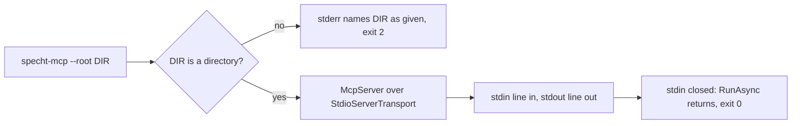

# Specification: The MCP host

## 1. Business Goal

<!-- last written by: spec-author, 2026-10-31, 2026-11-04 (premise reversed by the owner; ADR-0031) -->

An agent or an editor's assistant in a repository that pins `specht` reaches the tool only through a terminal session and output it scrapes, and no MCP server answers for the tool version the repository pinned. This Feature removes that failure state: one client configuration entry starts an MCP server that is a program of its own, which runs the `specht` the repository's local tool manifest pins and relays what the command returns, so that every answer `0132-F4` serves is that tool's, under the schema pin it reads, while the server opens no port, makes no outbound call and writes nothing.

## 2. User Needs

<!-- last written by: spec-author, 2026-10-31, 2026-11-01 (A-1 resolved with OQ-2), 2026-11-04 (A-1 superseded; A-4 and A-5 added; names and installs decided; A-6 added; pin, protocol revision and version guard decided), 2026-11-04 (A-7 added; OQ-7 of 0132-F4) -->

| #   | Persona                                 | Need                                                             | Pain Point Today                                       |
| --- | --------------------------------------- | ---------------------------------------------------------------- | ------------------------------------------------------ |
| 1   | A coding agent in a consumer repository | Reach `specht` through its MCP client, with no terminal          | Runs the command and scrapes its output                |
| 2   | A maintainer configuring a client       | One entry that starts the server, answering from the pinned tool | No server exists, and nothing would tie one to the pin |
| 3   | A person in an editor or a chat         | The same server their assistant reaches                          | Asks in a terminal, or not at all                      |
| 4   | `0132-F4`, reading through MCP          | A host that serves its answers by running the pinned tool        | N/A (internal dependency; no host exists)              |

### Assumptions

| ID  | Assumption                                                                                                                                                                                                                                                                                                                                                                                                                                                                                                                          |
| --- | ----------------------------------------------------------------------------------------------------------------------------------------------------------------------------------------------------------------------------------------------------------------------------------------------------------------------------------------------------------------------------------------------------------------------------------------------------------------------------------------------------------------------------------- |
| A-1 | Superseded 2026-11-04 by the owner: the MCP is not a `specht` command. Its package is `specht.mcp` and its command `specht-mcp` (OQ-2, resolved 2026-11-04). Was: resolved 2026-11-01 by the owner (OQ-2), the command is `specht mcp`.                                                                                                                                                                                                                                                                                             |
| A-2 | The root and the missing-input exit code `2` are the check's, so this Feature depends on `0001-F2`. The manifest B-011 names is the root's `.specht/manifest.json`, which the tool reads. A pin is `specht.tool` listed in a local tool manifest, `.config/dotnet-tools.json` (`0001-F2` C-6). The host runs the tool with the root as its working directory and the .NET local tool lookup decides which manifest applies; that lookup walks up to the nearest manifest, so a manifest above the root counts as the root's (OQ-7). |
| A-3 | What the host serves, and the shape of each answer, is `0132-F4`'s; this Feature serves what `0132-F4` registers and defines no answer of its own.                                                                                                                                                                                                                                                                                                                                                                                  |
| A-4 | Users are any `specht` consumer repository. The first version serves two MCP clients the owner named in session, and the major MCP clients follow (owner, 2026-11-04). Which clients the proof names is `0132-F4` OQ-1.                                                                                                                                                                                                                                                                                                             |
| A-5 | The MCP is not specific to .NET. It is distributed as a .NET tool package for now, and as demand grows a distribution outside the .NET ecosystem may be needed (§ 5 row 12). A recorded future, not a claim (owner, 2026-11-04; ADR-0031).                                                                                                                                                                                                                                                                                          |
| A-6 | A session is one run of the MCP's process, from its start to the close of its standard input; the protocol is stateless and has none. "Current" protocol revision means the revision current when the first release is minted, 2026-07-28, and a later revision is a new item (owner, 2026-11-04; OQ-5).                                                                                                                                                                                                                            |
| A-7 | A call "that needs the tool" is a call of the tool `check`, `0132-F4`'s verdict (its C-7, OQ-7 resolved 2026-11-04); this Feature's scenarios for B-009, B-017, B-018, B-020 to B-030 and B-034 drive the host through it, and any later tool is run the same way. `0330` registers it; `0359` supplies the pinned-tool run it calls, so those scenarios bind in the shared pull request (owner, 2026-11-04).                                                                                                                       |

## 3. Acceptance Criteria

<!-- last written by: spec-author, 2026-10-31, 2026-11-01 (B-015 and B-016 added), 2026-11-04 (B-007 withdrawn; B-001, B-006, B-009, B-011, B-013 and B-015 reworded; B-017 and B-018 added; ADR-0031; names and installs decided; B-001, B-006, B-011 and B-014 rewritten for the stateless protocol revision; B-017 and B-018 reworded; B-019 to B-031 added), 2026-11-04 (B-008, B-017, B-019, B-023 and B-027 reworded; B-033 and B-034 added on review), 2026-11-04 (OQ-7, OQ-11 and OQ-12 owner answers recorded; B-020 to B-022, B-024, B-026, B-027 and B-030 sources and wording; B-032 added), 2026-11-04 (C-12 cited by B-021, B-025, B-029 and B-031) -->

| ID    | Claim                                                                                                                                                                                                                                                                      | Source                                                                                                                                                                                         | Status    |
| ----- | -------------------------------------------------------------------------------------------------------------------------------------------------------------------------------------------------------------------------------------------------------------------------- | ---------------------------------------------------------------------------------------------------------------------------------------------------------------------------------------------- | --------- |
| B-001 | Given a client configuration entry that runs `dotnet specht-mcp` through the local tool manifest, or `specht-mcp` from a global install, this Feature answers the protocol's discovery request with the protocol revisions it supports, its capabilities and its identity. | epic `0132` candidate B and its sixth Must criterion; `0001-F2` C-6; the owner, 2026-11-04 (OQ-2, OQ-6; OQ-5: revision 2026-07-28 has no initialize handshake); reworded 2026-11-04 (ADR-0031) | Active    |
| B-002 | Given a session, this Feature exchanges protocol messages over its standard input and output only.                                                                                                                                                                         | epic `0132` § Constraints; spec-author's reading: of the protocol's standard transports, only standard input and output opens no port                                                          | Active    |
| B-003 | Given a session, this Feature opens no listening network port.                                                                                                                                                                                                             | epic `0132` § Constraints; AGENTS.md § Invariants                                                                                                                                              | Active    |
| B-004 | Given a session, this Feature makes no outbound network call.                                                                                                                                                                                                              | epic `0132` § Constraints; AGENTS.md § Invariants                                                                                                                                              | Active    |
| B-005 | Given a session, everything this Feature writes on stdout is a protocol message.                                                                                                                                                                                           | spec-author's reading of the protocol's standard input and output transport; as `0001-F2` C-3                                                                                                  | Active    |
| B-006 | Given a discovery answer, the server version this Feature states for itself is the informational version of the MCP's own package.                                                                                                                                         | the owner, 2026-11-04 (OQ-8: its own package version; the MCP and the tool can be updated apart, so their versions can differ); `0001-F2` B-040 for the form; reworded 2026-11-04              | Active    |
| B-007 | Given `specht.tool` installed and no other `specht` package, this Feature starts and completes the initialize handshake.                                                                                                                                                   | Withdrawn 2026-11-04: the host is not inside `specht.tool` (ADR-0031 supersedes ADR-0015 decision 3 and OQ-1's answer); C-2, C-9                                                               | Withdrawn |
| B-008 | Given a session from start to end, the host writes no file under the root or elsewhere.                                                                                                                                                                                    | brief § 9; epic `0132` § Constraints                                                                                                                                                           | Active    |
| B-009 | Given `--root <dir>`, this Feature answers for that directory, and with no `--root`, for the working directory the client starts it in, as the check does.                                                                                                                 | `0001-F2` B-001; the owner, 2026-11-04 (OQ-3, OQ-7)                                                                                                                                            | Active    |
| B-010 | Given `--root` naming a path that is not a directory, this Feature writes a message naming that path as given on stderr and exits `2` before any session starts.                                                                                                           | `0001-F2` B-005                                                                                                                                                                                | Active    |
| B-011 | Given a root whose `.specht/manifest.json` is missing, or is one the check rejects, this Feature still answers the discovery request.                                                                                                                                      | the owner, 2026-11-01 (OQ-4); reworded 2026-11-04 to name the manifest the tool reads (A-2) and for the stateless revision (OQ-5)                                                              | Active    |
| B-012 | Given the client closes this Feature's standard input, this Feature exits `0`.                                                                                                                                                                                             | spec-author's reading of the protocol's standard input and output shutdown                                                                                                                     | Active    |
| B-013 | Given `specht-mcp --help`, this Feature prints usage naming its options and exits `0`.                                                                                                                                                                                     | `0001-F2` B-008; `spectre-cli` § Help; the owner, 2026-11-04 (OQ-2); reworded 2026-11-04 (ADR-0031)                                                                                            | Active    |
| B-014 | Given a request naming protocol revision 2026-07-28, this Feature answers it without a version error.                                                                                                                                                                      | the owner, 2026-11-04 (OQ-5): the revision current at the first release; reworded 2026-11-04, was a handshake negotiation                                                                      | Active    |
| B-015 | Given the host, this Feature documents in `docs/mcp.md` a client configuration entry that runs `dotnet specht-mcp` and one that runs `specht-mcp`, each naming the repository root.                                                                                        | the owner, 2026-11-01; reworded 2026-11-04 (ADR-0031; OQ-6, resolved 2026-11-04: both installs, no `dnx`); B-001, B-009; C-8                                                                   | Active    |
| B-016 | Given the tools the host offers, the tool entries in `docs/mcp.md` name exactly those tools, one entry each.                                                                                                                                                               | the owner, 2026-11-01; held to the host as `docs/cli.md` is held to the help (`0002-F1` C-7); C-8                                                                                              | Active    |
| B-017 | Given a root whose local tool manifest, the root's own or the nearest one above it, lists `specht.tool` at a version that is restored, whatever version the MCP itself is, every call runs that version's `specht` and no other.                                           | owner, 2026-11-04: "Pinned means THIS version. Period."; C-2; OQ-7, resolved 2026-11-04                                                                                                        | Active    |
| B-018 | Given a root whose pinned `specht.tool` is not restored, this Feature does not restore it.                                                                                                                                                                                 | owner, 2026-11-04 (this version never installs or restores); B-004, B-008; C-10                                                                                                                | Active    |
| B-019 | Given a request naming a protocol revision this Feature does not support, this Feature answers with the protocol's unsupported-version error.                                                                                                                              | the owner, 2026-11-04 (OQ-5); the protocol's version rules for revision 2026-07-28                                                                                                             | Active    |
| B-020 | Given a root whose local tool manifest lists `specht.tool` and whose listed version is not restored, each call that needs the tool fails with an error naming the tool and the version that is missing.                                                                    | the owner, 2026-11-04 (OQ-7, reading (b) confirmed by the owner 2026-11-04): an error naming what is missing; B-018                                                                            | Active    |
| B-021 | Given a root whose pinned `specht.tool` is not restored, the error a call fails with names where to read how to restore the tool.                                                                                                                                          | the owner, 2026-11-04 (OQ-7, reading (b) confirmed 2026-11-04); B-031; C-12                                                                                                                    | Active    |
| B-022 | Given a root whose pinned `specht.tool` is not restored, this Feature runs no other `specht`.                                                                                                                                                                              | the owner, 2026-11-04 (OQ-7, reading (b) confirmed 2026-11-04): "Pinned means THIS version. Period." applied to a missing tool; C-2                                                            | Active    |
| B-023 | Given a root whose local tool manifest, the root's own or the nearest one above it, is absent or does not list `specht.tool`, this Feature runs the global `specht`.                                                                                                       | the owner, 2026-11-04 (OQ-7): no pin falls back to a global tool; C-2                                                                                                                          | Active    |
| B-024 | Given a root with no pin, this Feature reports to the user that the answer is unpinned, as a part of the call's result separate from the part holding the command's output.                                                                                                | the owner, 2026-11-04 (OQ-7): the report is a separate part of the same result, beside the command's text; C-2; `0132-F4` C-1 keeps the command's text itself unchanged                        | Active    |
| B-025 | Given a root with no pin, the report that the answer is unpinned names where to read how to pin the tool.                                                                                                                                                                  | the owner, 2026-11-04 (OQ-7); B-031; C-12                                                                                                                                                      | Active    |
| B-026 | Given a session, this Feature checks the version of the tool it runs, the pinned one or the global one, once.                                                                                                                                                              | the owner, 2026-11-04 (OQ-9): "we have to put a safety on the foot gun"; (OQ-12): one rule for the pinned and the global tool; A-6                                                             | Active    |
| B-027 | Given a tool older than the minimum version this Feature requires, each call that needs the tool fails with an error.                                                                                                                                                      | the owner, 2026-11-04 (OQ-9; OQ-12: the check applies to the global fallback too); B-026                                                                                                       | Active    |
| B-028 | Given a tool older than the minimum version, the error a call fails with names the minimum version required.                                                                                                                                                               | the owner, 2026-11-04 (OQ-9); the minimum is an implementation fact, not a claim                                                                                                               | Active    |
| B-029 | Given a tool older than the minimum version, the error a call fails with names where to read how to update the tool.                                                                                                                                                       | the owner, 2026-11-04 (OQ-9); B-031; C-12                                                                                                                                                      | Active    |
| B-030 | Given a root with no pin and no global `specht`, this Feature fails each call that needs the tool with an error naming the pin and the global tool as not found.                                                                                                           | the owner, 2026-11-04 (OQ-12): an error naming both as not found; B-023                                                                                                                        | Active    |
| B-031 | Given the messages of B-021, B-025 and B-029, `docs/mcp.md` has one entry for each thing they point to: restoring the tool, pinning it and updating it.                                                                                                                    | the owner, 2026-11-04 (OQ-7, OQ-9): the pointers belong to `docs/mcp.md`; C-8; C-12                                                                                                            | Active    |
| B-032 | Given a legacy `initialize` request, this Feature answers with an error naming the protocol revision it supports.                                                                                                                                                          | the owner, 2026-11-04 (OQ-11); B-019                                                                                                                                                           | Active    |
| B-033 | Given a request naming a protocol revision this Feature does not support, the error lists the revisions it supports.                                                                                                                                                       | the owner, 2026-11-04 (OQ-5); split from B-019 on review, 2026-11-04                                                                                                                           | Active    |
| B-034 | Given a tool older than the minimum version this Feature requires, the tool answers nothing.                                                                                                                                                                               | the owner, 2026-11-04 (OQ-9); split from B-027 on review, 2026-11-04; B-026                                                                                                                    | Active    |

## 4. Constraints

<!-- last written by: spec-author, 2026-10-31, 2026-11-01 (C-8 added), 2026-11-04 (C-4, C-6 and C-7 withdrawn; C-2, C-8 and C-10 reworded; C-9 and C-11 added; ADR-0031; C-2 reworded again for the unpinned case), 2026-11-04 (C-12 added) -->

| ID   | Constraint                                                                                                                                                                                                                                                                                                       | Rules Out                                                                                                                                                                                                                                                               |
| ---- | ---------------------------------------------------------------------------------------------------------------------------------------------------------------------------------------------------------------------------------------------------------------------------------------------------------------- | ----------------------------------------------------------------------------------------------------------------------------------------------------------------------------------------------------------------------------------------------------------------------- |
| C-1  | The host is a local process the client starts; it opens no port and makes no outbound call (epic `0132` § Constraints; AGENTS.md § Invariants).                                                                                                                                                                  | A hosted or remote service; any network transport, one on a local port included; a fetch from a session, `init`'s and `upgrade`'s included.                                                                                                                             |
| C-2  | Whenever the root's local tool manifest lists `specht.tool`, every answer is that tool's: the host runs that version as a process, and no other; with no pin the global `specht` answers and the answer is reported as unpinned (owner, 2026-11-04; epic `0132` § Constraints).                                  | A `specht` the path or a global install resolves while a pin exists; a copy of the tool or the engine bundled in the MCP's package; a fallback to a newer or an older version when the pinned one is not restored; an unpinned answer that is not reported as unpinned. |
| C-3  | The host writes nothing, and every path it gives is relative to the root with `/` separators (brief § 9).                                                                                                                                                                                                        | A log, cache or lock file; an absolute path in a protocol message or on stderr.                                                                                                                                                                                         |
| C-4  | Withdrawn 2026-11-04 (ADR-0031). Was: the host is composed by the one factory that composes the command-line host (ADR-0007).                                                                                                                                                                                    | Nothing now; the MCP's own composition is OQ-10. Was: a second composition root; a registration replaced for the host.                                                                                                                                                  |
| C-5  | The host defines no answer; every answer it serves is `0132-F4`'s (epic `0132` § Features, candidates B and C).                                                                                                                                                                                                  | A rule, tree-fact or verdict answer specified or built in this Feature.                                                                                                                                                                                                 |
| C-6  | Withdrawn 2026-11-04 (ADR-0031). Was: the host does not waive ADR-0014's benchmark gate.                                                                                                                                                                                                                         | Nothing now: the host holds no engine (C-9). Was: adopting ADR-0010's target architecture, or a mediator, as a side effect of the host.                                                                                                                                 |
| C-7  | Withdrawn 2026-11-04 (ADR-0031). Was: the command is listed in `docs/cli.md`, which a test holds to the help (`0002-F1`; AGENTS.md § CLI).                                                                                                                                                                       | Nothing now: the MCP is not a `specht` command (C-9). Was: a command missing from `docs/cli.md`; a second command-line reference page.                                                                                                                                  |
| C-8  | `docs/mcp.md` is the one MCP page: the client configuration entries and the tools the host offers; the MCP's options stay in its help (B-013, A-6).                                                                                                                                                              | An options list on the page that no test holds to the help; MCP configuration in `docs/cli.md`; an entry for a tool the host does not offer, or a planned marker standing in for one.                                                                                   |
| C-9  | The MCP is a program of its own, not a command of `specht.tool`, and holds no engine in its process (owner, 2026-11-04; ADR-0031).                                                                                                                                                                               | A `specht mcp` command; a reference from the MCP's project to the engine or the tool project; an answer computed in the MCP's process; an MCP section in `docs/cli.md`.                                                                                                 |
| C-10 | In this version the host runs the pinned tool and never restores, installs or updates one (C-1, C-3; owner, 2026-11-04).                                                                                                                                                                                         | `dotnet tool restore`, install or update run from a session; a download of the pinned version; a tool written into the tool cache by a session.                                                                                                                         |
| C-11 | The MCP package is versioned and tagged with the tool: one `v<version>` tag, no version line of its own (ADR-0015 decision 2, which ADR-0031 leaves standing).                                                                                                                                                   | A second `version.json` or tag line; a release workflow, or a release, of the MCP apart from the tool's.                                                                                                                                                                |
| C-12 | A message that names where to read how to restore, pin or update the tool contains the page path `docs/mcp.md` and the entry's anchor: `docs/mcp.md#restore-the-tool`, `docs/mcp.md#pin-the-tool` or `docs/mcp.md#update-the-tool`; `docs/mcp.md` has an entry at each anchor (B-021, B-025, B-029, B-031; C-8). | A pointer that is prose with no path; a path with no anchor; an anchor the page lacks; a URL; an absolute path.                                                                                                                                                         |

## 5. Out of Scope

<!-- last written by: spec-author, 2026-10-31, 2026-11-01 (row 5 resolved with OQ-1; row 10 added), 2026-11-04 (rows 2, 5, 9 and 13 reworded; rows 11, 12 and 14 to 19 added) -->

| #   | Item                                                                                                       | Exclusion Reason                                                                                                                                                                                                                      |
| --- | ---------------------------------------------------------------------------------------------------------- | ------------------------------------------------------------------------------------------------------------------------------------------------------------------------------------------------------------------------------------- |
| 1   | Every answer served: the verdict, rule and schema knowledge, the tree's facts                              | `0132-F4`; C-5.                                                                                                                                                                                                                       |
| 2   | A write through MCP: `init`, `upgrade`, the pin and set commands, `format`                                 | Staged in later, read-only first (owner, 2026-11-04); epic `0132` candidate D, deferred, 2026-10-30; each bound by its command's write rule.                                                                                          |
| 3   | The work queue                                                                                             | Epic `0132` candidate E, parked, 2026-10-30.                                                                                                                                                                                          |
| 4   | A network transport, one on a local port included                                                          | Never: epic `0132` § Out of this epic; C-1.                                                                                                                                                                                           |
| 5   | A host inside `specht.tool`: a `specht mcp` command, or the engine hosted in the MCP's process             | Rejected by the owner, 2026-11-04: ADR-0031; C-9. Was: "A package or an install of its own for the host", excluded on OQ-1's 2026-11-01 answer, which ADR-0031 supersedes.                                                            |
| 6   | Writing a client's configuration file                                                                      | Not asked; brief § 9's list of writes is unchanged, and `init`'s writes are `0001-F4`'s.                                                                                                                                              |
| 7   | One host shared between clients, users or machines                                                         | Epic `0324`, the service mode, moved 2026-10-30.                                                                                                                                                                                      |
| 8   | A persistent index or cache behind the host                                                                | `0132-F1`; C-3.                                                                                                                                                                                                                       |
| 9   | A caller with no .NET SDK                                                                                  | The pinned tool is a .NET tool, so the SDK is required whatever carries the MCP; the MCP's own distribution outside .NET is row 12. Was: epic `0132` § Out of this epic, no second distribution.                                      |
| 10  | The shape of a tool's answer, restated on `docs/mcp.md`                                                    | Each answer is its command's output (`0132-F4` C-1), documented where that command is; C-5.                                                                                                                                           |
| 11  | The MCP keeping and minting keys for documents and claims, with logic and state of its own                 | A recorded future (owner, 2026-11-04); no claim is written against it. It would amend C-3 and B-008, which say the host writes nothing; sequence allocation and lifetime keys are epic `0324`'s, and where this lands is not decided. |
| 12  | A distribution of the MCP outside the .NET ecosystem, such as a self-contained binary or a container image | A recorded future, not a claim: the MCP is not specific to .NET, it is a .NET tool package for now, and demand may require another (owner, 2026-11-04; A-5; ADR-0031 § Reversal).                                                     |
| 13  | Installing, restoring or updating the pinned tool from the MCP, in this version                            | C-10; the repository's own restore step does it.                                                                                                                                                                                      |
| 14  | Answering from a pinned version other than the one the manifest lists                                      | C-2; B-017, B-022. A repository with no pin is answered by the global tool, reported as unpinned (B-023 to B-025).                                                                                                                    |
| 15  | A future version of the MCP installing the pinned tool                                                     | A recorded future (owner, 2026-11-04); no claim is written against it. It would amend C-10, and B-004 and B-008, since an install fetches and writes.                                                                                 |
| 16  | A long-lived interactive mode of `specht` to avoid a process start per call                                | An idea only, not a direction (owner, 2026-11-04); the cost of a process start is unmeasured, and ADR-0014's benchmark gate applies to any change that claims to avoid it.                                                            |
| 17  | A protocol revision with an initialize handshake, 2025-11-25 and earlier                                   | Not in this version (owner, 2026-11-04, OQ-5): only revision 2026-07-28 is supported, and an older one is added only if the owner later says so; a client that does not use it is sorted out as a bug.                                |
| 18  | A protocol revision after 2026-07-28                                                                       | "Current" means the revision at the first release, 2026-07-28 (owner, 2026-11-04, OQ-5); a later revision is a new item.                                                                                                              |
| 19  | Workspace roots a client sends through the protocol                                                        | Not in this version (owner, 2026-11-04, OQ-3): the root comes from `--root` and the working directory only; client-sent roots are a later question.                                                                                   |

## 6. Concern Separation

<!-- last written by: implementer, 2026-11-04 (item 0329) -->

| Concern                                                                                                                                                                     | Classification | Where                                                                |
| --------------------------------------------------------------------------------------------------------------------------------------------------------------------------- | -------------- | -------------------------------------------------------------------- |
| Parsing `--root` and `--help`; a root that is not a directory is named as given on stderr and exits `2` before any session (B-010, B-013)                                   | Both           | `src/mcp/Features/Host/HostCommand.cs`                               |
| The one supported revision, 2026-07-28, handed to the SDK as the server's protocol version (B-014, B-019, B-033)                                                            | Business       | `HostCommand.Revision`, `HostCommand.ExecuteAsync`                   |
| The server's identity, its empty capabilities and the version it states, the informational version of its own assembly (B-001, B-006)                                       | Business       | `HostCommand.ExecuteAsync`, `ThisAssembly`                           |
| The exit code `2` for missing input, repeated here because the MCP references neither the tool nor the engine (C-9)                                                         | Business       | `HostCommand.MissingInput`                                           |
| The application's name and version in help                                                                                                                                  | Technical      | `src/mcp/Features/Host/HostRegistration.cs`                          |
| The host's composition: one command, set as the default                                                                                                                     | Technical      | `src/mcp/Program.cs`                                                 |
| JSON-RPC framing, one message per line, the discovery answer, the version negotiation and its errors, and ending on end of input (B-002, B-005, B-011, B-012, B-019, B-032) | Technical      | `ModelContextProtocol` 2.2.0, the SDK (ADR-0032)                     |
| Standard input and output as the one transport: no port, no outbound call, no file (B-003, B-004, B-008; C-1, C-3)                                                          | Technical      | `src/mcp/mcp.csproj` (no AspNetCore package), `StdioServerTransport` |

## 7. Technical Design

<!-- last written by: implementer, 2026-11-04 (item 0329) -->

**The project (B-001, B-013; C-9).** `src/mcp/mcp.csproj` packs `specht.mcp`, command `specht-mcp`, assembly `specht.mcp`. It references `ModelContextProtocol` and `Spectre.Console.Cli`, and neither the engine nor the tool project (C-9). Versions are central in `Directory.Packages.props`, under the label `Mcp`.

**The slice.** One folder, `src/mcp/Features/Host/`, laid out as [`dotnet-tool` § Vertical Slice](../../../../../.agents/skills/dotnet-tool/references/vertical-slice.md) lays out a command:

- [`HostCommand`](../../../../mcp/Features/Host/HostCommand.cs) is the one default command, with its nested `Settings` (`--root <DIR>`, default `.`). It checks the root with `Directory.Exists`, writes `specht-mcp: '<root as given>' is not a directory.` on stderr and returns `2` before a transport exists (B-010). Otherwise it builds `McpServerOptions` and runs `McpServer.Create(new StdioServerTransport("specht-mcp"), options)` until `RunAsync` returns, which is the end of standard input, and returns `0` (B-012). The root is checked and not otherwise used: an answer that depends on it arrives with `0330` (B-009, § 9).
- [`HostRegistration`](../../../../mcp/Features/Host/HostRegistration.cs) names the application and gives Spectre `ThisAssembly.AssemblyInformationalVersion`.
- [`Program.cs`](../../../../mcp/Program.cs) is `new CommandApp<HostCommand>()`, `Configure(AddHost)`, `RunAsync(args)`.

No domain type, interface or abstraction is declared in this item: the protocol types are the SDK's, and the program defines no answer (C-5). The compiler's declarations are the authority; this section restates none.

**Composition (OQ-10).** ADR-0007's direction is that each part registers itself and one factory composes the host. This host has one part, so `Program.cs` lists it and no factory exists; a factory with one caller is the abstraction `coding-conventions` § Design forbids. The factory arrives with `0359`, the second part, which brings services for the pin lookup and the process run. No static state is added. The command takes no injected service, so no type registrar is built. Reuse found: the check command's shape (a command with nested `Settings`, a message on stderr, an exit code) is followed; `ExitCodes` is not referenced because it lives in the tool project (C-9), so the one code this item needs is a constant of the command. `OQ-10` stays decided in § 11 as the spec-author recorded it; this paragraph is the design it deferred to § 7.

**Why Spectre.** `--help` listing `--root` and the `--root` option are what B-013 and B-010 need, and the repository's CLI skills name Spectre for options and help; the host uses no other part of it. Its footprint is `Spectre.Console` and `Spectre.Console.Ansi` 0.57.2, central.

**What the SDK does, found while building (ADR-0032 decision 3).**

1. **Answers produced after end of input are dropped.** `StreamServerTransport.SendMessageAsync` returns without writing once the read loop has seen end of input and marked the transport disconnected. A client that writes every request and closes standard input at once gets nothing back; a client that reads its answers before it closes gets them. The protocol's standard input and output shutdown has the client wait, so this is the SDK being correct, and the tests' launcher is a client that waits (§ 8). The same code is on the SDK's main branch, so 2.3.x does not change it.
2. **The version is negotiated per session.** The SDK keeps the negotiated protocol version for the session. A refused first request gets `-32022` with `data.supported`. A request that changes the revision after the session has settled on one gets `-32600` with no `data.supported`. B-033's proof is therefore a refusal that is a session's first request, compared with `supportedVersions` from a separate session's discovery answer.
3. **The supported revision is set, not defaulted.** `McpServerOptions.ProtocolVersion` is set to the literal `2026-07-28`. Its default, null, makes the SDK also support 2024-11-05, 2025-03-26, 2025-06-18 and 2025-11-25 through the initialize handshake, which OQ-5 rules out; set to 2026-07-28 it rejects the handshake and advertises only that revision. The SDK's `McpProtocolVersions` constants are internal, so the host states the literal once, as `HostCommand.Revision`.
4. **A legacy `initialize` gets the SDK's own error**, accepted by the owner on 2026-11-04: code `-32022`, the message `Protocol version '2026-07-28' is not available through the initialize handshake.`, and `data.supported` empty. It contains the revision (B-032, test: error contains 2026-07-28).
5. **A line that is no message gets no answer** and writes nothing on stdout; with no logger factory the SDK writes nothing on stderr either (B-005).

**The SDK version.** `ModelContextProtocol` 2.2.0, the newest 2.x whose packages fit the central pins. 2.3.0 and 2.3.1 need `Microsoft.Extensions.DependencyInjection.Abstractions` 10.0.13 or later; the central pin is 10.0.12 with transitive pinning on, so restore fails with `NU1109`. A pin bump is the owner's to decide later; nothing in 0329 needs it.

**The SDK's transitive package set (ADR-0032 check 6), as restored for net10.0.** `ModelContextProtocol` 2.2.0 brings `ModelContextProtocol.Core` 2.2.0, `Microsoft.Extensions.AI.Abstractions` 10.8.3, and `Microsoft.Extensions.Caching.Abstractions`, `Configuration.Abstractions`, `Diagnostics.Abstractions`, `FileProviders.Abstractions`, `Hosting.Abstractions`, `Logging.Abstractions`, `Options` and `Primitives`, all 10.0.10, with `Microsoft.Extensions.DependencyInjection.Abstractions` at the central 10.0.12. `Spectre.Console.Cli` adds `Spectre.Console` and `Spectre.Console.Ansi` 0.57.2. For net11.0 only `Microsoft.Extensions.AI.Abstractions` and `ModelContextProtocol.Core` come from the SDK. The owner accepts this set or rules otherwise.

**ADR-0032's six checks, each against the committed tests.**

| #   | Check           | Result                                                                                                                                                                                                                                                               |
| --- | --------------- | -------------------------------------------------------------------------------------------------------------------------------------------------------------------------------------------------------------------------------------------------------------------- |
| 1   | B-032           | Holds: error `-32022`, containing 2026-07-28 (point 4 above). The test asserts the revision's presence.                                                                                                                                                              |
| 2   | B-019 and B-033 | Holds: `-32022`, `data.supported` equals the discovery answer's `supportedVersions`, `["2026-07-28"]`, for a refused first request (point 2).                                                                                                                        |
| 3   | B-005           | Holds: every stdout line of a session of requests, a refusal, a legacy `initialize` and a noise line is a JSON-RPC message. No logger is passed, no console provider is referenced.                                                                                  |
| 4   | B-003 and B-004 | Holds as far as the tests see: no listening socket and no connection or datagram socket after a session has served; `specht.mcp.dll` references no networking assembly. The SDK's packages were read from the restore list above and none is an HTTP or socket host. |
| 5   | B-006           | Holds: `ServerInfo.Version` is `ThisAssembly.AssemblyInformationalVersion` of `specht.mcp`; the test reads the same value from the assembly's metadata.                                                                                                              |
| 6   | Footprint       | Listed above, for the owner's acceptance.                                                                                                                                                                                                                            |

**Tests.** No unit test is owed. The decisions § 8 listed as owed (the version decision, the framing, the discovery answer's composition) are the SDK's and this item declares no function that holds one; the one decision of this item's own, the root check, is a command and so an integration test in the Spectre convention. B-003, B-004 and B-008 remain absence proofs and `Partial`; B-009 waits for `0330`.

**Not built.** Every answer (`0330`, `0331`), pin lookup and tool run (`0359`), `docs/mcp.md` (`0332`). The Feature's specification stays under `src/tool/Features/Mcp/` although the project now exists; moving it to `src/mcp/.spec/` (§ Tasks, OQ-2) is the spec-author's, as it moves the `.feature` file the acceptance project links.

## 8. Testing Strategy

<!-- last written by: test-writer, 2026-11-04 (item 0329; launcher reads each answer before closing input; B-033 refusal is a session's first request) -->

Scope: the claims of item `0329` (B-001 to B-006, B-008 to B-014, B-019, B-032, B-033). B-017, B-018, B-020 to B-030 and B-034 are `0359`'s, B-015, B-016 and B-031 are `0332`'s, and their scenarios have no binding and their rows stay `Missing`.

The protocol is read from the 2026-07-28 revision's own pages: a request names its revision in `_meta["io.modelcontextprotocol/protocolVersion"]`, `server/discover` answers `supportedVersions`, `capabilities` and `_meta["io.modelcontextprotocol/serverInfo"]`, and the unsupported-version error is code `-32022` with `data.supported`. No third-party protocol package is decided, so every test drives the built program, `specht.mcp.dll`, as a process over its standard input and output, one newline-delimited JSON-RPC message per line, and holds either choice. The launcher is `AcceptanceTool.LaunchMcp` and `AcceptanceTool.McpSession`, in the one file `test/tests` already links from `test/acceptance`; no link is added. Fixtures are synthetic `SpechtTree` roots with root-relative paths; no test touches the network or reads a clock, and a session is bounded by a 30-second wait on the process, never a delay. The launcher behaves as a client that waits: it writes a request, reads lines until that request's answer arrives, and only then writes the next line; it closes standard input only after the last answer (a line that is no request, such as the noise B-005 sends, awaits no answer and is followed by a request that does). A host that ends its output at end of input would otherwise drop an answer still in flight, which a real client that has not yet read it never meets; a read that gets nothing within the limit ends the process and fails the test.

Every test is red until the host is built. Today `src/mcp` is the scaffold item `0329` names: a `Program.cs` that writes nothing and exits `1`, so each test fails on the missing behaviour (no answer on standard output, exit `1` for `2` or `0`). The scaffold is the implementer's to replace.

| Claim | Mechanism beneath it, and its proof                                                                                                                                                                                                                                                                                                                                                                                                                                                    |
| ----- | -------------------------------------------------------------------------------------------------------------------------------------------------------------------------------------------------------------------------------------------------------------------------------------------------------------------------------------------------------------------------------------------------------------------------------------------------------------------------------------- |
| B-001 | The discovery answer the host composes: its supported revisions, capabilities and identity. Process proof in `McpHostDiscoveryIntegrationTests` and the scenario. The scenario's two installs run the same built program: a local tool manifest and a global install differ in how the .NET host finds the program, which no code of the MCP decides and no test here installs. No unit test: no code exists to name.                                                                  |
| B-002 | The message loop: one request line in, one response line out, correlated by id, nothing on standard error. `McpHostSessionIntegrationTests` and the scenario. No unit test: no code exists to name.                                                                                                                                                                                                                                                                                    |
| B-003 | An absence. Two proofs, each partial: the process's listening TCP sockets read with `lsof` after it has served (not on Windows, where the test skips), and the networking assemblies the program's own metadata references. The second is green on the scaffold, since it proves absence of a capability and not behaviour, and a package the program calls could still open a port without the program referencing the type. Neither sees a port opened and closed between two reads. |
| B-004 | An absence. The process's non-listening internet sockets read with `lsof` after it has served, and the same reference check. An outbound call that has finished before the read is not seen; a fetch cannot be forced without a root that triggers one.                                                                                                                                                                                                                                |
| B-005 | The one writer of standard output. Every line of a session of requests, a refused request, a legacy `initialize` and a line that is no message parses as a JSON-RPC message, and the output is not empty, so a silent host does not pass.                                                                                                                                                                                                                                              |
| B-006 | The identity's version equals the informational version the built `specht.mcp.dll` states, read from its metadata as `AcceptanceTool.InformationalVersion` reads the tool's. A version string the host derives, trims or formats would earn a unit test; none exists yet.                                                                                                                                                                                                              |
| B-008 | An absence. The tree under the root is snapshotted by path and SHA-256 before and after a served session, with a sentinel file. "Elsewhere" is not covered: nothing observes a write outside the root, and the process's own runtime state is out of reach. A session that is not served is not accepted, so a host that exits silently does not pass.                                                                                                                                 |
| B-009 | Not bound. The root decides which repository an answer is about, and no answer depends on it until `0330`'s tool serves one; the item's decision puts these scenarios in the shared pull request. The mechanism, a root from `--root` or else the working directory, is a decision the implementer exposes for a unit test, below.                                                                                                                                                     |
| B-010 | The root check and its exit code. A root that does not exist and one that is a file, given relative, each exit `2` with the root as given on standard error, no absolute path, and nothing on standard output although a request was sent.                                                                                                                                                                                                                                             |
| B-011 | The host reads no manifest to serve discovery: a removed manifest, a malformed one and one with an unshipped pin all still get the answer.                                                                                                                                                                                                                                                                                                                                             |
| B-012 | The loop ends on end of input: a session that has answered a request exits `0` when its standard input closes.                                                                                                                                                                                                                                                                                                                                                                         |
| B-013 | `--help` names `--root` and exits `0`, read from standard output and standard error together because the claim names neither stream.                                                                                                                                                                                                                                                                                                                                                   |
| B-014 | A request naming 2026-07-28 is not answered with the unsupported-version error. The request is `tools/list`, which `0330` and `0331` define; the claim states only that no version error answers it, and the test asserts only that.                                                                                                                                                                                                                                                   |
| B-019 | The version decision: a request naming a revision outside the supported set is answered with code `-32022`, for the method that discovers and one that does not, and for a revision no one defined and one that has an initialize handshake.                                                                                                                                                                                                                                           |
| B-032 | A legacy `initialize` is answered with an error, not a result, and the error names 2026-07-28.                                                                                                                                                                                                                                                                                                                                                                                         |
| B-033 | The refusal's `data.supported`, from a session whose first request is the refused one, equals the `supportedVersions` a separate session's discovery answer gives, and is not empty.                                                                                                                                                                                                                                                                                                   |

What the design makes hard to test, for the implementer, none worked around here:

- **No decision is reachable in memory.** The version decision (requested revision against the supported set, giving a request to serve or the `-32022` error with the supported list), the root resolution (`--root` or the working directory, and the exit `2` for a path that is not a directory), the discovery answer's composition and the framing of one message per line each have a test owed once they exist as functions or types the test project can call. Those unit tests are written when their signatures are; until then the rows are `Partial`, not `Covered`.
- **Standard output must have one writer.** A second writer, a logger or a library's console output, is what B-005 catches only if the session reaches it; send logging to standard error.
- **The tool's answer is the missing half of B-009.** Whether the host answers for the root is observable only through `0330`'s verdict.
- **Absence claims have no strong unit.** B-003, B-004 and B-008 stay process-level and partial for the reasons above.

Focused verification selects `net11.0`; the required gates keep their configured matrix. No benchmark is needed: no performance claim is made and no architecture migration is introduced.

## 9. Traceability Matrix

<!-- last written by: spec-author, 2026-10-31; test-writer, 2026-11-01 (B-015 and B-016 rows added); spec-author, 2026-11-04 (B-006 and B-007 rows changed, B-017 and B-018 rows added, for the amendment only; test-writer to confirm); spec-author, 2026-11-04 (rows B-008, B-017, B-019 to B-034 added or changed, after the third review); test-writer, 2026-11-04 (rows B-001 to B-006, B-008, B-010 to B-014, B-019, B-032 and B-033 name tests, item 0329); implementer, 2026-11-04 (statuses after item 0329: Covered where the process-level test is the whole mechanism, Partial for the absences B-003, B-004 and B-008, Missing for B-009) -->

| Claim ID | Scenario                                                          | Test                                                                                                                                                                                                                                                                 | Status    |
| -------- | ----------------------------------------------------------------- | -------------------------------------------------------------------------------------------------------------------------------------------------------------------------------------------------------------------------------------------------------------------- | --------- |
| B-001    | A discovery request gets the server's identity                    | `McpHostSteps.ThenIdentity`; `McpHostDiscoveryIntegrationTests.ADiscoveryRequest_WhenServed_ShouldAnswerWithTheSupportedRevisionsItsCapabilitiesAndItsIdentity`                                                                                                      | Covered   |
| B-002    | The server speaks over its standard input and output              | `McpHostSteps.ThenStandardStreams`; `McpHostSessionIntegrationTests.TwoRequests_WhenSentOnStandardInput_ShouldBeAnsweredOnStandardOutputAndNotOnStandardError`                                                                                                       | Covered   |
| B-003    | The server opens no network port                                  | `McpHostSteps.ThenNoListeningPort`; `McpHostNetworkIntegrationTests.ASessionThatHasServed_WhenItsSocketsAreListed_ShouldHoldNoListeningSocket`; `McpHostNetworkIntegrationTests.TheMcpAssembly_WhenItsReferencesAreRead_ShouldNameNoNetworkingAssembly`              | Partial   |
| B-004    | The server calls nothing outside the machine                      | `McpHostSteps.ThenNoOutboundCall`; `McpHostNetworkIntegrationTests.ASessionThatHasServed_WhenItsSocketsAreListed_ShouldHoldNoConnectionAndNoDatagramSocket`; `McpHostNetworkIntegrationTests.TheMcpAssembly_WhenItsReferencesAreRead_ShouldNameNoNetworkingAssembly` | Partial   |
| B-005    | The standard output carries only protocol messages                | `McpHostSteps.ThenOnlyProtocolMessages`; `McpHostSessionIntegrationTests.ASessionThatIsGivenRequestsAndNoise_WhenItRuns_ShouldWriteOnlyProtocolMessagesOnStandardOutput`                                                                                             | Covered   |
| B-006    | The server states its own package's version                       | `McpHostSteps.ThenOwnVersion`; `McpHostDiscoveryIntegrationTests.ADiscoveryAnswer_WhenItStatesTheServerVersion_ShouldStateTheInformationalVersionOfTheMcpAssembly`                                                                                                   | Covered   |
| B-007    | None: withdrawn (ADR-0031, 2026-11-04)                            | None: withdrawn                                                                                                                                                                                                                                                      | Withdrawn |
| B-008    | The host writes no file in a session                              | `McpHostSteps.ThenNoFileChanged`; `McpHostSessionIntegrationTests.ASession_WhenItRunsFromStartToEnd_ShouldWriteNoFileUnderTheRoot`                                                                                                                                   | Partial   |
| B-009    | The server answers for the root the check would take              | Missing                                                                                                                                                                                                                                                              | Missing   |
| B-010    | A root that is not a directory stops the server                   | `McpHostSteps.ThenRootNamed`; `McpHostSteps.ThenMissingInput`; `McpHostSessionIntegrationTests.ARootThatIsNotADirectory_WhenTheServerStarts_ShouldNameItOnStandardErrorAndExitBeforeAnySession`                                                                      | Covered   |
| B-011    | A repository without a usable manifest still answers discovery    | `McpHostSteps.ThenAnswered`; `McpHostDiscoveryIntegrationTests.ARootWithoutAUsableManifest_WhenAskedForDiscovery_ShouldAnswerIt`                                                                                                                                     | Covered   |
| B-012    | Closing the server's input ends it cleanly                        | `McpHostSteps.ThenExitsZero`; `McpHostSessionIntegrationTests.ASessionInProgress_WhenTheClientClosesStandardInput_ShouldExitWithCodeZero`                                                                                                                            | Covered   |
| B-013    | Help names the server's options                                   | `McpHostSteps.ThenUsage`; `McpHostSteps.ThenHelpExitsZero`; `McpHostSessionIntegrationTests.HelpAsked_WhenTheServerStarts_ShouldNameTheRootOptionAndExitWithCodeZero`                                                                                                | Covered   |
| B-014    | A request naming the supported revision is answered               | `McpHostSteps.ThenNoVersionError`; `McpHostDiscoveryIntegrationTests.ARequestNamingTheSupportedRevision_WhenSent_ShouldNotBeAnsweredWithAVersionError`                                                                                                               | Covered   |
| B-015    | The MCP page gives the configuration entries                      | Missing                                                                                                                                                                                                                                                              | Missing   |
| B-016    | The MCP page documents exactly the tools the server offers        | Missing                                                                                                                                                                                                                                                              | Missing   |
| B-017    | Every call runs the version the repository pins                   | Missing                                                                                                                                                                                                                                                              | Missing   |
| B-018    | A tool that is not restored is not restored by the server         | Missing                                                                                                                                                                                                                                                              | Missing   |
| B-019    | An unsupported revision gets the unsupported-version error        | `McpHostSteps.ThenUnsupportedVersion`; `McpHostVersionsIntegrationTests.ARequestNamingAnUnsupportedRevision_WhenSent_ShouldBeAnsweredWithTheUnsupportedVersionError`                                                                                                 | Covered   |
| B-020    | A pinned tool that is not restored is named in the error          | Missing                                                                                                                                                                                                                                                              | Missing   |
| B-021    | The not-restored error says where to read how to restore          | Missing                                                                                                                                                                                                                                                              | Missing   |
| B-022    | A pinned tool that is not restored is never replaced              | Missing                                                                                                                                                                                                                                                              | Missing   |
| B-023    | With no pin the global tool answers                               | Missing                                                                                                                                                                                                                                                              | Missing   |
| B-024    | With no pin the answer is reported as unpinned                    | Missing                                                                                                                                                                                                                                                              | Missing   |
| B-025    | The unpinned report says where to read how to pin                 | Missing                                                                                                                                                                                                                                                              | Missing   |
| B-026    | The tool's version, pinned or global, is checked once per session | Missing                                                                                                                                                                                                                                                              | Missing   |
| B-027    | A tool older than the minimum fails each call                     | Missing                                                                                                                                                                                                                                                              | Missing   |
| B-028    | The too-old error names the minimum version                       | Missing                                                                                                                                                                                                                                                              | Missing   |
| B-029    | The too-old error says where to read how to update                | Missing                                                                                                                                                                                                                                                              | Missing   |
| B-030    | With no pin and no global tool the error says neither was found   | Missing                                                                                                                                                                                                                                                              | Missing   |
| B-031    | The MCP page has an entry for restoring, pinning and updating     | Missing                                                                                                                                                                                                                                                              | Missing   |
| B-032    | A legacy initialize request gets an error naming the revision     | `McpHostSteps.ThenAnError`; `McpHostSteps.ThenRevisionNamed`; `McpHostVersionsIntegrationTests.ALegacyInitializeRequest_WhenSent_ShouldBeAnsweredWithAnErrorNamingTheSupportedRevision`                                                                              | Covered   |
| B-033    | The unsupported-version error lists the supported revisions       | `McpHostSteps.ThenSupportedListed`; `McpHostVersionsIntegrationTests.AnUnsupportedVersionError_WhenAnswered_ShouldListTheRevisionsTheServerSupports`                                                                                                                 | Covered   |
| B-034    | A tool older than the minimum is given no work                    | Missing                                                                                                                                                                                                                                                              | Missing   |

## 10. Lessons / Spec Deltas

<!-- last written by: spec-author, 2026-10-31, 2026-11-04 (ADR-0032 pointer), 2026-11-04 (A-7, C-12) -->

2026-11-04, by the owner in session: the premise of OQ-1 and ADR-0015 decision 3, a host inside `specht.tool`, is rejected. The MCP is a program of its own that runs the repository's pinned `specht` (ADR-0031, which supersedes ADR-0015 decision 3 only).

- Withdrawn: B-007, C-4, C-6, C-7.
- Reworded: B-001, B-006, B-009, B-011, B-013, B-014, B-015, C-2, C-8, C-10.
- New: B-017 to B-034, C-9 to C-11; § 5 rows 11 to 19; A-4 to A-6.
- Owner, 2026-11-04: the program's protocol layer is the official C# MCP SDK, stdio only (ADR-0032, which refines ADR-0031 and supersedes nothing); the checks it leaves the implementer are ADR-0032's Consequences.
- Owner, 2026-11-04: package `specht.mcp`, command `specht-mcp` (OQ-2); installed through a local tool manifest or globally, no `dnx` (OQ-6); C-10 holds for this version only.
- Owner, 2026-11-04: pin resolution (OQ-7), protocol revision 2026-07-28 only (OQ-5), the tool's own version stated (OQ-8), a minimum pinned-tool version checked once per session (OQ-9), roots from `--root` and the working directory (OQ-3). OQ-10 decided in session.
- OQ-1 superseded; OQ-2, OQ-3, OQ-5, OQ-6, OQ-7, OQ-8, OQ-9, OQ-11, OQ-12 resolved; OQ-10 decided. B-019 and B-027 split on review, B-033 and B-034 added; A-2, B-008, B-017, B-023, C-8 and OQ-7 clarified on review.
- Owner, 2026-11-04: OQ-7 reading (b) confirmed; the unpinned report is a separate part of the same result (B-024); no pin and no global tool is an error naming both as not found (OQ-12, B-030); the minimum-version check applies to the global fallback (OQ-12, B-026, B-027); a legacy `initialize` gets an error naming the supported revision (OQ-11, B-032).

2026-11-04, by the owner in session: the tools are named for the commands they serve (`0132-F4` OQ-7, resolved), and the first is `check`.

- Added: A-7, the scenarios for B-009, B-017, B-018, B-020 to B-030 and B-034 drive the host through `check`; C-12, what a pointer to `docs/mcp.md` contains. No claim changes.
- `docs/mcp.md`'s three anchors are `0332`'s obligation (C-12, B-031).

## 11. Open Questions

<!-- last written by: spec-author, 2026-10-31, 2026-11-01 (OQ-1, OQ-2 and OQ-4 resolved by the owner), 2026-11-04 (OQ-1 superseded; OQ-2, OQ-3, OQ-5 to OQ-9 resolved by the owner; OQ-10 decided; OQ-11 and OQ-12 added) -->

| ID    | Question                                                                                                                                                                                                                                                                                                                                                                                                                                                       | Blocks                                  | Resolution                                                                                                                                                                                                                                                                                                                                                                                                                                                                                                                                                                                                                                                                                                                                                                                                                                                                                                                                                                                                                                                                                                                                                                                                                                                                                                                                                                                                                                                                                                                     |
| ----- | -------------------------------------------------------------------------------------------------------------------------------------------------------------------------------------------------------------------------------------------------------------------------------------------------------------------------------------------------------------------------------------------------------------------------------------------------------------- | --------------------------------------- | ------------------------------------------------------------------------------------------------------------------------------------------------------------------------------------------------------------------------------------------------------------------------------------------------------------------------------------------------------------------------------------------------------------------------------------------------------------------------------------------------------------------------------------------------------------------------------------------------------------------------------------------------------------------------------------------------------------------------------------------------------------------------------------------------------------------------------------------------------------------------------------------------------------------------------------------------------------------------------------------------------------------------------------------------------------------------------------------------------------------------------------------------------------------------------------------------------------------------------------------------------------------------------------------------------------------------------------------------------------------------------------------------------------------------------------------------------------------------------------------------------------------------------ |
| OQ-1  | Is the host delivered in the `specht.tool` package or in a package of its own? It touches epic `0055`.                                                                                                                                                                                                                                                                                                                                                         | Nothing; was B-007; § 5 row 5           | Superseded 2026-11-04 by the owner, in session: not a command inside `specht.tool`; a program of its own with its own package, running the pinned `specht` (ADR-0031). Was: resolved 2026-11-01 by the owner: a command inside the `specht.tool` package, ADR-0015 decision 3's preference. Was: open, left to the design by the owner, 2026-10-30 (epic `0132` § Open questions); proceeding on a command inside `specht.tool`, with a second packable project built from the same tag as the fallback.                                                                                                                                                                                                                                                                                                                                                                                                                                                                                                                                                                                                                                                                                                                                                                                                                                                                                                                                                                                                                       |
| OQ-2  | What are the MCP's package name and command name, and so the configuration entry a client carries?                                                                                                                                                                                                                                                                                                                                                             | Nothing; was B-001, B-013, B-015        | Resolved 2026-11-04 by the owner, in session: package `specht.mcp`, command `specht-mcp`, in line with `specht.tool` and `specht`. The project is `src/mcp`, beside `src/tool`, decided in session 2026-11-04 as reversible, the owner told and not objecting; the Feature's specification moves there with the project's first item, as co-location requires. Was: reopened 2026-11-04, the 2026-11-01 answer `specht mcp` having fallen with OQ-1. Was: resolved 2026-11-01 by the owner: `specht mcp`, run as `dotnet specht mcp` through the local tool manifest. Was: open, proceeding on that name; owner not asked.                                                                                                                                                                                                                                                                                                                                                                                                                                                                                                                                                                                                                                                                                                                                                                                                                                                                                                     |
| OQ-3  | Does the host take its root from the workspace roots a client can send through the protocol, or only from `--root` and the working directory? Clients differ in the working directory they start a server in.                                                                                                                                                                                                                                                  | Nothing; was B-009                      | Resolved 2026-11-04 by the owner, in session: `--root` and the working directory only, as the check takes them; client-sent workspace roots are a later question (§ 5 row 19). Owner: "this seems the right place to start". Was: open, proceeding on that default; owner not asked.                                                                                                                                                                                                                                                                                                                                                                                                                                                                                                                                                                                                                                                                                                                                                                                                                                                                                                                                                                                                                                                                                                                                                                                                                                           |
| OQ-4  | Given a root with no manifest or one the check rejects, does the host refuse to start, exiting `2` or `3` as the check does, or start and fail each answer that needs the manifest?                                                                                                                                                                                                                                                                            | B-011                                   | Resolved 2026-11-01 by the owner: the host starts, and each answer that needs the manifest fails, as B-011 says and `0132-F4` B-012 gives the error. 2026-11-04: unchanged; the tool reads the manifest, so the failure is the tool's. Was: open, proceeding on starting, so that a client shows each answer's error rather than a server that failed to start; owner not asked.                                                                                                                                                                                                                                                                                                                                                                                                                                                                                                                                                                                                                                                                                                                                                                                                                                                                                                                                                                                                                                                                                                                                               |
| OQ-5  | Which protocol revisions does the host support?                                                                                                                                                                                                                                                                                                                                                                                                                | Nothing; was B-001, B-006, B-011, B-014 | Resolved 2026-11-04 by the owner, in session: the current revision as of minting the tool, 2026-07-28, and nothing older; if the first clients do not use it, that is sorted out as a bug. The revision has no initialize handshake: every request carries its protocol version in its metadata, the server answers a discovery request with the versions, capabilities and identity it has, and a request naming an unsupported version gets the protocol's unsupported-version error listing the versions supported (read on the protocol's site, 2026-11-04: its basic, versioning, discovery and standard-input-and-output pages). B-001, B-006, B-011 and B-014 are rewritten for it and B-019 is added. "Current" means the revision at the first release; a later revision is a new item (§ 5 rows 17, 18). Was: conflict recorded 2026-11-04 between this revision and the handshake revisions B-001 and B-014 required, proceeding on the handshake revisions. Was: the newest revision published when the first item is cut. Owner not asked.                                                                                                                                                                                                                                                                                                                                                                                                                                                                        |
| OQ-6  | What invocation does a client configuration carry: the MCP run through the local tool manifest (`dotnet <command>`, its version pinned beside `specht.tool` in `.config/dotnet-tools.json`), or `dnx <package>@<version>` from a feed (the MCP pinned in the client's configuration, a second pin outside the repository's manifest that can drift from `specht.tool`'s)?                                                                                      | Nothing; was B-001, B-015               | Resolved 2026-11-04 by the owner, in session: the MCP installs the two ways `specht.tool` does, through a local tool manifest, which the client runs as `dotnet specht-mcp`, and as a global tool, which it runs as `specht-mcp`; `dnx` is not a documented path. Was: open between the local tool manifest and `dnx <package>@<version>` from a feed, proceeding on the local tool manifest; the owner had said only "the NuGet way".                                                                                                                                                                                                                                                                                                                                                                                                                                                                                                                                                                                                                                                                                                                                                                                                                                                                                                                                                                                                                                                                                         |
| OQ-7  | How does the host find the pinned `specht`, from `--root` or the working directory through the local tool manifest at that directory or the nearest one above it, and what does it do when the root has no local tool manifest, the manifest does not list `specht.tool`, or the listed version is not restored? A global install of the MCP has no manifest beside it, and a repository may have none either, so the question covers the global-install case. | Nothing; was B-009, B-017, B-018        | Resolved 2026-11-04 by the owner, in session: the host finds the pinned `specht` through the root's local tool manifest, the root coming from `--root` or the working directory, whichever way the MCP is installed. (a) With no pin, whether no local manifest or one that does not list `specht.tool`: it falls back to the global `specht`, reports to the user that the answer is unpinned and points to the documentation on pinning (B-023 to B-025). (b) With a pin that is not restored: it fails with an error naming what is missing and pointing to the documentation on restoring it, with no fallback (B-020 to B-022). The MCP never restores or installs (C-10, this version). Reading (b), the owner's rule "Pinned means THIS version. Period." applied to a missing tool, was confirmed by the owner 2026-11-04. The unpinned report of (a) is a separate part of the same call result beside the command's text, which stays byte for byte the command's (B-024; `0132-F4` C-1). The nearest manifest counts: the host runs the tool with the root as its working directory and the .NET local tool lookup decides, which walks up to the nearest manifest above it, so a manifest above the root is the root's (B-017, B-023; A-2). That call was made in session 2026-11-04 as reversible, the owner told, the owner not asked. The documentation pointers are `docs/mcp.md`'s (B-031). Was: open; proceeding on the .NET local tool lookup, no fallback, and an error naming the cause; owner not asked. |
| OQ-8  | Which version does the handshake state: the MCP's own package version, the pinned tool's, or both?                                                                                                                                                                                                                                                                                                                                                             | Nothing; was B-006                      | Resolved 2026-11-04 by the owner, in session: the version the server states about itself is its own package version (B-006). The owner noted the cost: the MCP and the tool can be updated independently in the manifest, so the same version is no longer guaranteed, and the release stays one tag (C-11). Was: open, proceeding on the MCP's own version; owner not asked.                                                                                                                                                                                                                                                                                                                                                                                                                                                                                                                                                                                                                                                                                                                                                                                                                                                                                                                                                                                                                                                                                                                                                  |
| OQ-9  | What does the host do when the pinned tool is older than the command an answer needs, or the MCP is newer than the tool it runs? A package version and a pinned version can differ (C-11, B-017).                                                                                                                                                                                                                                                              | Nothing; was B-017; `0132-F4` B-012     | Resolved 2026-11-04 by the owner, in session: the MCP declares a minimum pinned-tool version, checks the tool's `--version` once per session, and fails each answer that needs the tool with a message naming the version required and pointing to the documentation ("update specht.tool to X or later"); owner: "we have to put a safety on the foot gun" (B-026 to B-029). The minimum is an implementation fact, not a claim. Was: open, proceeding on no declared range and relaying the command's failure; owner not asked.                                                                                                                                                                                                                                                                                                                                                                                                                                                                                                                                                                                                                                                                                                                                                                                                                                                                                                                                                                                              |
| OQ-10 | Does ADR-0007's one-factory rule govern the MCP's own composition, as it governs the command-line host?                                                                                                                                                                                                                                                                                                                                                        | Nothing; § 7                            | Decided 2026-11-04 in session, reversible, not put to the owner: ADR-0007's direction governs the MCP's composition, each part registering itself and one factory composing the host and its tests; § 7, when written, decides the design. Was: open, proceeding on § 7 deciding, citing ADR-0007's direction.                                                                                                                                                                                                                                                                                                                                                                                                                                                                                                                                                                                                                                                                                                                                                                                                                                                                                                                                                                                                                                                                                                                                                                                                                 |
| OQ-11 | Does the host answer a legacy `initialize` request with an error naming the protocol revisions it supports, as the protocol recommends for a server that supports only the modern revisions?                                                                                                                                                                                                                                                                   | B-032                                   | Resolved 2026-11-04 by the owner, in session: a legacy `initialize` gets an error naming the supported revision, the rule being the protocol's recommendation for a server that supports only the modern revisions (B-032). Was: open, no claim, proceeding on the protocol's recommendation; owner not asked.                                                                                                                                                                                                                                                                                                                                                                                                                                                                                                                                                                                                                                                                                                                                                                                                                                                                                                                                                                                                                                                                                                                                                                                                                 |
| OQ-12 | With no pin and no global `specht`, what does the host do, and does the minimum-version check (B-026 to B-029) apply to the global tool it falls back to?                                                                                                                                                                                                                                                                                                      | B-030, B-023                            | Resolved 2026-11-04 by the owner, in session: no pin and no global tool is an error naming both as not found (B-030); the minimum-version check applies to the global fallback, "one rule, no special case" (B-026, B-027). Was: open, proceeding on the same two answers; owner not asked.                                                                                                                                                                                                                                                                                                                                                                                                                                                                                                                                                                                                                                                                                                                                                                                                                                                                                                                                                                                                                                                                                                                                                                                                                                    |

## 12. Sign-off

<!-- last written by: spec-reviewer, 2026-11-04 (round 5; rounds 1 to 4 in Review history) -->

| Section   | Status | Reviewer      | Note                                                                                                                                                                                                                                                                                                                                                                                                                                                                                                                                                                                                                                                                                                                                                                                                                                                                                                                                                                                                                                                                                                                                                                                                                                                                                                                                                                                                                                                                                                                                                                                                                        |
| --------- | ------ | ------------- | --------------------------------------------------------------------------------------------------------------------------------------------------------------------------------------------------------------------------------------------------------------------------------------------------------------------------------------------------------------------------------------------------------------------------------------------------------------------------------------------------------------------------------------------------------------------------------------------------------------------------------------------------------------------------------------------------------------------------------------------------------------------------------------------------------------------------------------------------------------------------------------------------------------------------------------------------------------------------------------------------------------------------------------------------------------------------------------------------------------------------------------------------------------------------------------------------------------------------------------------------------------------------------------------------------------------------------------------------------------------------------------------------------------------------------------------------------------------------------------------------------------------------------------------------------------------------------------------------------------------------- |
| 1-5, 9-11 | 🟢     | spec-reviewer | Round 5 (2026-11-04) - approved, reviewing commit `a58f54f7` (the owner's ruling on `0132-F4` OQ-7: tools are named for the commands they serve). No claim text or id changed: the diff touches B-021, B-025, B-029 and B-031 in their Source cells only (C-12), and the scenarios' wording only, with the B-002 scenario left as it was. A-7 and the scenarios agree: B-009, B-017, B-018, B-020 to B-030 and B-034 each call the check tool, which a client can reach through a tools/call request; B-019, B-033 and the document scenarios correctly do not. C-12 names three anchors, `restore-the-tool`, `pin-the-tool` and `update-the-tool`, and B-021, B-025, B-029, B-031, `0359` and `0332` cite the same three. The order `0329`, `0359`, `0330` in one pull request is coherent: `0359` registers no tool, its scenarios stay red until `0330` registers `check`, and the shared pull request is where they bind (`0329` and `0359` decisions, `0132-F4` Tasks). No "working names" wording about the tools is left in either Feature or in the items. Advisory, not blocking, routed to `spec-author`: (1) B-021, B-025 and B-029 and their scenarios say only "names where to read", so the anchor lives in C-12 alone; the item `0359` repeats the three literals, which the item-cites-ids rule would leave in C-12. (2) The messages ship in the shared pull request and `docs/mcp.md` in `0332`, which waits on `0331`; the release must not precede `0332`, or the pointers dangle. `./build.sh Specht`: 0 errors, 0 warnings; Prettier 3.9.9 clean. § 9 `Missing` rows block items, not this agreement. |

### Review history

| Section   | Status | Reviewer      | Note                                                                                                                                                                                                                                                                                                                                                                                                                                                                                                                                                                                                                                                                                                                                                                                                                                                                                                                                                                                                                                                                                                                                                                                                                                                                                                                                                                                                                                                                                                                                                                                                                                                                                                                                                                                                                                                                                                                                                                                                                                                                                                                                                                                                                                                                                                                                                                                                                                                                                                                                                                                                                                                                                                                                                                                                                                                                          |
| --------- | ------ | ------------- | ----------------------------------------------------------------------------------------------------------------------------------------------------------------------------------------------------------------------------------------------------------------------------------------------------------------------------------------------------------------------------------------------------------------------------------------------------------------------------------------------------------------------------------------------------------------------------------------------------------------------------------------------------------------------------------------------------------------------------------------------------------------------------------------------------------------------------------------------------------------------------------------------------------------------------------------------------------------------------------------------------------------------------------------------------------------------------------------------------------------------------------------------------------------------------------------------------------------------------------------------------------------------------------------------------------------------------------------------------------------------------------------------------------------------------------------------------------------------------------------------------------------------------------------------------------------------------------------------------------------------------------------------------------------------------------------------------------------------------------------------------------------------------------------------------------------------------------------------------------------------------------------------------------------------------------------------------------------------------------------------------------------------------------------------------------------------------------------------------------------------------------------------------------------------------------------------------------------------------------------------------------------------------------------------------------------------------------------------------------------------------------------------------------------------------------------------------------------------------------------------------------------------------------------------------------------------------------------------------------------------------------------------------------------------------------------------------------------------------------------------------------------------------------------------------------------------------------------------------------------------------- |
| 1-5, 9-11 | 🟢     | spec-reviewer | Round 4 (2026-11-04) - approved, reviewing the uncommitted working tree on `d0f94f42`. All twelve round-3 findings are closed. B-033 and B-034 are split from B-019 and B-027 with no change of meaning: each has a tag and scenarios (the global-tool cases included), a § 9 row, and one item home (`0329` B-033, `0359` B-034), with every claim in exactly one item. B-017, B-023, A-2 and OQ-7 now say the nearest manifest counts, with the .NET lookup as the reason; OQ-10 defers to § 7; C-8 cites B-013 and A-6; B-008 is scoped to the host; § Tasks and the `.goal` (0359 in 0.5.0) agree with the items, whose decisions record that tests bind in the shared pull request. Every `@B-nnn` tag resolves and § 9 has one row per claim (34); B-007 stays `Withdrawn`; nothing renumbered. `./build.sh Specht`: 0 errors, 0 warnings. §§ 6-8 pending; § 9 `Missing` rows block items, not this agreement.                                                                                                                                                                                                                                                                                                                                                                                                                                                                                                                                                                                                                                                                                                                                                                                                                                                                                                                                                                                                                                                                                                                                                                                                                                                                                                                                                                                                                                                                                                                                                                                                                                                                                                                                                                                                                                                                                                                                                          |
| 1-5, 9-11 | 🟡     | spec-reviewer | Round 3 (2026-11-04) - draft, reviewing the uncommitted working tree on `d0f94f42` after the owner's reversal (ADR-0031). Findings, all routed to `spec-author`: (1) B-019 and B-027 each state two assertions (an error and what it lists; an error and that the tool answered nothing) where this § 3 splits the like (B-020 and B-021, B-027 and B-028); split each, with its scenario, § 9 row and item. (2) OQ-7 asked whether the nearest local tool manifest above the root counts; its resolution and B-017, B-023 and A-2 say only "the root's local tool manifest", so a root below a manifest is unspecified; state it. (3) OQ-10 says "§ 7 gives the design" while § 7 is pending; reword as proceeding on ADR-0007's direction until § 7 is written. (4) § Tasks is stale: it gives `0329` B-017 to B-030 and omits `0359`, while the items cut `0329` as B-001 to B-006, B-008 to B-014, B-019 and B-032 and `0359` as B-017, B-018 and B-020 to B-030, delivered in one pull request with `0330`. (5) § 9's last-written note names the B-017 and B-018 rows only, not B-019 to B-032. (6) C-8 cites `0002-F1` C-6 for "options stay in its help"; C-6 puts every option in `docs/cli.md`, and `specht-mcp` is outside its A-6 surface, so cite A-6 and B-013 instead. (7) B-008 says no file "elsewhere" is touched while the host now starts `dotnet`; scope it to the host as C-3 is, or accept what a spawned process writes. Items: `.issue/.goal` milestone 0.5.0 lists `0329` to `0332` and not `0359`, which they wait on; `0359`'s scenarios call for an answer that only `0330`'s tool gives (as `0329` B-009's do) while `0330` waits on `0359`, so record in `0359`'s and `0329`'s decisions that these tests bind in the shared pull request, as `0330`'s 2026-11-01 decision did for B-012 and B-014; `0359`'s acceptance rows for B-017, B-018, B-022, B-024, B-027 and B-030 read as the claim's sentence, not an id and a few words (`item.yml`). Otherwise sound: every `@B-nnn` tag resolves and § 9 has one row per claim, B-007 `Withdrawn`, none renumbered; § 9 tests are `Missing`, none invented; C-2, C-9 and C-10 state what they rule out; B-024 and `0132-F4` C-1 agree on the unpinned part once F4 C-1 is fixed; B-001 to B-032 are cut across `0329`, `0359` and `0332` with no overlap and no stored priority, rank or blocks; no claim waits on a candidate deferred past 0.5.0; ADR-0031 supersedes ADR-0015 decision 3 only and ADR-0015 is unedited; the `0001-F2` C-5 amendment is recorded in place; `.issue/.sequence` `0359` is free (`origin/codex/0358-stable-code-citations` holds `0358` and will conflict on the file, not silently); OQs are resolved in place with date and what they replaced. `./build.sh Specht`: 0 errors, 0 warnings. §§ 6-8 pending; § 9 `Missing` rows block items, not this agreement. |
| 1-5, 9-11 | 🟢     | spec-reviewer | Round 2 (2026-11-01) - approved, reviewing the uncommitted working tree on `a189f53d`. The round-1 finding is closed: the B-011 Outline now removes the Background's manifest or replaces it with one the check rejects. § 9 has one row per claim and every tag resolves; the `@boundary` scenarios match § 5 row 4 and C-1; B-015, B-016 and C-8 agree with `0002-F1` C-6 and C-7; OQ-1, OQ-2 and OQ-4 are resolved in place with what they replaced; OQ-3 and OQ-5 stay open on recorded defaults, which do not block agreement. No claim depends on a `0132-F4` claim deferred past milestone 0.5.0. §§ 6-8 are pending after agreement and are reviewed when written; § 9 `Missing` rows block items, not this agreement.                                                                                                                                                                                                                                                                                                                                                                                                                                                                                                                                                                                                                                                                                                                                                                                                                                                                                                                                                                                                                                                                                                                                                                                                                                                                                                                                                                                                                                                                                                                                                                                                                                                                                                                                                                                                                                                                                                                                                                                                                                                                                                                                                |
| 1-5, 9-11 | 🟡     | spec-reviewer | Round 1 (2026-11-01) - draft, reviewing the uncommitted working tree on `a189f53d`. One finding, routed to `spec-author`: the B-011 Outline's `Given the repository's manifest <state>` ("is missing", "is one the check rejects") contradicts the Background's `And a manifest the check accepts`; phrase it as a change to the Background's tree, as `0132-F4` B-012 does ("is removed", "is replaced by one the check rejects"). Otherwise sound: § 9 has one row per claim and every tag resolves; B-015, B-016 and C-8 agree with `0002-F1` C-6 and C-7; OQ-1, OQ-2 and OQ-4 are resolved in place with what they replaced; OQ-3 and OQ-5 stay open on recorded defaults, which do not block agreement. No claim depends on a `0132-F4` claim deferred past milestone 0.5.0.                                                                                                                                                                                                                                                                                                                                                                                                                                                                                                                                                                                                                                                                                                                                                                                                                                                                                                                                                                                                                                                                                                                                                                                                                                                                                                                                                                                                                                                                                                                                                                                                                                                                                                                                                                                                                                                                                                                                                                                                                                                                                             |

## Tasks

- `0329`: the MCP host program: the host and its protocol (B-001 to B-006, B-008 to B-014, B-019, B-032 and B-033), delivered in one pull request with `0359` and `0132-F4`'s `0330`, so that no item here is done while the host serves nothing (owner, 2026-10-30; epic `0132` § Features).
- `0359`: finding, checking and running the pinned tool (B-017, B-018, B-020 to B-030 and B-034), waiting on `0329`; `0330` waits on it. Its scenarios are driven through `check`, which `0330` registers, and bind in the shared pull request (A-7).
- The Feature's specification stays at this path until the MCP project exists; it moves to that project's `.spec/` with the first item that creates it, as co-location requires (OQ-2).
- `0332`: `docs/mcp.md` (B-015, B-016 and B-031), with the three anchors C-12 names.

## Scoring

| Field | Value | Basis                                    |
| ----- | ----- | ---------------------------------------- |
| value | 0     | Not scored while the agreement is draft. |
| risk  | 0     | Not scored while the agreement is draft. |
